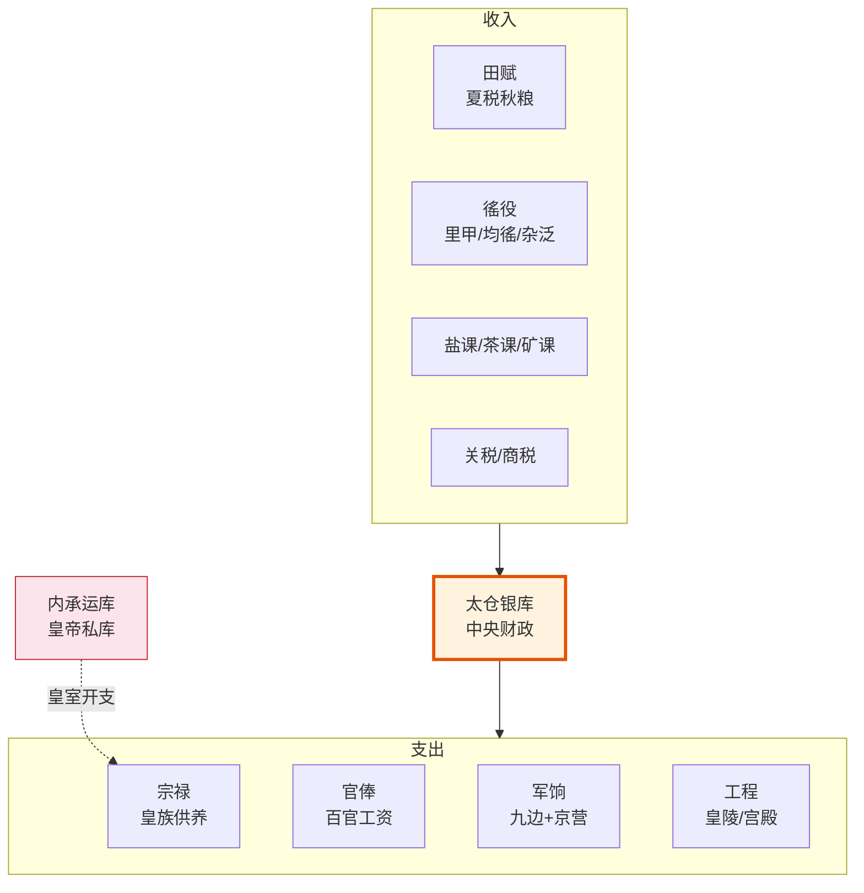

# 科举制度

## 明代科举的三级结构

明代科举是最核心的文官选拔机制，也是社会流动的最重要通道。三级考试层层筛选：

| 级别 | 考试名称 | 地点 | 通过者身份 | 说明 |
|:--|:--|:--|:--|:--|
| **第一级** | 院试（童试） | 各府/州/县 | 生员（秀才） | 获得参加乡试资格，也是最低级功名 |
| **第二级** | 乡试 | 各省城 | 举人 | 每三年一次（秋闱），录取率约1-3% |
| **第三级** | 会试 | 北京 | 贡士 | 乡试次年在京举行（春闱） |
| **最高级** | 殿试 | 皇宫 | 进士 | 皇帝亲自主持，只排名不淘汰 |

## 进士的三甲

殿试后分三甲：
- **一甲**（3人）：状元、榜眼、探花 → 直接入翰林院（修撰/编修）
- **二甲**（约60-80人）：赐进士出身 → 可考选庶吉士或分派六部主事
- **三甲**（约100-200人）：赐同进士出身 → 分派外地知县或六部科员

## 庶吉士的二次选拔

这是明代科举最精妙的设计（见[翰林院](../06-私人智囊/02-翰林院与格物学士.md)）：二、三甲进士中的最优秀者通过"馆选"进入翰林院做庶吉士，学习三年后"散馆"考核，最优秀者留翰林院，其余分派要职。庶吉士出身是通往内阁的必经之路——**"非进士不入翰林，非翰林不入内阁"**。

## 锁院与糊名

- **锁院**：考官从出题到阅卷结束被锁在贡院，与外界物理隔离
- **糊名**：考生姓名密封，防止阅卷官舞弊
- **誊录**：所有答卷由专人朱笔誊抄，考官只看到誊抄本，无法通过笔迹识别考生

这些制度保证了科举的相对公平——穷书生和富家子在答卷阶段处于同一起跑线（虽然富家子的教育资源优势在前端已经很大）。

## 科举考试内容：八股文的实际运作

明代科举的核心文体是**八股文（制义）**——不是"八股"字面上的八段论，而是一种极端形式化的议论文。题目全部来自《四书》《五经》（朱熹注本为标准答案），考生必须：

- **破题**（2句）：点明题目核心——最见功夫，破得好坏决定全文档次
- **承题**（3-4句）：承接破题，展开解释
- **起讲**：开始正式论述，用古人语气模拟
- **入题**：过渡到正文
- **起股/中股/后股/束股**：四段正文——每段必须有两股对偶长句（共八股，故名"八股"）。对偶必须字字对应
- **收结**：总结全文

在这个极端格式中，考官考察的不是知识面或创造性——而是**逻辑严密性**和**程朱理学理解力**。一个优秀八股文的作者，被假定为具备了处理行政文书的基本能力——能从复杂文本中提取核心（破题）、条分缕析（八股对仗）、以经典理论论证（引朱注）。

但这种极端形式化也带来致命的反效果：明末有大量进士能写出完美的八股文但完全不懂行政管理——因为八股文考试的技能和实际行政需要的技能几乎没有重叠。

## 科举的社会流动效应

科举确实是明代社会流动的最主要通道——但它的"公平"被严重夸大：

**确实流动的部分**：
- 约30-40%的进士来自"非官员家庭"（三代内无人做官）——这是一个显著的数字，说明科举确实让一些底层读书人进入了统治阶层
- 院试（秀才）级别覆盖面很广——每个县都有几十到上百个秀才，来自不同阶层

**实际上不流动的部分**：
- 要读完四书五经并会写八股文，首先需要5-10年的全日制教育——这就已经排除了需要儿童劳动力来维持生存的赤贫家庭
- 乡试（举人）的录取率约1-3%——需要极高的应试技巧，而应试技巧需要名师指导（名师只在大城市或富贵人家）
- 会试的竞争更加激烈——不仅考学问，还考体力和心理承受力（连考三场、每场三天、锁在贡院狭小号舍里）
- 所以整个流程筛选出的不是"最聪明的人"，而是"能负担得起长期脱产学习 + 有应试天赋 + 体力和心理过关"的人

用现代的话说——科举给底层人的是一个**概率机会**而不是一个**平等机会**。一个佃农的儿子能从院试→乡试→会试一路通关的概率极低，但确实有人做到了——这足以让整个社会"相信"科举是公平的。

## 科举体系的"第三通道"：监生与吏员

不是所有官员都来自进士。明代有两条"侧门"：
- **监生**：国子监的学生——可以经"监生入仕"直接获得低品级官职（多为教职或县丞）。部分监生靠"纳粟入监"（捐钱换监生资格）进入——本质上是买官的一个体面形式
- **吏员**：各衙门的办事人员（文职技工）——做满一定年限可参加"吏员考职"获得从九品起的最低级官员身份。但吏员出身的人几乎永远不能升到知县以上——"流品"的玻璃天花板

所以明代的官员体系是一个三层金字塔：顶层（进士）控制要津、中层（举人/贡生）填补府州县正官、底层（监生/吏员）做杂职和教职。三层的流动几乎不可逆——一个吏员出身的人无论多么能干，也不可能当上六部尚书。

## 科举的锁院机制详解

乡试和会试的"锁院"执行得极为严格：
- **入闱时间**：乡试八月初九、十二、十五共三场——考官八月初六入闱、阅卷完成后才得出闱（通常到九月初，全程近一个月）
- **与外界完全隔离**：贡院大门在入闱后以封条封闭，所有人员不得出入——食物和日用由专人轮流放置、不得与考官交谈
- **内帘与外帘的隔离**：内帘（阅卷官）和外帘（监考/收卷/誊录官）在闱内分居，不得往来——这是为了防止阅卷官知道某份试卷来自哪个考场
- **出闱后即时审核**：出闱当日，六科给事中到场监督——核对批卷数、考生数、成绩排名等基本数据的逻辑一致性

锁院+糊名+誊录三者构成一套**完整的匿名化流程**——从考生进考场到成绩出来，阅卷官不知道他看的卷子是谁写的、在哪个考场考的、答卷的人长什么样。在14-17世纪的世界范围内，这是一个非常先进的防舞弊体系。被舞弊破坏的不是这个体系的设计缺陷，而是执行这个体系的人（相关的案例在[大明律与祖宗成法](../03-监察链/04-大明律与祖宗成法.md)中有讨论）。

---

## 编排参考

编排系统中的多层次选拔机制直接受科举启发：
- "庶吉士馆选" → **动态人才池（馆阁选士）**：从执行 Agent 中选拔优秀者进入更高层级
- "锁院糊名" → **匿名反馈和弹劾**：反馈内容密封，防止人情干扰
- "进士三甲" → **考功册四等**：卓异(一甲)/称职(二甲)/平常(三甲)/不称职(淘汰)的等级体系
- "散馆" → **新兵见习期满考核**：庶吉士三年后散馆对应见习期满后的转正考核
- "非进士不入翰林" → **选锋标签的精英通道**：只有连续高过程质量分的 Agent 才能进入御马监或动态人才池
- "监生与吏员" → **多通道准入**：非选锋标签的 Agent 也可通过常规考核获得任务——但有上限（不能承担战略级任务）
- "八股文的逻辑训练" → **沙盘推演的标准化测试**：冷启动阶段用标准测试集评估Agent的逻辑严密性

科举体系给编排系统的核心启示：**选拔机制的设计目标不是"选出最好的人"，而是"让被选中的人被认为是最合适的人"**——前者是能力问题，后者是合法性问题。编排系统中的京察朝会答辩流程完全复刻了这一逻辑：考核结果不仅要做，还要公开展示、接受质疑、获得认同。
