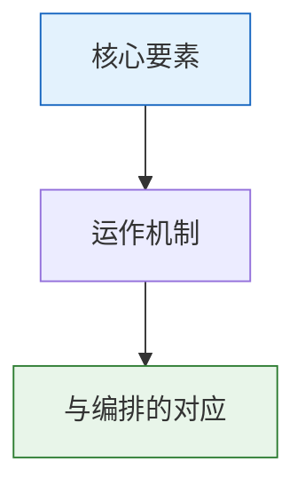

# 皇史宬与档案制度

## 皇史宬的定位

皇史宬是明代皇家档案馆，位于北京皇城内，建于嘉靖十三年（1534年）。它是中国现存最完整、最古老的皇家档案库建筑。它的核心职能只有一个：**永久保存国家最核心的原始档案，不可篡改、不可销毁**。

皇史宬存放的是"国家正本"——实录、圣训、玉牒（皇室家谱）、重要诏书的原始版本。这些文件在法律上被视为最终依据，任何副本如果与皇史宬的正本不符，以正本为准。

## 明代档案体系的分层

| 档案类型 | 存储位置 | 保管者 | 用途 |
|:--|:--|:--|:--|
| **原始奏章** | 内阁大库 → 定期移交皇史宬 | 内阁 + 通政司 | 决策溯源的第一手依据 |
| **批红记录** | 皇史宬 | 司礼监 | 所有皇帝决策的不可篡改记录 |
| **六部公文** | 各部架阁库（档案室） | 六部各司 | 日常行政档案 |
| **诏书正本** | 皇史宬 | 司礼监 | 法律效力的最终依据 |
| **考功册/京察记录** | 吏部 + 皇史宬副本 | 吏部考功司 | 官员考核的永久记录 |
| **诏狱案卷** | 锦衣卫北镇抚司 + 皇史宬副本 | 锦衣卫 | 案件审理全过程 |
| **度支奏销册** | 户部 + 皇史宬副本 | 户部度支司 | 财政审计依据 |

皇史宬的核心设计原则：**正本和副本分存、定期核查、任何人无权销毁已归档的记录**。

## 档籍的不可篡改

明代档案制度有两个关键保障：
1. **内容哈希的雏形**：重要文件的副本会经过多人独立校对，有"校对人签字画押"制度。一旦发现副本与正本不符，校对人和篡改者连坐
2. **分层存储**：原始奏章（第0层）永不销毁，内阁的摘要（贴黄）可以废弃但原件必须保存

## 什么人可以调阅档案

- 内阁大学士在票拟时可以调阅相关的历史奏章
- 审计部门（都察院）审查时凭批红可调阅相关档案
- 皇帝和司礼监可随时调阅任何档案
- 普通官员无权直接调阅皇史宬档案——这是信息权力的一种形式

---

## 编排参考

任事型编排系统中的**档籍 Agent**（皇史宬/档案库）完整复刻了这一制度：
- "第0层永不删" → 原始奏章的物理持久化与索引，对应皇史宬的永久保存
- "档籍 Agent 不参与决策" → 皇史宬只负责存储和检索，不参与实时任务决策
- "所有 Agent 日志归档" → 所有决策记录（批红/票拟/考功/诏狱/预算）全量归档
- "交互审核 Agent 持有索引，档籍 Agent 持有实体" → 索引和实体分离，防止单点篡改
- "保存版本历史" → 错误模式简报、白话诏书、规则修订票拟、灾备切换日志的历史版本全部留存

核心洞察：档籍（不可篡改日志）是整个编排系统**可审计性和确定性**的基础。没有档籍，事后审计就不可能——因为已经无法确定某个决策是谁在什么时间基于什么信息做出的。编排系统的"全局审计链"机制完全依赖档籍 Agent 的完整性保证。
