# 货币与金融体系

> 本文档从「演进时间轴」与「金融体系」两个维度梳理明代货币史。制度细节（宝钞设计、一条鞭法运作、白银货币化过程）见 [货币制度与白银货币化]()，本文不重复，聚焦于三币的兴衰脉络、货币层次结构与金融体系的萌芽。

**与 [货币制度与白银货币化]() 的分工**：后者按「制度」展开（宝钞怎么设计、一条鞭法怎么运作）；本文按「时间」与「金融」展开（三币如何此消彼长、货币背后长出了怎样的金融生态）。两文互补，可对照阅读。

**一句话论点**：明代货币史是一部「三种货币、三次失败」的历史——宝钞死于滥发、铜钱死于缺铜、白银死于外控。贯穿三者的共因，是朝廷始终把货币当财政工具，而非经济基础设施。

## 一、三币演进时间轴

明代货币体系不是某一次设计的产物——是三种货币在近三百年里此消彼长的演化结果。下图沿五个关键时段标注三币的命运转折：

```mermaid
flowchart LR
    subgraph HW["洪武 1368–1398"]
        H1["大明宝钞发行 1375<br/>禁民间用银"]
        H2["洪武通宝铸行"]
    end
    subgraph YL["永乐–宣德 1403–1435"]
        Y1["宝钞剧烈贬值<br/>1贯 → 200–300文"]
        Y2["白银民间暗流"]
    end
    subgraph CH["成化–弘治 1465–1505"]
        C1["宝钞名存实亡<br/>1贯 → 不足10文"]
        C2["白银成事实主币"]
    end
    subgraph WL["万历 1573–1620"]
        W1["一条鞭法 1581<br/>白银法定化"]
        W2["美洲白银大量流入"]
    end
    subgraph CZ["崇祯 1628–1644"]
        Z1["白银流入骤减<br/>通缩危机"]
        Z2["银荒·钱荒·钞废"]
    end
    HW --> YL --> CH --> WL --> CZ
    style H1 fill:#ffcdd2,stroke:#c62828
    style C1 fill:#d32f2f,color:#fff
    style W1 fill:#c8e6c9,stroke:#2e7d32
    style Z1 fill:#ffe0b2,stroke:#e65100
```

三条核心趋势：

- **宝钞**：单向贬值，从法定主币到「僵尸货币」，从未回升
- **白银**：从被禁止到事实主币再到法定货币，单向上升
- **铜钱**：始终在位但始终供给不足，夹在两极之间

---

## 二、三币兴衰

> 制度与机制详见 [货币制度与白银货币化]()。本节只讲兴衰脉络与关键数据。

先一张速查表概览三币的全貌：

| 货币 | 发行/来源 | 信任基础 | 结局 |
|:--|:--|:--|:--|
| **大明宝钞** | 朝廷（洪武 1375） | 朝廷信用（无准备金） | 僵尸货币·贬值 98%+ |
| **铜钱** | 官铸 + 民间私铸 | 铜料价值 + 官方铭文 | 供给不足·劣币泛滥 |
| **白银** | 民间流通 + 海外流入 | 银本身价值 | 法定主币·依赖进口 |

三者此消彼长，构成了明代不稳的「货币三脚架」——而每一只脚都有问题。

### 大明宝钞——信用货币的必然崩溃

洪武八年（1375）发行，是世界上最早的纯信用（无准备金）纸币实验之一，比欧洲早近三百年。

**崩塌轨迹**：

- 设计缺陷：无准备金、无兑换承诺、只发不收（征税主要收实物，宝钞回收渠道几乎不存在）
- 滥发轨迹：永乐间 1 贯 = 200–300 文（贬值 70%+）→ 宣德间 1 贯 = 10–20 文（贬值 98%+）→ 明中后期 1 贯 < 10 文
- 终局：名义上仍是法定货币（官员俸禄、钞关税仍以宝钞计），实际上市场完全拒收——**一个所有人都知道一钱不值的「僵尸货币」**

**核心教训**：无准备金、无回收机制的信用货币，发行权即贬值权。朝廷缺钱就印，信用必然透支到底。
**为何救不回来**：朝廷并非没有尝试挽救——宣德、正统年间曾多次「重钞」：加重宝钞关税、严惩拒收宝钞者、甚至规定某些交易必须用钞。但所有手段都只在需求端施压，从不在供给端收敛（继续印）。把废纸强塞给市场，市场只会躲得更彻底。加上宝钞防伪技术有限、伪造泛滥，信用崩塌叠加伪钞冲击，彻底回天乏术。

宝钞的失败不是「纸币」这种形态的失败，而是「无约束发行权」的失败——同样的纸币，若有准备金和回收机制，本可走通。

### 铜钱——供给失灵与私铸反噬

官方铸钱（洪武通宝 / 永乐通宝 / 嘉靖通宝等）始终供给不足：

- 铜矿匮乏，铸钱成本常高于面值（铜价 > 钱价时朝廷亏本，干脆不铸）
- 多位皇帝（永乐、宣德）铸钱极少，嘉靖、万历才恢复大规模铸行

**私铸泛滥**：官方供给缺口由民间私铸填补，质量参差——从接近官铸到薄如纸片。数十种质量不一的铜钱混流，交易成本极高。朝廷无法维持铸钱的质量与数量，市场遂整体转向白银。
**钱银比价的失控**：朝廷始终没有确立铜钱与白银的官方比价，两者在市场自由浮动。万历年间大致 1 两银 = 700–800 文，但随时波动、因地而异。每笔跨层交易都要现场议价——这等于把「汇率风险」转嫁给了每一次日常交易。

嘉靖、万历曾试图恢复大规模铸钱（嘉靖通宝、万历通宝），但好的官钱一出铸局就被民间收藏或熔毁取铜（铜料本身值钱）——格莱欣法则（劣币驱逐良币）反复上演，朝廷铸得越多，好钱越少。

### 白银——从禁令到法定的逆转

明代白银经历了最戏剧性的反转：

| 阶段 | 状态 |
|:--|:--|
| 洪武初 | 禁止民间用银（与宝钞强制推广配套） |
| 成化–弘治 | 民间事实主币（禁令形同虚设） |
| 万历九年（1581） | 一条鞭法——白银正式成为法定纳税货币 |

**白银来源**（详见 [货币制度与白银货币化]()）：

- 日本石见银山（经走私 / 倭寇贸易流入）
- 美洲白银（经马尼拉大帆船，中国成为世界白银的「终极归宿」）

**依赖风险**：明末海外白银流入骤减（日本锁国、马尼拉贸易萎缩）→ 全国性通缩 → 银贵谷贱 → 农民完税困难 → 经济危机与王朝危机叠加。一场**输入型货币危机**加速了王朝的终结。
**银两的形制与秤量**：白银本身也有内部层次，并非铁板一块：

| 形制 | 重量 | 用途 |
|:--|:--|:--|
| 元宝（银锭） | 约 50 两 | 大宗解运、国库入库 |
| 中锭 | 约 10 两 | 商贸大额 |
| 小锭 / 福珠 | 1–5 两 | 中等交易 |
| 碎银 | 不定 | 找零、小额 |

各地「平」（秤的标准）和「色」（成色标准）不一——京平、库平、市平、漕平各有差异。一笔银两从江南到北京，重量「缩水」是常态（因为换了一把秤）。这让白银虽是主币，却始终带着高昂的「计量摩擦」。

---

## 三、货币层次与流通结构

三币并非平行流通，而是按交易规模分层。各层之间**没有制度化的兑换机制**——这是明代货币体系最大的结构性缺陷。

| 交易规模 | 主用货币 | 性质 | 使用者 |
|:--|:--|:--|:--|
| 大额（跨省贸易、田产、纳税） | **银两**（tael） | 称量货币·需验色 | 官方、商人、大地主 |
| 中额（商铺、批发） | 银两 + 铜钱并用 | 双重折算 | 城市商铺、行商 |
| 日常（百姓柴米油盐） | **铜钱**（wen） | 计数货币 | 普通百姓 |
| 名义法定（覆盖全部） | **大明宝钞** | 僵尸货币·无人使用 | （仅官方账面） |

**关键断裂点**：银两（上层）与铜钱（下层）在市场上自由浮动，没有官方定价。每笔跨层交易都涉及「多少铜钱折多少白银」的双重计算——这是一项持续的、系统性的交易摩擦。上层（银）与下层（钱）各自运转，靠黑市汇率脆弱连接。

这种断裂的代价是双重的：宏观上，朝廷无法通过统一的货币政策调节经济（因为它管不住银钱比价）；微观上，每个百姓、每个商人都被迫成为「业余汇率交易员」，在每笔交易中承担折算风险。明代经济的「交易摩擦税」由此渗透进每一层商业活动。

---

## 四、金融体系的萌芽

明代没有现代意义的金融体系，但已出现若干「金融化」现象。这些是理解「货币如何影响实体经济」的关键——也是 [货币制度与白银货币化]() 未展开的部分。

### 银两平色与验银

银两是**称量货币**——没有统一成色标准。各地银两纯度不同（纹银、松江银、十足银……），每次大额交易都需「验银」：辨成色、称重量、折算平色。这是一项持续的交易摩擦，催生了专门的「银匠 / 钱店」做鉴定与折算中介。**没有标准化的计量单位，每次交易都附带一次「评估成本」。**

### 火耗的金融化

地方官征收碎银、熔铸成官锭时号称有「火耗」（熔炼损耗），实际加收 10%–30% 甚至更多。火耗本是技术性损耗，却演变为地方官的**灰色收入工具**——一种自下而上的、非正规的「地方铸币税」。它不在朝廷账面，却真实地从民间抽取财富。（财政制度维度的火耗见 [户部与财政制度]()）

### 钱庄与银票的萌芽

明中后期出现「钱庄」「钱铺」——从事银钱兑换、代保管、异地汇兑的雏形机构。它们发行的「会票 / 银票」是民间自发创造的**信用工具**，部分替代了官方法定信用的失败（宝钞）。这是「**官方法定信用破产 → 民间信用自发填补**」的经典案例：当宝钞变成废纸，市场没有坐以待毙，而是自己长出了信用替代品。

值得注意的是，这些「萌芽」几乎全是**民间自发**的——朝廷在金融领域几乎是缺位的。这与货币领域的「朝廷强干预却失败」形成讽刺对照：朝廷管得最死的地方（宝钞）败得最惨，朝廷不管的地方（钱庄、会票）反而长出了真正的金融功能。

### 国际白银平衡

一条鞭法后，明代经济的货币供给高度依赖海外白银的**净流入**。这构成了一个外部依赖型货币体系：美洲银矿（西班牙开采）→ 马尼拉大帆船 → 中国（以商品换白银）；同时日本石见银山 → 走私 / 倭寇贸易 → 中国。当输入端任何一环萎缩——美洲产银波动、日本锁国、马尼拉贸易中断——输出端就是全国性通缩。**明末的崩溃，部分正是一场输入型货币危机**：不是没钱，而是作为货币的白银流不动了。

### 典当业与高利贷

明中后期典当业（当铺）遍布城乡，是普通百姓最重要的「信贷」来源——也是高利贷的温床。农民青黄不接时典当衣物农具借银，秋后赎回，月息常达 2%–3%（年化 30%+）。破产农民的土地大量流入地主与当铺手中，**货币化加剧了土地兼并**。

### 商人网络的信用

徽商、晋商等大商帮在跨省贸易中发展出基于宗族与同乡的信用网络——「会票」可在异地商号兑付，相当于民间汇兑系统。这套系统完全独立于朝廷，运作效率甚至高于官方法定信用。**当官方金融缺位，商业社会自建了一套影子金融。**

---

## 五、三币失败的共因

三种货币各自失败，但失败有共同的根因——这是明代货币史最值得记取的系统性教训：

- **信用与权力绑定**：宝钞靠皇权强制、铜钱靠官铸垄断、白银虽民间流通但其法定化靠朝廷。货币信用始终依附于政治权力，没有独立的信用发行机构（如独立央行）。一旦政治信用动摇，货币体系整体动摇
- **货币与财政不分**：朝廷把货币当成财政工具（印宝钞充军饷、用银两征税），而不是当成公共基础设施。货币服从财政需要，而非服务于经济流通
- **供给端全部失灵**：宝钞滥发（供给过剩）、铜钱铸不足（供给短缺）、白银靠进口（供给外控）。三种货币没有一种实现了稳定的内生供给
- **拒绝制度学习**：宝钞崩了不 reform 只硬撑，铜钱私铸泛滥不整顿，白银依赖进口不建储备。制度失败被「将就」过去，直到累积成系统性危机

**一句话总结**：明代的悲剧不是某一种货币不行，而是**没有任何一种货币被正确地治理过**。

---

## 六、编排参考

明代货币与金融体系对编排系统的启发（与 [货币制度与白银货币化]() 的编排参考互补，此处聚焦「演进」与「金融」两个新角度）：

- **「三币分层但无兑换机制」→ 多层资源抽象的断裂风险**：编排系统若设多层资源（Token 大额调度 / API 调用小额计量 / 存储计量），各层之间必须有**制度化的折算通道**。明代银钱断裂导致每笔交易双重计算——编排系统若层间无汇率，调度成本会指数膨胀。**层间汇率必须显式、可查、可审计，不能让两层各自黑市浮动**

- **「宝钞单向贬值从不回升」→ 信用资源的不可逆衰减**：宝钞一旦失信，朝廷再怎么「强制使用」也救不回来——信用是单调递减的。编排系统中的「信用额度」「优先级权重」一旦因超发或滥用而贬值，几乎无法重建。**信用类资源必须设硬上限和单向熔断，不能像宝钞那样「只发不收」——衰减不可逆，预防胜于补救**

- **「火耗金融化」→ 中间层的隐性抽成**：火耗不在朝廷账面，却真实抽走民间财富。编排系统的中间层（路由 Agent / 调度器 / 代理层）在转发资源时也可能产生「隐性火耗」——多算一点延迟、多报一点消耗、截留一点配额。**中间层资源损耗必须有独立审计，不能由中间层自己报数——自查自报等于火耗合法化**

- **「钱庄银票填补宝钞失败」→ 官方信用失败时民间信用的自发出现**：当官方法定信用（宝钞）破产，民间自发创造出会票 / 银票替代。编排系统中，当官方预算 / 优先级机制失灵时，Agent 之间也会自发形成「灰色信用」（互相欠账、私下调度、绕过配额）。这既是韧性也是失控源——**要么修复官方机制，要么把民间信用纳入可观测范围，不能装作不存在**

- **「明末输入型通缩」→ 外部资源依赖的断流危机**：明经济靠海外白银续命，输入一断全线通缩。编排系统若依赖外部资源（人工审核、外部 API、云配额、外部模型），必须监测「净流入」指标并设断流预警。**外部依赖不是「有就行」，要监控流入速率的异常下降——明末的教训是等到危机显现时已无法挽回**

- **「银两平色不一·每笔交易都要验银」→ 无标准计量单位的评估成本**：明代银两成色、秤量各地不同，每次交易附带「评估成本」。编排系统中若资源 / 任务的「度量单位」不统一（不同 Agent 对「复杂度」「成本」「优先级」的定义不同），每次跨 Agent 协作都要现场「验银」——重新对齐口径、折算标准。**统一的度量单位是基础设施，不是锦上添花——没有它，协作成本会渗透进每一次交互**

---

> 本文与 [货币制度与白银货币化]() 互补：后者侧重制度设计与白银货币化过程，本文侧重演进脉络、货币层次与金融体系萌芽。财政制度整体见 [户部与财政制度]()，盐引作为准货币见 [盐法漕运马政]()，太仓库（白银国库）见 [太仓库与内承运库]()。
