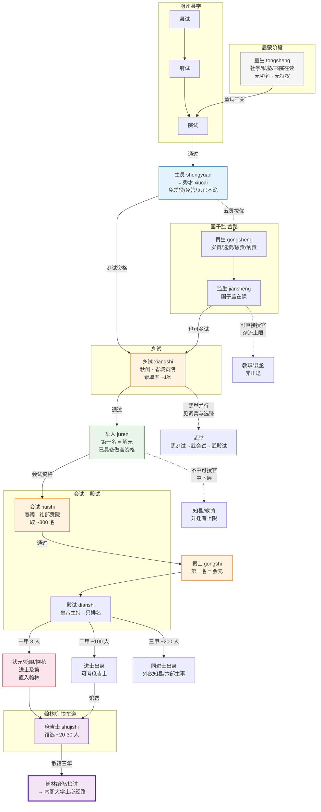

# 科举制度完整流程

> 📍 返回 [README](../00-总览/README.md) · [按编排模式反查](../99-附录/04-按编排模式反查.md)
> 🔗 相关主题：童试 · 乡试 · 会试 · 殿试 · 庶吉士 · 贡生 · 国子监

**与 [科举制度]() 的分工**：后者按「制度切片」展开——八股文文体、锁院糊名防舞弊、社会流动效应、监生吏员侧门。本文按「流程」展开——一个读书人从蒙学走到翰林院，要经过哪些关卡、每关刷掉多少人、走了哪条岔路。两文互补，可对照阅读。翰林院庶吉士的精英培养细节见 [翰林院与格物学士](../06-私人智囊/02-翰林院与格物学士.md)，本文不重复。

**一句话论点**：明代科举不是一场考试，而是一条**六阶段漏斗**——从蒙学童生到翰林庶吉士，每阶段筛选率约 1%–10%，整条管道的端到端通过率低于万分之一。漏斗的每一级都有特权跃升和岔路分流，使得「未通过者」也有制度化的出路（生员特权、贡生入监、举人授官），不至于全部沉淀为失败者。

---

## 一、人才漏斗总览

下图是从蒙学到翰林的完整管道。实线为主航道（童试→乡试→会试→殿试→翰林），虚线为岔路（贡生入监、武举并行、吏员侧门）。每段标注典型通过率和身份跃升。

---

## 二、启蒙阶段：童生

进入科举管道的入口不是考试，而是**教育**。明代基础教育有三类载体：

| 载体 | 性质 | 学生来源 | 教学内容 |
|:--|:--|:--|:--|
| **社学**（shexue） | 官办社区学校，朱元璋洪武年间强推每里设一所 | 农家子弟、平民 | 《百家姓》《千字文》、四书入门 |
| **私塾**（sishu） | 家庭或宗族延师自办 | 中等家境以上 | 四书五经、八股文基础 |
| **书院**（shuyuan） | 民间学术机构（如东林、白鹿洞） | 有志深造者 | 经义辩论、理学探讨，不限科举 |

在读学生统称**童生（tongsheng）**——「童」取「初学」之意，不限于儿童，四五十岁仍考不过院试的也唤作童生。童生没有任何官方身份，不享特权，是管道中人数最多、最无名的一群人。

**启蒙的隐性门槛**：脱产读书 5–10 年方能应付童试，这已将需要儿童劳动力的赤贫家庭排除在外（见 [科举制度]()「社会流动效应」节）。管道的「公平性」从入口就已打折。

---

## 三、童试与生员

童试不是一场考试，而是**三连考**——县试、府试、院试，逐级淘汰：

| 关卡 | 主持者 | 地点 | 淘汰强度 |
|:--|:--|:--|:--|
| **县试**（xianshi） | 知县 | 本县 | 初筛，约取前 10%–20% |
| **府试**（fushi） | 知府 | 本府 | 再筛，约取前 30%–50% |
| **院试**（yuanshi） | 提学官（省教育厅长） | 省内巡回 | 定终，通过即获「生员」身份 |

通过院试 = **生员（shengyuan）** = 俗称**秀才（xiucai）**。这是科举管道的**第一身份跃升**——从「什么都不是」变成「有功名的人」。

### 生员三等

生员不是铁板一块，按待遇分三等：

| 等级 | 名称 | 名额 | 待遇 |
|:--|:--|:--|:--|
| 一等 | **廪生**（linsheng） | 每县约 20 名 | 官府发廪米（粮食津贴），称「廪膳生」 |
| 二等 | **增生**（zengsheng） | 廪生名额之外扩招 | 无廪米，但在学籍 |
| 三等 | **附生**（fusheng） | 附加录取 | 无廪米、无定额，最底层 |

生员的等级不是固定的——岁考（年度考核）成绩好的附生可升增生、增生可补廪生缺；成绩差的逐级降等甚至革退。这构成了一个**生员内部的小型漏斗**。

### 生员特权

成为生员后即刻获得三项特权，使其在社会地位上与平民拉开差距：

1. **免差役**——不服徭役（明代徭役沉重，这是实打实的经济利益）
2. **免笞刑**——不受笞杖（犯轻罪由学校内部处分，不交衙门打板子）
3. **见知县不跪**——平民见官必须跪，生员可以长揖代跪

这三项特权使生员成为乡间的**特权阶层**——即使终生考不中举人，秀才身份已足以受人尊敬、参与地方事务。这就是管道「未通过者也有出路」的第一层缓冲。

---

## 四、国子监：贡生通道

并非所有读书人都走童试→乡试的主航道。**国子监（Guozijian，帝国大学）**提供了另一条通道——通过「贡生」身份直接入监读书，毕业后可参加科举或直接选官。国子监的详细制度见 [国子监与钦天监]()，本文只梳理其作为管道岔路的角色。

### 贡生的四类来源

| 类型 | 名称 | 选拔方式 | 地位 |
|:--|:--|:--|:--|
| **岁贡**（suigong） | 岁贡生 | 各府州县学按定额（通常每 1–2 年 1 名）从廪生中按资历挨次选拔 | 最正规，人数最稳定 |
| **选贡**（xuangong） | 选贡生 | 不按资历，考试择优选拔 | 质量高于岁贡 |
| **恩贡**（engong） | 恩贡生 | 皇帝登基、万寿等喜庆特恩增加名额 | 政治恩赐性质 |
| **纳贡**（nagong） | 纳贡生 | 灾荒年纳米粟换取入学资格 | 最受歧视，实质是「体面的买官」 |

四类贡生入国子监后统称**监生（jiansheng）**，在监读书 4–10 年。

### 监生的两条出路

- **正途**：从监生参加乡试，走科举主航道——但起点已比生员晚
- **捷径**：直接「监生入仕」授低品级官职（多为教职或县丞），**被视为「杂流」非「正途」**，升迁上限远低于进士

这条岔路的意义在于：**给科举主航道上的落榜者一个兜底**——考不中举人的秀才，可以走贡生通道获得做官资格，虽然起点低、天花板低，但总比什么都没有强。

---

## 五、乡试：举人

乡试是科举管道的**第一道国家级关卡**，也是淘汰率最高的一关。

| 维度 | 内容 |
|:--|:--|
| **周期** | 三年一次（子卯午酉年） |
| **时间** | 八月，称**秋闱**（qiuwei） |
| **地点** | 各省城**贡院**（gongyuan） |
| **考官** | 皇帝钦派（主考 + 副主考），通常出自翰林院或六科 |
| **场次** | 三场，每场三天，考生锁在号舍内 |
| **录取** | 每省约 30–100 名，视省份大小而定；**录取率约 1%** |
| **头名** | 第一名称**解元**（jieyuan） |

通过乡试 = **举人（juren）**。这是管道的**第二身份跃升**——举人已具备做官资格，即使会试不中，也可被授以知县、教谕等中下层官职。这就是「穷秀才中举」之所以是民间故事的固定母题——中举意味着阶级跨越的完成，而非开始。

**乡试的残酷性**：每省三年只取几十人，而应试者常达数千。一个生员可能考十次（30 年）都考不中举人，终身停留在秀才身份。这就是为什么「范进中举」会疯——不是夸张，是真实的心理冲击。

---

## 六、会试与殿试：贡士与进士

### 会试

乡试**次年在京城举行**，称**春闱**（chunwei）。

| 维度 | 内容 |
|:--|:--|
| **时间** | 二月/三月（乡试次春） |
| **地点** | 北京礼部贡院 |
| **考官** | 礼部主持，皇帝钦派总裁 |
| **场次** | 三场，与乡试同结构但难度更高 |
| **录取** | 约 300 名（全国），**录取率约 10%**（相对乡试已高很多） |
| **头名** | 第一名称**会元**（huiyuan） |

通过会试 = **贡士（gongshi）**。注意「贡士」与国子监的「贡生」是**完全不同的概念**——贡生是入监读书的学生身份，贡士是通过国家级考试的准进士。

### 殿试

殿试是管道的**最后一关**，也是唯一不淘汰人的一关——到这一步的都是进士。

| 维度 | 内容 |
|:--|:--|
| **主持** | 皇帝（名义上亲自出题、阅卷，实际由翰林院代办） |
| **地点** | 皇宫奉天殿 |
| **性质** | **只排名次，不淘汰**——会试通过者全部获进士身份 |
| **内容** | 策论一道（时务题，非经义） |

殿试将全部贡士分为**三甲**：

| 甲次 | 人数 | 赐 | 身份称号 | 前三名特称 |
|:--|:--|:--|:--|:--|
| **一甲** | 3 人 | 进士及第 | — | **状元**（第一名）/ **榜眼**（第二名）/ **探花**（第三名） |
| **二甲** | 约 60–100 人 | 进士出身 | — | 第一名特称「传胪」 |
| **三甲** | 约 100–200 人 | 同进士出身 | — | — |

一甲三人**直接授翰林院官职**：状元授修撰（从六品），榜眼、探花授编修（正七品）。二甲、三甲进士则需另走「馆选」考庶吉士，或直接分派六部主事、外地知县。

**殿试不淘汰的设计意图**：让皇帝对最终的「天子门生」有直接恩典——所有人都是皇帝钦点的，不经过任何中间机构。这使进士群体对皇帝有直接的「师生」忠诚，是皇权控制文官的纽带。

---

## 七、翰林院：精英快车道

殿试后的二甲、三甲进士中，最优秀的一批通过**馆选**（guanxuan）进入翰林院做**庶吉士（shujishi）**——这是管道的**精英支线**，也是通往内阁的必经之路。

| 阶段 | 内容 | 时长 |
|:--|:--|:--|
| **馆选** | 翰林院从二、三甲进士中考试选拔约 20–30 人 | 殿试后不久 |
| **在馆学习** | 国史、典章、公文写作、经义辩论，由资深翰林学士指导 | 3 年 |
| **散馆**（sanguan） | 期满考核，最优者留翰林院做编修/检讨，其余分派六部、科道 | — |

庶吉士制度的详细运作（为什么是「非翰林不入内阁」的精英加速器）见 [翰林院与格物学士](../06-私人智囊/02-翰林院与格物学士.md) 第「庶吉士制度」「馆阁选士」节，本文不重复。

**管道的终局分化**：

| 出身 | 典型仕途上限 | 占进士比例 |
|:--|:--|:--|
| 庶吉士 → 翰林 → 内阁 | 内阁大学士（宰相级） | ~10% |
| 一甲 → 翰林 | 侍郎、尚书（部级） | <1% |
| 二甲 → 六部主事 | 郎中、知府（司局级） | ~30% |
| 三甲 → 外放知县 | 知府、布政使（地厅级） | ~60% |

同一批进士，因为殿试名次和是否入选庶吉士，仕途天花板可以差出三四个品级。管道在此完成了最后的分流——**不是选谁最好，而是选谁有资格进入下一个更慢更长的筛选**。

---

## 八、武举：并行轨道

明代另有一条**武举**（wuju）管道，与文举并行但地位较低：

- **武乡试** → **武会试** → **武殿试**，结构对仗文举
- 武举考**弓马武艺** + **兵法策论**，文武双考
- 武进士授官限于**武职系统**（参将、游击、千总等），不可入文官系统
- 社会地位远低于文进士——明代「重文轻武」，武进士被视为「粗人」

武举的军事人才选拔机制与选锋标签的对应关系，见 [调兵与选锋](../02-执行链/军事执行/10-调兵与选锋.md)。武举与文举的**核心差异**：文举的终点是内阁（决策权），武举的终点是总兵（执行权），武将受文臣节制——这是明代「以文制武」原则在人才管道上的投射。

---

## 九、管道的岔路与回流

科举管道不是单线漏斗，而是有多条**岔路**和**回流**：

| 岔路类型 | 路径 | 说明 |
|:--|:--|:--|
| **贡生岔路** | 生员 → 贡生 → 监生 → 直接选官 | 绕过乡试，但天花板低 |
| **举人回流** | 举人 → 不中会试 → 直接授知县/教谕 | 举人已有做官资格，会试不是必经 |
| **纳贡侧门** | 富民 → 纳米粟 → 监生 → 杂流官 | 灾荒年开，实质是买官 |
| **吏员侧门** | 衙门书吏 → 考职 → 从九品官 | 天花板极低，几乎不可升知县 |
| **武举并行** | 童生 → 武童试 → 武乡试 → 武进士 | 文武分轨，不可交叉 |

这些岔路使管道不是「要么通关要么出局」的二元系统——每级都有「降级出路」。秀才考不中举人可走贡生，举人考不中进士可做知县，这保证了**管道的容错性**：不会因为一次失败就让十年寒窗完全白费。代价是**天花板固化**——岔路出身的人几乎不可能回到主航道，阶层流动是单向的（见 [科举制度]()「三层金字塔」节）。

---

## 编排参考

科举完整流程给 wuwo 多 Agent 编排系统提供了「人才漏斗管道」的完整原型：

1. **「童试三关逐级淘汰」→ 多阶段漏斗筛选**：编排系统从候选 Agent 池到执行 Agent 到选锋标签，不是一次评估定终身，而是多级筛选——每级淘汰差者、保留优者。对应科举的县试→府试→院试→乡试→会试→殿试六级漏斗，每级筛选率约 1%–10%。

2. **「生员三等 + 特权跃升」→ 分层激励而非二元淘汰**：管道不给落选者「零分」，而是给「部分身份」——生员三等（廪生/增生/附生）对应编排系统中的分级权重（选锋/常规/观察期），让每个层级都有可见的激励和升级路径，而非「通过/淘汰」的粗暴二元。

3. **「贡生岔路 + 举人回流」→ 容错管道设计**：编排系统中 Agent 失败某一关后不应直接废黜，而应有「降级出路」——常规 Agent 池、后备池、专项任务池。正如举人可做知县、贡生可直接选官，编排系统的 Agent 在主航道失败后仍可在支线发挥价值，避免人才浪费。

4. **「殿试只排名不淘汰 + 皇帝恩典」→ 终审只定序不淘汰**：编排系统的最高决策层（帝皇/总控）对已通过前置筛选的 Agent 只做排序分配，不做二次淘汰——保证决策的权威性（天子门生）同时不浪费前置筛选的投入。

5. **「庶吉士精英快车道」→ 选锋标签的加速通道**：见 [翰林院与格物学士](../06-私人智囊/02-翰林院与格物学士.md)，从普通进士中选 20–30 人进入 3 年精英培养——对应编排系统的选锋标签从执行 Agent 中选拔后进入御马监/动态人才池的加速通道。

6. **「武举并行但天花板固化」→ 专用通道与通用通道的隔离**：武举与文举并行但不可交叉、武进士天花板低于文进士——对应编排系统中「专项任务 Agent」与「通用任务 Agent」的分类：专项 Agent 在特定领域可达到极高胜率，但不可跨领域调用至战略级决策，防止能力错配。

**核心洞察**：科举管道的设计智慧不在于「选出最优秀的人」，而在于**让每一级的参与者都觉得参与是值得的**——秀才有特权、举人可做官、贡生有出路、进士分三甲。一个让 99% 参与者都觉得自己「赚了」的漏斗，才能维持数百年的运转而不崩。编排系统的 Agent 评估体系也应如此：不是只奖励顶尖 1%，而是让每个层级的 Agent 都有明确的升级路径和可见激励，才能维持整个 Agent 池的活跃度和进化动力。
