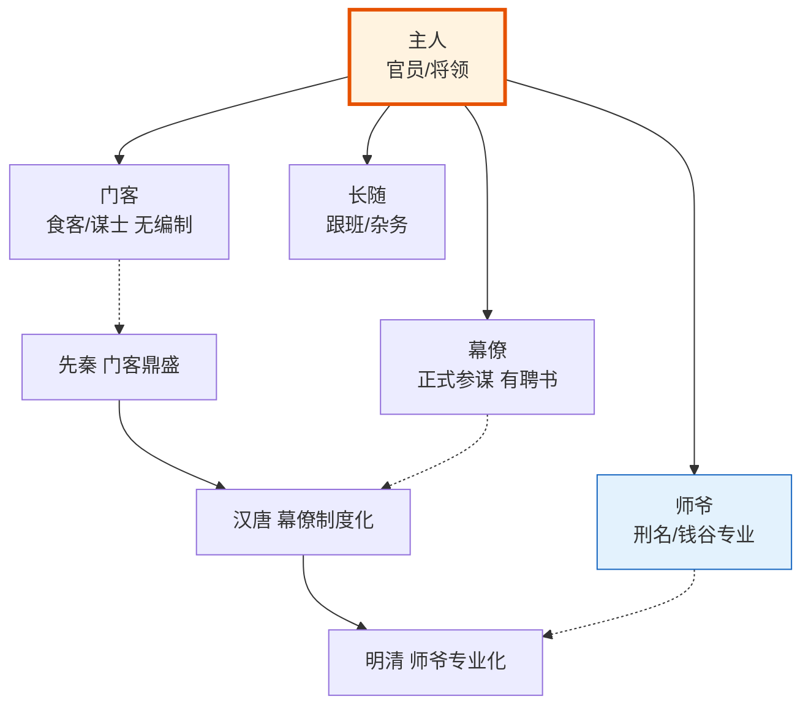

# 门客幕僚与师爷传统

> 本文记录谋士型编排系统的明代（及前代）历史原型。门客、幕僚、师爷、智囊——这些角色在明代虽非正式官职，但构成了**正式官僚体制之外的私人智囊体系**，与朝廷命官体系平行运作。




## 为什么需要单独记录

明代的正式官制（六部五寺都察院）解决的是"公共事务的执行"问题。但官员个人面对复杂决策时，往往需要**私人智囊**——这些人不是朝廷命官，不领俸禄（或由官员私人支付），但深度参与决策。

这一私人智囊体系在明代有三种主要形态：
1. **门客**（战国传统的余绪）
2. **幕僚/师爷**（明清最盛行的私人助手体系）
3. **智囊**（综合性谋士概念）

> 消歧注：门客（Menke）≠ 幕僚（Muliao）≠ 师爷（Shiye）
> 区分依据：门客偏向"创意发散型谋士"，幕僚偏向"执行落地型助手"，师爷偏向"专业职能型顾问"。三者有历史演变关系但职能定位不同。

---

## 一、门客传统

### 起源：战国养士之风

门客传统的源头在**战国四公子**——齐国孟尝君、赵国平原君、魏国信陵君、楚国春申君。他们各自养士数千，门客成为一支独立的政治力量。

**门客的核心特征**：
- **无正式官职**——不是朝廷任命，是贵族私人供养
- **无固定职责**——平时寄食，有事时献策或执行特殊任务
- **来去自由**——门客可以随时离开投奔他人（"良禽择木而栖"）
- **能力多样**——既有鸡鸣狗盗之徒，也有冯驩这样的战略家

### 门客的典型职能

| 职能 | 说明 | 历史案例 |
|:--|:--|:--|
| **献策建言** | 为主人提供策略建议 | 冯驩为孟尝君"焚券市义" |
| **执行特殊任务** | 完成主人不便出面的事 | 孟尝君靠鸡鸣狗盗门客逃出秦国 |
| **充当刺客/说客** | 暗杀或游说敌方 | 荆轲（燕太子丹的门客）刺秦王 |
| **壮大门第声势** | 门客数量本身是政治资本 | 四公子以门客众多闻名诸侯 |
| **危机时刻的死士** | 主人遇难时拼死相救 | 信陵君门客侯嬴、朱亥窃符救赵 |

### 门客传统的演变

**战国**：门客的黄金时代，四公子养士数千
**汉代**：门客传统延续但式微，梁孝王、淮南王仍有门客
**魏晋南北朝**：门客演变为"部曲"（私人武装）和"清客"（清谈之士）
**唐宋**：门客传统基本消失，被"幕僚"（正式的幕职）取代
**明清**：门客传统在形式上已不主流，但**精神内核被幕僚/师爷体系继承**

### 明清时期的"门客"残留

虽然明清的主流是"幕僚/师爷"，但"门客"一词仍在特定场合使用：
- **权臣的清客**：严嵩、徐阶等内阁首辅身边有一批"门客"，主要作用是写文章、出主意、壮声势
- **王公贵族的食客**：藩王和勋贵家中仍有寄食的门客，但已无战国时期的政治影响力
- **文人雅集的"客"**：江南文人圈子中的"食客"更多是文化交流，而非政治智囊

### 门客的失败模式

| # | 失败 | 原因 | 后果 |
|:--|:--|:--|:--|
| 1 | **门客误主** | 门客为主人谋私利而非主人利益 | 吕不韦门客嫪毐之乱 |
| 2 | **门客叛主** | 利益冲突时门客反咬 | 战国时期常见 |
| 3 | **门客滥竽充数** | 混吃混喝无真才实学 | "滥竽充数"典故 |
| 4 | **主亡客散** | 主人失势后门客立即四散 | "树倒猢狲散" |

---

## 二、幕僚与师爷传统

### 明清师爷文化的兴起

明清两代，**师爷**（又称"幕友""幕宾""西席"）成为官员的标配。一个知县上任，通常会自费聘请 3-5 位师爷协助处理政务。

**为什么需要师爷**：
1. **科举出身的官员不懂实务**——科举考的是八股文，不是法律、会计、公文
2. **官员回避制度**——官员不能在原籍任职，到陌生地方需要当地人脉和知识
3. **任期短暂**——知县平均任期 2-3 年，刚熟悉情况就调走，需要师爷保持连续性
4. **正式吏胥不可信**——衙门里的"书吏"是本地人，容易形成利益集团欺上瞒下

### 师爷的典型分类

明清师爷有明确的分工，最常见的六类：

| 师爷类型 | 简称 | 职能 | 师爷对应编排角色 |
|:--|:--|:--|:--|
| **刑名师爷** | 刑名 | 法律审判、刑事案件、司法程序 | 合规师爷 |
| **钱谷师爷** | 钱谷 | 赋税征收、户籍田土、财政账目 | 钱粮师爷 |
| **书启师爷** | 书启 | 公文起草、书信往来、对外沟通 | 文案师爷 |
| **账房师爷** | 账房 | 财务记账、银钱出纳、收支核算 | （钱粮师爷的细分） |
| **征比师爷** | 征比 | 催征赋税、比较排名（征比） | （钱粮师爷的细分） |
| **阅卷师爷** | 阅卷 | 学政考试时协助阅卷 | （文案师爷的细分） |

此外还有**挂号师爷**（管公文登记分类）、**朱墨师爷**（管红黑两色公文抄写）等更细的分工。

### 师爷的工作方式

**师爷不是官，是"宾"**：
- 官员称师爷为"先生"或"老夫子"
- 师爷称官员为"东翁"或"东家"
- 师爷不领朝廷俸禄，由官员私人支付"脩金"（束脩）
- 师爷住在衙门内的"幕馆"或官员的私人宅邸

**师爷的实际权力**：
- 虽然名义上是"助手"，但实际上**主导具体事务**
- 刑名师爷实际上决定案件怎么判（官员不懂法律，只能听师爷的）
- 钱谷师爷实际上决定赋税怎么收（官员不懂账目）
- 这种"名义助手、实际决策"的状态是明清师爷文化的核心

### 绍兴师爷现象

明清时期，**浙江绍兴**出产的师爷遍布天下——"无绍不成衙"。

**为什么是绍兴**：
1. **文化传统**——绍兴文风鼎盛，但科举名额有限，大量读书人考不上进士
2. **地少人多**——绍兴人口密集而土地不足，读书人必须外出谋生
3. **传承体系**——师爷职业在绍兴形成师徒传承，法律、账务等专业知识代代相传
4. **同乡网络**——绍兴师爷互相介绍工作，形成全国性的人脉网络

**绍兴师爷的影响**：
- 实际上形成了一个"影子官僚体系"
- 绍兴师爷之间通过同乡关系互相通气
- 一些重大政策实际上受绍兴师爷群体的影响

### 师爷的失败模式

| # | 失败 | 原因 | 后果 |
|:--|:--|:--|:--|
| 1 | **师爷擅权** | 官员完全依赖师爷，被师爷架空 | 实际统治者变成师爷 |
| 2 | **师爷贪腐** | 师爷利用职务之便收受贿赂 | "衙门八字开，有理无钱莫进来" |
| 3 | **师爷与吏胥勾结** | 师爷（外人）与书吏（本地人）合谋 | 共同欺瞒官员 |
| 4 | **师爷传承断代** | 老师爷退休，新师爷接不上 | 专业能力下降 |
| 5 | **官员与师爷失和** | 官员试图摆脱师爷控制 | 师爷带走关键信息和人脉 |

---

## 三、总办与调度角色

### "总办"在明清的形态

明清官方事务中，**总办**（又称"总管""总理"）是负责统筹调度的角色：
- **衙门总办**：衙门内部负责统筹各房（吏、户、礼、兵、刑、工六房）的总管
- **差使总办**：重大工程或事件（如皇太后丧礼、河工、赈灾）时设总办统筹
- **局所总办**：晚清新式机构（如机器局、船政局的"总办"）

总办的核心价值是**跨职能协调**——把不同专业的人（师爷、书吏、工匠）组织起来完成一件事。

### 调度的关键能力

| 能力 | 说明 |
|:--|:--|
| **任务拆分** | 把整体任务拆分成可分配的子任务 |
| **人员匹配** | 根据子任务性质分给最合适的人 |
| **冲突调解** | 不同职能人员之间出现冲突时调解 |
| **进度追踪** | 跟踪各子任务进度，及时发现阻塞 |
| **向上汇报** | 向官员汇报整体进展和问题 |

---

## 四、智囊传统

### "智囊"一词的来源

"智囊"一词最早见于《史记》——秦始皇的丞相吕不韦被称为"智囊"。指的是**能为君主提供高质量决策建议的人**。

**智囊与门客、师爷的区别**：
- **门客**：寄食型，来去自由，能力参差
- **师爷**：专业型，长期合同，分工明确
- **智囊**：综合型，与决策者关系最紧密，提供战略级建议

### 明代的"智囊"形态

明代虽无"智囊"的正式官职，但实际存在：
- **内阁大学士**：本质上就是皇帝的智囊团
- **翰林学士**：皇帝的知识型智囊
- **司礼监太监**：皇帝的贴身智囊（虽然名义上是奴仆）
- **私人顾问**：皇帝有时会信任某个道士（如嘉靖与陶仲文）、某个方士，这相当于"非正式智囊"

### 智囊的失败模式

| # | 失败 | 原因 | 后果 |
|:--|:--|:--|:--|
| 1 | **智囊干政** | 智囊越位，从"建议"变成"决策" | 严嵩专权（皇帝的智囊变成了权臣） |
| 2 | **智囊蒙蔽** | 智囊控制信息流，让决策者看不到真相 | 明末东林党与阉党互斗 |
| 3 | **智囊腐化** | 智囊利用接近权力中心的优势谋私 | 各类贪腐案 |
| 4 | **智囊失和** | 多个智囊之间争权 | 内阁首辅与次辅之争 |

---

## 五、谋士传统的演变脉络

从春秋到明清，谋士角色经历了清晰的演变：

```
春秋战国：门客黄金时代
    ↓
秦汉：门客式微，谋士职业化（张良、陈平）
    ↓
魏晋南北朝：部曲、清客、门阀智囊
    ↓
唐宋：幕僚制度正式化（节度使幕府、州县幕职）
    ↓
明清：师爷文化鼎盛（绍兴师爷）
    ↓
晚清：幕僚演化（曾国藩幕府、李鸿章幕府）
```

### 各时期特征对比

| 时期 | 主流形态 | 与官员关系 | 报酬方式 | 政治影响力 |
|:--|:--|:--|:--|:--|
| **战国** | 门客 | 寄食依附 | 主人供养 | 极大（左右诸侯决策） |
| **秦汉** | 谋士 | 君臣关系 | 朝廷俸禄 | 极大（丞相级） |
| **魏晋** | 清客/部曲 | 半依附 | 主人供养 | 中等（门阀政治） |
| **唐宋** | 幕僚 | 半官方 | 半官半私 | 中等（地方政治） |
| **明清** | 师爷 | 私人聘请 | 官员私付 | 实际很大（影子官僚） |
| **晚清** | 幕府 | 督抚私属 | 督抚供养 | 极大（曾国藩幕府） |

### 谋士传统的核心不变量

无论形态如何演变，谋士角色始终有三个不变特征：
1. **与决策者关系紧密**——不是普通下属，是"近臣"
2. **提供高质量建议**——价值在于智慧而非劳力
3. **不掌握最终决策权**——建议归建议，决策归决策者

---

## 六、四种角色在编排系统中的映射

你的谋士型编排系统综合了上述传统，形成 4 种并列可选模式 + 1 种融合模式。每种模式的明代（及前代）原型：

| 编排角色 | 主要历史原型 | 职能对应 | 历史特征保留 |
|:--|:--|:--|:--|
| **门客（Menke）** | 战国门客 | fan-out 创意发散 | 来去自由、追求"不可能"思路、人格多样 |
| **幕僚（Muliao）+ 四师爷** | 明清师爷 | chain 专家链式落地 | 专业分工（合规/钱粮/文案/总办）、长期合作 |
| **帝皇（Dihuang）** | 皇帝的战略审议角色 | tournament 层级审议 | 强制反对（谏院御史）、综合裁决（批红Agent） |
| **总智囊（ZhinangRouter）** | 智囊传统 + 路由器 | dag opt-in 融合 | 综合诊断、模式路由、朝会复合态 |

### 门客模式（Menke）→ 创意发散

- **历史原型**：战国四公子的门客
- **保留特征**：
  - 多人格并行（战国"养士数千"的现代版）
  - 追求"不可能"思路（冯驩式的非常规策略）
  - 创意池管理器（门客的"寄食"特性——等待召唤）
- **明代演化**：明清的"清客"已弱化，但创意发散的精神被保留

### 幕僚模式（Muliao）+ 四师爷 → 链式执行

- **历史原型**：明清绍兴师爷
- **保留特征**：
  - 合规师爷 → 刑名师爷（法律审查）
  - 钱粮师爷 → 钱谷师爷（资源估算）
  - 文案师爷 → 书启师爷（沟通包装）
  - 总办调度 → 衙门总办（任务分发）
- **链式特征**：四师爷按 chain 顺序协作，上游阻塞下游

### 帝皇模式（Dihuang）→ 战略审议

- **历史原型**：明代皇帝的战略决策角色
- **保留特征**：
  - tournament 层级审议（皇帝召集重臣议事）
  - 强制反对（谏院御史——明代的言官传统）
  - 综合裁决（批红——皇帝的最终决定权）
- **关键设计**：谏院御史必须提 ≥3 条反对意见——这源自明代言官"风闻言事"的传统

### 总智囊模式（ZhinangRouter）→ 综合融合

- **历史原型**：智囊传统（综合门客+幕僚+帝皇的能力）
- **保留特征**：
  - 问题诊断器（智囊的核心能力——"望闻问切"）
  - 模式路由器（根据诊断结果选择最合适的策略）
  - 朝会复合态（智囊议事——廷议的现代版）
- **设计差异**：历史上的智囊是"一个人"，编排系统的总智囊是"一个路由器"——这是创造性扩展

---

## 七、朝会复合态的明代原型

你的"朝会复合态"是总智囊模式激活的混合运行态，源自明代的廷议。

### 廷议 vs 朝会复合态

| 维度 | 明代廷议 | 朝会复合态 |
|:--|:--|:--|
| **触发** | 皇帝召集 | 用户主动选择或总智囊诊断后激活 |
| **参与者** | 内阁+九卿+相关官员 | 门客+幕僚+帝皇各派代表 |
| **发言顺序** | 按品级+议题相关性 | 门客发散→幕僚量化→帝皇批驳 |
| **决议方式** | 不投票，皇帝最终决定 | 三轮辩论→总控裁决 |
| **产出** | 廷议疏（会议纪要） | 综合方案 |

### 朝会复合态的辩论流程

你的编排系统设计了三轮辩论，对应明代的廷议流程：

```
第一轮：门客发散（创意提案）
    ↓ 门客提出多个大胆方案
第二轮：幕僚量化（可行性评估）
    ↓ 幕僚对每个方案做合规/资源/沟通评估
第三轮：帝皇批驳（战略审查）
    ↓ 帝皇审议，谏院强制反对，批红Agent 综合裁决
    ↓
最终方案
```

**与明代廷议的对应**：
- 第一轮相当于"群臣各抒己见"
- 第二轮相当于"相关部尚书提供专业评估"
- 第三轮相当于"皇帝+内阁首辅+都御史的最终审议"

---

## 编排参考

### 核心映射总结

| 编排角色 | 明代原型 | 历史智慧 |
|:--|:--|:--|
| **门客** | 战国门客 | 创意发散需要"人格多样性"，不是"一个聪明的Agent"而是"多个不同视角的Agent" |
| **幕僚** | 明清师爷 | 专业分工优于"全能助手"——四类师爷各管一摊 |
| **总办调度** | 衙门总办 | 跨职能协调是独立角色，不能让某个职能师爷兼任 |
| **帝皇** | 皇帝审议 | 战略决策需要"层级审议"——不是一次决定，而是多轮过滤 |
| **谏院御史** | 明代言官 | 强制反对机制——任何方案必须有反对意见，防止盲点 |
| **总智囊** | 智囊传统 | 综合诊断能力——根据问题特征选择最合适的策略组合 |
| **朝会** | 廷议 | 混合议事——按结构化流程辩论，不是自由讨论 |

### 关键设计启示

**1. 私人智囊与正式官僚的分离**
- 明代：朝廷命官（六部） vs 私人智囊（师爷）
- 编排：任事型（朝廷/竞功/大明） vs 谋士型（门客/幕僚/帝皇）
- **启示**：两套体系解决不同问题——正式官僚处理确定性任务，私人智囊处理模糊多解问题

**2. 师爷的"名义助手、实际决策"**
- 明代：官员不懂法律，刑名实际由师爷决定
- 编排：用户不懂技术细节，实际由Agent决定
- **启示**：谋士型Agent不是"建议者"，而是"实际决策者"——但要保留用户的最终否决权

**3. 强制反对机制**
- 明代：言官"风闻言事"，可以没有任何证据就弹劾
- 编排：谏院御史必须提 ≥3 条反对意见
- **启示**：强制反对不是"找茬"，是"防止盲点"——任何方案都有缺点，必须有人专门挑刺

**4. 智囊的失败模式**
- 明代：智囊可能干政、蒙蔽、腐化
- 编排：谋士型Agent可能"绑架"用户决策
- **启示**：谋士型必须有"可跳过"机制——用户可以绕过翰林格物学士、可以选择不用总智囊、可以无视谏院御史的反对

### 详细映射参见
- [08-廷议与朝会](../01-决策链/05-廷议与朝会.md) — 廷议流程
- [02-翰林院](02-翰林院.md) — 翰林学士（与门客师爷的关系）
- [01-明代六大协调模式总览](../08-协调机制/01-明代六大协调模式总览.md) — 议政协调模式
