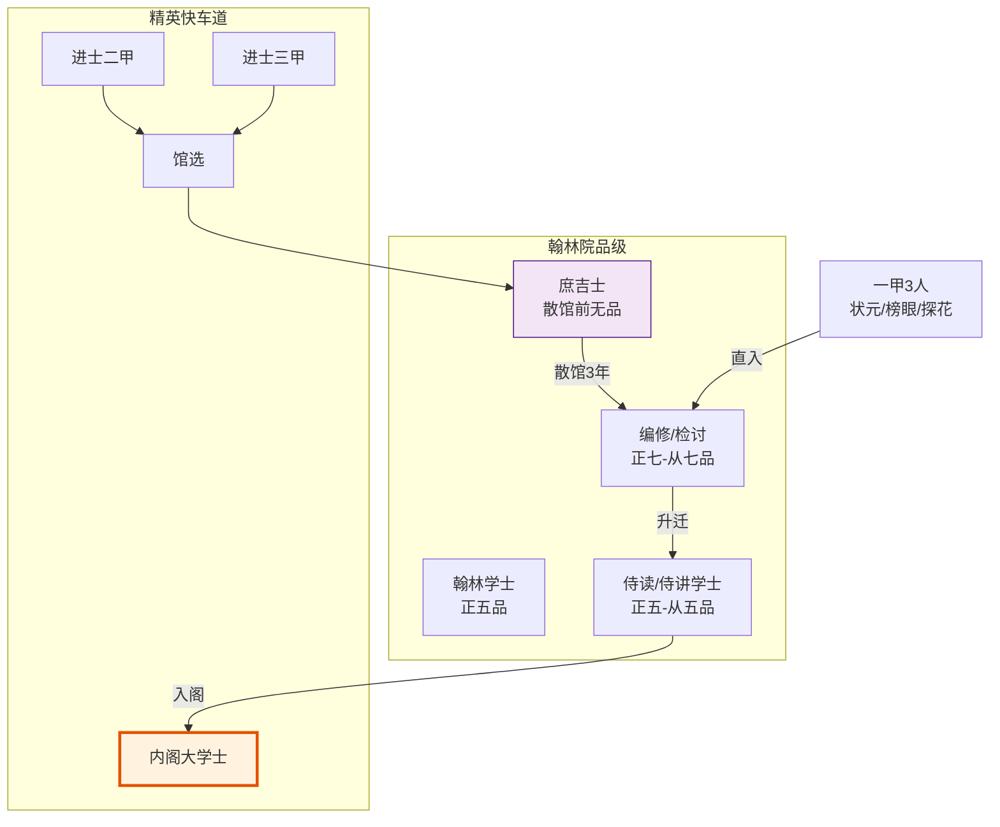

# 翰林院

> 📍 返回 [README](../00-总览/README.md) · [按编排模式反查](../99-附录/04-按编排模式反查.md)
> 🔗 相关主题：翰林格物学士 vs 翰林学士 · 格物致知 · 庶吉士

## 翰林院的定位

翰林院是明代的最高学术机构和皇家智囊团。表面上它负责修史、编书、起草文书、经筵讲学等文事，但实际上它是**高级官员的储备库和培养基地**——内阁大学士几乎全部出自翰林院。

## 翰林学士

翰林学士是皇帝最亲近的学术顾问，品级不高（正五品）但地位超然。核心职能：
- 草拟重要诏书（即位诏、遗诏、册封诏等）
- 经筵日讲：定期为皇帝讲解经史，实际上是"皇帝的私人教师"
- 参与重大政策的讨论（作为知识权威提供历史先例参考）

## 翰林院内部职能细分（深化）

翰林院不是单一职能机构——内部有多个明确的职能线，不同翰林学士承担不同角色：

| 职能线 | 职责 | 典型产出 | 编排对应 |
|:--|:--|:--|:--|
| **修史** | 编修国史、实录、会典 | 《明实录》《大明会典》 | 档籍 Agent（持久化历史记录） |
| **草诏** | 起草重要诏书 | 即位诏、遗诏、册封诏 | 文案师爷（文本生成） |
| **讲筵** | 经筵日讲、为皇帝授课 | 讲稿、经筵记录 | **翰林格物学士**（横切增益） |
| **顾问** | 皇帝的学术顾问、参与重大政策讨论 | 咨询意见、历史先例参考 | **翰林学士**（帝皇池知识检索） |
| **考试** | 主持科举乡试/会试 | 考官评语、阅卷记录 | 考功司（考核评估） |

### 修史职能

翰林院是明代官方史书的编修机构。每位皇帝去世后，新帝会下令编修《实录》——记录先帝一朝的所有重要事件。翰林学士负责收集档案、整理编年、起草史文。

**修史的关键设计**：
- **档案齐全**——通政司的奏章原件、内阁的票拟、司礼监的批红都归档供修史使用
- **编年严格**——按年月日顺序记录，不重排不剧节
- **原则上不造假**——虽然有"为尊者讳"的传统，但基本原则是存真

### 草诏职能

重要诏书由翰林学士起草，内阁大学士审阅，皇帝批红后生效。翰林学士的草诏水平直接影响国家政令的准确性和权威性。

**草诏的层级**：
- **即位诏/遗诏**——最高规格，通常由内阁首辅亲自草拟或指导
- **册封诏**——册立皇后/太子/藩王，翰林学士草拟
- **一般诏书**——常规政令，翰林学士中的编修/检讨草拟

### 经筵日讲职能（重点）

**经筵日讲**是翰林院最独特的职能——定期为皇帝讲解经史子集。这不是简单的"教学"，而是：

1. **知识传递**——把历史上的成败得失讲给皇帝听
2. **道德劝谏**——通过讲历史故事间接劝谏皇帝的某些行为（比直接上奏委婉）
3. **提供历史先例**——当皇帝面临重大决策时，翰林学士会从历史中找到类似案例作为参考
4. **格物致知**——宋代以后的经筵传统强调"格物"——即通过研究具体事物来提炼本质规律

### 格物致知传统

**"格物致知"**源自《大学》——"致知在格物，物格而后知至"。意思是：通过研究具体事物（格物）来获得真知（致知）。

宋明理学（特别是朱熹和王阳明）对"格物"有不同的解释：
- **朱熹**：格物是"即物穷理"——研究每个具体事物背后的天理
- **王阳明**：格物是"致良知"——向内心探求本有的良知

明代的经筵日讲受两派影响，形成了**既重外在研究、又重内在体悟**的传统。这种传统正是编排系统中"翰林格物学士"的原型——剥离具体行业语境，提炼本质结构，进行跨域扫描。

### 顾问职能

翰林学士作为皇帝的学术顾问，在重大政策讨论时提供历史先例参考。这不同于内阁的票拟（提出具体处理意见），翰林学士提供的是**背景知识和历史视角**。

**顾问与票拟的区别**：
- 内阁大学士："这个事该怎么办"（具体建议）
- 翰林学士："历史上类似的事是怎么办的、结果如何"（参考依据）
- 两者互补：内阁有决策建议权，翰林有知识支持权

## 重要消歧：翰林格物学士 vs 翰林学士

编排系统使用了两个不同的"翰林"角色，需明确区分：

| 维度 | 翰林格物学士（HanlinEnricher） | 翰林学士（HanlinScholar） |
|:--|:--|:--|
| **所属编排** | 谋士型·增益层 | 谋士型·帝皇池 |
| **原型职能** | 经筵日讲 + 格物致知 | 顾问 + 知识检索 |
| **职责** | 横切增益，输出《格物引》注入下游 | 为帝皇审议提供知识依据 |
| **是否拦截** | 不拦截请求，只增加上下文 | 不拦截，提供检索结果 |
| **数量** | 1 个（全局横切） | 1 个（帝皇 tournament 的角色） |
| **可跳过** | 默认启用可跳过 | 帝皇模式必选 |

> 消歧注：翰林格物学士（HanlinEnricher）≠ 翰林学士（HanlinScholar）
> 区分依据：所属层（增益层 vs 帝皇池）+ 职责（格物引输出 vs 知识检索）+ 英文标识符

**为什么需要两个不同的"翰林"角色**：
- 增益层需要的是"抽象提炼能力"——从具体问题中抽出本质结构（格物）
- 帝皇池需要的是"知识检索能力"——为审议提供历史先例和事实依据（顾问）
- 两者能力要求不同，不能由同一个角色承担

## 庶吉士制度

这是明代人才选拔中最精妙的设计。每科殿试后，从二、三甲进士中选拔最优秀的一批（约20-30人）进入翰林院学习，称为**庶吉士**。

庶吉士不担任正式官职，而是：
- 在翰林院学习三年，由资深翰林学士指导
- 学习内容包括：国史、典章制度、公文写作、经义辩论
- 三年后"散馆"（毕业），最优秀者留翰林院做编修/检讨，其他人分派到六部、科道等重要岗位

庶吉士制度本质上是一个**精英加速渠道**：普通进士可能在外地做知县一辈子升不上去，但庶吉士出身的人在翰林院三年镀金后，升迁速度远超同期。明朝有"非进士不入翰林，非翰林不入内阁"的说法——想当内阁首辅？先做成庶吉士，再在翰林院熬资历。

## 馆阁选士

翰林院内部的"馆阁"（史馆、文渊阁等）不定期从翰林院编修/检讨中选拔特别优秀者，进入更核心的文书草拟和政策研究岗位。这种**内部层层选拔**机制让翰林院成为了一个持续筛选精英的金字塔。

---

## 编排参考

谋士型编排系统中的两个翰林角色都源于翰林院（**注意消歧，见上文**）：
- "翰林学士" → 翰林格物学士作为全局横切 Agent，承担"格物致知"：剥离行业语境，提炼本质结构，跨域扫描
- "经筵日讲" → 格物学士的《格物引》输出——为皇帝（用户/总控）提供跨域知识和历史先例
- "庶吉士制度" → 新兵见习期：冷启动时执行 Agent 进入"月课"高频考核快速积累评分
- "馆阁选士" → 动态人才池（馆阁选士）：从执行 Agent 中选拔卓异者进入帝皇中枢或御马监

任事型编排系统也借用了"庶吉士"概念用于新兵见习期，以及"馆阁选士"融入动态人才池。

核心洞察：翰林院在编排系统中提供了两个关键思路：
1. **全局横切层**——一个不参与具体执行、但为所有执行者提供知识和跨域视野的独立 Agent
2. **内部人才管道**——不是从外部招聘新 Agent，而是在内部多层筛选和培养（庶吉士 → 编修 → 馆阁 → 内阁）
