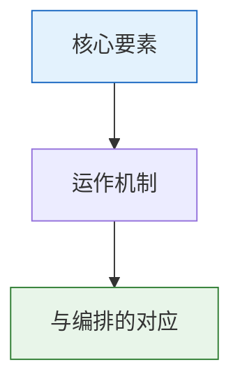

# 灾备与应急机制

## 南京留都——行在六部（南六部）

朱棣迁都北京后，南京保留了一套完整的中央行政机构——六部、都察院、大理寺、五军都督府等一应俱全。这就是**留都南京**和**南六部**。

**日常状态**：南六部的官员品级与北京相同，但权限极低——管辖范围仅限于南直隶（南京周边地区）。大多数南六部官员实际上处于半退休状态，是给那些"资历够但不太能干"的官员养老的地方。

**灾备功能**：一旦北京中央政府因战乱（如土木堡之变后瓦剌逼近北京）、瘟疫、或宫廷政变而瘫痪，南六部可以随时切换为"实权模式"，接管全国的行政运作。

南京的存在本质上是一种**地理级别的灾备**——万一北京出事，不用从零重建中央政府，而是启动一个已同步好规则和人事的影子系统。

## 锁院/戒严机制

**科举锁院**：科举考试期间，考官们被锁在贡院里直到阅卷结束，与外界完全隔离，防止泄题和人情请托。

**军事戒严**：首都遇到兵临城下的紧急状态时，关闭城门、宵禁、暂停正常行政流程，所有资源由军事指挥系统统一调度。

两者的共同逻辑：**在特殊情况下暂时冻结正常规则，进入一套预设的应急规则**。

## 旗牌令

总督征战时持有"旗牌"——象征皇帝授予的军事指挥权。持有旗牌令的总督可以在战场上：
- 先斩后奏（对临阵脱逃的将官）
- 就地征用民间物资
- 绕过正常调兵流程紧急调动卫所军队

旗牌令不是常规权力，是特事特办的授权。战后旗牌交还，权力回收。

## 灾备储备金

太仓库总额度中独立划出的预备金，常规预算不得动用。启用条件极其严格——必须满足真实紧急状况（大灾、大战），且需皇帝亲批。预备金的使用记录单独归档，事后由审计和东厂双重审查，防止"假紧急真花钱"。

---

## 编排参考

任事型编排系统的灾备层直接来自这些明代机制：
- "行在六部" → **灾备部（影子部/南六部）**：为六部核心能力设置影子部，日常不接任务，只从档籍 Agent 同步规则、数据和模型权重。主部异常时灾备切换
- "同步延迟量化" → 影子部同步最大允许延迟T_max=30秒，连续超时3次或版本号落后2个版本触发灾备预警
- "锁院" → **全局熔断锁院**：指标触发时自动锁院——暂停所有新任务接收，仅保留正执行的高安全敏感度任务及皇帝直控系统通信
- "旗牌令" → 锁院/灾备状态下按任务安全敏感度三级分配残余资源
- "灾备储备金" → 从国库总额度中划出独立灾备储备金，仅在内承运库枯竭时由总控亲批开启
- "回切验证" → 主部修复后需经沙盘推演验证通过方可回切

核心洞察：祖先在设计灾备时走的是**"冷备份 + 同步 + 验证回切"**的路径，而非"热备双活"——影子部日常不接任务以节省资源，但保持数据同步。这是资源约束下的最优灾备策略。
