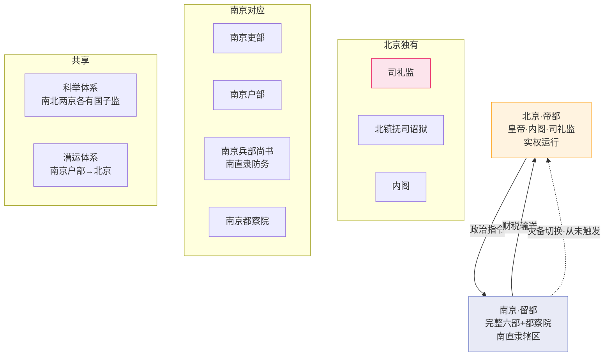

# 南京留都详解

> 本文档补全[灾备与应急机制]()中提及的"南六部影子"——南京留都不仅是一个灾备方案，它有完整的政治、行政和象征意义。

## 一、为什么保留南京

永乐十九年（1421年），朱棣正式迁都北京。但南京并未降格——它被保留为"留都"，维持了一套与北京完全平行的中央政权架构。

**朱棣的考量**：
1. **政治合法性**：朱元璋的陵墓（明孝陵）在南京——放弃南京等于放弃对太祖的祭祀责任（这在儒家政治伦理中是巨大的不孝）
2. **经济命脉**：江南是朝廷的钱粮根本——南京是江南的中心，保留南京的行政控制力等于保留了朝廷对经济腹地的控制
3. **灾备意识**：万一北京失守（蒙古入侵）或遭遇灾难，朝廷可以撤回南京继续运转——南京是一份"政权保单"
4. **惯性**：迁都是朱棣的个人决定——但不能把南京的所有衙门都撤了（会引发江南士大夫的强烈反对和人事动荡）

---

## 二、南京的完整政权架构

南京保留了一套与北京平行的中央政权——每个北京的重要衙门在南京都有对应：

| 北京机构 | 南京对应 | 实际状态 |
|:--|:--|:--|
| 六部（吏户礼兵刑工） | **南京六部**——各有尚书和侍郎 | 编制齐全但缺员——南京六部尚书常成为政治斗争的失败者或被边缘化者的去处 |
| 都察院 | 南京都察院 | 编制有但弹劾权弱——弹劾北京官员被认为是越权 |
| 五军都督府 | **南京五军都督府** | 管南直隶地区的卫所（约40卫） |
| 大理寺 | 南京大理寺 | 复核南直隶地区案件 |
| 翰林院 | 南京翰林院 | 几乎不运作 |
| 国子监 | **南京国子监** | 仍在运作——与北京国子监并列为全国最高学府 |
| 通政司 | 南京通政司 | 几乎不运作 |
| 六科 | 南京六科 | 编制有但实际权力极小 |
| 锦衣卫 | 南京锦衣卫 | 编制有但无诏狱权 |

**关键限制**：南京各衙门只能在南直隶（今江苏+安徽+上海）范围内行使权力——不能干预全国事务。南京兵部尚书是个例外（管南直隶军事），但也不能插手九边防务。

---

## 三、南京六部的实际角色

### 南京户部——最"肥"的南京职位

管理南直隶的赋税征收和漕运事务，职能实际上覆盖了整个江南的财税命脉。相比之下，南京礼部、南京工部几乎无事可做。

### 南京兵部尚书——南京最重要的职位

被称为"南京守备"或"南京参赞机务"——负责南直隶地区（约40个卫所）的防务。是南京权力最大的官员。

### 南京各部的"养老院"属性

到明中后期，南京六部和都察院成了政治斗争的"失败者安置所"：
- 在北京的政治斗争中失败但罪不至罢官 → 平级"调"到南京（名义上品级不变但丢了实权）
- 年老的官员主动请求"调南京"养老（南京的生活成本低、气候更舒适、工作轻松）
- 得罪了首辅或皇帝但需要"给个台阶" → 调到南京

这产生了一个讽刺的效果——**南京汇聚了大批有经验但对现状不满的官员，逐渐成为批评北京朝政的舆论中心**（东林党的主要阵地之一就是南京）。

---

## 四、南直隶——唯一由中央直辖的"省"

明代行政区划中，**南直隶**（南京直辖地区，约今江苏+安徽+上海）是一个特殊存在：没有布政使、按察使、都指挥使——由南京六部直接管理。

这种安排的政治意义：北京的北直隶和南京的南直隶被称为"两京"——这是全国仅有的两个由中央直辖的地区。

---

## 五、南京作为灾备方案——从未启动但系统性地维护

南京作为"政权备胎"的灾备价值在于：
- 如果北京沦陷（土木堡之变后的危机感使这一设计更为重要）
- 如果北京遭遇重大自然灾害或瘟疫
- 如果北京发生政变

**为什么不启动也值得维护**：保险的价值不在于"一定会用"而在于"万一需要时能用"。

南京的备胎角色在崇祯十七年（1644年）李自成攻破北京时得到了最后一次也是最关键的一次验证——崇祯帝上吊自杀，但南京政权仍在。南京六部迅速拥立福王朱由崧为弘光帝，建立了**南明**政权。如果南明内部没有迅速陷入党争和内斗，南京留都的设计本应拯救明朝。

---

## 六、南北两京的协同架构

---

## 编排参考

- "南京完整但不运作" → **温备灾备**：编排系统的核心模块（总控/司礼监/六部/太仓库）应该有一个完整但处于"休眠状态"的副本——规则和数据实时同步、但不参与日常决策。一旦主系统遭遇"锁院"级事件，副本可以立即激活接管
- "南京作为政治失败者的安置所" → **降权不等于剔除**：编排系统中被降权的 Agent 不直接删除——移到类似"南京"的边缘角色，保留其知识和经验但剥夺其决策权。这比直接剔除更节省重新招募成本
- "南直隶的直辖设计" → **关键区域不设中间层**：编排系统中最重要的计算或数据资源节点，可以不经过常规的省-府-县层级——由中枢直接管理，减少中间层的信息损耗和决策延迟
- "南京户部管漕运" → **灾备节点分担常规负载**：灾备副本（南京）并非完全闲置——它承担了部分不可替代的常规职能（漕运、南直隶赋税），这保持了它的"肌肉记忆"，防止在紧急启动时完全生疏
- "南明的教训" → **灾备方案有但组织崩溃依然会失败**：南京留都的制度设计是完善的——但南明的迅速崩溃说明"有制度"不等于"制度在关键时刻会被正确使用"。编排系统的灾备切换需要自动化+演练——不能依赖"到时候有人手动切换"
