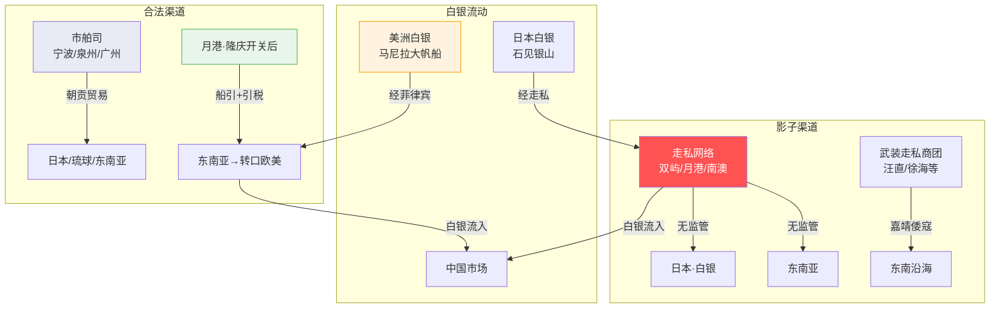

# 海禁与海外贸易

> 明代对外贸易并非只有郑和下西洋——还有长达两百年的海禁、倭寇战争、隆庆开关后的合法贸易，以及走私网络构成的影子经济。

## 一、海禁政策——"片板不许下海"

### 朱元璋的禁海令

洪武四年（1371年），朱元璋颁布禁海令：**"片板不许入海"**。

**禁令的具体内容**：
- 禁止民间建造远洋海船
- 禁止民间出海贸易（违者杖一百、货物充公、再犯者处死）
- 沿海居民内迁（在福建和浙江将部分沿海岛屿的居民迁入内地——"迁界"）
- 外国商船来华必须在市舶司的严格管理下进行朝贡贸易（不能自由通商）

**朱元璋的动机**：
1. **安全考量**：张士诚、方国珍余部逃往海上——朱元璋担心沿海居民与海上反明势力勾结
2. **朝贡垄断**：贸易如果由朝廷垄断（通过朝贡体系），就成为外交和政治工具——而非经济行为
3. **小农思维**：朱元璋认为"农桑为本、商贾为末"——海外贸易在朱元璋的价值体系中不值得冒安全风险

### 海禁的实际效果

海禁没有阻止海上贸易——它只是把海上贸易**从合法变成了非法**：

- 沿海居民世代以海为生——禁海令等于要他们放弃唯一的生存方式，结果是大规模违禁出海
- 外国商人（日本、琉球、东南亚）仍然想和中国做生意——既然合法渠道（朝贡）配额有限，就走私
- 一个巨大的**海上走私网络**形成——海南、浙江、福建、广东沿海的商人、渔民、甚至部分地方官员和卫所将领都卷入其中

**嘉靖年间的"倭寇"危机**就是这个走私网络的军事化表现：
- 所谓"倭寇"首领中——汪直（徽州商人）、徐海（中国走私头目）等其实都是中国人
- 真正的日本人只占倭寇的少数（约10-30%）
- 他们是武装走私商团——走私+海盗+雇佣兵——而不是"日本侵略军"
- 沿海居民为走私商提供补给和情报——因为他们是这些沿海社区的经济命脉

---

## 二、市舶司——朝贡贸易的唯一合法窗口

（详见[会同馆四夷馆与外交](../04-信息链/07-会同馆四夷馆.md)中的市舶司部分）

市舶司是明朝廷管理海外贸易的专门机构。洪武初年设于太仓（后因靠近南京不安全而撤）、后设于**宁波、泉州、广州**三地。

| 市舶司 | 对口国家 | 核心功能 |
|:--|:--|:--|
| 宁波 | 日本 | 接待日本朝贡使团 |
| 泉州 | 琉球 | 接待琉球朝贡使团 |
| 广州 | 东南亚（占城/暹罗/满剌加等） | 接待南洋各国使团 |

**朝贡贸易的运作**：
1. 外国派出"朝贡使团"来华——名义上是向明朝皇帝进贡
2. 明朝给予丰厚回赐（"薄来厚往"——回赐价值远超贡品）
3. 使团附带部分商品在指定市场交易
4. 整个过程中市舶司负责检验、翻译、安排住宿（会同馆）、组织交易

**关键矛盾**：朝贡的频率和规模被严格限制（如日本十年一贡），但民间（中日双方）有巨大的贸易需求——合法的口子太小，走私必然泛滥。

---

## 三、隆庆开关——合法化的转折

### 背景

嘉靖朝的"倭寇"战争持续了二十多年，耗费了巨额军费（戚继光、俞大猷的募兵和作战开支极大），沿海经济遭到严重破坏。越来越多的朝廷官员认识到：**倭寇问题的根源不是"日本人来侵略"而是"海禁造成的非法化"**——与其花巨额军费打走私商，不如开放合法贸易。

### 隆庆元年（1567年）开关

隆庆帝（万历的父亲）即位后，在福建巡抚涂泽民的建议下，宣布**开放海禁**：

- 在福建漳州**月港**（今海澄）开放民间海外贸易
- 商人向官府申请"船引"（出海贸易许可证）
- 根据船只大小和目的地征收"引税"（出口税）
- **仍然禁止对日本直接贸易**（因为倭寇战争的历史原因——但商人通过中转东南亚轻松绕过）

### 开关的影响

隆庆开关是中国对外贸易史上的一个分水岭：

- 月港从一个走私小港变成了国际贸易中心
- 大量中国商品（丝绸、瓷器、茶叶）经合法渠道出口到东南亚——再由葡萄牙/西班牙商船转运到欧洲和美洲
- **白银大量流入**：西班牙从墨西哥和秘鲁开采的白银，经马尼拉大帆船运到菲律宾，再由中国商船运回月港——这些白银流入中国，成为一条鞭法推行和张居正改革的基础货币条件
- 明朝在隆庆和万历前期的财政好转，与开关后贸易关税和白银流入有直接关系

**隆庆开关没有开放的东西**：
- 仍然禁止对日直接贸易（但民间通过琉球和东南亚中转绕过）
- 朝贡体系仍然存在（开关没有取代朝贡——两者并存）
- 贸易的范围和规模仍有管制

---

## 四、明末的贸易收缩

万历后期和天启、崇祯年间，几个因素导致海外贸易再度萎缩：
- 东北边疆军事压力加大（努尔哈赤的崛起）→ 朝廷精力转向北方
- 东南沿海海盗再度活跃（郑芝龙等）→ 贸易安全环境恶化
- 朝廷对月港的管制收紧 → 走私再度超过合法贸易
- 西班牙限制美洲白银出口 → 流入中国的白银减少
- 中国内部经济衰退 → 对进口商品的需求减少

---

## 海外贸易全景图

---

## 编排参考

- "海禁导致走私" → **禁止不如监管**：编排系统中如果完全禁止某种行为（如 Agent 自修改规则），只会让该行为转入地下更难监控——开放受监管的合法通道比全面禁止更有效
- "倭寇首领大多是中国人" → **标签和实质的分离**：不要被"倭寇"的标签误导——编排系统中的异常行为也要穿透标签看实质，而非依赖表面分类
- "隆庆开关 → 白银流入 → 财政改善" → **开放外部接口的正反馈**：编排系统如果适度开放"外部资源接口"（如人工审核、外部知识库），会产生类似白银流入的正反馈——系统能力不再受限于封闭的"内部产出"
- "朝贡贸易的配额太少" → **合法通道的容量设计**：编排系统中的"规则市场"（登闻鼓院）和"密奏通道"必须有足够的带宽——如果合法反馈渠道太窄，问题会通过"走私"（绕过系统的 hack）来解决
- "马尼拉大帆船的白银依赖" → **外部资源的高度依赖风险**：编排系统如果关键资源依赖外部输入（如 API 调用额度、人工标注），需要为输入中断做预案——类似明末白银流入减少导致的经济收缩
