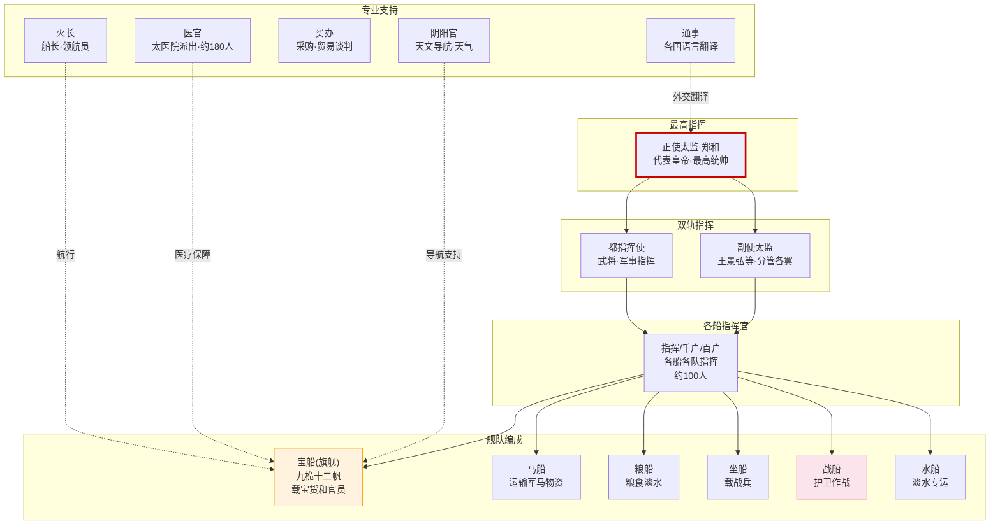
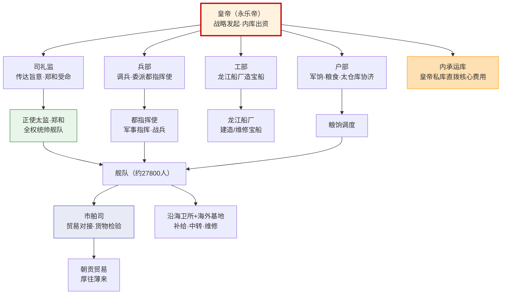

# 郑和下西洋

## 背景与规模

永乐三年（1405年）至宣德八年（1433年），明成祖朱棣派遣郑和七次下西洋。这是人类前工业时代最大规模的海上远征，比哥伦布早87年，规模是哥伦布舰队的数十倍。

**舰队规模**（第一次下西洋）：
- 船只：约317艘（其中大型宝船62艘）
- 人员：约27,800人
- 最大的宝船：长约125米、宽约50米（据《明史》记载，学术界有争议）

## 组织架构

郑和下西洋有一套完整的指挥体系：

| 层级 | 职位 | 人数 | 职能 |
|:--|:--|:--|:--|
| **正使** | 正使太监 | 1人（郑和） | 最高统帅，代表皇帝 |
| **副使** | 副使太监 | 2-3人（王景弘等） | 分管舰队各翼 |
| **都指挥** | 都指挥使 | 2-3人 | 军事指挥，统领战兵 |
| **指挥** | 指挥/千户/百户 | 约100人 | 各船和各队指挥官 |
| **阴阳官** | 阴阳生 | 若干 | 天文导航、天气预报 |
| **通事** | 翻译官 | 若干 | 各国语言翻译 |
| **买办** | 采购官 | 若干 | 物资采购和贸易谈判 |
| **医官** | 太医院派出的医士 | 约180人 | 医疗防疫 |
| **火长** | 船长/领航员 | 若干 | 负责具体船只的航行 |

## 舰队编成

郑和舰队按功能分为若干类型船只：
- **宝船**（旗舰/主力舰）：九桅十二帆，载宝货和高级官员
- **马船**（运输舰）：运载马匹和军需物资
- **粮船**（补给舰）：运载粮食和淡水
- **坐船**（战船）：载战兵和水师士兵
- **战船**（护卫舰）：轻快机动，负责警戒和作战
- **水船**（淡水船）：专门运载淡水

## 指挥结构的特点

**双轨制指挥**：郑和（太监）代表皇帝行使外交和最高决策权，都指挥使（武将）负责军事指挥和舰队安全。太监和武将在同一条船上但不互相隶属——类似于总督(文)和总兵(武)的关系。

**独立后勤链**：舰队携带了几乎自给自足的后勤体系——自己的医生、翻译、工匠、铁匠、厨师。一次航行长达两年不靠岸也能维持运转。这是"小规模自洽系统"的极致案例。

---

## 郑和舰队组织架构图

---

## 编排参考

虽然两个编排文档未直接引用郑和下西洋，但其架构对编排系统有多重启发：

- **双轨制指挥** → 类似于编排系统中的**文臣统兵**模式：总督(战略)和提督(执行)双轨并行，各管一摊
- **自洽后勤** → 类似于**九边卫所屯田**和**内承运库独立资源池**：长周期任务需要自己的资源闭环
- **多船协同** → 类似于**竞功模式**的多路并行：宝船(主路)由总督指定，其他船(客路)通过旗牌协调
- **阴阳官导航** → 类似于**翰林格物学士**的导航功能：在未知海域提供跨域参考和历史先例
- **通事翻译** → 类似于**军情转译使/行人司**：在外部系统(外国/用户)和内部系统之间的翻译层

---

## 维度①：财政支撑——谁出的钱？

郑和下西洋是人类前工业时代最昂贵的国家工程之一。其财政来源体现了一个关键设计：**绕过户部（外朝）走内库直拨**。

**出资结构**（待验证：具体比例学术界有争议）：
- **内承运库出资**（皇帝私库）：永乐帝从内承运库直接拨付宝船建造和航行的核心费用——这绕开了户部的预算审批。皇帝"自掏腰包"意味着这是"皇家工程"而非"国家工程"（详见 [太仓库与内承运库](../05-资源链/02-太仓库与内承运库.md)）。
- **工部摊派造船**：宝船由工部下属的龙江船厂（南京）建造，工部出物料和工匠人工，走工部预算。
- **户部协济**：粮食、军饷等常规军需走户部太仓库的军费预算。
- **地方卫所补给**：船队途经的海外基地（如占城、满剌加）和国内沿海卫所提供补给——这部分不直接计入中央账本。

**"厚往薄来"的账本逻辑**：

朝贡贸易的核心原则是"薄来厚往"（或作"厚往薄来"）——外国进贡的物品价值低，明朝回赐的物品价值远高于贡品。这在商业上是"亏本"的，但在政治账本上是"盈利"的：

| 账本类型 | 逻辑 | 结果 |
|:--|:--|:--|
| **政治账** | 回赐越丰厚 → 朝贡国越多 → 万国来朝 → 皇帝合法性增强 | 政治收益"无限大" |
| **经济账** | 造船+航行+赏赐远超贸易收入 | 巨额财政消耗 |

**实际成本估算**（待验证：以下为学者推算区间）：
- 单次航行直接成本：据推测约占太仓库年收入的相当比例（不同学者估算差异极大）
- 宝船建造成本：龙江船厂为建造宝船专门扩建船坞，耗时数年
- 机会成本：用于下西洋的财政资源本可用于北方边疆（永乐时期同时在对蒙古用兵）

> **财政洞察**：郑和下西洋是"皇帝的私房钱撑起来的外交工程"。内库直拨绕过了户部的成本质疑——这也解释了为什么永乐帝死后、内库不再愿意出资时，下西洋立刻难以为继。

---

## 维度②：跨部门协调链路

郑和下西洋不是某一个部门的事——它需要**六个中央部门 + 地方卫所 + 海外基地**的协同。完整链条如下：

**链条的关键节点**：
- **皇帝 → 司礼监 → 郑和**：这是"皇权直达"通道——郑和作为司礼监出身的太监，直接对皇帝负责，不经过内阁和六部（详见 [司礼监与宦官体系](../01-决策链/03-司礼监与宦官体系.md)）。
- **兵部调兵**：舰队的战兵由兵部从各卫所抽调，都指挥使由兵部委派——但都指挥使到了海上要听郑和的。
- **工部造船**：龙江船厂隶属工部，宝船建造是国家级军工项目，工部尚书直接督办。
- **户部筹款**：军饷和粮食走太仓库的正常军费预算——户部无权拒绝（皇帝的旨意），但户部官员可以"拖"（消极抵抗）。
- **市舶司对接**：船队带回的朝贡货物和贸易货物，由市舶司负责检验、估价、入库（详见 [海禁与海外贸易]() 市舶司部分）。
- **地方卫所补给**：沿海卫所（太仓、长乐、占城、满剌加等）提供中途补给——这是一条跨国的后勤补给线。

> **协调洞察**：这条链路之所以能运转，是因为**皇帝的意志压倒了部门利益**。一旦皇帝不再强力支持（永乐之后），六部中反下西洋的力量（尤其是户部和文官集团）就迅速占据上风。

---

## 维度③：远距离自治权——"代天巡狩"

郑和舰队在海外享有极高的自主权，这在通信落后的前工业时代是必须的——从南京到印度洋往返一次要两年，不可能事事请示。

**正使太监的权力边界**：

| 权力类型 | 具体内容 | 类比 |
|:--|:--|:--|
| **外交全权** | 代表皇帝册封外国国王、接受朝贡、缔结条约 | 全权大使 |
| **军事裁量** | 可对海盗和敌对势力使用武力（如剿灭海盗陈祖义） | 战区指挥官 |
| **贸易决策** | 可自主决定贸易品的价格和交换对象 | 贸易谈判全权代表 |
| **赏罚之权** | 对舰队内部人员有赏罚甚至处决之权（待验证） | 独立人事权 |

**"代天巡狩"的含义**：郑和携带皇帝的诏书和印信，在海外所言所行等同于皇帝亲临。这种授权的极端程度，在前工业时代的世界史上极为罕见。

**与现代 remote agent autonomy 的类比**：

| 郑和舰队的自治 | 现代 remote agent |
|:--|:--|
| 两年航程无法请示 → 必须自主决策 | 网络断连或延迟时的 agent 自主 |
| 皇帝给"代天巡狩"全权 → 预授权范围极大 | orchestrator 给 agent 的 autonomy boundary |
| 郑和回朝后需汇报 → 事后审计 | agent 执行完成后 log 审计 |
| 郑和不能自立为王 → 忠诚约束 | agent 不能自修改核心指令 |

> **自治洞察**：远距离自治的前提是**预授权范围清晰 + 事后可审计 + 核心忠诚不可叛**。郑和体系之所以安全运转28年，是因为这三条同时满足：永乐帝的授权明确（外交军事全权），郑和回朝必报（档案记录），郑和身为太监无子孙无篡位动机（忠诚锁）。

---

## 维度④：七次航行的阶段演化

郑和七下西洋不是均匀的——28年间经历了探索、高峰、衰落三个截然不同的阶段：

| 阶段 | 次数 | 年代 | 核心任务 | 代表事件 |
|:--|:--|:--|:--|:--|
| **探索期** | 第1-3次 | 1405-1411 | 打通航路、清除海盗、建立基地 | 剿灭海盗陈祖义（旧港）；到达古里（印度西海岸）；册封满剌加国王 |
| **高峰期** | 第4-6次 | 1413-1424 | 远距离外交、朝贡国激增、抵达非洲 | 到达忽鲁谟斯（波斯湾）、木骨都束（索马里）；多国使节随船来华朝贡 |
| **衰落期** | 第7次 | 1431-1433 | 宣德帝勉强批准的"最后一搏" | 郑和客死古里（约1433年）；船队由王景弘率领返航 |

**阶段演化的驱动力**：

> **演化洞察**：下西洋的兴衰完全绑定在**皇帝个人意志**上。永乐帝一人之力推起，永乐帝一死立刻停摆。这是典型的"人亡政息"——制度没有内化为系统性的持续能力，而是一个强力个人的项目。

---

## 维度⑤：人员选拔体系——为什么是宦官？

**正使必须是宦官——"信任 > 能力"原则**：

郑和（原名马三宝）被选为正使，核心原因不是航海能力（他不是水手出身），而是：
1. **忠诚锁**：宦官没有子孙，不可能拥兵自立、在海外割据称王。把约27000人和一个舰队交给一个将领太危险——交给自己人（宦官）安全得多。
2. **内廷出身**：郑和是永乐帝身边的人（燕王府旧人），跟了朱棣几十年，信任关系深厚。
3. **皇权延伸**：宦官代表的是皇帝私权，不是外朝官僚体系。让宦官统帅，意味着这是"皇家工程"而非"国家工程"。

**副使也是宦官**：王景弘（副使太监）同样出身内廷。正副使都是宦官，意味着**最高决策层完全由内廷掌控**——外朝（兵部、户部）只能配合，不能决策。

**都指挥使——兵部委派的武将**：军事指挥由兵部委派的都指挥使负责。都指挥使是职业军人，专业能力强，但地位低于正使太监——他"能打仗但不能做主"。

**专业人员的选拔**：

| 专业岗位 | 选拔来源 | 选拔标准 |
|:--|:--|:--|
| **阴阳官**（导航） | 钦天监 | 天文历法计算能力·能使用牵星板 |
| **通事**（翻译） | 四夷馆/会同馆 | 外语能力·外交礼仪（详见 [会同馆四夷馆](../04-信息链/07-会同馆四夷馆.md)） |
| **医官**（医疗） | 太医院 | 医术·防疫知识·约180人规模 |
| **火长**（船长/领航） | 沿海有经验的水手 | 航海经验·熟悉洋流季风 |
| **买办**（贸易） | 户部/市舶司 | 贸易谈判·估价能力 |

> **选拔洞察**：人员体系是"忠诚分层"的——越靠核心（正使副使）越重忠诚（宦官），越靠执行（火长医官）越重专业能力。这种"忠诚锁定核心、能力分散边缘"的设计，保证了权力安全和技术能力的平衡。

---

## 维度⑥：档案销毁与知识断裂——辉煌系统的彻底消失

郑和下西洋最令人扼腕的不是它停止了——而是它**消失得干干净净**，连技术档案都没有留下。

**刘大夏烧航海图（成化年间，待验证）**：

据部分明代文献记载，成化年间（1465-1487）有官员提议恢复下西洋，兵部官员**刘大夏**将郑和的航海图（航海档案）藏匿或销毁，理由是"三宝下西洋，费钱粮数十万，军民死且万计……此特一弊政"。

> ⚠️ 待验证：刘大夏烧航海图的具体细节在学术界有争议。有学者认为航海图是被"藏匿"而非"销毁"，也有学者认为此事被后人夸大。但无论细节如何，**下西洋的航海档案确实大量遗失**这一事实是确定的。

**技术流失的连锁反应**：

| 知识领域 | 流失情况 | 后果 |
|:--|:--|:--|
| **造船技术** | 宝船建造工艺失传，后世再未造出同等规模船只 | 明代中后期战船规模远小于宝船 |
| **航海图** | 《郑和航海图》部分留存于《武备志》，但原始详细档案丢失 | 后人无法完整复现航路 |
| **天文导航** | 牵星术（利用星辰定位的航海术）随航海活动中断而失传 | 明代后期导航技术倒退 |
| **地理知识** | 马欢《瀛涯胜览》、费信《星槎胜览》、巩珍《西洋番国志》留存——但属个人记录非系统档案 | 知识碎片化，非体系化传承 |

**"辉煌系统彻底消失"的含义**：

下西洋不是一个"衰落"的系统——它是一个"被删除"的系统。它没有慢慢衰退，而是在停止后**被主动清理**（刘大夏藏匿档案、文官集团全面否定）。这意味着：
- 不是"能力退化了"，而是"能力被销毁了"
- 不是"知识过时了"，而是"知识被刻意遗忘了"
- 不是"系统自然消亡"，而是"系统被人为终止并清除痕迹"

> **知识断裂的警示**：一个运行了28年、耗费无数资源的复杂系统，可以在停止后几十年内**彻底从实践知识中消失**。造船工匠老死、航海术无人传授、档案被藏匿销毁——辉煌的系统不是永恒的，它的知识需要**主动的、制度化的保存**才能延续。下西洋是中国古代"系统知识断裂"最典型的案例。

---

## 维度⑦：与朝贡体系的联动——主动出击 vs 被动等待

（朝贡体系的完整运作详见 [海禁与海外贸易]() 市舶司部分；此处只分析下西洋与朝贡的战略联动关系。）

**下西洋是"主动出击型"朝贡扩张**：

普通的朝贡体系是**被动等待**——外国使节自己来华朝贡，明朝在口岸接待。下西洋则是**主动出击**——明朝派舰队到各国，主动册封国王、邀请（施压）朝贡。

| 朝贡模式 | 运作方式 | 朝贡国数量 | 成本 |
|:--|:--|:--|:--|
| **被动等待**（海禁后） | 外国自行来华 | 少且不稳定（官方渠道收窄） | 低（不出海） |
| **主动出击**（下西洋） | 舰队到各国册封邀请 | 激增（永乐朝朝贡国达数十国） | 极高（造船+航行+赏赐） |

**停止下西洋后朝贡国锐减**：

永乐朝末期，来华朝贡的国家数量达到峰值。但宣德朝停止下西洋后，朝贡国数量**断崖式下降**——没有舰队"邀请"，很多东南亚和印度洋国家不再主动来华。

**战略差异的本质**：

- **被动等待型**（隆庆开关后的民间贸易）：不靠朝贡，靠民间贸易自发扩展——虽然官方朝贡国减少，但民间贸易（走私+合法）从未停止。
- **主动出击型**（下西洋）：靠国家力量强行扩展朝贡圈——成本极高，一旦停止立刻萎缩，但短期内能形成"万国来朝"的政治效果。

> **战略洞察**：下西洋是"国家力量强行拉升外交网络"的案例。它的效果显著（短期内朝贡国激增），但**不可持续**（成本太高、依赖皇帝个人意志）。停止后立刻崩溃——说明这种靠强力维持的外交网络没有自生长能力。

---

## 编排参考（续·新维度启发）

> 接上文 [编排参考](#编排参考) 5 条，以下为新维度补充的启发：

- **财政支撑** → **任务的"私库直拨"通道**：郑和下西洋由内库直拨绕过户部 → 编排系统中，战略级任务可以有一条"绕过常规预算审批"的快速通道（类似 [内承运库独立资源池](../05-资源链/02-太仓库与内承运库.md)），用于不可拖延的核心任务。但这条通道必须有总控直接授权，不可滥用。
- **跨部门协调链路** → **跨层编排的显式握手**：六部+地方卫所+海外基地的协同 → 编排系统中跨多个基础设施层的任务（如同时涉及 Core Engine + Domain Pack + Infrastructure），需要一条**显式的协调链路**，每个环节有明确的职责和交付物。
- **远距离自治权** → **remote agent 的预授权框架**：郑和"代天巡狩" → 编排系统中的远程 Agent（如离线执行的子 Agent、跨网络的长周期任务）必须有清晰的**预授权边界**（可自主决策范围）+ **事后审计机制**（执行日志）+ **忠诚锁**（不可自修改核心指令）。三者缺一不可。
- **阶段演化** → **编排模式的生命周期**：下西洋的探索→高峰→衰落 → 编排系统中的每种 Pattern（Coordination × Execution）也有生命周期——冷启动探索期、稳定运行高峰期、需求变化后的衰退期。需要识别 Pattern 所处阶段，适时降级或替换。
- **人员选拔——忠诚分层** → **Agent 的信任分级**：正使副使重忠诚（宦官）、专业人员重能力 → 编排系统中的 Agent 也应"信任分层"——核心决策 Agent 重安全（不可降权、不可自修改），执行层 Agent 重能力（可自由调用工具）。详见 [司礼监与宦官体系](../01-决策链/03-司礼监与宦官体系.md) 的授权分层。
- **知识断裂** → **系统知识的制度化保存**：下西洋档案销毁导致技术彻底失传 → 编排系统必须有**制度化的知识保存**——Pattern 定义、执行日志、决策记录必须持久化存储，不可因系统重启或版本迁移而丢失。"辉煌系统可以消失"是最该警惕的失败模式。
- **主动出击 vs 被动等待** → **资源网络的主动构建**：下西洋是主动扩展朝贡圈 → 编排系统对外部资源（外部 Agent、外部知识库、人工审核通道）的接入，可以是"被动等待调用"也可以是"主动出击构建"。主动构建的网络效果更强但维护成本更高——需要权衡。
