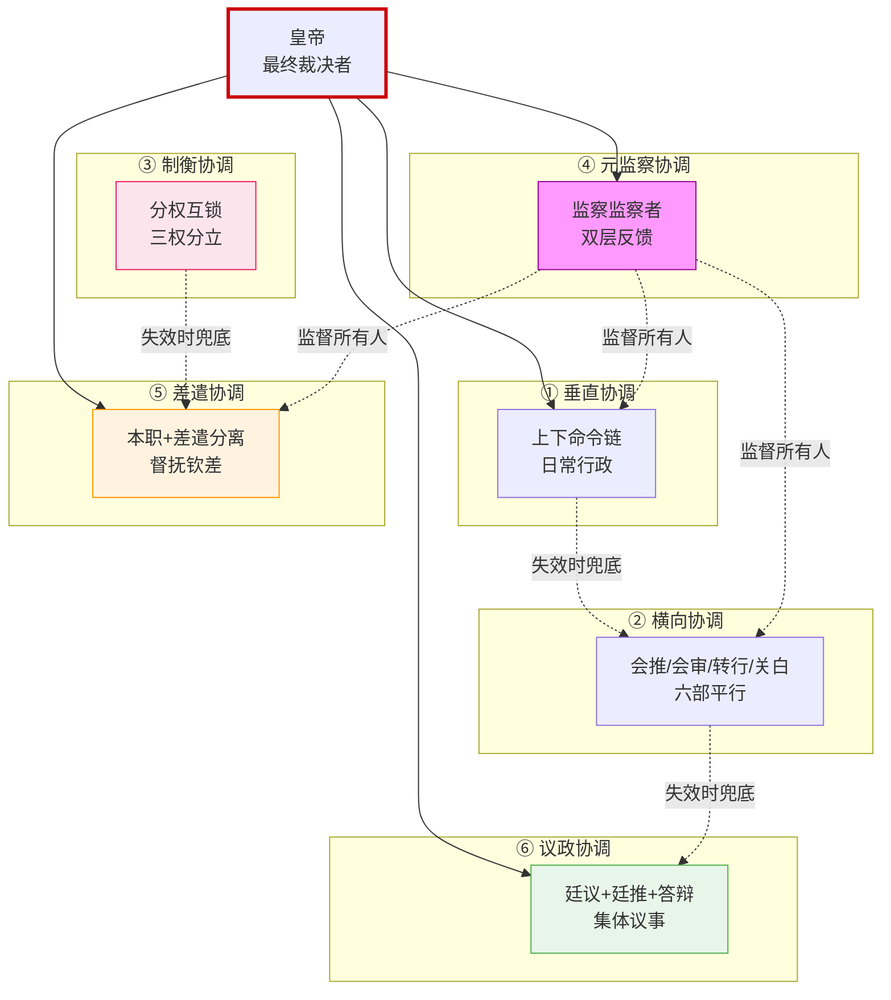
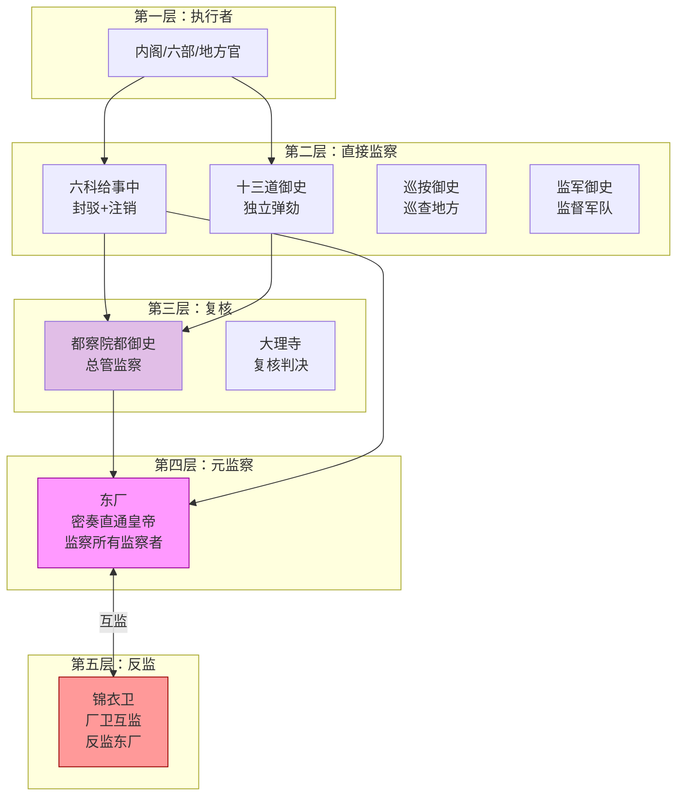
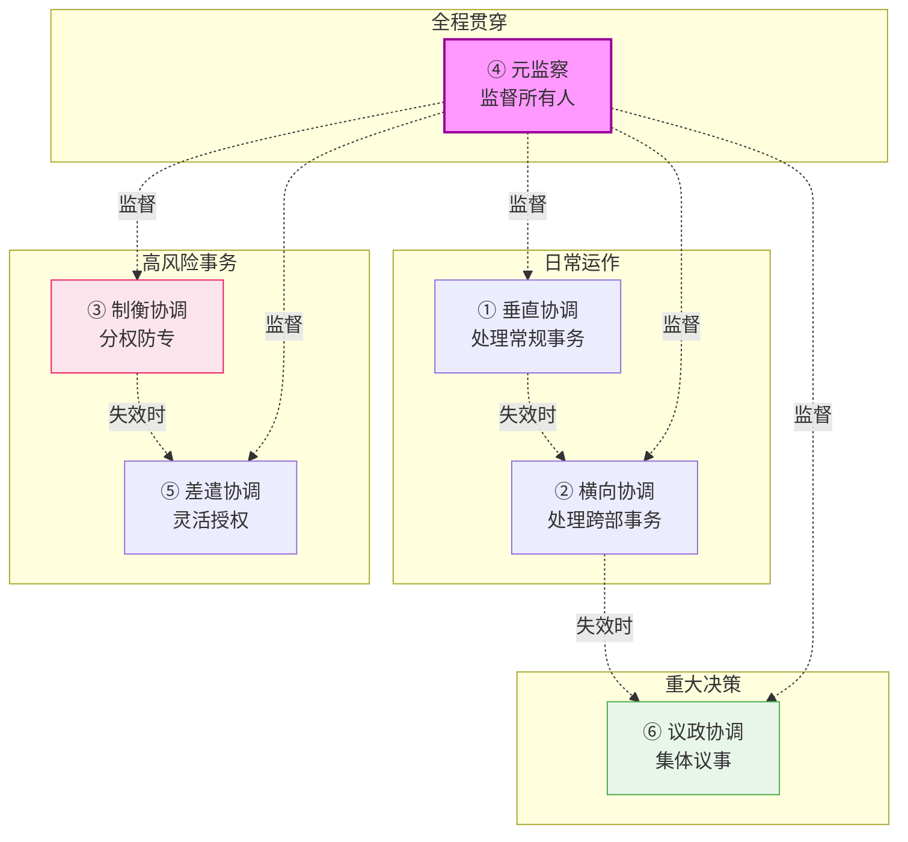

# 明代六大协调模式总览

> 本文档是「09-协调机制专题」的入口。明代官制之所以能支撑 276 年的庞大帝国，靠的不是单一命令链，而是**六种性质不同的协调模式叠加运行**。每种模式都有自己适用的场景、失败模式和历史教训。

## 为什么需要"多种协调模式"

一个复杂系统不可能只靠一种协调方式：
- **只用垂直命令**：信息失真、底层僵化、单点失败
- **只用横向协商**：决策瘫痪、无人拍板、派系倾轧
- **只用制衡互锁**：相互否决、什么事都做不成
- **只用临时差遣**：制度化崩溃、回归人治

明代的解法是**让六种协调模式各自承担不同的协调需求**，并相互补位。当一个模式失效时，其他模式可以兜底。

---

## 六大协调模式速览

| # | 模式 | 核心机制 | 明代典型案例 | 适用场景 | 失败模式 |
|:--|:--|:--|:--|:--|:--|
| 1 | **垂直协调** | 自上而下的命令链 + 自下而上的上报 | 皇帝→内阁→六部→郎中→主事 | 日常行政、确定性任务 | 信息失真、单点阻塞、皇帝怠政 |
| 2 | **横向协调** | 平级部门之间的四种协同方式 | 六部之间的会推/会审/转行/关白 | 跨领域事务、信息共享 | 派系斗争、互相推诿 |
| 3 | **制衡协调** | 分权互锁——把一件事的多个环节拆给不同部门 | 调兵权(兵部)+军政权(五军)+统兵权(总兵)三权分立 | 高风险权力、防止专权 | 三方都不动、决策瘫痪 |
| 4 | **元监察协调** | 监察者也被监察——双层反馈环 | 东厂监察都察院/六科/锦衣卫，锦衣卫反监东厂 | 防止监察者本身腐败 | 监察过载（西厂教训）、合谋 |
| 5 | **差遣协调** | 本职（品级/俸禄）+差遣（临时权力）分离 | 总督/巡抚/钦差/经略/提督/监军御史 | 跨域临时任务、灵活授权 | 差遣久任不归、变相割据 |
| 6 | **议政协调** | 多人集体议事，但最终决策权在一人 | 廷议（重臣议事）+廷推（集体提名）+朝会答辩 | 重大决策、减少独断风险 | 议而不决、皇帝甩锅 |



---

## 模式一：垂直协调（命令链）

### 核心机制

**自上而下**：决策逐级下达，每级有明确的审批边界。
**自下而上**：上报逐级审核，每级有独立的驳回权。

### 明代典型链条

```
皇帝（批红）
  ↓
内阁首辅（汇总票拟）
  ↓
六部尚书（审批重大事项）
  ↓
郎中（司内决策）
  ↓
主事（具体执行）
```

### 关键设计要点

1. **每级独立审批权**——上级不能绕过下级直接指挥更下级（保持司的完整性）
2. **每级独立上报权**——下级发现上级错误可以越级上报（虽然代价是与直接上级决裂）
3. **审批边界明确**——主事不需要每件事上报郎中，郎中不需要每件事上报尚书

### 失败模式

- **皇帝怠政**：万历皇帝近三十年不上朝，整条命令链顶端堵塞
- **信息失真**：每经一级都会被"过滤"，越往上级越看不到真相
- **单点失败**：内阁首辅一旦被皇帝猜忌，整条链瘫痪

### 详见
- [04-六部体系](../02-执行链/文官执行/01-六部体系.md) — 部内层级
- [02-内阁制度](../01-决策链/02-内阁制度.md) — 票拟流转

---

## 模式二：横向协调（平级协同）

### 核心机制

平级部门之间没有上下级关系，必须通过**约定的协同方式**完成跨部门事务。明代发展出**四种标准协同方式**：

| 协同 | 含义 | 典型场景 |
|:--|:--|:--|
| **会推** | 吏部会同各部推选高级官员 | 三品以上官员任免 |
| **会审** | 多部门联合审理重大案件 | 三法司会审、大案要案 |
| **转行** | 公文在部门之间流转处理 | 跨部业务流转 |
| **关白** | 部门间通报信息（不要求回复） | 资源用量广播 |

### 关键设计要点

1. **没有"上级"**——发起方不能命令接收方，只能"移会"
2. **协同义务有约束力**——拒绝参与会推/会审需要给出理由
3. **结果需上报**——协同结果不直接生效，需上呈皇帝批红

### 失败模式

- **派系斗争**：会推变成各派提名自己人，丧失公正性
- **互相推诿**：转行公文在部门间来回踢皮球
- **关白变空文**：通报了但没人看，信息流于形式

### 详见
- [04-六部体系](../02-执行链/文官执行/01-六部体系.md) 第 211 行 — 四种协同方式详解
- [02-中央决策协调机制专题]() — 横向协调的深度案例

---

## 模式三：制衡协调（分权互锁）

### 核心机制

**把一件事拆成多个环节，分别交给互不统属的部门**。任何一方都无法独立完成全流程，必须协作。这是防止权力集中最有效的方式。

### 明代最典型的三组分权

#### A. 军事三权分立

```
调兵权（兵部）   ── 发布调兵令
        ↓ 必须经五军都督府核对军籍
军政权（五军都督府）── 管军籍、训练、屯田
        ↓ 但不能调动军队
统兵权（总兵官） ── 战场指挥
        ↑ 战后必须交还兵权
```

#### B. 财政收支分立

```
花钱的（六部各部）── 提出预算和开支
        ↓ 必须经户部度支司审批
管账的（户部）   ── 编制预算、监控执行
        ↓ 但不能直接付款
管钱的（太仓库） ── 实物白银收付
        ↓ 余额不足自动拦截
```

#### C. 司法三法司

```
主审（刑部）   ── 调查、初审、判决
        ↓ 判决需经大理寺复核
监督（都察院） ── 监督审判公正
        ↓ 可弹劾审判官员
复核（大理寺） ── 法律审，可推翻重审
```

### 关键设计要点

1. **每方都有否决权**——任一环节拒绝副署，整件事就办不成
2. **副署才有法律效力**——兵部调兵令需五军都督府副署，否则不生效
3. **制衡不等于否决**——是为了"共同确认"而非"互相否决"

### 失败模式

- **三方都不动**：土木堡之变前的军政协调瘫痪
- **合谋绕过**：兵部和五军都督府勾结，互相放水
- **效率低下**：每件事都要三方会签，紧急事务延误

### 详见
- [01-五军都督府](../02-执行链/军事执行/01-五军都督府.md) — 军政军令分权
- [03-三法司会审专题](03-三法司会审专题.md) — 司法三权分立的协调流程

---

## 模式四：元监察协调（监察监察者）

### 核心机制

监察者本身也是人，也会腐败。**必须有一层"监察监察者"的机制**——这就是元监察。

### 明代的四层监察叠加



### 关键设计要点

1. **监察者品级低**（给事中正七品、御史正七品）——没有利益牵扯，弹劾无顾忌
2. **元监察者无执行权**——东厂只能"密奏弹劾"，不能直接抓人（抓人归锦衣卫）
3. **元监察者也互相监视**——东厂和锦衣卫互监（厂卫互监），防止任何一方独大
4. **密奏直通**——绕过内阁和都察院，确保皇帝能看到最原始的情报

### 失败模式

- **监察过载**：西厂短暂设立时监察范围过广，造成系统性恐惧（明宪宗/武宗时被废）
- **合谋**：魏忠贤时期东厂与锦衣卫合谋，互监失效
- **监察者被监察者收买**：御史接受被弹劾者的贿赂

### 详见
- [04-厂卫互监与皇权控制](../03-监察链/08-厂卫互监与皇权控制.md)
- [03-西厂与内行厂](../03-监察链/07-西厂与内行厂.md) — 监察过载的教训

---

## 模式五：差遣协调（本职+差遣分离）

### 核心机制

明代的官职分两种：
- **本职**：品级、俸禄、礼仪地位的依据（如兵部侍郎正三品）
- **差遣**：临时授予的实际权力（如"提督军务"、"总理河道"）

**一个人可以本职很低但差遣很大**——典型的如总督，本职可能只是兵部侍郎（正三品）或佥都御史（正四品），但差遣"总督某地军务"可以节制数省。

### 明代主要差遣类型

| 差遣 | 权力 | 本职通常搭配 | 任期 |
|:--|:--|:--|:--|
| **总督** | 跨省军政统帅 | 兵部侍郎/尚书 + 副都御史衔 | 数年一任 |
| **巡抚** | 一省军政统帅 | 侍郎 + 副都御史/佥都御史衔 | 数年一任（明中期后渐常驻） |
| **经略** | 战略统帅（高于总督） | 兵部尚书 + 都御史衔 | 重大战事期间 |
| **提督** | 战术/专项统帅 | 武将或文臣 | 视任务而定 |
| **钦差** | 皇帝特派处理特定事务 | 各部尚书/侍郎 | 任务结束即回收 |
| **总兵** | 战场指挥 | 武将（都督/都指挥使） | 战时持印，战后交还 |
| **监军御史** | 监督军队 | 御史（正七品！） | 战时派出 |
| **巡按御史** | 巡查地方 | 御史（正七品） | 一年一轮 |
| **漕运总督** | 漕粮运输 | 户部侍郎 + 都御史衔 | 数年一任 |
| **河道总督** | 黄河/运河治理 | 工部侍郎 + 都御史衔 | 数年一任 |

### 关键设计要点

1. **差遣可随时收回**——不像本职有任期保障
2. **差遣需配信物**——旗牌令、关防、敕书
3. **差遣有明确边界**——敕书上写明"节制某省某地、有权做某事"
4. **差遣有汇报义务**——钦差回京需复命，总督需定期奏报
5. **差遣叠加限制**——一般不让人同时持两个差遣（防止权力过大）

### 失败模式

- **差遣久任不归**：明末督抚事实上变成地方长官，差遣制度化（破坏设计初衷）
- **差遣叠床**：经略+总督+巡抚+监军同时存在，协调反而更复杂
- **敕书模糊**：差遣边界不清，与地方官冲突

### 详见
- [04-钦差大臣制度]()
- [05-督抚深度协调](05-督抚深度协调.md)
- [07-经略与总督协调](07-经略与总督协调.md)

---

## 模式六：议政协调（集体议事）

### 核心机制

重大决策不交由单人决定，而是召集多人议事。**但议政不等于投票**——明代的议政最终决策权始终在皇帝手中。

### 明代三种议政形式

#### A. 廷议（议事）

皇帝召集重臣（内阁+九卿）专题讨论重大国事：
- 不投票，各官员表达意见
- 形成廷议疏（会议纪要）作为决策参考
- 皇帝可以批"再议"——退回重新讨论

#### B. 廷推（集体提名）

三品以上官员出缺时，由九卿集体推举候选人：
- 各部尚书提出人选并说明理由
- 形成 2-3 人候选名单上呈皇帝
- 皇帝从名单中选择一人任命（理论上也可全部拒绝）

#### C. 朝会答辩（公示申辩）

京察大计后，考核结果在朝堂公示，被考核者可以申辩：
- 不是民主投票，只是纠错机制
- 异议成立则由大理寺复核
- 减少冤错

### 关键设计要点

1. **议政不投票**——只议事不决议，决策权在皇帝
2. **议政结果可被皇帝推翻**——但皇帝推翻廷议需要承担政治代价
3. **议政的发起权在皇帝**——皇帝不召开，臣子不能自行廷议
4. **议政有回避**——如首辅不参加廷推（提名自己的下属）

### 失败模式

- **议而不决**：廷议讨论半天没有结论，皇帝最终独断
- **派系化**：廷推变成各派提名自己人
- **皇帝甩锅**：把难以决策的事推给廷议，事后又不采纳

### 详见
- [08-廷议与朝会](../01-决策链/05-廷议与朝会.md)
- [10-京察大计跨部协调](10-京察大计跨部协调.md)

---

## 六大模式的相互关系

六种模式不是孤立的，而是**相互补位、相互制衡**：



### 典型组合案例：一场战争的协调链

**万历朝鲜之役（1592-1598）**同时使用了所有六种协调模式：

| 模式 | 在战争中的体现 |
|:--|:--|
| ① 垂直协调 | 皇帝→内阁→兵部→前线将领 的命令链 |
| ② 横向协调 | 兵部（调兵）+ 户部（粮饷）+ 工部（兵器）的协同 |
| ③ 制衡协调 | 调兵令需兵部+五军都督府双方副署 |
| ④ 元监察协调 | 监军御史随军，东厂密探监视后方动向 |
| ⑤ 差遣协调 | 经略宋应昌、总督邢玠都是差遣，战后回收 |
| ⑥ 议政协调 | 战前廷议讨论是否出兵，廷推推荐将领 |

**启示**：复杂的现实事务往往**同时需要多种协调模式**。任何单一模式都不足以应对。

---

## 编排参考

### 直接对应：编排系统的"协调模式菜单"

明代六大协调模式可以直接映射为编排系统的六种 Agent 协作模式：

| 明代模式 | 编排系统对应 | 适用场景 |
|:--|:--|:--|
| ① 垂直协调 | 主控 Agent → 子任务 Agent → 工具 Agent 的命令链 | 确定性任务、明确的执行流程 |
| ② 横向协调 | 六部 Agent 之间的会推/会审/转行/关白 | 跨领域任务、需要多方信息汇总 |
| ③ 制衡协调 | 规划+审核+执行三层分离，每层可否决 | 高风险决策、需要防错 |
| ④ 元监察协调 | 东厂 Agent 元监察所有监察 Agent | 防止监察 Agent 自身失效 |
| ⑤ 差遣协调 | 临时 Agent 持旗牌令执行专项任务 | 跨域专项任务、灾备切换 |
| ⑥ 议政协调 | 朝会模式的多 Agent 集体议事 | 复杂决策、需要多视角 |

### 设计多套编排的启示

**为什么需要"多套编排"而不是"一套大而全"**？因为不同的协调模式有不同的适用场景：

- **简单确定性任务** → 用垂直协调就够（一套简单线性流程）
- **跨域复杂任务** → 需要横向协调+制衡协调（六部协同+三法司式审核）
- **高风险探索任务** → 需要差遣协调+元监察（临时授权+全程监督）
- **争议性决策** → 需要议政协调（多方案辩论+用户裁决）

**多套编排的本质是"协调模式的组合方式不同"**，而不是"用了不同的 Agent"。同一批 Agent，用不同的协调模式组合，就能形成完全不同的编排。

### 关键铁律

1. **任何编排都必须显式声明用了哪几种协调模式**——不能"自然形成"
2. **元监察是必备模式**——没有元监察的编排等于没有反腐败机制
3. **差遣必须可回收**——临时 Agent 不能演变成常驻
4. **议政不等于投票**——多 Agent 议事最终决策权在用户（或总控）

### 推荐的协调模式组合

| 编排类型 | 推荐组合 | 理由 |
|:--|:--|:--|
| 简单问答 | ① 垂直 | 单链路最快 |
| 多步推理 | ①+② 垂直+横向 | 主流程+分支协作 |
| 代码生成 | ①+③ 垂直+制衡 | 主流程+生成/审核分离 |
| 复杂研究 | ②+⑥ 横向+议政 | 多视角汇总+集体辩论 |
| 长时任务 | ①+④+⑤ 垂直+元监察+差遣 | 主流程+监督+灵活派遣 |
| 高风险决策 | ③+④+⑥ 制衡+元监察+议政 | 多重防错+反腐败+集体智慧 |
