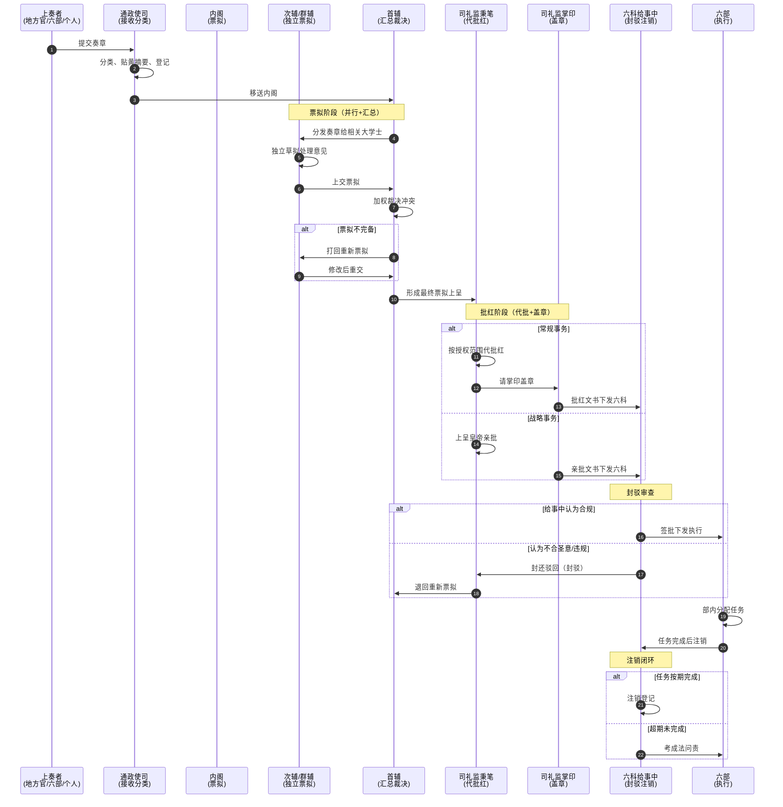

# 中央决策协调机制专题

> 内阁-司礼监-六科-通政司-六部之间的协调流转。本文档不是重复已有的"内阁制度"或"司礼监"，而是聚焦**它们之间如何协调**——这是明代日常行政最复杂、最高频的协调场景。

## 决策协调的五大角色

中央决策的协调不是简单的"内阁提出→皇帝批准"，而是**五个角色互相协调**：

| 角色 | 品级 | 协调职能 | 核心权力 |
|:--|:--|:--|:--|
| **通政使** | 正三品 | 接收天下奏章，分类移送 | 文书入口的把关 |
| **内阁首辅** | 正五品（加衔撑到一品） | 主持票拟，汇总裁决 | 票拟的形成 |
| **次辅/群辅** | 正五品 | 各自独立票拟 | 票拟的并行设计 |
| **司礼监秉笔** | 宦官（无品级） | 代皇帝批红 | 票拟的生效批准 |
| **司礼监掌印** | 宦官（无品级） | 掌玉玺，盖印 | 最终生效的物理动作 |
| **六科给事中** | 正七品/从七品 | 封驳+注销 | 流程的最终把关 |

**关键洞察**：这五个角色的品级差距极大——通政使正三品、内阁正五品、给事中正七品，但**权力的关键节点在内阁和司礼监**。品级不等于权力，制度设计才决定权力。

---

## 标准决策流转：奏章的全生命周期



---

## 协调细节一：通政使司的入口协调

### 通政使司的"前置协调"角色

通政司不只是"邮局"——它在奏章进入决策流程之前就进行了**前置协调**：

| 职能 | 协调价值 |
|:--|:--|
| **接收奏章** | 统一入口，防止"绕过通政司直接送皇帝"（中旨的特殊情况除外） |
| **分类移送** | 按奏章内容判断该送哪个部门处理 |
| **贴黄摘要** | 在长篇奏章末尾贴黄纸写摘要——让内阁首辅不必通读全文 |
| **登记存档** | 每份奏章都有编号，防止"半路消失"或"事后篡改" |
| **拒绝违规奏章** | 不符合格式的奏章可以直接退回 |

### 关键协调机制：贴黄

**贴黄**是明代文书处理的精华——奏章太长，首辅读不过来。通政司在奏章末尾贴一张黄纸，写**结构化摘要**：
- 事由（什么事情）
- 关键人物（涉及谁）
- 处理建议（上奏者建议怎么办）
- 紧急程度

这相当于**为内阁首辅做的预处理**——首辅先看贴黄判断轻重缓急，再决定是否细读原件。如果没有贴黄，内阁根本无法处理每天的奏章量。

---

## 协调细节二：内阁内部的协调

### 首辅-次辅-群辅的并行票拟

内阁不是"首辅说了算"——而是**并行票拟+汇总裁决**的协调模式：

```
首辅分发奏章
   ↓
次辅 ──┐
群辅甲 ┼──→ 各自独立草拟处理意见
群辅乙 ┘
   ↓
各大学士上交票拟给首辅
   ↓
首辅加权裁决
   ├─ 一致意见 → 直接采纳
   ├─ 分歧较小 → 首辅加权采纳某版
   ├─ 分歧较大 → 召集协商
   └─ 都不完备 → 全部打回重拟
```

### 首辅裁决权的边界

**首辅不是独裁**——他的裁决权受以下约束：

1. **次辅/群辅的独立票拟权**：群辅的票拟不需要首辅审批就能上呈，首辅只能"打回"不能"否决"
2. **内阁会议的协商**：重大事项首辅不能独断，必须召集全体大学士协商
3. **皇帝的批红**：首辅的最终票拟皇帝可以推翻
4. **六科封驳**：批红后的文书六科可以封还
5. **都察院弹劾**：首辅可以被弹劾

**强势首辅的例外**：张居正通过"考成法"实质上把内阁变成了决策中心，但这不是制度设计，是个人能力突破。张居正死后立即被反噬。

### 内阁协调的失败模式

| 失败 | 原因 | 后果 |
|:--|:--|:--|
| **票拟僵持** | 大学士意见严重分歧，无法形成一致 | 奏章滞留，皇帝催促 |
| **首辅专断** | 首辅压制其他大学士的票拟权 | 失去内部制衡，走向"宰相化" |
| **群体怠工** | 大学士们都不认真票拟 | 决策质量下降 |
| **首辅空缺** | 首辅出缺未及时补任 | 内阁失去协调核心 |

---

## 协调细节三：内阁与司礼监的协调

### 票拟-批红的关键交接

**内阁和司礼监不是上下级关系**——内阁是外朝，司礼监是内廷。两者通过**文书流转**协调：

```
内阁 → 票拟 → 司礼监秉笔（代批红）→ 司礼监掌印（盖章）→ 下发
```

这个交接的协调机制：

| 协调点 | 机制 |
|:--|:--|
| **文书的物理传递** | 由司礼监随堂太监负责，不让内阁的人进内廷送 |
| **批红的范围授权** | 律例明确规定哪些事务可代批、哪些必须亲批 |
| **批红的样式** | 用朱笔（红笔）写"如拟"、"准"、"知道了"等简短批示 |
| **盖章的次序** | 掌印太监每次用印都要登记（用印时间/事由/用印人） |

### 司礼监内部的协调

司礼监自己也是协调体系：

```
掌印太监（1人）
   │  管玉玺、管全宦官人事
   │  不直接批红
   ▼
秉笔太监（若干人，通常4-5人）
   │  代皇帝批红
   │  排名第一的通常兼东厂提督
   │  各秉笔按奏章类型分工
   ▼
随堂太监（若干人）
      协助秉笔处理杂务
      文书的物理流转
```

### 关键协调机制：掌印和秉笔的分离

**为什么要把"批红"和"盖章"分给两个人**？

- **批红（秉笔）**：决定内容的"是/否"
- **盖章（掌印）**：让内容生效的物理动作

如果一个人同时握有批红和盖章两权，等于拥有完整的"代皇帝决策权"——权力过大。分离后，**秉笔可以批红但盖不了章，掌印可以盖章但批不了红**，必须合作。

**历史教训**：魏忠贤同时担任司礼监秉笔（排名第一）和东厂提督——虽然没有同时任掌印，但通过控制其他秉笔和掌印，实质上独揽了批红+盖章+监察三权。

### 内阁首辅与司礼监掌印的私人关系约束

**制度禁止内阁与司礼监私下交往**——防止内外勾结：
- 内阁首辅不能私下见司礼监太监
- 文书往来必须通过通政司或随堂太监中转
- 违者以"结交近侍"罪论处（重罪）

**历史教训**：张居正的成功部分来自与司礼监掌印冯保的"政治联盟"——这违反了制度设计但暂时有效。张居正死后，冯保被清算，联盟反噬。

---

## 协调细节四：批红后的封驳协调

### 六科给事中的"末端否决权"

六科给事中是**整个决策流程的最后一道关口**——已经批红、已经盖章的文书，给事中仍然可以封还。

### 封驳的协调流程

```
司礼监下发批红文书
        ↓
对口六科给事中审查
        ├─ 形式审查：是否合程序（无越权、无遗漏）
        ├─ 实质审查：是否合圣意（给事中的理解）
        └─ 一致性审查：与现有律例是否冲突
        ↓
合规 → 签批下发六部执行
不合规 → 封还司礼监（说明理由）
        ↓
司礼监可选择
        ├─ 修改后重新下发
        ├─ 报皇帝亲裁
        └─ 强行下发（皇帝压给事中——但需承担政治代价）
```

### 封驳权的边界

**给事中不能封驳皇帝**——只能"封还诏旨"。但封驳权可以表达政治异议：

| 场景 | 给事中的行动 | 后果 |
|:--|:--|:--|
| 皇帝中旨（不经内阁） | 集体封驳 | 皇帝通常收回（承担"违制"压力） |
| 内阁票拟错误 | 封还说明理由 | 内阁重新票拟 |
| 六部奏章违规 | 驳正（不是封驳） | 退回六部修改 |
| 给事中内部意见不一 | 多数决定 | 少数可单独上奏异议 |

### 历史教训：万历朝的"封驳瘫痪"

万历皇帝想立皇三子为太子（违反嫡长子继承制）。六科给事中和都察院御史集体封驳反对——结果万历采取**奏章留中**（既不批也不退）来对抗，造成数十年政治瘫痪。

**启示**：当末端否决权遇上首端决策权的对抗，**协调机制会失效**——必须有超时机制或最终裁决机制。

---

## 协调细节五：注销监督的闭环协调

### 六科的"任务跟踪"职能

封驳只是六科的工作之一。**注销监督**才是日常最繁重的工作——跟踪六部每项任务的完成状态：

```
批红文书下发六部
        ↓
六部接收任务
        ↓
对口给事中登记：任务、负责人、时限、验收标准
        ↓
任务进行中
        ├─ 按期完成 → 给事中注销（销账）
        ├─ 申请延期 → 给事中审批
        ├─ 超期未完成 → 给事中启动考成法问责
        └─ 长期超期 → 考功司降权/停俸
```

### 注销监督的协调价值

| 价值 | 说明 |
|:--|:--|
| **闭环确认** | 任务不只下发了，还要确认完成了 |
| **时效约束** | 时限是制度化的，不是"尽快" |
| **责任追溯** | 每个任务有明确负责人 |
| **超期问责** | 不完成的任务有后果（考成法） |

---

## 中央决策协调的失败模式与启示

### 五种典型失败

| # | 失败模式 | 历史案例 | 后果 |
|:--|:--|:--|:--|
| 1 | **皇帝怠政（首端堵塞）** | 万历近三十年不上朝 | 奏章堆积如山，决策瘫痪 |
| 2 | **司礼监专权（中段绑架）** | 魏忠贤把持司礼监 | 假借皇帝意志，迫害异己 |
| 3 | **首辅专断（票拟独裁）** | 张居正虽有效但破坏制衡 | 死后被反噬，制度倒退 |
| 4 | **封驳瘫痪（末端对抗）** | 国本之争 | 皇帝留中，给事中集体封驳，死锁 |
| 5 | **党争工具化** | 东林党vs阉党 | 协调机制变成派系斗争工具 |

### 设计启示

1. **协调链必须有超时机制**——皇帝怠政导致整链瘫痪，编排系统中**任何节点的处理都必须有时限**
2. **末端否决权不能滥用**——给事中的封驳权本是纠错，但变成党争工具时反而破坏系统
3. **首辅的裁决权不能突破制度边界**——张居正的成功是个例不是常态
4. **司礼监的"代批"必须有明确范围**——超越范围就是越权
5. **私人联盟（首辅+掌印）违反制度**——内廷外朝必须保持距离

---

## 编排参考

### 直接对应：编排系统的中央决策协调

| 明代角色 | 编排系统角色 | 关键协调职能 |
|:--|:--|:--|
| 通政使司 | **交互审核 Agent**（翻译用户输入） | 入口把关、生成贴黄摘要 |
| 内阁首辅 | **首席规划 Agent** | 汇总方案、加权裁决 |
| 次辅/群辅 | **并行规划 Agent** | 独立提出方案 |
| 司礼监秉笔 | **司礼监 Agent**（代行常规批红） | 在授权范围内代行批准 |
| 司礼监掌印 | **总控 Agent 的"盖章"动作** | 物理执行权（资源扣减/状态变更） |
| 六科给事中 | **交互审核 Agent**（驳回偏离意图的输出） | 末端封驳、任务跟踪、超期问责 |

### 推荐的协调机制

1. **贴黄机制**——所有长输入必须先生成结构化摘要再处理
2. **并行票拟+汇总裁决**——多个规划 Agent 各自独立设计方案，首席汇总
3. **批红-盖章分离**——批准权和执行权分离（规划Agent批准，执行Agent执行）
4. **封驳机制**——末端审核 Agent 可以驳回首端的输出
5. **注销机制**——每个任务有负责人、时限、验收标准，超期有后果
6. **代批范围授权**——常规事务可代行，战略事务必须用户亲批

### 关键铁律

- **任何决策节点的处理都必有时限**——防止"奏章留中"式的瘫痪
- **末端否决权的次数有上限**——防止封驳变成恶意拖延
- **代批范围必须由律例明确**——不允许模糊授权
- **规划 Agent 与执行 Agent 必须分离**——防止"既是运动员又是裁判"
- **代批 Agent 不能持执行权**——司礼监批红但不能自己去调用工具

### 详细映射参见
- [04-六部体系](../02-执行链/文官执行/01-六部体系.md) — 六部协同四种方式
- [03-司礼监与宦官体系](../01-决策链/03-司礼监与宦官体系.md) — 司礼监内部分工
- [03-六科给事中](../03-监察链/02-六科给事中.md) — 封驳权详解
- [08-奏章流转完整路径图](../04-信息链/03-奏章流转完整路径图.md) — 端到端流转
