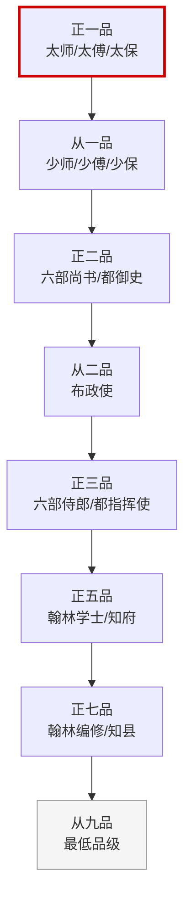

# 明朝官职品级表

## 品级体系

明代官员分九品，每品分正、从两级，共计十八级。以下列出与编排系统相关的核心官职。

## 正一品
| 官职 | 对应机构 | 说明 |
|:--|:--|:--|
| 左/右都督 | 五军都督府 | 各府最高长官（荣誉职位居多） |
| 太师/太傅/太保 | 三公 | 最高荣誉衔，不掌实权 |

## 从一品
| 官职 | 对应机构 | 说明 |
|:--|:--|:--|
| 都指挥同知 | 五军都督府 | 都督的副手 |
| 少师/少傅/少保 | 三孤 | 次高荣誉衔 |
| 太子太师/太傅/太保 | 东宫官职 | 太子的荣誉老师（多为兼职加衔） |

## 正二品
| 官职 | 对应机构 | 说明 |
|:--|:--|:--|
| **六部尚书** | 吏户礼兵刑工 | 各部最高长官 |
| **都指挥使** | 都指挥使司（都司） | 省级军事长官 |
| **左/右都御史** | 都察院 | 最高监察长官 |

## 从二品
| 官职 | 对应机构 | 说明 |
|:--|:--|:--|
| 左/右布政使 | 各省（民政） | 省级行政长官 |
| 都指挥同知 | 都指挥使司 | 都指挥使的副手 |

## 正三品
| 官职 | 对应机构 | 说明 |
|:--|:--|:--|
| **六部左/右侍郎** | 六部 | 各部副长官 |
| **通政使** | 通政司 | 通政司最高长官 |
| **大理寺卿** | 大理寺 | 最高复核长官 |
| **锦衣卫指挥使** | 锦衣卫 | 锦衣卫最高长官 |
| 左/右副都御史 | 都察院 | 都察院副长官 |

## 从三品
| 官职 | 对应机构 | 说明 |
|:--|:--|:--|
| 左/右参政 | 各省 | 布政使的副手 |

## 正四品
| 官职 | 对应机构 | 说明 |
|:--|:--|:--|
| 左/右通政 | 通政司 | 通政使的副手 |
| 左/右佥都御史 | 都察院 | 都御史的低级副手（总督常带此衔出任） |
| 大理寺左/右少卿 | 大理寺 | 大理寺卿的副手 |
| 左/右参议 | 通政司 | 通政司中层 |

## 从四品
| 官职 | 对应机构 | 说明 |
|:--|:--|:--|
| 知府 | 各府 | 府级行政长官 |

## 正五品
| 官职 | 对应机构 | 说明 |
|:--|:--|:--|
| **郎中** | 六部各司 | 各清吏司长官 |
| **翰林学士** | 翰林院 | 皇帝的学术顾问 |
| **大学士（本职）** | 内阁 | 内阁大学士的本职品级（正五品！靠加衔撑到一品） |
| 大理寺左/右寺丞 | 大理寺 | 大理寺中层 |
| 锦衣卫千户 | 锦衣卫 | 千户所长官 |

## 从五品
| 官职 | 对应机构 | 说明 |
|:--|:--|:--|
| 员外郎 | 六部各司 | 郎中的副手 |
| 翰林院侍读/侍讲学士 | 翰林院 | 翰林学士的副手 |

## 正六品
| 官职 | 对应机构 | 说明 |
|:--|:--|:--|
| **主事** | 六部各科 | 各司下设科的长官 |
| 翰林院编修 | 翰林院 | 庶吉士"散馆"后的首选职位 |
| 百户 | 卫所 | 百户所长官 |
| 锦衣卫百户 | 锦衣卫 | 锦衣卫基层层级 |

## 正七品
| 官职 | 对应机构 | 说明 |
|:--|:--|:--|
| **都给事中** | 六科 | 各科正科长 |
| **监察御史** | 都察院十三道 | 十三道御史 |
| 知县 | 各县 | 县级行政长官 |
| 翰林院检讨 | 翰林院 | 庶吉士"散馆"后的职位 |

## 从七品
| 官职 | 对应机构 | 说明 |
|:--|:--|:--|
| **左/右给事中** | 六科 | 各科副科长 |
| **给事中** | 六科 | 各科普通监察员 |

## 从八品
| 官职 | 对应机构 | 说明 |
|:--|:--|:--|
| 县丞 | 各县 | 知县的副手 |

## 正九品
| 官职 | 对应机构 | 说明 |
|:--|:--|:--|
| 巡检 | 各地巡检司 | 基层治安官 |

## 从九品
| 官职 | 对应机构 | 说明 |
|:--|:--|:--|
| 典史 | 各县 | 县级文书/治安底层官 |
| 驿丞 | 各地驿站 | 基层驿站管理员 |

---

## 重要说明

1. **"品"和"权"分离**：品级只代表俸禄和礼仪地位，不代表实际权力。一个正七品的给事中可以弹劾正二品的尚书——因为品级来自官僚体系，权力来自制度设计。

2. **内阁的品级悖论**：大学士本职只有正五品，但内阁是实际上的最高行政中枢。解法是大学士**兼职**吏部尚书或其他部侍郎衔，通过兼职衔把品级提上来。所以你会看到"吏部尚书兼文渊阁大学士"——吏部尚书是正二品（品级/俸禄/礼仪地位），文渊阁大学士是正五品（实际权力所在）。

3. **差遣和本职**：总督、巡抚、经略、钦差等不是官职，是**差遣**——暂时授权一个官员去做特定的事。差遣结束后职称回收。这种"本职（品级/俸禄）+ 差遣（临时权力）"的分离是明代人事制度的精髓。

4. **御史的低品高权**：监察御史只有正七品，但权力极大。这是因为明代故意让监察官员品级低——他们没有高级官员的人情网络和利益牵扯，弹劾时没有顾忌。
