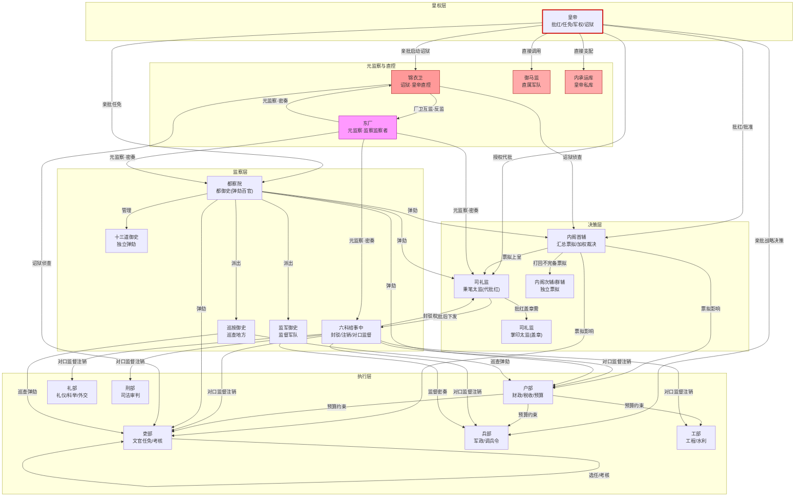
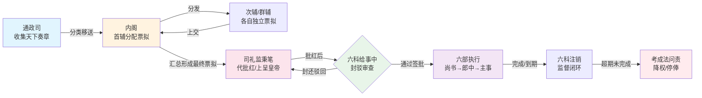
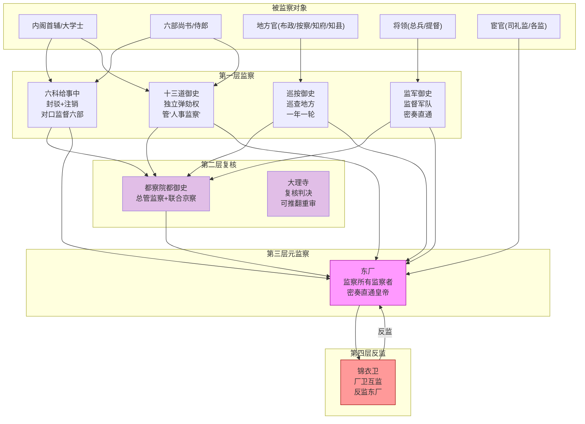
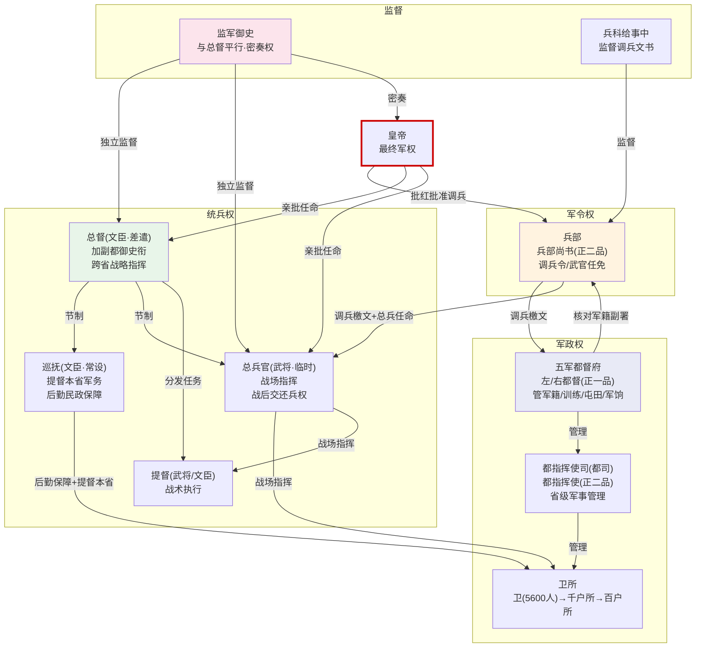
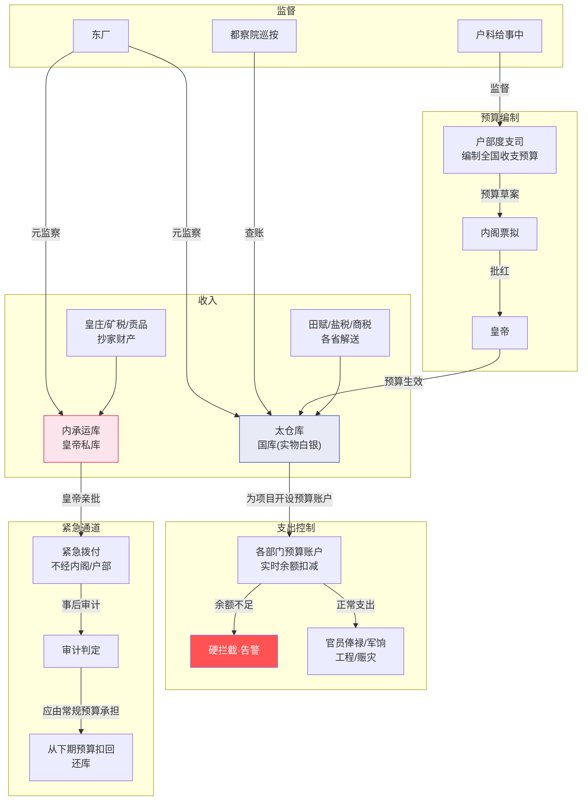
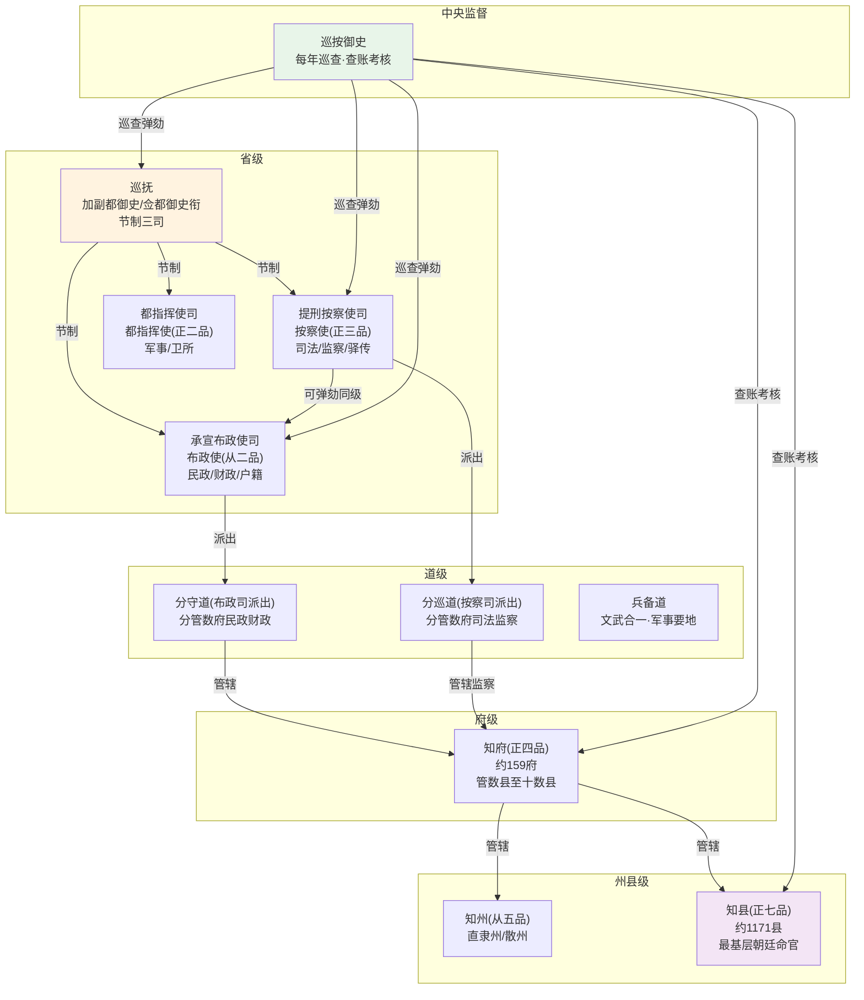
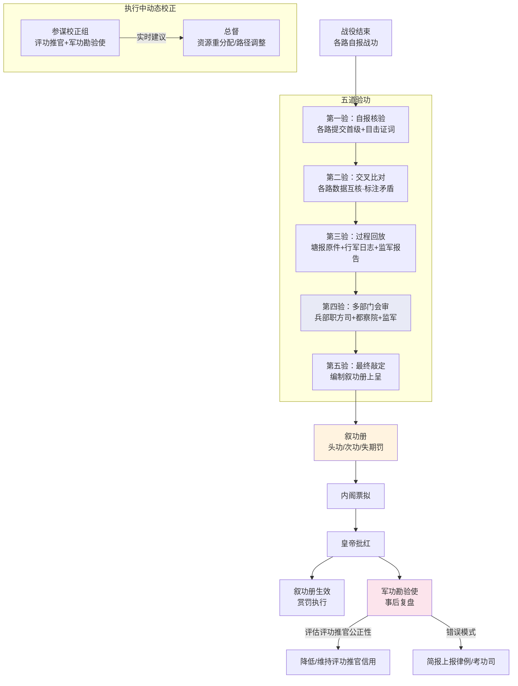
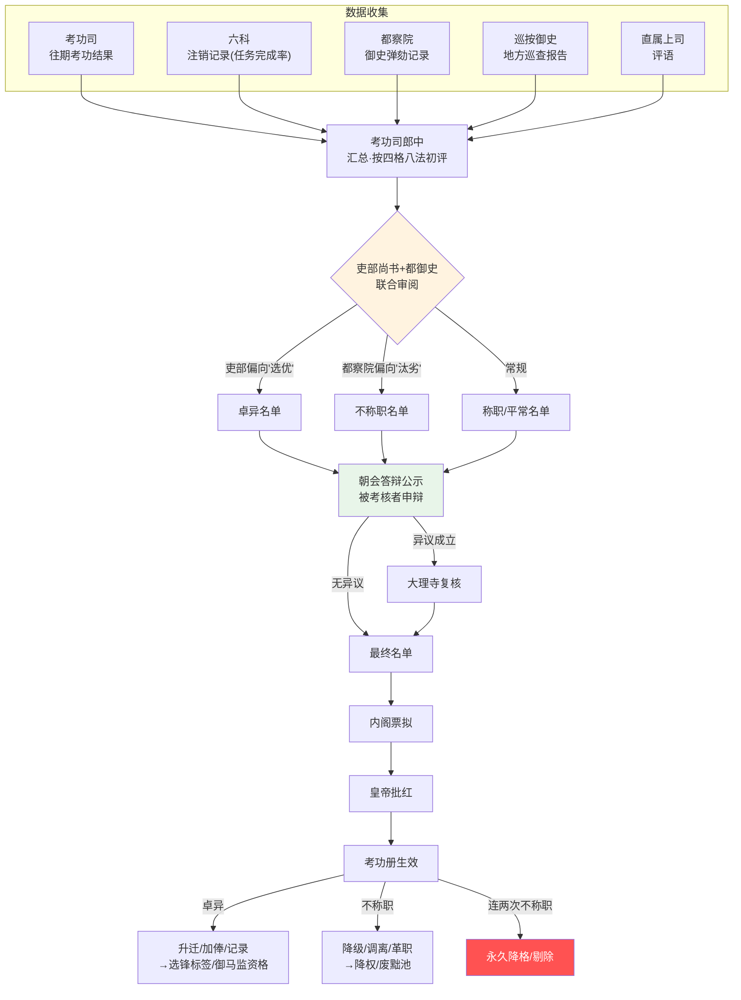

# 大明职位关系全景图

> 每个职位的**职责、受谁制约/监督、与哪些职位存在什么关系**，全部在此。

---

## 一、皇权层

### 皇帝
| 维度 | 内容 |
|:--|:--|
| **做什么** | 批红（最终批准所有重大决策）、任免三品以上官员、宣战/议和、启动诏狱、动用内承运库、调用御马监。常规批红可授权司礼监代批，但战略级决策必须亲批 |
| **受谁制约** | 祖宗成法（制度惯性，不能明着推翻祖制）、六科封驳（给事中可封还皇帝诏旨）、廷议压力（重臣集体反对时很难强硬推行）、文官集团的道德约束（"圣君"形象压力） |
| **受谁监督** | 理论上无人能监督皇帝。但都察院御史可"委婉进谏"（批评皇帝的具体决策而非皇帝本人），六科给事中可封驳诏旨，内阁首辅在票拟中可表达反对意见 |
| **监督谁** | 所有人——皇帝拥有最终的人事任免权、批红权、调兵权、诏狱启动权 |
| **与内阁关系** | 内阁票拟 → 皇帝批红。皇帝可推翻票拟，但未经内阁票拟直接下旨（中旨）会被视为不合程序 |
| **与司礼监关系** | 授权司礼监代批常规事务，保留战略决策亲批权。司礼监是皇权的延伸而非独立权力 |
| **与六部关系** | 六部尚书直接对皇帝负责（废除丞相后），但实际通过内阁票拟间接管理 |

### 司礼监掌印太监
| 维度 | 内容 |
|:--|:--|
| **做什么** | 掌管皇帝玉玺，所有批红文书需掌印太监盖章才生效。司礼监最高长官，管理全体宦官的人事和考核 |
| **受谁制约** | 皇帝的直接命令（随时可撤换）、东厂的监视、锦衣卫的反监、都察院可弹劾 |
| **受谁监督** | 东厂（厂公通常由司礼监二把手兼任，因此是内部制衡）、锦衣卫、都察院 |
| **监督谁** | 全体宦官、秉笔太监的批红是否越权 |
| **与秉笔太监关系** | 掌印和秉笔是司礼监两个最关键的职位——掌印管盖章(生效)，秉笔管批红(内容)。两者分离、互相制衡，防止一个太监独揽批红和盖章两权 |
| **与内阁关系** | 掌印太监不直接参与票拟，但可通过控制玉玺间接影响哪些票拟能快速生效 |

### 司礼监秉笔太监
| 维度 | 内容 |
|:--|:--|
| **做什么** | 在授权范围内代表皇帝批红（用朱笔在票拟上写最终决定）。是皇帝和内阁之间的文书枢纽——每天阅读大量票拟，按皇帝的意思批写 |
| **受谁制约** | 掌印太监（盖章权分离）、律例预设的代批范围（超越权限代批一经查实即作废）、皇帝的直接命令 |
| **受谁监督** | 六科给事中（可封驳代批结果）、东厂（内部监督）、审计（事后审查代批记录） |
| **监督谁** | 不直接监督任何人——秉笔太监是执行者而非决策者 |
| **与内阁关系** | 日常工作中与内阁首辅接触最频繁——协商票拟中的事务性处理。但私下交往受到严格限制（防止内外勾结） |

---

## 二、内阁层

### 内阁首辅
| 维度 | 内容 |
|:--|:--|
| **做什么** | 主持内阁会议，汇总各大学士的票拟，加权裁决冲突，打回不完备的票拟方案，形成最终票拟上呈皇帝。是实际上的政府首脑（但不是丞相——没有六部的直接指挥权） |
| **受谁制约** | 皇帝批红（可推翻票拟）、六科封驳（可封还首辅主导的票拟）、都察院弹劾、次辅和群辅的牵制（在内阁内部不是独裁） |
| **受谁监督** | 六科给事中、都察院御史、东厂密奏、锦衣卫监视 |
| **监督谁** | 次辅和群辅（打回不完备票拟）、通过票拟间接影响六部 |
| **与六部尚书关系** | 制度上六部尚书直接对皇帝负责——首辅不能直接命令尚书。但强势首辅（如张居正）通过票拟权+考成法实际上节制了六部 |
| **与司礼监关系** | 首辅的票拟必须经过司礼监批红才能生效。两者是互相依赖又互相制衡的关系 |

### 内阁次辅 / 群辅（大学士）
| 维度 | 内容 |
|:--|:--|
| **做什么** | 各自独立票拟（对奏章提出处理意见），分管不同领域的奏章。次辅在首辅出缺时递补 |
| **受谁制约** | 首辅（可打回票拟）、皇帝批红 |
| **受谁监督** | 与首辅相同——六科、都察院、东厂 |
| **与首辅关系** | 独立票拟权——群辅的票拟不需要首辅审批才能上呈。但首辅可以打回重新票拟。这种"独立提案+首辅汇总"类似于规划Agent的并行方案设计 |

---

## 三、六部层

### 吏部尚书（天官，正二品）
| 维度 | 内容 |
|:--|:--|
| **做什么** | 总管全国文官人事任免、考核、升迁降黜。主持京察（与都察院都御史共同主持）。三品以下官员的任免吏部可直接提名，三品以上需廷推（六部尚书+都御史+大理寺卿会推）上呈皇帝亲批 |
| **受谁制约** | 皇帝批红（高级官员任免）、内阁票拟（可对吏部提名提反对意见）、都察院弹劾、六科给事中封驳 |
| **受谁监督** | 吏科给事中（对口监督）、都察院御史、东厂 |
| **监督谁** | 四司郎中、全国文官的考核和升迁 |
| **与都察院关系** | 联合主持京察——吏部管"升"，都察院管"黜"。两者必须合作但互相牵制 |

#### 吏部四司郎中（正五品）
| 司 | 做什么 | 受谁制约/监督 | 与谁关联 |
|:--|:--|:--|:--|
| **文选司** | 文官选任——决定谁去哪个岗位。全国知县以上文官的空缺由文选司提出候选人名单 | 吏部尚书（审批）、吏科给事中（监督选任是否合规）、都察院（弹劾用人不当） | 向尚书汇报，与考功司共享官员考核数据 |
| **考功司** | 文官考核——收集京察和大计数据，划分四格等级，提出升/留/降/黜建议 | 吏部尚书+都御史(联合主持京察)、吏科给事中 | 向尚书汇报，与文选司联动（考核结果决定下次选任） |
| **稽勋司** | 文官档案——管理所有文官的履历、功过记录、勋级。是人事数据的"数据库" | 吏部尚书、吏科给事中 | 为文选司和考功司提供数据支撑 |
| **验封司** | 文官封爵和诰敕——管理封赠（给官员父母/祖父母的荣誉封号）和世袭爵位 | 吏部尚书、吏科给事中 | 与稽勋司共享档案数据 |

### 户部尚书（地官，正二品）
| 维度 | 内容 |
|:--|:--|
| **做什么** | 总管全国财政、税收、户籍、土地、度支预算。编制年度全国收支预算草案上呈内阁。十三司各管一省财政 |
| **受谁制约** | 皇帝批红（预算、重大开支）、内阁票拟、太仓库（超预算会被拦截）、户科给事中封驳 |
| **受谁监督** | 户科给事中、都察院巡按御史（地方财政审计）、审计（事后度支偏差简报） |
| **监督谁** | 十三司郎中、各省布政使（在财政事务上）、太仓库（管账不管实物，但账目核对） |

#### 户部十三司郎中（正五品，每省一司）
| 司 | 做什么 | 受谁制约 | 与谁关联 |
|:--|:--|:--|:--|
| **十三清吏司** | 每司分管对应省的所有财政事务——田赋征收、盐税、商税、户口统计、预算编制 | 户部尚书、户科给事中 | 与对应省的布政使司对接财政数据 |
| **度支司** | 编制全国年度预算、监控各部门预算执行率、管超支审批 | 户部尚书、户科给事中 | 与太仓库对接预算账户数据 |
| **金部司** | 管理国库的现金存量、铸币（铜钱）、金银储备 | 户部尚书 | 与太仓库的出纳日报对照 |
| **仓部司** | 管理全国粮仓——漕粮入仓、赈灾放粮、军粮调拨 | 户部尚书 | 与漕运总督、各省布政使对接 |

### 礼部尚书（春官，正二品）
| 维度 | 内容 |
|:--|:--|
| **做什么** | 总管全国礼仪、教育、科举、外交、祭祀。科举由礼部主持（会试）。制定全国礼仪规范 |
| **受谁制约** | 皇帝批红、内阁票拟、礼科给事中封驳 |
| **受谁监督** | 礼科给事中、都察院 |
| **监督谁** | 四司郎中、国子监、僧录司、道录司、会同馆、鸿胪寺（部分职能） |

#### 礼部四司郎中（正五品）
| 司 | 做什么 | 与谁关联 |
|:--|:--|:--|
| **仪制司** | 制定国家典礼规范——朝会礼仪、祭祀流程、皇帝出行仪仗 | 与鸿胪寺（排班执行）、太常寺（祭祀执行）是"定规则"与"执行"关系 |
| **祠祭司** | 管理祭祀和宗庙——祭天/地/社稷/孔子/宗庙的日期、规模、祭品规格 | 与太常寺（具体执行）、光禄寺（祭品采购）联动 |
| **主客司** | 管理外交和翻译——朝贡国使节接待规格、翻译事务 | 与会同馆（住宿接待）、四夷馆（翻译）、鸿胪寺（引见排班）联动 |
| **精膳司** | 管理宫廷宴会和赐宴——外藩使节宴会、官员赐宴的规格和安排 | 与光禄寺（食材和烹饪）联动 |

### 兵部尚书（夏官，正二品）
| 维度 | 内容 |
|:--|:--|
| **做什么** | 总管全国军政——武官任免、调兵令发布、兵器制造、军籍管理。但**不能直接指挥军队**——这是与五军都督府的关键分权 |
| **受谁制约** | 皇帝批红（调兵）、内阁票拟、兵科给事中封驳、五军都督府（核对军籍确认兵力后兵部檄文才生效） |
| **受谁监督** | 兵科给事中、都察院、总督（事后军功勘验） |
| **监督谁** | 四司郎中、各省总兵官的任免 |

#### 兵部四司郎中（正五品）
| 司 | 做什么 | 与谁关联 |
|:--|:--|:--|
| **职方司** | 管理军事地图、战略情报、敌情分析。是兵部的情报核心 | 与九边总督共享情报、与四夷馆获取境外情报 |
| **武选司** | 武官选任——全国卫所千户以上武官的提名和考核 | 与五军都督府（武官能力数据）、吏部文选司（文武任免并行） |
| **车驾司** | 管理军马和驿传——太仆寺养殖的军马分配、全国驿站的军事调度 | 与太仆寺（马政）、驿传系统 |
| **武库司** | 管理兵器制造和储备——火铳、火炮、盔甲、刀矛的生产和分配 | 与工部营缮司（制造）联动 |

### 刑部尚书（秋官，正二品）
| 维度 | 内容 |
|:--|:--|
| **做什么** | 总管全国司法审判和刑律执行。是"三法司"中的主审机关。管理全国监狱（但诏狱归锦衣卫） |
| **受谁制约** | 大理寺（可复核推翻判决）、都察院（监督审判公正）、刑科给事中封驳 |
| **受谁监督** | 刑科给事中、都察院、东厂 |
| **监督谁** | 十三司郎中、各省按察使（在司法事务上） |

#### 刑部十三司郎中（正五品）
| 司 | 做什么 | 与谁关联 |
|:--|:--|:--|
| **十三清吏司** | 按省分工——每司管辖对应省的刑事案件复核和上诉。各省徒以上（流放/死刑）案件必须报刑部复核 | 与对应省的按察使司对接，与大理寺（复核） |
| **律例馆** | 维护刑部的律例副本——确保审判时引用的法条是最新版本 | 与中央律例体系同步 |
| **提牢厅** | 管理刑部监狱——不是诏狱（归锦衣卫），而是普通刑事犯的监狱 | 独立于锦衣卫 |
| **司狱司** | 管理囚犯案底——犯罪记录、前科、减刑记录 | 为刑部审判提供历史参考 |

### 工部尚书（冬官，正二品）
| 维度 | 内容 |
|:--|:--|
| **做什么** | 总管全国工程营造、水利、屯田、工匠管理。负责京城和皇陵建设、黄河治理、大运河维护 |
| **受谁制约** | 皇帝批红、内阁票拟、户部预算（工程开支受户部核定预算约束）、工科给事中封驳 |
| **受谁监督** | 工科给事中、都察院（工程贪腐是重点监察领域）、审计决算 |
| **监督谁** | 四司郎中、全国工匠 |

#### 工部四司郎中（正五品）
| 司 | 做什么 | 与谁关联 |
|:--|:--|:--|
| **营缮司** | 宫殿/皇陵/城墙的建造和维护、木材石材的采办 | 与户部（预算）、兵部武库司（兵器制造中的木工/铁工部分） |
| **虞衡司** | 管理山林川泽——采木、采石、冶铁的许可和管理。管理全国的"自然资源开采权" | 与地方官府（采木/采石常扰民） |
| **都水司** | 水利工程——黄河治理、大运河维护、灌溉渠修建 | 与漕运总督（运河维护直接影响漕运）、各省 |
| **屯田司** | 管理屯田——军屯（卫所）和民屯（移民垦荒） | 与五军都督府（卫所屯田）、户部（屯田赋税） |

---

## 四、监察层

### 都察院左/右都御史（正二品）
| 维度 | 内容 |
|:--|:--|
| **做什么** | 最高监察长官。弹劾百官（可弹劾任何人包括内阁首辅）。与吏部联合主持京察。管理十三道御史 |
| **受谁制约** | 皇帝（御史的弹劾皇帝可以不采纳）、东厂元监察（可弹劾都御史）、锦衣卫反监 |
| **受谁监督** | 东厂（元监察）、锦衣卫、六科给事中（科道互相监督） |
| **监督谁** | 十三道御史、巡按御史、百官 |

### 十三道监察御史（正七品）
| 维度 | 内容 |
|:--|:--|
| **做什么** | 独立弹劾——每个御史独立上奏，不需经都御史批准。大事奏裁（上报皇帝裁决），小事立断（可自行决定处理）。品级低但权力大 |
| **受谁制约** | 弹劾必须附证据（诬告反坐）、东厂可质疑弹劾动机、都御史可调整御史的分管领域 |
| **受谁监督** | 东厂、锦衣卫、都御史（可考核御史） |
| **与六科给事中关系** | 御史管"人事监察"（弹劾官员个人），给事中管"流程监察"（封驳文书）。科道互不隶属但经常协作 |

### 巡按御史（正七品，外派差遣）
| 维度 | 内容 |
|:--|:--|
| **做什么** | 代天子巡狩地方——到各省检查财政账目、重审冤案、考核地方官、暂停问题官员职务。是中央派驻地方的"眼睛" |
| **受谁制约** | 巡按期一年（防止在地方结党），需向都察院报告巡按结果 |
| **受谁监督** | 都察院、东厂、锦衣卫 |
| **与地方官关系** | 品级低(正七品)但面对布政使(从二品)也毫不退让——因为他代表皇帝。巡抚是常驻，巡按是巡回——两者互补 |

### 六科给事中（都给事中正七品/给事中从七品）
| 维度 | 内容 |
|:--|:--|
| **做什么** | 封驳权（封还皇帝批红的诏旨，驳正六部的奏章）。注销监督（跟踪六部每项任务的完成状态）。六科各对口监督一部 |
| **受谁制约** | 皇帝（可无视封驳强行下发）、东厂（可弹劾给事中滥权） |
| **受谁监督** | 东厂、都察院（科道互察） |
| **与御史关系** | 给事中管"内"（行政文书流程），御史管"外"（官员行为） |

### 大理寺卿（正三品）
| 维度 | 内容 |
|:--|:--|
| **做什么** | 复核已判决案件——审查判决的法律依据和证据链。可推翻刑部和都察院的判决要求重审。不是重新审案而是法律审 |
| **受谁制约** | 皇帝可推翻大理寺复核结论、三法司会审时不是独断 |
| **受谁监督** | 东厂、都察院 |
| **与刑部/都察院关系** | 刑部主审→都察院监督审判→大理寺复核判决——三法司各管一段 |

---

## 五、军事层

### 五军都督府左/右都督（正一品）
| 维度 | 内容 |
|:--|:--|
| **做什么** | 分管全国卫所的军政——管理军籍、训练、屯田、军饷、器械。五府各管一片区域的都司和卫所。**只管军政不管军令**（不能调动军队） |
| **受谁制约** | 兵部（调兵权分离）、皇帝批红（任何调兵）、兵科给事中 |
| **受谁监督** | 兵科给事中、都察院、监军御史 |
| **与兵部关系** | 五军都督府有军政(管理军队)无权调兵，兵部有军令(调兵令)无军政管理权——分权制衡 |

### 都指挥使（正二品，省级军事长官）
| 维度 | 内容 |
|:--|:--|
| **做什么** | 管理一省范围内所有卫所的日常训练、屯田、军饷、兵籍 |
| **受谁制约** | 五军都督府（上级军政机关）、兵部（调兵令）、巡抚（节制权）、总督（经略权） |
| **受谁监督** | 监军御史、巡按御史、兵科给事中 |
| **与布政使/按察使关系** | 三司并立——都指挥使(军事)与布政使(民政)、按察使(司法)互不统属 |

### 总兵官（临时/常设，武将）
| 维度 | 内容 |
|:--|:--|
| **做什么** | 战时指挥指定军队作战。战前从兵部持调兵令到指定卫所接收军队，战后交还兵权回卫所。是"统兵权"而非"调兵权"或"军政管理权" |
| **受谁制约** | 总督/巡抚（文官节制武将）、兵部、战后军功勘验、监军御史 |
| **受谁监督** | 监军御史（实时监督战况和战功自报）、军功勘验使（事后复盘） |
| **与总督关系** | 总督(文官)管战略和后勤，总兵(武将)管战场指挥。总兵必须服从总督的战略决定 |

### 提督（明代中后期，武将/文官）
| 维度 | 内容 |
|:--|:--|
| **做什么** | 在特定地区或特定战事中负责具体军事行动。比总兵更偏重战术执行，有时与总兵并行设立。到明末提督逐渐制度化 |
| **受谁制约** | 总督/巡抚节制、兵部、监军御史 |
| **受谁监督** | 监军御史、军功勘验使 |

### 监军御史（都察院派出）
| 维度 | 内容 |
|:--|:--|
| **做什么** | 代表皇帝随军监督——核实将领自报的杀敌数量和战斗经过。有密奏权（直通皇帝）。可挂白旗暂停有问题的将领（需总督联署）。**不参与指挥决策** |
| **受谁制约** | 不能独立撤销将领（需总督联署）、密奏频次有上限、密奏内容虚假反坐 |
| **受谁监督** | 东厂（元监察）、都察院（本职上级） |
| **与总督关系** | 监军不是总督的下属——两者平行。总督管打仗，监军管监督打仗 |

---

## 六、特务与直控层

### 锦衣卫指挥使（正三品）
| 维度 | 内容 |
|:--|:--|
| **做什么** | 掌管北镇抚司诏狱（独立于刑部的监狱）——直接逮捕、审讯、关押皇帝指定的犯人。宫廷安保和仪仗。情报收集 |
| **受谁制约** | 必须有皇帝签发的驾帖（逮捕令）才能抓人、诏狱案卷事后可被都察院和东厂审查、刑科给事中可签批驾帖 |
| **受谁监督** | 东厂（反监锦衣卫）、都察院（可弹劾）、刑科 |
| **与东厂关系** | 厂卫互监——东厂监视锦衣卫是否滥用诏狱，锦衣卫监视东厂是否越权 |

### 东厂提督太监（厂公/督公）
| 维度 | 内容 |
|:--|:--|
| **做什么** | 元监察——监察所有监察者（监督Agent、监军、审计、军功勘验使）。密奏直通皇帝不经内阁。可弹劾任何人。无执行权 |
| **受谁制约** | 弹劾需附证据、弹劾频次上限（律例设定）、锦衣卫反监 |
| **受谁监督** | 锦衣卫（厂卫互监）、都察院（弹劾东厂违制） |
| **与锦衣卫关系** | 互相监督——东厂督公通常是司礼监二把手(宦官)，锦衣卫指挥使是勋贵武将——两者不属同一体系 |

### 御马监提督太监
| 维度 | 内容 |
|:--|:--|
| **做什么** | 掌管皇帝直属军队（四卫营约2-3万人+勇士营）。只听皇帝直接命令，绕开五军都督府和兵部。用于兜底执行、高风险直派 |
| **受谁制约** | 规模上限由律例设定、频繁调用触发审计预警、军饷从内承运库出（不占太仓库预算） |
| **受谁监督** | 东厂、锦衣卫、审计（事后审查调用是否必要） |
| **与五军都督府关系** | 完全独立——御马监军队不在五军都督府的军籍上 |

---

## 七、地方层

### 承宣布政使（从二品，省级民政长官）
| 维度 | 内容 |
|:--|:--|
| **做什么** | 管理一省民政、财政、户籍。向各府州县下达税收指标和民政政策。编制本省年度收支上报户部 |
| **受谁制约** | 户部（财政事务上）、巡抚（节制权）、按察使（司法独立不受布政使管辖） |
| **受谁监督** | 巡按御史（查账、考核）、户科给事中、都察院 |
| **与按察使/都指挥使关系** | 三司并立互不统属——布政使管民政但管不了司法和军事。重大行动需三司协商 |

### 提刑按察使（正三品，省级司法长官）
| 维度 | 内容 |
|:--|:--|
| **做什么** | 管理一省司法和监察——重审各府上报的徒刑以上案件、弹劾本省违法官员、管理省内驿传 |
| **受谁制约** | 刑部（司法事务上）、都察院（监察事务上）、巡抚（节制权） |
| **受谁监督** | 巡按御史、刑科给事中 |
| **与布政使关系** | 按察使可弹劾布政使——同级监察权的设计 |

### 分守道 / 分巡道 / 兵备道（正四品~从四品）
| 道 | 做什么 | 派出自 | 与谁关联 |
|:--|:--|:--|:--|
| **分守道** | 分管数府的民政和财政——是布政司的派出机构 | 布政司 | 下辖各府知府，上向布政使汇报 |
| **分巡道** | 分管数府的司法和监察——是按察司的派出机构 | 按察司 | 下辖各府，可弹劾知府 |
| **兵备道** | 军事要地的文武合一职位——兼管军队和民政 | 双重（兵部+地方） | 与卫所指挥使协同，有权调动本地卫所军队 |

### 知府（正四品，府级行政长官）
| 维度 | 内容 |
|:--|:--|
| **做什么** | 管理一府（约辖数县至十数县）的民政、司法、税收、教育、治安。初审本府徒刑案件。考核下属知县 |
| **受谁制约** | 布政使（民政）、按察使（司法）、分守道/分巡道（日常监管）、巡抚 |
| **受谁监督** | 巡按御史、按察使、分巡道 |
| **与知县关系** | 直接上级——知县的考核、升迁、处罚首先由知府提出 |

### 知州（从五品，直隶州或散州）
| 维度 | 内容 |
|:--|:--|
| **做什么** | 直隶州直属省（地位同府），散州属府（地位介于府和县之间）。职责类似知府/知县 |
| **受谁制约** | 直隶州→布政使/巡抚；散州→知府 |
| **受谁监督** | 同一套监察体系 |

### 知县（正七品，最基层朝廷命官）
| 维度 | 内容 |
|:--|:--|
| **做什么** | 管理一县所有事务——征税、司法(初审笞杖案件)、治安、教育、户口、赈灾。是朝廷与百姓之间的唯一接口 |
| **受谁制约** | 知府（直接上级）、布政使（财政）、按察使（司法）、各种道的派出监管、户部预算 |
| **受谁监督** | 巡按御史（查账、重审案件）、分巡道、按察使、知府 |
| **关键压力** | 上级层层加码的税收任务 vs 地方百姓的实际承受力——知县是"夹心层" |

---

## 八、财政层

### 户部度支司郎中
| 维度 | 内容 |
|:--|:--|
| **做什么** | 编制全国年度预算——汇总十三司上报的各省收支和各部的开支计划，做全国收支平衡。预算草案上呈户部尚书→内阁票拟→皇帝批红 |
| **受谁制约** | 户部尚书、内阁、皇帝批红、户科给事中 |
| **受谁监督** | 户科给事中、都察院、审计 |
| **与太仓库关系** | 度支司管"预算"（计划），太仓库管"执行"（实际收款和付款）——两者分离 |

### 太仓库太监 / 户部管库主事
| 维度 | 内容 |
|:--|:--|
| **做什么** | 太仓库的实际管理者——管实物白银的收纳入库和支出。为各部门和各项目开设预算账户，实时扣减余额，余额不足自动拦截。每日生成出纳日报 |
| **受谁制约** | 户部（核定预算额度）、皇帝批红（追加预算）、内承运库（紧急拨付的另一通道） |
| **受谁监督** | 户科给事中、审计（度支偏差简报）、东厂 |
| **与户部关系** | 太仓库管实物(钱的实际存放)，户部管账(预算编制和决算)——"管钱的不能花钱，花钱的不能管钱" |

### 内承运库太监
| 维度 | 内容 |
|:--|:--|
| **做什么** | 管理皇帝私人库藏——来源是皇庄收入、矿税、贡品、抄家财产。皇帝可不经内阁直接支配内库资金。内库支出不入国家财政账目 |
| **受谁制约** | 皇帝亲批（大额拨付）、律例（内库总额不可超过国库总额X%）、审计事后审查 |
| **受谁监督** | 东厂、审计（事后审查是否有系统性滥用）、锦衣卫 |
| **与太仓库关系** | 两条独立财政通路——国库(太仓库)管常规、内库(内承运库)管紧急和皇帝直控 |

---

## 九、考核与人才层

### 考功司郎中（吏部下属）
| 维度 | 内容 |
|:--|:--|
| **做什么** | 对全体官员进行周期性考核——京官六年京察、地方官三年大计。按四格(守/才/政/年)评分，按八法劣汰。提出升/留/降/黜名单 |
| **受谁制约** | 吏部尚书+都御史(联合主持)、皇帝批红(重要升降) |
| **受谁监督** | 吏科给事中、东厂、朝会答辩(公示可异议) |
| **与文选司关系** | 考功结果决定下次文选司的选任 |

### 翰林学士（正五品）+ 庶吉士
| 维度 | 内容 |
|:--|:--|
| **做什么** | 翰林学士：皇帝的学术顾问、草拟重要诏书、经筵日讲。庶吉士：从进士中选拔进入翰林院学习三年的精英储备 |
| **受谁制约** | 内阁（大学士多从翰林学士中选拔）、皇帝 |
| **受谁监督** | 都察院、东厂 |
| **与内阁关系** | 翰林院→内阁的人才管道："非进士不入翰林，非翰林不入内阁" |

---

## 权力制约关系总图

### 图一：中央权力架构全景

### 图二：票拟—批红—封驳—执行 决策流转

### 图三：监察体系互锁网络

### 图四：军事指挥链 — 军政/军令/统兵三权分离

### 图五：财政流转 — 国库内库双轨

### 图六：地方行政三层架构

### 图七：竞功五道验功全流程

### 图八：考功考核全流程

---

## 附录：职位品级速查

| 品级 | 代表性职位 |
|:--|:--|
| **正一品** | 左/右都督（五军都督府）、太师/太傅/太保（三公） |
| **从一品** | 少师/少傅/少保（三孤）、都指挥同知 |
| **正二品** | 六部尚书、都指挥使、左/右都御史 |
| **从二品** | 布政使、都指挥同知 |
| **正三品** | 六部侍郎、通政使、大理寺卿、锦衣卫指挥使、按察使 |
| **从三品** | 光禄寺卿、太仆寺卿、参政 |
| **正四品** | 左/右通政、左/右佥都御史（总督常带此衔）、大理寺少卿、知府 |
| **从四品** | 道员 |
| **正五品** | 六部郎中、翰林学士、大学士本职(内阁！)、大理寺丞 |
| **从五品** | 知州（直隶州）、员外郎 |
| **正六品** | 六部主事、百户 |
| **正七品** | 都给事中、监察御史、知县、巡按御史（品极低权力极大） |
| **从七品** | 给事中 |
| **从九品** | 驿丞 |
