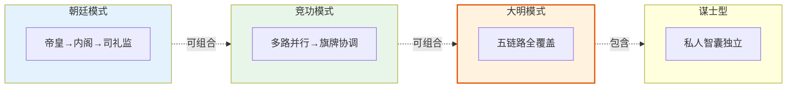

# 按编排模式反查明朝元素

> 🎯 **本文档解决一个核心痛点**：当你在设计或使用某个编排模式时，**应该参考哪些明朝元素**？
>
> 所有 5 个编排模式（朝廷/竞功/大明/司礼监/谋士型）使用的明朝概念，按"模式 → 角色 → 文档"三列整理。**从编排设计反查历史依据**，一表打通。

📍 返回 [README](../00-总览/README.md) | 直接查 [术语速查表](../00-总览/03-术语速查表.md) | 查 [官职品级表](02-明朝官职品级表.md)

---

## 快速使用指南

**你是哪种场景？**

| 你正在做什么 | 去哪一节 |
|:--|:--|
| 设计/实现朝廷模式（hierarchy Coordination） | [§1 朝廷模式](#1-朝廷模式-hierarchy-coordination) |
| 设计/实现竞功模式（market Coordination） | [§2 竞功模式](#2-竞功模式-market-coordination) |
| 设计/实现大明模式（混合编排） | [§3 大明模式](#3-大明模式-hybrid) |
| 理解司礼监代批机制（横切机制） | [§4 司礼监批次](#4-司礼监批次横切机制) |
| 设计/实现谋士型（council Coordination） | [§5 谋士型](#5-谋士型council-coordination) |
| 理解跨模式的协调机制 | [§6 协调机制专题](#6-协调机制专题跨模式) |
| 查找某术语在编排中的映射 | [术语速查表](../00-总览/03-术语速查表.md) |

---

## 1. 朝廷模式（hierarchy Coordination）

> 文官体制编排。任务整体确定性高、可清晰拆解为依赖链。

### 1.1 角色到明朝元素的映射

| 编排角色 | 明朝映射 | 核心职能 | 详细文档 |
|:--|:--|:--|:--|
| **通政使 Agent（Tongzhengshi）** | 通政使司 | 翻译用户输入、贴黄摘要、模式路由（见决策 137） | [通政司与贴黄](../04-信息链/01-通政司与贴黄.md) |
| **模式判定 Agent** | 通政使（廷议召集人） | 判定用哪种模式（见决策 137） | [廷议与朝会](../01-决策链/05-廷议与朝会.md) |
| **总控 Agent** | 皇帝（AI+人类共治） | 最高决策权、批红 | [皇帝制度](../01-决策链/01-皇帝制度.md) |
| **司礼监 Agent** | 司礼监秉笔太监 | 前置过滤、代批常规事务（翻译已移交通政使，见决策 137） | [司礼监与宦官体系](../01-决策链/03-司礼监与宦官体系.md) · 司礼监代批机制（见 orbita_v4.5.1/15-sijian-batch.md） ※ |
| **规划 Agent（多名）** | 内阁大学士 | 各自独立票拟 | [内阁制度](../01-决策链/02-内阁制度.md) |
| **首席规划 Agent** | 内阁首辅 | 汇总票拟、加权裁决 | 同上 |
| **六部尚书级 Agent** | 吏/户/礼/兵/刑/工 尚书 | 统筹本部、跨部协同 | [六部体系](../02-执行链/文官执行/01-六部体系.md) |
| **侍郎级 Agent** | 左/右侍郎 | 副手、独立上奏权 | 同上 |
| **司级 Agent** | 各清吏司郎中 | 数据领域分工 | 同上 |
| **科级 Agent** | 各科主事 | 原子操作执行 | 同上 |
| **子监督 Agent** | 六科给事中 | 封驳、注销、对口监督、检查单个执行完成情况 | [六科给事中](../03-监察链/02-六科给事中.md) |
| **总监督 Agent** | 都察院都御史 + 十三道御史 | 跨任务综合监督、事后质量审查、弹劾 | [都察院与十三道御史](../03-监察链/01-都察院与十三道御史.md) |
| **复核 Agent** | 大理寺 | 高风险子任务中途复核 | [大理寺与三法司](../03-监察链/03-大理寺与三法司.md) |
| **律例 Agent** | 大明律、问刑条例、祖宗成法 | 可审计规则库 | [大明律与祖宗成法](../03-监察链/04-大明律与祖宗成法.md) |
| **档籍 Agent** | 皇史宬、档籍 | 持久化归档 | [皇史宬与档案制度](../05-资源链/10-皇史宬与档案制度.md) |
| **考功司 Agent** | 吏部考功司 | 周期性考核 | [考功制度](../05-资源链/07-考功制度.md) |
| **户部 Agent（财政面）** | 户部度支司 | 预算核定 | [户部与财政制度](../05-资源链/01-户部与财政制度.md) |
| **太仓库 Agent** | 太仓库 | 预算账户、出纳日报 | [太仓库与内承运库](../05-资源链/02-太仓库与内承运库.md) |

※ 注：`15-sijian-batch.md` 是 `orbita_v4.5.1/` 下的编排设计文档，明朝原型见 `司礼监与宦官体系`

### 1.2 核心机制到明朝元素的映射

| 编排机制 | 明朝原型 | 详细文档 |
|:--|:--|:--|
| 贴黄摘要 | 贴黄 | [通政司与贴黄](../04-信息链/01-通政司与贴黄.md) |
| 考成簿（负责人/时限/验收标准） | 考成簿 | [考功制度](../05-资源链/07-考功制度.md) |
| 六部协同（会推/会审/转行/关白） | 六部四种协同方式 | [六部体系](../02-执行链/文官执行/01-六部体系.md) |
| 中旨 / 急递通道 | 中旨、急递 | [通政司与贴黄](../04-信息链/01-通政司与贴黄.md) |
| 朝会答辩公示 | 朝会答辩制 | [廷议与朝会](../01-决策链/05-廷议与朝会.md) |
| 京察周期性考核 | 京察、大计 | [考功制度](../05-资源链/07-考功制度.md) |
| 三法司会审式高风险复核 | 三法司会审、九卿会审 | [大理寺与三法司](../03-监察链/03-大理寺与三法司.md) |

---

## 2. 竞功模式（market Coordination）

> 军事体制编排。模糊多解任务、并行竞争、择优/融合、事后审计迭代。

### 2.1 角色到明朝元素的映射

| 编排角色 | 明朝映射 | 核心职能 | 详细文档 |
|:--|:--|:--|:--|
| **军情转译使** | 行人司（外交/特殊使命传达） | 翻译军令、保留原始战报 | [塘报邸报驿传与行人司](../04-信息链/04-塘报邸报驿传.md) |
| **总督 Agent** | 总督 / 经略 | 复制任务、分发各路、择将 | [总督与巡抚制度](../02-执行链/军事执行/07-总督与巡抚制度.md) |
| **主路/客路提督** | 正兵 / 奇兵 | worktree 隔离并行攻关 | [总督与巡抚制度](../02-执行链/军事执行/07-总督与巡抚制度.md) §正奇兵战术 |
| **九边坐镇提督** | 九边重镇 | 长连接频道、长期镇守 | [九边防御体系](../02-执行链/军事执行/04-九边防御体系.md) |
| **监军御史** | 监军御史 | 实时监控、白旗暂停、密奏 | [都察院与十三道御史](../03-监察链/01-都察院与十三道御史.md) · [监军御史](../99-附录/02-职位关系全景图.md) |
| **评功推官** | 评功推官（兵部职方司演化） | 五道验功、叙功册、择优/融合 | [竞功与军功考核](../02-执行链/军事执行/11-竞功与军功考核.md) |
| **军功勘验使** | 军功勘验使 | 事后复盘、updateWeights | 同上 |
| **参谋校正组** | 评功推官 + 军功勘验使（临组） | 运行中动态校正建议 | 同上 |
| **塘报旗牌使** | 塘报 + 旗牌令 | 点对多号令分发、接收清单 | [塘报邸报驿传与行人司](../04-信息链/04-塘报邸报驿传.md) |
| **调兵 Agent** | 五军都督府 | 选将推荐、能力档案维护 | [调兵与选锋](../02-执行链/军事执行/10-调兵与选锋.md) · [五军都督府](../02-执行链/军事执行/01-五军都督府.md) |

### 2.2 核心机制到明朝元素的映射

| 编排机制 | 明朝原型 | 详细文档 |
|:--|:--|:--|
| 首功制（功赏量规） | 首功制 | [竞功与军功考核](../02-执行链/军事执行/11-竞功与军功考核.md) |
| 选锋标签 + 时效衰减 | 选锋制度 | [调兵与选锋](../02-执行链/军事执行/10-调兵与选锋.md) |
| 五道验功 | 五道验功流程 | [竞功与军功考核](../02-执行链/军事执行/11-竞功与军功考核.md) |
| 叙功册（头功/次功/失期罚） | 叙功册 | 同上 |
| worktree 并行分支 | 卫所编制（空间换确定性） | [卫所制度](../02-执行链/军事执行/03-卫所制度.md) |
| 军功簿（WeightRegistry） | 精锐档案 | [调兵与选锋](../02-执行链/军事执行/10-调兵与选锋.md) |
| 旗牌令（先斩后奏） | 旗牌令 | [总督与巡抚制度](../02-执行链/军事执行/07-总督与巡抚制度.md) |
| 密奏通道（系统性偏转） | 监军密奏、东厂密奏 | [密奏制度](../03-监察链/09-密奏制度.md) |
| 自主裁决阈值 | 总督的战略自主权 | [总督与巡抚制度](../02-执行链/军事执行/07-总督与巡抚制度.md) |

---

## 3. 大明模式（hybrid）

> 任务级混合编排。朝廷拆解 → 确定性走朝廷、模糊剥离转竞功 → 回归汇总。

### 3.1 大明模式专属机制

| 编排机制 | 明朝原型 | 详细文档 |
|:--|:--|:--|
| 确定性估计矩阵 | 兵部职方司情报评估 | [兵部深度制度](../02-执行链/军事执行/02-兵部深度制度.md) §职方司 |
| 效率转模（模式切换） | 经略调整战略 | [总督与巡抚制度](../02-执行链/军事执行/07-总督与巡抚制度.md) §经略制度 |
| 预算池动态调整 | 户部调整预算、内承运库紧急拨付 | [预算与资源调度](../05-资源链/03-预算与资源调度.md) |
| 三阶段流程（朝廷→竞功→朝廷） | 朝廷+军镇混合治理 | [总督与巡抚制度](../02-执行链/军事执行/07-总督与巡抚制度.md) |
| 御马监兜底 | 御马监直属精锐 | [御马监与直控军队](../02-执行链/军事执行/06-御马监与直控军队.md) |

### 3.2 大明模式复用的角色

大明模式**不引入新角色**，完全复用：
- 朝廷模式全部角色 → [§1](#1-朝廷模式-hierarchy-coordination)
- 竞功模式全部角色 → [§2](#2-竞功模式-market-coordination)
- 共享基础层角色 → 两节交叉

---

## 4. 司礼监批次（横切机制）

> 前置关口 + 有限代批权 + 条陈预授权 + 批红可追溯 + 四不变量。
> 适用朝廷模式与大明模式朝廷阶段，**竞功模式不适用**。

### 4.1 角色到明朝元素的映射

| 编排角色 | 明朝映射 | 核心职能 | 详细文档 |
|:--|:--|:--|:--|
| **司礼监 Agent** | 司礼监（关口层） | 前置过滤 + 代批判断（翻译已移交通政使，见决策 137） | [司礼监与宦官体系](../01-决策链/03-司礼监与宦官体系.md) |
| **总控 Agent** | 皇帝 | 最高裁决 + 条陈授权 | [皇帝制度](../01-决策链/01-皇帝制度.md) |
| **秉笔太监（EunuchScribe）** | 司礼监秉笔太监 | 批红执行 | [司礼监与宦官体系](../01-决策链/03-司礼监与宦官体系.md) |
| **总监督 Agent** | 都察院（代批后验） | 代批后验审计 | [都察院与十三道御史](../03-监察链/01-都察院与十三道御史.md) |

### 4.2 核心机制到明朝元素的映射

| 编排机制 | 明朝原型 | 详细文档 |
|:--|:--|:--|
| 条陈预授权（BatchApproveCharter） | 条陈（分条陈述，扩展为预授权） | [通政司与贴黄](../04-信息链/01-通政司与贴黄.md) §条陈与中旨 |
| 代批后验审计 | 都察院事后审查 | [都察院与十三道御史](../03-监察链/01-都察院与十三道御史.md) |
| 掌印-秉笔分离 | 掌印太监 vs 秉笔太监 | [司礼监与宦官体系](../01-决策链/03-司礼监与宦官体系.md) |
| 用印记录留档 | 尚宝司用印记录 | [詹事府尚宝司与符节](../02-执行链/文官执行/03-詹事府尚宝司与符节.md) |
| 锁院期间代批暂停 | 锁院（戒严状态） | [科举制度](../05-资源链/08-科举制度.md) §锁院 |

---

## 5. 谋士型（council Coordination）

> 谋士体制编排。4 模式并列可选 + 翰林横切增益 + 朝会复合态。

### 5.1 角色到明朝元素的映射

| 编排角色 | 明朝映射 | 核心职能 | 详细文档 |
|:--|:--|:--|:--|
| **司礼监（交互审核）** | 司礼监（与朝廷共享） | 前置关口、过滤 | [司礼监与宦官体系](../01-决策链/03-司礼监与宦官体系.md) |
| **翰林格物学士（HanlinEnricher）** | 翰林院经筵日讲 + 格物致知 | 横切增益，输出《格物引》 | [翰林院](../06-私人智囊/02-翰林院与格物学士.md) §格物致知传统 |
| **门客（Menke）** | 战国门客 | fan-out 多人格创意发散 | [门客幕僚与师爷传统](../06-私人智囊/01-门客幕僚与师爷传统.md) §门客传统 |
| **创意池管理器** | 门客的"寄食"特性 | 分发/收集/去重/共鸣检测 | 同上 |
| **幕僚（Muliao）+ 四师爷** | 明清绍兴师爷 | chain 专家链式落地 | [门客幕僚与师爷传统](../06-私人智囊/01-门客幕僚与师爷传统.md) §幕僚与师爷 |
| **合规师爷** | 刑名师爷 | 法规政策审查 | 同上 |
| **钱粮师爷** | 钱谷师爷 | 资源/预算/时间估算 | 同上 |
| **文案师爷** | 书启师爷 | 沟通文本包装 | 同上 |
| **总办调度** | 衙门总办 | 草案拆分分发、冲突调解 | 同上 |
| **帝皇（Dihuang）** | 皇帝的战略审议角色 | tournament 层级审议 | [皇帝制度](../01-决策链/01-皇帝制度.md) |
| **翰林学士（HanlinScholar）** | 翰林院顾问职能 | 知识检索 | [翰林院](../06-私人智囊/02-翰林院与格物学士.md) §顾问职能 ※ 消歧见§重要消歧 |
| **批红 Agent（PihongSynthesizer）** | 皇帝批红权 | 综合裁决、形成最终决策 | [皇帝制度](../01-决策链/01-皇帝制度.md) |
| **谏院御史（JianyuanCritic）** | 明代言官（都察院御史 + 六科给事中） | 强制反对 ≥3 条 | [都察院与十三道御史](../03-监察链/01-都察院与十三道御史.md) · [六科给事中](../03-监察链/02-六科给事中.md) |
| **资源御史（ResourceCensor）** | 户部度支司的独立数据 | 实时约束数据 | [户部与财政制度](../05-资源链/01-户部与财政制度.md) |
| **总智囊（ZhinangRouter）** | 智囊传统（综合诊断路由） | 诊断问题→路由到三模式或朝会 | [门客幕僚与师爷传统](../06-私人智囊/01-门客幕僚与师爷传统.md) §智囊传统 |
| **朝会主持人** | 廷议 / 朝会 | 混合态议会辩论主持 | [廷议与朝会](../01-决策链/05-廷议与朝会.md) |
| **问题诊断器** | 智囊的"望闻问切" | 输出诊断向量 | [门客幕僚与师爷传统](../06-私人智囊/01-门客幕僚与师爷传统.md) |
| **模式路由器** | 智囊的"对症下药" | 按向量选 fan-out/chain/tournament | 同上 |

※ 注：`翰林格物学士（HanlinEnricher）` 和 `翰林学士（HanlinScholar）` 是两个不同角色，详见 [翰林院消歧](../06-私人智囊/02-翰林院与格物学士.md) §重要消歧

### 5.2 朝会复合态专属机制

| 编排机制 | 明朝原型 | 详细文档 |
|:--|:--|:--|
| 三轮辩论（发散→量化→批驳） | 廷议三轮传统 | [廷议与朝会](../01-决策链/05-廷议与朝会.md) §三轮辩论 |
| 风闻言事（无需实据的反对） | 言官风闻言事特权 | 同上 §风闻言事 |
| 强制反对（≥3 条有理据） | 言官"风闻言事"+ 反对传统 | 同上 |
| 复合态优先（朝会是运行态） | 廷议不是独立机构而是议事形式 | 同上 |

---

## 6. 协调机制专题（跨模式）

> 适用于**所有模式**的横向协调机制。

| 编排机制 | 明朝原型 | 详细文档 |
|:--|:--|:--|
| **垂直协调**（上下命令链） | 皇帝→内阁→六部→郎中→主事 | [明代六大协调模式总览](../08-协调机制/01-明代六大协调模式总览.md) §模式一 |
| **横向协调**（平级协同） | 六部会推/会审/转行/关白 | 同上 §模式二 |
| **制衡协调**（分权互锁） | 调兵权+军政权+统兵权 三权分立 | 同上 §模式三 |
| **元监察协调**（监察监察者） | 东厂监察都察院/六科/锦衣卫 | 同上 §模式四 |
| **差遣协调**（本职+差遣分离） | 总督/巡抚/钦差/经略 | 同上 §模式五 · [钦差大臣制度](../01-决策链/09-钦差大臣制度.md) |
| **议政协调**（集体议事） | 廷议+廷推+朝会答辩 | 同上 §模式六 |
| **中央决策端到端协调** | 通政司→内阁→司礼监→六科 流转 | [中央决策协调机制专题](../08-协调机制/02-中央决策协调机制专题.md) |

---

## 附：编排设计专用术语速查

> 以下是你在 `orbita_v4.5.1` 编排设计中**创造性扩展**的术语（非纯明代原型），注明其历史依据和创造性转化的部分：

| 编排术语 | 历史依据 | 创造性扩展 | 说明 |
|:--|:--|:--|:--|
| 军情转译使 | 行人司 | 增加了"军情复杂度评分"和"原始战报存档" | 明代行人只传话，不做评估 |
| 评功推官 | 兵部职方司 + 评功官 | 合成词，整合了验功和评功职能 | 明代是分开的 |
| 主路/客路 | 正兵/奇兵 | 从"战术协作"转为"市场竞争" | 明代是配合关系，编排是竞争关系 |
| 条陈预授权 | 条陈 | 从"官员上奏建议"转为"总控预授权代批" | 词义发生了变化 |
| 翰林格物学士 | 翰林院经筵日讲 + 格物致知 | 整合为"横切增益层"Agent | 明代没有这个具体职位 |
| 谏院御史 | 明代言官（都察院+六科） | 整合为"强制反对"角色 | 明代没有"谏院"（唐宋机构） |
| 总智囊 | 智囊传统 | 从"一个人"转为"路由器" | 创造性扩展 |
| 朝会复合态 | 廷议 | 从"议事形式"转为"运行态组合" | 创造性扩展 |
| 锦衣卫 Agent（冻结隔离） | 锦衣卫诏狱 | 从"皇帝直控监狱"转为"Agent 冻结机制" | 隐喻性转化 |

---

📍 返回 [README](../00-总览/README.md) | 直接查 [术语速查表](../00-总览/03-术语速查表.md) | 查 [官职品级表](02-明朝官职品级表.md)
