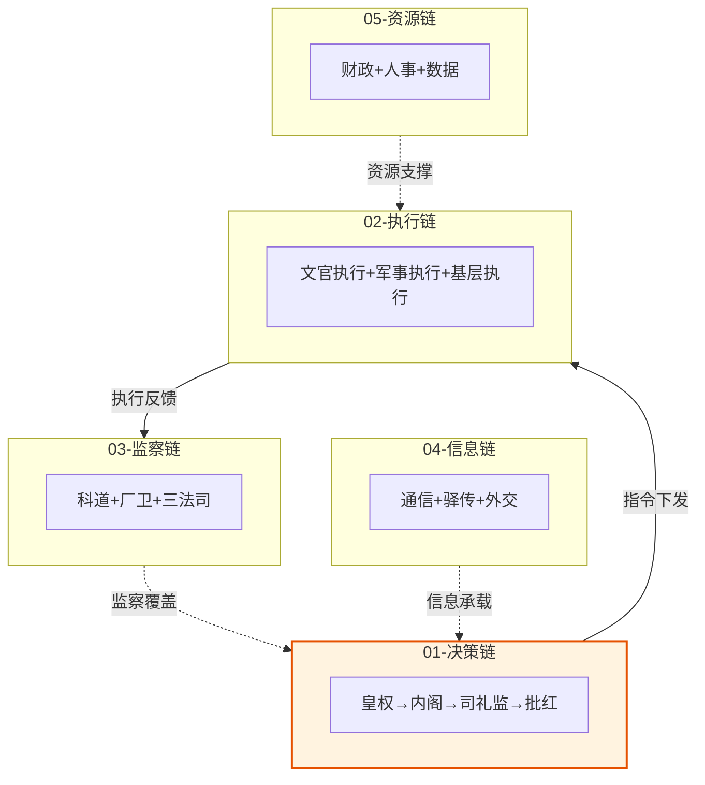

# 按权力链反查

> 设计编排模式时，按明代权力链快速查找对应文档。

---

## 五大权力链 + 三横切主题

| 链路 | 职责 | 核心概念 | 对应编排模式 |
|:--|:--|:--|:--|
| **01-决策链** | 皇权→内阁→司礼监→批红 | 票拟、批红、廷议、中旨 | 朝廷模式（决策层） |
| **02-执行链** | 六部+军事+地方 | 会推/会审/转行/关白、总督/巡抚、正奇兵 | 朝廷模式（执行层）+ 竞功模式 |
| **03-监察链** | 科道+厂卫+三法司 | 封驳、弹劾、厂卫互监 | 朝廷模式（制衡层） |
| **04-信息链** | 通政司+奏章+塘报 | 贴黄、条陈、中旨、急递、塘报 | 全模式（通信层） |
| **05-资源链** | 财政+人事+数据 | 度支、考功、科举、黄册 | 朝廷模式（资源层） |
| **06-私人智囊** | 门客/幕僚/师爷/翰林 | 格物、朝会复合态 | 谋士型 |
| **07-特殊治理** | 灾备/留都/海禁 | 南六部、锁院、旗牌令 | 大明模式（降级/灾备） |
| **08-协调机制** | 跨链路协调 | 六大协调模式、端到端流转 | 全模式（协调层） |

---

## 01-决策链（11 文档）

| 文档 | 关键概念 | 编排映射 |
|:--|:--|:--|
| [01-皇帝制度](../01-决策链/01-皇帝制度.md) | 批红权、司礼监代批、中旨 | 用户最终裁决权 |
| [02-内阁制度](../01-决策链/02-内阁制度.md) | 票拟流程、首辅裁决 | 内阁 Agent 群 |
| [03-司礼监与宦官体系](../01-决策链/03-司礼监与宦官体系.md) | 代批红、掌印秉笔分离 | 司礼监批次 |
| [04-宦官二十四衙门全览](../01-决策链/04-宦官二十四衙门全览.md) | 内廷政府、内外对接 | 内置工具集 |
| [05-廷议与朝会](../01-决策链/05-廷议与朝会.md) | 廷推、辩论规则、发言顺序 | 朝会复合态（参见06-私人智囊） |
| [06-宗人府与三公三孤](../01-决策链/06-宗人府与三公三孤.md) | 荣誉衔、兼职衔 | 角色层级 |
| [07-后宫与外戚制度](../01-决策链/07-后宫与外戚制度.md) | 外戚封而不任 | 权限隔离 |
| [08-藩王与宗室制度](../01-决策链/08-藩王与宗室制度.md) | 藩禁、系统性削藩 | 权限收束 |
| [09-钦差大臣制度](../01-决策链/09-钦差大臣制度.md) | 敕书、节制vs指挥、差遣 | 临时授权 |
#NH|| [10-二十四衙门体系](../01-决策链/10-二十四衙门体系.md) | 十二监四司八局、权力梯队 | 内置工具集 |
#SW|| [11-大明律与会典](../01-决策链/11-大明律与会典.md) | 律/诰/例/会典四层、规则成文化 | 规则系统 |

## 02-执行链（18 文档）

### 文官执行（4）
| 文档 | 关键概念 | 编排映射 |
|:--|:--|:--|
| [01-六部体系](../02-执行链/文官执行/01-六部体系.md) | 会推/会审/转行/关白 | 六部 Agent 群 |
| [02-五寺体系](../02-执行链/文官执行/02-五寺体系.md) | 太常/光禄/太仆/鸿胪 | 服务型 Agent |
| [03-詹事府尚宝司与符节](../02-执行链/文官执行/03-詹事府尚宝司与符节.md) | 宝玺、虎符 | 认证/授权 |
| [04-地方行政体系](../02-执行链/文官执行/04-地方行政体系.md) | 三司并立、布政/按察/都司 | 分区执行 |

### 军事执行（11）
| 文档 | 关键概念 | 编排映射 |
|:--|:--|:--|
| [01-五军都督府](../02-执行链/军事执行/01-五军都督府.md) | 军政/军令分权 | 执行/调度分离 |
| [02-兵部深度制度](../02-执行链/军事执行/02-兵部深度制度.md) | 四司详解、以文制武 | 任务分发 |
| [03-卫所制度](../02-执行链/军事执行/03-卫所制度.md) | 卫/千户所编制 | Agent 编制 |
| [04-九边防御体系](../02-执行链/军事执行/04-九边防御体系.md) | 九边重镇、三角制 | 防御布局 |
| [05-京营三大营与水师](../02-执行链/军事执行/05-京营三大营与水师.md) | 五军/三千/神机营 | 精锐 Agent |
| [06-御马监与直控军队](../02-执行链/军事执行/06-御马监与直控军队.md) | 四卫营、勇士营 | 直辖精锐 |
| [07-总督与巡抚制度](../02-执行链/军事执行/07-总督与巡抚制度.md) | 经略权、节制权 | 跨区协调者 |
| [08-正奇兵战术](../02-执行链/军事执行/08-正奇兵战术.md) | 正兵/奇兵、萨尔浒 | 主路/客路 |
| [09-文臣统兵规则](../02-执行链/军事执行/09-文臣统兵规则.md) | 旗牌令、以文制武 | 文武协调 |
| [10-调兵与选锋](../02-执行链/军事执行/10-调兵与选锋.md) | 选锋标签、时效衰减 | Agent 选择 |
| [11-竞功与军功考核](../02-执行链/军事执行/11-竞功与军功考核.md) | 首功制、五道验功 | 竞功模式核心 |
#MM|| [12-调兵完整流程](../02-执行链/军事执行/12-调兵完整流程.md) | 端到端链路、三路径 | 端到端流转 |

### 基层执行（2）
| 文档 | 关键概念 | 编排映射 |
|:--|:--|:--|
| [01-基层社会组织](../02-执行链/基层执行/01-基层社会组织.md) | 里甲、粮长、士绅 | 基层 Agent |
| [02-土司制度](../02-执行链/基层执行/02-土司制度.md) | 羁縻统治、改土归流 | 自治区域 |

## 03-监察链（11 文档）

| 文档 | 关键概念 | 编排映射 |
|:--|:--|:--|
| [01-都察院与十三道御史](../03-监察链/01-都察院与十三道御史.md) | 弹劾权、巡按御史 | 监察 Agent |
| [02-六科给事中](../03-监察链/02-六科给事中.md) | 封驳权、注销监督 | 末端把关 |
| [03-大理寺与三法司](../03-监察链/03-大理寺与三法司.md) | 复核权、三法司会审 | 结果复核 |
| [04-大明律与祖宗成法](../03-监察链/04-大明律与祖宗成法.md) | 律/例双轨、规则引擎 | 规则系统 |
| [05-锦衣卫](../03-监察链/05-锦衣卫.md) | 诏狱、皇帝直控 | 直辖监察 |
| [06-东厂](../03-监察链/06-东厂.md) | 密奏直通、元监察 | 元监察层 |
| [07-西厂与内行厂](../03-监察链/07-西厂与内行厂.md) | 监察过载的教训 | 监察限制 |
| [08-厂卫互监与皇权控制](../03-监察链/08-厂卫互监与皇权控制.md) | 多重监察互锁 | 互锁机制 |
| [09-密奏制度](../03-监察链/09-密奏制度.md) | 密折直呈、平行通道 | 旁路通信 |
| [10-登闻鼓院与直诉](../03-监察链/10-登闻鼓院与直诉.md) | 击鼓鸣冤、直诉 | 用户申诉 |
| [11-党争与制度异化](../03-监察链/11-党争与制度异化.md) | 制度空转、五种模式 | 失败模式 |

## 04-信息链（8 文档）

| 文档 | 关键概念 | 编排映射 |
|:--|:--|:--|
| [01-通政司与贴黄](../04-信息链/01-通政司与贴黄.md) | 奏章流转、贴黄摘要 | 交互审核 Agent |
| [02-条陈中旨与急递](../04-信息链/02-条陈中旨与急递.md) | 条陈、中旨、急递 | 批量授权/紧急通道 |
| [03-奏章流转完整路径图](../04-信息链/03-奏章流转完整路径图.md) | 端到端生命周期 | 完整通信流 |
| [04-塘报邸报驿传](../04-信息链/04-塘报邸报驿传.md) | 军事急递、邸报、驿传 | 协作总线 |
| [05-行人司](../04-信息链/05-行人司.md) | 外交通信、军情转译使 | 军情转译使 |
| [06-经筵日讲与白话诏书](../04-信息链/06-经筵日讲与白话诏书.md) | 皇帝教育、规则可解释性 | 规则下发 |
| [07-会同馆四夷馆](../04-信息链/07-会同馆四夷馆.md) | 朝贡体系、翻译机构 | 外部接入 |
#HB|| [08-驿传制度](../04-信息链/08-驿传制度.md) | 水马驿、急递铺、递运所 | 信息基础设施 |

## 05-资源链（12 文档）

| 文档 | 关键概念 | 编排映射 |
|:--|:--|:--|
| [01-户部与财政制度](../05-资源链/01-户部与财政制度.md) | 十三司、度支预算 | 预算管理 |
| [02-太仓库与内承运库](../05-资源链/02-太仓库与内承运库.md) | 国库/内库分离 | 资源池分离 |
| [03-预算与资源调度](../05-资源链/03-预算与资源调度.md) | 预算核定、动态调整 | 动态资源分配 |
| [04-盐法漕运马政](../05-资源链/04-盐法漕运马政.md) | 盐政御史、漕运总督 | 跨区资源协调 |
| [05-货币制度与白银货币化](../05-资源链/05-货币制度与白银货币化.md) | 宝钞崩溃、一条鞭法 | 货币体系 |
| [06-黄册与鱼鳞图册](../05-资源链/06-黄册与鱼鳞图册.md) | 户籍册+土地册 | 数据基础 |
| [07-考功制度](../05-资源链/07-考功制度.md) | 考满/考察、京察、大计 | Agent 考核 |
| [08-科举制度](../05-资源链/08-科举制度.md) | 三级考试、庶吉士 | Agent 选拔 |
| [09-国子监与钦天监](../05-资源链/09-国子监与钦天监.md) | 最高学府、天文历法 | 专门培养 |
| [10-皇史宬与档案制度](../05-资源链/10-皇史宬与档案制度.md) | 皇家档案馆、不可篡改 | 档籍 Agent |
#RT|| [11-货币与金融体系](../05-资源链/11-货币与金融体系.md) | 宝钞/铜钱/白银三币演化 | 货币体系 |
#YR|| [12-科举制度完整流程](../05-资源链/12-科举制度完整流程.md) | 童生→生员→举人→进士→翰林 | Agent 选拔 |

## 06-私人智囊（3 文档）

| 文档 | 关键概念 | 编排映射 |
|:--|:--|:--|
| [01-门客幕僚与师爷传统](../06-私人智囊/01-门客幕僚与师爷传统.md) | 门客、四师爷、绍兴师爷 | 谋士型（门客/幕僚模式） |
| [02-翰林院与格物学士](../06-私人智囊/02-翰林院与格物学士.md) | 格物致知、经筵日讲 | 谋士型（翰林格物学士） |
| [03-朝会复合态](../06-私人智囊/03-朝会复合态.md) | 门客先发言、帝皇后发言、风闻言事 | 谋士型（朝会复合态） |

## 07-特殊治理（5 文档）

| 文档 | 关键概念 | 编排映射 |
|:--|:--|:--|
| [01-灾备与应急机制](../07-特殊治理/01-灾备与应急机制.md) | 南六部影子、锁院、旗牌令 | 灾备/降级 |
| [02-南京留都详解](../07-特殊治理/02-南京留都详解.md) | 南六部完整编制 | 影子系统 |
| [03-海禁与海外贸易](../07-特殊治理/03-海禁与海外贸易.md) | 海禁、隆庆开关 | 开放/封闭策略 |
#VQ|| [04-郑和下西洋](../07-特殊治理/04-郑和下西洋.md) | 宝船舰队、双轨指挥、7维度（财政/跨部门/自治/演化/选拔/档案销毁/朝贡联动） | 大规模任务 |
| [05-僧道录司与宗教管理](../07-特殊治理/05-僧道录司与宗教管理.md) | 佛教/道教管理、度牒 | 特殊社区管理 |

## 08-协调机制（2 文档）

| 文档 | 关键概念 | 编排映射 |
|:--|:--|:--|
| [01-明代六大协调模式总览](../08-协调机制/01-明代六大协调模式总览.md) | 垂直/横向/制衡/元监察/差遣/议政 | 全模式协调层 |
| [02-中央决策协调机制专题](../08-协调机制/02-中央决策协调机制专题.md) | 通政司→内阁→司礼监→六科 | 端到端流转 |
