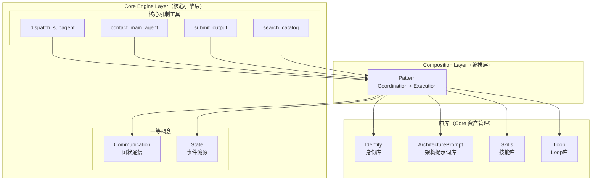
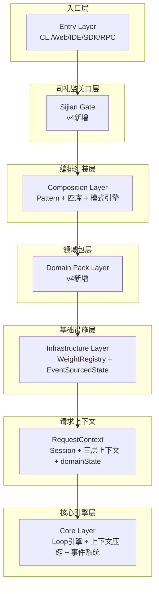
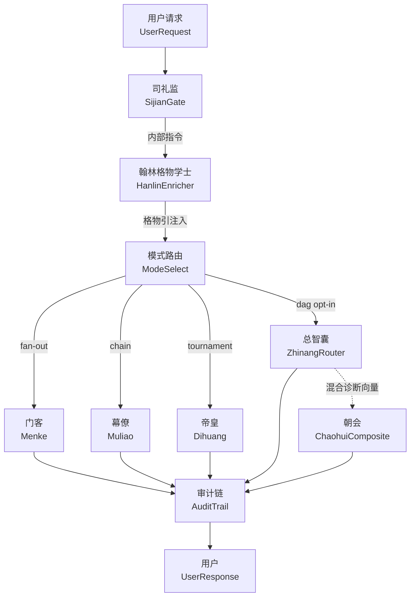

[AI 生成]

# 璇玑（ORBITA）架构全景文档

> 这是 collaborator 的入口点，自包含可独立阅读。v4 定位为通用多用户多 Agent 协作底座，核心微内核领域中立。
> 状态：stable
> 维护：@XZF（主笔）
> 讨论：无
> 待决：无

---

## 1. 璇玑（ORBITA）是什么

璇玑（ORBITA，原代号 wuwo，2026-08 更名，见决策 146）是**通用多用户多 Agent 协作底座**。核心接口领域中立（domain-neutral，不携带任何具体领域的语义字段），领域能力（工具/身份/技能/Loop/评估维度/工作区后端）通过可插拔的 Domain Pack（领域包）注入。第一个官方 Pack 是 coding-pack（编码包）。

**推翻决策 1**：v3 把 璇玑 定位为 coding 内部架构，允许接口携带 `filePath`、`repoUrl` 等 coding 语义字段。v4 推翻这一定位——核心接口不携带任何领域语义，coding 能力全部通过 coding-pack 注入。详见决策 70。

**终局目标**：多人在线 + 海量 agent + 复杂拓扑协作。核心微内核为终局预留接缝，Phase 1（第一阶段）给最笨实现，核心逻辑跨阶段零改动（原则 2 的延伸）。

**设计哲学**：在正确的位置预留正确的接缝（seam，可替换的边界），让系统从单机单 Agent 自然演进到多人多 Agent，核心微内核零改动。

**v3→v4 十大变化**：① 定位通用化 ② 四库（+Loop 库）③ Coordination×Execution 两层 Pattern（模式） ④ 朝廷（Chaoting）/竞功（Jinggong）/大明（Daming）三模式 + 共享基础层（任事型 Renshi type 三分类，智囊团 Zhinang/council 为谋士型 Moushi type，见 §7.5） ⑤ 司礼监（Sijian）代批 ⑥ 军功簿（Merit Registry / WeightRegistry）学习闭环 ⑦ 通信图状化 ⑧ 状态事件溯源（Event Sourcing） ⑨ 监察分层+权力分离 ⑩ User 一等公民。

---

## 2. 核心微内核：6 个一等概念

核心只保留"任何领域、任何模式都必须有的框架机制"。6 个一等概念：

| 一等概念 | 含义 | 可插拔 |
|---------|------|--------|
| **Agent** | 跑 Loop 的实体 | 是（由 Identity 定义） |
| **Loop** | Agent 内部执行引擎 | 是（四库之一） |
| **User** | 一等公民（profile/memory/quota） | 是（用户自管） |
| **Communication** | 图状通信（点对点+发布订阅+频道） | 是（Transport 实现） |
| **State** | 事件溯源共享状态+命名空间 | 是（StateBackend 实现） |
| **Pattern** | 两层：Coordination × Execution | 是（各自可注册） |

**代表性接口签名**（完整定义见 02-architecture-layers.md、04-four-libraries.md）：

```typescript
// === 一等概念接口 ===

interface Agent {
  readonly id: string;
  readonly identity: IdentityDefinition;
  readonly loop: AgentLoop;
  readonly communication: AgentTransport;
  readonly state: EventSourcedState;
  readonly user: UserRef;
}

interface AgentLoop {
  readonly name: string;
  readonly description: string;
  readonly tags: readonly string[];
  run(ctx: LoopContext): Promise<LoopResult>;
}

interface LoopContext {
  readonly input: string;
  readonly llm: LLMHandle;
  readonly toolSlot: ToolSlot;
  readonly contextModel: ContextModel;
  readonly compactionPolicy: CompactionPolicy;
  readonly identity: IdentityDefinition;
  readonly architecturePrompt?: string;
  readonly maxIterations: number;
  readonly abortSignal: AbortSignal;
}

interface UserProfile {
  readonly id: string;
  readonly identity: UserIdentity;
  readonly permissions: PermissionSet;
  readonly quotas: UserQuotas;
  readonly memory: UserMemory;
  readonly agents: readonly AgentRef[];
  readonly sessions: readonly SessionRef[];
}

interface AgentTransport {
  send_message(to: string, payload: Message): Promise<void>;
  publish(topic: string, payload: Message): Promise<void>;
  subscribe(topic: string, handler: MessageHandler): Unsubscribe;
}

interface EventSourcedState {
  readonly namespace: string;
  append(event: DomainEvent): Promise<void>;
  replay(): Promise<StateProjection>;
  getState(): StateProjection;
}

// === 四库资产条目结构 ===

interface IdentityEntry {
  readonly name: string;
  readonly category: string;
  readonly description: string;
  readonly identity: {
    readonly systemPrompt: string;
    readonly tools?: readonly string[];
    readonly model?: string;
    readonly skills?: readonly string[];
  };
  readonly metadata?: {
    readonly tags?: readonly string[];
    readonly version?: string;
    readonly author?: string;
  };
  readonly when_to_use?: string;
  readonly when_not_to_use?: string;
}

interface PromptEntry {
  readonly id: string;
  readonly description: string;
  readonly variables?: readonly string[];
  readonly version: string;
  readonly when_to_use?: string;
}

interface SkillEntry {
  readonly name: string;
  readonly category: string;
  readonly description: string;
  readonly content: string;
  readonly metadata?: {
    readonly tags?: readonly string[];
    readonly version?: string;
  };
}

interface LoopEntry {
  readonly name: string;
  readonly description: string;
  readonly tags: readonly string[];
  readonly when_to_use: string;
  readonly when_not_to_use?: string;
}
```


**角色降级**（决策 74）：Main/Worker/Reviewer 不再是架构枚举，降级为 `Identity.role: string`（身份角色字符串）。架构只理解 Agent。Loop 行为差异通过 Identity 配置的 hooks/slots（钩子/插槽）实现，不靠 `switch(role)`。

**核心自带工具**（框架机制工具，领域中立）：`dispatch_subagent`、`contact_main_agent`、`submit_output`、`search_catalog`。走同一 ToolSlot（工具插槽）注册路径，无特权通道。

**微内核边界**：Loop 引擎、Agent 生命周期管理、四库机制、双宪法、事件系统、Pattern 注册表都属核心。所有"具体角色/具体领域/具体拓扑"都是可插拔资产。详见 02-architecture-layers.md。

---

## 3. 双层架构总览

v3 五层架构的层间依赖关系被核心微内核继承，并新增司礼监关口层（Sijian Gate）与领域包层（Domain Pack Layer）两个 v4 注入层。



**关键原则**：Core 层是纯引擎，不能与 Composition 层的编排功能冲突。Loop 引擎只执行单个 Agent，编排逻辑全部在 Composition Layer。Core 跨阶段零改动。

---

## 4. 四库体系总览

v3 三库扩展为四库，完全对称（都可被 Main Agent 通过 catalog 选择）：

| 库 | 定义什么 | v4 变化 |
|----|---------|---------|
| 身份库（Identity Library） | Agent 角色（谁来做） | 不变 |
| 架构提示词库（Architecture Prompt Library） | 框架行为（怎么做） | 不变 |
| 技能库（Skills Library） | 能力扩展（额外能力） | 不变 |
| **Loop 库（Loop Library）** | 执行引擎（用什么跑） | **v4 新增** |

**Loop 库的特殊性**（和其他三库不对称，决策 72）：Loop 是命令式代码（imperative code，vs 其他三库是声明式数据）；运行期只读——只能从已注册的 Loop 选，不能运行期创建；无 Loop 专家（vs 身份有专家可运行期造）；新 Loop 注册是开发期行为（写代码 + 审计 + 发布）。

**四库对称点**：各自四层加载（builtin < user < project < group）、各自 catalog.yaml + `when_to_use`/`when_not_to_use`、dispatch_subagent 四维度各自独立选 source（library | ask-expert）。

**四库协同**：身份库定义"谁来做"，架构提示词库定义"怎么做"，技能库定义"有什么额外能力"，Loop 库定义"用什么引擎跑"。四库协同定义"一个 Agent 的完整配置"。详见 04-four-libraries.md。

---

## 5. Domain Pack 系统

核心领域中立，所有领域能力通过 Domain Pack 注入（决策 71）。

```typescript
interface DomainPack {
  /** 包名，如 "coding"、"research"、"writing" */
  name: string;
  /** 语义化版本 */
  version: string;
  /** pack 间依赖 */
  dependencies?: string[];
  /** 原料注入：向四库 + Pattern + 工具集注册资产 */
  register(registry: PackRegistry): void;
  /** 配方：打包好的合法组合（归 Pack，不是第五库） */
  presets: Preset[];
  /** domainState 的 schema（领域状态结构） */
  sessionStateSchema?: ZodSchema;
  /** 工作区后端，coding 用 GitWorktreeBackend */
  workspaceBackend?: WorkspaceBackend;
  /** 完成守卫，coding 用文件变异检测 */
  completionGuard?: CompletionGuard;
  /** 默认评估指标，竞功制功赏评分用 */
  defaultRubric?: EvaluationRubric;
}
```

**从 v3 核心移到 coding-pack 的渗剥点（peeling points，剥离迁移点）**：`ProjectState.files/cwd` → domainState（schema 由 pack 定义）；WorkspaceSlot "文件系统/git worktree" → WorkspaceBackend；工具分级表（read/write/bash...）→ pack 注册时声明风险等级；15 个内置身份、内置技能（owasp-top-10...）→ coding-pack 自带；Tournament 评估权重 → pack 的 defaultRubric；完成守卫（文件变异检测）→ pack 的 CompletionGuard。

**核心保留领域中立版**：`Session.domainState: Record<string, unknown>`（容器）、WorkspaceSlot 接口、ToolDescriptor（riskLevel 框架）、CompletionGuard 接口、EvaluationRubric 接口。

**发行方式**：璇玑 npm 包默认依赖 `@璇玑/coding-pack` 并自动启用。核心代码是空核（empty core），但开箱即用。

**四层加载优先级**：pack < builtin < user < project < group。pack 是最底层"内置"，用户 project 级覆盖永远赢。详见 18-domain-pack.md。

---

## 6. 两层 Pattern：Coordination × Execution

v3 单层"Session 模式 + 执行模式"重构为两层独立可组合的 Pattern（模式，决策 73）。

**Coordination Pattern**（协调拓扑，agent 怎么组织）：chaoting（朝廷，层级）、jinggong（竞功，市场竞争）、renshi-hybrid（大明，混合编排）、peer-mesh（同辈网状，Phase 2+）、federation（联邦，Phase 2+）。

**Execution Pattern**（执行模式，任务怎么执行）：dag（DAG+Wave）、tournament（竞争择优）、chain（链式）、fan-out（动态扇出）。

**兼容机制：Capability 契约**（capability，能力声明）：

```typescript
interface Pattern {
  name: string;
  /** 该 Pattern 提供的能力 */
  provides: Capability[];
  /** 该 Pattern 需要的能力 */
  requires: Capability[];
  /** Phase 1 用白名单简化版 */
  compatibleWith: string[];
}
```

**组合矩阵**（Phase 1 白名单推导）：

|  \ Coord \ Exec | dag | tournament | chain | fan-out |
|---|---|---|---|---|
| chaoting（朝廷） | ✅ 朝廷默认 | ✅ | ✅ | ✅ |
| jinggong（竞功） | ✅ | ✅ 竞功默认 | ❌ | ✅ |
| renshi-hybrid（大明） | 朝廷+dag→竞功+tournament→朝廷+dag | 朝廷+dag→竞功+tournament→朝廷+dag | ❌ | ❌ |
| federation | Phase 2+ | Phase 2+ | Phase 2+ | Phase 2+ |
| council | ✅ | ✅ | ✅ | ✅ |

**派发权限下沉**：不靠架构硬编码递归深度，而靠 `Identity.capabilities`（"dispatch"/"contact"/"broadcast"）+ dispatchBudget（派发预算，预算驱动）。架构硬兜底上限 10。详见 03-execution-modes.md。

---

## 7. 三个协作模式：朝廷模式、竞功模式与大明模式

v3 的 on-demand（按需派发）和 swarm（群 Agent）升级为**朝廷/竞功/大明三模式**。技术名沿用 `on-demand`/`swarm`/`renshi-hybrid`，中文显示名分别为**朝廷模式**、**竞功模式**与**大明模式**。

**三模式共享术语池**（原则 33，已推翻原则 21）：朝廷/竞功/大明三模式共享同一套术语体系，不再区分术语族。Session 切换模式时称呼不再因此切换。智囊团（谋士型术语族）仍独立，不纳入三模式共享术语池。

### 7.1 朝廷模式（on-demand）—— 文官体制

Coordination: hierarchy | 来源: ming-architecture.md（明朝内阁架构）。文官体制隐喻：层级协商 + 三层监督 + 暂停/恢复权分离 + 紧急通道降级。

| 层 | 中文名 | 英文名 | 职责 |
|----|--------|--------|------|
| 交互层 | 交互审核 Agent（司礼监） | `InteractiveReviewAgent` | 翻译+过滤+代批 |
| 决策层 | 总控 Agent（皇帝） | `SupremeController` | 最高裁决+紧急通道降级 |
| 规划层 | 规划 Agent（内阁大学士） | `PlanningAgent` | 各出票拟，携带置信度 |
| 规划层 | 首席规划 Agent（首辅） | `ChiefPlanner` | 加权裁决+恢复权 |
| 执行层 | 功能执行 Agent（六部） | `ExecutionAgent` | 各负责一个领域 |
| 监察层 | 监督 Agent（六科给事中） | `SupervisionAgent` | 过程合规+暂停权（无恢复权） |
| 监察层 | 审计 Agent（都察院） | `AuditAgent` | 事后审计（仅建议性） |
| 监察层 | 复核 Agent（大理寺） | `ReviewAgent` | 高风险裁决（强制力） |
| 通信层 | 协作总线 | `CollaborationBus` | 订阅发布+授权列表+日志审计 |

工作流程：用户→司礼监(prefilter→translate→escalate/autoApprove)→总控→[内阁票拟+首辅裁决]→六部执行→[三层监察]→司礼监最终审查→用户。详见 12-chaoting-mode.md。

### 7.2 竞功模式（swarm）—— 军事体制

Coordination: market | 来源: jinggong-system.md（明朝竞功军制）。军事体制隐喻：并行竞争 + worktree 分支 + 择优/融合 + 事后审计迭代。

| 层 | 中文名 | 英文名 | 职责 |
|----|--------|--------|------|
| 交互层 | 军情转译使 | `MilitaryTranslator` | 翻译军令+保留原始战报+最终审查 |
| 决策层 | 总督 Agent | `Governor` | 复制分发+最高裁决+haltBranch/acceptBranch/mergeBranches |
| 执行层 | 各路提督 Agent | `Commander` | 独立攻关+不同战术+产出完整战果 |
| 融合层 | 评功推官 | `MeritJudge` | 功赏指标评分+择优/融合+挂载主分支 |
| 监察层 | 监军御史 Agent | `MilitarySupervisor` | 实时监控资源/超时/违规+白旗暂停（仅暂停） |
| 审计层 | 军功勘验使 | `MeritInspector` | 事后复盘+评分+updateWeights（学习闭环） |
| 通信层 | 塘报旗牌使 | `DispatchMessenger` | 点对多分发+固定频道独立上报+接收清单防篡改 |

**核心机制**：复制分发（replicateTask 创建 N 个 worktree 分支）；**禁止横向通信**（公平性不变量：竞争者间不得通信）；评功四策略（best/merge/hybrid/vote）；功赏指标外置（MeritMetrics 由 pack 定义，不硬编码）；监军御史仅暂停（权力分离）；军功勘验影响权重（updateWeights）；接收清单防篡改（confirmAllReported 才融合。

工作流程：用户→军情转译使→总督(replicateTask N 份)→塘报旗牌使分发→提督×N 并行(worktree 隔离)→监军御史实时监控→全部回报→评功推官评估择优→挂载主分支→军情转译使审查→军功勘验使复盘+updateWeights→用户。详见 13-jinggong-mode.md。

### 7.3 大明模式（renshi-hybrid）—— 混合编排

大明模式是**任事型第三模式**（任务级混合编排，技术名 `renshi-hybrid`），复用朝廷模式与竞功模式的两套 Preset，不引入新的 Coordination Pattern 或微内核一等概念。对同一任务的不同子任务分别适用确定性路径（朝廷）与多解探索路径（竞功），并在两段执行之间做预算池动态调整与结果汇总。详见 14-daming-mode.md。

大明模式与朝廷/竞功同属**任事型**（task-execution），术语现共享同一术语池（见原则 33，已推翻原则 21）。效率转模是大明模式的「模式切换触发策略」（机制），不是第四独立模式。共享基础层（11-renshi-shared-base.md）提供律例、档籍、户部、考功司、御马监、太仓库、锁院等跨模式公共角色与基础设施。

### 7.4 智囊团（zhinang）—— council 协调拓扑

Coordination: council | 来源: 16-moushi-overview.md（谋士体制）。谋士隐喻：翰林格物学士（HanlinEnricher）横切增益 + 四模式并列可选 + 朝会复合态。谋士型（moushi）是用户主动选择进入的**第二编排类型**（原则 30），与任事型（朝廷/竞功/大明）并列，术语独立不交叉（原则 33）。

| 层 | 中文名 | 英文名 | 职责 |
|----|--------|--------|------|
| 增益层 | 翰林格物学士 | `HanlinEnricher` | 横切增益，输出《格物引》注入下游，可跳过不拦截 |
| 门客层 | 门客 | `Menke` | fan-out 多人格并行创意发散（不可能思路合法化） |
| 幕僚层 | 幕僚 | `Muliao` | chain 专家链式落地（合规师爷→钱粮师爷→文案师爷→总办调度） |
| 帝皇层 | 帝皇 | `Dihuang` | tournament 层级审议+强制反对+多方案择优 |
| 路由层 | 总智囊 | `ZhinangRouter` | dag opt-in 融合，诊断后路由前三者或激活朝会 |

**核心机制**：翰林格物学士为横切增益模块（只增加上下文不拦截，区别于司礼监代批权）；门客/幕僚/帝皇为独立可选的专注工具（可直选独立使用），总智囊为 opt-in 融合模式（用户主动选才进入）；朝会（Chaohui）为总智囊的复合运行态而非第五个 Execution（原则 32）。审计链贯穿总智囊路由到各策略执行，确保可追溯。



工作流程：用户→司礼监→翰林格物学士（横切增益《格物引》）→四模式路由（门客 fan-out / 幕僚 chain / 帝皇 tournament / 总智囊 dag）→审计链→用户。详见 16-moushi-overview.md 和 17-moushi-modes.md。

## 8. 关键机制总览

### 8.1 司礼监代批（决策 77）

司礼监（Sijian，明朝内廷机构）是有**有限代批权**的前置关口，不只是翻译层。代批权来自总控预授权的"条陈"。**三重职责**：① 前置过滤（prefilter，超出能力/违反策略/格式错误→不受理或驳回）；② 翻译（translate，InternalCommand + 保留原始映射，可逆）；③ 代批判断：命中条陈+简单低风险→代批，复杂/高风险/不在条陈→呈送总控。关口层由司礼监 + 通政司 subagent 组成（决策 139）：通政司专司收文登记/查看工作区文档/分类/分发，不决定内容对错；前置过滤驳回判断与代批判断仍由司礼监执行。

**条陈（BatchApproveCharter）**：代批授权清单，由总控预先授权，司礼监不得自行扩充。每条指定匹配条件+handler+必须是 minimal 风险。**代批流程**：命中条陈→校验条陈条目→调用 handler→打"批红"标签→同步审计 Agent 后验→直接返回用户（不经内阁）。

**呈送标准**（任一命中即必须呈送）：多 steps / 依赖外部资源 / 涉及修改数据 / 非最低风险 / 不在条陈范围。

**架构宪法不变量**（代码强制）：`sijian-no-arbitrary-approve`（代批必须有据）、`sijian-must-be-traceable`（批红标签+审计）、`sijian-escalate-complex`（复杂不得代批）、`sijian-charter-immutable`（条陈只能总控授权修改）。详见 15-sijian-batch.md。

### 8.2 军功簿学习闭环（决策 78）

WeightRegistry（权重注册表）实现**跨任务学习闭环**。竞功制军功勘验使 `updateWeights` 让系统越用越聪明。v4 提升为核心 Infrastructure（不只竞功制，内阁制也用）。

**机制**：记录每个 Identity/Agent 历史表现评分；后续 dispatch 按权重推荐/选择；表现稳定→升权，不佳→降权；保留探索比例（ε-greedy，ε 贪心探索，防过早收敛）。

**模式别名**：竞功制下叫"军功簿"，内阁制下叫"考绩簿"。核心接口名统一 WeightRegistry。内阁制映射：首辅加权裁决读取 WeightRegistry（不再依赖自报置信度）。竞功制映射：军功勘验 updateWeights 直接写入，总督下次 replicateTask 按权重选提督。Phase 1 NoOp，Phase 2+ SQLite 持久化。

### 8.3 通信图状化（决策 79）

v3 树形单链路（dispatch + contactMainAgent）扩展为图状通信。**三种通信模式**：① 点对点 `send_message(to, ...)`（基于权限）；② 发布订阅 `publish/subscribe(topic, ...)`（EventBus 暴露为工具）；③ 频道/主题（多 Agent 异步协作，Blackboard 黑板模式底层）。

**模式实现**：内阁制用协作总线（CollaborationBus）——订阅发布+总控授权列表+日志审计。竞功制用塘报旗牌使（DispatchMessenger）——点对多分发+固定频道独立上报+接收清单。

**通信权限**：Identity 声明能发给谁/订阅什么。核心不变量：market Coordination 下竞争者间禁止横向通信（公平性保障）。跨用户通信（Phase 3）需 Trust Level（信任等级）授权。

**统一消息格式**：v4 消息体系只有一个统一消息格式——**OrbitaMessage**，一个大整体分两个部分：**humanView**（人 ↔ 司礼监，content blocks 线性数组，用于呈现与持久化）+ **Delegation**（编排层 Agent 间内部交流，task + resultSummary，自包含上下文）。Delegation 不暴露给 UI，子 Agent 产出经 parentToolUseId 归因后以 humanView 呈现。详见 02-architecture-layers.md §3a。

### 8.4 状态事件溯源（决策 80）

v3 可变对象 projectState 改为事件溯源（Event Sourcing）。**核心模型**：所有状态变更是 append-only（只追加）事件；状态是事件的投影（projection）；天然支持审计（谁改了什么）、回放（Replay）、并发（事件不冲突，投影才冲突）。

**命名空间/作用域**：共享状态分区，Agent 只看自己有权的分区（与 Identity scope 联动）。**黑板模式**：事件流之上提供 Blackboard 抽象，多 Agent 异步读写。

**Session.domainState**：核心只提供 `Record<string, unknown>` 容器，schema 由 Domain Pack 定义。底层是事件投影。Phase 1 简化为可变对象+activityLog，接口按事件溯源设计。

### 8.5 监察分层与权力分离（决策 81）

v3 Check+MetaCheck 两层扩展为可配置三层+权力分离。

| 层 | 内阁制名 | 竞功制名 | 强制力 |
|----|---------|---------|--------|
| 过程监督 | 六科给事中 | 监军御史 | 仅暂停权 |
| 事后审计 | 都察院 | 军功勘验使 | 建议性/权重影响 |
| 高风险复核 | 大理寺 | — | 强制推翻 |

**权力分离原则**（核心不变量）：暂停权与恢复权分离（过程监督可暂停不可恢复，恢复需更高层）；监察者被谁监察（改写/暂停记录进事件流，可被更高层采样复审）；fail-closed（失败即拒绝）选项（监察失败可选 fail-open 原样通过或 fail-closed 拒绝）。

**MetaCheck 改造**（决策 18）：从 1:1 常驻伴随改为按策略触发（ReviewPolicy）。maxCorrections + confidenceThreshold 保留。透明化：改写标注来源（用户可区分原话和改写）。
> CheckAgent 形式化契约（接口/角色/通道/筛选/压缩/回退）见 06-core-engine.md §3a。


### 8.6 紧急通道降级（决策 82）

规划/执行失效时，决策者不现场 improvisation（即兴发挥），直接下发**预设降级方案**。**内阁制**：总控 emergencyFallback——规划超时/冲突时直接下发预设方案到执行层。**竞功制**：总督 haltBranch——一路出问题时直接采纳已完成分支或中止。

**EmergencyFallback 契约**：triggerCondition（超时/冲突级别）+ fallbackValue（预设兜底）+ defaultBehavior（默认行为描述）。**预定义优于 improvisation**（系统初始化时声明，不现场创造）。

### 8.7 User 一等公民（决策 83）

v3 的 AuthContext.userId 字符串升级为一等实体。**UserProfile**：identity（画像/偏好/专业领域）、permissions（跨资源权限）、quotas（并发/成本/存储配额）、memory（跨 session 记忆）、agents（常驻 Agent 注册表）、sessions。

**Session 扩展**：`type: "personal" | "shared"`；participants: UserRef[]；owner；permissions: SessionACL。**多用户协作涌现**（Phase 3）：跨用户复用专家、多用户 Tournament vote（真人投票）、协作 Session 责任追溯（事件流带 userId）。**信任模型**：Trust Level（none/read-only/invoke/delegate/full-control）。Phase 1 简化：单用户，UserProfile 存在但字段精简。

### 8.8 Preset + 渐进推断（决策 84）

解决 Main Agent 决策负担（四维度+两层 Pattern+Domain Pack 过多选择）。**Preset 归 Domain Pack**（不是第五个库），每个 Pack 提供自己的 Preset 集。

```typescript
interface Preset {
  /** 固化 Coordination */
  coordination: string;
  /** 固化 Execution */
  execution: string;
  /** 四维度默认值 */
  defaults: { identity?: string; loop?: string; prompt?: string; skills?: string[] };
  /** 渐进推断规则 */
  infer: InferRule[];
}
```

**派发流程**：选 Preset（或系统按 catalog.when_to_use 推荐）→ 只填 task + 可选 identity → 系统按 infer 补齐其余 → dispatch_subagent。**决策负担从 7-8 个降到 2-3 个**。

### 8.9 效率转模机制（决策 97）

效率转模是大明模式的「模式切换触发策略」（机制），**不是第四独立模式**。任事型三模式 = 朝廷 / 竞功 / 大明。效率转模只在朝廷模式 / 大明模式朝廷阶段内部，把某个效率严重低下的子任务剥离转入竞功执行路径。

**触发条件**（律例 Agent 预设阈值，见 11-renshi-shared-base.md）：朝廷子任务实际预算消耗超出预测中位数的 X%；且进度推进低于计划的 Y%；或连续 Z 个周期无明显进展。

**检测方**：户部 Agent（财政面：预算消耗率 + 进度完成率）；监督 Agent（独立同步，可独立发送「效率转模预警」）。检测命中 → 户部生成「效率转模特拟」→ 上呈总控。此阶段不自动执行剥离。

**人类亲批流程**（共享基础层人类关键介入点第 1 类「模式切换」）：必须由总控（人类）亲自审批，不可下放给司礼监代批，不可交由自动规则引擎执行。审批时限 2 小时；超时默认保持现有路径，高风险任务暂停；总控离线时由司礼监按预设「安全保守规则」暂行，事后人类补批。

**批准后执行**：总控亲批剥离 → 该子任务从朝廷执行队列移除，转入竞功执行路径；户部调整预算池（从确定性预算池划拨到竞功预算池）；太仓库执行账户转移；决策记录归档档籍 Agent，作为审计/考功证据。详见 14-daming-mode.md §5。
---

## 9. 双宪法体系

璇玑 采用双宪法体系，分别约束两个不同风险级别的对象（原则 10，v4 保留并扩展）。

| 宪法 | 约束对象 | 执行机制 | 依据 |
|------|----------|----------|------|
| 架构宪法 | 框架行为 | 代码强制 | core-invariants.ts 硬编码，任何专家或提示词都不可修改 |
| 身份宪法 | 身份定义 | 专家判断 | 身份信息专家审查（Phase 1 降级为代码基础校验） |

**为什么双宪法**：架构提示词修改风险高（影响所有 Agent），需要硬性约束。身份定义修改风险中（影响单个 Agent），需要灵活判断。两种风险级别适合两种执行机制。

**核心不变量**（架构宪法内容，v4 扩展）：配对检查强制、Meta Check 不可删除、递归深度硬上限（架构兜底 10）、工具分级管控、安全操作需用户确认、工具调用/结果对保护、Compaction 三规则（工具对保护/摘要替代/激进裁剪）、**司礼监四不变量**（见 §8.1）、**竞争者间禁止横向通信**、**暂停/恢复权分离**。这些规则硬编码在 TypeScript 代码中，解决"修改规则的人不能同时是被规则约束的人"的自引用问题。

---

## 10. 设计哲学

**为什么核心微内核领域中立**。核心接口携带领域语义（如 coding 的 filePath）会把框架锁死在单一领域。领域中立让 璇玑 从 coding 扩展到 research/writing/任何协作场景。领域能力通过 Domain Pack 注入，核心保持空核但开箱即用（默认依赖 coding-pack）。详见决策 70。

**为什么四库（+Loop 库）**。三库对应"谁来做/怎么做/额外能力"，但 Loop（执行引擎）在 v3 是硬编码单一实现。v4 把 Loop 提升为四库之一，让"用什么引擎跑"也可插拔。Loop 库运行期只读（命令式代码需开发期审计），其他三库可运行期创建（声明式数据可专家生成）。不对称点反映代码 vs 数据的本质差异。详见决策 72。

**为什么两层 Pattern**。v3 把"模式"混在单层（Session 模式 + 执行模式耦合）。v4 拆为 Coordination（怎么组织 agent）× Execution（怎么执行任务）两层独立可组合。组合矩阵让 hierarchy+dag（内阁制默认）、market+tournament（竞功制默认）等组合显式化。Capability 契约保证组合合法。详见决策 73。

**为什么三模式共享术语池**。原则 21（两模式独立术语）已被原则 33 推翻。朝廷/竞功/大明三模式现共享同一套术语体系，不再因模式切换而切换称呼。智囊团术语族仍独立。共享能力用核心通用名（WeightRegistry/EventSourcedState）。详见原则 33。

**为什么司礼监代批**。95% 日常请求是简单低风险的，走完整内阁流程（票拟→裁决→执行→三层监察）开销过大。司礼监前置关口+条陈预授权让简单请求走快速通道（代批），同时批红标签+审计后验保证可追溯。复杂/高风险请求必须呈送总控走完整流程。详见决策 77。

**为什么接缝先于实现**。每一层有明确的职责边界，变化频率不同。层与层之间通过接口通信，预计会变的边界必须是接口，不变的边界直接硬编码。Phase 1 给最笨实现，核心逻辑从第一天就只依赖接口，跨阶段零改动（原则 1、2）。

**七维度插件化总表**（plan §16）。上述每一处接缝都收敛到一张总表：Phase 1 体验和 v3 几乎一样，但底层接口已是终局形态，后续每个维度升级=换实现不改接口。

| 维度 | Phase 1 实现（最笨） | 接口形态（终局） |
|------|---------------------|-----------------|
| 角色 | 4 个 Identity 模板 | Identity.role + capabilities |
| 拓扑 | 树，深度 2 | CoordinationPattern + dispatchBudget |
| 通信 | dispatch + contact | AgentTransport 工具化 + topic 订阅 |
| 状态 | projectState + activityLog | EventSourcedState + namespace |
| 监察 | Check + MetaCheck | ReviewPolicy + 三层 enum |
| 生命周期 | ephemeral + persistent | LifecycleScope 连续谱 |
| 能力发现 | 只能创建 | source: library/ask-expert/registry |
| Loop | react-loop 默认 | Loop 库四库之一 |
| User | AuthContext 字段 | UserProfile 一等公民 |

---

## 11. 原则速查（v3 17 条扩展 + 新增）

v3 原则 1-17 保留（其中 8 条随 v4 决策修改），v4 新增原则 18-33。完整原则全文见 README.md。

| # | 原则 | 一句话 |
|---|------|--------|
| 1 | 边界即接口 | 会变的边界必须是接口，不变的就硬编码 |
| 2 | 接口按最终形态设计 | Phase 1 最笨实现，核心逻辑跨阶段零改动 |
| 3 | 核心自研 + 引用/借鉴 dsh | 微内核/编排/通信/状态/用户/四库自研；横切基建借鉴 dsh 设计（决策 145）：LLM registry/Agent 生命周期/Typert 工具协议/session 分层/沙箱为设计参考，抄类型/协议形状、不引运行时；pi 现行 LLM Provider 实现暂保留 |
| 4 | 不限制 Subagent 数量 | 预算驱动 dispatchBudget，不按数量限制（v4 修改） |
| 5 | Check 是上下文屏障 | Task 产出经 Check 压缩后以精简报告到 Main |
| 6 | Meta Check 是系统保险 | 按策略触发+透明化（v4 修改，决策 18） |
| 7 | 编排可组装 | 编排在 Composition Layer，两层 Pattern |
| 8 | 身份可复用 | 从身份库引用，可插拔 |
| 9 | 内置即扩展 | 核心机制工具 vs pack 资产两层（v4 重述，决策 32） |
| 10 | 双宪法体系 | 架构宪法（代码强制）+ 身份宪法（专家判断） |
| 11 | 全局工具池 | 框架留风险四级，具体映射移 pack（v4 修改，决策 40） |
| 12 | 三库对称（v4 扩为四库） | 身份/提示词/技能三库对称，v4 新增 Loop 库（见原则 19） |
| 13 | 通信双向（v4 图状化） | 向下派发+向上请求缺一不可，v4 图状化（决策 79） |
| 14 | 隔离可选 | 三级隔离，实现移 coding-pack |
| 15 | 竞争选优 | Tournament/竞功制，功赏指标外置 pack |
| 16 | 模式可切换（v4 重命名） | on-demand→内阁制，swarm→竞功制，运行中可切换（决策 75/76） |
| 17 | 组级覆盖 | 组级覆盖优先级最高，临时生成，组后丢弃（v4 扩展） |
| 18 | 通用底座 | 核心微内核领域中立，领域能力通过 Domain Pack 注入，核心空核 |
| 19 | 四库体系 | 身份/提示词/技能/Loop 四库对称，各自多层加载（见原则 12） |
| 20 | 两层 Pattern | Coordination × Execution 独立可组合（决策 73） |
| 21 | 内阁制/竞功制术语不交叉（已推翻，见原则 33） | 三术语族（内阁/竞功/智囊）原各自独立不混用；原则 33 已推翻，三模式现共享术语池 |
| 22 | 司礼监代批 | 条陈预授权+批红标签+审计后验（决策 77） |
| 23 | 军功簿学习闭环 | WeightRegistry 跨任务权重，越用越聪明（决策 78） |
| 24 | 监察分层+权力分离 | 三层监察+暂停/恢复权分离（决策 81） |
| 25 | User 一等公民 | UserProfile（profile/memory/quota）（决策 83） |
| 26 | 监察分层+权力分离 | 三层监察+暂停/恢复权分离（决策 81，重申） |
| 27 | 紧急通道降级 | 预设 EmergencyFallback 优于 improvisation（决策 82） |
| 28 | User 一等公民 | UserProfile（profile/memory/quota）（决策 83，重申） |
| 29 | Preset + 渐进推断 | 归 Domain Pack，决策负担降到 2-3 个（决策 84） |
#TT|| 30 | 智囊团为谋士型（第二编排类型） | council 协调拓扑，与任事型（内阁制+竞功制）按职责并列；术语三族不交叉（见原则 21，**[已推翻]** 见原则 33） |
| 31 | 翰林格物学士为横切增益模块 | 横切增益非关卡，可「跳过格物」，位于司礼监之后 council 路由之前 |
| 32 | 朝会为 council 复合运行态 | 总智囊路由器混合诊断时串行 fan-out→chain→tournament，不占矩阵单元 |
| 33 | 三模式共享术语池 | 朝廷/竞功/大明三模式共享同一术语体系，已推翻原则 21 |

---

## 12. 关键接口摘要

### dispatch_subagent 核心参数

> 完整权威定义见 04-four-libraries.md。四维度（identity / loop / architecturePrompt / skills）各自独立选 source（library | ask-expert）。

```typescript
dispatch_subagent({
  task: "审查认证模块",
  identity: { source: "library", name: "security-reviewer" },
  // 以下全部可选
  preset: "security-audit",          // v4：选 Preset 自动补齐其余（决策 84）
  coordination: "hierarchy",         // v4：Coordination Pattern
  execution: "dag",                  // v4：Execution Pattern
  verification: "paired",            // 或 "auto" / "none"
  workspace: "isolated"              // 或 "shared" / "worktree"
})
```

### 三层上下文模型

| 层级 | 生命周期 | 访问控制 | 典型内容 |
|------|----------|----------|----------|
| Session 共享层 | 跨 Agent 存活 | 所有 Agent 可读 | domainState、活动日志、消息历史 |
| Agent 私有层 | 跟随 Agent 生命周期 | 仅自身可访问 | Agent 内部状态、工具调用历史 |
| Subagent 注入层 | 按需传递 | 由 contextMode 控制 | 父 Agent 上下文片段、任务背景 |

### 工具风险四级

| 级别 | 工具示例 | 授权方式 |
|------|----------|----------|
| safe | read, grep, find, glob | 自由授权 |
| moderate | write, edit, bash | 需配对验证 |
| restricted | browser, ssh, web_search | 需用户确认 + 审计日志 |
| forbidden | delete, sudo, install | 仅决策者可用 |

> v4：框架保留风险四级机制（ToolDescriptor.riskLevel），具体工具到级别的映射移 coding-pack（决策 40）。

---

## 13. 包结构概览

v3 包结构更新，新增 `domain-packs/` 目录承载领域能力。

```
璇玑/
├── packages/
│   ├── shared/               # 类型定义 + 核心不变量 + 工具注册表（零依赖，领域中立）
│   ├── config/               # 配置加载
│   ├── catalog/              # 模型数据 + 四库 catalog（models.json）
│   ├── llm/                  # LLM 客户端逻辑（LlmProvider 接口 + 适配器）
│   ├── extensions/           # 扩展系统 + 核心机制工具（dispatch_subagent 等）
│   ├── composition/          # 编排层
│   │   ├── architecture-prompts/ identity/ skills/   # 提示词/身份/技能三库
│   │   ├── loops/                 # Loop 库（v4 新增，运行期只读）
│   │   ├── pattern/               # 两层 Pattern 注册表 + Capability 契约
│   │   ├── neige/                 # 内阁制模式（v4 新增）
│   │   ├── jinggong/              # 竞功制模式（v4 新增）
│   │   └── sijian/                # 司礼监代批关口（v4 新增）
│   ├── agent-core/           # 可插拔 Loop 引擎 + 事件系统（纯引擎，领域中立）
│   ├── infrastructure/       # 接口最笨实现 + WeightRegistry + EventSourcedState + UserProfile
│   └── cli/                  # SimpleRenderer + 命令行入口
├── domain-packs/             # v4 新增：领域能力注入点
│   └── coding-pack/          # 第一个官方 Pack（默认依赖，自动启用）
│       ├── identities/ skills/        # 15 内置身份 + owasp-top-10 等技能（从核心渗剥）
│       └── tools/ workspace/ presets/ rubric/  # 工具+风险映射 / GitWorktreeBackend / 预设 / Tournament 指标（从核心渗剥）
```

详见 08-package-structure.md。

---

## 14. 各模式典型成本估算

> 以下为单次典型任务（中等复杂度）的**LLM 调用次数**估算，用于量化"代批快通道省多少"。实际值取决于子任务数量（N）、执行策略和 LLM 并发度。

### 14.1 朝廷模式（hierarchy × dag）

| 链路 | 调用次数 | 可并发 |
|------|---------|--------|
| 交互审核（翻译+过滤） | 1 | — |
| 模式判定 | 1 | — |
| 总控批红 | 1 | — |
| 规划 Agent 票拟（×3 名并行） | 3 | 是 |
| 首辅裁决 | 1 | — |
| 户部核定预算 | 1 | — |
| 六部执行（按 DAG 波次，3-6 个子任务） | 3-6 | 同 Wave 内可并发 |
| 监督 Agent（过程监察） | 1-2 | — |
| 审计 Agent（事后） | 1 | — |
| 复核 Agent（高风险触发时） | 0-1 | — |
| **完整链路合计** | **~14-18** | |

### 14.2 司礼监代批（快速通道）

| 链路 | 调用次数 |
|------|---------|
| 交互审核（命中条陈） | 1 |
| 代批判定 | 1 |
| 审计后验（异步） | 1 |
| **代批通道合计** | **~3**（vs 完整链路 14-18，节省 **~80%**） |

> 95% 日常请求走代批通道。代批通道的 3 次调用中，审计后验可异步批量处理，用户感知延迟仅 2 次 LLM 往返。

### 14.3 竞功模式（market × tournament）

| 链路 | 调用次数 | 说明 |
|------|---------|------|
| 军情转译使 | 1 | — |
| 总督分发 | 1 | — |
| 提督 × N 路并行（N=3） | 9-15 | 每路 3-5 次，可并发 |
| 监军御史 | 1-2 | — |
| 评功推官（五道验功，择优/融合） | 1 | — |
| 军功勘验使（事后审计+updateWeights） | 1 | — |
| **N=3 路合计** | **~14-21** | N 越大成本线性增长 |

### 14.4 谋士型（council × 各执行策略）

| 子模式 | 调用次数 | 说明 |
|--------|---------|------|
| 门客（fan-out） | 4-9 | 翰林增益 + N 人格创意 + 池管理 |
| 幕僚（chain） | 5-7 | 翰林增益 + 合规→钱粮→文案→总办 |
| 帝皇（tournament） | 9-13 | 翰林增益 + 审议+强制反对+资源审查+裁决 |
| 总智囊（dag opt-in） | 4-11 | 诊断+路由 → 前三者之一或朝会 |

### 14.5 大明模式（混编）

朝廷子任务部分（~8-12 次）+ 竞功子任务部分（~6-10 次）+ 预算池调整（1 次）≈ **~15-23 次**。

---

## 15. 参考来源

| 来源 | 参考 | 如何用 |
|------|------|--------|
| deepseek-harness (dsh) | LLM adapter registry、Agent 生命周期事务、Typert 工具协议、session 持久化/投影、沙箱策略 | **借鉴设计**（决策 145，不引运行时）：核心服务强绑 Cordis + rc，抄设计/协议形状进 璇玑 接缝；协作编排自研 |
| pi-agent-core | Agent Loop 双层循环、Compaction 三规则 | **经 Adapter Layer 适配**（决策 2 + 决策 140），作为 Loop 库默认实现来源与参考；微内核/编排自研 |
| oh-my-pi | DAG+Wave、模型角色路由、Mnemopi、URL 方案、BM25、状态持久化、扩展等权 | 借鉴设计 |
| pi-subagents | 验收推断、Intercom、Worktree 隔离、Skills 等十项 | 借鉴设计 |
| ming-architecture.md | 内阁制模式（明朝内阁架构）：层级协商+三层监督+司礼监代批 | **v4 新增**，升级为内阁制完整定义 |
| jinggong-system.md | 竞功制模式（明朝竞功军制）：并行竞争+评功+军功勘验 | **v4 新增**，升级为竞功制完整定义 |
| Tournament 竞争执行 | 璇玑 独有设计 | 原创 |
| Domain Pack / 微内核 | 通用化定位、领域能力可插拔 | **v4 原创** |

详见 19-minggong-frameworks.md（原始参考文档归档）。

---

> 文档版本：v2.19
> 本版变更（累积最近 3 条，最新在上）：
>   - v2.19：项目更名 wuwo→璇玑（ORBITA）：品牌定义句+更名注记，全文品牌/路径替换（见决策 146）
>   - v2.17：原则 3 + §15 参考来源表随决策 140 改为「分面适配」：有状态/行为类经 Adapter Layer，纯类型/纯渲染叶依赖直接复用
> 基于：璇玑 v4 架构设计
> 决策总数：145 条（含 103-105 T8 回流补录 + 139 通政司subagent + 140 pi适配层 + 141-144 会话储存专题 + 145 dsh横切借鉴）
> 文档总数：25 份
> 原则总数：33 条
