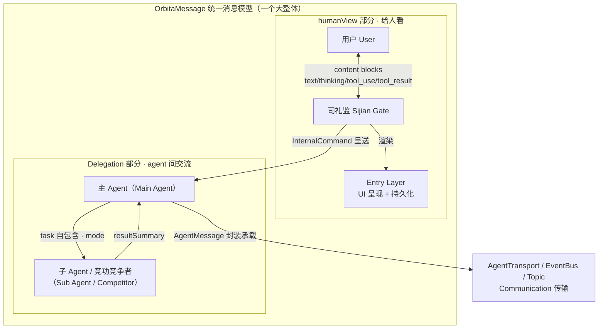
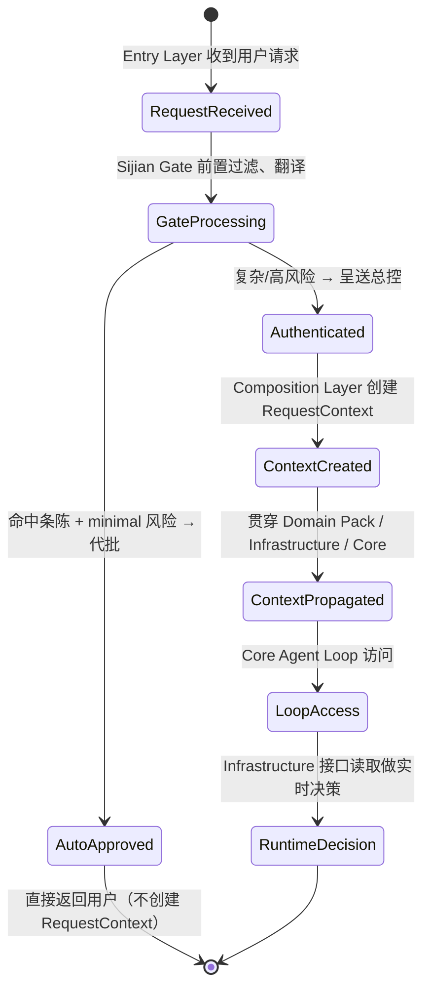
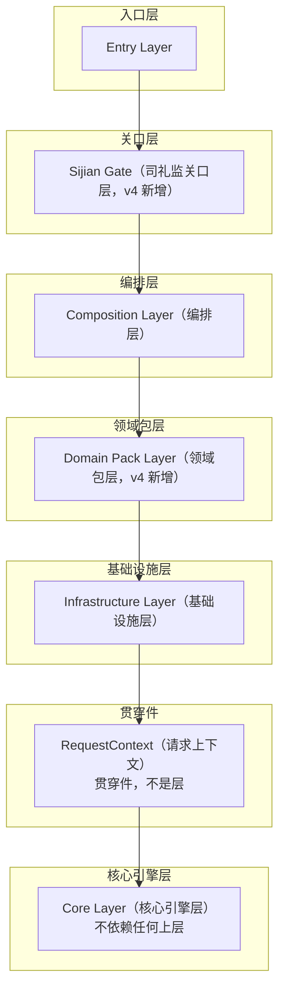
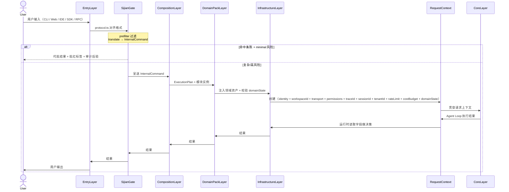

[AI 生成]

# 核心微内核与分层架构

> 核心微内核与分层架构：6 个一等概念、Domain Pack 注入层、层间依赖与接缝。
> 状态：stable
> 维护：@XZF（主笔）
> 讨论：无
> 待决：无
---

## 1. v4 分层架构总览

v3 的五层架构（Entry / Composition / Infrastructure / RequestContext / Core）层间依赖关系被核心微内核继承，并重新组织为**微内核 + Domain Pack 注入**的七层结构。RequestContext 从"层"降级为"贯穿件"（through-component，纯数据结构），新增 Sijian Gate（司礼监关口层）与 Domain Pack Layer（领域包层）两个 v4 注入层。

```mermaid
graph TD
    subgraph entryLayer["入口层"]
        E[Entry Layer<br/>CLI / Web / IDE / SDK / RPC<br/>共享同一 bootstrap]
    end
    subgraph sijianGateLayer["司礼监关口层"]
        S[Sijian Gate（司礼监关口层）<br/>编排协调中枢（七项职责）<br/>95% 日常请求走快速通道<br/>BatchApproveCharter（条陈）+ 批红（Pi-hong）标签 + 审计后验]
    end
    subgraph compositionLayer["编排层"]
        C[Composition Layer（编排层）<br/>两层 Pattern：Coordination × Execution<br/>Module Registry · Pattern Registry · Pattern Compiler<br/>Pattern Runtime · Pattern Selector · Visual Canvas<br/>DAG + Wave 执行引擎 / tournament / chain / fan-out<br/>dispatch_subagent · 接口反转]
    end
    subgraph domainPackLayer["领域包层"]
        P[Domain Pack Layer（领域包层）<br/>coding-pack / research-pack / ...<br/>register 向四库 + Pattern + 工具集注入领域资产<br/>WorkspaceBackend / CompletionGuard / EvaluationRubric / Preset<br/>核心空核但开箱即用（默认依赖 @璇玑/coding-pack）]
    end
    subgraph infrastructureLayer["基础设施层"]
        I[Infrastructure Layer（基础设施层）<br/>system-wide · 启动时注入 · 生命周期与进程相同<br/>SessionStore · EventBus · AuthProvider · AgentTransport<br/>TaskScheduler · PermissionResolver · Logger/Metrics<br/>ConcurrencyGovernor · CostGovernor · AgentPool<br/>WeightRegistry(v4) · EventSourcedState(v4) · UserProfile(v4)]
    end
    subgraph throughComponent["贯穿件"]
        R[RequestContext（请求上下文）<br/>贯穿件，不是层<br/>纯数据结构 · 每次 dispatch 创建 · 贯穿全程<br/>identity · workspaceId · transport · permissions · traceId<br/>+ sessionId · tenantId · rateLimit · costBudget · domainState]
    end
    subgraph coreEngineLayer["核心引擎层"]
        K[Core Layer（核心引擎层）<br/>领域中立微内核<br/>微内核 6 个一等概念：Agent · Loop · User · Communication · State · Pattern<br/>可插拔 Loop 引擎 + 事件系统 + Agent 生命周期 + 四库机制 + 双宪法<br/>核心自带 4 工具：dispatch_subagent / contact_main_agent / submit_output / search_catalog<br/>Extensions（6-slot）：ProviderSlot · ToolSlot · HookSlot · MiddlewareSlot · IsolationSlot · WorkspaceSlot]
    end
    E --> S
    S --> C
    C --> P
    P --> I
    I --> R
    R --> K
```
**依赖方向**：上层依赖下层接口，下层不知道上层存在。数据和控制流从上往下，事件和结果从下往上报。RequestContext 作为贯穿件在层间传递，不属于任何一"层"。
**v3→v4 架构变化要点**：
| 变化 | v3 | v4 |
|------|----|----|
| 分层 | 五层（含 RequestContext 为层） | 七层（RequestContext 降为贯穿件）+ 司礼监关口层 + Domain Pack 层 |
| Core | 单一 Agent Loop Engine | 微内核 6 一等概念（Agent/Loop/User/Communication/State/Pattern） |
| 编排 | 四级模式（L1-L4） | 两层 Pattern（Coordination × Execution）独立可组合 |
| 领域能力 | 核心内置 coding | Domain Pack 可插拔注入 |
| 角色 | 4 种架构枚举 | 降级为 `Identity.role: string`，架构只认 Agent |
| 通信 | 树形单链路 | 图状通信（点对点 + 发布订阅 + 频道） |
| 状态 | 可变对象 projectState | 事件溯源 EventSourcedState + 命名空间 |
| 入口 | 直接给 Main Agent | 司礼监前置关口（翻译+过滤+代批） |


---

## 2. Entry Layer（入口层）

**职责**：用户请求的接入点。把不同前端渠道的输入对齐为统一的内部协议，然后交给 Sijian Gate（v4）或 Composition Layer（v3 直达）。

**包含组件**：

| 接入点 | 说明 |
|--------|------|
| CLI | 命令行终端，支持 `/mode`、`/builder`、`/mode neige`（朝廷模式）、`/mode jinggong`（竞功模式）等斜杠命令 |
| Web | 浏览器界面，支持可视化画板（L3） |
| IDE | IDE 插件，在编辑器内直接调用 |
| SDK / RPC | 程序化接入，其他系统通过 SDK 调用（v4 扩展） |

**关键接口**：`protocol.ts`（对齐层）

所有接入点不直接调用下层接口，而是通过 `protocol.ts` 把用户输入转换为统一的内部请求格式。Entry Layer 不预留内部接口，未来新增接入点只需实现 `protocol.ts` 的输入适配。

**输出**：标准化请求 → Sijian Gate（v4）或 Composition Layer（v3 直达，v4 默认经关口）。

> Entry Layer 完整设计（EntryAdapter 接口 / Surface 抽象 / bootstrap 流程 / Phase 演进）见 [26-entry-layer.md](./26-entry-layer.md)。
---

## 3. Sijian Gate（司礼监关口层，v4 新增）

**职责**：有**有限代批权**的前置关口，不只是翻译层。用户请求经此关口过滤、翻译、可能代批后才进入编排。这是 v4 的核心新增层，解决"95% 日常请求走完整流程开销过大"的问题。

**关口层组件结构**（决策 139）：关口层由两个紧密协作的组件构成——

| 组件 | 角色 | 职责 |
|------|------|------|
| 通政司 Agent | TongzhengAgent（司礼监 subagent，组合持有） | 收文登记、查看工作区文档（读文件→贴黄摘要）、分类、分发 |
| 司礼监 Agent | SijianGate（关口主体） | 前置过滤判断、代批判断、模式推荐、编排协调、结果汇总 |

通政司是司礼监的 subagent（组合模式持有，决策 139），在关口层内部运行，对外表现为统一关口。用户始终与司礼监交流，入口不变；司礼监把收文登记与工作区文档读取等机械性工作委派给通政司，专注代批判断与用户交流。**通政司不决定内容对错**——条陈匹配/呈送判断/驳回判断/代批执行全留司礼监（决策 139，对应明朝通政司"只分类、登记、分发"的定位）。

**七项职责**（方案 B：编排协调中枢）：

司礼监不只是前置关口，而是**全程参与**编排的协调中枢。从用户输入到结果返回，司礼监在背后持续压缩、汇总、过滤，让 PatternRuntime（皇帝）保持全程低上下文最高效决策状态。

| # | 职责 | 说明 |
|---|------|------|
| 1 | 前置过滤 | 超出能力/违反策略的请求驳回 |
| 2 | 意图探索 | 搞清楚用户到底要什么（对话探索意图） |
| 3 | 有限代批 | 简单低风险请求代批，命中条章直接返回 |
| 4 | 模式推荐 | 推荐编排模式+理由（皇帝讨论后确认，非司礼监拍板） |
| 5 | 编排初始化 | 呈送前准备好一切（IntentBriefing、任务分解建议） |
| 6 | 全程协调 | 监控编排进展，持续压缩中间结果 |
| 7 | 结果汇总 | 编排完成后压缩结果呈送用户 |

**通政司分担**（决策 139）：上述七项职责中，与"收文/文档读取"相关的机械性工作由通政司 subagent 承担——收文登记（原始奏章全文+哈希交档籍）、查看工作区文档（用户附带的文档/文件读取→贴黄摘要）、分类（复杂度分级）、分发（处理结果移交司礼监判断）。通政司不做任何内容对错判断；前置过滤的驳回判定（out-of-scope / policy-violation / format-error）与代批判断仍由司礼监执行。

> **定位**：司礼监是参谋+管家，不是决策者。决策权永远在 PatternRuntime（皇帝）。详见 15-sijian-batch.md §1a。

**条陈（BatchApproveCharter）**：代批授权清单，由总控预先授权，司礼监不得自行扩充。每条指定匹配条件 + handler + 必须是 minimal（最低）风险。

**呈送标准**（任一命中即必须呈送，不得代批）：多 steps / 依赖外部资源 / 涉及修改数据 / 非最低风险 / 不在条陈范围。

**架构宪法不变量**（代码强制）：`sijian-no-arbitrary-approve`（代批必须有据）、`sijian-must-be-traceable`（批红标签+审计）、`sijian-escalate-complex`（复杂不得代批）、`sijian-charter-immutable`（条陈只能总控授权修改）。

**输出**：InternalCommand → Composition Layer（呈送）或 直接结果 → 用户（代批）。

> 完整代批机制见 15-sijian-batch.md。

**横切增益模块（翰林格物学士 HanlinEnricher）**位于司礼监关卡之后、Composition 层之前，透明增益上下文不拦截（区别于司礼监关卡模块的拒绝/代批权），可「跳过格物」；代批路径绕过翰林。

## 3a. 统一消息格式（OrbitaMessage — 一个大整体，分两个部分）

> 设计草案：OrbitaMessage 与 Delegation 类型定义从 `璇玑与adapter层设计.md` 提取，尚未落地为代码。

**定位**：v4 消息体系只有一个统一消息格式——**OrbitaMessage**，一个大整体，内部划分两个部分：**humanView**（给人看的人机边界部分，渲染 + 持久化）与 **Delegation**（agent 之间内部交流部分，任务委派与结果回传）。不是两套独立格式，而是同一消息模型的两部分；底层传输统一走 Communication 一等概念（AgentTransport / EventBus），只负责「怎么传」，不关心「传什么」。

| 层 | 消费部分 | 职责 |
|----|---------|------|
| Entry Layer（渲染 / 持久化） | humanView | 把 content blocks 数组渲染成 UI、写入对话历史 |
| Sijian Gate（人机边界） | humanView（对外）· InternalCommand（对内呈送） | 用户对话用 humanView；呈送编排时翻译为 InternalCommand |
| Composition Layer（编排） | Delegation | 编排内委派、竞功分发、跨编排通信 |
| Communication 一等概念 | AgentTransport / EventBus（传输管道） | 只负责「怎么传」，不关心「传什么」 |



**OrbitaMessage humanView 部分**（给人看的统一呈现）：

| 维度 | 内容 |
|------|------|
| 消息类型 | OrbitaUserMessage（人类输入 + 工具结果回填）· OrbitaAssistantMessage（模型回复）· OrbitaResultMessage（turn 终态：success / error / error_max_turns） |
| Content blocks | text（纯文本）· thinking（推理过程）· tool_use（工具调用 id/name/input）· tool_result（工具结果 tool_use_id + is_error） |
| 通用字段 | `uuid`（流式去重）· `_partial`（流式预览帧标记）· `parentToolUseId`（子 agent 消息归因，null = 主线） |
| 消费者 | Entry Layer（UI 渲染 + 持久化）· 人 ↔ 司礼监边界 |

**OrbitaMessage Delegation 部分**（agent 间通信唯一语义协议）：

| 维度 | 内容 |
|------|------|
| 核心字段 | `task`（自包含任务描述）· `role`（子 agent 角色）· `expectedOutput`（期望输出格式）· `status`（pending / running / completed / failed / cancelled）· `resultSummary`（B 最后一条 assistant 文本） |
| 三种 mode | `delegate`（编排内一对一）· `compete`（竞功：同一 task 多 Delegation fan-out，发起方打分选优）· `cross_orchestration`（跨编排：toSessionId 指向另一编排的主 agent） |
| 归因 | `rootSessionId`（链式委托追溯最初发起方）· `delegationDepth`（防无限嵌套） |
| 追问 | DelegationContinue（delegationId + followUpTask，子 agent 会话保留上下文继续跑） |
| 消费者 | 编排层 / Agent 内部——**不直接暴露给 UI**（UI 通过 parentToolUseId 归因看到子 agent 产出） |

**关键原则**：

1. **一个格式，两个部分**——OrbitaMessage 是唯一消息模型，humanView（人看）与 Delegation（agent 间交流）是同一消息的两部分；Delegation 承载于统一消息之上，不是第二轨独立类型。
2. **Delegation 不暴露给 UI**——UI 只消费 humanView；子 agent 产出通过 parentToolUseId 归因呈现。
3. **自包含上下文**——发起方 A 负责把 B 需要的全部上下文打包进 `task`，B 不翻 A 的历史（解耦 + 性能）。

> Communication 一等概念的传输层定义不变（EventBus / AgentTransport / Topic）；Delegation 是统一消息模型之上的语义协议，通过 `AgentTransport.send` 承载。完整类型定义与 mode 映射见 [22-communication.md](./22-communication.md) §5b。

---

## 4. Composition Layer（编排层）

**职责**：定义"谁来编排 Agent、怎么编排"。这是唯一承担**编排**职责的层，所有执行流程的决策都在这里做出。Composition Layer 是 v3→v4 继承最完整的层——核心概念（编排职责独立、DAG+Wave、接口反转）全部保留。

**特别说明**：Composition Layer 是层间唯一"上知 Sijian/Gate、下知 Infrastructure"的层。它向上消费入口关口翻译后的 InternalCommand，向下通过 Infrastructure 接口创建 Agent 实例。这一"双知"特性是架构的必然——编排必须在两端都有接口意识。

**核心组件**：

| 组件 | 职责 |
|------|------|
| Module Registry | 注册和发现所有 AgentModule（输入、处理、验证、转换、输出） |
| Pattern Registry | 注册和发现两层 Pattern（v4：Coordination × Execution，各自可注册） |
| Pattern Compiler | 把 Pattern 定义编译为可执行的 ExecutionPlan，执行验证（无环、无孤立、端口匹配、Capability 契约） |
| Pattern Runtime | 按 ExecutionPlan 驱动 Agent Loop 执行，管理模块生命周期 |
| Pattern Selector | 统一管理模式入口（v4：Coordination × Execution 组合 + Capability 白名单匹配） |
| Visual Canvas | 可视化画板（L3，Phase 2+），用户拖拽组装管道 |

**两层 Pattern：Coordination × Execution**（决策 73，v4 重构）

v3 单层"Session 模式 + 执行模式"拆为两层独立可组合的 Pattern：

| Pattern 层 | 含义 | 可选值 |
|-----------|------|--------|
| Coordination | agent 怎么组织 | hierarchy（朝廷模式）、market（竞功模式）、peer-mesh（Phase 2+）、federation（Phase 2+）、council（议会/谋士式，Phase 1） |
| Execution | 任务怎么执行 | dag（DAG+Wave）、tournament（竞争择优）、chain（链式）、fan-out（动态扇出） |
**兼容机制：Capability 契约**（Phase 1 用白名单简化版）：

```typescript
interface Pattern {
  /** Pattern 名称 */
  name: string;
  /** 该 Pattern 提供的能力 */
  provides: Capability[];
  /** 该 Pattern 需要的能力 */
  requires: Capability[];
  /** Phase 1 用白名单简化版：声明兼容的对方 Pattern 名 */
  compatibleWith: string[];
}
```

**组合矩阵**（Phase 1 白名单推导）：

| Coord \ Exec | dag | tournament | chain | fan-out |
|---|---|---|---|---|
| hierarchy（朝廷模式） | ✅ 朝廷模式默认 | ✅ | ✅ | ✅ |
| market（竞功模式） | ✅ | ✅ 竞功模式默认 | ❌ | ✅ |
| peer-mesh | Phase 2+ | Phase 2+ | Phase 2+ | Phase 2+ |
| federation | Phase 2+ | Phase 2+ | Phase 2+ | Phase 2+ |
| council | ✅ | ✅ | ✅ | ✅ |

> 完整 Capability 白名单矩阵见 03-execution-modes.md §1.4；朝会为 council 复合运行态，非独立 Execution，不占矩阵单元。

**DAG + Wave 执行引擎**（决策 26，v3 保留）：

PatternRuntime 使用 DAG（有向无环图）+ Wave（拓扑排序的并行波次）驱动任务执行：

1. 建图：根据 `waits_for` 和 `reports_to` 构建依赖边
2. 检测环：Kahn 算法，有环则报错
3. 拓扑排序：生成 Wave 列表，同一 Wave 内无依赖可并行，不同 Wave 之间串行
4. 执行：Wave 内 Agent 并行启动，全部完成后进入下一个 Wave

**派发权限下沉**（v4 变化）：不靠架构硬编码递归深度，而靠 `Identity.capabilities`（"dispatch"/"contact"/"broadcast"）+ dispatchBudget（派发预算，预算驱动）。架构硬兜底上限 10（原则 4 扩展）。

**dispatch_subagent 与 PatternRuntime 交互**（决策 63，接口反转保留）：

`dispatch_subagent` 工具定义在 Extensions，通过 `SubagentDispatcher` 接口（定义在 shared）调用 PatternRuntime。工具不直接依赖 composition 包——依赖通过接口反转。bootstrap 时注入 PatternRuntime 作为接口实现。PatternRuntime 查当前 Pattern 的连接关系，决定创建什么子 Agent 以及是否配套 Check Agent。编排逻辑始终保持在 Composition Layer。

```typescript
/**
 * SubagentDispatcher：dispatch_subagent 工具与 PatternRuntime 之间的接口。
 * 定义在 shared 包（零依赖），打破 extensions → composition 的直接依赖（决策 63）。
 */
interface SubagentDispatcher {
  /**
   * 派发子 Agent。
   * 工具调用此方法，PatternRuntime 实现此接口决定编排细节。
   */
  dispatch(request: DispatchRequest): Promise<DispatchResult>;
}
```

**监察触发**（v4 改造）：三层监察（过程监督 / 事后审计 / 高风险复核）的触发逻辑（checkpoint/persistent、maxCorrections、ReviewPolicy）在 Composition Layer 管理。v3 的 Check + MetaCheck 是三层监察的一种简化。

**输出**：ExecutionPlan + 模块实例 → Domain Pack Layer（v4，领域能力注入）→ Infrastructure Layer（创建 Agent 时注入依赖）。

---

## 5. Domain Pack Layer（领域包层，v4 新增）

**职责**：核心领域中立，所有领域能力通过 Domain Pack 注入。此层位于 Composition 和 Infrastructure 之间，是领域能力的注入点。

**核心机制**：Domain Pack 在系统启动时调用 `register(registry: PackRegistry)` 向四库（身份/架构提示词/技能/Loop）+ Pattern 注册表 + 工具集注入领域资产。

**Domain Pack 契约**：

```typescript
interface DomainPack {
  /** 包名，如 "coding"、"research"、"writing" */
  name: string;
  /** 语义化版本 */
  version: string;
  /** pack 间依赖 */
  dependencies?: string[];
  /** 原料注入：向四库 + Pattern + 工具集注册资产 */
  register(registry: PackRegistry): void;
  /** 配方：打包好的合法组合（归 Pack，不是第五库） */
  presets: Preset[];
  /** domainState 的 schema（领域状态结构） */
  sessionStateSchema?: ZodSchema;
  /** 工作区后端，coding 用 GitWorktreeBackend */
  workspaceBackend?: WorkspaceBackend;
  /** 完成守卫，coding 用 FileMutationGuard */
  completionGuard?: CompletionGuard;
  /** 默认评估量规，竞功模式功赏评分用 */
  defaultRubric?: EvaluationRubric;
}
```

**从 v3 核心渗剥到 coding-pack 的资产**：`ProjectState.files/cwd/repoUrl` → domainState；WorkspaceSlot "文件系统/git worktree" → WorkspaceBackend；工具分级表（read/write/bash...）→ Pack 注册时声明风险等级；15 个内置身份、内置技能（owasp-top-10...）→ coding-pack 自带；Tournament 评估权重 → Pack 的 defaultRubric；完成守卫（文件变异检测）→ Pack 的 CompletionGuard。

**核心保留领域中立版**：`Session.domainState: Record<string, unknown>`（无类型容器）、WorkspaceSlot 接口（mode+options）、ToolDescriptor（riskLevel 框架）、CompletionGuard 接口、EvaluationRubric 接口。

**发行方式**：璇玑 npm 包默认依赖 `@璇玑/coding-pack` 并自动启用。核心代码是空核（empty core），但开箱即用。

**四层加载优先级**：pack < builtin < user < project < group（pack 是最底层"内置"，用户 project 级覆盖永远赢）。

> 完整 Pack 系统设计见 18-domain-pack.md。

---

## 6. Infrastructure Layer（基础设施层）

**职责**：提供 system-wide 的基础服务。启动时注入，生命周期与进程相同。所有上层组件通过接口消费这些服务，不关心具体实现。

**核心接口**（v3 的 10 个 + v4 扩展 3 个）：

| 接口 | 回答的问题 | v4 变化 |
|------|-----------|---------|
| SessionStore | Session 数据存在哪里？如何读写？ | 保留 |
| EventBus | 事件如何发布和订阅？ | 保留（v4 暴露为通信工具） |
| AuthProvider | 如何认证用户、解析身份？ | 保留（配合 UserProfile） |
| AgentTransport | Agent 之间如何通信？ | 保留（v4 扩展为图状通信） |
| TaskScheduler | Subagent 任务如何排队和执行？ | 保留 |
| PermissionResolver | 用户对资源有哪些权限？ | 保留 |
| Logger / Metrics | 日志和指标如何收集？ | 保留 |
| ConcurrencyGovernor | 并发执行如何限制？ | 保留 |
| CostGovernor | LLM 花费如何控制？ | 保留 |
| AgentPool | Agent 实例如何管理？ | 保留 |
| **WeightRegistry** | 跨任务学习权重（军功簿/考绩簿） | **v4 新增** |
| **EventSourcedState** | 事件溯源共享状态 + 命名空间 | **v4 新增** |
| **UserProfile** | User 一等公民（profile/memory/quota） | **v4 新增** |

**为什么 Infrastructure 与 Extensions 必须分开**：

| 维度 | Infrastructure（system-wide） | Extensions（per-agent，6-slot） |
|------|-------------------------------|----------------------------------|
| 作用域 | system-wide，全局共享 | per-agent，每个 Agent 不同 |
| 加载时机 | 系统启动时 | Agent 创建时 |
| 生命周期 | 跟随进程 | 跟随 Agent |
| 变更驱动 | 运维需求（换存储、加监控） | 业务需求（新 tool、新 hook） |

如果把 Infrastructure 接口放进 Extensions slot，每个 Agent 都要重新配置基础设施，违背 DRY。如果把 Extensions 放进 Infrastructure，所有 Agent 强制相同配置，丧失灵活性。

**与 RequestContext 的关系**：Infrastructure 接口（如 CostGovernor、PermissionResolver、SessionStore、WeightRegistry）在运行时读取 RequestContext 中的字段做决策。RequestContext 是 Infrastructure 服务的输入参数，不是 Infrastructure 的一部分。

> 完整接口定义见 07-infrastructure.md。

---

## 7. RequestContext（请求上下文，贯穿件）

**职责**：每次 dispatch 创建一个 RequestContext，携带本次请求的所有身份和约束信息，贯穿整个调用链。

**重要降级**（v4 变化）：RequestContext 从 v3 的"层"降级为**贯穿件**（through-component）。它是纯数据结构，不是架构的一"层"。它不持有逻辑、不提供接口，只是从上往下传递的上下文载体。降级原因：v3 把它画成一"层"容易让人误以为它有独立职责，但它只是数据。

> 完整设计详见 24-request-context.md
**Phase 1 核心字段**：

```typescript
interface RequestContext {
  /** 用户身份（userId, roles） */
  identity: AuthContext;
  /** 工作区标识 */
  workspaceId: string;
  /** Agent 通信方式（图状通信 v4） */
  transport: AgentTransport;
  /** 权限解析器 */
  permissions: PermissionResolver;
  /** 日志关联 ID */
  traceId: string;
}
```

**Phase 3 扩展字段**：

```typescript
interface RequestContext {
  // ... Phase 1 字段
  /** Session 标识 */
  sessionId: string;
  /** 多租户标识 */
  tenantId: string;
  /** 速率限制（remaining, resetAt） */
  rateLimit: RateLimit;
  /** 成本预算（daily, monthly, spentToday, spentThisMonth） */
  costBudget: CostBudget;
  /** 领域状态容器（v4，schema 由 Pack 定义） */
  domainState: Record<string, unknown>;
}
```

**生命周期**：



**设计原则**：RequestContext 是不可变的上下文载体。上层（Composition）创建它，下层（Core、Infrastructure）只读取它。任何需要"这次请求是谁、在哪里、有什么权限"的组件，都从 RequestContext 获取，不自行构造。如果 RequestContext 反向依赖上层，就会形成循环依赖，破坏层边界。

---

## 8. Core Layer（核心引擎层，领域中立微内核）

**职责**：纯引擎 + 微内核。只管执行单个 Agent，不管编排。核心领域中立（domain-neutral），永不携带任何具体领域的语义字段。Core Layer 永不变化，是系统最稳定的底层。

### 8.1 微内核 6 个一等概念（v4 核心）

核心只保留"任何领域、任何模式都必须有的框架机制"。6 个一等概念：

| 一等概念 | 含义 | 可插拔 |
|---------|------|--------|
| **Agent** | 跑 Loop 的实体 | 是（由 Identity 定义） |
| **Loop** | Agent 内部执行引擎 | 是（四库之一，运行期只读） |
| **User** | 一等公民（profile/memory/quota） | 是（用户自管） |
| **Communication** | 图状通信（点对点+发布订阅+频道） | 是（Transport 实现） |
| **State** | 事件溯源共享状态+命名空间 | 是（StateBackend 实现） |

> 完整设计详见 22-communication.md
> 完整设计详见 23-state.md
**角色降级**（决策 74）：Main/Worker/Reviewer 不再是架构枚举，降级为 `Identity.role: string`。架构只理解 Agent。Loop 行为差异通过 Identity 配置的 hooks/slots 实现，不靠 `switch(role)`。

**核心自带工具**（框架机制工具，领域中立）：`dispatch_subagent`、`contact_main_agent`、`submit_output`、`search_catalog`。走同一 ToolSlot 注册路径，无特权通道（决策 32 重新表述）。

**微内核边界**：Loop 引擎、Agent 生命周期管理、四库机制、双宪法、事件系统、Pattern 注册表都属核心。所有"具体角色/具体领域/具体拓扑"都是可插拔资产。

### 8.2 Loop 引擎（v3 双层循环保留为默认 react-loop）

v3 的 Agent Loop 双层循环设计在 v4 作为默认 `react-loop` 保留（四库之一）。Loop 库是 v4 新增的第四库，运行期只读（命令式代码需开发期审计）。

| 组件 | 职责 |
|------|------|
| Agent Loop | 双层循环：外层对话循环，内层工具循环 |
| Event system | 事件发布和订阅，驱动模块间通信 |
| Subagent lifecycle | Subagent 的创建、执行、完成、清理 |
| Context layering | 三层上下文模型（Session/Agent/Subagent） |
| Error handling | 错误分类、重试策略、降级处理 |

> 完整 Loop 引擎设计见 06-core-engine.md。

### 8.3 Extensions（6-slot，per-agent，v3 保留）

每个 Agent 在创建时注入不同的 Extensions 配置，回答"如何做"的问题：

| Slot | 回答的问题 | Phase 1 实现 | Phase 3 实现 |
|------|-----------|-------------|-------------|
| ProviderSlot | 如何与 LLM 交互？ | 单一 provider 直连 | 多 provider 路由 + fallback |
| ToolSlot | 如何执行工具调用？ | 内置 tool registry（核心 4 工具 + Pack 工具） | 外部 tool server + 动态发现 |
| HookSlot | 在哪些节点插入逻辑？ | 空实现（no-op） | 事件拦截 + 审计日志 |
| MiddlewareSlot | 如何处理请求/响应？ | 空实现（no-op） | 重试、超时、限流、日志 |
| IsolationSlot | 如何隔离文件系统？ | shared / isolated | shared / isolated / backend（Pack 决定） |
| WorkspaceSlot | 工作区如何管理？ | 直接文件系统 | GitWorktreeBackend（coding-pack） / 其他 Pack 后端 |

> v4 变化：WorkspaceSlot 和 IsolationSlot 的"文件系统/git worktree"语义移到 Domain Pack 的 WorkspaceBackend，核心只保留接口。

### 8.4 Core Layer 的边界

- Core Layer 不做编排决策（那是 Composition Layer 的事）
- Core Layer 不直接创建 Subagent（由 PatternRuntime 创建）
- Core Layer 不管理并发和成本（那是 Infrastructure 的事）
- Core Layer 不携带领域语义（filePath/cwd/repoUrl 等属 Domain Pack）
- Core Layer 只管：收到一个 Agent 定义和 RequestContext，执行它，返回结果

详见 06-core-engine.md。

---

## 9. 层间接口和依赖

### 9.1 依赖方向


Entry Layer
    │  依赖
    ▼
Sijian Gate（v4 新增）
    │  依赖
    ▼
Composition Layer
    │  依赖
    ▼
Domain Pack Layer（v4 新增）
    │  依赖（向四库注入资产）
    ▼
Infrastructure Layer
    │  依赖（读取 RequestContext 字段）
    ▼
RequestContext（贯穿件，不是层）
    │  被 Core 消费
    ▼
Core Layer
    │  不依赖任何上层
    ▼
   底部（微内核）
```

**规则**：上层依赖下层接口，下层不知道上层存在。RequestContext 作为贯穿件在层间传递，不被任何层"依赖"，只被读取。

### 9.2 每层对下层的要求

| 上层 | 依赖下层什么 |
|------|------------|
| Entry | Sijian Gate 的关口接口（v4）或 Composition 的启动接口（v3 直达） |
| Sijian Gate | Composition 的 PatternSelector 接口（呈送时） + Infrastructure 审计接口（代批后验） |
| Composition | Domain Pack 的注入资产（四库+Pattern）+ Infrastructure 接口 + RequestContext + Core 的 Agent Loop |
| Domain Pack | PackRegistry（注入四库+Pattern）+ Infrastructure（WorkspaceBackend 等底层服务） |
| Infrastructure | RequestContext（读取身份、权限、预算、domainState 字段） |
| Core | 无依赖（底部微内核） |

### 9.3 为什么这个方向不能反转

**Composition 不能依赖 Core 的内部细节**：Core 是纯引擎，只管执行单个 Agent。如果 Composition 直接操作 Core 的内部状态（如手动插入消息、直接调用 Subagent 创建），就会和 Core 的职责冲突，导致两层耦合、难以独立演进。

**Infrastructure 不能依赖 Composition**：Infrastructure 是 system-wide 服务，在系统启动时注入。如果 Infrastructure 知道 Composition 的存在，就会在更换编排策略时被迫修改基础设施代码，违背"运维需求与业务需求分离"的原则。

**Domain Pack 不能反向定义核心**：Pack 是领域能力的注入方，核心是领域中立的容器。如果 Pack 能反向修改核心接口或核心携带领域语义（如 filePath），就会破坏"核心领域中立"的根本约束（决策 70）。

**RequestContext 不能依赖上层**：RequestContext 是纯数据结构，从上往下传递。如果 RequestContext 反向依赖上层，就会形成循环依赖，破坏层边界。

**Sijian Gate 不能越权**：司礼监只能代批条陈授权范围内的 minimal 风险请求。复杂/高风险请求必须呈送总控。如果关口越权直接编排或跳过审计，就破坏了代批可追溯性（原则 23）。

### 9.4 dispatch 的完整调用链（v4）



### 9.5 变更影响最小化原则

- 改 Core 引擎（微内核 6 概念）：Composition 接口不变，上层无感知
- 改 Infrastructure 实现（如 SQLite 换 PostgreSQL、NoOp WeightRegistry 换 SQLite 持久化）：Composition 和 Entry 无感知
- 改 Domain Pack（如 coding-pack 换 research-pack、或新增自定义 Pack）：核心零改动，Composition 通过四库机制消费 Pack 资产
- 改 Composition 编排策略（如 hierarchy 换 market、dag 换 tournament）：Core 和 Infrastructure 无感知
- 改 Sijian Gate 条陈（如新增代批授权项）：Composition 和下层无感知
- 改 Entry 接入点（如新增 IDE 插件）：Sijian Gate 和下层无感知

每层的变化只影响相邻上层，不会穿透多层。这是分层架构的核心价值。

---

## 9.6 层间边界接口签名

### 9.6.1 Entry → Sijian Gate

```typescript
/** Entry Layer 与 Sijian Gate 之间的协议对齐接口。 */
interface EntryGateProtocol {
  /** 将原始用户输入对齐为统一内部请求格式 */
  align(request: RawUserRequest): StandardizedRequest;
  /** 路由对齐后的请求到关口处理 */
  route(request: StandardizedRequest): Promise<SijianGateResult>;
}
```

### 9.6.2 Sijian Gate → Composition

```typescript
/** 司礼监关口与编排层之间的呈送/代批接口。 */
interface SijianCompositionBridge {
  /** 将用户输入翻译为 InternalCommand */
  translate(input: UserInput): InternalCommand;
  /** 尝试代批：命中条陈 + 简单低风险 → 直接返回结果 */
  autoApprove(command: InternalCommand, charter: BatchApproveCharter): Promise<AutoApproveResult>;
  /** 呈送总控：复杂/高风险请求进入完整编排流程 */
  escalate(command: InternalCommand): InternalCommand;
}
```

### 9.6.3 Composition → Domain Pack

```typescript
/** 编排层与领域包层之间的资产消费接口。 */
interface CompositionPackBoundary {
  /** 从四库获取资产（身份/技能/Loop/Prompt） */
  getLibrary(type: LibraryType): Catalog;
  /** 获取 Pack 提供的预设组合 */
  getPreset(name: string): Preset | null;
  /** 获取领域工作区后端 */
  getWorkspaceBackend(): WorkspaceBackend;
  /** 获取完成守卫 */
  getCompletionGuard(): CompletionGuard;
  /** 获取默认评估量规 */
  getEvaluationRubric(): EvaluationRubric;
}
```

### 9.6.4 Domain Pack → Infrastructure

```typescript
/** 领域包层与基础设施层之间的注入接口。 */
interface PackInfrastructureBoundary {
  /** 注册 Domain Pack 到 PackRegistry */
  registerPack(pack: DomainPack): void;
  /** 注入 WorkspaceBackend */
  injectWorkspaceBackend(backend: WorkspaceBackend): void;
  /** 注入 CompletionGuard */
  injectCompletionGuard(guard: CompletionGuard): void;
  /** 注入 EvaluationRubric */
  injectEvaluationRubric(rubric: EvaluationRubric): void;
}
```

### 9.6.5 Infrastructure → Core

```typescript
/** 基础设施层与核心引擎层之间的服务提供接口。 */
interface InfrastructureCoreBoundary {
  /** 获取 Session 存储 */
  getSessionStore(): SessionStore;
  /** 获取事件总线 */
  getEventBus(): EventBus;
  /** 获取 Agent 通信 Transport */
  getAgentTransport(): AgentTransport;
  /** 获取跨任务权重注册表 */
  getWeightRegistry(): WeightRegistry;
  /** 获取事件溯源状态 */
  getEventSourcedState(): EventSourcedState;
  /** 获取用户档案 */
  getUserProfile(): UserProfile;
}
```

### 9.6.6 RequestContext 贯穿件

```typescript
/** 请求上下文：贯穿件，不是层。纯数据结构，每次 dispatch 创建。 */
interface RequestContext {
  /** 用户身份（userId, roles） */
  identity: AuthContext;
  /** 工作区标识 */
  workspaceId: string;
  /** Agent 通信方式（图状通信 v4） */
  transport: AgentTransport;
  /** 权限解析器 */
  permissions: PermissionResolver;
  /** 日志关联 ID */
  traceId: string;
  /** Session 标识（Phase 3） */
  sessionId?: string;
  /** 多租户标识（Phase 3） */
  tenantId?: string;
  /** 速率限制（Phase 3） */
  rateLimit?: RateLimit;
  /** 成本预算（Phase 3） */
  costBudget?: CostBudget;
  /** 领域状态容器（v4，schema 由 Pack 定义） */
  domainState?: Record<string, unknown>;
}
```

### 9.6.7 层间依赖图

```mermaid
accTitle: Layer Dependency Graph
accDescr: Seven-layer architecture with RequestContext through-component showing dependency direction and boundary interface names.

graph TD
    subgraph entryLayer["入口层 Entry Layer"]
        E[Entry Layer<br/>CLI / Web / IDE / SDK / RPC]
    end
    subgraph sijianGateLayer["关口层 Sijian Gate"]
        S[Sijian Gate<br/>编排协调中枢（七项职责）]
    end
    subgraph compositionLayer["编排层 Composition Layer"]
        C[Composition Layer<br/>Coordination × Execution]
    end
    subgraph domainPackLayer["领域包层 Domain Pack Layer"]
        P[Domain Pack Layer<br/>四库 + Pattern + 工具集注入]
    end
    subgraph infrastructureLayer["基础设施层 Infrastructure Layer"]
        I[Infrastructure Layer<br/>system-wide 服务]
    end
    subgraph throughComponent["贯穿件 RequestContext"]
        R[RequestContext<br/>纯数据结构]
    end
    subgraph coreEngineLayer["核心引擎层 Core Engine Layer"]
        K[Core Layer<br/>微内核 6 一等概念]
    end

    E -->|EntryGateProtocol| S
    S -->|SijianCompositionBridge| C
    C -->|CompositionPackBoundary| P
    P -->|PackInfrastructureBoundary| I
    I -->|InfrastructureCoreBoundary| R
    R --> K

    classDef layer fill:#f9f,stroke:#333,stroke-width:1px
    classDef through fill:#bbf,stroke:#333,stroke-width:2px

    class E,S,C,P,I,K layer
    class R through
```
---

## 10. 七维度插件化总表

v4 的分层架构让七个维度都可插拔。Phase 1 体验和 v3 几乎一样，但底层接口已是终局形态，后续每个维度升级=换实现不改接口。

| 维度 | Phase 1 实现（最笨） | 接口形态（终局） | 所在层 |
|------|---------------------|-----------------|--------|
| 角色 | 4 个 Identity 模板 | Identity.role + capabilities | Core（Identity 属性） |
| 拓扑 | 树，深度 2 | CoordinationPattern + dispatchBudget | Composition |
| 通信 | dispatch + contact | AgentTransport 工具化 + topic 订阅 | Core（Communication） |
| 状态 | domainState + activityLog | EventSourcedState + namespace | Infrastructure（State） |
| 监察 | Check + MetaCheck | ReviewPolicy + 三层 enum | Composition |
| 生命周期 | ephemeral + persistent | LifecycleScope 连续谱 | Core |
| 能力发现 | 只能创建 | source: library/ask-expert/registry | Composition（四库） |
| Loop | react-loop 默认 | Loop 库四库之一 | Core（四库之一） |
| User | AuthContext 字段 | UserProfile 一等公民 | Infrastructure |
| 领域能力 | coding-pack（默认） | Domain Pack 可插拔 | Domain Pack Layer |

---

## 11. 术语

| 中文 | 英文 |
|------|------|
| 贯穿件 | through-component |
| 微内核 | microkernel |
| 领域包层 | Domain Pack Layer |
| 司礼监关口层 | Sijian Gate |
| 编排层 | Composition Layer |
| 基础设施层 | Infrastructure Layer |
| 核心引擎层 | Core Layer |
| 一等概念 | first-class concept |
| 协调模式 | Coordination Pattern |
| 执行模式 | Execution Pattern |
| 能力契约 | Capability contract |
| 派发预算 | dispatchBudget |
| 接口反转 | interface inversion |
| 扩展插槽 | Extensions slot |
| 领域中立 | domain-neutral |

---

## 12. 相关文档

- 01-overview.md — 全景概览（微内核 6 概念 + 两层 Pattern + Pack）
- 03-execution-modes.md — Coordination × Execution 两层 Pattern + Capability 契约 + 组合矩阵
- 04-four-libraries.md — 四库体系（身份/架构提示词/技能/Loop）
- 06-core-engine.md — Loop 引擎可插拔 + 事件溯源状态 + Compaction 不变量
- 07-infrastructure.md — 基础设施接口完整定义（含 v4 扩展）
- 08-package-structure.md — 包结构 + Domain Pack 目录组织
- 12-chaoting-mode.md — 朝廷模式完整定义
- 13-jinggong-mode.md — 竞功模式完整定义
- 15-sijian-batch.md — 司礼监代批机制
- 18-domain-pack.md — Domain Pack 系统设计 + coding 渗剥点清单
- 10-decisions.md — 决策 63（接口反转）、70（通用化）、71（Pack）、73（两层 Pattern）、74（角色降级）

---

> 文档版本：v2.9
> 本版变更（累积最近 3 条，最新在上）：
>   - v2.9：项目更名 wuwo→璇玑（ORBITA），全文品牌/路径/标识符替换（见决策 146）
>   - v2.8：路径引用更新：璇玑/cell-base→璇玑/orbita-sdk/cell-base（old 目录改名 orbita-sdk）
>   - v2.7：§3a 消息双轨制升级为统一消息格式（OrbitaMessage 一个大整体：humanView 部分 + Delegation 部分）
> 基于：璇玑 v4 架构设计总纲 §2/§3/§5、v3 02-architecture-layers.md 全部有效内容
> 决策总数：139 条
> 文档总数：25 份
> 原则总数：33 条

