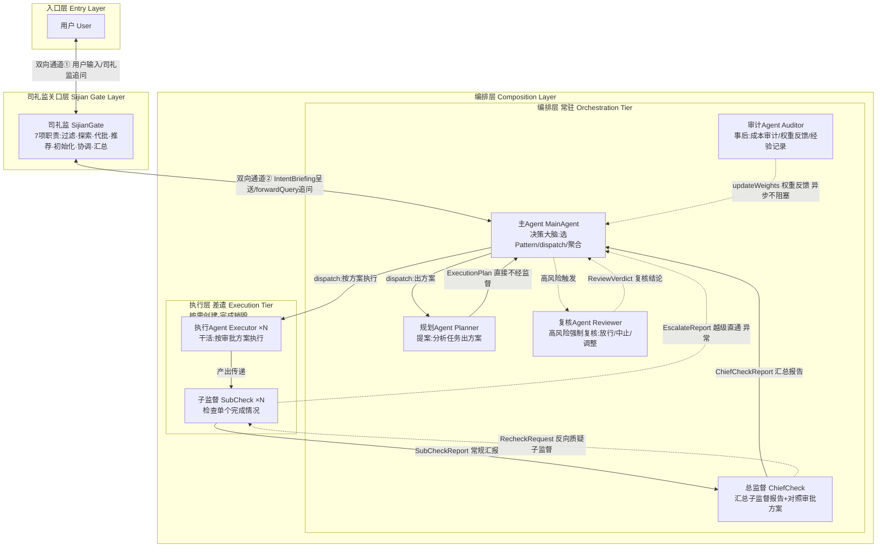
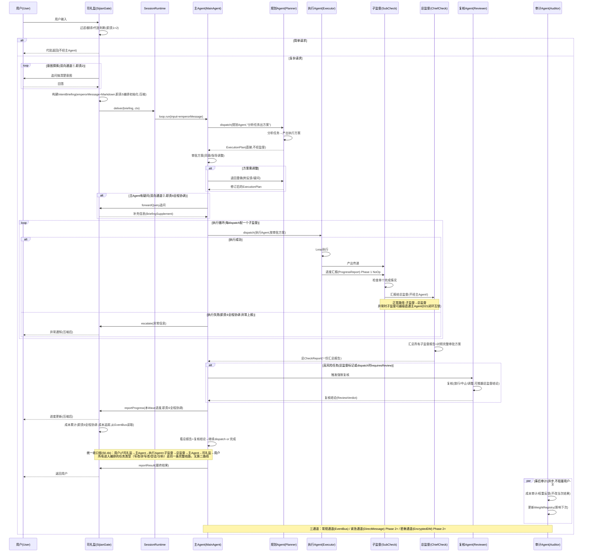
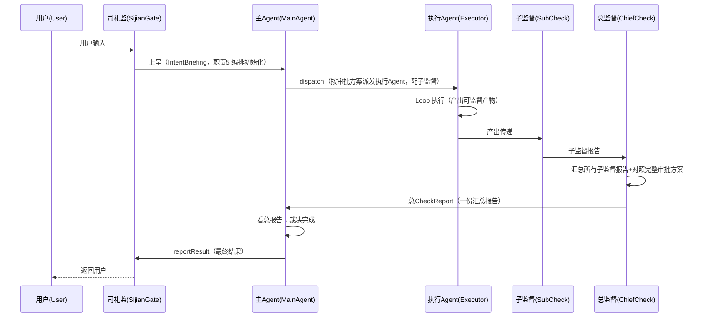
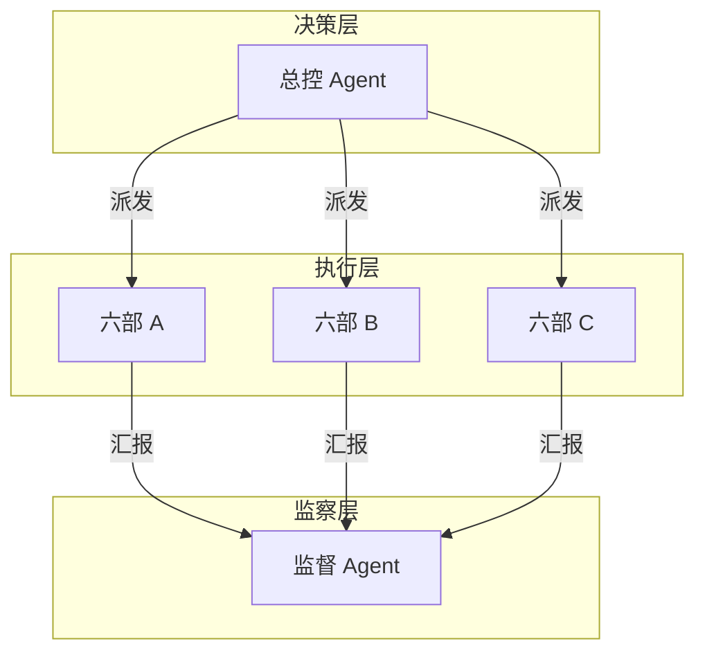
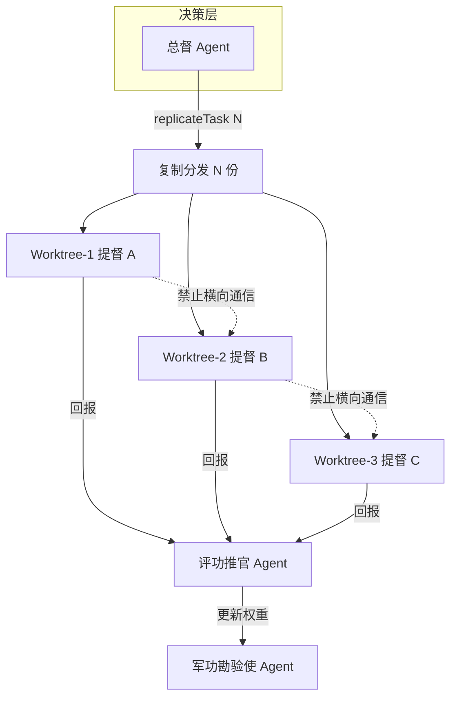
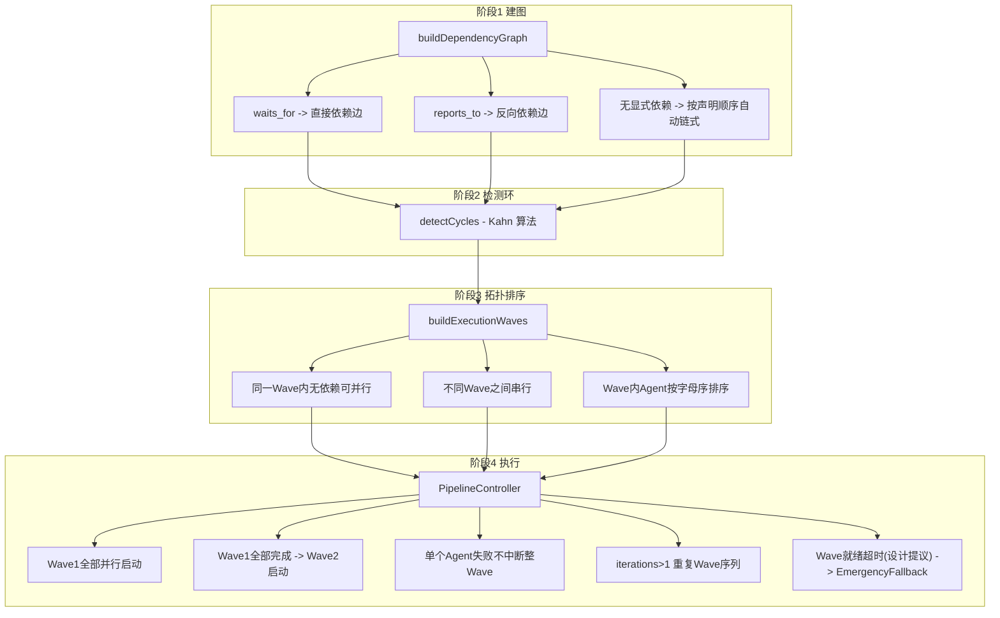
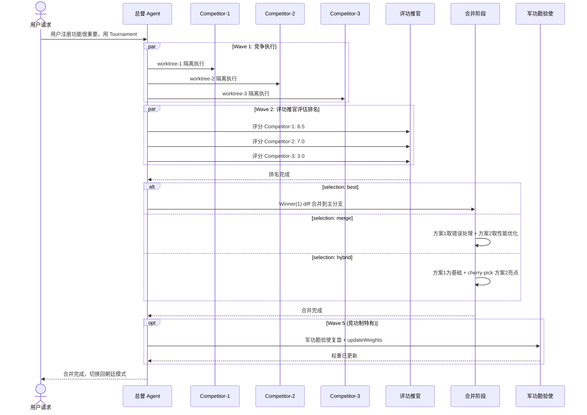
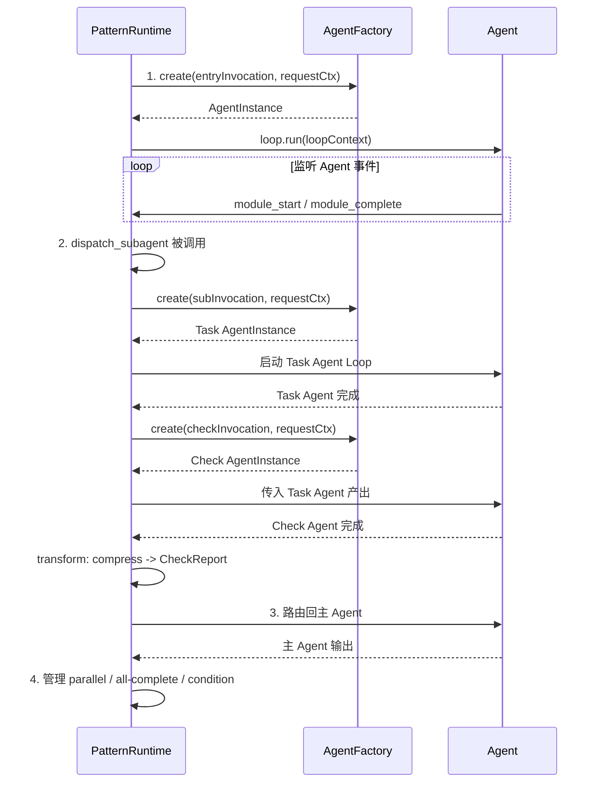
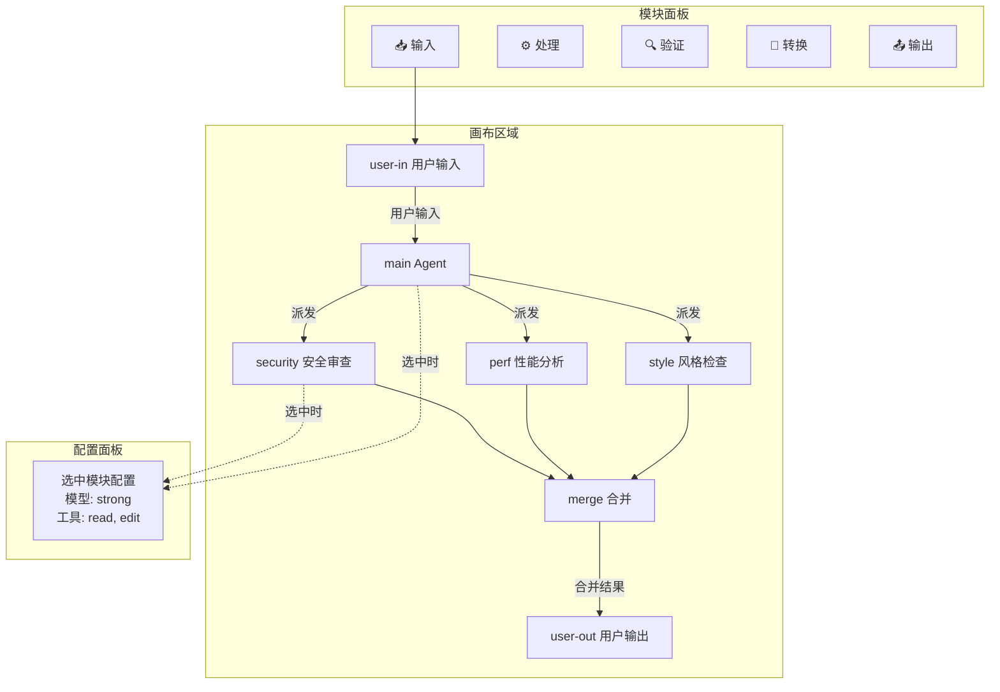

[AI 生成]

# 执行模式与协作拓扑（Coordination × Execution Patterns）

> Coordination × Execution 两层 Pattern：独立可组合的协作拓扑与执行模式。
> 状态：stable
> 维护：@XZF（主笔）
> 讨论：无
> 待决：无

---

## 0. 最小编排原子（D15）

> 任何编排模式的基本单位。所有复杂编排（DAG/tournament/六部/跨部）都是这个原子的递归组合。

### 0.0 架构拓扑总览（开门全景图）

八个角色的空间关系总览：入口层 → 司礼监关口层 → 编排层，编排层内部按生命周期分「常驻（预建制）」与「差遣（按需创建）」（D22）。监督链路见 §0.7b 闭环互锁，交互时序见 §0.4。



### 0.1 定义

最小编排原子 = 司礼监 + 规划Agent + 主Agent + 执行Agent + 子监督Agent + 总监督Agent + 复核Agent + 审计Agent，八个角色构成完整的四层监督体系。

核心流程：规划Agent 提案 → 主Agent 审批 → 执行Agent 执行 → 子监督Agent 检查 → 总监督Agent 汇总 → [高风险]复核Agent 强制复核 → 主Agent 决策 → [事后]审计Agent 学习反馈

四层监督（灵感源自明朝监察体系，与 11-renshi-shared-base 角色定义一致）：

| 层 | 角色 | 关注什么 | 改当次结果 | 每次都跑 | 明朝对应 |
|---|------|---------|----------|---------|---------|
| ① 过程监督 | 子监督Agent | 完成情况（做没做对） | ✅ 可要求返工 | ✅ | 给事中 |
| ② 全局汇总 | 总监督Agent | 整体偏离方案没有（汇总+对照方案） | ✅ 可建议redo | ✅ | 都御史 |
| ③ 结果复核 | 复核Agent | 结果有没有安全风险（合规+风险） | ✅ 可推翻中止 | ❌ 高风险才 | 大理寺 |
| ④ 事后审计 | 审计Agent | 做得怎么样（跨任务综合评价） | ❌ 只影响下次 | ❌ 按需 | 考功司 |

所有复杂编排模式都是这个原子的递归组合，且结构统一（规划→审批→执行→四层监督）：
- 最小编排原子：1个规划Agent → 1个主Agent → N个执行Agent → N个子监督 → 1个总监督 → [按需]复核 → [按需]审计
- 朝廷模式：3名内阁大学士 → 皇帝 → 六部 → 六科给事中 → 都察院都御史 → 大理寺 → 考功司
- 竞功模式：总督 → 皇帝批红 → 各路提督 → 各路监军御史 → 总监军 → [按需]复核 → 军功勘验使

> 注：最小编排原子中用"主 Agent"（Main Agent），朝廷模式中用"皇帝"（Emperor/总控）。两者不同：主 Agent 逐步 dispatch（动态决策），皇帝选 Preset + 审批（预定义流水线）。

### 0.2 八个角色

| 角色 | 职责 | 明朝对应 | 微内核映射 |
|------|------|----------|-----------|
| 司礼监 | 双向中间人：用户↔主 Agent | 司礼监 | Sijian Gate Layer |
| 规划 Agent | 想办法/出方案（提案） | 内阁大学士 | Planner |
| 主 Agent | 决策大脑：选 Pattern、dispatch、聚合结果 | 皇帝 | Main Agent（PatternRuntime） |
| 执行 Agent | 干活 | 六部执行者 | Task Subagent |
| 子监督 Agent | 每个执行subagent配一个，检查单个完成情况 | 六科给事中（每科对应一部） | Sub-Check |
| 总监督 Agent | 汇总所有子监督报告 + 拿完整审批方案检查全局 | 都察院都御史 | Chief Check |
| 复核 Agent | 高风险结果强制复核（放行/中止/调整），可推翻监督结论 | 大理寺 | Reviewer |
| 审计 Agent | 事后成本审计/预算偏差/反振荡/权重反馈，不改当次结果 | 考功司 | Auditor |

### 0.3 双向通道

司礼监不是单向传话筒，是**双向翻译官**——同时维护两条双向通道：

| 通道 | 方向 | 做什么 |
|------|------|--------|
| 用户 ↔ 司礼监 | 双向 | 司礼监听用户说；司礼监追问用户搞清楚意图 |
| 司礼监 ↔ 主 Agent | 双向 | 司礼监 Markdown 呈递主要信息；主 Agent forwardQuery 追问司礼监 |

### 0.4 完整流程



### 0.4a 司礼监全程参与（7 职责映射）

> 权威定义见 **15-sijian-batch.md §1a**（七项职责·方案 B）。本表是最小编排原子中的职责触发映射，编号与权威定义一致。

| # | 司礼监职责（同 15-sijian §1a） | 在最小编排原子中的触发时机 | 接口 |
|---|------|------|------|
| 1 | 前置过滤 | 用户输入到达，拦截不合规请求 | SijianGate 内部（deliver 前） |
| 2 | 意图探索 | 搞清用户意图（含双向通道①追问） | SijianGate 内部 + forwardQuery |
| 3 | 有限代批 | 简单低风险请求直接代批 | SijianGate 内部（alt 简单请求） |
| 4 | 模式推荐 | 推荐 Coordination×Execution 模式+理由 | IntentBriefing.recommendedMode |
| 5 | 编排初始化 | 呈送 IntentBriefing（含 emperorMessage 压缩） | SijianCompositionBridge.escalate |
| 6 | 全程协调 | 进度上报+异常上报+成本追踪+持续压缩 | reportProgress / forwardQuery / 内部 |
| 7 | 结果汇总 | 编排完成后压缩结果呈送用户 | SijianCompositionBridge.reportResult |

> 图中标注的"职责N"对应此表，编号与 15-sijian-batch.md §1a 一致。职责6（全程协调）是最小编排原子中触发点最多的职责，涵盖进度上报、异常上报、成本追踪、双向追问等子项。
> 注（v1.37，F12）：职责4「模式推荐」用于完整编排模式（朝廷/竞功/智囊团）——司礼监推荐 Coordination×Execution 模式。
> 最小编排原子为**固定流程**（规划→审批→执行→四层监督），无模式选择，`IntentBriefing.recommendedMode` 不填充属合理行为。

### 0.4b 统一收口链（所有任务类型）

> 收口闭环：编排是**一条完整的单线路**——用户 ⇄ 司礼监 →（上呈）主Agent →（按方案派发）执行Agent + 子监督 →（汇总）总监督 → 主Agent → 司礼监 → 用户。无论写改/多步执行、会话/分析，所有进入编排的任务都走这同一条线路，没有第二条路线。司礼监是对用户的**唯一出口**（职责7 结果汇总）。



**统一收口线路规则**：

| # | 规则 | 说明 |
|---|------|------|
| 1 | 一条线路 | 用户 ⇄ 司礼监 → 主Agent → 执行Agent+子监督 → 总监督 → 主Agent → 司礼监 → 用户 是编排**唯一的完整线路**，从用户出发到用户结束；不因任务类型（写改/非写改/会话/分析）而分支，**不存在**第二条路线或收口短线路 |
| 2 | 会话/分析同线派发 | 会话/分析任务在**同一条线路**内完成：主Agent 将回答/分析派发为可监督的执行产物（如"产出分析报告/回答文本"作为执行任务），执行Agent 产出后走与写改完全相同的子监督+总监督环节——派发内容不同，线路相同 |
| 3 | 司礼监唯一出口 | 用户只从司礼监收到最终答复（reportResult→返回用户），不直接接收执行Agent/总监督的原始输出；司礼监按职责7压缩后呈送 |
| 4 | 主Agent 裁决权 | 完成判定权在主Agent（看总报告→继续 dispatch or 完成）；总监督/复核只提供建议（redo/complete、approve/reject），不越权收口 |
| 5 | 代批通道边界 | 司礼监「有限代批」（15-sijian-batch.md 职责3，条陈授权内简单低风险请求）是编排**前**快速通道，不经内阁直接返回用户——不进编排、不走统一收口线路；一旦进入编排，走同一条完整线路 |
| 6 | 越级仅限异常 | 异常越级（子监督 escalate 直通主Agent / 异常上报司礼监→用户，D21 闭环互锁）为异常专用路径，不改变正常收口线路 |

### 0.5 Agent 生命周期（D22）

编排模式 = **预建制团队**。激活时全员就位 idle 待命，不是临时招人组建团队（灵感源自明朝：朝廷是预建制组织，尚书/侍郎/都御史已就位待命）。

#### 两层生命周期

| 层级 | 角色 | 何时创建 | 何时销毁 | 身份预注册 |
|------|------|---------|---------|----------|
| **编排层**（常驻） | 司礼监 | 模式激活时 | Session 结束 | ✅ |
| | 主Agent | 模式激活时 | Session 结束 | ✅ |
| | 规划Agent | 模式激活时 | Session 结束 | ✅ |
| | 总监督Agent | 模式激活时 | Session 结束 | ✅ |
| | 复核Agent | 模式激活时 | Session 结束 | ✅ |
| | 审计Agent | 模式激活时 | Session 结束 | ✅ |
| **执行层**（差遣） | 执行Agent | dispatch 时按需创建 | 任务完成销毁 | ✅ 模板预注册，实例按需 |
| | 子监督Agent | 配对执行Agent 创建 | 检查完成销毁 | ✅ 模板预注册，实例按需 |

#### 模式激活流程

```typescript
// 编排模式激活时（Session 创建 / 模式切换时）
// 1. SessionStore.create(session)
// 2. 编排层全员创建，idle 待命
AgentPool.create(司礼监 identity)     → 司礼监（idle）
AgentPool.create(主Agent identity)    → 主Agent（idle）
AgentPool.create(规划Agent identity)  → 规划Agent（idle）
AgentPool.create(总监督Agent identity) → 总监督Agent（idle）
AgentPool.create(复核Agent identity)   → 复核Agent（idle）
AgentPool.create(审计Agent identity)   → 审计Agent（idle）
// 3. 执行层身份模板预注册到身份库（不创建实例）
IdentityRegistry.preRegister(执行Agent identityTemplate)
IdentityRegistry.preRegister(子监督Agent identityTemplate)
// 4. Session 记住编排层 Agent ID
session.emperorAgentId = ...
session.plannerAgentId = ...
session.chiefCheckAgentId = ...
session.reviewerAgentId = ...
session.auditorAgentId = ...
```

```typescript
interface Session {
  // ... 已有字段
  emperorAgentId: string;      // 主Agent ID（编排层，Session级持久）
  plannerAgentId: string;      // 规划Agent ID（编排层，Session级持久）
  chiefCheckAgentId: string;   // 总监督Agent ID（编排层，Session级持久）
  reviewerAgentId: string;     // 复核Agent ID（编排层，Session级持久）
  auditorAgentId: string;      // 审计Agent ID（编排层，Session级持久）
}
```

#### 执行层按需创建（差遣）

主Agent dispatch 执行Agent 时，从身份库预注册的模板创建实例：

```typescript
// 主Agent dispatch 执行Agent
const executor = AgentPool.createFromTemplate(执行Agent identityTemplate);
const subCheck = AgentPool.createFromTemplate(子监督Agent identityTemplate);
// 执行 + 检查完成后
AgentPool.destroy(executor.id);
AgentPool.destroy(subCheck.id);
```

主 Agent 一直存在（编排层常驻）。每次司礼监呈送只是“唤醒”主 Agent 处理一个请求，处理完回到 idle。

> 编排层 = 预建制（模式激活时就位，idle 待命）。执行层 = 差遣（按需创建，完成销毁）。对应明朝差遣协调模式（六大协调模式之五）：本职官员常驻，差遣临时授权任务结束回收。

### 0.6 主 Agent 的第一个输入（空白 2）

司礼监呈送时，IntentBriefing 中包含 `emperorMessage`——Markdown 格式的压缩消息，传主要信息：

```typescript
interface IntentBriefing {
  userIntent: { goal: string; details: string; successCriteria?: string[]; constraints?: unknown };
  sijianAssessment: { complexity: string; recommendedMode?: string; suggestedAgents?: string[]; riskLevel?: string };
  originalCommand: InternalCommand;
  emperorMessage: string;  // Markdown 格式，司礼监压缩后的主要信息
}
```

主 Agent Loop 的 input = `emperorMessage`（不是原始用户输入，不是 JSON）。

主 Agent 看 emperorMessage 后如果有疑问，通过 `forwardQuery` 向司礼监追问（双向通道②）。不需要一次性把所有信息塞进 emperorMessage。

### 0.7 dispatch_subagent 最小参数（空白 3）

主 Agent 决定派 subagent 时，通过 dispatch_subagent 传 task + 四库选择：

```typescript
interface DispatchInput {
  task: string;                 // 做什么（必填）
  identity: string;             // 身份库：选谁
  loop?: string;                // Loop 库：用什么引擎（默认 react-loop）
  architecturePrompt?: string;  // 提示词库：怎么做
  skills?: string[];            // 技能库：额外能力
  deadline?: number;            // 超时（毫秒），超时触发子监督检查
  supervisionMode?: "passive" | "active";  // 监督模式（默认 passive）
}
```

deadline 超时机制（D24）：dispatch 时设定 deadline（毫秒），执行Agent 超时未完成 → 自动触发子监督检查（判定为失败）。灵感源自明朝六科给事中的注销监督——每项任务有完成时限，到期检查完成情况，超期启动考成法问责。

每个库选一个，不填用默认值。四维度各自独立选 source（见 04-four-libraries.md §8）。

dispatch 的返回值取决于角色类型：
- dispatch(规划Agent) → 直接返回 ExecutionPlan（不经监督，方案是给主Agent决策的）
- dispatch(执行Agent) → 产出去子监督→总监督，主Agent 最终收到的是总监督的 ChiefCheckReport（不经执行Agent原始产出——原则 5：上下文屏障适用于执行产出，不适用于规划产出）

### 0.7a 规划Agent的产出（D19）

规划Agent收到任务后，产出执行方案——类似朝廷模式的"票拟"：

```typescript
interface ExecutionPlan {
  /** 方案推理（为什么这么安排） */
  reasoning: string;
  /** 执行步骤 */
  steps: PlanStep[];
  /** 预估成本 */
  estimatedCost: number;
  /** 风险等级 */
  riskLevel: "low" | "medium" | "high";
}

interface PlanStep {
  /** 从身份库选谁 */
  identity: string;
  /** 做什么 */
  task: string;
  /** 依赖哪些前置步骤（步骤索引） */
  dependsOn?: number[];
}
```

主Agent收到方案后的审批选项：

| 审批结果 | 含义 | 怎么传 |
|----------|------|--------|
| **同意** | 按方案dispatch执行Agent | 直接dispatch |
| **指导调整** | 方案有问题，退回规划Agent重新出 | 再次dispatch规划Agent，task附修改理由/疑问 |
| **方案讨论** | 方案没大问题但信息不够，需要补充 | 主Agent↔规划Agent讨论通道（见 §0.7e） |

> 规划Agent产出 → 主Agent审批 → 按审批后方案dispatch。规划Agent产出不经监督（方案是给主Agent决策的，主Agent需完整看方案）。所有模式统一为"规划→审批→执行→子监督→总监督"五步。

### 0.7b 闭环互锁监督（D21）

监督体系不是单向金字塔（子监督→总监督→主Agent），而是**闭环互锁**——灵感源自明朝厂卫互监（“谁监察监察者”的终极解法不是找第三个人，而是让两者互察+都直达最高层）。

#### 四个通信方向构成闭环

```
     主Agent(MainAgent)
    ↗                  ↖
越级↗                    ↖常规汇报
  ↗   ←──互察──→          ↖
子监督              总监督
```

| 通信方向 | 谁触发 | 什么场景 | 接口 |
|---------|-------|---------|------|
| 子监督→总监督 | 正常 | 常规汇报检查结果 | SubCheckReport |
| 总监督→子监督 | 反向 | 总监督质疑子监督的检查质量（要求重新检查） | RecheckRequest |
| 子监督→主Agent | 越级 | 子监督发现总监督“包庇”了不通过的结果（直通主Agent） | EscalateReport |
| 总监督→主Agent | 正常 | 汇总后一份总报告 | ChiefCheckReport |

> 正常路径：子监督→总监督→主Agent。异常路径：子监督→主Agent（越级直通，绕过总监督）。反向路径：总监督→子监督（质疑检查质量，要求重查）。

#### 为什么闭环而不是金字塔

明朝厂卫互监的核心洞察：监察链不是单向的金字塔，而是一个闭环。如果监督者只能向上汇报不能越级，那上级监督者可以“压住”不利报告——系统就没有自我纠错能力。

闭环互锁确保：
1. **互相监察**：总监督可以反向审查子监督（子监督可能偷懒/草率检查），子监督可以越级举报总监督（总监督可能包庇）
2. **直达最高层**：子监督有越级直通主Agent的通道，不会被总监督“截留”
3. **信息不丢失**：两条路径（常规+越级）确保信息总能到达主Agent

#### 两层压缩不变

```
执行产出（大）
  → 子监督压缩（检查单个完成情况）
    → 总监督汇总压缩（对照完整审批方案）
      → 主Agent（一份总报告）
```

主Agent 正常情况下只看总监督的一份汇总报告。只有子监督越级时才多看一份 EscalateReport。

#### 数据结构

```typescript
/** 子监督→总监督：常规汇报 */
interface SubCheckReport {
  taskId: string;
  passed: boolean;
  summary: string;
  issues?: string[];
}

/** 总监督→子监督：反向要求重查 */
interface RecheckRequest {
  taskId: string;
  /** 质疑理由（为什么认为检查结果不可靠） */
  reason: string;
  /** 要求关注的特定方面 */
  focusAreas?: string[];
}

/** 子监督→主Agent：越级直通（绕过总监督） */
interface EscalateReport {
  taskId: string;
  /** 越级理由（通常：总监督包庇了不通过的结果） */
  escalateReason: string;
  /** 子监督自己的原始检查结果 */
  originalReport: SubCheckReport;
}

/** 总监督→主Agent：常规汇总报告 */
interface ChiefCheckReport {
  overallPassed: boolean;
  taskSummaries: string[];
  planAlignment: string;
  issues?: string[];
  recommendation: "complete" | "redo" | "partial";
}
```

> 消歧注（v1.36，F7）：本节 SubCheckReport（`passed: boolean`）、ChiefCheckReport（`overallPassed: boolean`）
> 为文档级示意形态。**实际代码契约遵循 06-core-engine.md §3a 的 CheckReport 层级**
> （`璇玑/orbita-sdk/cell-base/src/check-agent/types.ts`）：`verdict: "pass" | "fail" | "partial"`
> 替代 `passed`/`overallPassed`，语义等价（pass = true，fail/partial = false）。
> 引用本节字段形态的文档（12-chaoting-mode/17-moushi-modes/21-glossary）以本文档示意为准，
> 代码实现以 06 §3a 为准。

#### 复杂模式才增加的元监察

最小编排原子的闭环互锁是最小实现。复杂模式（朝廷/竞功）在此基础上增加：

| 角色 | 最小编排 | 朝廷模式 | 竞功模式 |
|------|---------|---------|---------|
| 东厂（元监察，监察所有监察者） | ❌ | ✅ | ✅ |
| 锦衣卫（反监东厂，厂卫互监） | ❌ | ✅ | ✅ |
| 三角制衡（内阁-皇帝-六科） | ❌ | ✅ | ❌ |

> 8 角色不变，4 个通信方向构成闭环。复核Agent 和 审计Agent 已在最小编排原子中（按需触发）。元监察（东厂/锦衣卫）仍留给复杂模式。
> CheckAgent 接口契约（CheckerRole/CheckTemplate/CheckReport 层级/压缩策略/回退策略/三通道/层层筛选）的形式化定义见 06-core-engine.md §3a。

### 0.7c 分层上报（D23）

主Agent（皇帝）只看大问题和系统性问题——日常小问题在子监督/总监督层就消化了。灵感源自明朝：给事中驳正退回六部（小事自己处理）、巡按“小事立断大事奏裁”、御史弹劾经都御史筛选后才报皇帝。

#### 四层上报

| 严重程度 | 谁处理 | 上报到谁 | 对应明朝 |
|---------|-------|---------|---------|
| **小问题**（补正级） | 子监督自己处理，要求执行Agent修复 | 不上报 | 给事中驳正退回六部 |
| **中等问题**（重审级） | 子监督报总监督，总监督决定 | 总监督层消化 | 御史弹劾→都御史筛选 |
| **大问题**（整体失败） | 总监督报主Agent | 主Agent裁定 | 都御史上报皇帝 |
| **系统性问题**（总监督包庇） | 子监督越级直通主Agent | 主Agent（绕总监督） | 密奏直通皇帝 |

#### 判断标准

| 层级 | 判断条件 | 处理方式 |
|------|---------|---------|
| 小问题 | 执行产出有小瑕疵，修复即可 | 子监督发 RecheckRequest → 执行Agent补正 → 重新检查 |
| 中等问题 | 执行产出有根本性问题，需要重做 | 子监督报总监督 → 总监督决定是否上报主Agent |
| 大问题 | 多个执行Agent失败 / 方案本身有问题 | 总监督发 ChiefCheckReport(recommendation="redo") → 主Agent裁定 |
| 系统性问题 | 总监督“包庇”了不通过的结果 | 子监督发 EscalateReport → 主Agent（绕总监督） |

#### 返工机制

检查不通过时，区分补正 vs 重审（源自大理寺复核的两种打回）：

| 打回类型 | 适用场景 | 怎么处理 |
|---------|---------|---------|
| **补正**（小问题） | 产出有小瑕疵，修复即可 | 原执行Agent继续修（不销毁），子监督重新检查 |
| **重审**（大问题） | 产出有根本性问题 | 销毁原执行Agent，重新 dispatch 新的 |

> 防止死循环：同一任务返工超过 N 次（由律例设定）→ 强制上报总监督 → 总监督决定是否报主Agent（源自明朝：多次打回奏报皇帝裁定）。

#### 主Agent 收到越级（EscalateReport）后怎么处理

子监督越级举报总监督时，主Agent 收到 EscalateReport 后：

1. 对照总监督的 ChiefCheckReport 和子监督的 EscalateReport
2. 如果矛盾 → 主Agent 裁定谁对（源自明朝：意见不一是奏报而非投票，各自上奏皇帝裁定）
3. 如果总监督确实包庇 → 降低总监督权重（源自密奏反坐制度）

> 越级不能滥用：子监督频繁越级且内容不实 → 子监督权重降低（源自密奏反坐：虚假密奏发送者受同等惩罚）。
> 层层筛选机制的完整设计见 06-core-engine.md §3a.6。CheckAgent 每种角色如何使用四层上报见 §3a.3 配置表。

### 0.7d 子监督双模式（D24）

子监督支持两种模式，灵感源自明朝两种监察方式：

| 模式 | 明朝对应 | 怎么做 | 适用场景 | 成本 |
|------|---------|-------|---------|------|
| **passive**（默认） | 六科给事中注销 | 执行Agent 说完成后才介入检查 | 日常任务、低风险 | 低（只检查一次） |
| **active**（可选） | 监军御史随军 | 执行过程中实时盯着，可中途暂停 | 高风险任务、长时任务 | 高（持续消耗） |

模式选择：dispatch 时通过 `DispatchInput.supervisionMode` 设定。默认 passive。

#### passive 模式（默认）

```
执行Agent 自己跑 → 自己判断“完成了” → 声明完成 → 子监督介入检查
→ 通过：SubCheckReport(passed=true)
→ 不通过：SubCheckReport(passed=false) + 返工
```

子监督不盯过程，只检查结果。执行Agent 说“我做完了”，子监督验证“你真的做完了吗？”

#### active 模式（可选，高风险任务）

```
执行Agent 跑 ←── 子监督实时盯着（监控执行过程）
→ 发现问题：白旗暂停（pauseExecution）
→ 主Agent 收到暂停通知 → 决定继续/调整/中止
→ 执行正常完成：子监督做最终检查（同 passive）
```

active 模式下子监督可以中途喊停（对应明朝监军御史的白旗暂停权），防止高风险任务在错误方向上浪费资源。

> 竞功模式（13-jinggong）的监军御史就是 active 模式的完整实现。最小编排原子中 active 是可选的，复杂模式可能默认 active。

### 0.7e 主Agent↔规划Agent 讨论通道（D24）

主Agent 收到方案后如果信息不够全、无法决策时，不是直接退回重做，而是与规划Agent 讨论，要求补充信息。灵感源自明朝：皇帝对票拟不满意时通过司礼监传话给内阁“朕觉得方案不够清楚，补充一下”，内阁补充后皇帝才好批红。

#### 方案讨论 vs 指导调整

| 情况 | 含义 | 通道 |
|------|------|------|
| 方案有问题 | 方案本身不对，需要重新出 | 指导调整（退回重做） |
| **方案不够全** | 方案没大问题，但信息不够让主Agent决策 | **方案讨论（追问/补充）** |

#### 讨论通道机制

```typescript
/** 主Agent→规划Agent：追问/要求补充 */
interface PlanClarifyRequest {
  /** 主Agent的疑问（哪些地方不清楚/需要更多细节） */
  questions: string[];
  /** 需要补充的方面 */
  areas: string[];
}

/** 规划Agent→主Agent：补充后的方案 */
interface PlanSupplement {
  /** 补充的信息 */
  clarifications: string[];
  /** 修订后的方案（可能只改了部分） */
  revisedPlan: ExecutionPlan;
}
```

> 消歧注（v1.37，F12）：本 PlanClarifyRequest（`questions/areas`）、PlanSupplement（`clarifications`）为文档级示意形态。
> **实际代码契约以 `composition/atom-types.ts` 为准**（`missingInfo/question`、`answers/revisedPlan?`），语义等价
> （questions↔missingInfo、areas↔question、clarifications↔answers）。

#### 讨论流程

```
规划Agent 出方案 → 主Agent 看 → 信息不够
→ 主Agent 发 PlanClarifyRequest（哪些地方不清楚）
→ 规划Agent 补充 PlanSupplement（修订方案）
→ 主Agent 看补充后方案 → 现在够全了 → 审批（同意/指导调整/再讨论）
```

> 讨论不是无限循环：如果讨论超过 N 轮仍未让主Agent 满意 → 转为“指导调整”（退回重做）或 forwardQuery 给司礼监（让用户补充信息）。

### 0.7f 复核Agent 和 审计Agent（D25）

四层监督体系的第三层和第四层。灵感源自明朝大理寺（复核）和考功司（审计）。

#### 复核Agent（Reviewer）—— 结果安全网

**职责**：对高风险任务的结果做最终安全复核，可推翻子监督和总监督的结论。

**两种复核时机**（D25b，解决事中/事后矛盾）：

复核Agent 有两种介入时机，覆盖执行全程的风险控制：

| 时机 | 什么时候 | 触发条件 | 对应明朝 | 对应 11-renshi |
|------|---------|---------|---------|--------------|
| **事中复核** | 执行**中途**到达预设关键节点时 | 规划Agent 在方案中标注“中途复核点” | 大理寺中途复核（高风险案件中途暂停） | 11-renshi §5.3 中途复核 |
| **事后复核** | 总监督汇总后、主Agent最终决策前 | dispatch 时 `requiresReview: true` 或总监督标记高风险 | 大理寺最终覆核（判决后执行前） | 03 §0.7f 默认 |

两种时机使用相同的 ReviewVerdict 接口（放行/中止/调整），但关注点不同：

- **事中复核**关注“执行方向对不对？”——防止在高风险任务上浪费资源（已经跑偏了就及早止损）
- **事后复核**关注“结果有没有安全风险？”（合规+风险）——最终结果给主Agent/用户前的最后一道安全网

> 两种复核互补：事中防止跑偏（止损），事后确保安全（兜底）。最小编排原子默认用事后复核，复杂模式（朝廷）可同时在方案中设置事中复核点。

**复核的三种结论**：

| 结论 | 含义 | 对应明朝 |
|------|------|---------|
| **放行**（pass） | 结果安全，允许执行 | 大理寺维持原判 |
| **中止**（abort） | 结果有安全隐患，强制取消 | 大理寺驳回重审 |
| **调整**（adjust） | 结果基本可用但需修改后执行 | 大理寺要求补正 |

```typescript
interface ReviewVerdict {
  /** 放行/中止/调整 */
  verdict: "pass" | "abort" | "adjust";
  /** 复核理由（为什么安全/为什么不安全） */
  reasoning: string;
  /** 如果调整，需要改什么 */
  adjustments?: string[];
}
```

> 消歧注（v1.36，F7）：本 ReviewVerdict（`verdict: "pass"|"abort"|"adjust"` + `reasoning`）为文档级示意形态。
> **实际代码契约遵循 06-core-engine.md §3a**（`check-agent/types.ts`）：`action: "approve" | "reject" | "adjust"`
> 替代 verdict（语义等价：pass↔approve、abort↔reject、adjust↔adjust），`summary` 替代 `reasoning`，
> `adjustments?: string` 替代 `string[]`。代码实现以 06 §3a 为准。

**复核 vs 子监督的区别**：
- 子监督检查“做完了没有”（完成情况）
- 复核检查“结果有没有安全风险”（合规+风险）
- 复核权力更大：可以推翻子监督+总监督的结论

> 复核是最终安全网——子监督和总监督可能“合谋放水”或检查不够深入，复核是最后一道防线。对应明朝大理寺：刑部和都察院都判了，大理寺还可以驳回重审。

#### 审计Agent（Auditor）—— 学习闭环

**职责**：事后评估本次编排的成本和表现，反馈到 WeightRegistry，影响下次调度。**不改当次结果。**

**触发时机**：
- 一个 Wave 完成后（异步，不阻塞用户）
- Session 结束时（总结性审计）

**审计的四个方面**：

| 审计维度 | 检查什么 | 对应明朝 |
|---------|---------|---------|
| 成本审计 | 预算 vs 实际消耗（token/时间），偏差简报 | 户部决算 |
| 反振荡检测 | 同类错误反复出现？某个 identity 持续表现差？ | 都察院弹劾模式 |
| 权重反馈 | 哪个 identity 表现好（升权）/差（降权）→ 更新 WeightRegistry | 考功司京察大计分级 |
| **经验记录** | **记录本次任务怎么做的好/差，供后续类似任务参考** | **则例/会典/皇史宬** |

```typescript
interface AuditReport {
  /** 本次编排成本摘要 */
  costSummary: { budgeted: number; actual: number; variance: string };
  /** 各 identity 表现评分 */
  identityScores: { identity: string; score: number; note: string }[];
  /** 发现的振荡模式（同类错误反复） */
  oscillationPatterns?: string[];
  /** 建议的权重调整 */
  weightAdjustments: { identity: string; delta: number; reason: string }[];
}
```

#### 经验记录（则例机制）

审计Agent 记录任务经验，后续类似任务可参考。灵感源自明朝则例——各部维护的案例集“以前类似事务怎么处理的”，新事务时查则例参考。

WeightRegistry 和经验记录的区别：
- **WeightRegistry**：记录“**谁**表现好”（identity 权重，派谁）
- **经验记录**：记录“**怎么做**的好”（方法/方案，怎么做）

两者互补——下次遇到类似任务时：WeightRegistry 告诉你派谁，经验记录告诉你怎么做。

```typescript
interface TaskRecord {
  /** 任务摘要（贴黄级别，不是完整过程） */
  taskSummary: string;
  /** 用的什么方案 */
  approach: string;
  /** 结果好不好 */
  outcome: "success" | "partial" | "failure";
  /** 成本 */
  cost: number;
  /** 教训（如果失败，什么原因） */
  lessons?: string;
  /** 任务标签（用于后续检索类似任务） */
  tags: string[];
}
```

#### 存储方案（两阶段）

| 阶段 | 存哪 | 检索能力 | 新增模块？ |
|------|------|---------|----------|
| **Phase 1** | EventSourcedState（已有基础设施） | ❌ 只存不检索 | ❌ 不加新模块 |
| **Phase 2+** | CaseLibrary（新增 Infrastructure 模块） | ✅ 向量检索相似任务 | ✅ 新增 |

Phase 1：审计Agent 产出 TaskRecord → 作为事件写入 EventSourcedState 的命名空间（`audit.task-records`），只存不检索——最笨实现（原则 2）。

Phase 2+：新增 CaseLibrary 基础设施模块（对应明朝则例/会典），规划Agent 可检索类似任务：

```typescript
interface CaseLibrary {
  /** 写入任务经验（审计Agent 调用） */
  record(taskRecord: TaskRecord): void;
  /** 检索类似任务（规划Agent 调用） */
  findSimilar(taskDescription: string, limit?: number): TaskRecord[];
}
```

规划Agent 用法：收到新任务 → CaseLibrary.findSimilar → 返回上次类似任务的方案+结果 → 参考产出更好的 ExecutionPlan。对应明朝：新官上任“查则例”。

> 两层存储对应明朝：皇史宬（EventSourcedState，原始存档）→ 则例/会典（CaseLibrary，整理后可检索的案例库）。

**审计 vs 监督的区别**：
- 监督关注“这次做对了没有”（当次结果）
- 审计关注“下次怎么做得更好”（学习反馈 + 经验记录）
- 审计不改当次结果，只更新 WeightRegistry 和 TaskRecord

> 审计是学习闭环——不改这次的决定，但让系统下次调度更优。对应明朝考功司京察大计：不改这次的任命，但影响官员升降（=WeightRegistry 权重调整）。Phase 1 审计Agent 可为 NoOp（只记录不反馈），Phase 2+ 接入 WeightRegistry 持久化。

#### 完整的四层监督职责链

```
执行Agent 完成
  → ① 子监督：检查“做完了没有？”（完成情况，每次）
  → ② 总监督：检查“整体偏离方案没有？”（汇总+对照方案，每次）
  → ③ 复核：检查“结果有没有安全风险？”（合规+风险，高风险才）
  → ④ 审计：检查“这次做得好不好？下次怎么改进？”（学习反馈，按需，异步）
  → 主Agent / WeightRegistry
```

> 四层各有关注点，不重叠：过程（监督）≠ 整体偏离（总监督）≠ 合规风险（复核）≠ 综合评价（审计）。与明朝监察体系完全对齐，与 11-renshi-shared-base 角色定义一致。

### 0.8 SessionRuntime 入口

Composition Layer 提供 SessionRuntime 接口，司礼监通过它启动主 Agent：

```typescript
interface SessionRuntime {
  /** 司礼监呈送后调用，启动主 Agent 处理 */
  deliver(briefing: IntentBriefing, ctx: RequestContext): Promise<ExecutionResult>;
}

interface ExecutionResult {
  output: string;                       // 最终产出文本
  agents: AgentExecutionSummary[];      // 各 Agent 执行摘要
  totalCost: number;
  durationMs: number;
}
```

> 实现注（v1.37，F12）：代码 `composition/session-runtime.ts` 的 `SessionRuntime.deliver(briefing, ctx)` 中
> `ctx` Phase 1 用 `InternalCommand`（entry 层协议，非 `RequestContext`——贯穿件字段由调用方在 briefing 内传递）；
> `ExecutionResult` 字段均为可选（宽松化实现选择）。另见 §0.5：Session 扩展字段
> （emperorAgentId/plannerAgentId/chiefCheckAgentId/reviewerAgentId/auditorAgentId）已由
> `OrchestrationAgentIds` 落地（F11）。

deliver 内部：
1. 从 AgentPool 获取主 Agent（已存在，idle 状态）
2. 构建 LoopContext（input = briefing.emperorMessage）
3. 调用 agent.loop.run(loopContext)
4. 返回 ExecutionResult

### 0.9 并行 dispatch

主 Agent 可以在一次 Loop 迭代中调用多次 dispatch_subagent（LLM 并行工具调用），Loop 内部用 Promise.all 并行执行：

```typescript
// Loop 的 executeTools 必须并行执行（不能串行 for 循环）
const results = await Promise.all(toolCalls.map(executeTool));
```

Wave 内并行 = 主 Agent 一次 dispatch 多个 subagent，Promise.all 等全部完成。Wave 间串行 = 主 Agent 看完全部 CheckReport 后再决定下一轮 dispatch。

---

## 1. 模式总览：两层 Pattern

### 1.1 为什么分两层

v3 把所有"模式"混在单层：**Session 模式**（on-demand / swarm）与**执行模式**（single / parallel / chain / fan-out / tournament）耦合在一起，模式名承担多种职责——`tournament` 既是一种执行机制又暗示单点派发，`swarm` 既是一种组织拓扑又默认团队竞争。

v4 拆为两层独立可组合的 Pattern（模式，决策 73，原则 20）：

- **Coordination Pattern**（协调拓扑）：agent 怎么**组织**。
- **Execution Pattern**（执行模式）：任务怎么**执行**。

两层各自独立注册、独立选择、独立演进。组合靠 Capability 契约保证合法（见 §17）。

### 1.2 Coordination Pattern（协调拓扑）

Coordination 回答"这群 Agent 怎么组织起来"。

| Coordination | 中文显示名 | 核心机制 | Phase |
|--------------|-----------|---------|-------|
| `hierarchy` | 层级（内阁制默认） | 树状派发，父子关系，自顶向下决策 | Phase 1 |
| `market` | 市场竞争（竞功制默认） | 复制分发，N 路竞争，择优合并 | Phase 1 |
| `peer-mesh` | 同辈网状 | 扁平协作，点对点直连 | Phase 2+ |
| `federation` | 联邦 | 多 Session 协作，跨域联邦 | Phase 2+ |
| `council` | 议会/谋士式 | 谋士议会式协作，4 执行策略独立可选，dag（总智囊）opt-in 融合 | Phase 1 |

### 1.3 Execution Pattern（执行模式）

Execution 回答"任务在 Agent 间怎么流转"。v3 的 `single` 不是真正的 Execution Pattern——它是"派发一个子 Agent"的最小行为，由 dispatch_subagent 工具完成（见 04-four-libraries.md §8）。`parallel` 是 DAG 的多 Wave 内并行能力，不是独立 Execution。

v4 真正的 Execution Pattern 有四种：

| Execution | 核心机制 | 来源 |
|-----------|---------|------|
| `dag` | DAG 建图 + Wave 拓扑排序 + 并行波次执行 | v3 决策 26 |
| `tournament` | N 个个体/团队同任务竞争，评功选优合并 | v3 决策 56 |
| `chain` | 步骤顺序串联，输出变量绑定传递 | v3 决策 48 |
| `fan-out` | 数据驱动动态扩展，expand/parallel/collect 三阶段 | v3 决策 51 |

### 1.4 组合矩阵（Capability 契约推导）

不是所有 Coordination × Execution 组合都有意义。Phase 1 用白名单（`compatibleWith`）限定合法组合，Phase 2+ 演进到完整 requires/provides 契约匹配（见 §17）。

| Coord \ Exec | dag | tournament | chain | fan-out |
|---|---|---|---|---|
| `hierarchy`（内阁制） | ✅ **内阁制默认** | ✅ | ✅ | ✅ |
| `market`（竞功制） | ✅ | ✅ **竞功制默认** | ❌ | ✅ |
| `peer-mesh` | Phase 2+ | Phase 2+ | Phase 2+ | Phase 2+ |
| `federation` | Phase 2+ | Phase 2+ | Phase 2+ | Phase 2+ |
| `council` | ✅ | ✅ | ✅ | ✅ |

> 朝会为 council 协调拓扑的复合运行态（= 总智囊 内部复合态），非独立 Execution，不占矩阵单元。

**为什么 market × chain 不合法**：chain 是步骤顺序串联的协作（数据在 Agent 间流动），而 market 的核心不变量是竞争者间禁止横向通信（见 §16.4）。chain 的步骤间通信违反 market 公平性。

### 1.5 编排类型与完整模式：任事型（内阁制/竞功制）+ 谋士型（智囊团）

v3 的 `on-demand`（按需派发）和 `swarm`（群 Agent）升级为两套**各自独立术语体系**的完整模式。技术名沿用 `on-demand`/`swarm`，中文显示名为**朝廷模式**与**竞功模式**（原则 21，已推翻，见原则 33）。

璇玑 v4 顶层模式按职责分两类**编排类型**（orchestration type）：**任事型**（Renshi type, task-execution）= 朝廷模式 + 竞功模式 + 大明模式，产出交付物、把事办成；**谋士型**（Moushi type, strategist）= 智囊团，产出谋议/分析。编排类型是 Coordination×Execution 两层 Pattern 之上的叙事分类。术语规则见原则 33——任事型三模式（朝廷/竞功/大明）共享术语池，谋士型术语独立（原原则 21 术语族不交叉规则已推翻）。


| 编排类型 | 模式 | 技术名 | 中文显示名 | 默认 Coordination | 默认 Execution | 来源隐喻 |
|----------|------|--------|-----------|------------------|---------------|---------|
| 任事型 | 内阁制 | `on-demand` | 内阁制 | `hierarchy` | `dag` | 明朝内阁（文官体制） |
| 任事型 | 竞功制 | `swarm` | 竞功制 | `market` | `tournament` | 明朝竞功军制（军事体制） |
| 谋士型 | 智囊团 | `zhinang` | 智囊团 | `council` | 随模式路由（council-menke=fan-out / council-muliao=chain / council-dihuang=tournament / council-zhinang=dag） | 智囊团谋士体制 |

**术语规则**（原则 33，已推翻原则 21）：任事型三模式（朝廷/竞功/大明）共享术语池，Session 切换模式时称呼不再切换。谋士型（智囊团）术语仍独立。共享能力用核心通用名（WeightRegistry / EventSourcedState）。
注：「三族不交叉」术语族规则已被原则 33 取代——朝廷/竞功/大明同属任事型，术语统一共享，不再因模式切换而改名。

完整角色表与工作流见 11-renshi-shared-base.md、12-chaoting-mode.md。本文件聚焦两层 Pattern 的机制定义。

### 1.6 术语对照

| 功赏量规 | EvaluationRubric（Pack 提供） |
| 编排类型 | orchestration type |
| 任事型 | Renshi type（task-execution） |
| 谋士型 | Moushi type（strategist） |
| 智囊团 | Zhinang（Brain-Trust，council） |

**相关决策**：73（两层 Pattern）、74（角色降级）、65（修改，执行模式->两层分离）、85（Capability 契约）、75（内阁制）、76（竞功制）。

---

## 2. Coordination Pattern 详解

### 2.1 hierarchy（层级，内阁制）

```


**核心特征**：
- 自顶向下的派发链路，父 Agent 决定子 Agent 的任务和资源。
- 三层监督分离（过程监督/事后审计/高风险复核），暂停权与恢复权分离。
- 角色术语：总控 / 首辅 / 六部 / 都察院 / 大理寺（见 12-chaoting-mode.md）。
- 默认 Execution：`dag`（DAG + Wave 引擎）。

**适用**：日常任务、需要清晰责任链、需要三层监察保障的任务。内阁制是默认模式（零配置即生效）。

### 2.2 market（市场竞争，竞功制）

```


**核心特征**：
- 复制分发（replicateTask）：同一任务下发 N 个独立分支，每个分支独立 worktree 隔离。
- **禁止横向通信**（公平性不变量，见 §16.4）：竞争者（提督）间不得直接通信。
- 择优/融合四策略（best / merge / hybrid / vote）。
- 功赏指标外置（Pack 的 `defaultRubric`，不硬编码）。
- 角色术语：总督 / 提督 / 评功推官 / 监军御史 / 军功勘验使（见 13-jinggong-mode.md）。
- 默认 Execution：`tournament`。

**适用**：高价值任务、需要多方案对比、复杂任务需要多视角团队协作。

### 2.3 peer-mesh 与 federation（Phase 2+）

**peer-mesh**：扁平协作，无中心决策者，每个 Agent 可直接点对点通信。适合开放式探索、头脑风暴、跨域专家咨询。

**federation**：跨 Session 协作，多个 Session 联邦，每个 Session 自治但可委托任务给其他 Session。适合多用户协作、跨域大型任务。

Phase 1 不实现。接口形态按 §17 Capability 契约预留。

### 2.4 派发权限下沉（dispatchBudget）

不靠架构硬编码递归深度，而靠 `Identity.capabilities`（身份能力声明）+ `dispatchBudget`（派发预算）下沉控制（决策 4 修改）。

```typescript
interface Identity {
  // ... 其他字段
  /** 该身份拥有的能力，如 ["dispatch", "contact", "broadcast"] */
  capabilities: string[];
  /** 派发预算：本 Agent 还能派发多少子 Agent */
  dispatchBudget?: number;
}
```

**规则**：
- `capabilities` 包含 `"dispatch"` 才能调用 `dispatch_subagent`。
- 每次派发消耗父 Agent 的 1 个 `dispatchBudget`，子 Agent 继承 `min(parentBudget - 1, identity.dispatchBudget)`。
- 架构硬兜底上限 10（原则 4：不限制数量，预算驱动）。
- Phase 1：树形拓扑，深度 2（决策者->执行者），Budget 大到不会触发。Phase 2+：通用图拓扑。

---

## 3. Execution Pattern 详解

### 3.1 dag：DAG + Wave 执行引擎（决策 26）

PatternRuntime 使用 DAG（有向无环图）+ Wave（拓扑排序的并行波次）作为执行引擎。这是内阁制默认 Execution，也是 hierarchy Coordination 的主要搭档。

#### 执行流程

```
阶段 1: 建图 (buildDependencyGraph)


#### 示例

```
Pattern: scout -> reviewer -> fixer

DAG: scout -> reviewer -> fixer
Waves: [[scout], [reviewer], [fixer]]

执行:
  Wave 1: [scout]          <- 并行执行
      v 全部完成
  Wave 2: [reviewer]       <- 并行执行
      v 全部完成
  Wave 3: [fixer]
      v 全部完成
```

#### Wave 推进条件与就绪超时（设计提议，2026-08）

Wave 间串行屏障的推进条件显式化，并补「就绪等待有界」：

- **推进条件**：波次内所有任务 `status ∈ {completed}` 且 CheckReport 验收通过（参与者自报完成 + 检查点确认，双层就绪）——现状语义，显式化声明
- **Wave 就绪超时（新增）**：波次启动后 T 秒内未满足推进条件（如某 Agent 挂起——既不失败也不超时，无事件发生）→ 触发 EmergencyFallback（决策 82）降级路径：
  - 重试挂起任务 / 跳过挂起者继续后续 Wave / 整个 Wave 中止
  - 降级选择由编排的 `fallbackValue` 预设决定，不现场 improvisation（预定义优于即兴发挥）
- 与单任务兜底（LLM 重试 §7.1、竞功 haltBranch）互补：单任务兜底是事件驱动（失败/超时有信号），Wave 超时兜底的是**无声挂起**（无事件，现有机制覆盖不到）


#### 变量绑定语法

Pattern 定义中每步支持输出命名和变量引用：

```yaml
pattern:
  name: "review-fix-cycle"
  steps:
    - agent: scout
      task: "扫描认证模块"
      as: context              # 输出命名

    - agent: reviewer
      task: "根据 {outputs.context} 审查代码"
      waits_for: [scout]
      as: review               # 输出命名

    - agent: fixer
      task: "根据 {outputs.review} 修复问题"
      waits_for: [reviewer]
```

#### 变量类型

| 变量 | 含义 | 示例 |
|------|------|------|
| `{outputs.xxx}` | 引用前序步骤命名输出 | `{outputs.context}` |
| `{previous}` | 引用上一步全部输出 | 根据 `{previous}` 实现 |

PatternRuntime 执行每步前自动解析变量引用。绑定验证：引用的名称必须在前序步骤中已声明。

也可结合内部 URL 方案用 `agent://step-1/output` 引用（见 09-seam-map.md 的内部 URL 方案）。

### 3.3 fan-out：动态扇出（决策 51）

#### expand/parallel/collect 三阶段

Pattern 定义支持 expand/parallel/collect 语法（Phase 2 实现）：

```yaml
pattern:
  name: "batch-review"
  steps:
    - agent: scout
      task: "列出需要审查的文件"
      output_schema:
        items: [{ path: string, reason: string }]
      as: targets

    - expand:
        from: { output: "targets", path: "/items" }
        item: "target"
        maxItems: 12
      parallel:
        agent: reviewer
        task: "审查 {target.path}"
      collect:
        as: reviews
      concurrency: 4

    - agent: fixer
      task: "根据 {outputs.reviews} 修复所有问题"
```

#### 三阶段说明

| 阶段 | 作用 | 说明 |
|------|------|------|
| expand | 数据驱动扩展 | 从上游输出提取数组，决定派发多少个子任务 |
| parallel | 并行执行 | 对每个扩展项创建 Agent 并行执行 |
| collect | 收集结果 | 将所有并行结果汇总为命名输出 |

#### 安全约束

- `maxItems` 必须指定（防无限扩展）
- 不允许嵌套动态扇出
- 空数组默认跳过（`onEmpty: "skip"`）

### 3.4 tournament：竞争执行（决策 56）

详见 §5（竞功制默认 Execution）。tournament 在 hierarchy（个体竞争）和 market（团队竞争）下均可工作，差异在参与者是单个 Agent 还是 AgentGroup。

---

## 4. 内阁制默认组合：hierarchy × dag

### 4.1 on-demand 历史命名

技术名 `on-demand`（按需派发）保留，作为内阁制模式的技术标识。Coordination=_hierarchy_、Execution=_dag_ 是默认组合，零配置生效。

### 4.2 dispatch 参数：执行模式部分

> dispatch_subagent 工具参数的**唯一权威定义**见 04-four-libraries.md §8。本节只展示与 Execution Pattern 相关的参数，不重新定义。

```typescript
dispatch_subagent({
  // ═══ 四维度（身份/Loop/架构提示词/技能）详见 04 §8 ═══
  identity: { source: "library", name: "feature-implementer" },
  task: "实现用户注册功能",

  // ═══ Execution 选项（本节聚焦）═══
  execution: "tournament",                    // 默认 single；tournament 启用竞争
  // Tournament 特有
  competitors: 3,                             // 竞争者数量
  selection: "best" | "merge" | "vote" | "hybrid",
  priority: "high" | "medium" | "low",

  // ═══ Coordination（默认 hierarchy，可显式指定）═══
  coordination: "hierarchy",                  // 可选，默认 hierarchy

  // ═══ 验证/工作区（详见 04 §8）═══
  verification: "paired" | "auto" | "none",
  workspace: "shared" | "isolated" | "worktree",

  // ═══ 工具升级策略（详见 07-infrastructure.md）═══
  tool_escalation: {
    auto_grant: ["write", "edit"],
    require_confirmation: ["bash"],
    deny: ["browser", "ssh"]
  }
})
```

> ask-expert 派发规则：专家是 Identity.role="xxx-expert" 的常规子 Agent，走同一 dispatch_subagent 路径（无 ExpertRegistry 特权通道，原则 9）。详见 `04-four-libraries.md` §2.8。

**execution 参数取值**（决策 65 修改）：
- `single`（默认）：派发一个子 Agent 执行任务。等同 hierarchy×dag 的最小单元。
- `tournament`：同一任务派发 N 个竞争者，评功推官（market）或 Check Subagent（hierarchy）评估排名选优。

`parallel`、`chain`、`fan-out` 不是 dispatch_subagent 的参数——它们通过 Pattern 语法定义（Wave 内并行、步骤串联、expand/collect）。本节不重复定义。

`coordination` 不是 dispatch 参数——它是 Session 级别模式（内阁制 <-> 竞功制），通过 `/mode` 命令切换。

### 4.3 工具升级策略说明

子 Agent 运行时请求工具由 ToolManager 依据策略自动处理。框架保留风险四级（safe/moderate/restricted/forbidden），具体工具到级别的映射由 Pack 注册时声明（决策 40 修改）。详见 07-infrastructure.md。

---

## 5. 竞功制默认组合：market × tournament

### 5.1 swarm 历史命名

技术名 `swarm`（群 Agent）保留，作为竞功制模式的技术标识。Coordination=_market_、Execution=_tournament_ 是默认组合。

竞功制支持两个粒度的 tournament：
- **个体竞争**（hierarchy × tournament）：N 个独立 Agent 同任务竞争。
- **团队竞争**（market × tournament）：N 个 AgentGroup 团队对抗。

### 5.2 个体竞争模式

tournament 模式下，N 个 Agent 同任务竞争。Check Subagent（hierarchy）或评功推官（market）从验证单个产出扩展为比较排名多个产出。

```
普通模式（single）:
  Check Subagent 验证 1 个 Agent 产出 -> passed / failed

Tournament 模式:
  评功推官 / Check Subagent 评估 N 个 Agent 产出:


### 5.3 评估维度外置为 Pack 的 defaultRubric

v3 把评估权重硬编码在核心（功能 30%/测试 25%/质量 25%/安全 10%/性能 10%）。v4 推翻——评估权重是领域语义，通过 Pack 的 `defaultRubric` 注入（决策 71 渗剥点 #9）。

```typescript
// 评估接口（核心，领域中立）
interface EvaluationRubric {
  name: string;
  dimensions: RubricDimension[];
  aggregate: "weighted-sum" | "min" | "hybrid";
}

interface RubricDimension {
  name: string;        // 如 "functionality"
  weight: number;      // 0-1，权重和=1
  criteria: string;    // 评分标准（供评功推官 LLM 理解）
}
```

**coding-pack 提供的五维度量规**（示例，非硬编码）：

| 维度 | 权重 | 评估方式 |
|------|------|---------|
| 功能完整性（functionality） | 30% | 是否完成所有要求 |
| 测试覆盖（tests） | 25% | 测试通过率和覆盖率 |
| 代码质量（quality） | 25% | 可读性、结构、命名 |
| 安全性（security） | 10% | 是否有安全漏洞 |
| 性能（performance） | 10% | 运行效率 |

research-pack 会提供不同的量规（如：novelty / reproducibility / rigor / clarity / impact）。核心对此一无所知，只按 `EvaluationRubric` 接口调用。

### 5.4 派发配置

```typescript
dispatch_subagent({
  identity: "feature-implementer",
  task: "实现用户注册功能",
  execution: "tournament",        // 竞争模式
  competitors: 3,                 // 竞争者数量
  isolation: "parallel",          // 各自独立 worktree
  selection: "best",              // best | merge | hybrid | vote
  priority: "high",               // low | medium | high
  diversity: {
    models: ["claude-sonnet-4", "gpt-4o", "claude-sonnet-4"],
    // 或
    identities: ["code-writer", "refactorer", "test-driven-dev"]
  }
})
```

### 5.5 四种选择策略

| 策略 | 行为 | 复杂度 | 适合场景 |
|------|------|--------|---------|
| `best` | 选评分最高，直接合并 | 低 | 大多数场景 |
| `merge` | 从多个方案提取优点融合 | 高 | 方案各有所长 |
| `vote` | 多个评功推官投票 | 中 | 需要客观性 |
| `hybrid` | 最优方案为基础，cherry-pick 其他亮点 | 中 | 大部分好但有局部短板 |

### 5.6 Tournament 工作流

```
总控 / 总督 决策: "用户注册功能很重要，用 Tournament 模式"
    |
    v
Wave 1: 竞争执行（并行，各自 worktree）
  |-- Competitor-1 (worktree-1)
  |-- Competitor-2 (worktree-2)
  +-- Competitor-3 (worktree-3)
      | 全部完成
      v
Wave 2: 评功推官 / Check Subagent 评估排名
  |-- 评分 Competitor-1: 8.5
  |-- 评分 Competitor-2: 7.0
  +-- 评分 Competitor-3: 3.0
      | 排名完成
      v
Wave 3: 选择与合并
  selection: "best"   -> Winner(1) diff 合并到主分支
  selection: "merge"  -> 从 1 取错误处理 + 从 2 取性能优化
  selection: "hybrid" -> 以 1 为基础 + cherry-pick 2 的亮点
      | 合并完成
      v
Wave 4 (可选): 合并结果验证
  评功推官验证合并后的代码
      |
      v
Wave 5 (竞功制特有): 军功勘验使复盘 + updateWeights
  更新 WeightRegistry（见 §16.3）
```

### 5.7 增量竞争（成本控制）

```
优先级 -> 竞争者数:
  low -> 1（不竞争，退化为 single）
  medium -> 2
  high -> 3

增量竞争:
  1. 先跑 1 个 Agent
  2. 评功评分 >= 阈值（如 8.0）-> 接受，不再竞争
  3. 评功评分 < 阈值 -> 派第 2 个 Agent
  4. 两者都不好 -> 派第 3 个
  5. 最终选最优

大多数情况下只需 1 个，省成本。
```

### 5.8 团队竞争：AgentGroup 结构

竞功制下，总督创建 N 个组，每组隔离 worktree，团队级竞争。与个体竞争（hierarchy × tournament）不同，团队竞争（market × tournament）是团队对团队。

```typescript
interface AgentGroup {
  /** 组 ID */
  id: string;
  /** 策略名称，如 "security-first" */
  strategy: string;
  /** 独立 worktree（由 Pack 的 WorkspaceBackend 创建） */
  workspace: IsolatedWorkspace;
  /** 差异化配置（覆盖四库） */
  configOverride: {
    architecturePrompts?: Record<string, string>;
    identityOverrides?: Record<string, Partial<Identity>>;
    skillOverrides?: string[];
    /** v4 新增：Loop 库覆盖 */
    loopOverrides?: Record<string, string>;
  };
  /** 组内成员 */
  members: GroupMember[];
  /** 组内执行 Pattern（通常是 hierarchy×dag 的 Mini Pattern） */
  pattern: PatternRef;
}

interface GroupMember {
  role: string;                  // architect | coder | tester（组内角色，非架构枚举）
  identity: string;
  model?: string;
}
```

### 5.9 差异化四库覆盖

每组通过覆盖四库实现策略差异（v4 从三库扩展为四库）：

```
组 A（安全优先）:
  架构提示词覆盖: 总控追加 "优先考虑安全性"
  身份覆盖: 使用 security-architect
  技能覆盖: 注入 owasp-top-10, security-audit
  Loop 覆盖: 用 tot-loop（多分支推理）

组 B（简洁优先）:
  架构提示词覆盖: 总控追加 "追求最小实现"
  身份覆盖: 使用 clean-code-architect
  技能覆盖: 注入 clean-code
  Loop 覆盖: 用 react-loop（默认）

组 C（性能优先）:
  架构提示词覆盖: 总控追加 "优先考虑性能"
  身份覆盖: 使用 perf-architect
  技能覆盖: 注入 performance-tuning
  Loop 覆盖: 用 plan-execute-loop（先规划再执行）
```

每组创建临时局部覆盖，不影响全局四库。组级覆盖优先级最高（pack < builtin < user < project < group）。

### 5.10 竞功制执行阶段

```
用户请求 -> 军情转译使翻译
    |
    v
总督 Agent 切换到竞功制（swarm）
    |
    +-- 创建 N 个组，每组独立 worktree
    +-- 为每组生成差异化配置（覆盖四库）
    +-- 塘报旗牌使分发任务
    |
    v
并行执行（每组内部独立运行自己的 Mini Pattern）

    组 A (worktree-A)        组 B (worktree-B)        组 C (worktree-C)
    |-- architect-A           |-- architect-B           |-- architect-C
    |-- coder-A               |-- coder-B               |-- coder-C
    +-- tester-A              +-- tester-B              +-- tester-C
         |                         |                         |   ✗ 禁止横向通信
         +-----------+-------------+                         |
                     |                                       |
                     +-------------------+-------------------+
                                         |
                                         v 全部回报 + 接收清单确认
                    +------------------------------------+
                    |  评功推官评估（按 Pack.defaultRubric）|
                    |                                    |
                    |  组 A: 安全 9, 性能 6, 维护 7      |
                    |  组 B: 安全 6, 性能 7, 维护 9      |
                    |  组 C: 安全 5, 性能 9, 维护 6      |
                    +------------------+-----------------+
                                         |
                                         v
                    +------------------------------------+
                    |  合并阶段（评功推官执行）             |
                    |                                    |
                    |  best:   选总分最高组完整合并       |
                    |  merge:  从各组取不同模块融合       |
                    |  hybrid: 最优组为基础+合入亮点      |
                    |  vote:   多个评功推官投票           |
                    +------------------+-----------------+
                                         |
                                         v
                    军功勘验使复盘 + updateWeights
                                         |
                                         v
                    合并完成，总督切回内阁制（on-demand）
```

### 5.11 四种合并策略

| 策略 | 行为 | 适合场景 |
|------|------|---------|
| `best` | 选总分最高组完整方案 | 各组质量差异大 |
| `merge` | 从不同组提取不同模块融合 | 各组各有所长 |
| `hybrid` | 最优组为基础，cherry-pick 其他组亮点 | 大部分好但有局部短板 |
| `vote` | 多个评功推官投票 | 需要客观性 |

`hybrid` 最实用：以最佳方案为基础，只合入其他方案的特定改进。

### 5.12 组内协调

- Phase 2：组内扁平协作，共享 worktree，靠文件系统协调。
- Phase 3：组内自带 Mini Pattern（hierarchy×dag），architect -> coder -> tester。

### 5.13 成本控制

```
默认: 2 组 x 3 Agent = 6 Agent
高配: 3 组 x 4 Agent = 12 Agent

增量群组:
  先跑 1 组
  质量不够 -> 再跑第 2 组
  还不够 -> 第 3 组
```

### 5.14 群组派发参数

```typescript
dispatch_group({
  objective: "构建完整的认证系统",
  coordination: "market",          // 显式指定 Coordination
  execution: "tournament",         // 显式指定 Execution
  groups: 3,
  strategies: [
    { name: "security-first",    configOverride: { ... } },
    { name: "simplicity-first",  configOverride: { ... } },
    { name: "performance-first", configOverride: { ... } }
  ],
  teamStructure: ["architect", "coder", "tester"],
  selection: "hybrid",
  isolation: "parallel"
})
```

### 5.15 接收清单防篡改（竞功制不变量）

竞功制下，总督通过塘报旗牌使分发任务给各路提督。为防止提督谎报战果，每路回报必须经过**接收清单确认**（confirmAllReported）：

```typescript
interface DispatchReceipt {
  /** 总督下发时的任务清单 */
  dispatchedTasks: string[];
  /** 提督回报的战果清单 */
  reportedResults: string[];
  /** 接收清单校验：reportedTasks 必须覆盖 dispatchedTasks */
  confirmAllReported: boolean;
}
```

**不变量**：只有 `confirmAllReported === true` 的回报才进入评功推官的评估池。未回报的任务视为失败。

### 5.16 模式开关（内阁制 <-> 竞功制）

Session 级别支持两种模式，运行中可切换：

```
内阁制（on-demand，默认）:
  总控按需派发六部
  hierarchy × dag 执行
  当前默认行为

竞功制（swarm）:
  总督创建 N 个组
  每组隔离 worktree + 差异化策略
  组完成后评功评估合并
```

切换时 Session 重新加载对应模式的架构提示词。原则 16（两模式可切换）：运行中可切换，称呼随之切换。

---

## 6. 模式选择指南

### 6.1 决策表（两层 Pattern 视角）

| 场景 | Coordination | Execution | 理由 |
|------|-------------|-----------|------|
| 日常简单任务 | hierarchy（内阁制） | dag | 零配置，系统自动编排 |
| 需要快速执行，无检查 | hierarchy | dag（fast-mode Preset） | 跳过检查监察，速度优先 |
| 多步骤流水线，需上下文传递 | hierarchy | chain | 变量绑定，步骤间数据流动 |
| 批量处理，数量动态确定 | hierarchy | fan-out | 数据驱动扩展，自动并行 |
| 高价值任务，需多方案 | hierarchy 或 market | tournament（个体） | 多 Agent 竞争，选最优方案 |
| 复杂任务，需多视角团队 | market（竞功制） | tournament（团队） | 团队协作，差异化策略覆盖 |
| 需要可视化定制流程 | hierarchy | dag | L3 可视化组装，适合特殊流程 |
| 复杂多变任务，主 Agent 判断 | hierarchy | dag | L4 动态判断，主 Agent 按需添加模块 |

### 6.2 模式组合关系

- 内阁制（hierarchy）是基础 Coordination，所有 Execution 都兼容。
- 竞功制（market）禁用 chain（违反公平性不变量），其他 Execution 兼容。
- chain 可以嵌套在任何 Execution 内部（步骤间传递数据是 Pattern 语法的通用能力）。
- fan-out 可以在任何 Execution 的某一步使用（数据驱动批量派发）。
- 竞功制运行中可切回内阁制（模式开关）。

---

## 7. Pattern 定义（编排模式）

### 7.1 Pattern 接口（v4 两层分离 + Capability 契约，决策 D7）

Pattern 采用两层独立类型（方案 A）：CoordinationPattern（协调层，回答"谁指挥谁"）+ ExecutionPattern（执行层，回答"任务怎么跑"），各自有完整 TS 接口。PatternRegistry 保持 registerCoordination / registerExecution 双方法注册（见 09-seam-map.md §3.14）。

```typescript
// Coordination Pattern：协调层模式（回答"谁指挥谁"）
interface CoordinationPattern {
  name: string;                        // "hierarchy" | "market" | "council" | "daming"
  description: string;
  compatibleExecutions: string[];      // 兼容哪些 Execution Pattern 名
  provides: Capability[];              // 提供的能力
  requires: Capability[];              // 需要的能力
  topology: "tree" | "graph" | "star" | "line" | "tournament";  // 拓扑结构
  /**
   * 派发策略。同时声明派发独占性语义（设计提议，2026-08）：
   * - top-down / broadcast / rotate：独占派发（exclusive）——同一任务只能被一个 Agent 领取，
   *   领取后置 claimedBy，重复领取被拒绝或排队（见 07-infrastructure.md §4.1 TaskRecord.claimedBy）
   * - compete：竞争派发（competitive）——同一任务可派发多个 Agent 隔离执行（竞功模式现状），
   *   提交层写权仍永远独占，收敛由本编排的裁决层负责
   */
  dispatchStrategy: "top-down" | "broadcast" | "compete" | "rotate";  // 派发策略
}

// Execution Pattern：执行层模式（回答"任务怎么跑"）
interface ExecutionPattern {
  name: string;                        // "dag" | "tournament" | "chain" | "fan-out" | "expand" | "parallel" | "collect"
  description: string;
  compatibleCoordinations: string[];   // 兼容哪些 Coordination Pattern 名
  provides: Capability[];
  requires: Capability[];
  executionModel: "dag" | "tournament" | "pipeline" | "fan-out" | "fan-in" | "parallel";  // 执行模型
  loopBinding: "single" | "per-task" | "per-phase";  // Loop 绑定策略
}

// Capability 契约
interface Capability {
  name: string;
  description?: string;
}

/**
 * CompositionInstance：编排实例（组合 Coordination × Execution 后的连线配置）。
 * modules / connections / entry / exit 描述具体编排连线，不属于 Pattern 定义本身。
 */
interface CompositionInstance {
  coordination: string;                // 引用 CoordinationPattern.name
  execution: string;                   // 引用 ExecutionPattern.name
  modules: ModuleInstance[];
  connections: Connection[];
  entry: string;                       // 接收用户输入的模块 ID
  exit: string;                        // 输出给用户的模块 ID
  metadata?: {
    version: string;
    author: string;
    tags: string[];
    builtin: boolean;                  // 是否内置
  };
}
```

> PatternRegistry 完整接口签名（register/get/list + Capability 契约匹配）见 `09-seam-map.md` §3.14。

### 7.2 ModuleInstance 与 Connection

```typescript
interface ModuleInstance {
  id: string;                  // 画板上的唯一 ID
  module: string;              // 引用 AgentModule.name
  config: Record<string, unknown>;  // 用户配置
  position?: { x: number; y: number };  // 画板上的位置（L3）
}

interface Connection {
  from: string;                // 源模块 ID 或 "user"
  fromPort?: string;           // 输出端口名（默认主端口）
  to: string;                  // 目标模块 ID 或 "user"
  toPort?: string;             // 输入端口名（默认主端口）
  trigger: "dispatch" | "completion" | "checkpoint" | "parallel" | "all-complete";
  transform?: "compress" | "passthrough" | "summarize" | "maybe-rewrite";
  condition?: string;          // 可选条件表达式
}
```

### 7.3 内置模式

#### full-quality（默认模式，hierarchy × dag）

```yaml
name: full-quality
description: 完整质量保障（4 模块全启用）
builtin: true
coordination: hierarchy
execution: dag
compatibleWith: []   # 默认模式，不参与组合矩阵

modules:
  - id: main
    module: main-agent
    config:
      tools: [read, write, edit, bash, grep, glob, ls, dispatch_subagent]
      model: strong
  - id: meta-check
    module: meta-check
    config:
      triggerMode: checkpoint
      maxCorrections: 1
      confidenceThreshold: 0.8

connections:
  - from: user
    to: main
  - from: main
    to: task-agent
    trigger: dispatch
  - from: task-agent
    to: check-agent
    trigger: completion
  - from: check-agent
    to: main
    transform: compress
  - from: main
    to: meta-check
    trigger: checkpoint
  - from: meta-check
    to: user
    transform: maybe-rewrite

entry: main
exit: meta-check
```

#### fast-mode（快速模式，hierarchy × dag）

```yaml
name: fast-mode
description: 快速模式，无检查无监察
builtin: true
coordination: hierarchy
execution: dag

modules:
  - id: main
    module: main-agent
    config:
      tools: [read, write, edit, bash, grep, glob, dispatch_subagent]
      model: strong

connections:
  - from: user
    to: main
  - from: main
    to: task-agent
    trigger: dispatch
  - from: task-agent
    to: main
    transform: passthrough
  - from: main
    to: user

entry: main
exit: main
```

#### no-subagent（纯主 Agent，hierarchy × dag）

```yaml
name: no-subagent
description: 纯主 Agent，无 Subagent
builtin: true
coordination: hierarchy
execution: dag

modules:
  - id: main
    module: main-agent
    config:
      tools: [read, write, edit, bash, grep, glob, ls]  # 无 dispatch_subagent
      model: strong

connections:
  - from: user
    to: main
  - from: main
    to: user

entry: main
exit: main
```

#### check-only（有检查无监察，hierarchy × dag）

```yaml
name: check-only
description: 有配对检查，无监察 Agent
builtin: true
coordination: hierarchy
execution: dag

modules:
  - id: main
    module: main-agent
    config:
      tools: [read, write, edit, bash, grep, glob, dispatch_subagent]
      model: strong

connections:
  - from: user
    to: main
  - from: main
    to: task-agent
    trigger: dispatch
  - from: task-agent
    to: check-agent
    trigger: completion
  - from: check-agent
    to: main
    transform: compress
  - from: main
    to: user

entry: main
exit: main
```

---

## 8. AgentModule 接口与内置模块

### 8.1 AgentModule 接口（模块标准）

每个模块自包含，有明确的输入/输出/配置，像 n8n 节点一样可插拔。

```typescript
interface AgentModule {
  /** 模块身份 */
  type: "input" | "processing" | "verification" | "transform" | "output";
  name: string;
  description: string;
  icon?: string;              // 画板上的图标（L3）

  /** 输入输出端口（画板上的连接点） */
  inputs: ModulePort[];
  outputs: ModulePort[];

  /** 用户可配置项（画板上的配置面板） */
  configSchema: ConfigField[];

  /** 执行函数 */
  execute(input: ModuleInput, config: ModuleConfig, ctx: RequestContext): Promise<ModuleOutput>;
}

interface ModulePort {
  name: string;
  multiple: boolean;           // true = 可接收多个输入（合并）
  dataType: "text" | "task" | "task_result" | "check_report" | "review_result" | "draft";
}

interface ConfigField {
  name: string;
  label: string;
  type: "text" | "textarea" | "select" | "multiselect" | "number" | "boolean";
  default?: unknown;
  options?: { label: string; value: string }[];
  description?: string;
}

interface ModuleInput {
  from: string;                // 来源模块 ID 或 "user"
  data: unknown;               // 输入数据
  dataType: string;
}

interface ModuleOutput {
  data: unknown;
  dataType: string;
  artifacts?: string[];        // 产出物路径
}
```

### 8.2 内置模块清单（10 个）

#### 输入模块

| 模块 | name | 输入 | 输出 | 可配置项 |
|------|------|------|------|---------|
| 用户输入 | `user-input` | 无 | text | 无 |

#### 处理模块

| 模块 | name | 输入 | 输出 | 可配置项 |
|------|------|------|------|---------|
| 主 Agent | `main-agent` | text | text | tools, model, systemPrompt |
| 任务 Agent | `task-agent` | task | task_result | tools, model, systemPrompt |
| 自定义 Agent | `custom-agent` | task | task_result | systemPrompt, tools, model |

#### 验证模块

| 模块 | name | 输入 | 输出 | 可配置项 |
|------|------|------|------|---------|
| 检查 Agent | `check-agent` | agent_output | check_report | model, maxRetries |
| 监察 Agent | `meta-check` | draft | review_result | triggerMode, maxCorrections, confidenceThreshold |

#### 转换模块

| 模块 | name | 输入 | 输出 | 可配置项 |
|------|------|------|------|---------|
| 合并器 | `transform-merge` | array（多输入） | text | strategy, maxTokens |
| 压缩器 | `transform-compress` | text | text | maxTokens |
| 过滤器 | `transform-filter` | text | text | condition |

#### 输出模块

| 模块 | name | 输入 | 输出 | 可配置项 |
|------|------|------|------|---------|
| 用户输出 | `user-output` | text | 无 | 无 |

### 8.3 模块在画板上的表现

```
┌─────────────────────────┐
│  🤖 主 Agent             │
│  main-agent              │
│                         │
│  ──● in (text)          │  ● = 输入端口
│                         │  ○ = 输出端口
│  config:                │
│    model: strong         │
│    tools: [read, edit]   │
│                         │
│  ●── out (text)         │
└─────────────────────────┘
```

---

## 9. Pattern Compiler（模式编译器）

把 Pattern 定义编译成可执行的 ExecutionPlan：

```typescript
interface PatternCompiler {
  compile(pattern: Pattern, moduleRegistry: ModuleRegistry): ExecutionPlan;
}

interface ExecutionPlan {
  pattern: Pattern;
  resolvedModules: Map<string, AgentModule>;  // ID -> 模块实例
  flowGraph: FlowGraph;                        // 编译后的数据流图
  validationErrors: string[];
  warnings: string[];
}

interface FlowGraph {
  nodes: FlowNode[];
  edges: FlowEdge[];
  entryNode: string;
  exitNode: string;
}

interface FlowNode {
  id: string;
  module: AgentModule;
  config: Record<string, unknown>;
  dependencies: string[];     // 前置节点
}

interface FlowEdge {
  from: string;
  to: string;
  trigger: string;
  transform?: string;
  condition?: string;
}
```

### 9.1 编译验证规则

| 规则 | 说明 |
|------|------|
| 无孤立模块 | 每个模块至少有一个连接 |
| 无环（除 rework 循环） | 除 check -> rework -> executing 外，不允许环 |
| 入口可达 | 从 entry 能到达所有模块 |
| 出口可达 | 所有模块能到达 exit |
| 端口匹配 | 连接的 dataType 兼容 |
| 模块存在 | 引用的模块在 ModuleRegistry 中已注册 |
| **Capability 兼容**（v4 新增） | Pattern.compatibleWith 必须涵盖组合对端 |

### 9.2 Capability 兼容检查（v4 新增）

```typescript
function checkCapabilityCompat(coord: Pattern, exec: Pattern): string[] {
  const errors: string[] = [];
  // Coordination 必须声明兼容此 Execution
  if (!coord.compatibleWith.includes(exec.name)) {
    errors.push(
      `Coordination "${coord.name}" 不兼容 Execution "${exec.name}"。` +
      `合法 Execution：${coord.compatibleWith.join(", ")}`
    );
  }
  // 反向检查（Phase 2+ 完整契约匹配时启用）
  return errors;
}
```

**注册时验证**：PatternCompiler 在 Pattern 注册时验证 `provides` 和 `requires` 的 Capability 契约匹配，不仅仅检查 `compatibleWith` 白名单。两个 Pattern 组合时，上游 Pattern 的 `provides` 必须覆盖下游 Pattern 的 `requires`。


---

## 10. Pattern Runtime（模式运行时）

按 ExecutionPlan 驱动 Agent Loop（经 AgentFactory.create() 装配 AgentInstance，再调 agent.loop.run()；详见 06-core-engine.md §3.8.1）：

```typescript
interface PatternRuntime {
  /** 启动模式 */
  execute(plan: ExecutionPlan, sessionId: string): Promise<void>;

  /** 切换模式（运行时） */
  switchPlan(sessionId: string, newPlan: ExecutionPlan): Promise<void>;

  /** 停止 */
  stop(sessionId: string): Promise<void>;

  /** 监听模式事件 */
  onEvent(handler: PatternEventHandler): Subscription;
}

interface PatternEvent {
  type: "module_start" | "module_complete" | "module_error"
      | "flow_dispatch" | "flow_receive" | "pattern_switch";
  moduleId?: string;
  sessionId: string;
  payload: Record<string, unknown>;
}
```

### 10.1 运行时执行流程

```
PatternRuntime.execute(plan, sessionId)


### 10.2 Phase 1 PatternRuntime 简化策略

Phase 1 的 PatternRuntime 不做通用引擎。只支持 4 个内置模式，用 if-else 直接执行。

```typescript
async function execute(plan: ExecutionPlan, sessionId: string) {
  switch (plan.pattern.name) {
    case "full-quality":
      return executeFullQuality(sessionId);
    case "fast-mode":
      return executeFastMode(sessionId);
    case "no-subagent":
      return executeNoSubagent(sessionId);
    case "check-only":
      return executeCheckOnly(sessionId);
    default:
      throw new Error("Phase 1 不支持自定义模式: " + plan.pattern.name);
  }
}
```

每个 executeXxx 函数是固定流程的硬编码执行。Phase 2 再做通用 PatternRuntime（能执行任意 Pattern）。这是原则 2 的体现：接口按终局设计，Phase 1 提供最笨实现。

### 10.3 PatternRuntime 与 ConcurrencyGovernor 交互

Pattern 的 parallel trigger 可以同时创建多个 Agent。但 ConcurrencyGovernor 限制并发数（原则 4：不限制数量，预算驱动）。

交互规则：

```
PatternRuntime 要创建 Agent 之前：
  1. 向 ConcurrencyGovernor 申请 slot
  2. 有 slot：创建 Agent
  3. 没有 slot：Agent 进入排队等待
  4. 有 Agent 完成：释放 slot：排队的 Agent 开始执行
  5. 模式的 all-complete trigger 等待所有 Agent 完成（包括排队的）
```

示例：模式要求并行 3 个专家，但 max=10 且已有 8 个在跑：

| 时间 | 事件 | 并发数 |
|------|------|--------|
| T0 | 模式请求 3 个 slot | 8/10 |
| T0 | 只有 2 个空闲 slot | 8/10 |
| T0 | 2 个专家开始执行，1 个排队 | 10/10 |
| T1 | 1 个完成，释放 slot | 9/10 |
| T1 | 排队的第 3 个专家开始 | 10/10 |
| T2 | all-complete 等待所有 3 个完成 | - |

---

## 11. Pattern Selector（模式选择器）

统一管理四级模式的入口：

```typescript
interface PatternSelector {
  // ===== Level 1: 默认 =====
  /** 获取默认模式（full-quality） */
  getDefaultPattern(): Pattern;

  // ===== Level 2: 预设 =====
  /** 列出所有预设模式（含 Pack 提供的 Preset） */
  listPresetPatterns(): PatternInfo[];
  /** 选择预设模式 */
  selectPreset(sessionId: string, name: string): Promise<void>;

  // ===== Level 3: 用户组装（Phase 2+，接口预留） =====
  /** 启动可视化画板 */
  startCanvas(sessionId: string): CanvasSession;
  /** 保存用户自定义模式 */
  saveCustomPattern(userId: string, name: string, pattern: Pattern): Promise<void>;
  /** 列出用户自定义模式 */
  listCustomPatterns(userId: string): PatternInfo[];

  // ===== Level 4: 主 Agent 动态（Phase 2+，接口预留） =====
  /** 主 Agent 创建动态管道 */
  createDynamicPattern(sessionId: string, composition: DynamicComposition): Promise<Pattern>;

  // ===== 通用 =====
  /** 获取当前模式 */
  getCurrentPattern(sessionId: string): Pattern;
  /** 获取当前模式级别 */
  getCurrentLevel(sessionId: string): "default" | "preset" | "custom" | "dynamic";
}

interface PatternInfo {
  name: string;
  description: string;
  level: "default" | "preset" | "custom";
  builtin: boolean;
  tags: string[];
}
```

### 11.1 四级模式层级

```
Level 1（默认）       full-quality，零配置即生效
     用户主动选择
Level 2（预设）       fast-mode / no-subagent / check-only / Pack Preset
     用户可视化组装
Level 3（自定义）     画板拖拽组合（Phase 2+）
     主 Agent 自动组装
Level 4（动态）       主 Agent 按任务特征动态组合（Phase 2+）
```

**v4 变化**：Level 2 的预设来源扩展为 Pack 的 Preset（决策 84）。每个 Domain Pack 自带 Preset 集，归 Pack 不归第五库（详见 14-domain-pack.md §8）。

---

## 12. 可视化画板（Level 3 设计）

### 12.1 画板布局

```


### 12.2 画板交互

| 操作 | 行为 |
|------|------|
| 从模块面板拖拽模块到画布 | 添加模块实例 |
| 点击模块输出端口，拖到另一模块输入端口 | 创建连接 |
| 点击模块 | 选中，右侧显示配置面板 |
| 双击模块 | 展开详细配置 |
| 右键模块 | 菜单：复制、删除、配置 |
| 右键连接 | 菜单：删除、编辑触发条件、编辑转换 |
| 拖拽模块 | 移动位置 |
| Ctrl+Z | 撤销 |
| Ctrl+S | 保存 |
| 点击"验证" | 检查模式有效性（无环、无孤立、端口匹配、Capability 兼容） |
| 点击"激活" | 编译并切换到该模式 |

### 12.3 模块在画板上的视觉表示

```
普通状态：
┌─────────────────┐
│  🤖 主 Agent     │
│  main-agent      │
│                 │
│ ●── in          │
│                 │
│ ──○ out         │
└─────────────────┘

选中状态（蓝色边框）：
┌═══════════════┐
║  🤖 主 Agent   ║
║  main-agent    ║
║               ║
║ ●── in        ║
║               ║
║ ──○ out       ║
╚═══════════════╝

执行中状态（绿色脉冲）：
┌─────────────────┐
│  🤖 主 Agent  ●  │  <- 右上角绿点表示运行中
│  main-agent      │
│                 │
│ ●── in          │
│                 │
│ ──○ out         │
└─────────────────┘

错误状态（红色边框）：
┌─────────────────┐  <- 红色边框
│  🤖 主 Agent  ❌ │
│  main-agent      │
│                 │
│ ●── in          │
│                 │
│ ──○ out         │
└─────────────────┘
```

### 12.4 多输入端口（合并器）

```
┌──────────────────┐
│  🔀 合并器        │
│  transform-merge  │
│                  │
│ ●── in 1         │  <- 多个输入端口
│ ●── in 2         │
│ ●── in 3         │
│                  │
│ ──○ out          │
└──────────────────┘
```

### 12.5 连接动画

数据流动时，连接线上显示流动动画（类似 n8n）：

```
[主 Agent] ──·──·──·──▶ [安全审查]    <- 点状动画表示数据流动
```

### 12.6 画板技术方案（Phase 2+）

| 方案 | 优点 | 缺点 |
|------|------|------|
| Web 浏览器（React + React Flow） | 生态丰富，交互成熟 | 需要启动 Web 服务器 |
| TUI 画板（终端内画板） | 无需浏览器 | 交互受限，复杂度低 |
| Electron 桌面应用 | 原生体验 | 重，跨平台问题 |

**推荐**：Phase 2 先做 Web 浏览器版（React + React Flow），Phase 3 可选 TUI 简化版。

---

## 13. 主 Agent 动态组装（Level 4 设计）

主 Agent 通过 `compose_pipeline` 工具动态创建管道：

```typescript
const composePipelineTool = {
  name: "compose_pipeline",
  description: `分析任务特征，动态组装执行管道。
    根据任务需要选择模块，定义连接关系。
    简单任务不需要调用此工具，直接用工具完成。`,
  parameters: {
    type: "object",
    properties: {
      analysis: {
        type: "string",
        description: "任务分析：为什么需要这些模块"
      },
      pipeline: {
        type: "array",
        description: "管道定义",
        items: {
          type: "object",
          properties: {
            stepId: { type: "string" },
            module: { type: "string", description: "模块名" },
            config: { type: "object" },
            connectFrom: { type: "string", description: "连接来源 stepId" },
            trigger: { type: "string" },
            parallelWith: { type: "string", description: "并行伙伴 stepId" }
          }
        }
      },
      metaCheck: { type: "boolean", description: "是否启用监察", default: false },
      ephemeral: { type: "boolean", description: "是否临时（任务后清除）", default: true }
    },
    required: ["analysis", "pipeline"]
  }
};
```

### 13.1 动态组装护栏

```typescript
interface DynamicCompositionLimits {
  maxPipelineSteps: number;           // 默认 10
  maxParallelAgents: number;          // 默认 5
  allowedModules: string[];           // 只能用注册过的模块
  requireVerificationForWrites: boolean;  // 写操作必须验证
  ephemeralByDefault: boolean;        // 默认临时
  maxCostPerComposition: number;      // 成本上限
}
```

### 13.2 动态判断示例

```
用户："帮我做一次全面的代码审查"

主 Agent 分析：
  - 全面审查 = 需要多角度
  - 安全角度：security-reviewer 模块
  - 性能角度：perf-analyzer 模块
  - 风格角度：style-checker 模块
  - 需要合并：transform-merge 模块
  - 需要压缩：transform-compress 模块
  - 重要任务：启用 meta-check

主 Agent 调用 compose_pipeline：
  analysis: "全面代码审查需要安全、性能、风格三角度并行，合并后压缩返回"
  pipeline: [
    { stepId: "security", module: "custom-agent", config: { systemPrompt: "安全专家..." } },
    { stepId: "perf", module: "custom-agent", config: { systemPrompt: "性能专家..." }, parallelWith: "security" },
    { stepId: "style", module: "custom-agent", config: { systemPrompt: "风格专家..." }, parallelWith: "security" },
    { stepId: "merge", module: "transform-merge", connectFrom: ["security", "perf", "style"], trigger: "all-complete" },
    { stepId: "compress", module: "transform-compress", connectFrom: "merge" }
  ]
  metaCheck: true
  ephemeral: true

PatternSelector.createDynamicPattern -> PatternRuntime 动态执行
```

---

## 14. Session 集成与运行时交互

### 14.1 Session 字段（模式集成）

```typescript
interface Session {
  // ... 现有字段

  /** v4：当前 Coordination Pattern（hierarchy / market / peer-mesh / federation） */
  coordination: string;
  /** v4：当前 Execution Pattern（dag / tournament / chain / fan-out） */
  execution: string;

  /** 当前编排模式级别 */
  patternMode: "default" | "preset" | "custom" | "dynamic";
  patternId?: string;            // default/preset/custom 的模式 ID
  dynamicPattern?: Pattern;      // dynamic 模式的临时 Pattern
  dynamicEphemeral?: boolean;    // 动态模式是否临时
}
```

### 14.2 运行时切换

```
用户: /mode default       -> Level 1（加载 full-quality）
用户: /mode fast-mode     -> Level 2（加载预设）
用户: /mode no-subagent   -> Level 2（加载预设）
用户: /mode my-review     -> Level 3（加载用户自定义）
用户: /mode dynamic       -> Level 4（启用主 Agent 动态）
用户: /builder            -> Level 3（进入画板组装）
用户: /mode              -> 列出所有可用模式

# v4 新增：模式切换（内阁制 <-> 竞功制）
用户: /mode neige        -> 切换到内阁制（hierarchy×dag）
用户: /mode jinggong     -> 切换到竞功制（market×tournament）
用户: /mode on-demand    -> 等同 /mode neige（技术名兼容）
用户: /mode swarm        -> 等同 /mode jinggong（技术名兼容）
```

### 14.3 dispatch_subagent 与 PatternRuntime 交互

dispatch_subagent 工具的定义在 extensions（它是主 Agent 可调用的工具）。但执行时转发给 PatternRuntime。

```
主 Agent 调用 dispatch_subagent（参数：task, identity, execution...）
    |
    v
dispatch_subagent 工具收到参数
    |
    v
转发给 PatternRuntime（通过 SubagentDispatcher 接口反转，决策 63）
    |
    v
PatternRuntime 查当前 Pattern：
  按 connections 决定创建什么子 Agent + 是否配检查 Agent
  按 execution 参数决定是否启动 tournament 竞争
    |
    v
PatternRuntime 创建子 Agent + 配套检查 Agent
```

**关键原则**（决策 63）：dispatch_subagent 是传话筒，不是执行者。它不自己创建子 Agent，而是通知 PatternRuntime 去创建。编排逻辑保持在 Composition Layer。

### 14.4 PatternRuntime 与 ConcurrencyGovernor 交互

详见 §10.3。

---

## 15. Intercom 与通信图状化

### 15.1 v3 树形单链路 -> v4 图状通信

v3 通信是树形单链路：`dispatch_subagent`（父->子）+ `contactMainAgent`（子->父），两条方向各一条边。

v4 扩展为图状通信（决策 79，原则 13 扩展）：

```
v3 树形单链路：
  父 ──dispatch──▶ 子
  父 ◀──contact─── 子

v4 图状通信：
       send_message
  A ◄──────────────► B    点对点（基于权限）
       publish/subscribe
  A ──────► [topic] ──────► B, C, D    发布订阅
       频道/黑板
  [blackboard] ◄──► A, B, C, D    多 Agent 异步协作
```

### 15.2 三种通信模式

| 模式 | API | 用途 |
|------|-----|------|
| 点对点 | `send_message(to, ...)` | 基于 Identity.capabilities 权限的直接通信 |
| 发布订阅 | `publish(topic, ...)` / `subscribe(topic, ...)` | EventBus 暴露为工具，多 Agent 广播 |
| 频道/黑板 | Blackboard 抽象 | 多 Agent 异步协作，事件流之上 |

```typescript
interface AgentTransport {
  /** 点对点发送（基于权限） */
  sendMessage(to: string, message: Message): Promise<Receipt>;
  /** 发布到主题 */
  publish(topic: string, event: DomainEvent): Promise<void>;
  /** 订阅主题 */
  subscribe(topic: string, handler: EventHandler): Subscription;
  /** 退订 */
  unsubscribe(subscription: Subscription): void;
}
```

AgentTransport 是核心机制工具，暴露给 Agent 作为可用工具（同一 ToolSlot 注册，无特权）。

### 15.3 内阁制实现：协作总线（CollaborationBus）

内阁制下，通信通过**协作总线**（CollaborationBus）：

```typescript
interface CollaborationBus {
  /** 订阅主题（受总控授权列表约束） */
  subscribe(topic: string, handler: EventHandler): Subscription;
  /** 发布事件（自动日志审计） */
  publish(topic: string, event: DomainEvent): Promise<void>;
  /** 总控授权列表：谁可以订阅什么主题 */
  authorization: AuthorizationTable;
  /** 所有通信自动写入事件流（审计可追溯） */
  auditLog: AuditEntry[];
}
```

**核心特征**：订阅发布 + 总控授权列表 + 日志审计。所有通信可追溯，符合文官体制的层级协商特征。

### 15.4 竞功制实现：塘报旗牌使（DispatchMessenger）

竞功制下，通信通过**塘报旗牌使**（DispatchMessenger）：

```typescript
interface DispatchMessenger {
  /** 总督点对多分发（向下，对每路提督） */
  dispatchToAll(command: Command): Promise<DispatchReceipt>;
  /** 提督固定频道独立上报（向上，对总督） */
  reportToGovernor(channel: string, report: Report): Promise<void>;
  /** 接收清单校验（防篡改） */
  confirmAllReported(receipt: DispatchReceipt): boolean;
}
```

**核心特征**：点对多分发 + 固定频道独立上报 + 接收清单防篡改。提督间**没有**点对点通道——这是 market 公平性不变量的直接体现。

### 15.5 Intercom（contact_main_agent）保留为图状通信的一种

v3 的 `contactMainAgent` 工具保留（决策 79），作为图状通信的一种特例——子 Agent 向父 Agent 的点对点通信。对应 `dispatch_subagent` 的向下派发（父->子）。两个方向缺一不可（原则 13）。

```
need_decision（阻塞型）:
  子 Agent: contact_main_agent({ reason: "need_decision", message: "API 范围不明确" })
  子 Agent 暂停，等待 Main Agent 回复
  Main Agent 回复后子 Agent 继续

progress_update（非阻塞型）:
  子 Agent: contact_main_agent({ reason: "progress_update", message: "发现意外情况" })
  子 Agent 继续执行，仅汇报
```

Main Agent 回复约 10-20 token，对上下文影响极小。

**v4 演进**：`contact_main_agent` 在图状通信框架下是 `send_message(to: parent, ...)` 的语义糖。Phase 1 保留原工具名（兼容性），Phase 2+ 演进到通用 `send_message`。

### 15.6 通信权限

Identity 声明能发给谁/订阅什么：

```typescript
interface Identity {
  // ... 其他字段
  /** 通信权限：能调用哪些通信工具 */
  communicationCapabilities?: {
    /** 能调用 send_message（点对点） */
    canSendDirect?: boolean;
    /** 能调用 publish/subscribe（发布订阅） */
    canPublishSubscribe?: boolean;
    /** 允许通信的对象范围（黑名单/白名单） */
    allowedRecipients?: "all" | string[];
    /** 允许订阅的主题 */
    allowedTopics?: string[];
  };
}
```

### 15.7 跨用户通信（Phase 3）

跨用户通信（不同 UserProfile 的 Agent 间）需 Trust Level（信任等级）授权：

| Trust Level | 含义 |
|-------------|------|
| `none` | 不信任，无通信 |
| `read-only` | 只读对方公开状态 |
| `invoke` | 可调用对方 Agent |
| `delegate` | 可委托任务 |
| `full-control` | 完全控制 |

Phase 1：单用户，无跨用户通信。Phase 3 扩展多用户协作。

---

## 16. 竞功制不变量与权力分离

### 16.1 禁止横向通信（market 公平性不变量）

**架构宪法不变量**（代码强制，写入 core-invariants.ts）：

```
market-no-lateral-communication:
  在 market Coordination（竞功制）下，
  竞争者（提督 / Competitor）之间禁止任何形式的直接通信。
```

**为什么禁止**：
- 公平性：竞争者若能通信，可能串谋、抄袭、互相干扰，破坏择优基础。
- 信息隔离：每个竞争者在独立 worktree 中，只看到总督下发的任务和自己的产出，保证方案独立性。
- 可重现性：相同的任务下发给相同配置的竞争者，应产生可比较的结果。

**强制机制**：
- 塘报旗牌使（DispatchMessenger）不提供提督间的通信通道。
- Identity.communicationCapabilities 在竞功制下被强制覆盖：`canSendDirect` 只允许发给总督。
- 任何尝试横向通信的调用被 Transport 层拒绝并记录审计日志。

### 16.2 权力分离（决策 81）

监察分层与权力分离是 v4 的核心扩展。详见 11-renshi-shared-base.md、12-chaoting-mode.md。本节列与 Pattern 相关的不变量。

| 层 | 内阁制名 | 竞功制名 | 强制力 | 与 Pattern 的关系 |
|----|---------|---------|--------|------------------|
| 过程监督 | 六科给事中 | 监军御史 | 仅暂停权 | Pattern 中的 check-agent 模块 |
| 事后审计 | 都察院 | 军功勘验使 | 建议性/权重影响 | Pattern 的 Wave 末尾 |
| 高风险复核 | 大理寺 | — | 强制推翻 | Pattern 的 exit 模块 |

**权力分离原则**（核心不变量）：
- 暂停权与恢复权分离：过程监督可暂停不可恢复，恢复需更高层（首辅/总控）。
- 监察者被谁监察：改写/暂停记录进事件流，可被更高层采样复审。
- fail-closed 选项：监察失败可选 fail-open（原样通过）或 fail-closed（拒绝）。

### 16.3 军功簿学习闭环（WeightRegistry）

竞功制军功勘验使的 `updateWeights` 让系统越用越聪明（决策 78，原则 24）。WeightRegistry 是核心 Infrastructure，不只竞功制用，内阁制也用。

```typescript
interface WeightRegistry {
  /** 记录 Identity/Agent 的历史表现评分 */
  recordScore(identityId: string, score: number, context: ScoreContext): Promise<void>;
  /** 按权重推荐 Identity（用于 dispatch 选择） */
  recommend(taskSignature: string, candidates: string[]): Promise<WeightedRecommendation>;
  /** 调整权重（升权/降权） */
  updateWeights(identityId: string, delta: number): Promise<void>;
}
```

**模式别名**（原则 21，已推翻，见原则 33。三模式共享术语池，但各模式对 WeightRegistry 仍保留历史显示名）：
- 竞功制下叫**军功簿**——军功勘验使 `updateWeights` 写入，总督下次 `replicateTask` 按权重选提督。
- 内阁制下叫**考绩簿**——首辅加权裁决读取 WeightRegistry（不再依赖自报置信度）。
- 核心接口名统一 `WeightRegistry`。

**Phase 演进**：Phase 1 NoOp（不实际学习），Phase 2+ SQLite 持久化。详见 07-infrastructure.md。

### 16.4 紧急通道降级（决策 82）

规划/执行失效时，决策者不现场 improvisation（即兴发挥），直接下发**预设降级方案**。原则 27：预设 EmergencyFallback 优于 improvisation。

```typescript
interface EmergencyFallback {
  /** 触发条件（超时阈值/冲突级别） */
  triggerCondition: "timeout" | "conflict" | "all-failed";
  /** 预设兜底值 */
  fallbackValue: PresetValue;
  /** 默认行为描述 */
  defaultBehavior: string;
}
```

**内阁制实现**：总控的 `emergencyFallback`——规划超时/冲突时直接下发预设方案到执行层。

**竞功制实现**：总督的 `haltBranch`——一路出问题时直接采纳已完成分支或中止。

预定义优于 improvisation：系统初始化时声明 EmergencyFallback，不现场创造。

---

## 17. Capability 契约详解（决策 85）

### 17.1 为什么需要 Capability 契约

两层 Pattern 独立可组合，但不是所有组合都有意义。需要机制保证组合合法：

- `market × chain` 不合法（chain 的步骤间通信违反 market 公平性不变量）。
- `peer-mesh × tournament` 在 Phase 1 不实现（peer-mesh 整体未实现）。
- 某些 Coordination 可能要求 Execution 提供特定能力（如 market 要求 Execution 支持 isolated-workspace）。

Capability 契约让组合合法性**显式化**，而非散落在条件判断里。

### 17.2 Phase 1：白名单（compatibleWith）

Phase 1 用最笨实现——每个 Coordination Pattern 声明 `compatibleWith: string[]`，列出兼容的 Execution Pattern 名。Pattern Compiler 在编译时检查双向兼容。

```typescript
// hierarchy Pattern 的兼容声明（示例）
const hierarchyCoordination: Pattern = {
  name: "hierarchy",
  coordination: "hierarchy",
  // ...
  compatibleWith: ["dag", "tournament", "chain", "fan-out"],
  provides: [{ name: "hierarchical-dispatch" }],
  requires: [],
};

// market Pattern 的兼容声明（示例）
const marketCoordination: Pattern = {
  name: "market",
  coordination: "market",
  // ...
  compatibleWith: ["dag", "tournament", "fan-out"],  // 注意：无 chain
  provides: [{ name: "parallel-competition" }],
  requires: [{ name: "isolated-workspace" }],  // 要求 Execution 提供隔离工作区
};
```

### 17.3 Phase 2+：完整 requires/provides 匹配

Phase 2+ 演进到结构化契约匹配：

```typescript
function matchCapabilities(coord: Pattern, exec: Pattern): MatchResult {
  // 1. Execution 提供的能力必须满足 Coordination 的需求
  const provided = new Set(exec.provides.map(c => c.name));
  const unmet = coord.requires.filter(req => !provided.has(req.name));
  if (unmet.length > 0) {
    return { ok: false, reason: `Execution 缺少能力：${unmet.map(r => r.name).join(", ")}` };
  }
  // 2. 参数匹配（如并行度、隔离级别）
  // ...
  return { ok: true };
}
```

### 17.4 内置 Pattern 的 Capability 声明

| Pattern | provides | requires | compatibleWith |
|---------|---------|---------|---------------|
| `hierarchy` | hierarchical-dispatch | — | dag, tournament, chain, fan-out |
| `market` | parallel-competition | isolated-workspace | dag, tournament, fan-out |
| `peer-mesh` (Phase 2+) | direct-peer-comm | — | dag, tournament, chain, fan-out |
| `federation` (Phase 2+) | cross-session-delegation | trust-level | dag, tournament, chain, fan-out |
| `dag` | wave-parallel-execution | — | — |
| `tournament` | merit-based-selection | evaluation-rubric | — |
| `chain` | sequential-pipeline | — | — |
| `fan-out` | data-driven-expand | max-items-bound | — |

### 17.5 Capability 契约与 Pack 的关系

某些 Capability 由 Pack 提供而非 Execution Pattern：

- `isolated-workspace`：由 Pack 的 WorkspaceBackend 提供（coding-pack 提供 GitWorktreeBackend）。
- `evaluation-rubric`：由 Pack 的 defaultRubric 提供（tournament 要求此能力）。
- `completion-guard`：由 Pack 的 CompletionGuard 提供。

Pattern Compiler 检查 Capability 时，同时查询 Pattern 注册表和 PackRegistry。若 Pack 未提供必需能力，编译失败并提示加载相应 Pack。

---

## 17a. 编排模式选择机制（D12）

> 谁决定用哪种编排模式（内阁制/竞功制/谋士型/大明）？

### 三种选择路径

| 路径 | 谁决定 | 优先级 |
|------|--------|--------|
| **A: 用户直接选** | 用户在对话中指定 | 最高（用户说了算） |
| **B: 司礼监推荐，皇帝讨论确认** | 司礼监在 IntentBriefing 中推荐，皇帝可同意/讨论/改 | 中（默认路径） |
| **C: 系统自动选** | 司礼监根据任务特征自动判定 | 最低（保留接口，Phase 2+ 实现） |

### 选择流程

```text
1. 用户明确说了模式？→ 用用户的（路径 A）
2. 用户没说 → 司礼监在 IntentBriefing 中推荐模式+理由（路径 B）
   - 皇帝看到推荐后：
     - 直接同意 → 用推荐的
     - 想讨论 → forwardQuery 与司礼监讨论 → 达成共识
     - 自己改 → 用皇帝选的
3. 司礼监拿不准 → 默认内阁制（最通用）
4. Phase 2+: 司礼监可自动判定不需用户确认（路径 C，保留接口）
```

### 模式推荐逻辑（司礼监内部）

| 任务特征 | 推荐模式 | 理由 |
|----------|----------|------|
| 目标明确，需分解+并行执行 | 内阁制（hierarchy+dag） | 总控指挥，六部分头干 |
| 开放性问题，想对比多个方案 | 竞功制（market+tournament） | 多人竞争，选最优 |
| 复杂决策，需多角度讨论 | 谋士型（council） | 智囊团多视角分析 |
| 任务中途需切换模式 | 大明（daming） | 混合转模 |

```typescript
// IntentBriefing 中的模式选择字段
interface SijianAssessment {
  recommendedMode?: string;           // 司礼监建议
  modeSelectionReason?: string;       // 为什么建议这个
  userPreferredMode?: string;         // 用户指定（覆盖建议）
}

// 最终使用的模式 = userPreferredMode ?? recommendedMode ?? "hierarchy-dag"（默认）
```

> **关键**：recommendedMode 是建议不是决定。最终决策权在 PatternRuntime（皇帝）。司礼监是参谋，不是决策者。

---

## 18. 相关决策索引

### 18.1 v3 保留决策（本文件涉及）

| 决策 | 内容 |
|------|------|
| 决策 4 | 不限制 Subagent 数量（v4 修改：预算驱动 dispatchBudget） |
| 决策 11 | Check Subagent 双重职责（v4 扩展：三层监察可配置） |
| 决策 26 | DAG + Wave 执行引擎 |
| 决策 27 | Pattern 迭代支持 |
| 决策 32 | 内置即扩展（v4 重述：核心机制工具 vs pack 资产） |
| 决策 40 | 工具升级策略（v4 修改：风险四级留核心，具体映射移 pack） |
| 决策 42、43 | 工具升级策略细节 |
| 决策 48 | 链式变量绑定 |
| 决策 49 | Worktree 三级隔离（v4 实现移 coding-pack） |
| 决策 50 | 完成守卫（v4 修改：接口留核心，实现移 pack） |
| 决策 51 | 动态扇出 |
| 决策 54 | Fork 上下文边界过滤 |
| 决策 56 | Tournament 模式 |
| 决策 57 | 选择策略（best/merge/vote） |
| 决策 58 | 增量竞争 |
| 决策 59 | 模式开关（on-demand <-> swarm） |
| 决策 60 | 群 Agent |
| 决策 61 | 差异化机制 |
| 决策 62 | 合并策略增强 |
| 决策 63 | SubagentDispatcher 接口反转 |

### 18.2 v4 新增决策（本文件涉及）

| 决策 | 内容 |
|------|------|
| 决策 70 | 定位通用化（推翻决策 1） |
| 决策 71 | Domain Pack 系统 |
| 决策 73 | Coordination × Execution 两层 Pattern |
| 决策 74 | 角色降级为 Identity 属性 |
| 决策 75 | 内阁制模式完整定义 |
| 决策 76 | 竞功制模式完整定义 |
| 决策 78 | 军功簿（WeightRegistry 跨任务学习闭环） |
| 决策 79 | 通信图状化 |
| 决策 81 | 监察分层 + 权力分离 |
| 决策 82 | 紧急通道降级 |
| 决策 84 | Preset + 渐进推断（归 Domain Pack） |
| 决策 85 | Capability 契约（Pattern 兼容性机制） |

---

## 19. 相关文档

- 01-overview.md — 全景概览（两层 Pattern 总览 + 内阁制/竞功制角色表）
- 02-architecture-layers.md — 核心微内核 6 概念 + Composition Layer
- 04-four-libraries.md — 四库体系（dispatch_subagent 权威定义 §8）
- 05-agent-roles.md — 角色=Identity 属性 + 派发权限下沉
- 06-core-engine.md — Loop 引擎 + 事件溯源状态
- 07-infrastructure.md — ConcurrencyGovernor / WeightRegistry / AgentTransport
- 08-package-structure.md — composition/ 包组织（neige / jinggong / sijian / pattern）
- 09-seam-map.md — Pattern 注册接缝 + Loop 注册接缝
- 10-decisions.md — 决策 73/74/75/76/79/81/82/85
- 11-renshi-shared-base.md — 内阁制完整定义（七层角色 + 工作流）
- 12-chaoting-mode.md — 竞功制完整定义（七层角色 + 禁止横向通信 + 军功勘验）
- 13-sijian-batch.md — 司礼监代批机制
- 14-domain-pack.md — Pack defaultRubric / WorkspaceBackend / Preset

> 文档版本：v1.38
> 本版变更（累积最近 3 条，最新在上）：
>   - v1.38：项目更名 wuwo→璇玑（ORBITA），全文品牌/路径/标识符替换（见决策 146）
>   - v1.37：F12 小偏离文档说明——§0.4a 职责4 注（原子固定流程无模式推荐）/§0.7e PlanClarifyRequest 消歧/§0.8 SessionRuntime ctx+ExecutionResult 实现注
>   - v1.36：§0.7b/§0.7f 加消歧注（F7）：监督报告字段形态以 06 §3a CheckReport 层级为准（passed/overallPassed→verdict，ReviewVerdict verdict→action）
> 基于：Coordination×Execution 两层 Pattern（见 02-architecture-layers.md）、决策 73/74/65/85/75/76
> 决策总数：112 条
> 文档总数：29 份
> 原则总数：33 条
