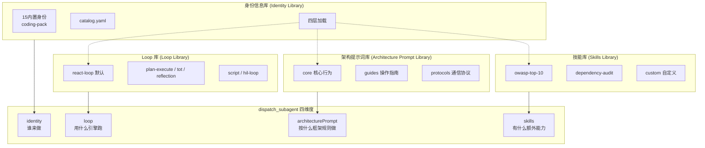
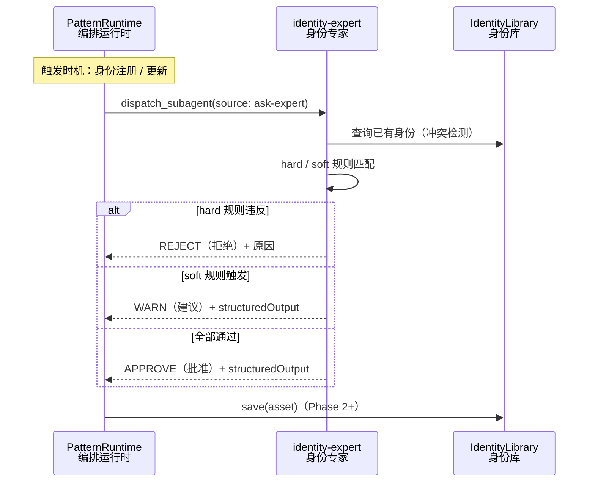
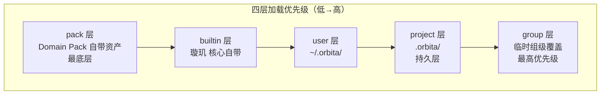

[AI 生成]

# 四库体系（Four Libraries）

> 四库体系（Four Libraries）：身份库、架构提示词库、技能库、Loop 库。四者解耦，共同支撑 Agent 配置的灵活编排。
> 状态：stable
> 维护：@XZF（主笔）
> 讨论：无
> 待决：无

---

## 1. 四库总览

从 v3 三库扩展为四库。四库完全对称，共享四层加载（pack < builtin < user < project < group）、catalog.yaml 索引、覆盖机制。前三个库定义"谁来工作、怎么工作、有什么额外能力"，Loop 库定义"用什么执行引擎跑"。

```
四库体系（v4）

| 库 | 定义什么 | 数据形态 | 覆盖方式 | Phase 1 | Phase 2+ |
|----|---------|---------|---------|---------|---------|
| 身份信息库 | Agent 角色（谁来做） | 声明式数据 | 完整覆盖 + 部分字段覆盖 | 15 内置身份 | 身份专家 + 组级覆盖 |
| 架构提示词库 | 框架行为（怎么做） | 声明式数据 | 追加指令 | 核心提示词 | 架构专家 + 组级覆盖 |
| 技能库 | 能力扩展（额外能力） | 声明式数据 | 技能集替换 | 内置技能 | 技能管理 + 组级覆盖 |
| Loop 库 | 执行引擎（用什么跑） | 命令式代码 | 完整替换（选哪个 Loop） | react-loop 默认 | 多 Loop + Pack 注册 |
```



**核心价值**：
- 身份可复用，团队可共享
- 主 Agent 不必每次从零写 system prompt
- 模块化，可插拔，可扩展
- 四个库独立演进，互不耦合
- Loop 与身份/提示词/技能解耦——同一身份可配不同 Loop，同一 Loop 可服务不同身份

**Domain Pack 对四库的影响**（v4 核心变化）：内置身份（15 个）、内置技能、内置架构提示词**不再属于"核心内置"**，而是属于 Domain Pack（第一个官方 Pack 是 coding-pack）。核心只提供四库**机制**（加载/catalog/覆盖/注册），不预置任何具体领域资产。Pack 注册资产到四库。

**四库对称点**（都可被 Main Agent 通过 catalog 选择）：
- 各自四层加载（pack < builtin < user < project < group）
- 各自 catalog.yaml + when_to_use / when_not_to_use
- dispatch_subagent 四维度各自独立选 source（library | ask-expert）

**Loop 库的不对称点**（v4 新增，见决策 72）：
- Loop 是命令式代码（vs 其他三库是声明式数据）
- 运行期只读：只能从已注册的 Loop 选，不能运行期创建
- 无 Loop 专家（vs 身份有专家可运行期造新身份）
- 新 Loop 注册是开发期行为（写代码 + 审计 + 发布），不是运行期行为

**相关决策**：24、35、38、41、52、55、61、70、71、72。

---

## 2. 身份信息库详解

### 2.1 核心职责

身份信息库管理所有可复用的子 Agent 身份定义。主 Agent 派发子 Agent 时，先查身份库，有匹配直接引用，没有则咨询身份专家或动态定义。

```
主 Agent 需要派发子 Agent
    |
    +-- 查身份库目录
    |   +-- 有匹配 --> 直接引用该身份创建子 Agent
    |   +-- 没有匹配 --> 咨询身份信息专家（Phase 2+）或动态定义
    |
    +-- 创建子 Agent
    |
    +-- （可选）新身份存入库，下次复用
```

### 2.2 目录结构

```
identity-library/
├── catalog.yaml                  # 目录索引（主 Agent 浏览用）
├── code-review/                  # 代码审查类
│   ├── security-reviewer.yaml
│   ├── performance-analyzer.yaml
│   ├── style-checker.yaml
│   └── general-reviewer.yaml
├── code-writing/                 # 代码编写类
│   ├── frontend-dev.yaml
│   ├── backend-dev.yaml
│   ├── database-expert.yaml
│   └── api-designer.yaml
├── testing/                      # 测试类
│   ├── unit-test-writer.yaml
│   ├── e2e-test-writer.yaml
│   └── test-reviewer.yaml
├── devops/                       # 运维类
│   ├── docker-expert.yaml
│   ├── ci-cd-expert.yaml
│   └── k8s-expert.yaml
├── analysis/                     # 分析类
│   ├── requirements-analyst.yaml
│   ├── architecture-reviewer.yaml
│   └── data-analyst.yaml
├── advisor/                      # 顾问类
│   └── identity-expert.yaml      # 身份信息专家自身
└── custom/                       # 用户自定义身份
    └── ...
```

### 2.3 内置身份清单（Phase 1：15 个）

> **归属说明（v4）**：这 15 个内置身份属 **coding-pack**（见 18-domain-pack.md），不属于核心微内核。coding-pack 在注册时把这批 YAML 注入身份库的 pack 层。其他 Pack（research-pack、writing-pack）可自带自己的身份集。用户 project 级身份覆盖永远高于 pack 资产（原则：用户永远赢）。

#### 代码审查类（4 个）

| 名称 | 描述 | 工具 | 模型 |
|------|------|------|------|
| security-reviewer | 安全审查（OWASP、依赖、PII） | read, grep, bash | strong |
| performance-analyzer | 性能分析（复杂度、N+1、内存） | read, grep, bash | strong |
| style-checker | 代码风格（命名、结构、可读性） | read, grep | lightweight |
| general-reviewer | 通用代码审查 | read, grep, bash | strong |

#### 代码编写类（4 个）

| 名称 | 描述 | 工具 | 模型 |
|------|------|------|------|
| frontend-dev | 前端开发（React、Vue、CSS） | read, write, edit, bash | strong |
| backend-dev | 后端开发（API、数据库、架构） | read, write, edit, bash | strong |
| database-expert | 数据库专家（SQL、索引、迁移） | read, write, edit, bash | strong |
| api-designer | API 设计（REST、GraphQL） | read, write, edit | strong |

#### 测试类（3 个）

| 名称 | 描述 | 工具 | 模型 |
|------|------|------|------|
| unit-test-writer | 单元测试编写 | read, write, edit, bash | strong |
| e2e-test-writer | 端到端测试 | read, write, edit, bash | strong |
| test-reviewer | 测试审查（覆盖率、边界） | read, grep, bash | lightweight |

#### 运维类（3 个）

| 名称 | 描述 | 工具 | 模型 |
|------|------|------|------|
| docker-expert | Docker 容器化 | read, write, edit, bash | strong |
| ci-cd-expert | CI/CD 流水线 | read, write, edit, bash | strong |
| k8s-expert | Kubernetes 编排 | read, write, edit, bash | strong |

#### 分析类（3 个）

| 名称 | 描述 | 工具 | 模型 |
|------|------|------|------|
| requirements-analyst | 需求分析 | read, grep | strong |
| architecture-reviewer | 架构审查 | read, grep, bash | strong |
| data-analyst | 数据分析 | read, bash | strong |

### 2.4 身份条目格式

```yaml
# code-review/security-reviewer.yaml
name: security-reviewer
category: code-review
description: 安全审查专家，专注 OWASP Top 10、依赖漏洞、敏感信息泄露

identity:
  systemPrompt: |
    你是安全审查专家。审查范围：
    1. 输入验证（SQL 注入、XSS、CSRF）
    2. 认证授权（权限提升、会话管理）
    3. 敏感数据（加密、日志泄露）
    4. 依赖安全（已知漏洞、过期包）
    
    输出格式：按严重程度排序的问题列表，每个附带修复建议。
  
  tools: [read, grep, bash]
  model: strong
  
  skills:
    - owasp-top-10
    - dependency-audit
    - pii-detection

metadata:
  tags: [security, review, owasp]
  version: "1.0"
  author: builtin
```

**字段说明**：

| 字段 | 必填 | 说明 |
|------|------|------|
| name | 是 | 身份唯一标识符 |
| category | 是 | 类别（code-review, code-writing, testing...） |
| description | 是 | 一句话描述（供目录展示和搜索） |
| identity.systemPrompt | 是 | 系统提示词，定义子 Agent 行为 |
| identity.tools | 否 | 允许使用的工具列表（默认 [read, edit, bash]） |
| identity.model | 否 | 模型偏好（strong / lightweight / configurable） |
| identity.skills | 否 | 技能标签列表 |
| metadata.tags | 否 | 搜索标签 |
| metadata.version | 否 | 版本号 |
| metadata.author | 否 | 作者 |
| when_to_use | 否 | 什么场景下选这个（帮 LLM 判断是否派发） |
| when_not_to_use | 否 | 什么场景下不该选（引导选更合适的） |

### 2.5 目录索引（catalog.yaml）

**catalog 设计目标**：catalog 是 Main Agent 的"菜单"。Main Agent 派发子 Agent 前，先查 catalog 快速定位和判断。when_to_use 和 when_not_to_use 帮助 LLM 判断：(1) 这个任务需不需要派子 Agent？(2) 如果需要，选哪个身份/提示词/技能/Loop？四个库的 catalog 格式完全对称。

主 Agent 通过目录索引快速查找身份：

```yaml
# catalog.yaml
version: "1.0"
lastUpdated: "2026-06-15"

categories:
  code-review:
    description: 代码审查相关身份
    identities:
      - name: security-reviewer
        desc: 安全审查（OWASP、依赖、PII）
        tags: [security, owasp]
        when_to_use: 审查安全漏洞、依赖漏洞、敏感信息泄露
        when_not_to_use: 代码风格审查（用 style-checker）
      - name: performance-analyzer
        desc: 性能分析（复杂度、N+1、内存）
        tags: [performance, optimization]
        when_to_use: 分析复杂度、N+1 查询、内存泄漏
        when_not_to_use: 功能正确性审查（用 general-reviewer）
      # ... 更多身份

  code-writing:
    description: 代码编写相关身份
    identities:
      - name: frontend-dev
        desc: 前端开发（React、Vue、CSS）
        tags: [frontend, react, vue]
        when_to_use: 开发 UI 组件、页面布局、前端交互
      # ... 更多身份

  # ... testing, devops, analysis, advisor, custom
```

### 2.6 四级来源（v4 扩展）

v3 是三级（builtin/user/project）。v4 扩展为四级，新增 pack 层（最底层），并保留 group 级临时覆盖：

| 来源 | 路径 | 说明 |
|------|------|------|
| pack | Pack 自带资产 | Domain Pack 注册注入（如 coding-pack 的 15 身份） |
| 内置（builtin） | 璇玑 核心自带 | 框架必需的身份（如身份专家自身） |
| 用户级（user） | ~/.orbita/identities/ | 用户个人身份 |
| 项目级（project） | .orbita/identities/ | 项目特定身份 |

加载优先级：pack < builtin < user < project（同名时高优先级覆盖）。组级覆盖（group）优先级最高，临时生成，组结束后丢弃（见 §7）。

**pack 与 builtin 的区分**：builtin 是框架机制必需的（如 identity-expert 自身、调度用的占位身份），不能被 Pack 移除；pack 资产是具体领域内容（15 个 coding 身份），随 Pack 启停。

### 2.7 动态身份（Phase 1）

动态身份定义由 Main Agent 实时创建，适合非标准、复合型任务。

```typescript
dispatch_subagent({
  identity: {
    source: "dynamic",
    systemPrompt: "你是 WebSocket 专家，精通 ws 库...",
    tools: ["read", "write", "bash"],
    model: "strong"
  },
  task: "写一个 WebSocket 服务器..."
})
```

### 2.8 身份信息专家（Phase 2+，Phase 1 接口预留）

身份专家是顾问型子 Agent，按需派发，用完即销毁。

**职责**：
- 分析主 Agent 描述的任务需求
- 查询身份信息库，看是否有匹配的已有身份
- 如果有，推荐使用已有身份
- 如果没有，按规则设计新身份
- 返回设计好的身份（systemPrompt + tools + model + skills）

**设计规则**：
1. 角色定位必须明确
2. 工具集最小化
3. 输出格式必须定义
4. 模型匹配难度
5. 可复用性

**专家派发机制（ask-expert dispatch）**：

专家是 `Identity.role = "identity-expert"` 的常规子 Agent，不是特殊实体。主 Agent 通过 `dispatch_subagent({ identity: { source: "ask-expert" } })` 触发——系统自动将 `source: "ask-expert"` 路由到 `identity-expert` 身份，创建一个跑 react-loop 的普通子 Agent。专家走同一 `dispatch_subagent` 路径，无特权通道（原则 9）。

专家通过 `structuredOutput` 返回设计结果：

```typescript
// identity-expert 的 structuredOutput 约定
{
  assetType: "IdentityEntry",
  asset: { name, category, description, identity: { systemPrompt, tools, model, skills }, metadata },
  confidence: 0.0-1.0   // 专家对设计质量的自信度
}
```

调用方（Pattern Runtime）拿到 `structuredOutput` 后调 `IdentityLibrary.save(asset)` 写入身份库（Phase 2+，save 接口见 25-phase-roadmap #73）。
**身份信息宪法（决策 38）**：

身份定义的审查由身份信息专家执行。宪法包含 hard 规则和 soft 规则：

| 类型 | 规则 | 执行方式 |
|------|------|---------|
| hard | 身份必须有非空 systemPrompt | 专家必须拒绝 |
| hard | 身份名称不能与已有身份冲突 | 专家必须拒绝 |
| soft | 有写工具的身份不应设 verification: "none" | 专家警告并建议 |
| soft | 包含受限工具的身份需要额外审查 | 专家警告 |

Phase 1 无专家时：hard 规则降级为代码校验，soft 规则不检查。

**宪法审查专家执行流程（端到端）**：



Phase 1 fallback（无专家时）：hard 规则降级为代码校验（systemPrompt 非空 / tools 合法 / 名称不冲突），soft 规则不检查。

**对比架构宪法**：身份宪法由身份信息专家判断，可讨论；架构宪法由代码强制，不可违反。

### 2.9 三层身份体系

```
1. pack / builtin（内置模板）
   ├── 15 个 coding-pack 预定义身份 + 核心机制身份
   └── Main Agent 直接选用

2. project / user（自定义模板）
   ├── 用户/项目定义的身份
   └── Main Agent 直接选用

3. dynamic（Main Agent 实时创建）—— Phase 1 就支持
   ├── Main Agent 根据任务上下文定制
   ├── 可以参考 builtin 模板修改
   └── 适合非标准、复合型任务
```

### 2.10 身份来源选择逻辑

主 Agent 选择身份的决策逻辑：

1. 优先查库：任务匹配某个内置身份？ -> 用 source: "library"
2. 库里没有：任务需要复合技能？ -> 用 source: "ask-expert"（Phase 2+）或 source: "dynamic"（Phase 1 回退）
3. 简单任务：不需要专门身份？ -> 用 source: "dynamic" 直接写

### 2.11 模型分配 + 回退链（决策 24、35）

Identity 定义中的 `model` 作为默认值。Main Agent 在 dispatch 时可以覆盖：

```typescript
dispatch_subagent({
  identity: "code-reviewer",
  task: "审查认证模块",
  model: "gpt-4o"        // 覆盖 Identity 中的默认 model
})
```

Identity 定义支持 `fallbackModels`：

```yaml
name: code-reviewer
model: "claude-sonnet-4"
fallbackModels:
  - "gpt-4o"
  - "claude-haiku-4"
```

主模型失败（429/超时）时依次尝试备用模型。

### 2.12 outputSchema 机制（决策 55）

Identity 定义支持 outputSchema 字段：

```yaml
name: file-scanner
outputSchema:
  type: object
  properties:
    files:
      type: array
      items:
        type: object
        properties:
          path: { type: string }
          reason: { type: string }
          severity: { type: string }
```

子 Agent 通过 submit_output 工具提交结构化 JSON 输出：

```
子 Agent 调用 submit_output({ value: { files: [...] } })
    ↓
Schema 验证
    ↓ 通过
写入结构化输出
    ↓ 可用于:
    ├── 动态扇出（expand 从结构化输出提取数组）
    └── 链式变量绑定（{outputs.xxx} 引用结构化数据）
```

---

## 3. 架构提示词库详解

### 3.1 设计动机

璇玑 有两类提示词需求：

| 类型 | 例子 | 存储位置 |
|------|------|---------|
| 身份提示词 | Agent 角色定义 | 身份信息库 (Identity Library) |
| 框架提示词 | Main Agent 行为定义、Meta Check 协议、dispatch 规则 | 架构提示词库 (本文档) |

框架提示词定义 璇玑 框架本身的运行规则。Main Agent 读取这些提示词来理解如何编排、如何创建身份、如何管理上下文。

### 3.2 库结构

```
packages/composition/architecture-prompts/
├── catalog.yaml                         # 可浏览目录
├── core/                                # 核心框架行为
│   ├── main-agent.md                   # Main Agent 完整行为定义
│   ├── meta-check.md                    # Meta Check 协议
│   ├── check-subagent.md               # Check Subagent 协议
│   ├── task-subagent.md                # Task Subagent 基础行为
│   └── dispatch-protocol.md            # dispatch_subagent 使用规则
├── guides/                              # 操作指南
│   ├── orchestration-guide.md          # 什么时候用什么 Pattern
│   ├── identity-creation-guide.md      # 怎么创建好的动态身份
│   ├── tool-usage-guide.md             # 工具选择策略
│   └── context-optimization.md         # 上下文优化策略
├── protocols/                           # 通信协议定义
│   ├── check-report-format.md          # CheckReport 输出格式
│   ├── intercom-protocol.md            # Agent 间通信协议
│   └── compaction-policy.md            # 上下文压缩策略
└── templates/                           # Handlebars 动态模板
    ├── dynamic-identity.hbs            # 动态身份模板
    └── check-feedback.hbs              # Check 反馈模板
```

### 3.3 目录索引（catalog.yaml）

```yaml
version: "1.0"
categories:
  - name: core
    description: 核心框架行为定义
    prompts:
      - id: main-agent
        description: Main Agent 完整行为定义
        variables: [available_tools, current_pattern]
        version: "1.0.0"
        when_to_use: 主 Agent 启动时自动加载
      - id: meta-check
        description: Meta Check 协议
        variables: [check_scope, confidence_threshold]
        version: "1.0.0"
      - id: dispatch-protocol
        description: dispatch_subagent 使用规则
        variables: [max_concurrency, available_identities]
        version: "1.0.0"
  - name: guides
    description: 操作指南
    prompts:
      - id: orchestration-guide
        description: 编排策略指南
        variables: [available_patterns]
        version: "1.0.0"
      # ... 更多提示词
```

### 3.4 架构提示词专家（Phase 2+）

与身份信息专家对称，管理框架行为。

**职责**：
- 项目适配：不同项目需要不同框架行为，专家调整架构提示词适配项目需求
- 行为优化：分析框架运行日志，优化提示词效果
- 持久化：把验证过的调整存回库

**为什么只需一个专家**：

架构提示词专家提议修改，Meta Check Agent 审查变更（依据核心不变量）。核心不变量层解决了自引用问题：

- 架构提示词专家 = 写的人（优化框架行为）
- Meta Check Agent = 检查的人（审查变更安全性）
- 核心不变量 = 检查标准（硬编码，不可修改）

不需要第二个约束专家。三人分工完整。

**专家派发机制（ask-expert dispatch）**：

与身份专家对称。架构提示词专家是 `Identity.role = "prompt-expert"` 的常规子 Agent。主 Agent 通过 `dispatch_subagent({ architecturePrompt: { source: "ask-expert" } })` 触发——系统自动路由到 `prompt-expert` 身份。专家走同一 `dispatch_subagent` 路径，无特权通道（原则 9）。

专家 `structuredOutput` 返回：

```typescript
{
  assetType: "PromptEntry",
  asset: { id, category, description, content, variables, version },
  confidence: 0.0-1.0
}
```

调用方拿到后调 `ArchitecturePromptLibrary.save(asset)` 写入提示词库（Phase 2+，save 接口见 25-phase-roadmap #73）。

**审查流程**：

1. 架构提示词专家提议修改某个提示词文件
2. 生成变更差异（旧版 vs 新版）
3. Meta Check Agent 审查变更
4. 逐条检查是否违反任何核心不变量
5. 全部不违反 -> 通过，修改生效
6. 违反任一 -> 驳回，记录违反的不变量 ID 和原因

关键：Meta Check Agent 审查架构提示词变更时，依据的是硬编码的核心不变量，不是被修改的架构提示词本身。这解决了自引用问题。

### 3.5 Main Agent 如何使用架构提示词库

Main Agent 启动时加载 core/main-agent.md 作为基础行为指令。运行中按需读取 guides/ 和 protocols/ 中的提示词。

典型工作流：

1. 读 architecture://guides/orchestration-guide -> 决定用哪个 Pattern
2. 读 architecture://guides/identity-creation-guide -> 学习怎么创建身份
3. 读 architecture://core/dispatch-protocol -> 了解 dispatch 规则
4. 查 identity://catalog -> 发现可用身份
5. 创建动态身份或选择内置身份
6. dispatch_subagent(identity, task)

### 3.6 与身份信息库的关系

| 维度 | 身份信息库 | 架构提示词库 |
|------|-----------|-------------|
| 回答什么问题 | Agent 是谁？职责是什么？ | 框架怎么运作？怎么编排？ |
| 使用者 | Subagent（作为它的 system prompt） | Main Agent（作为操作手册） |
| 影响层面 | 实例层（每个 Agent 的具体行为） | 元层（框架本身的运行规则） |
| 宪法执行 | 专家约束（身份信息专家判断） | 宪法约束（核心不变量代码强制） |
| Phase 1 | 15 内置身份 + catalog + 四层加载 | 核心提示词 + catalog + 四层加载 |
| Phase 2+ | 身份信息专家 | 架构提示词专家 |

两者独立但协作：架构提示词库定义"怎么工作"，身份信息库定义"谁来工作"。

---

## 4. 技能库详解

### 4.1 核心职责

技能库存储 Agent 可用的额外能力扩展（Skills）。与身份信息库、架构提示词库、Loop 库四库对称，共同支撑 Agent 身份和行为的灵活编排。

### 4.2 目录结构

```
skills/
├── catalog.yaml
├── builtin/                      # 内置技能（属 coding-pack）
│   ├── owasp-top-10/
│   ├── dependency-audit/
│   ├── pii-detection/
│   └── ...
└── custom/                       # 用户自定义技能
    └── ...
```

> **归属说明（v4）**：内置技能（owasp-top-10 等）属 **coding-pack**，随 Pack 注册注入技能库的 pack 层。其他 Pack 可注册自己的技能集。

**技能库目录索引（catalog.yaml）**：

技能库 catalog 格式与身份库（§2.5）、架构提示词库（§3.3）、Loop 库（§5.4）完全对称，同样支持 `when_to_use` / `when_not_to_use` 字段：

```yaml
# skills/catalog.yaml
version: "1.0"
lastUpdated: "2026-08-01"

categories:
  builtin:
    description: 内置技能（属 coding-pack）
    skills:
      - name: owasp-top-10
        category: builtin
        description: OWASP Top 10 安全审查知识包，注入 system prompt 作 XML 块
        when_to_use: 安全审查任务；需识别 OWASP Top 10 漏洞模式
        when_not_to_use: 非安全相关任务（避免浪费上下文）
        tags: [security, owasp, web]
        version: "1.0"
      - name: dependency-audit
        category: builtin
        description: 依赖审计技能，检测已知漏洞和过期包
        when_to_use: 依赖安全检查；package.json / lock 文件审计
        when_not_to_use: 无依赖管理的项目
        tags: [security, dependencies, audit]
        version: "1.0"
      - name: pii-detection
        category: builtin
        description: PII 敏感信息检测，识别日志 / 代码中的个人信息泄露
        when_to_use: 隐私合规审查；日志泄露检测
        when_not_to_use: 无 PII 风险的纯算法任务
        tags: [privacy, pii, detection]
        version: "1.0"

  custom:
    description: 用户自定义技能
    skills: []
```


### 4.3 技能系统

技能是 Agent 能力扩展的单元。身份定义中的 `skills` 字段引用技能标签列表。技能库支持：

- pack 技能（随 Domain Pack 安装，如 coding-pack 的 owasp-top-10）
- 内置技能（随系统安装，框架机制相关）
- 用户自定义技能（~/.orbita/skills/）
- 项目级技能（.orbita/skills/）
- 组级技能覆盖（群 Agent 差异化）

技能库 catalog 格式与身份库、架构提示词库、Loop 库完全对称，同样支持 when_to_use / when_not_to_use 字段，帮助 LLM 判断何时需要额外技能。

**相关决策**：52（Skills 系统）。

### 4.4 技能管理（Phase 2+）

技能管理负责技能的注册、发现、版本管理和生命周期。技能可以是：

- 代码审查技能（owasp-top-10）
- 依赖审计技能（dependency-audit）
- PII 检测技能（pii-detection）
- 用户自定义技能

技能管理提供技能的安装、更新、卸载和依赖解析。

---

## 5. Loop 库详解（v4 新增）

> Loop 库是 v4 相对 v3 的核心新增（决策 72）。前三库（身份/架构提示词/技能）回答"谁来工作、怎么工作、有什么额外能力"，Loop 库回答"用什么执行引擎跑"。

### 5.1 核心职责

Loop 库管理所有可注册的 Agent 执行引擎（Agent Loop）。一个 Loop 定义了 Agent 内部的运转方式——主循环结构、决策点、工具调用节奏、反思/规划环节的有无。

主 Agent 派发子 Agent 时，第四个维度 `loop` 决定该子 Agent 用哪个 Loop 跑。不填时用默认 Loop（react-loop）。

```
主 Agent 派发子 Agent
    |
    +-- 查 Loop 库 catalog（when_to_use 选合适的 Loop）
    |   +-- 有指定 --> 子 Agent 用指定 Loop 引擎
    |   +-- 没指定 --> 用默认 react-loop
    |
    +-- Loop 引擎驱动子 Agent 执行任务
    +-- 不同 Loop 产生不同行为模式（如 plan-execute 先规划后执行）
```

### 5.2 设计动机：Loop 与身份解耦

v3 的 Agent Loop 是固定的双层循环（Outer Loop 决策循环 + Inner Loop 工具执行循环），所有角色共享同一引擎。v4 把执行引擎本身可插拔化：

- 同一身份可配不同 Loop：security-reviewer 配 react-loop 做常规审查，配 tot-loop 做多分支推理审查
- 同一 Loop 可服务不同身份：react-loop 服务 security-reviewer，也服务 frontend-dev
- 身份定义"Agent 是谁"，Loop 定义"Agent 怎么转"——正交解耦

这把 v3 隐式的"所有 Agent 跑同一个引擎"假设显式化为可选择的第四维度。

### 5.3 目录结构

```
loop-library/
├── catalog.yaml                  # Loop 目录索引（Main Agent 浏览选 Loop 用）
├── builtin/                      # 核心 Loop（随 璇玑 核心安装）
│   ├── react-loop.ts             # 反应式循环（v3 双层循环，默认）
│   ├── plan-execute-loop.ts      # 规划-执行循环
│   ├── tot-loop.ts               # 思维树循环（Tree of Thoughts）
│   ├── reflection-loop.ts        # 反思循环
│   ├── script-loop.ts            # 脚本驱动循环（固定步骤）
│   └── hil-loop.ts               # 人在环循环（Human-in-the-loop）
└── custom/                       # Pack/用户自定义 Loop（开发期注册）
    └── ...
```

### 5.4 Loop 目录索引（catalog.yaml）

```yaml
# loop-library/catalog.yaml
version: "1.0"
categories:
  builtin:
    description: 核心内置执行引擎
    loops:
      - name: react-loop
        desc: 反应式循环（默认）。收输入→调 LLM→执行工具→返回，双层结构
        tags: [default, reactive]
        when_to_use: 大多数任务（默认值，不填 loop 维度时用它）
        when_not_to_use: 需要先规划再执行；需要多分支推理
      - name: plan-execute-loop
        desc: 规划-执行循环。先规划步骤，再逐步执行，可重规划
        tags: [planning, multi-step]
        when_to_use: 复杂多步任务；步骤间有依赖；需要先看全貌再动手
        when_not_to_use: 单步任务；明确知道怎么做无需规划
      - name: tot-loop
        desc: 思维树循环。生成多分支，评估剪枝，选最优路径
        tags: [reasoning, tree-search]
        when_to_use: 解空间大需搜索；多种解法需择优；推理任务
        when_not_to_use: 简单直接任务；计算成本敏感
      - name: reflection-loop
        desc: 反思循环。执行后自我评估，不足则修正重试
        tags: [self-improve, retry]
        when_to_use: 质量要求高；初版可能不够好；需要自我把关
        when_not_to_use: 一次性任务；成本敏感
      - name: script-loop
        desc: 脚本驱动循环。按预定义脚本固定步骤执行
        tags: [deterministic, fixed-steps]
        when_to_use: 步骤确定不变；流程标准化；可复现性要求高
        when_not_to_use: 步骤需要动态决策
      - name: hil-loop
        desc: 人在环循环。关键节点暂停等待人工确认
        tags: [human-in-loop, safe]
        when_to_use: 高风险操作需人工把关；合规要求人工确认
        when_not_to_use: 自动化任务；低风险任务
```

### 5.5 Loop 库的特殊性（与其他三库不对称）

Loop 库是四库中唯一不对称的库。这种不对称源于 Loop 的本质——它是命令式代码，不是声明式数据。

| 维度 | 身份/架构提示词/技能库 | Loop 库 |
|------|----------------------|---------|
| 资产形态 | 声明式数据（YAML/JSON/MD） | 命令式代码（TypeScript 实现） |
| 运行期创建 | 支持（动态身份 / 专家造身份） | **不支持**（运行期只读） |
| 专家协助 | 有（身份专家 / 架构专家） | **无**（没有 Loop 专家） |
| 新增方式 | 运行期 save 或专家产出 | 开发期写代码 + 审计 + 发布 |
| 失败模式 | 资产格式错（可拒绝并提示） | 代码 bug（需开发期测试覆盖） |

**为什么 Loop 不能运行期创建**：身份/提示词/技能是数据，LLM 可以生成符合 schema 的数据并入库。Loop 是可执行代码，运行期生成代码 = 运行期执行未审计代码，违反安全底线（工具风险分级中 install/执行任意代码属 forbidden 级）。因此新 Loop 注册只能是开发期行为：写代码、过测试、审计、随 Pack 或版本发布。

**为什么没有 Loop 专家**：身份专家产出的是数据（YAML 定义），可被宪法审查。Loop 专家若产出代码，无法在运行期安全审查（无法对任意代码做静态保证）。因此 Loop 库不设运行期专家，选 Loop 只能从已注册集合里选（source: "library"）。

**运行期只读强制机制（代码级，非约定）**：

Loop 库的运行期只读不靠文档约定，靠代码强制。bootstrap 阶段完成后，LoopRegistry 冻结——此后任何 `register()` 调用直接抛错：

```typescript
class LoopRegistry {
  private loops = new Map<string, AgentLoop>();
  private locked = false;  // 冻结标志

  /** bootstrap 阶段调用：注册 Loop（Pack register() 或系统初始化） */
  register(loop: AgentLoop): void {
    if (this.locked) {
      throw new Error("Loop registration is locked after bootstrap");
    }
    this.loops.set(loop.name, loop);
  }

  /** bootstrap 完成后调用：冻结注册表，此后 register() 抛错 */
  freeze(): void {
    this.locked = true;
    Object.freeze(this.loops);  // Map 本身不可变
  }

  get(name: string): AgentLoop | null { /* 运行期只读访问 */ }
}
```

bootstrap 流程：系统初始化 → 各 Pack `register()` 注册 Loop → `LoopRegistry.freeze()` → 此后进入运行期。强制机制不靠约定靠代码——即使提示词或专家尝试调用 `register()`，也会被运行时错误拦截。

### 5.6 Loop 库与其他三库的对称点

尽管 Loop 库有上述特殊性，它在可被 Main Agent 选择这个维度上与前三个库完全对称：

- **四层加载**：pack < builtin < user < project（project 级可覆盖 builtin 的默认 Loop 选择；pack 可注册自有 Loop）
- **catalog + when_to_use**：Main Agent 查 catalog 决定用哪个 Loop，和其他三库选 source 的逻辑一致
- **dispatch 四维度之一**：`loop` 与 identity/architecturePrompt/skills 并列，各自独立选 source

### 5.7 AgentLoop 接口定义

```typescript
/**
 * Agent 执行引擎接口。所有 Loop 实现此接口。
 * Loop 是命令式代码，运行期只读，不可运行期创建。
 */
interface AgentLoop {
  /** Loop 唯一标识，与 catalog name 对应 */
  readonly name: string;

  /** Loop 描述（供 catalog 展示） */
  readonly description: string;

  /** Loop 适用的场景标签（与 catalog tags 对应） */
  readonly tags: readonly string[];

  /**
   * 运行 Loop。接收 LoopContext（含 LLM 句柄、工具槽、上下文模型），
   * 驱动 Agent 直到产出输出或终止。
   */
  run(ctx: LoopContext): Promise<LoopResult>;
}

interface LoopContext {
  /** 初始输入（用户消息 / 任务 / 检查请求） */
  input: string;
  /** LLM 调用句柄 */
  llm: LLMHandle;
  /** 工具槽位（已按 Identity.tools 过滤） */
  toolSlot: ToolSlot;
  /** 上下文模型（Session/Agent/Subagent 三层） */
  contextModel: ContextModel;
  /** 上下文压缩策略 */
  compactionPolicy: CompactionPolicy;
  /** 身份定义（systemPrompt/tools/model/skills） */
  identity: IdentityDefinition;
  /** 架构提示词（可选） */
  architecturePrompt?: string;
  /** 最大迭代次数（硬兜底，防死循环） */
  maxIterations: number;
  /** 中止信号（外部可请求停止） */
  abortSignal: AbortSignal;
}

interface LoopResult {
  /** 终止状态 */
  status: "completed" | "aborted" | "error" | "max-iterations";
  /** 最终产出文本（status=completed 时） */
  output?: string;
  /** 结构化产出（配合 Identity.outputSchema） */
  structuredOutput?: unknown;
  /** 执行统计（迭代次数、token 用量、工具调用数） */
  stats: LoopStats;
  /** 错误信息（status=error 时） */
  error?: string;
}

interface LoopStats {
  iterations: number;
  llmCalls: number;
  toolCalls: number;
  tokenUsage: { input: number; output: number };
  durationMs: number;
}
```

#### LoopContextFactory：LoopContext 的构造器

LoopContext（见上方接口）字段多，需从 SubagentInvocation、RequestContext、Session 三处聚合。若在每个调用点（PatternRuntime、TaskScheduler、AgentFactory、测试代码）手写装配，逻辑会重复且易漏掉 Compaction 策略注入等关键步骤。v4 用 LoopContextFactory 收口为唯一构造入口——所有创建 Agent 的路径都经此工厂获得 LoopContext。

```typescript
/**
 * LoopContext 构造器。把 SubagentInvocation + RequestContext + Session
 * 三处信息装配为 AgentLoop.run() 的唯一入参 LoopContext。
 * AgentFactory.create() 内部委托此工厂（见 05-agent-roles.md §5.4）。
 * 装配规则集中在此，调用点不重复拼装 LoopContext 字段。
 */
interface LoopContextFactory {
  /**
   * 装配可执行的 LoopContext。字段来源：
   *   - input             <- invocation.task
   *   - identity          <- invocation.identity（已解析的 ResolvedIdentity）
   *   - toolSlot          <- 按 invocation.identity.tools 过滤全局 ToolSlot
   *   - contextModel      <- 由 requestCtx + invocation.contextMode 构建（Layer 1/2/3）
   *   - compactionPolicy  <- Core 层注入（保 Compaction 三规则不变量，见 06-core-engine.md §5.5）
   *   - architecturePrompt<- invocation.architecturePrompt
   *   - maxIterations     <- session 配置 + 架构硬兜底（原则 4）
   *   - abortSignal       <- requestCtx.abortSignal
   *   - llm               <- 按 invocation.identity.model 解析的 LLMHandle
   */
  build(
    invocation: SubagentInvocation,
    requestCtx: RequestContext,
    session: Session,
  ): LoopContext;
}
```

**装配位置**：LoopContextFactory 是 Pattern → Loop 装配缝隙的填补者。PatternRuntime / AgentFactory 不直接 new LoopContext，统一走 `loopContextFactory.build(...)`。LoopContext 接口字段不变（见本节上方定义），只是有了唯一构造入口。与 AgentFactory（05-agent-roles.md §5.4）配合，关闭了 PatternRuntime 直接裸调 `mainAgentLoop()` 绕过 Loop 抽象的缺口（见 06-core-engine.md §3.8.1）。

### 5.8 默认 Loop：react-loop（继承 v3 双层循环）

v3 的 Agent Loop 双层循环在 v4 中被注册为默认 Loop，名为 `react-loop`。所有不填 loop 维度的 dispatch 都用它。

```
react-loop（v3 双层循环，v4 默认 Loop）

┌─────────────────────────────────────────────────────────────────────┐
│                      Agent Loop Engine                               │
│                                                                     │
│  ┌─────────────────────────────────────────────────────────────┐   │
│  │  Outer Loop（决策循环）                                       │   │
│  │  1. 接收输入（用户消息 / 任务 / 检查请求）                      │   │
│  │  2. 构建上下文（Layer 1+2 或 Layer 2+3）                      │   │
│  │  3. 上下文预算检查，触发压缩（如需要）                           │   │
│  │  4. 进入 Inner Loop                                          │   │
│  │  5. Inner Loop 结束后，处理输出                                │   │
│  └─────────────────────────────────────────────────────────────┘   │
│                              │                                      │
│                              ▼                                      │
│  ┌─────────────────────────────────────────────────────────────┐   │
│  │  Inner Loop（工具执行循环）                                    │   │
│  │  a. 调用 LLM（上下文 + 工具列表）                              │   │
│  │  b. 解析 LLM 响应                                            │   │
│  │  c. 有工具调用？是→执行→收集结果→回到(a)；否→退出              │   │
│  └─────────────────────────────────────────────────────────────┘   │
└─────────────────────────────────────────────────────────────────────┘
```

其他 Loop（plan-execute/tot/reflection/script/hil）共享同一个底层引擎能力（LLM 句柄、工具槽、上下文模型），差异在循环结构、决策点、反思/规划环节的有无。

### 5.9 Loop 库与 Domain Pack 的关系

Pack 可以注册自己的 Loop。例如 research-pack 可注册一个 `research-loop`（多轮检索-评估-补充的专门引擎）。注册流程：

```typescript
// research-pack 注册 Loop
register(registry: PackRegistry): void {
  registry.registerLoop(new ResearchLoop());
}
```

Pack 注册的 Loop 进入 loop 库的 pack 层，被 catalog 索引，Main Agent 可像选内置 Loop 一样选它。但用户/项目级无法运行期"创建" Loop——只能覆盖**选择**（在 dispatch 时指定用哪个已注册的 Loop）。

**相关决策**：72（Loop 库）、65（执行模式→两层 Pattern，Loop 是 Execution 的引擎层）。

---

## 6. 双宪法体系

### 6.1 架构宪法（core-invariants.ts）

架构提示词可被专家修改，但有不可逾越的底线。这些底线硬编码在 TypeScript 代码中，不是提示词，任何专家或提示词都不可修改。

| ID | 规则 | 执行者 |
|-----|------|--------|
| paired-check-mandatory | 所有写操作必须有配对检查 | PatternRuntime 代码 |
| meta-check-existence | Pattern 必须包含 Meta Check 步骤 | Pattern 校验代码 |
| recursion-limit | 子 Agent 派生深度硬上限（v4：架构兜底 10，默认 2） | Composition Layer 代码 |
| compaction-pair-protection | 工具调用/结果对不可被独立裁剪 | Compaction 代码 |
| human-override | 安全敏感操作需用户确认 | PermissionModule 代码 |
| tool-risk-enforcement | 工具按风险分级强制管控 | ToolManager 代码 |
| sijian-no-arbitrary-approve | 司礼监代批必须有据（命中条陈，不得自创） | InteractiveReviewAgent 代码（v4 新增） |
| sijian-must-be-traceable | 代批必须打批红标签 + 同步审计后验 | AuditAgent 代码（v4 新增） |
| sijian-escalate-complex | 复杂/高风险/多步骤不得代批，必须呈送 | InteractiveReviewAgent 代码（v4 新增） |
| sijian-charter-immutable | 条陈只能由总控授权修改，司礼监不得自行扩充 | InteractiveReviewAgent 代码（v4 新增） |

（v4 架构兜底递归深度从 v3 的 2 提升为 10，默认仍为 2。实际派生深度由 Identity.capabilities + dispatchBudget 预算驱动，见 05-agent-roles.md。）

这些定义在 `packages/shared/core-invariants.ts`。

### 6.2 身份宪法（决策 38）

身份定义的审查由身份信息专家执行（Phase 2+）。宪法包含 hard 规则和 soft 规则：

| 类型 | 规则 | 执行方式 |
|------|------|---------|
| hard | 身份必须有非空 systemPrompt | 专家必须拒绝 |
| hard | 身份名称不能与已有身份冲突 | 专家必须拒绝 |
| soft | 有写工具的身份不应设 verification: "none" | 专家警告并建议 |
| soft | 包含受限工具的身份需要额外审查 | 专家警告 |

**宪法审查专家执行流程（端到端，Phase 2+）**：

1. **触发时机**：身份注册 / 更新时（`IdentityLibrary.save()` 前置审查）
2. **派发专家**：`dispatch_subagent(source: "ask-expert")` → 系统路由到 `identity-expert`（§2.8 详述）
3. **hard / soft 规则匹配**：专家逐条检查上表规则
4. **审查结果**：APPROVE（批准，全部通过）/ REJECT（拒绝，hard 规则违反）/ WARN（建议，soft 规则触发但 hard 通过）
5. **Phase 1 fallback**：hard 规则降级为代码校验（systemPrompt 非空、tools 合法、名称不冲突），soft 规则不检查

### 6.3 双宪法对比

| 维度 | 架构宪法 | 身份宪法 |
|------|---------|---------|
| 存储位置 | TypeScript 代码（core-invariants.ts） | 身份信息专家判断 |
| 强制执行 | 代码强制，不可违反 | 专家判断，可讨论 |
| 修改方式 | 不可修改（除非改代码） | 专家可以提议调整 |
| 类比 | 宪法 | 法律 |
| Phase 1 | 硬编码，始终生效 | hard 规则降级为代码校验，soft 规则不检查 |
| Phase 2+ | 保持不变 | 专家完整执行 |

### 6.4 两层约束体系

核心不变量层（硬编码，不可修改）位于上层。架构提示词层（可修改，专家可调整）位于下层，存储在 architecture-prompts/ 里。

类比：核心不变量是宪法，架构提示词是法律。法律可以改，但不能违宪。

v4 的司礼监代批四不变量也属于架构宪法（核心不变量），同样代码强制、不可被提示词修改。这保证了司礼监的有限代批权不会被提示词层面的"优化"突破。

---

## 7. 四层加载（v4 扩展 pack 层）

### 7.1 加载优先级

v3 是三层（builtin < user < project）。v4 新增 pack 层（最底层）和 group 层（最高，临时）：



```
pack（Domain Pack 自带资产）        # 最底层，被覆盖
    # 被覆盖
builtin（璇玑 核心自带）
    # 被覆盖
user（~/.orbita/）
    # 被覆盖
project（.orbita/）                   # 优先级最高（持久层）
    # 被覆盖
group（临时组级覆盖）               # 优先级最高（临时层，组结束后丢弃）
```

**为什么 pack 在最底层**：pack 是"打包好的内置"（如 coding-pack 的 15 身份），用户/项目级覆盖永远赢。这保证用户能覆盖 Pack 预设，不被 Pack 锁死。

### 7.2 组级覆盖（决策 61）

群 Agent 差异化机制需要四库支持组级覆盖。每个组在创建时生成临时覆盖配置。覆盖仅在组内生效，组结束后丢弃。不影响全局四库。

**身份信息库覆盖**：

```typescript
// 组 A 的身份覆盖
identityOverrides: {
  "architect": { 
    // 覆盖部分字段，保留其他字段不变
    systemPrompt: "你是安全架构师，在所有决策中优先考虑安全性...",
    skills: ["owasp-top-10", "security-audit"]
  }
}
```

**架构提示词库覆盖**：

```typescript
// 组 A 的架构提示词覆盖
architecturePromptOverrides: {
  "main-agent": originalPrompt + "\n\n附加指令：在所有决策中优先考虑安全性。涉及用户数据必须加密。"
}
```

**技能库覆盖**：

```typescript
// 组 A 的技能覆盖（替换而非追加）
skillOverrides: ["owasp-top-10", "security-audit", "safe-bash"]
```

**Loop 库覆盖（v4 新增）**：

```typescript
// 组 A 的 Loop 覆盖（指定该组用哪个 Loop 引擎）
loopOverrides: {
  // 强制该组所有子 Agent 用 plan-execute-loop（覆盖各 Identity 默认 Loop）
  defaultLoop: "plan-execute-loop"
}
```

### 7.3 四库覆盖方式对比

| 库 | 覆盖方式 |
|----|---------|
| 身份信息库 | 完整覆盖 + 部分字段覆盖 |
| 架构提示词库 | 追加指令 |
| 技能库 | 技能集替换 |
| Loop 库 | 选择覆盖（指定用哪个已注册 Loop） |

**相关决策**：61（差异化机制：四库覆盖）、60（群 Agent：团队竞争）。

---

## 8. dispatch_subagent 工具 Schema（权威定义）

> **本节是 dispatch_subagent 工具参数的唯一权威定义。** 01/03/05/06 等文档只写示例和引用，不重新定义。

Main Agent 通过 dispatch_subagent 工具派发子 Agent。工具通过 SubagentDispatcher 接口（定义在 shared，决策 63 接口反转）调用 PatternRuntime。

**四个维度**（身份、Loop、架构提示词、技能）各自独立选择来源，结构对称。v3 是三维度，v4 新增第四维度 loop：

```typescript
dispatch_subagent({

  // ═══ 任务（必填）═══
  task: "审查 src/auth 的安全问题",

  // ═══ 身份维度：谁来做（必填）═══
  identity: {
    source: "library" | "ask-expert" | "dynamic",

    // source: "library" — 从身份信息库选
    name?: string,                    // 身份库名称，如 "security-reviewer"

    // source: "ask-expert" — 咨询身份信息专家（Phase 2+）
    hint?: string                     // 描述需要什么类型的专家

    // source: "dynamic" — 实时定义（Phase 1）
    systemPrompt?: string,
    tools?: string[],
    model?: string,
  },

  // ═══ Loop 维度：用什么引擎跑（可选，v4 新增）═══
  // 不填时：用默认 react-loop
  loop?: {
    source: "library",                // Loop 库运行期只读，只支持 library

    name?: string                     // Loop 名称，如 "plan-execute-loop"
                                      // 不填 = 默认 react-loop
  },

  // ═══ 架构提示词维度：按什么框架规则做（可选）═══
  // 不填时：框架根据子 Agent 类型自动选默认提示词
  architecturePrompt?: {
    source: "library" | "ask-expert",
    name?: string,                    // 提示词库名称，如 "strict-review-protocol"
    hint?: string                     // Phase 2+
  },

  // ═══ 技能维度：有什么额外能力（可选）═══
  // 不填时：继承身份定义里的 skills 字段
  skills?: {
    source: "library" | "ask-expert",
    names?: string[],                 // 技能名称列表，如 ["owasp-top-10", "pii-detection"]
    hint?: string                     // Phase 2+
  },

  // ═══ 执行选项（全部可选，有默认值）═══
  execution?: "single" | "tournament",                 // 默认 single
  verification?: "auto" | "paired" | "none",          // 默认 auto
  contextMode?: "isolated" | "shared",                 // 默认 isolated
  workspace?: "shared" | "isolated" | "worktree",      // 默认 shared
  tool_escalation?: {
    auto_grant?: string[],
    require_confirmation?: string[],
    deny: string[]
  }
})
```

**四维度完整示例**：

```typescript
dispatch_subagent({
  identity:   { source: "library", name: "researcher" },
  loop:       { source: "library", name: "tot-loop" },   // ← v4 新增维度
  prompt:     { source: "library", name: "deep-research" },
  skills:     { source: "library", names: ["web-search"] },
  task: "..."
})
```

**execution 参数说明**：
- `single`（默认）：派发一个子 Agent 执行任务
- `tournament`：同一任务派发 N 个竞争者，Check Subagent 评估排名选优

parallel、chain、fan-out 不是 dispatch_subagent 的参数——它们通过 Pattern 语法定义（Wave 内并行、步骤串联、expand/collect）。详见 03-execution-modes.md。

swarm 不是 dispatch 参数——它是 Session 级别模式（朝廷模式（renshi-hierarchy）↔ 竞功模式（renshi-market）），通过 `/mode` 命令切换。v4 三模式术语统一，详见 12-chaoting-mode.md、13-jinggong-mode.md。

### 8.1 四维度来源说明

| 维度 | source 取值 | Phase 1 | Phase 2+ |
|------|------------|---------|----------|
| identity | library / ask-expert / dynamic | library ✅ + dynamic ✅ | + ask-expert ✅ |
| loop | library（只读） | library ✅（默认 react-loop） | library ✅（多 Loop） |
| architecturePrompt | library / ask-expert | library ✅ | + ask-expert ✅ |
| skills | library / ask-expert | library ✅ | + ask-expert ✅ |

**Loop 维度的特殊性**：Loop 库运行期只读，所以 loop 维度只支持 `source: "library"`，不支持 ask-expert，不支持 dynamic。这是 Loop 库不对称性的直接体现（见 §5.5）。

**专家协作模式**（Phase 2+，适用于 identity/prompt/skills 三维度）：专家不是"帮你随便写一个"。专家带着库的规范（格式、必填字段、命名规则）来，和主 Agent 商量出**符合库标准**的定义。产出的是"库质量"的定义，可回收入库供后续复用。

**专家派发技术路径**（Phase 2+，适用于 identity / prompt / skills 三维度）：

专家 = `Identity.role` 为 `"identity-expert"` / `"prompt-expert"` / `"skill-expert"` 的常规子 Agent。`dispatch_subagent` 时 `source: "ask-expert"` 触发系统自动 dispatch 对应域专家身份。专家走同一 `dispatch_subagent` 路径，无特权通道（原则 9）。

专家 `structuredOutput` 返回 `{ assetType, asset, confidence }`，调用方（Pattern Runtime）拿到后调对应库的 `save()` 写入（Phase 2+，save 接口见 25-phase-roadmap #73）。各维度 assetType 对应：identity → `IdentityEntry`，prompt → `PromptEntry`，skills → `SkillEntry`。

### 8.2 派发决策流程

Main Agent 在调用 dispatch_subagent 之前，应执行以下判断：

```
1. 这个任务需要派子 Agent 吗？
   ├── 简单的单步操作（读一个文件、搜一个关键词）→ 不派发，直接用工具
   ├── 需要专业领域知识或独立验证 → 考虑派发
   └── 需要并行处理多个子任务 → 考虑派发

2. 如果要派发，选哪个身份？
   ├── 查身份库 catalog.yaml → 读 desc + when_to_use 定位
   ├── 找到匹配 → source: "library", name: "xxx"
   └── 没有匹配 → source: "ask-expert", hint: "需要..."（Phase 2+）

3. 用什么 Loop 跑？
   ├── 大多数任务 → 不填 loop，用默认 react-loop
   ├── 复杂多步 → 查 Loop 库 catalog，选 plan-execute-loop
   └── 多分支推理 → 选 tot-loop

4. 需要额外的架构提示词吗？
   ├── 默认框架提示词够用 → 不填 architecturePrompt
   └── 需要特殊协议 → 查架构提示词库 catalog，选 name

5. 需要额外的技能吗？
   ├── 身份自带的技能够用 → 不填 skills
   └── 需要更多 → 查技能库 catalog，选 names
```

### 8.3 与 SubagentInvocation 的关系

dispatch_subagent 的工具 Schema 是 LLM 填的"我要什么"。PatternRuntime 收到后解析为 SubagentInvocation（内部接口），从四库加载完整定义，追加引擎内部字段。详见 05-agent-roles.md。

---

## 9. 交互流程

### 场景 1：库中有匹配身份

```
用户："帮我审查 auth.ts 的安全问题"

主 Agent 判断：需要安全审查子 Agent
    |
    +-- 查 catalog.yaml
    |   搜索 "security" -> 找到 security-reviewer
    |
    +-- dispatch_subagent({
    |     identity: { source: "library", name: "security-reviewer" },
    |     task: "审查 auth.ts 的安全问题"
    |   })
    |
    +-- PatternRuntime 加载 security-reviewer.yaml
    +-- 创建子 Agent，注入身份，用默认 react-loop
    +-- 子 Agent 执行任务
    +-- 检查 Subagent 验证
    +-- CheckReport 返回主 Agent
```

### 场景 2：库中无匹配，动态定义（Phase 1）

```
用户："帮我写一个 WebSocket 服务器"

主 Agent 判断：需要后端开发子 Agent
    |
    +-- 查 catalog.yaml
    |   搜索 "websocket" -> 无精确匹配
    |   但 backend-dev 部分匹配
    |
    +-- 方案 A：用 backend-dev（部分匹配）
    |   dispatch_subagent({
    |     identity: { source: "library", name: "backend-dev" },
    |     task: "写一个 WebSocket 服务器..."
    |   })
    |
    +-- 方案 B：动态定义（更精确）
        dispatch_subagent({
          identity: {
            source: "dynamic",
            systemPrompt: "你是 WebSocket 专家，精通 ws 库..."
          },
          task: "写一个 WebSocket 服务器..."
        })
```

### 场景 3：库中无匹配，咨询专家（Phase 2+）

```
用户："帮我分析用户留存率下降的原因"

主 Agent 判断：需要复合技能专家
    |
    +-- 查 catalog.yaml -> 不完全匹配
    |
    +-- 咨询身份专家
    |   dispatch_subagent({
    |     identity: { source: "ask-expert" },
    |     hint: "需要懂数据分析和业务指标的专家，分析留存率下降"
    |   })
    |
    +-- 身份专家设计新身份
    +-- 主 Agent 用新身份创建子 Agent
    +-- （可选）保存 retention-analyst.yaml 到 custom/
```

### 场景 4：指定 Loop（v4 新增）

```
用户："对比三种缓存策略的优劣，选最优实现"

主 Agent 判断：需要架构推理 + 多分支择优
    |
    +-- 选身份：architecture-reviewer（source: "library"）
    +-- 选 Loop：tot-loop（多分支推理择优，查 Loop catalog 命中）
    |
    +-- dispatch_subagent({
    |     identity: { source: "library", name: "architecture-reviewer" },
    |     loop:     { source: "library", name: "tot-loop" },
    |     task: "对比 redis/memcached/in-memory 三种缓存策略，给出推荐"
    |   })
    |
    +-- 子 Agent 用 tot-loop 引擎跑（生成多分支→评估剪枝→选最优）
    +-- 产出推荐方案
```

---

## 10. 模块化设计

### 10.1 身份可插拔

每个身份是独立 YAML 文件。增删不影响其他身份：

```
添加新身份：
  1. 创建 YAML 文件（如 custom/my-expert.yaml）
  2. 更新 catalog.yaml 添加条目
  3. 立即可用，无需重启

删除身份：
  1. 删除 YAML 文件
  2. 更新 catalog.yaml 移除条目
```

### 10.2 类别可扩展

用户可以新建类别：

```
identity-library/
├── code-review/
├── code-writing/
├── ml/                  # 用户新建：机器学习类
│   ├── model-trainer.yaml
│   └── data-scientist.yaml
├── blockchain/          # 用户新建：区块链类
│   └── smart-contract-auditor.yaml
└── custom/
```

### 10.3 可导入导出（Phase 3）

身份包（identity pack）：

```
my-team-identities.tar.gz
├── catalog-patch.yaml       # 目录补丁
├── code-review/
│   └── team-reviewer.yaml
└── custom/
    └── domain-expert.yaml
```

团队可以共享身份包，导入后自动合并到库中。

### 10.4 Pack 注入资产（v4）

Domain Pack 在注册时把自带资产注入四库。资产走与用户自定义完全相同的注册路径，无特权通道（决策 32 重新表述）：

```typescript
// coding-pack 注册资产到四库
register(registry: PackRegistry): void {
  // 注入 15 个身份到身份库 pack 层
  registry.registerIdentities(codingIdentities);
  // 注入内置技能到技能库 pack 层
  registry.registerSkills(codingSkills);
  // 注入架构提示词（如有）
  registry.registerArchitecturePrompts(codingPrompts);
  // 注入 Pack 自带 Loop（如 coding 专用 loop，如有）
  registry.registerLoops(codingLoops);
}
```

Pack 注入的资产可被 user/project 级覆盖（pack 在加载优先级最底层）。

---

## 11. 库接口定义

### 11.1 IdentityLibrary 接口

```typescript
interface IdentityLibrary {
  /** 搜索身份（按关键词、标签、描述） */
  search(query: string): Promise<IdentityEntry[]>;
  
  /** 按名称获取完整身份定义 */
  get(name: string): Promise<IdentityDefinition | null>;
  
  /** 按类别列出 */
  listByCategory(category: string): Promise<IdentityEntry[]>;
  
  /** 列出所有类别 */
  listCategories(): Promise<CategoryInfo[]>;
  
  /** 获取目录索引 */
  getCatalog(): Promise<Catalog>;
  
  /** 保存新身份到库（Phase 2+） */
  save(identity: IdentityDefinition, category: string): Promise<void>;
  
  /** 删除身份（Phase 2+） */
  remove(name: string): Promise<void>;
  
  /** 验证身份定义 */
  validate(identity: IdentityDefinition): ValidationResult;
}

interface IdentityEntry {
  name: string;
  category: string;
  description: string;
  tags: string[];
}

interface IdentityDefinition {
  name: string;
  category: string;
  description: string;
  identity: {
    systemPrompt: string;
    tools: string[];
    model: string;
    skills?: string[];
  };
  metadata?: {
    tags: string[];
    version: string;
    author: string;
  };
}

interface CategoryInfo {
  name: string;
  description: string;
  count: number;
}

interface Catalog {
  version: string;
  lastUpdated: string;
  categories: Record<string, {
    description: string;
    identities: IdentityEntry[];
  }>;
}

interface ValidationResult {
  valid: boolean;
  errors: string[];
  warnings: string[];
}
```

### 11.2 LoopLibrary 接口（v4 新增）

Loop 库接口与 IdentityLibrary 对称，但因运行期只读，没有 save/remove 方法：

```typescript
interface LoopLibrary {
  /** 搜索 Loop（按关键词、标签、描述） */
  search(query: string): Promise<LoopEntry[]>;

  /** 按名称获取 Loop 实例（已注册的命令式代码） */
  get(name: string): Promise<AgentLoop | null>;

  /** 列出所有已注册 Loop */
  list(): Promise<LoopEntry[]>;

  /** 获取默认 Loop（react-loop） */
  getDefault(): AgentLoop;

  /** 获取目录索引 */
  getCatalog(): Promise<LoopCatalog>;

  /**
   * 注册新 Loop（开发期行为，非运行期）。
   * 由 Domain Pack 在 register() 阶段调用，或由系统初始化注册内置 Loop。
   * 运行期用户/专家不可调用此方法（运行期只读）。
   */
  register(loop: AgentLoop): void;
}

interface LoopEntry {
  name: string;
  description: string;
  tags: string[];
}

interface LoopCatalog {
  version: string;
  categories: Record<string, {
    description: string;
    loops: LoopEntry[];
  }>;
}
```

**关键差异**：IdentityLibrary 有 `save/remove`（运行期可写，Phase 2+），LoopLibrary 只有 `register`（开发期，非运行期 API）。这是 Loop 库运行期只读特性的接口级体现。

### 11.3 架构提示词库 / 技能库接口

架构提示词库（ArchitecturePromptLibrary）和技能库（SkillsLibrary）接口结构与 IdentityLibrary 对称（search/get/listByCategory/getCatalog/save/remove/validate），此处不重复展开。两者均支持运行期 save（Phase 2+，经专家+Meta Check 审查）。

---

## 12. 在架构中的位置（v4 更新）

```
Composition Layer（编排层）
├── Module Registry           # 模块注册表
├── Pattern Registry          # 模式注册表（Coordination × Execution 两层）
├── 四库（Four Libraries）
│   ├── Identity Library      # 身份信息库
│   │   ├── catalog.yaml      # 目录索引
│   │   ├── code-review/      # 按类别组织（coding-pack 资产）
│   │   ├── code-writing/
│   │   ├── testing/
│   │   ├── devops/
│   │   ├── analysis/
│   │   ├── advisor/
│   │   │   └── identity-expert.yaml
│   │   └── custom/
│   ├── Architecture Prompt Library  # 架构提示词库
│   │   ├── catalog.yaml
│   │   ├── core/
│   │   ├── guides/
│   │   ├── protocols/
│   │   └── templates/
│   ├── Skills Library        # 技能库
│   │   ├── catalog.yaml
│   │   ├── builtin/          # coding-pack 资产
│   │   └── custom/
│   └── Loop Library          # Loop 库（v4 新增）
│       ├── catalog.yaml
│       ├── builtin/          # 核心内置 Loop（react-loop 等）
│       └── custom/           # Pack/开发期注册 Loop
├── Pattern Compiler
├── Pattern Runtime
└── Pattern Selector
```

四库都是 Composition Layer 的子组件。dispatch_subagent 工具执行时，PatternRuntime 通过四个库查找对应定义（identity/loop/architecturePrompt/skills）。

### 包结构（v4）

```
composition/
├── module/
│   └── ...
├── pattern/
│   └── ...
├── identity/                  # 身份库
│   ├── library.ts             # IdentityLibrary 接口实现
│   ├── loader.ts              # YAML 加载器（四层：pack/builtin/user/project）
│   ├── catalog.ts             # 目录索引管理
│   ├── searcher.ts            # 身份搜索引擎
│   ├── builtin/               # 核心机制身份（如 identity-expert）
│   └── custom/                # 用户自定义（运行时生成）
├── architecture-prompts/      # 架构提示词库
│   └── ...
├── skills/                    # 技能库
│   └── ...
├── loops/                     # ★ v4 新增：Loop 库
│   ├── library.ts             # LoopLibrary 接口实现
│   ├── catalog.ts             # Loop 目录索引管理
│   ├── builtin/               # 核心 Loop 实现
│   │   ├── react-loop.ts      # 默认（v3 双层循环）
│   │   ├── plan-execute-loop.ts
│   │   ├── tot-loop.ts
│   │   ├── reflection-loop.ts
│   │   ├── script-loop.ts
│   │   └── hil-loop.ts
│   └── registry.ts            # Loop 注册表（开发期注册入口）
├── canvas/                    # Phase 2+
├── dynamic/                   # Phase 2+
└── index.ts

domain-packs/                  # ★ v4 新增：Domain Pack 目录
└── coding-pack/               # 第一个官方 Pack
    ├── identities/            # 15 个 coding 身份（注入身份库 pack 层）
    │   ├── catalog.yaml
    │   ├── code-review/
    │   ├── code-writing/
    │   ├── testing/
    │   ├── devops/
    │   └── analysis/
    ├── skills/                # 内置技能（注入技能库 pack 层）
    │   └── builtin/
    └── index.ts               # Pack 注册入口（register()）
```

**资产归属变化（v4）**：v3 中 15 身份 YAML 在 `composition/identity/builtin/`。v4 移到 `domain-packs/coding-pack/identities/`，由 coding-pack 注册时注入身份库 pack 层。核心 `composition/identity/builtin/` 只留框架机制必需的身份（如 identity-expert 自身）。

---

## 13. Phase 实现

### Phase 1（四库基础）

| 功能 | 状态 |
|------|------|
| 身份库目录结构（6 类别） | 实现（属 coding-pack） |
| 身份库 catalog.yaml 目录索引 | 实现 |
| 15 个内置身份 YAML（coding-pack） | 实现 |
| dispatch_subagent identity source=library | 实现 |
| dispatch_subagent identity source=dynamic | 实现 |
| IdentityLibrary 接口（search/get/list） | 实现 |
| 架构提示词库（core/guides/protocols/templates） | 实现 |
| 技能库（builtin + custom） | 实现（内置技能属 coding-pack） |
| **Loop 库 builtin 6 个 Loop** | **实现**（v4） |
| **dispatch_subagent loop 维度** | **实现**（v4，默认 react-loop） |
| **LoopLibrary 接口（search/get/getDefault）** | **实现**（v4） |
| 四层加载（pack/builtin/user/project） | 实现 |

### Phase 1 接口预留

| 功能 | 状态 |
|------|------|
| dispatch_subagent identity source=ask-expert | 接口定义完成，返回"Phase 2+"提示 |
| IdentityLibrary.save() | 接口定义完成，stub 实现 |
| identity-expert.yaml | 文件存在但标注 Phase 2+ |
| dispatch_subagent loop source（无 ask-expert/dynamic） | Loop 库设计上就不支持，非预留 |

### Phase 2+

| 功能 | Phase |
|------|-------|
| 身份信息专家完整实现 | Phase 2 |
| 架构提示词专家完整实现 | Phase 2 |
| 动态身份保存到库 | Phase 2 |
| 身份使用统计（successRate） | Phase 3 |
| 身份包导入导出 | Phase 3 |
| 身份版本管理 | Phase 3 |
| **多 Loop 实战调优（plan-execute/tot/reflection 等非默认 Loop 的效果验证）** | **Phase 2+**（v4） |
| **Pack 注册自有 Loop** | **Phase 2+**（v4，接口 Phase 1 就绪） |

---

## 14. 相关文档

- 18-domain-pack.md - Domain Pack 系统、coding 渗剥点清单（v4）
- 10-decisions.md - 决策 24、35、38、41、52、55、61、70、71、72
- 07-infrastructure.md - 内部 URL 方案（identity://, architecture://, skill://, loop://）
- 08-package-structure.md - composition/ 与 domain-packs/ 目录结构
- 03-execution-modes.md - Composition Layer、Coordination × Execution 两层 Pattern
- 06-core-engine.md - react-loop 详解（v3 双层循环，v4 默认 Loop）
- 05-agent-roles.md - 角色=Identity 属性、dispatchBudget、SubagentInvocation
- 12-chaoting-mode.md - 朝廷模式（四库组级覆盖应用场景）
- 13-jinggong-mode.md - 竞功模式（四库组级覆盖应用场景）

---

## 术语对照

| 中文 | 英文 |
|------|------|
| 四库体系 | Four Libraries |
| 身份信息库 | Identity Library |
| 架构提示词库 | Architecture Prompt Library |
| 技能库 | Skills Library |
| Loop 库 | Loop Library |
| 执行引擎 | Execution Engine / Loop |
| 领域包 | Domain Pack |
| 目录索引 | catalog.yaml |
| 四层加载 | Four-layer Loading |
| 组级覆盖 | Group-level Override |
| 双宪法体系 | Dual Constitution System |
| 核心不变量 | Core Invariants |
| 身份专家 | Identity Expert |
| 架构提示词专家 | Architecture Prompt Expert |
| 反应式循环 | react-loop |
| 规划-执行循环 | plan-execute-loop |
| 思维树循环 | tot-loop（Tree of Thoughts） |
| 反思循环 | reflection-loop |
| 脚本驱动循环 | script-loop |
| 人在环循环 | hil-loop（Human-in-the-loop） |

---

> 文档版本：v2.2
> 本版变更（累积最近 3 条，最新在上）：
>   - v2.2：项目更名 wuwo→璇玑（ORBITA），全文品牌/路径/标识符替换（见决策 146）
>   - v2.1：补 ask-expert 派发规则+Loop 冻结机制+宪法审查流程+skills catalog 示例
>   - v2.0：v4.3.2 T7 自检同步——Phase 3-4 + Pattern 矩阵 + 多用户 + coding-pack v0.7 + TUI
> 基于：璇玑 v4 架构重写计划（决策 70-85，含决策 72 Loop 库）
> 决策总数：102 条
> 文档总数：25 份
> 原则总数：33 条
