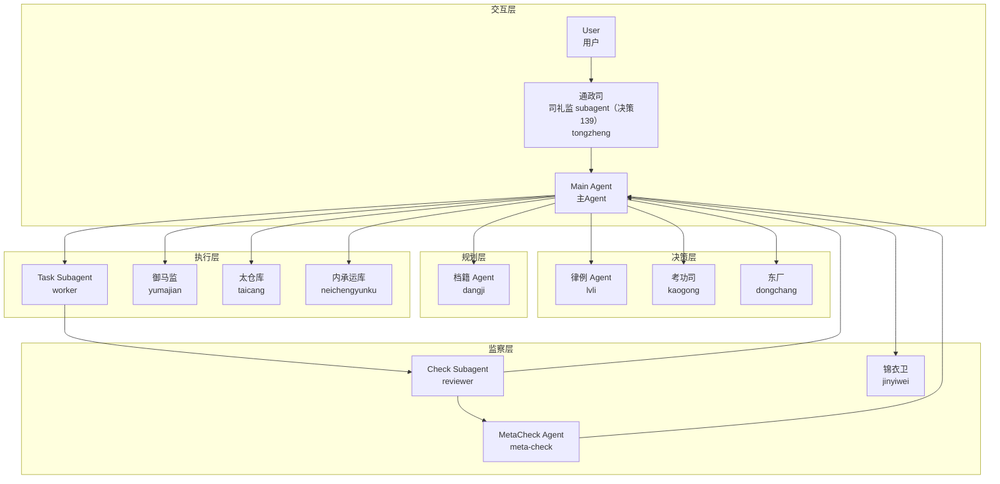
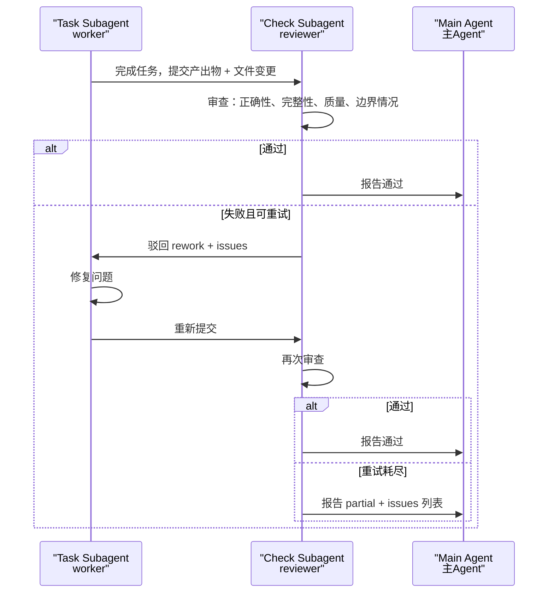
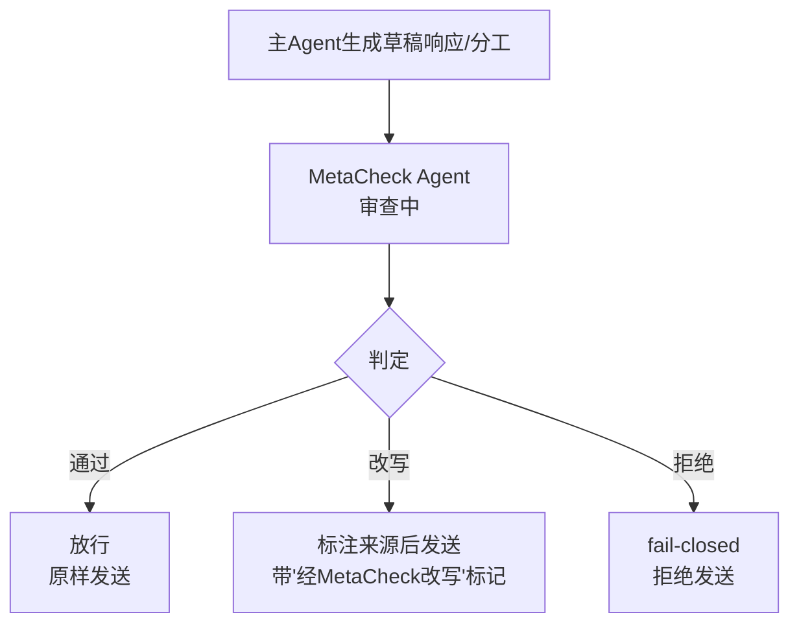

[AI 生成]

# Agent 角色体系

> Agent 角色体系：角色作为 Identity 属性、七维度插件化、监察分层与权力分离。
> 状态：stable
> 维护：@XZF（主笔）
> 讨论：无
> 待决：无

---

## 1. 角色降级：角色作为 Identity 属性

v3 把 Main/MetaCheck/Task/Check 四种角色作为架构枚举，框架代码用 `switch(role)` 区分行为。v4 把角色从架构枚举**降级为 Identity.role 字符串属性**（决策 74）。架构只理解一个一等概念：Agent。Loop 行为的差异通过 Identity 配置的 hooks/slots（钩子/插槽）实现，不再依赖 `switch(role)`。

### 1.1 降级要点

| 维度 | v3 | v4 |
|------|----|----|
| 角色定义位置 | 架构枚举（TypeScript union type） | Identity.role: string |
| 框架代码区分 | `switch(agent.role)` 分支 | 统一 Agent 接口，无分支 |
| 行为差异来源 | 架构层硬编码 | Identity 配置的 capabilities + hooks |
| 新增角色 | 改框架代码 | 新增 Identity 模板 |
| 框架对角色的理解 | 显式知道 4 种角色 | 只知道 `Identity.role` 字符串 |

### 1.2 架构只认 Agent

```typescript
/**
 * 架构层面唯一的 Agent 概念。无角色枚举，无 switch 分支。
 * role 是 Identity 的字符串属性，框架不解释其语义。
 */
interface AgentInstance {
  /** 实例唯一 ID */
  id: string;
  /** 身份定义（含 role 字符串、capabilities、tools、model 等） */
  identity: ResolvedIdentity;
  /** 该 Agent 绑定的执行引擎实例 */
  loop: AgentLoop;
  /** Agent 私有上下文（Layer 2） */
  privateContext: ContextBucket;
  /** 生命周期作用域 */
  lifecycle: LifecycleScope;
  /** 运行状态（由 TaskScheduler 管理，AgentInstance 本身是数据载体不主动转换） */
  status: AgentStatus;
}

// Agent 运行状态（由 TaskScheduler 管理，AgentInstance 本身是数据载体不主动转换）
type AgentStatus =
  | "pending"      // 已创建待执行
  | "executing"    // Loop 执行中
  | "checking"     // Check Subagent 审查中
  | "reworking"    // 打回返工中
  | "reported"     // 已报告 Main Agent
  | "completed"    // 正常完成
  | "partial"      // 部分完成
  | "failed"       // 失败
  | "aborted";     // 被 abort
```

**Agent 状态与 LoopContext 状态映射**：

| AgentStatus | LoopContext 状态 | 含义 |
|-------------|-----------------|------|
| pending | created | Agent 已创建，LoopContext 待构建 |
| executing | consuming | Loop 执行中（LLM + 工具循环） |
| checking | consuming | Check Subagent 审查 Agent 产出中 |
| reworking | consuming | Agent 打返工重做中 |
| reported | consuming | 已报告 Main Agent，等 Main 完成 |
| completed | discarded | Agent 正常完成，LoopContext 释放 |
| partial | discarded | 部分完成（如 budget 耗尽），LoopContext 释放 |
| failed | discarded | 失败，LoopContext 释放 |
| aborted | discarded | 被 abort，LoopContext 释放 |

> 注意：AgentStatus 是 TaskScheduler 管理的运行状态（业务语义）；LoopContext 状态是 Core 引擎管理的传播生命周期（技术语义）。两者并行运行，映射关系如上但**不由代码强制同步**——AgentStatus 的转换由 TaskScheduler 驱动，LoopContext 状态转换由 LoopContextFactory/LifecycleGuard 驱动。


### 1.3 行为差异通过 Identity 配置

角色相关的行为差异（能否 dispatch 子 Agent、是否触发监察、是否可改写上层输出等）全部下沉到 Identity 字段。相对 v3 的 ResolvedIdentity，v4 新增三个字段（完整定义见 06-core-engine.md §2.2 ResolvedIdentity，T8 回流）：

```typescript
// v4 相对 v3 新增的三个字段（节选自 ResolvedIdentity，完整定义见 06-core-engine.md §2.2）
interface ResolvedIdentityV4Additions {
  /** 角色字符串（main / worker / reviewer / meta-check / 任意 Pack 自定义） */
  role: string;
  /** 能力声明（决定能否派发、通信、广播等） */
  capabilities: string[];
  /** 监察策略（决定哪些监察层适用该 Agent） */
  reviewPolicy?: ReviewPolicy;
}
```

框架代码只读 `capabilities` 和 `reviewPolicy`，从不读 `role` 字符串本身。`role` 字段供 catalog 分类、日志、审计使用，不进入控制流。

### 1.4 角色仍是有效概念

> 角色降级不等于角色消失。角色仍然是有效的**配置概念**和**文档概念**：身份库按角色分类（main/worker/reviewer/meta-check 四类），文档用角色名交流，审计日志按 role 聚合。降级的是"角色作为架构控制流分支"这一硬编码形式。

详见决策 74。

---

## 2. 七维度插件化总表

v4 把 Agent 角色体系涉及的所有可变维度收敛到一张总表（plan §16）。每个维度 Phase 1 给最笨实现，接口按终局形态设计，后续每个维度升级=换实现不改接口。

| 维度 | Phase 1 实现（最笨） | 接口形态（终局） |
|------|---------------------|-----------------|
| 角色 | 三模式共享 Identity 模板（main/worker/reviewer/meta-check + 通政使/律例/档籍/考功司/太仓库/内承运库/御马监/锦衣卫/东厂等共享层角色） | `Identity.role: string` + `capabilities: string[]` |
| 拓扑 | 树，深度 2（Main→Sub 单层） | CoordinationPattern + dispatchBudget |
| 通信 | dispatch_subagent + contact_main_agent 两条边 | AgentTransport 工具化 + topic 订阅 + 频道 |
| 状态 | projectState 可变对象 + activityLog | EventSourcedState + namespace |
| 监察 | Check Subagent + MetaCheck Agent 两层 | ReviewPolicy + 三层 enum（过程/审计/复核） |
| 生命周期 | ephemeral + persistent 二值 | LifecycleScope 连续谱 |
| 能力发现 | 只能创建（library / dynamic） | source: library / ask-expert / registry |

**Phase 1 体验和 v3 几乎一样**，但底层接口已是终局形态。后续每个维度升级=换实现不改接口（原则 1、2）。

**额外两维度**（不在七维表但与本档相关，归 04-four-libraries.md 详述）：Loop（react-loop 默认 → Loop 库四库之一）、User（AuthContext 字段 → UserProfile 一等公民）。

---

## 3. Agent 角色对比与关系图

> 以下对比表沿用 v3 的四种角色分类，但加注 **角色是 Identity 配置，不是架构硬编码**。每种角色对应一个 Identity 模板（Phase 1 内置 4 个），可被 Pack 扩展、可被用户覆盖。

### 3.1 角色对比表

| 角色 | 数量 | 生命周期 | 模型 | 核心职责 |
|------|------|---------|------|---------|
| Main Agent（主 Agent，role: "main"） | 1（架构支持 N） | 常驻 | 强模型 | 用户对话 + 任务分发 + 结果整合 |
| Meta Check Agent（Meta 检查 Agent，role: "meta-check"） | 按策略触发（v4 改造） | 按需触发，不强制常驻 | 同级（默认） | 审查主 Agent 的回答和分工，可改写（透明化标注来源） |
| Task Subagent（任务子 Agent，role: "worker"） | 不限 | 按需创建，完成销毁 | 可配置 | 执行具体任务 |
| Check Subagent（检查子 Agent，role: "reviewer"） | 跟任务 1:1 | 任务完成后触发，验证后销毁 | 轻量（默认） | 验证任务产出 + 上下文屏障 |
| 律例 Agent（role: "lvli"） | 1 | 常驻 | 强模型 | 规则库维护、规则修订票拟、审计合规检查 |
| 档籍 Agent（role: "dangji"） | 1 | 常驻 | 可配置 | 持久化与索引、日志归档、灾备恢复 |
| 考功司（role: "kaogong"） | 1 | 周期性触发 | 强模型 | 周期性综合考核、输出考功册、权重升降建议 |
| 太仓库（role: "taicang"） | 1 | 常驻 | 可配置 | 中央资源池实际存放、预算账户扣减、余额拦截 |
| 内承运库（role: "neichengyunku"） | 1 | 常驻 | 可配置 | 皇帝直控独立资源池、紧急拨付、借支还库 |
| 御马监（role: "yumajian"） | 1 | 常驻 | 强模型 | 兜底执行精锐、跨领域御用执行、总控直派 |
| 锦衣卫（role: "jinyiwei"） | 1 | 按需触发 | 强模型 | 诏狱安全隔离、离线诊断、问题定性 |
| 东厂（role: "dongchang"） | 1 | 常驻 | 强模型 | 元监察层、再监察、弹劾、厂报 |
| 通政使 Agent（role: "tongzheng"） | 1 | 常驻 | 可配置 | 收文/翻译用户输入为内部指令（贴黄+结构化指令列表）；生成原始奏章交档籍持久化；急递通道判定。映射通政使司（Transmission Office） |
**v3→v4 变化**：① Main/MetaCheck/Task/Check 从架构枚举降级为 Identity.role 字符串；② MetaCheck 从 1:1 常驻伴随改为按 ReviewPolicy 触发（见 §10、§11）；③ 角色名是约定，Pack 可注册新角色（如 research-pack 可注册 "researcher" 角色），框架不限制 role 字符串取值；④ 新增律例/档籍/考功司/太仓库/内承运库/御马监/锦衣卫/东厂等共享层角色（朝廷模式/竞功制/大明模式共用）。

### 3.3 新增共享层角色 Identity.role + capabilities + dispatchBudget

以下新增角色均为任事型三模式（朝廷模式/竞功制/大明模式）共享，映射自 11-renshi-shared-base.md §15.1。不新增微内核一等概念，角色作为 Identity.role 字符串属性，框架不 `switch(role)`。

| 角色 | Identity.role | capabilities | dispatchBudget（Phase 1 默认） |
|------|---------------|--------------|-------------------------------|
| 律例 Agent | `"lvli"` | `["define-rules", "propose-revision"]` | remainingDepth: 2, remainingConcurrency: 4 |
| 档籍 Agent | `"dangji"` | `["persist", "index", "archive"]` | remainingDepth: 2, remainingConcurrency: 4 |
| 考功司 | `"kaogong"` | `["assess", "propose-weight"]` | remainingDepth: 2, remainingConcurrency: 4 |
| 太仓库 | `"taicang"` | `["allocate", "deduct", "block"]` | remainingDepth: 2, remainingConcurrency: 4 |
| 内承运库 | `"neichengyunku"` | `["allocate", "record-loan"]` | remainingDepth: 2, remainingConcurrency: 4 |
| 御马监 | `"yumajian"` | `["execute-elite"]` | remainingDepth: 2, remainingConcurrency: 4 |
| 锦衣卫 | `"jinyiwei"` | `["isolate", "diagnose"]` | remainingDepth: 2, remainingConcurrency: 4 |
| 东厂 | `"dongchang"` | `["meta-audit", "impeach"]` | remainingDepth: 2, remainingConcurrency: 4 |
| 通政司 Agent（司礼监 subagent） | `"tongzheng"` | `["translate", "reverseTranslate", "complexityScore", "inspect-workspace", "register"]` | remainingDepth: 0, remainingConcurrency: 0（不派发子Agent） |

> **Phase 1 默认**：remainingDepth: 2, remainingConcurrency: 4, remainingTokens/remainingCost: 无上限（由 CostModule 全局追踪）。dispatchBudget 详细定义见 §5.3。

### 3.2 角色关系图



> **v4 注**：MetaCheck 不再是 1:1 常驻伴随，而是按 ReviewPolicy（见 §10）在关键节点触发。图中"按策略采样"反映这一改造。

> **v4 注（决策 139）**：通政司 Agent（TongzhengAgent）是司礼监的组合 subagent——由 SijianGate 组合持有，负责收文登记/查看工作区文档/分类/分发，不决定内容对错（条陈匹配/呈送/驳回/代批判断留司礼监）。图中 `Tongzheng --> Main` 表示通政司处理后移交主 Agent（司礼监）做代批判断。

---

## 4. 派发参数（SubagentInvocation 核心字段）

主 Agent 创建子 Agent 时传入的核心参数。

| 参数 | 必填 | 说明 |
|------|------|------|
| identity | 是 | 身份定义：systemPrompt、skills、tools、model、role、capabilities、definitionFile |
| model | 否 | 覆盖 Identity 默认模型（决策 24） |
| tools | 否 | 允许使用的工具列表（受风险分级约束） |
| budget | 否 | token 预算上限，由 CostModule 追踪 |
| deadline | 否 | 执行超时时间 |
| workspace | 是 | 工作区模式：shared / isolated / worktree |

> **SubagentInvocation 是引擎内部接口**，不是 LLM 直接填写的工具 Schema。PatternRuntime 收到 dispatch_subagent 调用后，根据 source（library / ask-expert / registry）从库加载或通过专家产出完整定义，组装为 SubagentInvocation。LLM 填写的工具 Schema 详见 04-four-libraries.md §8。
>
> identity 字段类型为 ResolvedIdentity——已解析的完整身份定义，不再有 source 字段（source 是工具 Schema 层面的概念，解析完成后不需要）。

```typescript
interface SubagentInvocation {
  // ═══ 已解析的身份（PatternRuntime 从库加载或专家产出后填入）═══
  identity: ResolvedIdentity;

  // ═══ 任务 ═══
  task: string;

  // ═══ 架构提示词（已解析的完整提示词文本）═══
  architecturePrompt?: string;

  // ═══ 技能（已加载的技能内容列表）═══
  skills?: string[];

  // ═══ 执行引擎（v4 新增，不填时用默认 react-loop）═══
  loop?: { name: string };

  // ═══ 上下文 ═══
  contextMode:
    | { type: "isolated" }
    | { type: "shared"; depth: number }
    | { type: "custom"; payload: ContextPayload };

  // ═══ 工作区（v4：去 branchTemplate，git 语义移 coding-pack）═══
  workspace: {
    mode: "shared" | "isolated" | "worktree";
  };

  // ═══ 验证 ═══
  verification: {
    mode: "auto" | "paired" | "none";
    checker?: { identity: ResolvedIdentity };
    autoChecks?: string[];
    maxRetries: number;
  };

  // ═══ 执行模式 ═══
  mode:
    | { type: "single" }
    | { type: "parallel"; count: number }
    | { type: "chain"; steps: ChainStep[] };

  // ═══ 派发预算（v4 新增，替代硬编码递归深度）═══
  dispatchBudget?: DispatchBudget;

  // ═══ 以下为引擎内部字段（LLM 不填，引擎自动追加）═══
  lifecycle: LifecycleScope;

  rework?: {
    originalTaskId: string;
    feedback: string;
    keepContext: boolean;
  };

  maxReworks: number;
}

// IdentityDefinition 是声明态（四库存储的身份模板）
// ResolvedIdentity 是运行态（四库加载+四层优先级合并后的完整身份）
// 转换发生在 IdentityResolver.resolve(name) → ResolvedIdentity
// 运行态：四库解析后的完整身份（IdentityDefinition 的超集）
interface ResolvedIdentity extends IdentityDefinition {
  /** 身份显示名（解析后填充） */
  name: string;
  /** 审查策略（解析后填充） */
  reviewPolicy?: ReviewPolicy;
  /** 来源文件路径（解析后填充） */
  definitionFile?: string;
}
```

> **v4 变化**：① 新增 `loop` 字段（Loop 库四库之一，详见 04-four-libraries.md §5）；② 新增 `dispatchBudget` 字段（见 §5）；③ `workspace` 去掉 `branchTemplate`——git 分支模板是 coding 领域语义，移到 coding-pack 的 WorkspaceBackend 实现，核心 WorkspaceSlot 接口保持领域中立（详见 18-domain-pack.md）；④ ResolvedIdentity 新增 `role`、`capabilities`、`reviewPolicy` 三个字段（决策 74、81）。

---

## 5. 能力发现与 dispatchBudget

### 5.1 能力发现（七维度之一）

v3 dispatch 的 identity source 只有两个取值：library（从库选）和 dynamic（实时写）。v4 扩展为三种，新增 **registry**（注册表搜索已存在 Agent 复用）。

| source | 含义 | Phase 1 | Phase 2+ |
|--------|------|---------|----------|
| library | 从四库加载身份定义，新建 Agent 实例 | ✅ | ✅ |
| dynamic | 主 Agent 实时写 systemPrompt 等字段，新建实例 | ✅ | ✅ |
| ask-expert | 咨询身份信息专家，产出符合库标准的定义 | ❌（降级 dynamic） | ✅ |
| **registry**（v4 新增） | 搜索已存在的常驻 Agent 实例，直接复用（不新建） | ✅ | ✅ |

**registry 与 library 的区别**：library 加载的是**身份定义**（YAML 数据），每次 dispatch 都新建一个 Agent 实例；registry 搜索的是**已存在的 Agent 实例**（已经加载过 Identity、已经预热过上下文、可能已经跑过相似任务），dispatch 时直接把任务发给这个实例，不新建。registry 适用于 UserProfile.agents 注册表中的常驻 Agent（决策 83）、Session 内的 persistent Agent、跨 Session 复用的专家 Agent。

```typescript
interface AgentRegistry {
  /** 按能力/角色搜索已存在的 Agent 实例 */
  search(query: AgentSearchQuery): Promise<AgentInstance[]>;
  /** 注册一个常驻 Agent 到注册表 */
  register(agent: AgentInstance): Promise<void>;
  /** 注销常驻 Agent */
  unregister(agentId: string): Promise<void>;
  /** 按 ID 获取 */
  get(agentId: string): Promise<AgentInstance | null>;
}

interface AgentSearchQuery {
  role?: string;
  capabilities?: string[];
  identityName?: string;
  /** 限定在某个 Session 内搜索 */
  sessionId?: string;
  /** 限定在某个 User 的常驻 Agent 中搜索 */
  userId?: string;
}
```

### 5.2 Identity.capabilities

Identity 声明自己具备的能力。框架代码通过 `capabilities.includes("dispatch")` 判断能否派发子 Agent，不通过 `role === "main"` 判断。

| capability | 含义 | 默认持有者 |
|------------|------|-----------|
| dispatch | 可调用 dispatch_subagent 派发子 Agent | main |
| contact | 可调用 contact_main_agent 向上通信 | worker、reviewer |
| broadcast | 可向频道/主题发布消息 | main、meta-check |
| subscribe | 可订阅频道/主题 | 所有 |
| correct | 可改写上层 Agent 的输出 | meta-check |
| pause | 可暂停下层 Agent 执行 | reviewer（过程监督层） |
| resume | 可恢复被暂停的 Agent | main（决策者） |

**capabilities 与 role 的关系**：role 是给人看的标签（catalog 分类、日志），capabilities 是给框架代码读的开关。同一 role 可配不同 capabilities（如 reviewer 在过程监督层配 pause，在事后审计层不配 pause）。新增 capability 是框架行为，新增 role 是配置行为。

```typescript
/**
 * 运行期能力检查器。框架代码在每个关键操作前调用此接口验证 Agent 是否具备所需能力。
 */
interface CapabilityChecker {
  /** 检查指定 Identity 是否具备执行指定 action 的能力 */
  check(agentIdentity: ResolvedIdentity, action: CapabilityAction): { allowed: boolean; reason?: string };
}

/** 框架检查的能力动作类型 */
type CapabilityAction = 'dispatch' | 'contact' | 'submit' | 'broadcast' | 'correct' | 'pause' | 'resume';

/** 能力不足时抛出的错误 */
class CapabilityDeniedError extends Error {
  constructor(
    public readonly action: CapabilityAction,
    public readonly reason: string,
    public readonly agentId: string
  ) {
    super(`Capability denied: ${agentId} cannot ${action}. ${reason}`);
  }
}
```

**运行期检查点（dispatch）**：`SubagentDispatcher.dispatch()` 在创建 Subagent 前调用 `capabilityChecker.check(parentIdentity, 'dispatch')`。返回 `{allowed: false}` 时抛 `CapabilityDeniedError`，不创建 Subagent。


### 5.3 dispatchBudget（替代硬编码递归深度）

v3 用架构硬编码递归深度（默认 2，硬上限 2）。v4 改为**预算驱动**：每个 Agent 在 SubagentInvocation 中继承一份 dispatchBudget，派发子 Agent 时扣减，扣完则不能再派发。架构只保留硬兜底上限 10（防失控）。

```typescript
interface DispatchBudget {
  /** 剩余派发深度（每派发一层减 1，到 0 不能再派发） */
  remainingDepth: number;
  /** 剩余并发槽位（该 Agent 同时派发的子 Agent 数上限） */
  remainingConcurrency: number;
  /** 剩余 token 预算（该 Agent 及其子孙的 token 总开销上限） */
  remainingTokens: number;
  /** 剩余成本预算（美元/积分） */
  remainingCost: number;
}
```

**派发时的扣减规则**：
- 父 Agent 派发一个子 Agent：父的 `remainingConcurrency -= 1`，子的 `remainingDepth = 父.remainingDepth - 1`。
- 子 Agent 的 token/成本预算从父的剩余预算中分配（默认均分，可由 dispatchBudget 显式指定）。
- 任一字段降到 0：拒绝派发，返回 BudgetExhausted 错误。

**均分算法（Phase 1 默认）**：
- 父 Agent 同时派发 N 个子 Agent 时，每个 child 的 `remainingTokens = floor(parent.remainingTokens / N)`。
- 可由 `identity.dispatchBudget.tokensPerChild` 显式指定覆盖均分值。
- `remainingCost` 同理：`child.remainingCost = floor(parent.remainingCost / N)`，或由 `identity.dispatchBudget.costPerChild` 覆盖。
- cost 是 tokens 的派生（PricingTable 接口计算，见 D4 决策），因此 cost 分配与 tokens 同逻辑。

**返还机制**：
- child Agent 完成后，未使用的 tokens 回写 parent：`parent.remainingTokens += child.unusedTokens`。
- 未使用的 cost 同理：`parent.remainingCost += child.unusedCost`。
- 返还发生在 TaskScheduler 收到 child 的 CheckReport 之后、销毁 child 之前。

**Phase 2+ 加权分配预留**：
- 接入 WeightRegistry（决策 78），根据 Identity 历史表现评分分配预算——表现好的 Identity 分更多 tokens/cost。
- 接口预留：
```typescript
interface BudgetAllocator {
  allocate(parent: DispatchBudget, children: IdentityRef[], weights?: WeightMap): DispatchBudget[];
}
```
- Phase 1 使用 `EvenSplitAllocator` 实现（均分），Phase 2+ 替换为 `WeightedAllocator`。
**与 Identity.capabilities 的关系**：`capabilities.includes("dispatch")` 是"能不能派发"的开关；`dispatchBudget.remainingDepth > 0` 是"还有没有预算派发"的约束。两者同时满足才能派发。

**Phase 1 简化**：remainingDepth 默认 2，并发槽位默认 4，token/成本预算默认无上限（由 CostModule 全局追踪）。Phase 2+ 接入 WeightRegistry（决策 78）做基于历史表现的预算分配。

#### 派发预算三检查点（dispatchBudget checkpoints）

dispatchBudget 在派发链路上有三个显式检查点，分布在不同接口的方法里。每个检查点命名其所在函数、检查内容与代码级逻辑。任一硬检查点（①②）失败即返回 BudgetExhausted 并中止派发；③ 为并发槽扣减，扣到 0 则排队而非拒绝。

| # | 检查点（函数） | 检查内容 | 代码级逻辑 | 定义位置 |
|---|----------------|---------|-----------|---------|
| ① | `SubagentDispatcher.dispatch()` | 能力 + 深度 | `identity.capabilities.includes("dispatch") && parent.dispatchBudget.remainingDepth > 0`，否则拒绝 | 06-core-engine.md §3.6 |
| ② | `AgentFactory.create()` | 子预算计算 | `child.remainingDepth = min(parent.remainingDepth - 1, identity.dispatchBudget ?? Infinity)` | 本节 §5.4 |
| ③ | `TaskScheduler.schedule()` | 并发扣减 | `parent.dispatchBudget.remainingConcurrency -= 1`；`remainingConcurrency === 0` 时排队等待槽位释放 | 07-infrastructure.md §4.1 |

三检查点串联：① 把守入口（能不能派），② 计算子代预算（派多深），③ 扣并发槽（同时派几个）。架构硬兜底 `remainingDepth ≤ 10`（原则 4）在 ①② 处额外校验。

**相关决策**：4（不限制数量→预算驱动）、15（扩展）、74（角色降级）。

### 5.4 AgentFactory（AgentInstance 构造器）

AgentInstance（见 §1.2）的构造跨四库：从 IdentityLibrary / LoopLibrary 加载定义、计算子代 dispatchBudget、装配 LoopContext。v4 用 AgentFactory 收口——PatternRuntime.execute() 与 AgentPool.create() 创建 Agent 的唯一入口，不再裸调 `mainAgentLoop()` / `taskSubagentLoop()`（那是 react-loop 的内部实现细节）。这是填补 Pattern（编排）→ Loop（执行）装配缝隙的核心接口。

```typescript
/**
 * AgentInstance 构造器。从 SubagentInvocation 装配出可运行的 AgentInstance。
 * 内部委托 LoopContextFactory.build() 构造 LoopContext（见 04-four-libraries.md §5.7）。
 * PatternRuntime.execute() 与 AgentPool.create() 均通过此工厂创建 Agent，
 * 不直接调用 mainAgentLoop / taskSubagentLoop。
 */
interface AgentFactory {
  /**
   * 装配并返回 AgentInstance（尚未启动 Loop）。步骤：
   *   1. 解析 Loop：从 LoopLibrary 取 invocation.loop?.name ?? "react-loop"
   *   2. 解析 Session：从 requestCtx.sessionId 经 SessionStore 取 Session
   *   3. 委托 loopContextFactory.build(invocation, requestCtx, session) 得 LoopContext
   *   4. dispatchBudget 检查点 ②：child.remainingDepth = min(parent.remainingDepth - 1, identity.dispatchBudget ?? Infinity)
   *   5. 绑定 AgentInstance.privateContext（Layer 2 新建）
   * 返回的 AgentInstance 尚未启动；启动由调用方显式调 agent.loop.run(agent.loopContext)。
   */
  create(invocation: SubagentInvocation, requestCtx: RequestContext): AgentInstance;
}
```

**与 AgentPool 的关系**：AgentPool.create() 委托本工厂（见 07-infrastructure.md §4.2）。AgentPool 只管实例池（id 分配、生命周期、健康检查、负载统计），Identity 解析、Loop 选择、LoopContext 装配、dispatchBudget 检查点 ② 全部下沉到 AgentFactory。这避免装配逻辑在 PatternRuntime 与 AgentPool 两处重复。

**dispatchBudget 检查点 ②**：子代预算计算在此工厂内完成（`min(parent-1, identity.dispatchBudget)`），保证无论哪条路径创建 Agent，深度预算都一致收敛。三检查点全表见 §5.3。

---

## 6. 工具升级机制

### 6.1 三层授权检查

子 Agent 请求工具时，ToolManager 依次检查三层：

```
子 Agent 请求某工具
  -> ToolManager 检查三层
     1. 全局分级：safe / moderate / restricted / forbidden
     2. 升级策略：auto_grant / deny / require_approval
     3. 宪法约束：moderate 需配对验证 -> 子 Agent verification = "paired" OK
  -> 授予 / 拒绝
```

**三层结构**：
- **第一层（identity 默认）**：SubagentInvocation.identity.tools 中声明的初始工具集。
- **第二层（dispatch 扩展）**：主 Agent 在 dispatch 时通过 tools 字段额外授予的工具（受风险分级约束）。
- **第三层（运行时升级）**：子 Agent 运行中通过 ToolManager 请求额外工具，依据升级策略处理。

### 6.2 四级风险分类

框架保留风险四级机制（ToolDescriptor.riskLevel），**具体工具到级别的映射移到 coding-pack**（决策 40）。核心只定义级别枚举和检查规则，不预置"read=safe、write=moderate"等具体映射。

| 风险等级 | 自动授权 | 需确认 | 需升级 | 拒绝 |
|------|------|------|------|------|
| safe | ✓ | - | - | - |
| moderate | - | ✓ | - | - |
| restricted | - | - | ✓ | - |
| forbidden | - | - | - | ✓ |

**风险级别由 Pack 声明**：Domain Pack 在注册工具时通过 `registry.declareToolRisk(toolName, riskLevel)` 声明每个工具的风险级别。coding-pack 声明 `read/grep/glob = safe`、`write/edit/bash = moderate`、`browser/ssh = restricted`、`delete/sudo = forbidden`。其他 Pack（research-pack、writing-pack）声明各自工具的风险级别。框架的 ToolManager 只读 riskLevel 字段执行分级管控，不硬编码任何具体工具到级别的映射。

**相关决策**：40（工具分级框架留核心，具体映射移 pack）、42、43。详见 07-infrastructure.md ToolManager 部分、18-domain-pack.md 渗剥点清单。

**运行期检查点（tool）**：`ToolSlot.execute()` 在执行工具前调用 `capabilityChecker.check(agentIdentity, tool.requiredCapability)`。工具通过 `ToolDefinition.requiredCapability?: CapabilityAction` 声明所需能力。检查不通过时抛 `CapabilityDeniedError`。


---

## 7. 模型路由

### 7.1 Category-Model 路由

不同 Agent 角色映射到不同模型 Category（角色名是 Identity.role 字符串，模型选择依据 role 对应的 Identity 模板配置）：

- **Main Agent**（role: "main"）：强模型（如 gpt-4o、claude-sonnet）。
- **Meta Check Agent**（role: "meta-check"）：同级模型（默认与 Main Agent 同级，确保审查质量）。
- **Task Subagent**（role: "worker"）：可配置（dispatch 时通过 model 字段覆盖 identity 默认值）。
- **Check Subagent**（role: "reviewer"）：轻量模型（默认，验证不需要强模型）。

### 7.2 Fallback Chain

当主模型不可用时，系统按配置的 fallback chain 降级：

```
Primary Model（强模型）
  ├── 可用 -> 使用
  └── 不可用 -> Fallback 1（次强模型）
                    ├── 可用 -> 使用
                    └── 不可用 -> Fallback 2（轻量模型）
                                      └── 最终兜底
```

### 7.3 BM25 工具激活（决策参考）

工具选择与 BM25 检索结合：根据任务描述的关键词匹配，动态激活相关工具子集。例如任务含 "web" 关键词时自动激活 browser、web_search 工具。

**相关决策**：24（模型指定）、39（全局工具池）。

---

## 8. 完成守卫（Completion Guard）

### 8.1 设计目的

防止 Task Subagent 在未实际修改文件的情况下过早宣布完成。

### 8.2 接口（核心保留，实现移 Pack）

v4 核心保留 CompletionGuard 接口（领域中立），**具体推断逻辑（文件变异检测）移到 coding-pack**（决策 50）。其他 Pack 可注册自己的 CompletionGuard 实现（如 research-pack 检测"是否产出研究报告"、writing-pack 检测"是否产出文章"）。

```typescript
/**
 * 完成守卫接口。核心定义接口，实现由 Domain Pack 提供。
 * coding-pack 提供 FileMutationGuard（文件变异检测）。
 */
interface CompletionGuard {
  /** 守卫名（如 "file-mutation"、"report-output"） */
  name: string;
  /** 推断任务是否预期产生某种产出 */
  expectMutation(task: string, identity: ResolvedIdentity): MutationExpectation;
  /** 检测 Agent 运行过程中是否实际产生了预期产出 */
  detectActual(agentRun: AgentRunTrace): MutationActual;
  /** 综合判断是否触发守卫（expected && !actual => trigger） */
  evaluate(task: string, identity: ResolvedIdentity, agentRun: AgentRunTrace): GuardVerdict;
}

interface MutationExpectation {
  expected: boolean;
  reason: string;
}

interface MutationActual {
  actual: boolean;
  evidence: string[];
}

interface GuardVerdict {
  triggered: boolean;
  message?: string;
}
```

### 8.3 coding-pack 的 FileMutationGuard 推断逻辑（示例实现）

coding-pack 注册的 `FileMutationGuard` 沿用 v3 推断逻辑，作为 CompletionGuard 接口的一个实现：

```
expectedMutation = 推断是否预期修改文件
  ├── Identity 角色为 scout/researcher -> 否
  ├── 任务含 "review only" / "do not edit" -> 否
  ├── Identity 角色为 worker + 任务含 fix/implement -> 是
  └── 任务含通用实现关键词 -> 是

actualMutation = 检测是否实际调用写工具
  ├── 调用 write/edit -> 是
  └── 调用 bash 且为变异命令 -> 是

triggered = expectedMutation && !actualMutation
  -> 验证失败："任务预期修改文件，但未调用写工具"
```

### 8.4 检查时机

完成守卫由 Check Subagent 在 verifying 阶段执行，是 CheckReport 的强制检查项之一。

**相关决策**：48、50（接口留核心，实现移 pack）。

---

## 9. 配对检查（Paired Check，三层监察之一）

配对检查是 v4 监察三层分离（§10）中的**过程监督层**在 Phase 1 的具体实现形态。Task Subagent 与 Check Subagent 1:1 配对运行。

### 9.1 配对关系



### 9.2 Verification 配置

```typescript
interface SubagentVerification {
  mode: "auto" | "paired" | "none";
  // auto（默认）：系统根据任务特征自动决定
  //   - 只读任务（tools 只含 read/grep/glob）跳过检查（none）
  //   - 写任务（tools 含 write/edit/bash）配对检查（paired）
  // paired：总是创建检查 Subagent
  // none：原始输出直接返回主 Agent（仅用于输出简单的小任务）

  checker?: {
    identity: {
      source?: "default" | "dynamic" | "predefined";
      systemPrompt?: string;
      definitionFile?: string;
      tools?: string[];            // 默认 ["read", "grep", "bash"]
      model?: string;              // 默认轻量模型
    };
  };

  autoChecks?: string[];           // ["test", "lint", "typecheck"]
  maxRetries: number;              // 默认 2
}
```

### 9.3 CheckReport 接口

```typescript
interface CheckReport {
  taskId: string;
  taskSummary: string;        // 一行摘要
  verdict: "pass" | "fail" | "partial";
  result: string;             // 2-5 句话，最多
  artifacts: {
    filesChanged: string[];   // 仅文件路径，不包含内容
    branchesCreated?: string[];
  };
  issues?: {
    severity: "critical" | "warning";
    oneLine: string;          // 每行一个问题，一行概括
  }[];
  nextAction?: "accept" | "escalate" | "retry_differently";
  durationMs: number;
  reworkCount: number;
}
```

**设计原则**：CheckReport 控制在约 500 token 以内，确保主 Agent 的上下文增长可控。
**Tournament 模式**：execution: "tournament" 时 CheckReport 放宽至约 1500 token（评估 N 个竞争者需要更多空间）。普通模式保持 500 token。

---

## 10. 监察三层分离与权力分离

v3 是两层监察（Check + MetaCheck）。v4 扩展为可配置的**三层监察 + 权力分离**（决策 81）。配对检查（§9）是过程监督层在 Phase 1 的实现形态，MetaCheck（§11）是按策略触发的跨层监督。

### 10.1 三层监察

| 层 | 朝廷模式名 | 竞功制名 | 大明模式名 | 强制力 | Phase 1 实现 |
|----|---------|---------|--------|-------------|
| 过程监督 | 六科给事中 | 监军御史 | 六科给事中 | 仅暂停权 | Check Subagent（§9） |
| 事后审计 | 都察院 | 军功勘验使 | 都察院 | 建议性 / 权重影响 | MetaCheck Agent 采样（§11） |
| 高风险复核 | 大理寺 | — | 大理寺 | 强制推翻 | MetaCheck Agent block 路径（§11） |

> 三模式术语严格不交叉（原则 22）。同一监察职能在朝廷模式和竞功制下有不同名字，Session 切换模式时称呼随之切换。详见 12-chaoting-mode.md、13-jinggong-mode.md。

### 10.2 权力分离原则（核心不变量）

**暂停权与恢复权分离**：过程监督层可暂停下层 Agent 执行（capability: pause），但不可恢复——恢复需更高层（决策者 capability: resume）。这防止监察者既当裁判又当运动员。

**监察者被谁监察**：改写/暂停记录进事件流（EventSourcedState，决策 80），可被更高层采样复审。MetaCheck 的每次 correct/pause 都留痕，可被总控（朝廷模式）/总督（竞功制）复审。

**fail-closed 选项**：监察失败时可选 fail-open（原样通过）或 fail-closed（拒绝）。Phase 1 默认 fail-open（保证可用性），高风险场景配置 fail-closed。这是 Identity.reviewPolicy 的一个字段。

### 10.3 ReviewPolicy 接口

每个 Identity 可声明自己的 ReviewPolicy，决定哪些监察层适用、触发条件、强制力等级。

```typescript
/**
 * 监察策略。绑定到 Identity，决定该 Agent 适用哪些监察层。
 * Phase 1 用枚举简化，Phase 2+ 支持自定义规则。
 */
interface ReviewPolicy {
  /** 过程监督：是否对该 Agent 的产出做配对检查 */
  processSupervision: {
    enabled: boolean;
    /** 触发模式：always 总是 / on-write 仅写任务 / sampled 采样 */
    trigger: "always" | "on-write" | "sampled";
    /** 采样率（trigger: sampled 时生效） */
    sampleRate?: number;
  };
  /** 事后审计：是否对该 Agent 的输出做事后审查 */
  postAudit: {
    enabled: boolean;
    trigger: "always" | "checkpoint" | "sampled";
    sampleRate?: number;
    /** 审计结果的强制力：advisory 仅建议 / weight 影响权重 / block 可阻止 */
    enforcement: "advisory" | "weight" | "block";
  };
  /** 高风险复核：是否对高风险决策做强制复核 */
  highRiskReview: {
    enabled: boolean;
    /** 触发条件：风险级别阈值 / 工具级别 / 上下文特征 */
    triggerConditions: string[];
    /** 复核结果的强制力：block 强制推翻 */
    enforcement: "block";
  };
  /** fail-closed 选项：监察失败时拒绝（true）或放行（false） */
  failClosed?: boolean;
}
```

### 10.4 默认 ReviewPolicy（按角色）

| role | 过程监督 | 事后审计 | 高风险复核 |
|------|---------|---------|-----------|
| main | enabled: false（main 受上层 MetaCheck 审查） | enabled: true, enforcement: block | enabled: true |
| worker | enabled: true, trigger: on-write | enabled: true, trigger: sampled, enforcement: weight | enabled: false（由 main 兜底） |
| reviewer | enabled: false（reviewer 不被过程监督） | enabled: true, enforcement: advisory | enabled: false |
| meta-check | enabled: false | enabled: true, trigger: checkpoint, enforcement: advisory | enabled: true |

默认值是 Phase 1 的最笨配置。Pack 可注册新角色并定义新的默认 ReviewPolicy。用户 project 级 Identity 覆盖永远赢。

**相关决策**：11（Check 双重职责→三层监察可配置）、18（MetaCheck 改造）、81（监察分层+权力分离）。

---

## 11. MetaCheck Agent（按策略触发 + 透明化）

### 11.1 v3→v4 改造

v3 的 MetaCheck Agent 是 1:1 常驻伴随主 Agent。v4 改造为**按策略触发**（ReviewPolicy）+ **透明化**（改写标注来源）。`maxCorrections` + `confidenceThreshold` 保留（决策 18）。

| 维度 | v3 | v4 |
|------|----|----|
| 触发模式 | 1:1 常驻伴随（每决策都过） | 按策略触发（checkpoint / sampled / persistent 三档） |
| 改写透明度 | 隐式改写，用户无法区分 | 改写标注来源（用户可区分原话和改写） |
| 改写循环防护 | maxCorrections + confidenceThreshold | 保留 |
| 数量 | 1 个（伴随主 Agent） | 按策略可有多实例（不同层各一个） |

### 11.2 系统级监督

MetaCheck Agent 是系统级别的监督 Agent，它不检查任务代码质量。它检查的是**主 Agent 的决策**。

### 11.3 三个检查维度

| 维度 | 检查内容 |
|------|---------|
| Task Completion（任务完成度） | Subagent 真的完成任务了吗？检查 Subagent 的工作质量如何？ |
| Main Response（主响应审查） | 主 Agent 对用户的回答是否正确？是否有幻觉？是否误解用户意图？是否过度承诺？ |
| Delegation（分工审查） | 任务拆解是否合理？给 Subagent 的上下文是否足够？是否遗漏了用户请求中的某些方面？ |

### 11.4 权限与改写流程（透明化）

MetaCheck Agent 的 capability 为 `correct`，意味着它可以直接改写主 Agent 的输出。**v4 透明化**：改写后的输出打"经 MetaCheck 改写"标签，用户可区分主 Agent 原话和 MetaCheck 改写版本。



**Verdict 语义**：
- `ok`：按原样发送，无反馈
- `warning`：按原样发送，同时向主 Agent 提供改进建议
- `block`：阻止发送，改写后发送修正版本（v4 标注来源）

### 11.5 触发模式（ReviewPolicy）

```typescript
type TriggerMode = "checkpoint" | "sampled" | "persistent";

// checkpoint（默认）：仅在关键节点激活：
//   1. 主 Agent 向用户响应之前
//   2. 主 Agent 分发任务之后
//   3. 检查 Subagent 报告后（按采样率）
// sampled：按采样率随机触发（省成本，适合 routine 检查）
// persistent：每次决策都检查（最强保障，但 2x 延迟 + 2x 成本）
```

Phase 1 默认 checkpoint。sampled 模式的采样率由 ReviewPolicy.postAudit.sampleRate 控制。

### 11.6 MetaCheckAgent 接口（v4 更新）

```typescript
interface MetaCheckAgent {
  id: string;
  mainAgentId: string;
  /** 能力声明（v4 新增）：correct 改写权来自 capability，不来自 role */
  capabilities: ["correct"];
  /** 监察策略（v4 新增）：替代 v3 的 triggerMode 单字段 */
  reviewPolicy: ReviewPolicy;
  /** 改写权标记（v4 保留） */
  authority: "correct";
  triggerMode: "checkpoint" | "sampled" | "persistent";
  /** 防无限改写循环（v4 保留） */
  maxCorrections: number;          // 默认 1，防止无限改写循环
  /** 置信度阈值（v4 保留） */
  confidenceThreshold?: number;    // 默认 0.8，低于此值不改写
  /** 透明化标记（v4 新增）：改写是否标注来源 */
  transparentRewrite: boolean;     // 默认 true
  model: {
    critical: string;
    routine?: string;
  };
  scope: {
    checkTaskCompletion: boolean;
    checkMainResponses: boolean;
    checkDelegation: boolean;
  };
  identity: {
    source: "default" | "dynamic" | "predefined" | "registry";
    systemPrompt?: string;
  };
}
```

`maxCorrections` 防止 MetaCheck Agent 和主 Agent 之间的无限改写循环。MetaCheck Agent 在单个决策点上最多改写 maxCorrections 次（默认 1），超过后原样通过主 Agent 的输出。`confidenceThreshold` 确保只有高置信度的判断才执行改写，默认 0.8。`transparentRewrite`（v4 新增）默认 true，改写后的输出带"经 MetaCheck 改写"标签，用户可区分原话和改写。

**相关决策**：18（MetaCheck 改造）、81（监察分层）。

---

## 12. 上下文三层模型

### 12.1 层级定义

```
┌─────────────────────────────────────────────────────────────────┐
│                    Layer 1: Session Shared                      │
│  - 项目状态（domainState，v4：事件投影，schema 由 Pack 定义）     │
│  - Session 元数据（sessionMetadata）                             │
│  - 活动日志（activityLog，v4：事件流 append-only）               │
│                                                                 │
│  访问规则：Main Agent 直接访问；Subagent 仅在被显式注入时可见      │
└─────────────────────────────────────────────────────────────────┘
                                    ▲
                                    │ 可注入
                                    │
┌─────────────────────────────────────────────────────────────────┐
│                    Layer 2: Agent Private                       │
│  - 完整对话历史                                                 │
│  - System Prompt + Skills + Tools                               │
│  - Turn State（当前轮次状态）                                    │
│                                                                 │
│  访问规则：每个 Agent 独有，完全私有                              │
└─────────────────────────────────────────────────────────────────┘
                                    ▲
                                    │ 由主 Agent 在调用时决定注入内容
                                    │
┌─────────────────────────────────────────────────────────────────┐
│                    Layer 3: Subagent Injected                   │
│  - Task Description（任务描述）                                  │
│  - Identity（身份定义：systemPrompt、skills、tools、role）       │
│  - Optional Context（根据 contextMode 可能包含部分共享上下文）    │
│                                                                 │
│  访问规则：由主 Agent 在 SubagentInvocation 中显式指定            │
└─────────────────────────────────────────────────────────────────┘
```

> **v4 注**：Layer 1 的 projectState 改为 domainState（事件投影容器，schema 由 Domain Pack 定义，详见 18-domain-pack.md、决策 80）。activityLog 改为 append-only 事件流（EventSourcedState）。

### 12.2 Context Mode

| 模式 | 描述 | Layer 3 注入内容 | 适用场景 |
|------|------|-----------------|---------|
| isolated | 只有任务描述和身份 | task + identity | 简单任务，不需要额外上下文 |
| shared | 任务描述 + 身份 + 最近 N 轮摘要 | task + identity + recentSummary | 需要一定上下文连贯性的任务 |
| custom | 主 Agent 手动选择要注入的内容 | task + identity + 自定义 payload | 复杂任务，需要精确控制上下文 |

---

## 13. Main Agent vs Subagent 对比

| 维度 | Main Agent（主 Agent） | Subagent（子 Agent） |
|------|----------------------|---------------------|
| 对话对象 | 用户 | 无（不直接对话） |
| 上下文访问 | Session 共享层 + Agent 私有层 | Agent 私有层 + Subagent 注入层 |
| 生命周期 | 跟随 Session | ephemeral 或 persistent（LifecycleScope） |
| 工具权限 | 完整权限 | 可限制（通过 identity.tools） |
| 能力（capabilities） | dispatch + contact + broadcast + resume | contact + subscribe（默认无 dispatch，除非 dispatchBudget 允许） |
| 可创建 Subagent | 是（capabilities: dispatch） | 视 capabilities + dispatchBudget（v4 改造） |
| 会话历史 | 完整保留 | 完成后归并到主 Agent |
| 验证 | 受 MetaCheck 审查（三层监察） | 配对检查 Subagent 验证（过程监督层） |
| 打回重做 | 发起方 | 接收方（可重试） |
| 监察覆盖 | 受 MetaCheck 审查 | 受 Check + MetaCheck 采样审查 |

> **v4 注**：① "可创建 Subagent"维度从硬编码 yes/no 改为 capabilities + dispatchBudget 双重判断（§5）；② 生命周期从二值（ephemeral/persistent）升级为 LifecycleScope 连续谱（七维度之一）。

---

## 14. 工作区模式

| 模式 | 隔离级别 | 文件系统实现 | 打回处理 | 适用场景 | Phase |
|------|---------|------------|---------|---------|-------|
| shared | 无隔离，共享主 Agent 工作区 | 直接读写主 Agent 的文件系统 | git revert（有版本控制时） | 读任务、无副作用的分析 | Phase 1 默认 |
| isolated | 中等隔离，复制工作区 | 复制主 Agent 工作区的快照到临时目录 | discard（丢弃所有修改） | 写任务、需要实验的任务 | Phase 1+ |
| worktree | 完全隔离，git worktree | 创建 git worktree 分支 | delete branch | git 相关任务、需要保留修改的任务 | Phase 2+ |

> **v4 注**：worktree 模式的具体实现（git worktree 分支创建/删除）移到 coding-pack 的 GitWorktreeBackend（决策 49）。核心 WorkspaceSlot 接口保持领域中立，只暴露 mode + options，不携带 branchTemplate 等 git 语义字段（详见 18-domain-pack.md 渗剥点清单）。

---

## 15. 预定义 Agent 定义文件格式

### 15.1 文件格式

预定义的 Subagent 定义使用 Markdown 文件，YAML frontmatter 包含配置信息。

**文件位置**：
- Phase 1：定义文件在项目目录中，通过 `definitionFile` 路径引用。
- Phase 2+：定义文件在 Agent Registry 中持久化存储，可通过 source: "registry" 复用已加载实例。

### 15.2 两种身份分配方式（v4 扩展为四种 source）

**动态（dynamic）**：主 Agent 在调用时直接写入 `systemPrompt`、`skills`、`tools` 等字段。适合临时性、一次性的任务。

**预定义（predefined）**：主 Agent 通过 `definitionFile` 引用定义文件。适合重复使用的角色。

**专家产出（ask-expert，Phase 2+）**：主 Agent 咨询身份信息专家，专家产出符合库标准的定义，可回收入库。详见 04-four-libraries.md §2.8。

**注册表复用（registry，v4 新增）**：主 Agent 通过 source: "registry" 搜索已存在的常驻 Agent 实例，直接派发任务给该实例，不新建。详见 §5.1。

四种 source 完全兼容，同一系统中可以混合使用。

---

## 16. 完整生命周期状态机

```
  ┌──────────┐  create   ┌───────────┐  done    ┌──────────────┐
  │ pending  │ ────────▶ │ executing │────────▶ │  checking    │
  └──────────┘           └─────┬─────┘          └──────┬───────┘
                               │                       │
                               │ timeout/fail          │ pass
                               │                       │
                               ▼                       ▼
                         ┌──────────┐           ┌────────────┐
                         │ failed   │           │  reported   │
                         │          │           │  (pass)     │
                         └──────────┘           └──────┬─────┘
                                                        │
                                                 main agent accept
                                                        │
                                                        ▼
                                                 ┌────────────┐
                                                 │ completed  │
                                                 └────────────┘

  ┌──────────────┐  fail       ┌──────────┐
  │  checking    │────────────▶│reworking │
  │  (verifying) │ retries > 0 └────┬─────┘
  └──────────────┐                  │ retries--
                                    │ feedback to task subagent
                                    │
                                    └──→ back to executing
                               │ fail + retries == 0
                                           │
                                           ▼
                                    ┌──────────────┐
                                    │ reported     │
                                    │ (partial)    │
                                    │ + issues     │
                                    └──────────────┘
```

### 16.1 状态说明

| 状态 | 描述 | 谁在此状态 |
|------|------|-----------|
| pending | 已创建 SubagentInvocation，等待 TaskScheduler 调度 | 任务 Subagent |
| executing | 任务 Subagent 正在执行任务（Agent Loop 运行中） | 任务 Subagent |
| checking | 任务 Subagent 完成，检查 Subagent 正在验证 | 检查 Subagent |
| reworking | 检查发现问题，任务 Subagent 根据反馈修正 | 任务 Subagent |
| reported | 检查完成（pass 或 partial），CheckReport 已发送给主 Agent | 系统级 |
| completed | 主 Agent 确认接受报告 | 系统级 |
| partial | 重试耗尽，附带未解决问题列表 | 系统级 |
| failed | 执行失败（LLM 错误、超时等不可恢复错误） | 系统级 |

### 16.2 LifecycleScope（v4 连续谱）

v3 生命周期是二值（ephemeral / persistent）。v4 升级为 LifecycleScope 连续谱（七维度之一）：

```typescript
type LifecycleScope =
  | { type: "ephemeral" }                              // 完成即销毁（默认）
  | { type: "persistent"; ttl: number }                // 存活 TTL 秒
  | { type: "session"; sessionId: string }             // 跟随 Session
  | { type: "user"; userId: string }                   // 跟随 User（跨 Session 常驻）
  | { type: "global" };                                // 全局常驻（如身份专家）
```

Phase 1 只实现 ephemeral + persistent 两种（与 v3 等价）。Phase 2+ 扩展到 session/user/global。接口按终局形态设计，后续升级=换实现不改接口。

---

## 17. 接口依赖总览

```
┌──────────────────────────────────────────────────────────────────────┐
│                      SubagentInvocation                               │
│              (由主 Agent 创建，传入 TaskScheduler)                    │
│        v4 新增字段：loop / dispatchBudget                             │
└────────────────────────────┬─────────────────────────────────────────┘
                             │
                             ▼
┌──────────────────────────────────────────────────────────────────────┐
│                        TaskScheduler                                  │
│  - 接收 SubagentInvocation                                           │
│  - 检查 Identity.capabilities（dispatch 权限，v4 改造）               │
│  - 检查 dispatchBudget（v4 新增，预算驱动）                           │
│  - 通过 ConcurrencyGovernor 获取执行槽                               │
│  - 从 AgentPool 获取或创建 Subagent 实例（source: registry 时复用）   │
│  - 根据 workspace.mode 准备 WorkspaceSlot                            │
│  - 根据 contextMode 注入 Layer 3 上下文                              │
│  - 根据 verification + ReviewPolicy 配置检查 Subagent                │
│  - 通过 AgentTransport 发送任务                                      │
└────────────────────────────┬─────────────────────────────────────────┘
                             │
                             ▼
┌──────────────────────────────────────────────────────────────────────┐
│                      Subagent 实例                                    │
│  - 拥有独立的 AgentPrivate（Layer 2）                                 │
│  - 在 WorkspaceSlot 提供的工作区中执行                               │
│  - 使用 identity 中指定的 tools、skills、loop（v4 新增）             │
│  - 执行完成后产出结果                                                 │
└────────────────────────────┬─────────────────────────────────────────┘
                             │
                             ▼
┌──────────────────────────────────────────────────────────────────────┐
│                      Check Subagent（过程监督层）                      │
│  - ReviewPolicy.processSupervision.enabled = true 时触发             │
│  - 接收任务 Subagent 的全部输出                                       │
│  - 独立验证工作质量                                                   │
│  - 产出 CheckReport（上下文屏障，约 500 token）                        │ 形式化定义见 06-core-engine.md §3a
│  - 如需重做，循环至通过或耗尽重试                                     │
└────────────────────────────┬─────────────────────────────────────────┘
                             │
                             ▼
┌──────────────────────────────────────────────────────────────────────┐
│                      MetaCheck Agent（事后审计 + 高风险复核层）        │
│  - ReviewPolicy.postAudit / highRiskReview 触发（v4 改造）            │
│  - 按策略（checkpoint / sampled / persistent）检查主 Agent 决策       │
│  - capability: correct，可改写主 Agent 输出（透明化标注来源）         │
│  - 改写/暂停记录进事件流，可被更高层复审（权力分离）                  │
└────────────────────────────┬─────────────────────────────────────────┘
                             │
                             ▼
┌──────────────────────────────────────────────────────────────────────┐
│                      SubagentReport / CheckReport                     │
│  (返回给主 Agent，主 Agent 决定接受或打回)                             │
│  - 最终报告进入主 Agent 上下文                                        │
└──────────────────────────────────────────────────────────────────────┘
```

> **v4 注**：① TaskScheduler 新增 capabilities 检查和 dispatchBudget 检查（§5）；② Check Subagent 由 ReviewPolicy 触发（§10）；③ MetaCheck Agent 从 1:1 常驻改为按 ReviewPolicy 触发（§11）。

---

## 18. 并发与成本

### 18.1 并发模型

- Subagent 数量不限，由 ConcurrencyGovernor 根据当前资源（token 预算、并发槽、成本预算）动态管理。
- `parallel` 模式的 `count` 不设上限，系统自动排队。
- 检查 Subagent 默认使用轻量模型，降低单次验证成本。
- MetaCheck Agent 默认使用同级模型，确保审查质量。
- **v4**：派发深度由 dispatchBudget 驱动（§5），架构硬兜底上限 10。父 Agent 的并发槽位扣减后传递给子 Agent。

### 18.2 成本追踪

所有 LLM 调用（主 Agent、任务 Subagent、检查 Subagent、MetaCheck Agent）的开销由 CostModule 统一追踪：

```typescript
interface CostRecord {
  agentId: string;
  agentType: "main" | "task_subagent" | "check_subagent" | "meta_check";
  model: string;
  promptTokens: number;
  completionTokens: number;
  cost: number;
  timestamp: Date;
  taskId?: string;
}
```

### 18.3 优化策略

| 策略 | 说明 |
|------|------|
|| 检查 Subagent 用轻量模型 | 验证任务不需要强模型，轻量模型足够且成本低 | CheckAgent per-role 配置见 06-core-engine.md §3a.3
| MetaCheck Agent routine 采样 | 非关键检查使用轻量模型，仅在 critical 路径使用强模型 |
|| 上下文屏障压缩 | 检查 Subagent 将大量输入压缩为 ~500 token 报告，减少主 Agent 的 token 消耗 | per-role 模型选择见 06-core-engine.md §3a.3
| 并行排队 | 超量 Subagent 自动排队，避免突发流量打满资源 |
| 缓存复用 | 相同任务的检查结果可缓存，避免重复验证 |
| **按策略触发监察（v4）** | ReviewPolicy 的 sampled 模式按采样率触发 MetaCheck，省 2x 延迟和成本 |
| **dispatchBudget 预算驱动（v4）** | 父 Agent 预算耗尽则停止派发，避免无限递归爆炸 |
| **registry 复用常驻 Agent（v4）** | source: registry 复用已加载实例，省去 Identity 加载和上下文预热开销 |

---

## 术语对照表

| 中文 | 英文 |
|------|------|
| 角色 | role |
| 能力 | capability |
| 派发预算 | dispatchBudget |
| 监察策略 | ReviewPolicy |
| 过程监督 | process supervision |
| 事后审计 | post audit |
| 高风险复核 | high-risk review |
| 权力分离 | separation of powers |
| 暂停权 | pause capability |
| 恢复权 | resume capability |
| 注册表 | registry |
| 透明化改写 | transparent rewrite |
| 生命周期作用域 | LifecycleScope |
| 事件流 | event stream |
| 完成守卫 | CompletionGuard |
| 上下文屏障 | context barrier |
| 配对检查 | paired check |

---

> 文档版本：v2.9
> 本版变更（累积最近 3 条，最新在上）：
>   - v2.9：项目更名 wuwo→璇玑（ORBITA），全文品牌/路径/标识符替换（见决策 146）
>   - v2.8：§1.3 修正 ResolvedIdentity 定义指引（§4→06-core-engine §2.2，T8 回流）
>   - v2.7：通政使Agent→通政司(决策139：司礼监subagent，capabilities加inspect-workspace/register)
> 基于：璇玑 v4 架构设计（决策 70-96、原则 18-32）+ 11-renshi-shared-base.md §15.1 新增 Agent Identity.role 映射
> 决策总数：139 条
> 文档总数：25 份
> 原则总数：33 条
