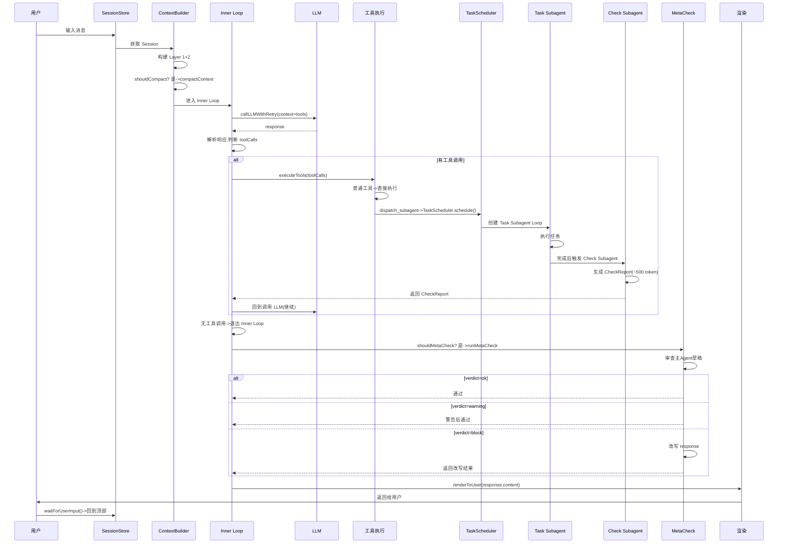
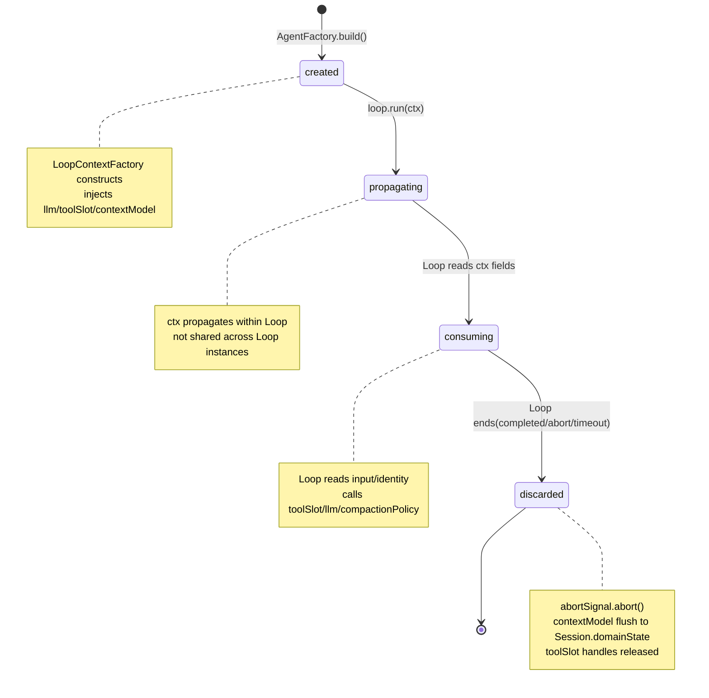
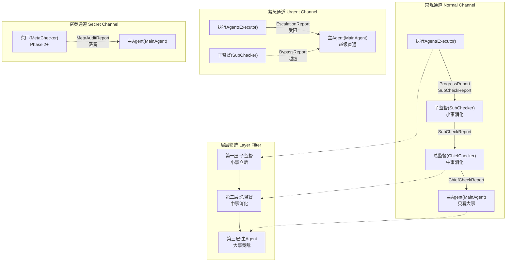
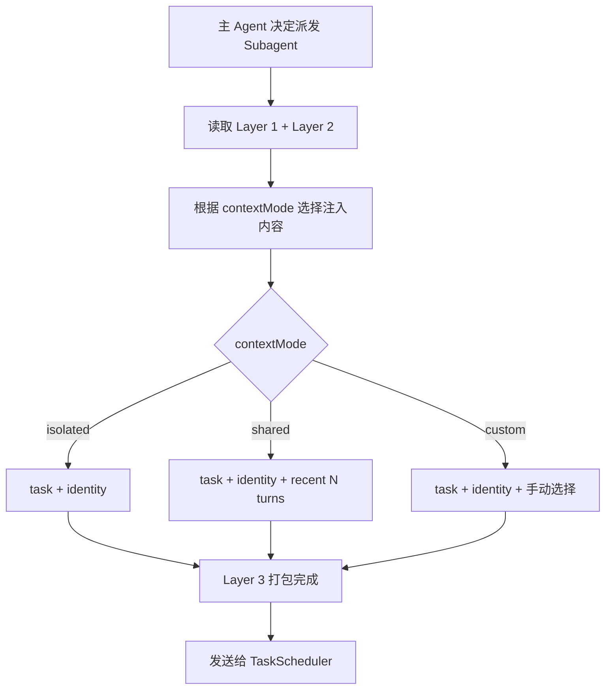

[AI 生成]

# Core 引擎

> Core 引擎：Loop 可插拔（四库之一）、事件溯源状态、Compaction 三规则不变量。
> 状态：stable
> 维护：@XZF（主笔）
> 讨论：无
> 待决：无

---

## 1. Core 层职责

Core 层是纯引擎，管执行单个 Agent（收输入 -> 调 LLM -> 执行工具 -> 返回产出）。不创建/销毁 Agent，不管编排，不定义角色。Core 层是角色无关、编排无关、身份无关、领域无关的纯发动机。

Core 层包含以下子系统，每个子系统职责单一、互不耦合：

| 子系统 | 职责 | v4 变化 |
|--------|------|---------|
| `loop/` | Agent 执行引擎：主循环 + 工具执行循环。v4：**Loop 是四库之一**，默认 react-loop，其他 Loop 在 Loop 库注册 | 可插拔（决策 72） |
| `context/` | 三层上下文模型：Session / Agent / Subagent | 不变 |
| `slots/` | 工具槽位与权限门控（ToolSlot） | 不变 |
| `state/` | v4 新增：事件溯源状态（EventSourcedState）+ 命名空间 | 重构（决策 80） |
| `error/` | 错误分类、传播与重试策略 | 不变 |
| `compaction/` | 上下文压缩，执行**三规则不变量** | 不变（核心不变量） |
| `events/` | Agent Loop 事件、EventBus | 不变 |

**Core 层不负责**：

- Agent 生命周期（Composition Layer 管）
- Pattern 编排（PatternRuntime 管）
- 角色定义（Identity Library 管，角色降级为 Identity 属性，决策 74）
- 具体领域语义（Domain Pack 管，决策 70/71）

**Loop 库归属说明**：Loop 库是四库之一，物理位置在 Composition Layer（见 04-four-libraries.md §5）。但 Loop 的**执行逻辑**（react-loop 的双层循环、Compaction 触发、工具执行）属 Core 层。即：Loop 的**注册/选择/目录索引**在 Composition 层，Loop 的**运行时引擎**在 Core 层。本文档定义 Loop 在 Core 层的执行契约。

---

## 2. Loop 库与可插拔引擎（v4 新增）

### 2.1 从硬编码引擎到四库之一

v3 的 Agent Loop 是硬编码单一引擎（双层循环），所有角色共享同一实现。v4 把执行引擎本身可插拔化——Loop 成为四库之一（决策 72）。

| 维度 | v3 | v4 |
|------|----|----|
| Loop 来源 | 硬编码在 agent-core | 四库之一，可注册 |
| 默认 Loop | 无（唯一实现） | react-loop（继承 v3 双层循环） |
| 可选 Loop | 无 | plan-execute / tot / reflection / script / hil 等 |
| dispatch 维度 | 三维度（identity/prompt/skills） | 四维度（+loop） |
| 选 Loop 方式 | N/A | dispatch_subagent 的 `loop` 参数 |

**核心价值**：同一身份可配不同 Loop（security-reviewer 配 react-loop 做常规审查，配 tot-loop 做多分支推理）；同一 Loop 可服务不同身份（react-loop 服务所有身份）。身份定义"Agent 是谁"，Loop 定义"Agent 怎么转"——正交解耦。

### 2.2 AgentLoop 接口

所有 Loop 实现此接口。完整接口定义见 04-four-libraries.md §5.7，此处展示核心契约：

```typescript
/**
 * Agent 执行引擎接口。所有 Loop 实现此接口。
 * Loop 是命令式代码，运行期只读，不可运行期创建（原则 20）。
 */
interface AgentLoop {
  /** Loop 唯一标识，与 catalog name 对应 */
  readonly name: string;
  /** Loop 描述（供 catalog 展示） */
  readonly description: string;
  /** Loop 适用的场景标签 */
  readonly tags: readonly string[];

  /**
   * 运行 Loop。接收 LoopContext，驱动 Agent 直到产出输出或终止。
   * Loop 实现内部自由组织循环结构（双层/规划执行/思维树/反思等）。
   */
  run(ctx: LoopContext): Promise<LoopResult>;
}

interface LoopContext {
  /** 初始输入（用户消息 / 任务 / 检查请求） */
  input: string;
  /** LLM 调用句柄 */
  llm: LLMHandle;
  /** 工具槽位（已按 Identity.tools 过滤） */
  toolSlot: ToolSlot;
  /** 上下文模型（Session/Agent/Subagent 三层） */
  contextModel: ContextModel;
  /** 上下文压缩策略（Core 层提供，Loop 调用） */
  compactionPolicy: CompactionPolicy;
  /**
   * 身份定义（运行态）。类型为 ResolvedIdentity（运行态），不是 IdentityDefinition（声明态）。
   * IdentityDefinition 存储在四库中，ResolvedIdentity 是运行时解析后的完整身份。
   * 定义见本文件 §2.2 ResolvedIdentity（T8 回流；原「见 05-agent-roles.md §4」指引有误，
   * 05 §4 实为派发参数 SubagentInvocation）。
   */
  identity: ResolvedIdentity;
  /** 架构提示词（可选） */
  architecturePrompt?: string;
  /** 最大迭代次数（硬兜底，防死循环） */
  maxIterations: number;
  /** 中止信号（外部可请求停止） */
  abortSignal: AbortSignal;
}

interface LoopResult {
  /** 终止状态 */
  status: "completed" | "aborted" | "error" | "max-iterations";
  /** 最终产出文本（status=completed 时） */
  output?: string;
  /** 结构化产出（配合 Identity.outputSchema） */
  structuredOutput?: unknown;
  /** 执行统计 */
  stats: LoopStats;
  /** 错误信息（status=error 时） */
  error?: string;
}
```

#### LLMHandle（Loop 契约 LLM 句柄）

> [AI 生成 2026-08-13] 补全本接口定义，消除悬空引用（01-overview.md / 04-four-libraries.md / 本文档 LoopContext.llm 此前引用但未定义）。

```typescript
/**
 * LLMHandle — LoopContext.llm 的 LLM 调用句柄（非流式 complete，供 Loop 决策消费）。
 * 三层分工（T8 回流 2026-08-13，方案 3）：
 *   - LLMHandle（本接口，Loop 契约层）：非流式 complete，Loop 每次决策调一次拿完整响应
 *   - StreamFn（Provider 层）：流式函数签名，LLMHandle.complete 内部经其实现（聚合流事件）
 *   - LlmProvider（组装层）：StreamFn 的薄包装 + fallback 链（决策 19/35），供 Cell 装配
 */
interface LLMHandle {
  complete(params: LLMParams): Promise<LLMResponse>;
}

interface LLMParams {
  systemPrompt?: string;
  messages: readonly unknown[];
  tools?: readonly { name: string; description: string; parameters: Record<string, unknown> }[];
  signal?: AbortSignal;
  maxTokens?: number;
}

interface LLMResponse {
  content: string;
  toolCalls: readonly { id: string; name: string; args: unknown }[];
  usage: { input: number; output: number };
}
```

#### ToolSlot（Loop 契约工具槽位）

> [AI 生成 2026-08-13] 补全本接口定义（消除悬空引用）。候选 A 形态，用户确认；替代 09-seam-map §7.25 旧形态（register/execute/list，来源待验证，已废弃）。与 ② 层 orbita-cell-base_v0.1/02-shared-infrastructure.md §3.2 同步。

```typescript
/**
 * ToolSlot — LoopContext.toolSlot 的工具槽位（已按 identity.tools 过滤）。
 * 作用：隔离全局 ToolRegistry + 授权过滤 + 双视角（LLM 元数据 / 执行）。
 * 候选 A（2026-08-13 用户确认）：list = LLM 视角元数据 / execute = 执行视角
 * （含授权检查）/ has = 授权视图。无 register（装配时由 ToolRegistry.slotFor 生成）、
 * 无 ToolHandle/release（璇玑 工具为纯函数，无资源生命周期）。
 */
interface ToolSlot {
  /** LLM 视角：列出此 Cell 可用工具元数据（生成 LLM tools 列表用） */
  list(): readonly ToolDescriptor[];
  /** 执行视角：执行工具调用（含授权检查） */
  execute(call: ToolCall, signal?: AbortSignal): Promise<ToolResult>;
  /** 授权视图：检查是否拥有某工具 */
  has(name: string): boolean;
}

/** 工具 LLM 元数据（OpenAI tools 格式兼容）。
 * 消歧注：本 ToolDescriptor（LLM 视角元数据）≠ 18-domain-pack.md §2.1.1（Pack 注册声明条目：
 * toolName/riskLevel/source）≠ 18-domain-pack.md §4.3 / 07-infrastructure.md（完整风险描述符：
 * riskLevel/requiresVerification/...）。区分依据：上下文 + 字段形态（本处无 riskLevel）。
 * executionMode：pi 移植（2026-08-13）——工具执行模式覆盖，供 Loop 同批并行调度 */
interface ToolDescriptor {
  name: string;
  description: string;
  parameters: Record<string, unknown>;
  /** 执行模式覆盖：该工具是否可与同批其他工具并行（缺省串行） */
  executionMode?: "sequential" | "parallel";
}

/** 工具调用（Loop 决策产物） */
interface ToolCall {
  id: string;
  name: string;
  args: unknown;
}

/** 工具执行结果 */
interface ToolResult {
  toolCallId: string;
  content: string;
  isError: boolean;
  /** 可选扩展元数据（T8 回流 2026-08-13：edit 工具返回 diff patch 详情等，供审计/展示；不影响 content 语义） */
  details?: Record<string, unknown>;
}
```

#### ResolvedIdentity（运行态身份）

> [AI 生成 2026-08-13，T8 回流] 补全本接口定义（消除悬空引用）。定义本体回流自
> `loop/agent-loop.ts`。修正错指：原 06 §2.2 注释「见 05-agent-roles.md §4」有误
> （05 §4 实为派发参数 SubagentInvocation），运行态身份定义在本处。

```typescript
/**
 * ResolvedIdentity — LoopContext.identity 的运行态身份（IdentityResolver.resolve(name)
 * 四库加载 + 四层优先级合并后的完整身份，见 05-agent-roles.md）。区别于 IdentityDefinition
 * （声明态，存四库）：ResolvedIdentity 是运行时解析结果，无 source 字段。
 */
interface ResolvedIdentity {
  name: string;
  role: string;
  capabilities: readonly string[];
  tools: readonly string[];
  model: string;
  systemPrompt: string;
  skills?: readonly string[];
  outputSchema?: unknown;
  hooks?: {
    beforeInnerLoop?(ctx: LoopContext): Promise<void>;
    afterInnerLoop?(output: string, ctx: LoopContext): Promise<string>;
    onToolError?(err: unknown, ctx: LoopContext): Promise<ToolResult>;
  };
}
```

**接口设计要点**：

- Loop 只依赖 LoopContext，不依赖 Composition 层任何接口（边界即接口，原则 1）
- Loop 不关心编排（下一步做什么）——编排由 PatternRuntime 决定
- Loop 不关心身份赋予——身份定义通过 identity 字段注入
- Compaction 策略由 Core 层提供，Loop 在迭代中调用（保证 Compaction 三规则不变量始终生效）

### 2.3 Loop 库注册内容（Phase 1）

| Loop 名 | 描述 | 适用场景 |
|---------|------|---------|
| `react-loop` | 反应式循环（默认）。收输入→调 LLM→执行工具→返回，双层结构 | 大多数任务（不填 loop 维度时默认） |
| `plan-execute-loop` | 规划-执行循环。先规划步骤，再逐步执行，可重规划 | 复杂多步任务 |
| `tot-loop` | 思维树循环（Tree of Thoughts）。生成多分支，评估剪枝，选最优路径 | 解空间大需搜索 |
| `reflection-loop` | 反思循环。执行后自我评估，不足则修正重试 | 质量要求高 |
| `script-loop` | 脚本驱动循环。按预定义脚本固定步骤执行 | 步骤确定不变 |
| `hil-loop` | 人在环循环（Human-in-the-loop）。关键节点暂停等待人工确认 | 高风险操作 |

其他 Loop（plan-execute/tot/reflection/script/hil）共享同一个底层引擎能力（LLM 句柄、工具槽、上下文模型），差异在循环结构、决策点、反思/规划环节的有无。本文档以 react-loop 为完整示例（它是 v3 双层循环的直接继承）。

**相关决策**：72（Loop 库）、65（执行模式→两层 Pattern，Loop 是 Execution 的引擎层）。

---

## 3. react-loop：默认双层循环（v3 保留）

react-loop 是 v3 Agent Loop 在 v4 的注册名。所有不填 loop 维度的 dispatch 都用它。它实现了 v3 的双层循环结构——Outer Loop（决策循环）+ Inner Loop（工具执行循环）。

### 3.1 双层循环总览

```mermaid
stateDiagram-v2
    state "接收输入" as S1
    state "构建上下文" as S2
    state "预算检查" as S3
    state "压缩" as S4
    state "进入InnerLoop" as S5
    state "调用LLM" as S6
    state "解析响应" as S7
    state "判断工具调用" as S8
    state "执行工具" as S9
    state "退出InnerLoop" as S10
    state "处理输出" as S11
    state "主Agent输出" as S12
    state "任务Subagent完成" as S13
    state "检查Subagent报告" as S14
    state "MetaCheck审查" as S15
    [*] --> S1
    S1 --> S2: 构建上下文(Layer 1+2 或 2+3)
    S2 --> S3: 上下文预算检查
    S3 --> S4: 触发压缩
    S3 --> S5: 无需压缩
    S4 --> S5
    S5 --> S6: 调用 LLM(上下文+工具列表)
    S6 --> S7: 解析 LLM 响应
    S7 --> S8: 有工具调用?
    S8 --> S9: 是
    S9 --> S6: 收集结果,回到调用LLM
    S8 --> S10: 否
    S10 --> S11: Inner Loop 结束
    S11 --> S12: 主Agent: Meta Check审查后输出
    S11 --> S13: 任务Subagent: 完成后触发检查
    S11 --> S14: 检查Subagent: 生成CheckReport
    S11 --> S15: Meta Check Agent: 审查草稿,可能改写
    S12 --> [*]
    S13 --> [*]
    S14 --> [*]
    S15 --> [*]

**核心原则**：

- Outer Loop 是决策层：决定"做什么"。
- Inner Loop 是执行层：决定"怎么做"。

> **守护支柱：P（可插拔）**：Loop 引擎可插拔化是四库体系的核心，身份与引擎正交解耦，同一身份可配不同 Loop，同一 Loop 可服务不同身份。

### 3.2 角色差异通过 Identity 配置

v3 用 `switch(role)` 分四种角色（主 Agent / 任务 Subagent / 检查 Subagent / Meta Check Agent）。v4 角色降级为 `Identity.role: string`（决策 74），行为差异通过 Identity 的 hooks/slots 注入，不再 switch。

| 维度 | 主 Agent | 任务 Subagent | 检查 Subagent | Meta Check Agent |
|------|---------|-------------|-------------|-----------|
| Identity.role | "main" | "worker" | "reviewer" | "meta-check" |
| 输入来源 | 用户消息 | SubagentInvocation | 任务 Subagent 产出 | 主 Agent 草稿 |
| 上下文 | Layer 1+2 | Layer 2+3 | Layer 2+3（检查专用） | Layer 2（独立） |
| 工具集 | 完整（含 dispatch_subagent） | identity.tools 限制 | 只读（read, grep, bash） | 无工具（纯 LLM 推理） |
| 输出去向 | 用户 | 检查 Subagent | 主 Agent（CheckReport） | 改写后的响应 |
| 特殊环节 | Meta Check 审查 | 完成后触发检查 | 可触发返工 | maxCorrections 限制 |
| Loop 持续 | 多轮（对话持续） | 单任务多轮 | 单次验证（可重试） | 按触发模式 |

**差异注入方式**（v4 替代 switch）：

```typescript
// v3: switch(agent.role) { case "main": ...; case "reviewer": ... }
// v4: Identity 配置驱动
interface IdentityDefinition {
  role: string;                    // "main" | "worker" | "reviewer" | "meta-check" | 自定义
  capabilities: string[];          // ["dispatch", "contact", "submit"] 等能力声明
  tools: string[];                 // 允许的工具
  model: string;                   // 模型偏好
  systemPrompt: string;            // 角色系统提示词
  skills?: string[];               // 技能标签
  outputSchema?: ZodSchema;        // 结构化输出 schema（决策 55）
  // v4 新增：行为钩子（替代 switch 分支）
  hooks?: {
    beforeInnerLoop?: (ctx: LoopContext) => Promise<void>;
    afterInnerLoop?: (output: string, ctx: LoopContext) => Promise<string>;
    onToolError?: (err: ToolError, ctx: LoopContext) => Promise<ToolResult>;
  };
}
```

react-loop 引擎读 Identity 的 capabilities/hooks/tools 决定行为：有 "dispatch" 能力的可调 dispatch_subagent，有 "submit" 能力的可调 submit_output，hooks 提供各环节自定义逻辑。架构只认 Agent，不再 switch(role)。

> Agent Loop 只管执行单个 Agent。编排逻辑由 PatternRuntime 决定。

### 3.3 主 Agent 的完整 Loop

```typescript
async function mainAgentLoop(
  agent: MainAgent,
  userMessage: string,
  ctx: RequestContext
): Promise<void> {
  // Outer Loop: 每次用户消息一轮
  while (true) {
    // 1. 构建上下文（Layer 1 共享 + Layer 2 私有）
    const context = await buildMainAgentContext(agent, ctx);

    // 2. 上下文预算检查
    if (context.tokenCount > agent.contextBudget * 0.8) {
      await compactContext(agent);
    }

    // 3. Inner Loop: 工具执行循环
    let llmResponse;
    let toolResults: ToolResult[] = [];

    while (true) {
      llmResponse = await callLLMWithRetry(agent.provider, {
        messages: [...context.messages, ...toolResults],
        tools: agent.availableTools,
      });

      if (llmResponse.toolCalls.length === 0) {
        break; // 没有工具调用，Inner Loop 结束
      }

      // 执行工具
      toolResults = await executeTools(llmResponse.toolCalls, agent, ctx);
    }

    // 4. 本轮产出完成，返回给 PatternRuntime
    // Loop 自己不做编排决策
    // 何时触发监察、何时输出给用户，由 PatternRuntime 决定
    return {
      content: llmResponse.content,
      toolResults,
      artifacts: collectArtifacts(toolResults),
    };
  }
}
```

> **实现增补（T8 回流 2026-08-13，pi-agent-core 移植）**：
> - **length 截断保护**：`callLLMWithRetry` 返回的 `stopReason === "length"`（输出被 token 上限截断）时，本批 toolCall 参数可能不完整，**不执行任何工具调用**，全部回填 `isError` toolResult（提示重新发起完整参数）后进入下一轮。防止执行被截断的参数（pi `failToolCallsFromTruncatedMessage`）。
> - **轮间决策钩子 afterTurn**：LoopContext 可选 `afterTurn({ iteration, output, toolResults }) => { stop?, nextModel?, thinkingLevel? }`，每工具轮结束后调用。`stop` 提前终止（对齐 pi `shouldStopAfterTurn`）；`nextModel`/`thinkingLevel` 上报到 LoopResult（Loop 零状态：llm 构造注入，运行时切换属组装层职责，对齐 pi `prepareNextTurn` 的决策语义）。

#### PatternRuntime 如何驱动编排

PatternRuntime 包裹在 Agent Loop 外面。Loop 返回产出后，PatternRuntime 按 Pattern connections 决定下一步：

```typescript
async function patternRuntime_execute(pattern, sessionId, ctx) {
  const mainAgent = await createAgent(pattern.entry, ctx);
  while (true) {
    const output = await mainAgentLoop(mainAgent, userMessage, ctx);
    const nextSteps = pattern.getFlowsFrom(mainAgent.id);
    for (const step of nextSteps) {
      if (step.trigger === 'checkpoint' && step.module === 'meta-check') {
        const verdict = await runMetaCheck(output, ctx);
        if (verdict.verdict === 'block' && corrections < maxCorrections) {
          output.content = verdict.correctedContent;
          corrections++;
        }
      }
    }
    await renderToUser(output.content);
    userMessage = await waitForUserInput();
    if (userMessage === null) break;
  }
}
```

**职责分离**：

- Agent Loop：收输入 -> 调 LLM -> 执行工具 -> 返回产出。不关心下一步。
- PatternRuntime：收到产出 -> 查 Pattern -> 决定下一步 -> 驱动数据流转。

**接口反转**（决策 63）：PatternRuntime 实现 shared 包定义的 SubagentDispatcher 接口。dispatch_subagent 工具（在 extensions）通过此接口调用 PatternRuntime，不直接 import composition。bootstrap 时注入具体实现。这打破了 composition → agent-core → extensions → composition 的循环依赖。

### 3.4 任务 Subagent 的完整 Loop

```typescript
async function taskSubagentLoop(
  invocation: SubagentInvocation,
  ctx: RequestContext
): Promise<SubagentOutput> {
  // 1. 构建上下文（Layer 2 新建 + Layer 3 注入）
  const context = buildSubagentContext(invocation);

  // 2. Inner Loop: 工具执行循环
  let llmResponse;
  let toolResults: ToolResult[] = [];

  while (true) {
    llmResponse = await callLLMWithRetry(invocation.identity.model, {
      messages: [...context.messages, ...toolResults],
      tools: invocation.identity.tools,
    });

    if (llmResponse.toolCalls.length === 0) {
      break;
    }

    toolResults = await executeTools(llmResponse.toolCalls, invocation, ctx);
  }

  // 3. 返回产出（不直接返回主 Agent，先经过检查 Subagent）
  return {
    content: llmResponse.content,
    artifacts: collectArtifacts(toolResults),
    fileChanges: collectFileChanges(toolResults),
    durationMs: Date.now() - context.startTime,
  };
}
```

### 3.5 检查 Subagent 的完整 Loop

```typescript
async function checkSubagentLoop(
  taskOutput: SubagentOutput,
  invocation: SubagentInvocation,
  retriesRemaining: number
): Promise<CheckReport> {
  // 1. 构建检查上下文
  const context = buildCheckContext(taskOutput, invocation);

  // 2. 调用 LLM 验证（单次调用，不是循环）
  const verdict = await callLLMWithRetry(checkModel, {
    messages: context,
    systemPrompt: CHECK_SYSTEM_PROMPT,
  });

  // 3. 根据结果决定下一步
  if (verdict.pass) {
    // 通过：压缩为 CheckReport（上下文屏障，原则 5）
    return compressToCheckReport(taskOutput, verdict);
  }

  if (retriesRemaining > 0) {
    // 未通过但有重试次数：触发返工
    const reworkFeedback = extractFeedback(verdict);
    return triggerRework(invocation, reworkFeedback, retriesRemaining - 1);
  }

  // 重试耗尽：返回 partial 报告
  return partialReport(taskOutput, verdict);
}
```

**CHECK_SYSTEM_PROMPT 核心**：

- 你是独立的质量验证者。
- 审查任务产出是否正确、完整、达到质量标准。
- 如果发现问题，给出具体反馈和修复建议。
- 最终输出必须是 CheckReport 格式：verdict（pass/fail/partial）+ 精简摘要 + 文件变更列表 + 问题列表。
- CheckReport 总长度不超过 500 token。

> v4 监察分层（决策 81）把 v3 的 Check + MetaCheck 两层扩展为可配置三层（过程监督/事后审计/高风险复核）。Check Subagent 对应"过程监督"层。详见 01-overview.md §8.5。

### 3.6 dispatch_subagent 工具

主 Agent 通过 `dispatch_subagent` 工具调用 Subagent。这是 ToolSlot 中的内置工具，只有主 Agent 可以使用。

dispatch_subagent 通过 SubagentDispatcher 接口（定义在 shared，决策 63）调用 PatternRuntime。工具本身不 import composition——依赖通过工厂函数注入。

> **工具参数的权威定义见 04-four-libraries.md §8。** 此处只展示工厂函数结构。

```typescript
// extensions/tools/dispatch-subagent.ts
import type { SubagentDispatcher } from "../../shared/subagent-dispatcher";

export function createDispatchSubagentTool(dispatcher: SubagentDispatcher) {
  return {
    name: "dispatch_subagent",
    description: "派发一个子 Agent 执行任务。四维度（identity/loop/architecturePrompt/skills）各自独立选 source，详见四库 catalog。",
    // parameters schema 详见 04-four-libraries.md §8 权威定义
    parameters: { /* 见 04 §8 权威定义 */ },
    execute: async (input: DispatchInput) => dispatcher.dispatch(input),
  };
}

// bootstrap 时创建：
// const dispatchTool = createDispatchSubagentTool(patternRuntime);
// mainAgent.tools.push(dispatchTool);
```

**何时派发子 Agent**（Main Agent system prompt 应包含的指导）：

派发前必须判断：

1. **需要派发吗？**——简单的单步操作（如读取一个文件）不需要派发 Subagent，直接用工具。需要专业领域知识或独立验证时才派发。
2. **选哪个身份？**——查身份库 catalog.yaml，读 desc + when_to_use 定位。找不到匹配的考虑 ask-expert（Phase 2+）。
3. **用什么 Loop 跑？**——大多数任务不填 loop，用默认 react-loop。复杂多步查 Loop 库 catalog 选 plan-execute-loop；多分支推理选 tot-loop。
4. **需要额外提示词/技能吗？**——查架构提示词库和技能库 catalog。不填则用默认/继承。

详见 04-four-libraries.md §8.2 派发决策流程。

> **dispatchBudget 检查点 ①**：`SubagentDispatcher.dispatch()` 调用前检查 `capabilities.includes('dispatch') && dispatchBudget.remainingDepth > 0`。不通过则抛 CapabilityDeniedError，不创建 Subagent。

### 3.7 Agent Loop 事件

Agent Loop 在执行过程中发出以下事件（通过 EventBus）：

| 事件类型 | 触发时机 | payload 关键字段 |
|---------|---------|-----------------|
| `agent.loop.start` | Agent 开始处理输入 | agentId, sessionId, agentType, loopName |
| `agent.loop.end` | Agent 完成处理 | agentId, sessionId, durationMs |
| `agent.llm.call` | 调用 LLM 前 | agentId, model, estimatedTokens |
| `agent.llm.response` | LLM 返回后 | agentId, tokensUsed, latencyMs |
| `agent.tool.execute` | 执行工具前 | agentId, toolName, params |
| `agent.tool.result` | 工具执行后 | agentId, toolName, success, durationMs |
| `agent.compaction` | 触发压缩 | agentId, tokensBefore, tokensAfter |
| `agent.error` | 任何错误 | agentId, errorType, message, context |
| `subagent.dispatch` | 主 Agent 派发 Subagent | mainAgentId, subagentId, taskSummary |
| `subagent.check` | 检查 Subagent 触发 | taskId, verdict, durationMs |
| `subagent.report` | 报告返回主 Agent | taskId, verdict, tokenCount |
| `meta_check.review` | Meta Check Agent 审查 | metaCheckId, verdict, corrected |

v4 新增 `loopName` 字段到 `agent.loop.start` 事件，记录用了哪个 Loop。这些事件由 ConcurrencyMonitor 和 CostModule 消费，用于实时观察和成本追踪。事件本身也写入事件溯源状态（见 §8）。

> **可观测性集成**：每个 event 触发时自动创建 TraceSpan（event 触发 = span start，event 完成 = span end）。traceId 从 RequestContext 贯穿所有层。Phase 1 最笨实现：内存 span 数组；Phase 3：OpenTelemetry exporter。详见 07-infrastructure.md §7.3。

### 3.8 完整请求处理流程



### 3.8.1 Agent 构造入口：AgentFactory → AgentLoop

PatternRuntime 不直接调用 AgentLoop。通过 AgentFactory 间接创建：

1. PatternRuntime 调用 `agentFactory.create(invocation, requestCtx)` 创建 AgentInstance
2. AgentFactory 内部调用 `loopContextFactory.build(invocation, requestCtx, session)` 构造 LoopContext
3. AgentFactory 调用 `agent.loop.run(loopContext)` 启动 AgentLoop（← AgentLoop 入口）

**dispatchBudget 三检查点**贯穿此链路：
- **检查点 ①**（§3.6 SubagentDispatcher.dispatch）：检查 `capabilities.includes('dispatch') && dispatchBudget.remainingDepth > 0`，不通过则抛 CapabilityDeniedError
- **检查点 ②**（AgentFactory.create）：计算子 budget = `min(parentBudget.remainingDepth - 1, identity.dispatchBudget)`，写入子 SubagentInvocation.dispatchBudget
- **检查点 ③**（07-infrastructure.md §4.1 TaskScheduler.schedule）：扣减 `dispatchBudget.remainingConcurrency`

接口定义见 04-four-libraries.md §5.7（LoopContextFactory）和 05-agent-roles.md §5.4（AgentFactory）。

### 3.9 LoopContext 生命周期（P0）

LoopContext 是 Agent Loop 的唯一运行时上下文。**每个 Loop 实例独占一个 LoopContext**（不可共享，防竞态）。生命周期与 RequestContext 状态机（决策 110）对齐。

#### 生命周期状态机



#### 创建（created）

AgentFactory 调用 `loopContextFactory.build(invocation, requestCtx, session)` 构造 LoopContext：

```typescript
// Composition Layer 创建 LoopContext（见 05-agent-roles.md §5.4 AgentFactory）
const loopContext = loopContextFactory.build(invocation, requestCtx, session);
// build 内部：
//   1. 从 session 构造 contextModel（三层上下文 §4）
//   2. 按 identity.tools 过滤 toolSlot
//   3. 注入 compactionPolicy（Core 层提供，保证三规则不变量）
//   4. 创建 abortController → abortSignal
//   5. 设置 maxIterations（硬兜底，防死循环）
```

#### 传递（propagating → consuming）

`agent.loop.run(loopContext)` 启动 AgentLoop。Loop 实现内部自由读取 ctx 字段（input/identity/toolSlot/llm 等），驱动 Agent 直到产出输出或终止。

**不可共享约束**：LoopContext 绑定单个 Loop 实例。同一 Agent 连续运行多个 Loop（如先 plan-execute 后 reflection）时，每个 Loop 各自获得独立的 LoopContext——不跨 Loop 复用，避免 state 污染和竞态。

#### 销毁（discarded）

Loop 结束（正常完成 / abort / 超时）后执行清理：

1. **abortSignal.abort()**：触发所有未完成的异步操作取消（工具调用、LLM 请求等监听 abortSignal 的组件收到取消信号）
2. **contextModel 回写**：Loop 运行期间对 contextModel 的变更回写到 `session.domainState`（事件追加，见 §8）
3. **工具句柄释放**：toolSlot 持有的工具句柄释放，防止资源泄漏

```typescript
// Loop 结束后清理（AgentLoop.run 返回后由 AgentFactory 调用）
async function cleanupLoopContext(ctx: LoopContext): Promise<void> {
  if (!ctx.abortSignal.aborted) {
    ctx.abortController.abort();    // 确保取消
  }
  await ctx.contextModel.flushTo(session); // 回写状态
  ctx.toolSlot.release();                   // 释放句柄
}
```

**相关决策**：110（RequestContext 状态机 created→propagating→consuming→discarded，LoopContext 生命周期与此对齐）、72（Loop 库）。

---
## 3a. CheckAgent：通用监督引擎

> 定位：CheckAgent 是所有监督角色（子监督/总监督/复核/审计/东厂）共用的**压缩屏障+通信引擎**。不是微内核一等概念（不在 §0.5 的 6 个中），是 Core Engine 内部机制——由 Agent Loop 调用、产出 CheckReport 系列报告。灵感源自明朝多层通信模型（奏章流转+塘报驿传+厂卫互监）。本节是原则 5（Check 是上下文屏障）的形式化实现契约。

### 3a.1 核心定位

CheckAgent 将 §3.5 的 `checkSubagentLoop` 泛化为通用监督接口：

- **不是某一个监督角色的接口**——是子监督/总监督/复核/审计/东厂共用的压缩屏障+通信引擎
- **不是一等概念**——Core Engine 内部机制，由 PatternRuntime 在 dispatch 后触发（见 §3.6）
- **角色通过参数注入**——同一 CheckAgent 实例，传入不同 `CheckerRole` + `CheckTemplate`，产出不同报告类型
- **向后兼容**——§3.5 `checkSubagentLoop` 是 CheckAgent `role=completion` 角色的特例（不改原函数签名）

灵感来源：明朝的多层通信模型不是简单的"汇报完就压缩"，而是一个包含进度汇报（覆奏）、完成报告（注销）、异常上报（塘报/急递）、汇总上报（都察院筛选）、越级直通（御史弹劾）、密奏（东厂）的完整通信体系，且走三条不同通道（常规/紧急/密奏）。详见明朝参考文档：奏章流转完整路径图、塘报邸报驿传、六科给事中、厂卫互监与皇权控制。

### 3a.2 CheckAgent 接口

```typescript
/**
 * CheckAgent — 所有监督角色共用的压缩屏障+通信引擎。
 * 不是一等概念，是 Core Engine 内部机制。
 */
interface CheckAgent {
  check(
    input: CheckInput,
    role: CheckerRole,
    template: CheckTemplate
  ): Promise<CheckReport>;
}

/**
 * 检查输入：被检查目标 + 对照基准 + 上下文。
 */
interface CheckInput {
  /** 被检查目标：执行产出文本 或 子监督报告数组（总监督场景） */
  target: string | SubCheckReport[];
  /** 对照基准：执行计划 或 任务规格（可选） */
  reference?: ExecutionPlan | TaskSpec;
  /** 检查上下文 */
  context: CheckContext;
}

/**
 * 五种监督角色。每种角色对应不同的检查维度和产出报告。
 */
type CheckerRole = "completion" | "alignment" | "safety" | "cost" | "meta";

/**
 * 检查模板：定义 systemPrompt / 输出格式 / 模型选择 / 失败策略。
 * 压缩与检查在同一次 LLM 调用中完成（方案 C，见 §3a.8）。
 */
interface CheckTemplate {
  /** 角色专属 system prompt */
  systemPrompt: string;
  /** 输出 JSON 格式定义（固定字段 + 每字段 token 上限） */
  outputSchema: string;
  /** 最大 token（≤500 default） */
  maxTokens: number;
  /** 模型选择：轻量（成本低）/ 标准 / 强模型（准确优先） */
  model: "lightweight" | "standard" | "strong";
  /** 失败时是否拒绝跳过（true=不能跳过，false=降级通过） */
  failClosed: boolean;
}

/**
 * 检查上下文：任务/会话/调用/预算信息。
 */
interface CheckContext {
  taskId?: string;
  sessionId: string;
  invocation?: SubagentInvocation;
  budgetRemaining?: number;
}
```

### 3a.3 五种监督角色配置

| 角色 | CheckerRole | checkWhat | 明朝对应 | 模型 | 失败策略 | 产出类型 | 触发时机 |
|------|-------------|-----------|---------|------|---------|---------|---------|
| 子监督 | `completion` | 完成情况 | 六科给事中（注销） | 轻量 | fail-open | SubCheckReport | 每个 dispatch 后必跑 |
| 总监督 | `alignment` | 方案对齐 | 都察院都御史 | 轻量 | fail-open | ChiefCheckReport | 所有子监督完成后 |
| 复核 | `safety` | 安全风险 | 大理寺覆核 | 强模型 | fail-closed | ReviewVerdict | 高风险才触发 |
| 审计 | `cost` | 成本表现 | 考功司考绩 | 轻量 | fail-open | AuditReport | Wave 后异步 |
| 东厂 | `meta` | 监察质量 | 东厂密奏 | 强模型 | fail-closed | MetaAuditReport | 复杂模式定期 |

> Phase 1 只实现 `completion` + `alignment`。`safety`/`cost`/`meta` 标注 Phase 2+（见 §3a.10）。

### 3a.4 六种通信类型

灵感源自明朝奏章流转体系——不是只有"完成后报告"一种通信，而是执行全过程的六种通信类型，分别走不同通道：

| 通信类型 | 明朝对应 | 触发时机 | 璇玑 映射 | 通道 |
|---------|---------|---------|-----------|------|
| 进度汇报 | 覆奏（执行中奏报） | 执行中关键节点 | ProgressReport | 常规 |
| 完成报告 | 注销（六科注销） | 执行完成后 | SubCheckReport | 常规 |
| 异常上报 | 塘报/急递（军情专报） | 执行受阻时 | EscalationReport | 紧急 |
| 汇总上报 | 都察院筛选（御史汇总） | 所有子监督后 | ChiefCheckReport | 常规 |
| 越级直通 | 御史独立弹劾（直通皇帝） | 任何时候 | BypassReport（=EscalateReport） | 紧急 |
| 密奏 | 东厂密奏（直达天听） | 定期/按需 | MetaAuditReport | 密奏 |

> EscalateReport/BypassReport 的权威定义见 03-execution-modes.md §0.7b。此处只做通信类型映射，不重复接口定义。

### 3a.5 三条并行通信通道

源自明朝三大通信体系（驿传/塘报/密奏），璇玑 映射为三条并行通道：

| 通道 | 明朝对应 | 璇玑 基础设施 | 速度 | 谁可见 | 用途 |
|------|---------|-------------|------|--------|------|
| 常规通道 | 驿传/通政司（日常公文） | CollaborationBus（EventBus） | 标准 | 全程可见 | 日常进度+完成报告 |
| 紧急通道 | 塘报/急递（军情专报） | DirectMessage（AgentTransport） | 不排队 | 指定接收者 | 执行受阻+越级直通 |
| 密奏通道 | 东厂/监军密奏（直达皇帝） | EncryptedDirectMessage | 最高 | 只有主 Agent | 绕过中间层 |

核心洞察（引自明朝塘报邸报驿传参考文档）：**"如果所有信息都挤在一条通道上，紧急异常会被日常进度淹没"**。三通道并行确保不同优先级的信息走不同通道，不被互相阻塞。

> 三通道的基础设施接口定义见 22-communication.md（EventBus / AgentTransport / DirectMessage）。本节只定义 CheckAgent 使用哪些通道，不重新设计 Communication 层。

> Phase 1 简化：三通道全走 EventBus（不区分紧急/密奏），Phase 2+ 拆分（见 §3a.10）。

### 3a.6 层层筛选——小事消化大事上报

引用 03-execution-modes.md §0.7c 四层上报机制。灵感源自明朝巡按御史原则：**"小事立断大事奏裁"**——日常小问题在子监督/总监督层就消化了，主 Agent（皇帝）只看大问题和系统性问题。

四层上报（权威定义见 03 §0.7c）：

| 严重程度 | 谁处理 | 上报到谁 | 对应明朝 |
|---------|-------|---------|---------|
| 小问题（补正级） | 子监督自己处理，要求执行 Agent 修复 | 不上报 | 给事中驳正退回六部 |
| 中等问题（重审级） | 子监督报总监督，总监督决定 | 总监督层消化 | 御史弹劾→都御史筛选 |
| 大问题（整体失败） | 总监督报主 Agent | 主 Agent 裁定 | 都御史上报皇帝 |
| 系统性问题（总监督包庇） | 子监督越级直通主 Agent | 主 Agent（绕总监督） | 密奏直通皇帝 |

每一层都做**压缩+筛选**：

```
执行产出（大）
  → 子监督压缩（检查单个完成情况，小事自己消化）
    → 总监督汇总压缩（对照完整审批方案，中事层消化）
      → 主 Agent（一份总报告 ChiefCheckReport）
```

主 Agent 正常只看 ChiefCheckReport（一份汇总报告）。越级时多看一份 BypassReport（=EscalateReport）。

### 3a.7 报告类型层级

```typescript
/** 基础报告（所有角色公共字段，≤500 token） */
interface CheckReport {
  verdict: "pass" | "fail" | "partial";
  summary: string;        // ≤200 token
  issues?: string[];      // ≤150 token
  [key: string]: unknown; // 角色扩展字段
}

/** 进度汇报（覆奏）— Phase 1 NoOp */
interface ProgressReport extends CheckReport {
  taskId: string;
  progress: number;       // 0-1
  eta?: string;
  blockers?: string[];
}

/**
 * 子监督完成报告（注销）
 * 权威定义见 03-execution-modes.md §0.7b，此处为 CheckReport 层级示意。
 */
interface SubCheckReport extends CheckReport {
  taskId: string;
}

/**
 * 总监督汇总（都察院筛选）
 * 权威定义见 03-execution-modes.md §0.7b，此处为 CheckReport 层级示意。
 */
interface ChiefCheckReport extends CheckReport {
  taskSummaries: string[];
  planAlignment: string;
  recommendation: "complete" | "redo" | "partial";
}

/** 复核裁决（大理寺覆核）— Phase 2+ */
interface ReviewVerdict extends CheckReport {
  action: "approve" | "reject" | "adjust";
  adjustments?: string;
}

/** 审计报告（考功司考绩）— Phase 2+ */
interface AuditReport extends CheckReport {
  costAnalysis?: string;
  weightFeedback?: WeightFeedback;  // Phase 2+，回写 WeightRegistry
}

/** 密奏（东厂）— Phase 2+ */
interface MetaAuditReport extends CheckReport {
  supervisorQuality: string;
  anomalies?: string[];
}
```

> **注意**：`EscalateReport`（越级直通）和 `RecheckRequest`（反向要求重查）的权威定义在 03-execution-modes.md §0.7b，此处不重复定义。`WeightFeedback` 类型由 WeightRegistry 定义（07-infrastructure.md，Phase 2+）。

### 3a.8 压缩策略

采用**方案 C（结构化模板）**——check 和压缩在同一次 LLM 调用中完成，不需要二次压缩：

- `CheckTemplate.outputSchema` 定义固定字段 + 每字段 token 上限
- LLM 直接输出结构化 JSON → 天然 token 约束（不需要先输出全文再压缩）
- 等效于"让 LLM 边检查边压缩"——一次调用完成两件事

子监督 CheckTemplate 示例（completion 角色）：

```typescript
const completionTemplate: CheckTemplate = {
  systemPrompt: `你是独立的质量验证者（六科给事中）。
    审查任务产出是否正确、完整、达到质量标准。
    输出必须是 JSON：{verdict, summary, issues, taskId}。
    summary ≤200 token，issues 每条 ≤50 token，总输出 ≤500 token。`,
  outputSchema: "{verdict: pass|fail|partial, summary: string, issues: string[], taskId: string}",
  maxTokens: 500,
  model: "lightweight",
  failClosed: false,
};
```

**Phase 2 扩展**：方案 D（混合策略）——当 summary 超长时（如产出本身极大），LLM 二次摘要。Phase 1 不需要。

### 3a.9 回退策略

per-role 可配置的失败处理，由 `CheckTemplate.failClosed` 控制：

| 角色 | failClosed | 含义 | 与现有文档的关系 |
|------|-----------|------|------------------|
| 子监督（completion） | `false` | fail-open：LLM 失败→原始输出直返主 Agent | 与 §7.4 一致 |
| 总监督（alignment） | `false` | fail-open：LLM 失败→跳过总监督，子监督报告直汇总 | 与 §7.4 同理 |
| 复核（safety） | `true` | fail-closed：LLM 失败→拒绝通过（安全风险不能跳过） | 补充 §7.5 |
| 审计（cost） | `false` | fail-open：LLM 失败→跳过审计 | 与 §7.4 同理 |
| 东厂（meta） | `true` | fail-closed：LLM 失败→拒绝跳过元监察 | 补充 §7.5 |

> **Phase 1 默认**：除 `safety` + `meta` 外全部 fail-open。Phase 1 不实现 safety/meta，所以 Phase 1 全部 fail-open。

> §7.4（check 失败→fail-open）和 §7.5（MetaCheck 失败→fail-open）是本节的 Phase 1 特例。fail-closed 策略（复核/东厂）为 Phase 2+ 补充。

### 3a.10 Phase 1 简化实现

Phase 1 只实现最小可用子集：

- **只实现 2 种角色**：`completion`（子监督）+ `alignment`（总监督）
- `safety`/`cost`/`meta` 标注 **Phase 2+**——接口预留但实现为 NoOp
- **进度汇报（ProgressReport）Phase 1 为 NoOp**——执行完才报，不做中途汇报
- **三通道 Phase 1 全走 EventBus**——不区分紧急/密奏，Phase 2+ 拆分为 DirectMessage + EncryptedDM
- **现有 §3.5 `checkSubagentLoop` 是 §3a 的 `completion` 角色特例**——向后兼容，不改原函数签名，新代码可选择性调用 CheckAgent 通用接口

### 3a.11 与现有机制的关系

| 现有机制 | 与 CheckAgent 的关系 |
|---------|---------------------|
| §3.5 `checkSubagentLoop` | CheckAgent `role=completion` 角色特例。向后兼容，不改原函数。新代码可调用 CheckAgent 通用接口 |
| ReviewPolicy（05 §10-11） | 定义"**何时触发**"监督，CheckAgent 定义"**触发后怎么做**"（压缩+通信+报告） |
| verification 模式（决策 148） | `paired`→completion 角色+配对执行者；`solo`→无配对；`none`→跳过 CheckAgent |
| dispatch_subagent（§3.6） | dispatch 后由 PatternRuntime 触发 CheckAgent（completion 角色必跑，其他按 ReviewPolicy） |
| §7.4 check 失败回退 | CheckAgent `failClosed=false` 的 fail-open 策略 |
| §7.5 MetaCheck 失败回退 | CheckAgent `failClosed=false` 的 fail-open 策略（MetaCheck 对应 meta 角色，Phase 2+） |

### 3a.12 通信链全景（sequenceDiagram）

```mermaid
sequenceDiagram
    participant EX as 执行Agent(Executor)
    participant SUB as 子监督(SubChecker)
    participant CHIEF as 总监督(ChiefChecker)
    participant MAIN as 主Agent(MainAgent)
    participant REV as 复核(ReviewChecker)
    participant AUD as 审计(Auditor)

    Note over EX,SUB: 常规通道(EventBus)

    EX->>SUB: 进度汇报(ProgressReport)
    Note over EX: Phase 1 NoOp

    EX->>SUB: 完成报告(SubCheckReport)
    SUB->>SUB: check(completion, template)
    SUB->>CHIEF: SubCheckReport

    CHIEF->>CHIEF: check(alignment, template)
    CHIEF->>MAIN: 汇总报告(ChiefCheckReport)

    Note over MAIN,REV: 紧急通道(DirectMessage) Phase 2+
    MAIN->>REV: 高风险触发(ReviewVerdict)
    REV-->>MAIN: 复核裁决

    Note over MAIN,AUD: 密奏通道(EncryptedDM) Phase 2+
    MAIN-.>>AUD: 异步审计(AuditReport)

    Note over SUB,MAIN: 越级直通: SUB可绕CHIEF直报MAIN(EscalateReport)
```

### 3a.13 三通道并行+层层筛选（graph TD）



---


## 4. 三层上下文模型

#### ContextModel（Loop 上下文读写口）

> [AI 生成 2026-08-13，T8 回流] 补全本接口定义（消除悬空引用）。定义本体回流自
> `loop/agent-loop.ts`（作者按本节设计意图实现后回流）。Loop 是执行器不是仓库（原则 20）：
> 每轮经此读写，自身零状态。

```typescript
/**
 * ContextModel — LoopContext.contextModel 的上下文读写口（三层：Session/Agent/Subagent）。
 * - getMessages/append*：Layer 2（Agent 私有对话历史）的读写口——Loop 拿得到「喂 LLM 的东西」，
 *   拿不到「不该碰的东西」（最小暴露面，Layer 1 只经 ContextGate 访问）
 * - flushTo()：无参——session 由 contextModelFor(session) 构造时绑定（依赖注入，
 *   杜绝调用方传错 session 导致跨会话污染）；终态一次（cleanup 调用，事件流由 emit 实时保证）
 * - replaceWith()：Compaction 摘要替代（接受摘要文本或裁剪后的消息数组，T8/A2）
 */
interface ContextModel {
  /** 当前 Layer 2 消息（LLM 输入来源） */
  getMessages(): readonly unknown[];
  /** user 输入进 Layer 2 */
  appendUser(content: string): Promise<void>;
  /** assistant 输出追加（含 toolCalls 的调用块由实现方按消息协议组织） */
  appendAssistant(content: string): Promise<void>;
  /** 工具结果回填（配对：toolCallId 关联，不变量 #1） */
  appendToolResults(results: readonly ToolResult[]): Promise<void>;
  /** 终态回写（session 构造时绑定；事件追加，T11） */
  flushTo(): Promise<void>;
  /** 摘要替代（Compaction 后；接受摘要文本或裁剪后的消息数组，T8/A2） */
  replaceWith(messages: readonly unknown[] | string): Promise<void>;
}
```

### 4.1 三层模型概览

```mermaid
graph TD
    subgraph Layer1[Layer 1: Session 共享层]
        L1A[domainState<br/>v4:事件投影]
        L1B[Session Meta<br/>会话元数据]
        L1C[Activity Log<br/>活动日志]
        L1D[sharedMemory<br/>Phase 3]
    end
    subgraph Layer2[Layer 2: Agent 私有层]
        L2A[Agent Private Context]
        subgraph L2Sub[Agent Private Contents]
            L2A1[Conversation History]
            L2A2[System Prompt +Skills+Tools]
            L2A3[Turn State 轮次状态]
            L2A4[Compaction Summary]
            L2A5[Extension State]
        end
    end
    subgraph Layer3[Layer 3: Subagent 注入层]
        L3A[Task Description 任务描述]
        L3B[Identity Definition 身份定义]
        L3C[Optional Extra Context<br/>contextMode 决定]
    end
    Layer1 -.->|注入(contextMode决定)| Layer2
    Layer2 -.->|构建| Layer3
```

**三层关系**：Session(Task 的父级) > Task(一个 dispatch 的生命周期) > Working(当前 LLM 调用窗口)。

**v4 domainState 变化**：v3 的 `Project State`（含 files/cwd 等 coding 字段）在 v4 改为 `domainState`（领域中立容器 `Record<string, unknown>`，schema 由 Domain Pack 定义，决策 70/71）。底层是事件投影（见 §8）。

### 4.2 上下文流转

#### Main Agent 的上下文视图

Main Agent 同时持有 Layer 1 和 Layer 2：

```
Main Agent 视角：
 ┌──────────────────────────────────────────────────────────┐
 │  Layer 1 (Session Shared)  ← 直接访问                   │
 │    ├── domainState（事件投影，v4）                       │
 │    ├── sessionMetadata                                   │
 │    ├── activityLog                                       │
 │    └── sharedMemory (Phase 3)                            │
 │                                                          │
 │  Layer 2 (Agent Private)  ← 直接访问                    │
 │    ├── conversationHistory                               │
 │    ├── systemPrompt + skills + tools                     │
 │    ├── turnState                                         │
 │    └── compactionSummary                                 │
 └──────────────────────────────────────────────────────────┘
```

#### Subagent 的上下文视图

Subagent 持有自己的 Layer 2，以及由主 Agent 注入的 Layer 3：

```
Subagent 视角：
 ┌──────────────────────────────────────────────────────────┐
 │  Layer 2 (Agent Private)  ← 自己的上下文                 │
 │    ├── conversationHistory（任务执行期间）                │
 │    ├── systemPrompt（来自 identity）                      │
 │    ├── turnState                                         │
 │    └── compactionSummary                                 │
 │                                                          │
 │  Layer 3 (Subagent Injected)  ← 主 Agent 注入            │
 │    ├── task（任务描述）                                   │
 │    ├── identity（身份定义）                               │
 │    └── extraContext（contextMode 决定）                   │
 └──────────────────────────────────────────────────────────┘

不可见：
 ┌──────────────────────────────────────────────────────────┐
 │  Layer 1 (Session Shared)                                │
 │    └── 默认不可见，除非 contextMode 为 shared/custom      │
 └──────────────────────────────────────────────────────────┘

> **守护支柱：A（多Agent协作）**：三层上下文模型支撑多 Agent 协作的安全隔离，Layer 1 共享、Layer 2 私有、Layer 3 按需注入，确保 Subagent 不越权访问 Session 共享状态。

#### 主 Agent 打包 Layer 3 的过程



### 4.3 contextMode 行为详解

| 模式 | 注入内容 | Layer 1 访问 | 适用场景 | Phase |
|------|---------|-------------|---------|-------|
| isolated | task + identity | 无 | 纯计算任务、不需要项目上下文 | Phase 1 默认 |
| shared | task + identity + recent N turns summary | 只读快照 | 需要了解近期对话的任务 | Phase 1+ |
| custom | task + identity + 主 Agent 手动选择的内容 | 按需 | 复杂任务，需要精确控制上下文 | Phase 3 |

**isolated 模式示例**：

```
主 Agent 对话：
  User: "审查 src/auth 的安全问题"
  Main: "我来帮你派发安全审查"

Layer 3 打包：
  task: "审查 src/auth 的安全问题"
  identity: { source: "library", name: "security-reviewer" }
  // 不包含任何 Session 上下文

Subagent 执行：
  - 只能看到 task 和自己的 identity
  - 不知道之前的对话历史
  - 不知道 domainState 中的其他文件
```

**shared 模式示例**：

```
主 Agent 对话：
  User: "刚才的修复方案再细化一下"
  Main: "我让 Subagent 基于刚才的讨论继续"

Layer 3 打包（depth: "recent"）：
  task: "细化 src/auth 的修复方案"
  identity: { source: "library", name: "security-reviewer" }
  context: [
    "Main Agent: 建议使用参数化查询...",
    "User: 具体怎么改？",
    "Main Agent: 参考这个 PR 的思路...",
  ]  // 最近 5 轮对话摘要

Subagent 执行：
  - 可以看到近期对话
  - 但看不到更早的对话或 domainState
```

**custom 模式示例**：

```
主 Agent 决定：
  - 需要传递完整的 domainState 中的文件列表
  - 需要传递特定的测试结果
  - 不需要传递对话历史

Layer 3 打包：
  task: "根据测试结果修复 src/auth"
  identity: { source: "library", name: "backend-dev" }
  context: {
    files: ["src/auth.ts", "src/db.ts", "tests/auth.test.ts"],
    testResults: { failed: 2, passed: 15, errors: [...] },
    recentChanges: ["PR #42 引入了 SQL 注入"],
  }

Subagent 执行：
  - 只看到主 Agent 选择的内容
  - 不包含完整 Session 上下文
```

### 4.4 Phase 1 简化

Phase 1 只有 1 个 Main Agent，Session 共享层本质上就是 Main Agent 的上下文：

```
Phase 1 简化视图：

  Session 共享层 = Main Agent 的 Layer 2 的一部分
  （因为只有一个 Agent，不需要严格分离）

  Subagent 默认使用 isolated 模式
  （不注入任何 Session 上下文）

  三层模型退化为：
  - Layer 1+2 合并：Main Agent 的完整上下文
  - Layer 3：Subagent 的独立任务上下文
```

**Phase 1 的 Subagent 上下文构建**：

```typescript
function buildSubagentContext(
  mainAgentContext: AgentContext,
  invocation: SubagentInvocation
): SubagentContext {
  switch (invocation.contextMode.type) {
    case "isolated":
      return {
        layer2: createFreshLayer2(invocation.identity),
        layer3: {
          task: invocation.task,
          identity: invocation.identity,
        },
      };
    // Phase 3: shared 和 custom 在这里扩展
  }
}
```

### 4.5 Phase 3 完整版本

Phase 3 支持多个 Main Agent 共享 Session 层：

```
Phase 3 完整视图：

  Session 共享层（独立存储）
   ├── domainState（多 Agent 可读写，底层事件投影+乐观锁）
   ├── sessionMetadata
   ├── activityLog（所有 Agent 的操作记录，append-only 事件流）
   └── sharedMemory（可共享的长期记忆）

  多个 Main Agent：
   ├── Main Agent A（用户 A 的窗口）
   ├── Main Agent B（用户 B 的窗口）
   └── Main Agent C（自动化任务）

  Subagent 支持三种 contextMode：
   ├── isolated：默认，最小上下文
   ├── shared：注入近期对话摘要
   └── custom：主 Agent 精确选择
```

**多 Main Agent 的并发控制**：

- Session 共享层的写操作通过事件溯源+乐观锁（v4，决策 80）。事件 append-only 天然无冲突，投影冲突时用乐观锁重放。
- Activity Log 是 append-only 事件流，天然支持并发。
- Shared Memory 的更新通过 EventBus 广播，保证最终一致性。

### 4.6 上下文隔离保证

#### Subagent 不能直接访问 Layer 1

```
┌────────────────────────────────────────────────────────────────┐
│                        Core Layer                               │
│                                                                │
│  ┌──────────────────────────────────────────────────────────┐ │
│  │  ContextGate（上下文门控）                                 │ │
│  │  - Subagent 请求 Layer 1 时检查 contextMode               │ │
│  │  - isolated: 拒绝访问                                     │ │
│  │  - shared: 返回只读快照                                   │ │
│  │  - custom: 返回主 Agent 指定的 payload                     │ │
│  └──────────────────────────────────────────────────────────┘ │
└────────────────────────────────────────────────────────────────┘
```

**实现约束**：

```typescript
// Subagent 的 RequestContext 中的 Layer 1 访问被门控
class SubagentContextGate {
  constructor(private contextMode: SubagentInvocation["contextMode"]) {}

  getSessionShared(): SessionSharedLayer | null {
    switch (this.contextMode.type) {
      case "isolated":
        return null;  // 完全隔离
      case "shared":
        return this.getReadOnlySnapshot();  // 只读快照
      case "custom":
        return this.contextMode.payload as SessionSharedLayer;  // 主 Agent 指定
    }
  }
}
```

---

## 5. 上下文压缩（Compaction）

#### CompactionPolicy（Loop 压缩触发策略）

> [AI 生成 2026-08-13，T8 回流] 补全本接口定义（消除悬空引用）。定义本体回流自
> `loop/agent-loop.ts`。仅承载触发上限；三规则算法（配对保护裁剪/五段式摘要）在
> `loop/compaction.ts`（CompactContext 版权威实现，单一事实来源，决策 25）。

```typescript
/**
 * CompactionPolicy — LoopContext.compactionPolicy 的压缩触发策略（Core 层提供，Loop 调用）。
 * 仅承载触发上限；三规则算法在 loop/compaction.ts（决策 25，核心不变量）。
 */
interface CompactionPolicy {
  /** 上下文 token 上限（model.contextWindow * triggerThreshold，§5.2） */
  maxTokens: number;
}
```

### 5.1 Compaction 与上下文的关系

Compaction（上下文压缩）发生在 Layer 2（Agent 私有层）。

```
Main Agent 的 Layer 2 增长：
  初始：10K tokens
  执行中：100K tokens（对话历史增长）
  触发 compaction：压缩为 20K summary
  Layer 1 不受 compaction 影响
```

**Compaction 规则**：

- 只压缩 Layer 2（Agent 私有层）。
- Layer 1（Session 共享层）的压缩是独立的，由 Session 的 compaction policy 控制。
- Subagent 的 Layer 2 在自己的生命周期内独立压缩。

### 5.2 触发条件

```typescript
function shouldCompact(agent: Agent): boolean {
  const contextTokens = countTokens(agent.context.messages);
  const modelLimit = agent.provider.contextWindow;
  return contextTokens > modelLimit * 0.8; // 超过 80% 触发
}
```

### 5.3 压缩算法

```typescript
async function compactContext(agent: Agent): Promise<void> {
  // 1. 保留最近 N 轮对话（默认 5）
  const keepRecent = agent.context.messages.slice(-5);

  // 2. 需要压缩的旧消息
  const toCompress = agent.context.messages.slice(0, -5);

  // 3. 用 LLM 生成摘要
  const summary = await callLLM(agent.provider, {
    messages: [
      { role: "system", content: COMPACTION_PROMPT },
      { role: "user", content: serializeMessages(toCompress) }
    ],
  });

  // 4. 替换上下文
  agent.context.messages = [
    { role: "system", content: `之前的对话摘要：\n${summary}` },
    ...keepRecent
  ];
}
```

### 5.4 压缩范围

| 层级 | 是否压缩 | 说明 |
|------|---------|------|
| Layer 1 (Session 共享) | 独立压缩 | 由 Session compaction policy 控制，Phase 1 不需要 |
| Layer 2 (Agent 私有) | 是 | 每个 Agent 独立压缩 |
| Layer 3 (Subagent 注入) | 不需要 | 任务完成后即丢弃 |

### 5.5 压缩三规则（决策 25，核心不变量）

> **核心不变量**：Compaction 三规则是架构宪法的一部分（`compaction-pair-protection` 不变量，硬编码在 TypeScript 代码中），不可通过提示词修改。任何 Loop（不只 react-loop）调用的 Compaction 都必须遵守这三条规则。

Core Layer 的 compaction 实现三条规则：

#### 规则 1：工具调用/结果对保护

工具调用（tool_call）和对应的结果（tool_result）作为**原子单元**。不可被独立裁剪。

```
错误：保留 tool_call("read", "auth.ts") 但裁剪 tool_result
正确：要么都保留，要么都压缩为摘要
```

如果保留了 tool_call 但裁剪了对应的 tool_result，LLM 会困惑（看到一个函数调用但没有返回值）。配对保护是最基本的正确性保障。

#### 规则 2：摘要替代

被裁剪的内容不是直接丢弃，而是生成一个摘要替代。这样信息损失最小。

```
原始对话（1000 tokens):
  [用户消息] [tool_call] [tool_result] [LLM回复] [tool_call] [tool_result] ...
    ↓ compaction
压缩后（200 tokens):
  [摘要：用户请求重构认证模块，Agent 读取了 auth.ts 并做了分析...] [最近 N 轮完整对话]
```

#### 规则 3：激进裁剪

空间仍不足时，从最早的摘要开始进一步压缩。层层递进：

```
Level 0: 保留最近 N 轮完整对话
Level 1: 更早的对话生成摘要
Level 2: 空间仍不足 → 摘要的摘要（更短）
Level 3: 空间仍不足 → 只保留最关键信息
```

#### Compaction 策略总结

```
1. 识别 tool_call <-> tool_result 配对
2. 配对作为原子单元——要么都保留，要么都压缩为摘要
3. 保留最近 N 轮完整对话
4. 更早的对话生成摘要替代
5. 空间仍不足 → 从最早的摘要开始进一步压缩
```

这三规则是架构提示词宪法的一部分（compaction-pair-protection 不变量），不可通过提示词修改。v4 强调：无论用哪个 Loop（react-loop / plan-execute / tot / reflection...），Loop 在迭代中调用的 Compaction 都必须遵守这三规则——Compaction 策略由 Core 层提供（LoopContext.compactionPolicy），Loop 不能绕过。

**相关决策**：25（上下文压缩三规则）、37（宪法约束）。

**相关文档**：04-four-libraries.md（核心不变量，§6.1）。

### 5.6 COMPACTION_PROMPT 核心

```
你是上下文压缩器。将给定的对话历史压缩为简洁的摘要。保留：
- 关键决策和结论
- 未完成的任务
- 重要的事实（文件路径、变量名、错误信息）
- 用户的核心需求

丢弃：
- 工具调用的详细输出（只保留结论）
- 重复的确认和寒暄
- 中间推理过程

输出为 Markdown 格式，不超过 2000 token。
```

### 5.7 Compaction 并发锁机制

多 Agent 并发场景下，多个 Agent 可能同时触发 Compaction（如 Phase 3+ 多 Main Agent 共享 Session）。为防止并发压缩导致上下文不一致，引入 Compaction 锁。

#### 锁机制

每个 Session 维护一个 `compactionLock: Mutex`（互斥锁）。同一时刻只有一个 Agent 持有锁执行 Compaction，其他 Agent 触发 Compaction 时等待锁释放。

```typescript
class SessionCompactionGuard {
  private compactionLock: Mutex = new Mutex();
  private pendingEvents: StateEvent[] = [];

  async compact(agent: Agent): Promise<void> {
    // 获取锁——其他 Agent 触发 compaction 时等待
    await this.compactionLock.acquire();
    try {
      const summary = await generateCompactionSummary(agent);
      agent.contextModel.replaceWith(summary);
    } finally {
      this.compactionLock.release();
      await this.flushPendingEvents(); // 锁释放后 flush 缓冲的写操作
    }
  }
}
```

#### 并发行为

| 操作类型 | Compaction 期间行为 | 说明 |
|---------|-------------------|------|
| 读操作（project） | 使用旧快照 | Compaction 开始前的投影快照仍可读，保证读不阻塞 |
| 写操作（append event） | 缓冲到 pendingEvents | 写操作不阻塞，事件暂存，Compaction 完成后 flush |
| 触发 Compaction | 等待锁释放 | 后续 Compaction 请求排队，获取锁后重新评估是否仍需压缩 |

**Phase 1 简化**：Phase 1 单 Agent 无并发竞争，compactionLock 为 NoOp（直接获取，无需等待）。Phase 3+ 多 Agent 时启用真实互斥。

#### Phase 3 细化：命名空间级局部锁（设计提议，2026-08，已逐条确认）

Session 级全局 Mutex 会造成不必要的串行化：两个 Agent 压缩各自私有 Layer 2 后写回**不同命名空间**时，实际上不共享任何资源，却被同一把锁串行。细化方案（2026-08 讨论确认）：

- **锁粒度 = 写回目标命名空间**：`NamespaceLockManager`（命名空间 → Mutex 映射），Agent 压缩前只获取自己要写回的分区锁（如 `session.shared.recent`），不同命名空间的压缩可并行
- **锁获取约定（注释级，非独立机制）**：一次压缩只写回一个命名空间，多锁嵌套获取场景不存在；若未来出现「一次压缩写多个分区」，约定按命名空间字典序获取（杜绝 ABBA 死锁）——仅为防御性约定，不设锁排序器
- **与权限隔离协同**：锁粒度和 `IdentityScope.writableNamespaces`（§8.3）权限粒度保持一致——**只读分区不需要锁**（无写回），能写的分区才需要锁，同时缩小锁表规模
- **锁回收（防内存泄漏）**：命名空间动态创建时锁随之创建，须可回收——Session 结束时清空锁表；运行期命名空间在 W 秒（RuleRegistry 配置）内无 acquire 请求且不在当前写权限集内 → 锁可回收
- Phase 1 仍为 NoOp；本细化仅 Phase 3 多 Main Agent 场景生效

> **守护支柱：A（多Agent协作）**：Compaction 并发锁保障多 Agent 共享上下文的一致性，防止并发压缩导致数据损坏。

---

## 6. Fork 上下文边界过滤（决策 54）

ContextBuilder 构建子 Agent 上下文时执行三层过滤。

### 6.1 三层过滤

```
1. 项目上下文过滤
   inheritProjectContext: false -> 移除系统提示中的项目指令段落

2. 技能过滤
   inheritSkills: false -> 移除 <skill> 块（特别是编排技能）
   编排技能只注入给 Main Agent，子 Agent 在边界被过滤

3. 消息过滤
   从 fork 上下文移除父级专属消息:
   - 编排指令（dispatch_subagent 调用记录）
   - Meta Check 指令
   - Pattern 执行状态消息
   保留: 普通对话、工具调用/结果（非编排类）
```

### 6.2 边界声明

注入到子 Agent system prompt：

```
你是子 Agent，不是主编排者。
继承的对话历史仅供参考，不是活跃对话。
不要继续或回复历史消息。
如果需要编辑文件，直接调用 edit/write 工具。
```

### 6.3 Phase 规划

- Phase 1：fresh 模式（不继承父 Agent 历史）
- Phase 2+：fork 模式 + 三层过滤

**相关决策**：54（Fork 上下文边界过滤）。

---

## 7. 错误处理

### 7.1 LLM 调用失败

```typescript
async function callLLMWithRetry(
  provider: LlmProvider,
  params: LLMParams,
  maxRetries = 3
): Promise<LLMResponse> {
  for (let attempt = 0; attempt < maxRetries; attempt++) {
    try {
      return await provider.complete(params);
    } catch (error) {
      if (attempt === maxRetries - 1) throw error;

      // 指数退避：1s, 2s, 4s
      const delay = Math.pow(2, attempt) * 1000;
      await sleep(delay);
    }
  }
}
```

| 错误类型 | HTTP 状态码 | 处理策略 |
|---------|-----------|---------|
| 网络超时 | - | 重试 3 次，指数退避（1s, 2s, 4s） |
| 速率限制 | 429 | 等待 Retry-After 头指定的时间后重试 |
| 认证错误 | 401 | 不重试，立即报错，通知用户检查 API Key |
| 请求过大 | 413 | 触发 compaction 后重试 1 次 |
| 服务器错误 | 500/502/503 | 重试 3 次，指数退避 |
| 上下文超长 | 400 | 触发 compaction 后重试 1 次 |

### 7.2 工具执行失败

工具错误不会终止 Agent Loop。错误消息作为工具结果返回给 LLM，LLM 在下一轮决定如何处理。

| 错误类型 | 处理策略 |
|---------|---------|
| 工具不存在 | 返回错误消息给 LLM："工具 xxx 不存在" |
| 权限不足 | 返回错误消息给 LLM："没有权限执行 xxx" |
| 工具超时（默认 60s） | 终止工具，返回超时错误给 LLM |
| 工具参数错误 | 返回参数验证错误给 LLM |
| 工具内部错误 | 返回错误消息给 LLM，LLM 决定是否换方式重试 |

### 7.3 Subagent 超时

```typescript
const SUBAGENT_TIMEOUT = 5 * 60 * 1000; // 5 分钟

async function executeSubagentWithTimeout(
  invocation: SubagentInvocation,
  ctx: RequestContext
): Promise<SubagentOutput> {
  try {
    return await Promise.race([
      taskSubagentLoop(invocation, ctx),
      timeout(SUBAGENT_TIMEOUT)
    ]);
  } catch (error) {
    if (error instanceof TimeoutError) {
      return {
        status: "failed",
        error: "Subagent 执行超时（5 分钟）",
        partialOutput: collectPartialResults(),
      };
    }
    throw error;
  }
}
```

### 7.4 检查 Subagent 自身失败

如果检查 Subagent 自身 LLM 调用失败（网络错误、超时等），降级处理：

1. 回退到 `verification=none` 模式
2. 原始输出直接返回主 Agent（无上下文屏障）
3. 记录 warning 日志
4. 主 Agent 看到原始输出（不理想但可用）

### 7.5 Meta Check Agent 失败

如果 Meta Check Agent LLM 调用失败：

1. 原样通过主 Agent 的输出（不审查）
2. 记录 warning 日志
3. 不触发重试（监察是保险，不是必需路径）

> v4 监察失败可选 fail-open（原样通过）或 fail-closed（拒绝，决策 81）。Phase 1 默认 fail-open。

### 7.6 Session 存储损坏

| 场景 | 处理 |
|------|------|
| JSONL 文件部分损坏 | 逐行解析，跳过损坏行，恢复可读部分 |
| 文件完全损坏 | 创建新 Session，记录错误日志 |
| 磁盘空间不足 | 停止写入，通知用户清理空间 |

> v4 事件溯源状态下，事件日志 append-only 天然容错——单行损坏不影响其他行的可读性。状态投影从可用事件重新计算（见 §8.4）。

### 7.7 通信失败处理（v4 补充）

**场景**：EventBus.emit 无订阅者 / AgentTransport.send 目标离线 / channel 不存在。

| 场景 | Phase 1 行为 | Phase 2+ 行为 |
|------|-------------|--------------|
| EventBus.emit 无订阅者 | 静默成功（消息不持久化） | 记录 warning + dead-letter queue |
| AgentTransport.send 目标不存在/离线 | 抛 AgentNotFoundError | 重试 3 次 → dead-letter queue |
| subscribeTopic 未注册的 topic | 静默接受（topic 按需创建） | topic 需预注册 |
| EventBus 同步 dispatch handler 抛异常 | 记录 error + 不影响其他订阅者 | 同左 + circuit breaker |

Phase 1 InProcessTransport 所有 Agent 在同进程，"离线" 不适用。Phase 3 NetworkTransport 才需处理真实网络故障。

### 7.8 Main Agent Loop 崩溃处理（v4 补充）

**场景**：Main Agent（非 Subagent）的 Loop 执行中 LLM 永久不可达（callLLMWithRetry 3 次后仍失败）。

**处理流程**：
1. callLLMWithRetry 重试 3 次（指数退避：1s → 4s → 16s）
2. 3 次失败后抛 LLMUnreachableError
3. Loop 外层 catch 捕获 → 标记 LoopResult.status = "error"
4. PatternRuntime 收到 error → 调用 EmergencyFallback.shouldTrigger()
5. EmergencyFallback 返回 return-error → 输出明确错误给用户

**不降级为"不调 LLM"**：璇玑 的核心是 LLM 驱动，LLM 不可达 = 无法工作。不像传统系统可以降级为规则引擎。

### 7.9 子 Agent 派发失败处理（v4 补充）

**场景**：dispatch_subagent 时 budget 不足（CapabilityDeniedError）。

**Main Agent 看到的错误形态**：dispatch_subagent 是一个工具调用，失败时返回工具错误结果（非抛异常）：

```typescript
// dispatch_subagent 失败时的工具返回
{
  success: false,
  error: {
    type: "CapabilityDeniedError",
    reason: "budget_exhausted" | "depth_exceeded" | "capability_missing",
    message: "Dispatch denied: remaining depth = 0",
  }
}
```

Main Agent 的 LLM 看到此错误结果后自行决策：换一个身份 / 简化任务 / 放弃。

**朝廷模式无配额耗尽策略**：朝廷模式（hierarchy）默认不限制 dispatch（总控有全权），budget 由 RequestContext.costBudget 控制（用户级 quota）。竞功模式有 TaicangkuAccount 配额耗尽策略（见 13-jinggong-mode.md §12）。

### 7.10 资源耗尽——内存限制（v4 补充）

**场景**：Agent 执行中内存超限。

**Phase 1**：无内存配额强制（Node.js 进程级内存管理，超限时 V8 OOM 崩溃）。

**Phase 2+**：
- UserProfile.quotas.memoryQuotaBytes 定义每个用户的内存上限
- MemoryMonitor（Infrastructure 模块）每 10 秒采样 Agent 内存使用
- 超限时触发 Compaction（强制压缩上下文到 50%）
- Compaction 后仍超限 → abort Agent + 调用 EmergencyFallback

**Loop 深度预警**：maxDepth=10（core-invariant #8 recursion-hard-limit）。depth ≥ 8 时记录 warning，depth ≥ 10 时硬拒绝。

---

## 8. 状态事件溯源（v4 新增）

### 8.1 从可变对象到事件溯源

v3 的 `projectState` 是可变对象，Agent 直接读写字段。v4 改为事件溯源（Event Sourcing，决策 80）。

| 维度 | v3 | v4 |
|------|----|----|
| 状态模型 | 可变对象 projectState | EventSourcedState（事件投影） |
| 写操作 | 直接改字段 | append-only 事件 |
| 并发 | 乐观锁字段级 | 事件不冲突，投影冲突重放 |
| 审计 | 单独 activityLog | 事件天然带审计信息 |
| 回放 | 不支持 | 支持（Replay） |

**核心模型**：

- 所有状态变更是 **append-only（只追加）事件**
- 状态是事件的**投影（projection）**
- 天然支持审计（谁改了什么）、回放（Replay）、并发（事件不冲突，投影才冲突）

### 8.2 EventSourcedState 接口

```typescript
/**
 * 事件溯源状态接口。Core 层提供契约，实现由 Infrastructure 层注入。
 * Phase 1：可变对象 + activityLog 简单实现；接口按事件溯源设计（原则 2）。
 * 注：本文为简化的 Core 层契约展示；EventSourcedState 权威定义见 23-state.md §4（含 snapshot/restore/listNamespaces 等完整方法）。
 */
interface EventSourcedState {
  /** 追加事件（唯一写操作，append-only） */
  append(event: StateEvent): Promise<void>;

  /** 查询当前状态投影（从事件流计算；可指定 namespace 只投影该分区） */
  project(namespace?: string): Promise<Record<string, unknown>>;

  /** 订阅事件流（Blackboard 黑板模式底层） */
  subscribe(namespace: string, handler: (e: StateEvent) => void): Unsubscribe;

  /** 回放事件流（按时间范围或过滤器，Phase 2+）。签名对齐 23-state.md §4 */
  replay(options?: ReplayOptions): Promise<StateEvent[]>;
}

/** 取消订阅函数，调用后停止接收事件 */
type Unsubscribe = () => void;

interface StateEvent {
  /** 事件唯一 ID（单调递增或 ULID） */
  id: string;
  /** 命名空间（分区键，与 Identity scope 联动） */
  namespace: string;
  /** 事件类型（如 "file.added" / "decision.made"） */
  type: string;
  /** 事件 payload */
  payload: unknown;
  /** 操作者（Agent ID 或 User ID） */
  actor: string;
  /** 时间戳 */
  timestamp: number;
}
```

**写操作唯一入口是 `append`**。没有 `update` 或 `delete`——状态变更只能通过追加事件表达。读状态通过 `project` 从事件流计算当前投影。

### 8.3 命名空间与作用域

共享状态分区，Agent 只看自己有权的分区（与 Identity scope 联动）。

```typescript
interface IdentityScope {
  /** 该 Identity 可读的命名空间列表 */
  readableNamespaces: string[];
  /** 该 Identity 可写的命名空间列表 */
  writableNamespaces: string[];
}
```

例如：

- Main Agent 可读写 `session.shared` 命名空间
- Task Subagent（contextMode=isolated）无命名空间访问权
- Task Subagent（contextMode=shared）只读 `session.shared.recent`

命名空间保证：Subagent 不能越权修改 Session 共享状态。这是 ContextGate（§4.6）之外的另一道权限隔离。

### 8.4 Phase 1 简化

Phase 1 不实现完整事件溯源（事件日志+投影+回放），但接口按事件溯源设计（原则 2）。实现是可变对象 + activityLog：

```typescript
// Phase 1 最笨实现
class MutableStateWithLog implements EventSourcedState {
  private state: Record<string, unknown> = {};
  private log: StateEvent[] = [];

  async append(event: StateEvent): Promise<void> {
    // 最笨实现：直接改 state，同时记 log
    this.applyToState(this.state, event);
    this.log.push(event);
  }

  async project<T>(namespace: string): Promise<T> {
    return this.state[namespace] as T;
  }

  async subscribe(namespace: string, handler: (e: StateEvent) => void): Unsubscribe {
    // 简单实现：同步通知
  }

  // Phase 2+ 实现
  async *replay?(fromEventId?: string): AsyncIterable<StateEvent> {
    throw new Error("Phase 2+");
  }
}
```

Phase 2+ 升级到真实事件溯源（SQLite 持久化事件日志+投影缓存+回放）= 换实现不改接口。核心逻辑（Loop / ContextGate / Compaction）从第一天就只依赖 `EventSourcedState` 接口，跨阶段零改动。

### 8.5 与三层上下文的关系

Session 共享层（Layer 1）的 domainState 底层是事件投影：

```
事件流（append-only）
  ├── session.shared 命名空间的事件
  │     ├── StateEvent { type: "domain.init", payload: {...} }
  │     ├── StateEvent { type: "domain.update", payload: {...} }
  │     └── ...
  │
  └── project("session.shared") → domainState 投影
        ↓
      Layer 1 的 domainState 字段
```

Activity Log 不再是独立结构——它就是事件流本身（每个事件天然是操作记录）。

### 8.6 黑板模式（Phase 2+）

事件流之上提供 Blackboard 抽象，多 Agent 异步读写：

```typescript
interface Blackboard {
  /** 写一条记录（底层是 append 事件） */
  write(key: string, value: unknown): Promise<void>;
  /** 读一条记录（底层是 project 投影） */
  read(key: string): Promise<unknown>;
  /** 订阅变化（底层是 subscribe 事件） */
  onChange(key: string, handler: (v: unknown) => void): Unsubscribe;
}
```

黑板模式让多 Agent 通过共享事件流异步协作（如内阁制的 CollaborationBus、竞功制的 DispatchMessenger 底层都可基于 Blackboard 实现）。

**相关决策**：80（状态事件溯源）、79（通信图状化）。

### 8.7 乐观锁与并发控制（Phase 3+）

事件溯源天然支持并发——事件 append-only 不冲突。但**投影冲突**（两个 Agent 同时 project + 基于同一旧投影追加事件）需要乐观锁（Optimistic Lock）解决。

#### version/revision 机制

每个命名空间维护单调递增的 revision（修订号）。`append` 时携带 `expectedRevision`，冲突则重试：

```typescript
// 命名空间级 revision
interface NamespaceRevision {
  namespace: string;
  revision: number; // 单调递增，每次 append 成功 +1
}

// append 携带 expectedRevision（乐观锁）
async function appendWithOptimisticLock(
  state: EventSourcedState,
  event: StateEvent,
  namespace: string,
  expectedRevision: number,
  maxRetries = 3
): Promise<void> {
  for (let attempt = 0; attempt < maxRetries; attempt++) {
    const currentRevision = await state.getRevision(namespace);
    if (currentRevision !== expectedRevision) {
      // 冲突：其他 Agent 已先追加了事件
      // 重新 project 获取最新投影，重试
      const freshProjection = await state.project(namespace);
      event.payload = mergeConflict(event.payload, freshProjection);
      expectedRevision = currentRevision; // 更新期望值
      continue;
    }
    return state.append(event); // 追加成功，revision 自动 +1
  }
  throw new ConcurrencyConflictError(`append 重试 ${maxRetries} 次后仍冲突`);
}
```

#### 投影缓存策略

`project` 结果可缓存，缓存携带 revision 标签。revision 变更时缓存失效：

```typescript
// project 结果缓存 + revision 标签
interface ProjectionCacheEntry<T> {
  projection: T;     // 投影结果
  revision: number;  // 投影时的 revision
  timestamp: number;
}

// 缓存失效条件：revision 变更时缓存失效
function getCachedProjection<T>(
  cache: Map<string, ProjectionCacheEntry<unknown>>,
  namespace: string,
  currentRevision: number
): T | null {
  const entry = cache.get(namespace);
  if (entry && entry.revision === currentRevision) {
    return entry.projection as T; // 缓存命中
  }
  cache.delete(namespace); // revision 变更 → 缓存失效
  return null; // 需重新计算投影
}
```

#### 冲突解决策略

核心**不硬编码**合并策略——冲突解决由 Domain Pack 定义：

| 策略 | 含义 | 适用场景 |
|------|------|---------|
| LWW（Last-Write-Wins，最后写入胜） | 时间戳最新的覆盖 | 简单状态字段 |
| 业务级合并 | Pack 定义的领域逻辑合并 | 复杂领域状态（如文件列表合并、测试结果聚合） |
| 拒绝（Abort） | 冲突时抛错，由上层决策 | 高一致性要求场景 |

```typescript
// 冲突解决策略接口（Pack 提供，核心不硬编码）
interface ConflictResolver {
  resolve(conflictingEvent: StateEvent, currentProjection: unknown): unknown;
}
```

**Phase 1 简化**：Phase 1 单 Agent 无并发冲突，revision 机制为 NoOp（总是 expectedRevision = currentRevision）。接口按乐观锁设计（原则 2），Phase 3+ 启用真实并发控制。

#### 并发写计数（设计提议，2026-08 已逐条确认，Phase 2+ 诊断用）

**目的**：识别热点命名空间——同一命名空间在时间窗口内被多个 Agent 并发 append 的次数统计。不是自动调度，是诊断数据：

- 统计对象：命名空间级并发写计数（窗口内 revision 冲突次数 + 并发 append 次数）
- 用途：发现热点命名空间 → 律例/人工决策是否拆分命名空间或调整 IdentityScope 权限（§8.3）
- **确认不实现自动读写错峰调度**（2026-08 讨论定稿）：事件溯源 + 读旧快照（§5.7）已天然读写错峰（读无锁、写不堵读），自动调度无收益——生物原型「复制-转录错峰」在此为反向借鉴：细胞必须错峰（物理碰撞），璇玑 无碰撞，只借鉴冲突检测与计数
- **数据暴露：复用 ConcurrencyMonitor**（07 §5.2）——扩展 `hotNamespaceStats`（或 `getHotNamespaceStats()`），不新建诊断接口（监控已有消费链路，新增字段比新接口侵入小）
- **窗口/聚合粒度**：窗口 W = 60s（RuleRegistry 配置，与 G4 故障窗口同源）；聚合 = 窗口内按命名空间（与 §8.7 revision 粒度一致）统计冲突次数 + 并发 append 峰值，输出 Top-N 热点（N 默认 5，可配）
- 与乐观锁（§8.7）关系：乐观锁处理冲突（事后检测），计数暴露冲突频率（事前诊断）——两者互补

**相关决策**：80（状态事件溯源）。

---

## 9. 设计权衡

### 9.1 上下文分层选择

| 选项 | 优点 | 缺点 | 选择 |
|------|------|------|------|
| 三层严格隔离 | 安全、清晰 | 实现复杂、Phase 1 过度设计 | Phase 3 采用 |
| 两层（共享+私有） | 简单 | Subagent 无法灵活控制注入内容 | Phase 1 采用 |
| 一层（全部共享） | 最简单 | Subagent 可以看到所有内容，安全隐患 | 不采用 |

**决策**：Phase 1 用两层简化，Phase 3 扩展为三层。接口设计时按三层设计，Phase 1 的 isolated 模式自然退化为两层。

### 9.2 Loop 引擎选择（v4 新增）

| 选项 | 优点 | 缺点 | 选择 |
|------|------|------|------|
| 硬编码单一引擎（v3） | 实现简单，性能最优 | 无法适配不同任务模式（规划/推理/反思） | 不采用 |
| Loop 库可插拔（v4） | 灵活，身份与引擎解耦 | 接口复杂，需保证 Compaction 等不变量跨 Loop 生效 | 采用 |
| 运行期生成 Loop | 极致灵活 | 运行期执行未审计代码，违反安全底线 | 不采用 |

**决策**：Loop 库可插拔，但运行期只读（原则 20）。新 Loop 注册是开发期行为（写代码 + 审计 + 发布）。Compaction 三规则通过 LoopContext.compactionPolicy 由 Core 层统一提供，保证所有 Loop 都遵守。

### 9.3 状态模型选择（v4 新增）

| 选项 | 优点 | 缺点 | 选择 |
|------|------|------|------|
| 可变对象（v3 projectState） | 实现简单，读写直接 | 无审计/回放，并发需乐观锁字段级 | Phase 1 简化实现 |
| 事件溯源（v4 EventSourcedState） | 天然审计/回放/并发 | 实现复杂，投影计算开销 | 接口终局形态 |

**决策**：接口按事件溯源设计（原则 2），Phase 1 用可变对象+activityLog 简单实现。后续升级=换实现不改接口。

---

## 10. 核心不变量（core-invariants）完整列表

> 架构宪法内容（原则 10），硬编码在 TypeScript 代码中（`core-invariants.ts`），任何专家或提示词都不可修改。以下为完整列表，来源标注对应决策/原则编号。本节只列出不重新设计。

| # | 不变量标识符 | 中文名称 | 约束内容 | 来源 |
|---|-------------|---------|---------|------|
| 1 | `compaction-pair-protection` | 工具调用/结果对保护 | Compaction 不可独立裁剪 tool_call 和对应 tool_result，配对作为原子单元 | 决策 25，§5.5 |
| 2 | `sijian-no-arbitrary-approve` | 代批必须有据 | 司礼监代批必须命中条陈（BatchApproveCharter），不得自行扩充代批范围 | 原则 22，决策 77 |
| 3 | `sijian-must-be-traceable` | 批红可追溯 | 代批必须打「批红」标签 + 审计后验，代批记录进事件流 | 原则 22，决策 77 |
| 4 | `sijian-escalate-complex` | 复杂不得代批 | 多 steps/涉数据修改/非最低风险/不在条陈范围必须呈送总控 | 原则 22，决策 77 |
| 5 | `sijian-charter-immutable` | 条陈不可擅改 | 条陈只能由总控预授权修改，司礼监不得自行增删 | 原则 22，决策 77 |
| 6 | `market-no-lateral-communication` | 竞争者间禁止横向通信 | market Coordination 下竞争者间不得直接通信（公平性保障） | 原则 13，决策 79 |
| 7 | `pause-resume-separation` | 暂停/恢复权分离 | 过程监督层仅有暂停权，恢复需更高层（权力分离不变量） | 原则 24，决策 81 |
| 8 | `recursion-hard-limit` | 递归深度硬上限 | dispatchBudget 架构硬兜底上限 10，任何配置不可超过 | 原则 4 |
| 9 | `tool-risk-tiering` | 工具分级管控 | safe/moderate/restricted/forbidden 四级风险管控（框架留机制，映射移 Pack） | 原则 11，决策 40 |
| 10 | `meta-check-undeletable` | MetaCheck 不可删除 | Meta Check 可按策略触发（ReviewPolicy），但不可完全移除（系统保险） | 原则 6，决策 18 |
| 11 | `restricted-tool-user-confirm` | 安全操作需用户确认 | restricted 级工具执行前需用户确认 + 审计日志 | 原则 11 |
| 12 | `tool-call-result-pair` | 工具调用/结果对保护 | Check 配对检查必须验证 tool_call ↔ tool_result 完整性 | 原则 5，决策 25 |

### 13. `user-quota-hard-limit`

**约束**：当 UserProfile.quotas.dailyCostLimit 或 monthlyCostLimit 耗尽时（remaining ≤ 0），系统必须：
- CostGovernor.canSpend() 返回 false
- TaskScheduler.schedule() 拒绝新 dispatch（抛 QuotaExhaustedError）
- 已在执行的 Agent 允许完成当前 Loop 迭代，但不得发起新 dispatch

**强制位置**：CostGovernor.canSpend() + TaskScheduler.schedule()
**Phase**：Phase 1 CostGovernor 为 NoOp（单用户无 quota 强制）；Phase 2+ CostGovernor 接 SQLite quota 跟踪后此 invariant 硬生效
**违反后果**：用户意外超支（成本失控）

### 14. `namespace-isolation`

**约束**：Agent 只能向 IdentityScope.writableNamespaces 内的命名空间 append 事件。默认 Agent 可写自己的 `agent:{agentId}` namespace 和 `session:{sessionId}` namespace。写入其他 namespace 需要 `write:{namespace}` capability。

**强制位置**：NamespaceGuard（Phase 2+）/ EventSourcedState.append 内部检查
**Phase**：Phase 1 PassthroughNamespaceGuard（always allow）；Phase 2+ StrictNamespaceGuard 强制
**违反后果**：跨 Agent 状态污染、数据泄露
**来源**：22-communication.md §8 invariant_namespace_isolation + 23-state.md §6 权限矩阵

### 15. `event-append-only`

**约束**：StateEvent 一旦 append 到事件流，不可修改、不可删除。只能通过追加新事件（compensation event）来修正错误状态。快照（Snapshot）是事件流的投影缓存，不可覆盖事件流本身。

**强制位置**：EventSourcedState 接口（无 update/delete 方法）
**Phase**：全 Phase（接口层面天然保证——没有 update/delete 方法签名）
**违反后果**：事件溯源失去可信基础，审计追溯断裂
**来源**：22-communication.md §8 invariant_append_only

### 16. `agent-lifecycle-finality`

**约束**：Agent 生命周期必须到达终态（completed / failed / aborted），不可永久挂起。终态一经写入不可回退，Agent 不可从终态恢复执行。Loop 引擎通过超时（timeout）和最大迭代数（maxIterations）保证活性，资源持有在终态后必须释放。

**强制位置**：AgentLoop 接口（终态枚举 + 超时兜底 + 资源清理钩子）
**Phase**：全 Phase（Loop 引擎接口层面保证——终态枚举 + 超时机制）
**违反后果**：僵尸 Agent 泄漏资源、并发预算耗尽、系统活性丧失
**来源**：06-core-engine.md §3 AgentLoop 接口 + 07-infrastructure.md SessionStore 生命周期

**不变量分类**：

- **Compaction 不变量**（#1, #12）：保证上下文压缩的正确性
- **司礼监代批不变量**（#2-#5）：保证代批快速通道的安全性
- **通信不变量**（#6）：保证竞功制公平性
- **权力分离不变量**（#7）：保证监察权力不被滥用
- **安全兜底不变量**（#8-#11）：递归限制/工具管控/监察保险
- **配额不变量**（#13）：保证用户成本不失控
- **命名空间不变量**（#14）：保证 Agent 间状态隔离
- **事件溯源不变量**（#15）：保证事件流不可变（审计可信基础）
- **Agent 生命周期不变量**（#16）：保证 Agent 必达终态、无僵尸泄漏

> **双宪法体系**（原则 10）：架构宪法（本列表，代码强制）约束框架行为；身份宪法（专家判断）约束身份定义的安全底线。详见 01-overview.md §9。

---

## 11. 配置项机制

### 11.1 当前硬编码值（Phase 1）

Phase 1 的关键运行时参数使用硬编码默认值，简化实现：

| 参数 | 硬编码值 | 含义 | 出现位置 |
|------|---------|------|---------|
| `keepRecent` | 5 | Compaction 保留最近 N 轮完整对话 | §5.3 compactContext |
| `triggerThreshold` | 0.8（80%） | 上下文 token 占模型窗口的比例，超过触发 Compaction | §5.2 shouldCompact |
| `subagentTimeoutMs` | 300,000（5 分钟） | Subagent 执行超时上限 | §7.3 executeSubagentWithTimeout |
| `maxConcurrency` | 10 | dispatchBudget 架构硬兜底上限（递归深度+并发） | §3.8.1，原则 4 |
| `maxRetries` | 3 | LLM 调用重试次数 | §7.1 callLLMWithRetry |
| `maxCorrections` | 3 | Meta Check 最大改写次数 | §3.3，决策 18 |

### 11.2 Phase 2+ Config 接口预留

Phase 2+ 将硬编码值抽取为可配置接口，支持 Pack 级和项目级覆盖：

```typescript
/**
 * 璇玑 运行时配置接口（Phase 2+ 预留）。
 * Phase 1 使用默认值（见 §11.1 硬编码值表）。
 * 配置加载优先级：pack < user < project < group（与四库一致）。
 */
interface OrbitaConfig {
  /** Compaction 配置 */
  compaction: {
    keepRecent: number;           // 保留最近 N 轮，默认 5
    triggerThreshold: number;     // 触发阈值 0-1，默认 0.8
  };
  /** Subagent 配置 */
  subagent: {
    timeoutMs: number;            // 超时毫秒，默认 300000
  };
  /** 并发配置 */
  concurrency: {
    max: number;                  // 硬兜底上限，默认 10，不可超过架构硬限
  };
  /** LLM 调用配置 */
  llm: {
    maxRetries: number;           // 重试次数，默认 3
  };
  /** 监察配置 */
  review: {
    maxCorrections: number;       // Meta Check 最大改写次数，默认 3
  };
}
```

### 11.3 Phase 演进

| Phase | 配置方式 | 说明 |
|-------|---------|------|
| Phase 1 | 硬编码默认值 | 最笨实现，零配置启动 |
| Phase 2+ | OrbitaConfig 接口 + 默认值 | 接口预留，用户可通过配置文件覆盖 |
| Phase 3+ | Pack 级 + 项目级覆盖 | 配置加载优先级与四库一致（pack < user < project < group） |

> **原则 2（接口按最终形态设计）**：Phase 1 用硬编码值，但代码结构预留 Config 接口位置。Phase 2+ 升级 = 替换默认值为配置注入，核心逻辑零改动。
---

## 12. Loop 内部实现模式（v4 决策 106-108）

> 本节描述 Loop 引擎内部的三个代码模式设计。这些是 06 内部实现细节，非独立一等概念。

### 12.1 Factory-with-deps Wiring（决策 106）

**问题**：工具（Tool）在执行时需要 LLM、EventBus、EventSourcedState 等依赖。但工具定义时（Pack 注册）这些依赖还不存在。

**方案**：工具工厂签名带可选 deps 参数。有 deps 走真实路径，无 deps 走 stub（用于测试/预注册）。

```typescript
// 工具依赖包
interface ToolDeps {
  llm: LLMClient;
  eventBus: EventBus;
  state: EventSourcedState;
  transport: AgentTransport;
  costGovernor: CostGovernor;
  // ...系统级依赖
}

// 工厂签名
type ToolFactory = (deps?: ToolDeps) => Tool;

// 注册时（Pack bootstrap）：无 deps，仅声明
registry.registerTool("code-search", factory);  // factory 未调用，deps 未注入

// 运行时（Loop 启动）：有 deps，真实实例化
const tool = factory(systemDeps);  // deps 注入，走真实路径

// 测试时：无 deps 或 mock deps
const stubTool = factory();  // 走 stub 路径
```

**Phase 标注**：Phase 1 实现（react-loop 工具走此模式）。

### 12.2 wrapEmit Observability（决策 107）

**问题**：Loop 执行过程中通过 emit 发射事件（工具调用开始/结束、迭代完成等）。需要在 emit 链加一层 observability wrap，统一记录 trace/metrics/log。

**方案**：高阶函数包装 emit。

```typescript
// 原始 emit
type Emit = (event: LoopEvent) => void;

// observability wrap
function wrapEmit(originalEmit: Emit, context: { traceId: string; agentId: string; sessionId: string }): Emit {
  return (event) => {
    // 1. 记录 trace（开始时间）
    const start = Date.now();

    // 2. 调用原始 emit
    originalEmit(event);

    // 3. 记录 metrics（耗时、事件类型）
    const duration = Date.now() - start;
    observability.record({ traceId: context.traceId, agentId: context.agentId, event: event.type, duration });

    // 4. 记录 log（按级别）
    if (event.severity === "error") {
      logger.error({ ...context, event });
    }
  };
}

// 使用：Loop 初始化时 wrap
const wrappedEmit = wrapEmit(rawEmit, { traceId, agentId, sessionId });
```

**Phase 标注**：Phase 1 实现（基础 trace + log），Phase 2+ 加 metrics dashboard。

### 12.3 Hook Chain Variadic（决策 108）

**问题**：工具调用前后需要执行多个 hook（权限检查、参数校验、审计日志、性能监控等）。hook 数量可变，需要按优先级执行。

**方案**：variadic 函数链。hook 按声明顺序执行，任何 hook 可短路（返回 false 阻止后续）。

```typescript
// Hook 类型
type BeforeToolCallHook = (ctx: ToolCallContext) => boolean | Promise<boolean>;
// 返回 false = 短路（阻止工具调用 + 后续 hook）
// 返回 true = 继续

type AfterToolCallHook = (ctx: ToolCallContext, result: ToolResult) => void | Promise<void>;

// Variadic 链构造
function chainBeforeToolCall(...hooks: BeforeToolCallHook[]): BeforeToolCallHook {
  return async (ctx) => {
    for (const hook of hooks) {
      const shouldContinue = await hook(ctx);
      if (!shouldContinue) return false;  // 短路
    }
    return true;
  };
}

function chainAfterToolCall(...hooks: AfterToolCallHook[]): AfterToolCallHook {
  return async (ctx, result) => {
    for (const hook of hooks) {
      await hook(ctx, result);
    }
  };
}

// 使用：Loop 初始化时组装 hook 链
const beforeChain = chainBeforeToolCall(
  permissionCheck,     // 优先级 1：权限检查
  parameterValidate,   // 优先级 2：参数校验
  auditLog,            // 优先级 3：审计日志
);

const afterChain = chainAfterToolCall(
  performanceRecord,   // 优先级 1：性能记录
  resultValidate,      // 优先级 2：结果校验
);
```

**短路语义**：before 链中任何 hook 返回 false，工具调用被阻止，after 链不执行。
**扩展点**：Pack 可通过 ToolSlot 注册额外 hook，在 chain 中按优先级插入。

**Phase 标注**：Phase 1 实现（permissionCheck + auditLog 两个 hook），Phase 2+ 支持 Pack 注册自定义 hook。


## 术语对照

| 中文 | 英文 |
|------|------|
| 核心引擎 | Core Engine |
| 双层循环 | Dual-layer Loop |
| 决策循环 | Outer Loop |
| 工具执行循环 | Inner Loop |
| 反应式循环 | react-loop |
| 三层上下文模型 | Three-layer Context Model |
| Session 共享层 | Session Shared Layer |
| Agent 私有层 | Agent Private Layer |
| Subagent 注入层 | Subagent Injected Layer |
| 上下文压缩 | Compaction |
| 压缩三规则 | Compaction Three Rules |
| 工具对保护 | Tool Call-Result Pair Protection |
| 摘要替代 | Summary Replacement |
| 激进裁剪 | Aggressive Truncation |
| Fork 上下文边界过滤 | Fork Context Boundary Filtering |
| 上下文门控 | ContextGate |
| 事件溯源 | Event Sourcing |
| 事件投影 | Event Projection |
| 命名空间 | Namespace |
| 黑板模式 | Blackboard Pattern |
| 接口反转 | Interface Inversion |
| 可插拔引擎 | Pluggable Engine |

---

## 相关文档

- 04-four-libraries.md - 四库体系（Loop 库 §5，AgentLoop 接口 §5.7，dispatch_subagent Schema §8）
- 02-architecture-layers.md - 分层架构（Core 层职责定位）
- 03-execution-modes.md - 两层 Pattern（Loop 是 Execution 的引擎层）
- 05-agent-roles.md - 角色=Identity 属性（行为差异通过 Identity 注入）
- 07-infrastructure.md - EventBus、StateBackend 等基础设施接口
- 10-decisions.md - 决策 25（Compaction 三规则）、54（Fork 过滤）、63（接口反转）、72（Loop 库）、74（角色降级）、80（事件溯源）、81（监察分层）

---

> 文档版本：v1.28
> 本版变更（累积最近 3 条，最新在上）：
>   - v1.28：项目更名 wuwo→璇玑（ORBITA），全文品牌/路径/标识符替换（见决策 146）
>   - v1.27：G3/G7 逐条确认修订：§5.7 全序降级注释级+补锁回收；§8.7 并发写计数定稿（复用ConcurrencyMonitor/60s窗口/Top-N）
>   - v1.26：G3/G7并发提议：§5.7命名空间级局部锁(Phase3)；§8并发写计数诊断
> 基于：璇玑 v4 架构重写计划（决策 70-85，重点决策 72 Loop 库、决策 80 事件溯源）
> 决策总数：108 条
> 文档总数：25 份
> 原则总数：33 条
