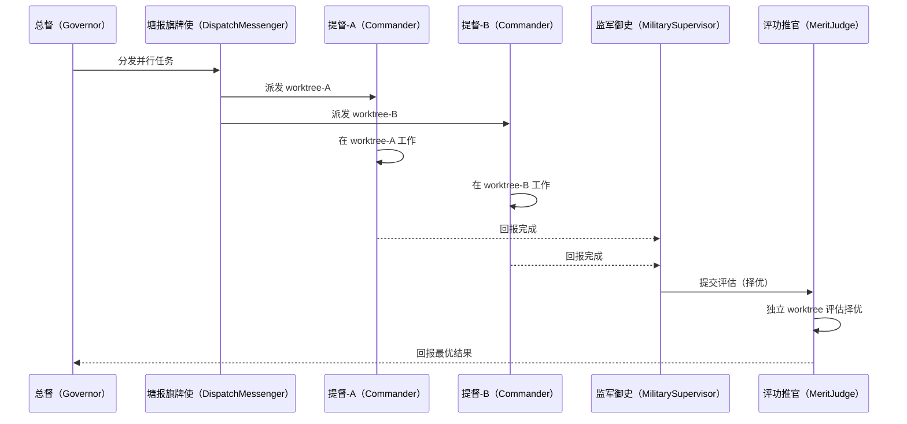
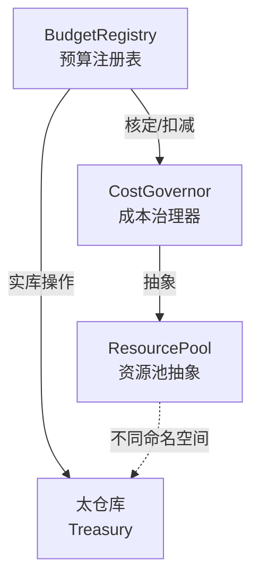
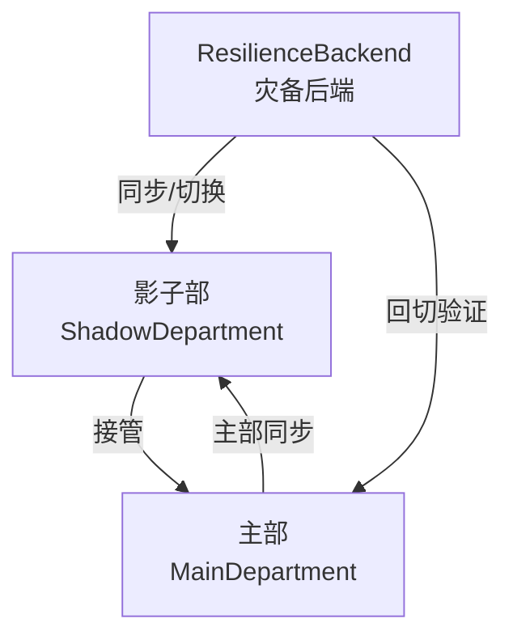
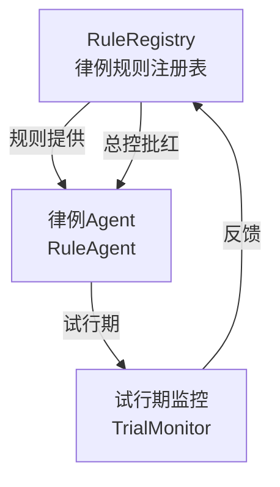
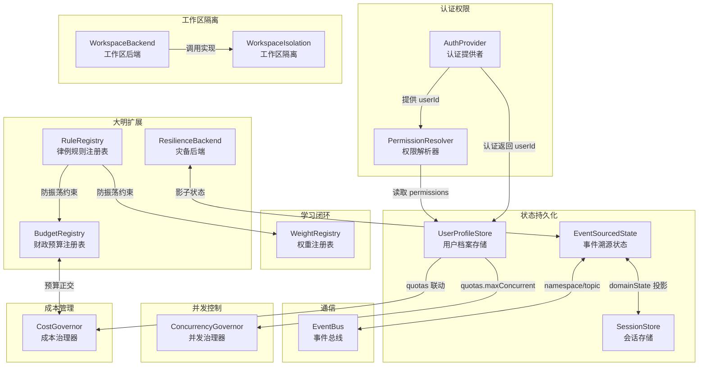

[AI 生成]

# 基础设施模块详细设计

> 基础设施模块详细设计：v3 全部 16+ 接口保留 + v4 新增 WeightRegistry/UserProfileStore/EventSourcedState/WorkspaceBackend + 大明 Infrastructure 扩展（BudgetRegistry/ResilienceBackend/RuleRegistry，不新增微内核一等概念）。
> 状态：stable
> 维护：@XZF（主笔）
> 讨论：无
> 待决：无

---

## 模块总览

Infrastructure Layer 提供 system-wide 的基础服务，启动时注入，生命周期与进程相同。所有上层组件通过接口消费这些服务，不关心具体实现。v3 的 16+ 模块接口完整保留，v4 在四个方向扩展：学习闭环（WeightRegistry）、User 一等公民（UserProfileStore）、状态事件溯源（EventSourcedState）、大明模式 Infrastructure 扩展（BudgetRegistry/ResilienceBackend/RuleRegistry，不新增微内核一等概念），同时将工作区实现移至 Domain Pack（核心保留 WorkspaceBackend 接口）。

| 分类 | 模块 | v4 变化 |
|------|------|---------|
| 状态与持久化 | SessionStore, MemoryStore, State Persistence, **EventSourcedState**(v4), **UserProfileStore**(v4) | +2 模块 |
| 通信 | EventBus, AgentTransport | 接口保留，语义扩展为图状通信 |
| 认证与权限 | AuthProvider, PermissionResolver | 保留 |
| 任务与 Agent 管理 | TaskScheduler, AgentPool | 保留 |
| 并发控制 | ConcurrencyGovernor, ConcurrencyMonitor | 保留 |
| 成本管理 | CostGovernor, CostModule | 保留 |
| 可观测性 | Logger/Metrics, ActivityMonitor | 保留 |
| 工具管理 | ToolManager, ToolRegistry | 保留 |
| **学习闭环** | **WeightRegistry** | **v4 新增** |
| **大明 Infrastructure 扩展** | **BudgetRegistry**, **ResilienceBackend**, **RuleRegistry** | **v4 新增**（不新增微内核一等概念） |
| 工作区隔离 | WorkspaceIsolation, **WorkspaceBackend** | 接口保留，实现移 coding-pack |
| **经验记录** | **CaseLibrary**（案例库/则例库） | **v4 新增**（审计Agent 任务经验记录，Phase 2+ 独立模块+向量检索；Phase 1 存 EventSourcedState。详见 03-execution-modes.md §0.7f） |

**与 v3 的差异要点**：

| 变化 | v3 | v4 |
|------|----|----|
| Session 状态字段 | `projectState: ProjectState` | `domainState: Record<string, unknown>`（schema 由 Pack 定义） |
| 工作区隔离实现 | 核心包 `GitWorktreeIsolation` | 移至 coding-pack 的 `WorkspaceBackend` 实现 |
| 跨任务学习 | 无 | `WeightRegistry`（军功簿/考绩簿） |
| User 持久化 | `AuthContext.userId` 字符串 | `UserProfileStore`（profile/memory/quota） |
| 状态投影 | 可变对象直接修改 | `EventSourcedState`（事件溯源，接口按终局设计） |
| 通信形态 | 树形单链路（dispatch + contact） | 图状（点对点 + 发布订阅 + 频道） |

**相关决策**：78（军功簿 WeightRegistry）、80（状态事件溯源）、83（User 一等公民）、71（Domain Pack，工作区实现移 Pack）、79（通信图状化）。

---

## 1. 状态与持久化

### 1.1 SessionStore

**职责**：Session 数据的持久化存储和检索。

> **已迁移**（2026-08 会话存储重构）：SessionStore 接口、Session/SessionState/ActivityEntry/SessionACL/UserRef 结构、实现状态、Phase 演进（LocalFileStore → PgStore）已集中至 **28-session-storage.md §3（会话存储唯一权威）**。本节仅保留模块定位与 Phase 要点。

- **接口**（create/read/update/delete/listByUser/listByWorkspace + Session 结构）→ 28-session-storage.md §3
- **实现状态**（Phase 1 简化实现，普通会话 SQLite 留待桌面 persistence 基建）→ 28-session-storage.md §3
- **本地 SQLite 落地**（node:sqlite 后端/单文件三表，决策 141-144）→ 28-session-storage.md §11/§12
- **Phase 演进**（Phase 1 LocalFileStore JSONL / Phase 3 PgStore）保留如下：

**Phase 演进**：
- Phase 1（LocalFileStore）：JSONL 文件存储，每个 Session 一个文件，路径 `.orbita/sessions/{sessionId}.jsonl`，内存索引加速 listByUser/listByWorkspace，无并发控制，单进程使用。`domainState` 字段存在但内容精简（单 Pack 模式）。
- Phase 3（PgStore）：PostgreSQL JSONB 存储，索引 workspaceId、userId、updatedAt，支持并发写入（乐观锁），支持复杂查询（按时间范围、按 Agent 筛选）。多用户协作 Session（type=shared）持久化参与者与权限。

**错误处理与并发**：文件 I/O 失败时 retry 3 次（间隔 100ms），3 次均失败则降级为内存存储（数据丢失风险记 warning 日志）。Phase 1 单进程使用，天然线程安全；Phase 3 多进程需外部同步（乐观锁，expectedRevision 模式）。

### 1.2 MemoryStore

**职责**：记忆存储，支持内容的保留、召回和反思。

**接口**：

```typescript
interface MemoryStore {
  retain(content: string, metadata?: Record<string, unknown>): Promise<void>;
  recall(query: string, options?: { limit?: number; minRelevance?: number }): Promise<Memory[]>;
  reflect(question: string): Promise<string>;
}
```

**Phase**：
- Phase 1：空实现（NoOpMemoryStore）。
- Phase 2/3：接入 SQLite，支持 Weibull 衰减 + MMR 召回。

> MemoryStore 与 v4 的 WeightRegistry（§10.1）并列。前者是跨 Session 的语义记忆，后者是跨任务的性能权重。两者均 Phase 1 NoOp，Phase 2+ 持久化。

### 1.3 State Persistence

**职责**：Session 崩溃后的状态恢复。

**目录结构**：

```
.orbita/sessions/<session-id>/
├── state/
│   ├── pattern.json       # Pattern 执行状态（哪个 Wave、哪些 Agent 完成）
│   └── agents.json        # 所有 Agent 实例状态
├── logs/
│   └── <agent-id>.log     # 单个 Agent 日志
└── artifacts/
    └── <agent-id>/        # Agent 产出物
```

**Phase**：
- 崩溃后恢复：读取 pattern.json -> 找到未完成的 Wave -> 从断点继续。

v4 变化：v3 的 `pattern.json` 记录硬编码的"Wave"结构。v4 改为记录 Execution Pattern（dag / tournament / chain / fan-out）的运行快照，由 Pattern Runtime 写入。崩溃恢复逻辑由 Pattern Runtime 实现，基础设施只提供存储路径。

### 1.4 EventSourcedState（v4 新增）

**职责**：事件溯源共享状态，支持命名空间/作用域、状态投影、事件回放、快照。所有状态变更是 append-only 事件；状态是事件的投影；天然支持审计（谁改了什么）、回放（Replay）、并发（事件不冲突，投影才冲突）。

**接口**：

```typescript
/**
 * EventSourcedState：事件溯源状态后端。
 * v4 取代 v3 的可变对象 projectState。Phase 1 简化为可变对象 + activityLog，接口按事件溯源终局形态设计。
 */
interface EventSourcedState {
  /** 追加事件（append-only，不可修改已有事件） */
  append(event: StateEvent): Promise<void>;
  /** 投影当前状态（从事件流计算） */
  project(namespace?: string): Promise<Record<string, unknown>>;
  /** 回放事件流（按时间范围或过滤器） */
  replay(options?: ReplayOptions): Promise<StateEvent[]>;
  /** 创建快照（加速后续 project） */
  snapshot(namespace?: string): Promise<Snapshot>;
  /** 从快照恢复 */
  restore(snapshot: Snapshot): Promise<void>;
  /** 列出所有命名空间 */
  listNamespaces(): Promise<string[]>;
  /** 订阅 namespace 的事件流。handler 在事件 append 后同步触发。handler 抛异常不影响 append 成功，仅记录警告。返回取消订阅函数。 */
  subscribe(namespace: string, handler: (event: StateEvent) => void): Unsubscribe;
}

interface StateEvent {
  /** 事件唯一 ID（append-only，单调递增或 ULID） */
  id: string;
  /** 命名空间/作用域（Agent 只看自己有权的分区，与 Identity scope 联动） */
  namespace: string;
  /** 事件类型，如 "state.set" / "state.merge" / "state.delete" */
  type: string;
  /** 事件载荷 */
  payload: Record<string, unknown>;
  /** 谁触发了此事件 */
  agentId: string;
  /** 触发时的 RequestContext traceId，便于审计关联 */
  traceId: string;
  /** 发生时间 */
  timestamp: Date;
  /** 上一事件 ID（可选，用于事件链校验） */
  previousEventId?: string;
}

interface ReplayOptions {
  /** 时间范围 */
  range?: TimeRange;
  /** 命名空间过滤 */
  namespace?: string;
  /** 事件类型过滤 */
  type?: string;
  /** 触发 Agent 过滤 */
  agentId?: string;
  /** 最大返回条数 */
  limit?: number;
}

interface TimeRange {
  start: Date;
  end: Date;
}

interface Snapshot {
  /** 快照 ID */
  id: string;
  /** 命名空间 */
  namespace: string;
  /** 快照时的状态投影 */
  state: Record<string, unknown>;
  /** 快照包含到的事件 ID */
  upToEventId: string;
  /** 快照时间 */
  createdAt: Date;
}
```
}

/** 取消订阅函数，调用后停止接收事件 */
type Unsubscribe = () => void;

**命名空间/作用域**：共享状态分区，Agent 只看自己有权的分区（与 Identity scope 联动）。例如竞功制下竞争者各自命名空间隔离，内阁制下内阁成员共享 `cabinet` 命名空间。

**黑板模式（Blackboard）**：事件流之上提供 Blackboard 抽象，多 Agent 异步读写。黑板读 = project；黑板写 = append（事件不可冲突，但投影可基于读时值做乐观合并）。

**Session.domainState 与 EventSourcedState 的关系**：`Session.domainState: Record<string, unknown>` 是核心提供的无类型容器，schema 由 Domain Pack 定义。底层是事件投影——Phase 1 简化为可变对象 + activityLog，但 EventSourcedState 接口按终局形态设计，后续升级 = 换实现不改接口。

**Phase**：
- Phase 1（InMemoryEventState）：内存存储，`append` 直接追加到数组，`project` 返回当前可变对象，`replay` 返回数组，`snapshot` 浅拷贝。无持久化，重启丢失。可变对象 + activityLog 即此实现的简化形态。
- Phase 3（SqliteEventState）：SQLite 追加表存储事件，`project` 基于快照 + 增量事件计算，支持多 Agent 并发（事件不冲突，投影乐观合并），支持回放和审计查询。
- **[已实现 2026-08-13，A+B 档]** `infrastructure/sqlite/sqlite-event-state.ts`：schema 终局（state_events 带 seq 单调/namespace 索引/previous_event_id 事件链 + namespace_revisions + state_snapshots，乐观锁启用无需迁移表结构）；append 同步维护 namespace revision（B 档）；乐观锁 API（expectedRevision，06 §8.7 Phase 3+）与 revision 缓存（§4a Phase 2+）标注延后未实现。

> 完整事件溯源设计见 06-core-engine.md 的"状态投影"章节。

**档籍持久化（Layer 0 原始奏章永不删）**：EventSourcedState 在大明共享基础层下扩展为档籍持久化后端（详见 11-renshi-shared-base.md §2.2 DangjiAgent）。第 0 层（原始奏章 + 内容哈希）作为不可篡改锚点，事件 type=`memorial.raw`，物理持久化由档籍 Agent（DangjiAgent）负责。档籍 Agent 不参与压缩决策，仅负责物理存储与检索；交互审核 Agent 持有索引，档籍 Agent 持有实体。

**上下文分层压缩（4 层模型）**：上下文超阈值时，交互审核 Agent 执行分层压缩。EventSourcedState 提供分层语义：

| 层级 | 内容 | 压缩策略 | EventSourcedState 映射 |
|------|------|---------|----------------------|
| 第 0 层 | 原始奏章（用户输入全文 + 内容哈希） | **永不删** | 档籍持久化层（DangjiAgent 实体，type=`memorial.raw`） |
| 第 1 层 | 锚点 + 批红 + 切换锚点 + 预算快照 + 复核快照 + 调配快照 + 锁院快照 + 灾备快照 + 转模快照 | **永不冲刷** | namespace=`anchors`，事件不可覆盖 |
| 第 2 层 | 动态上下文（执行过程、中间结果、对话历史） | 压缩至最近 N 轮 | 默认 namespace，按时间窗口剪枝 |
| 第 3 层 | 即时工作区（当前正在处理的少量信息） | 保留 | 内存投影，重启重建 |

**崩溃恢复顺序**：读取第 1 层锚点快照 → 第 2 层最近 N 轮 → 第 3 层工作区，重建可继续状态。索引由交互审核 Agent 携带，实体由档籍 Agent 持久化。

### 1.5 UserProfileStore（v4 新增）

**职责**：User 一等公民支撑。User 从 v3 的 `AuthContext.userId` 字符串升级为完整实体。UserProfileStore 持久化用户画像、权限、配额、跨 Session 记忆、常驻 Agent 注册表、Session 列表。

**接口**：

```typescript
/**
 * UserProfileStore：User 一等公民的存储后端。
 * 配合 AuthProvider（认证）和 PermissionResolver（权限解析）使用。
 * Phase 1 单用户简化（字段精简），Phase 3 扩展多用户协作。
 */
interface UserProfileStore {
  /** 创建用户 */
  create(profile: UserProfile): Promise<string>;
  /** 读取用户完整 profile */
  read(userId: string): Promise<UserProfile | null>;
  /** 更新用户 profile（partial patch） */
  update(userId: string, patch: Partial<UserProfile>): Promise<void>;
  /** 删除用户 */
  delete(userId: string): Promise<void>;
  /** 列出用户参与的所有协作（Session + Agent） */
  listCollaborations(userId: string): Promise<Collaboration[]>;
}

// User 身份信息
interface UserProfileIdentity {
  displayName: string;       // 显示名
  expertise?: string[];      // 专业领域（如 ["frontend", "systems"]）
  preferences?: {
    defaultMode?: string;    // 默认编排模式
    defaultModel?: string;   // 默认 LLM
    language?: string;       // 偏好语言
  };
  avatar?: string;           // 头像 URL（Phase 2+ Web 版）
}

// User 常驻 Agent 的默认配置（最小字段集，Pack 可经 metadata 扩展）
interface UserAgentConfig {
  autoStart?: boolean;           // 是否自动启动
  defaultIdentity?: string;      // 默认使用的身份名
  customSystemPrompt?: string;   // 用户自定义系统提示词追加
  overriddenTools?: string[];    // 用户覆盖的工具列表
  metadata?: Record<string, unknown>;  // Pack 扩展字段（保持开放性）
}

interface UserProfile {
  /** 用户 ID（与 AuthContext.userId 一致） */
  id: string;
  /** 用户身份信息（画像/偏好/专业领域，结构化子类型，见 UserProfileIdentity） */
  identity: UserProfileIdentity;
  /** 跨资源权限（与 PermissionResolver 联动） */
  permissions: {
    roles: string[];
    /** 多租户 Phase 3 */
    tenantId?: string;
    /** Trust Level（跨用户协作用，Phase 3） */
    trustLevel?: "none" | "read-only" | "invoke" | "delegate" | "full-control";
  };
  /** 配额：并发、成本、存储 */
  quotas: {
    /** 最大并发 Agent 数 */
    maxConcurrentAgents: number;
    /** 每日成本上限（与 CostGovernor 联动） */
    dailyCostLimit: number;
    /** 每月成本上限 */
    monthlyCostLimit: number;
    /** 记忆存储上限（字节） */
    memoryQuotaBytes: number;
  };
  /** 跨 Session 记忆引用（指向 MemoryStore） */
  memory: {
    /** 用户的长期记忆 ID 列表 */
    longTermMemoryIds: string[];
    /** 偏好摘要 */
    summary?: string;
  };
  /** 常驻 Agent 注册表（用户自定义的默认 Agent 配置） */
  agents: Array<{
    /** Agent 配置 ID */
    id: string;
    /** 引用的 Identity（来自身份库） */
    identity: string;
    /** 是否在登录时自动启动 */
    autoStart: boolean;
    /** 默认配置（最小字段集，Pack 可经 metadata 扩展，见 UserAgentConfig） */
    config: UserAgentConfig;
  }>;
  /** 用户拥有的 Session 列表（由 SessionStore 维护，此处缓存引用） */
  sessions?: string[];
  createdAt: Date;
  updatedAt: Date;
}

/** 用户参与的协作记录 */
interface Collaboration {
  /** 协作类型：Session 或常驻 Agent */
  type: "session" | "agent";
  /** 协作 ID */
  id: string;
  /** 用户在此协作中的角色 */
  role: "owner" | "editor" | "viewer";
  /** 协作元信息 */
  metadata: Record<string, unknown>;
  /** 最后活跃时间 */
  lastActiveAt: Date;
}
```

**与 AuthProvider / PermissionResolver 的关系**：AuthProvider 完成认证后返回 AuthContext（含 userId），UserProfileStore 用 userId 读取完整 profile，PermissionResolver 用 profile.permissions 解析具体权限。三者职责清晰分离。

**Phase**：
- Phase 1（SingleUserProfile）：单用户，硬编码一个本地用户 profile，字段精简（identity/quotas，permissions.roles=["owner"]）。配合 SingleUserAuth 使用。
- Phase 3（MultiUserProfile）：多用户 profile 持久化到 PostgreSQL，支持多租户（tenantId）、Trust Level 授权、跨用户协作（Collaboration 列表）、配额动态调整。

---

## 2. 通信

### 2.1 EventBus

**职责**：事件发布和订阅，实现组件之间的解耦通信。v4 将 EventBus 暴露为 Agent 可调用的工具（发布订阅通信模式）。

**接口**：

```typescript
interface EventBus {
  /** 发布事件 */
  emit(event: DomainEvent): Promise<void>;
  /** 订阅事件 */
  subscribe(pattern: EventPattern, handler: EventHandler): Subscription;
  /** 取消订阅 */
  unsubscribe(subscription: Subscription): Promise<void>;
}

type EventPattern = {
  type?: string;
  agentId?: string;
  sessionId?: string;
  source?: string;
  /** v4 新增：命名空间过滤（与 EventSourcedState 联动） */
  namespace?: string;
  /** v4 新增：主题过滤（图状通信的频道模式） */
  topic?: string;
};

interface DomainEvent {
  id: string;
  type: string;
  source: string;
  sessionId?: string;
  agentId?: string;
  payload: Record<string, unknown>;
  timestamp: Date;
  /** v4 新增：命名空间（事件分区） */
  namespace?: string;
  /** v4 新增：主题（发布订阅模式） */
  topic?: string;
  /** v4 新增：触发者 userId（审计追溯） */
  userId?: string;
}

type Subscription = {
  id: string;
  unsubscribe(): Promise<void>;
};

type EventHandler = (event: DomainEvent) => Promise<void> | void;
```

**v4 图状通信扩展**：v3 的 EventBus 是树形单链路（dispatch + contactMainAgent）。v4 扩展为图状通信：
- **点对点**（`send_message`）：基于权限的 Agent 间直接消息（见 2.2 AgentTransport）。
- **发布订阅**（`publish/subscribe`）：EventBus 暴露为工具，Agent 可订阅主题。
- **频道/主题**：多 Agent 异步协作的黑板模式底层，与 EventSourcedState 命名空间联动。

**通信权限**：Identity 声明能发给谁/订阅什么。核心不变量：market Coordination（竞功制）下竞争者间禁止横向通信（公平性保障，见 13-jinggong-mode.md）。

**Phase**：
- Phase 1（InProcessBus）：基于 Node.js EventEmitter，同步或异步分发，无持久化，重启后事件丢失，适合单进程开发。
- Phase 3（PersistentBroadcastBus）：事件持久化到数据库，支持 WebSocket 广播（多节点），支持事件回放（replay），支持事件过滤和路由。
**错误处理与并发**：`emit` 内部 handler 执行失败时 retry 1 次，仍失败则记录 warning 日志（不阻塞调用方，不传播异常）。Phase 1 单进程，基于 Node.js EventEmitter，天然线程安全；Phase 3 多节点需外部同步（事件持久化 + WS 广播，依赖 PersistentBroadcastBus 实现的内部锁）。

### 2.2 AgentTransport

**职责**：Agent 之间的消息传递。v4 扩展为图状通信（点对点 + 发布订阅 + 频道）。

**接口**：

```typescript
interface AgentTransport {
  /** 发送消息给目标 Agent（点对点，基于权限） */
  send(target: AgentId, message: AgentMessage): Promise<void>;
  /** 注册消息处理器 */
  onMessage(handler: MessageHandler): Subscription;
  /** 获取 Agent 连接状态 */
  getStatus(agentId: AgentId): Promise<AgentStatus>;
  /** v4 新增：广播给多个 Agent（频道/主题模式） */
  broadcast(targets: AgentId[], message: AgentMessage): Promise<void>;
  /** v4 新增：订阅主题（发布订阅模式） */
  subscribeTopic(topic: string, handler: MessageHandler): Subscription;
}

type AgentId = string;

interface AgentMessage {
  from: AgentId;
  to: AgentId;
  type: string;
  payload: Record<string, unknown>;
  traceId: string;
  timestamp: Date;
  /** v4 新增：主题（用于发布订阅模式下的消息归类） */
  topic?: string;
  /** v4 新增：通信权限标记 */
  visibility?: "private" | "topic" | "broadcast";
}

type AgentStatus = "online" | "offline" | "busy";

type MessageHandler = (message: AgentMessage) => Promise<void> | void;
```

**v4 通信权限与不变量**：
- **内阁制**：协作总线（CollaborationBus）——订阅发布 + 总控授权列表 + 日志审计。Identity 声明能发给谁。
- **竞功制**：塘报旗牌使（DispatchMessenger）——点对多分发 + 固定频道独立上报 + 接收清单防篡改（confirmAllReported 才融合）。**竞争者间禁止横向通信**（公平性不变量）。
- **跨用户通信**（Phase 3）：需 Trust Level 授权（来自 UserProfile.permissions.trustLevel）。

**Phase**：
- Phase 1（InProcessTransport）：直接函数调用，内存传递，无序列化开销，适合单进程单节点。`broadcast` 在内存中循环 `send`；`subscribeTopic` 用内存 Map。
- Phase 3（NetworkTransport）：跨节点消息路由，TLS 加密传输，支持消息队列（RabbitMQ/Kafka），支持重试和死信队列。
**错误处理与并发**：`send` 失败时 retry 2 次，指数退避（100ms → 200ms），仍失败抛出 TransportError。`broadcast` 对每个 target 独立 retry，单 target 失败不影响其他 target。Phase 1 单进程（直接函数调用），天然线程安全；Phase 3 跨节点需外部同步（NetworkTransport 内部消息队列保证有序投递）。

---

## 3. 认证与权限

### 3.1 AuthProvider

**职责**：用户认证和身份解析。

**接口**：

```typescript
interface AuthProvider {
  /** 认证并返回身份 */
  authenticate(token: string): Promise<AuthContext>;
  /** 刷新 token */
  refresh(refreshToken: string): Promise<AuthContext>;
  /** 验证身份是否有效 */
  validate(authContext: AuthContext): Promise<boolean>;
}

interface AuthContext {
  userId: string;
  tenantId?: string;  // Phase 3
  roles: string[];
  scopes?: string[];  // Phase 3
  metadata: Record<string, unknown>;
}
```

**Phase**：
- Phase 1（SingleUserAuth）：硬编码一个本地用户，任何 token 都返回同一个 AuthContext，无实际认证，仅用于本地开发。配合 SingleUserProfile（UserProfileStore Phase 1 实现）。
- Phase 3（JwtAuth）：验证 JWT token，支持 OAuth2 登录（Google、GitHub 等），支持 RBAC 角色和 Scope，多租户支持（tenantId）。
**错误处理**：`authenticate` 失败不 retry（安全考虑，防止暴力枚举），直接返回 AuthError（含 reason 字段）。`validate` 失败同理不 retry。`refresh` 失败 retry 1 次（token 刷新属幂等操作，可安全重试）。

### 3.2 PermissionResolver

**职责**：权限解析和访问控制。

**接口**：

```typescript
interface PermissionResolver {
  /** 检查是否有权限 */
  can(ctx: RequestContext, action: string, resource: ResourceRef): Promise<boolean>;
  /** 获取所有权限 */
  getPermissions(ctx: RequestContext): Promise<Permission[]>;
  /** 检查多个权限 */
  canAll(ctx: RequestContext, checks: PermissionCheck[]): Promise<PermissionResult[]>;
}

type ResourceRef = {
  type: string;
  id: string;
  parentId?: string;
};

type Permission = {
  action: string;
  resource: string;
  effect: "allow" | "deny";
  conditions?: Record<string, unknown>;
};

type PermissionCheck = {
  action: string;
  resource: ResourceRef;
};

type PermissionResult = {
  allowed: boolean;
  reason?: string;
};
```

**Phase**：
- Phase 1（AllowAll）：所有请求都返回 true，无实际权限检查，适合本地开发环境。
- Phase 3（RbacResolver）：基于角色的访问控制（RBAC），支持角色继承（admin > maintainer > developer > viewer），支持资源级权限，支持权限降级（downgrade）策略。读取 UserProfile.permissions.roles 解析。

---

## 4. 任务与 Agent 管理

### 4.1 TaskScheduler

**职责**：Subagent 任务的调度和执行。

**接口**：

```typescript
interface TaskScheduler {
  /** 调度新任务 */
  schedule(invocation: SubagentInvocation): Promise<string>;
  /** 查询任务状态 */
  getStatus(taskId: string): Promise<TaskStatus | null>;
  /** 取消任务 */
  cancel(taskId: string): Promise<void>;
  /** 列出任务 */
  list(filter?: TaskFilter): Promise<TaskRecord[]>;
}

type TaskStatus =
  | "pending"      // 已创建，等待执行
  | "executing"    // 任务 Subagent 正在执行
  | "checking"     // 检查 Subagent 正在验证
  | "reworking"    // 任务 Subagent 根据检查反馈修正中
  | "reported"     // 检查完成，报告已发送给主 Agent
  | "completed"    // 主 Agent 确认接受
  | "partial"      // 重试耗尽，附带未解决问题
  | "failed";      // 执行失败（LLM 错误、超时等）
```

**状态流转显式断言（设计提议，2026-08）**：
- **终态不可逆**：终态集合 `{ completed, partial, failed }` 为吸收态——到达后禁止回到任何进行中状态（`reworking` 仅允许 `checking → reworking` 方向的显式退回，不允许终态回退）
- **提交即冻结**：任务进入 `reported` 后，已提交产出快照只读——提交者及所有 Agent 对已提交产出的写操作被拒绝；如有修正需求，走 `reworking` 显式退回通道，而非直接改写已提交快照
- 与 Check 上下文屏障（06-core-engine.md §3a）正交：Check 管质量验收（好不好），本断言管时序不可逆（能不能退回）

interface TaskRecord {
  id: string;
  invocation: SubagentInvocation;
  status: TaskStatus;
  /** 设计提议（2026-08）：任务领取者。独占派发（dispatchStrategy=top-down/broadcast/rotate）时置位——
   * 领取用事件溯源 CAS（append 携带 expectedClaimant: null，冲突即拒绝），防「同一任务被多个
   * Agent 重复领取」；竞争派发（compete）时多个 Agent 共领同一任务，本字段不置位（见
   * 03-execution-modes.md CoordinationPattern.dispatchStrategy 派发独占性语义） */
  claimedBy?: AgentId;
  report?: SubagentReport;
  createdAt: Date;
  updatedAt: Date;
}
```

**Phase**：
- Phase 1（ImmediateScheduler）：同步执行，立即创建 Subagent 并执行，无排队，无优先级，适合单用户低并发场景。
- Phase 3（CapabilityScheduler）：基于技能匹配的调度（Subagent 的技能与任务需求匹配），负载均衡（选择最合适的节点），优先级队列，任务持久化和恢复。

> **dispatchBudget 检查点 ③**：`TaskScheduler.schedule()` 内部扣减 `dispatchBudget.remainingConcurrency`。扣减后检查 `remainingConcurrency >= 0`，不足则排队等待。

**运行期检查点（schedule）**：`TaskScheduler.schedule()` 在排队前调用 `capabilityChecker.check(identity, 'dispatch')` 作为前置门。检查不通过时直接拒绝调度，不排队。
**错误处理**：`schedule` 失败直接返回错误（不排队，不 retry），调用方需 catch 并决定降级策略。Phase 1 同步执行，失败原因主要是 LLM 调用错误或 Subagent 创建失败。Phase 3 CapabilityScheduler 支持任务持久化和恢复（崩溃后可从 persisted 状态重建）。


### 4.2 AgentPool

**职责**：管理 Agent 实例的生命周期。

**接口**：

```typescript
interface AgentPool {
  /** 创建新 Agent */
  create(config: AgentConfig): Promise<AgentRef>;
  /** 获取 Agent */
  get(agentId: string): Promise<AgentRef | null>;
  /** 销毁 Agent */
  destroy(agentId: string): Promise<void>;
  /** 列出所有 Agent */
  list(filter?: AgentFilter): Promise<AgentRef[]>;
  /** 获取资源使用情况 */
  getLoad(): Promise<AgentLoad>;
}

interface AgentRef {
  id: string;
  type: "main" | "meta_check" | "task_subagent" | "check_subagent";
  status: "idle" | "executing" | "checking" | "reworking" | "waiting";
  extensions: ExtensionConfig;
  createdAt: Date;
}

interface AgentLoad {
  total: number;
  active: number;
  idle: number;
  waiting: number;
  memoryUsed: number;
  llmCallsPerMinute: number;
}
```

**Phase**：
- 所有 Phase 一致：Map 存储，O(1) 查找，无大小限制（按决策 15）。v4 不限制 Subagent 总数，按资源（LLM 配额、内存、CPU）+ dispatchBudget（派发预算）限制并发。
- Phase 1：基础创建/销毁。
- Phase 3：健康检查 + 自动扩缩。

> **AgentFactory 委托**：`AgentPool.create()` 内部委托 `AgentFactory.create(invocation, requestCtx)` 创建 AgentInstance。AgentFactory 负责调用 LoopContextFactory 构造 LoopContext 并启动 AgentLoop。详见 05-agent-roles.md §5.4。

---

## 5. 并发控制

### 5.1 ConcurrencyGovernor

**职责**：控制并发执行数量，防止资源耗尽。

**接口**：

```typescript
interface ConcurrencyGovernor {
  /** 尝试获取执行槽 */
  acquire(ctx: RequestContext): Promise<ExecutionSlot>;
  /** 释放执行槽 */
  release(ctx: RequestContext, slot: ExecutionSlot): Promise<void>;
  /** 获取当前状态 */
  getStatus(): Promise<GovernorStatus>;
}

interface ExecutionSlot {
  id: string;
  acquiredAt: Date;
  expiresAt: Date;
}

interface GovernorStatus {
  active: number;
  max: number;
  queued: number;
  slots: ExecutionSlot[];
}
```

**Phase**：
- Phase 1（fixed limit）：固定 maxConcurrent = 10，内存队列（超出时拒绝，不排队），无跨节点协调。v4 配合 UserProfile.quotas.maxConcurrentAgents 做按用户限流。
- Phase 3（dynamic）：根据 LLM 速率限制动态调整，支持跨节点池（多进程共享），内存队列 + 持久化队列，优先级调度。

**故障感知降速（设计提议，2026-08 已逐条确认，Phase 2+）**：现有并发控制全部为静态约束（固定上限 + 配额扣减 + 深度限制），缺少「故障反馈」——若并发槽全被反复失败的 Agent 占用（重试→失败→重试空转），系统无感知。新增动态反馈（2026-08 讨论定稿）：

- **双层故障率统计**：最近 W 秒内任务失败/超时率 R——**全局统计用于触发降速**（降速是 governor 级动作，保护整个并发池）；**命名空间聚合用于定位**（哪个命名空间在制造故障，供律例/人工定位，与 G7 热点计数同源）
- **降速方式：派发退避为主**（新任务派发间隔指数放大，如 1s → 5s → 25s）。不下调 maxConcurrent——下调会拒绝已排队任务（Phase 1 acquire 超出即抛 LimitExceededError），退避只是「慢一点派」不杀旧任务，且天然可逆
- **轻重分级 + 恢复滞回**：
  - 轻故障（R > 0.3 持续 10s）→ 进入降速（退避）
  - 重故障（R > 0.8 或连续 N 次同因失败）→ 走 EmergencyFallback 中止路径（决策 82）——与 p53 分级决策语义一致：轻损伤阻滞修复、重损伤凋亡
  - **滞回（Hysteresis）**：解除阈值低于触发阈值（触发 0.3 / 解除 0.15），且需持续一段时间——防止 R 在阈值附近震荡导致反复进出降速模式（生物对应：细胞周期检查点持续激活而非瞬时翻转，有时间整合）
- 阈值与窗口为律例/RuleRegistry 配置（预定义优于即兴发挥），与 CostGovernor 配额正交（配额管预算，降速管故障）
**acquire 失败行为**：
- Phase 1（fixed limit）：当前并发数 ≥ max 时，`acquire` 抛出 `LimitExceededError`（不排队，调用方需 catch 并决定降级策略——等待重试或放弃任务）。
- `acquire`/`release` 原子性：内部 mutex 保证（JavaScript 单线程模型下用 Promise 链序列化即可；Phase 3 多节点需分布式锁）。
- Phase 3（dynamic）：根据负载动态调整 max。预留接口 `interface ConcurrencyPolicy { computeMax(currentLoad: LoadMetrics): number }`，Phase 3 实现基于 LLM 速率限制和节点健康状态动态计算上限。负载指标由 ConcurrencyMonitor（§5.2）提供。

### 5.2 ConcurrencyMonitor

**职责**：独立观察并发状态，提供实时快照、历史查询和告警。

**接口**：

```typescript
interface ConcurrencyMonitor {
  /** 获取当前快照 */
  snapshot(): Promise<ConcurrencySnapshot>;
  /** 订阅状态变化事件 */
  subscribe(handler: ConcurrencyChangeHandler): Subscription;
  /** 查询历史数据 */
  query(range: TimeRange, filter?: ConcurrencyFilter): Promise<ConcurrencyRecord[]>;
  /** 设置告警阈值 */
  setAlert(alert: ConcurrencyAlert): Promise<void>;
}

interface ConcurrencySnapshot {
  timestamp: Date;
  active: number;
  queued: number;
  completed: number;
  failed: number;
  byAgent: Record<string, AgentConcurrencyInfo>;
  byWorkspace: Record<string, WorkspaceConcurrencyInfo>;
}

interface AgentConcurrencyInfo {
  agentId: string;
  agentType: "main" | "meta_check" | "task_subagent" | "check_subagent";
  status: "executing" | "checking" | "reworking";
  taskId: string;
  startedAt: Date;
}

interface WorkspaceConcurrencyInfo {
  workspaceId: string;
  activeCount: number;
  queuedCount: number;
}

type TimeRange = {
  start: Date;
  end: Date;
};

type ConcurrencyFilter = {
  agentId?: string;
  workspaceId?: string;
  status?: string;
};

interface ConcurrencyRecord {
  timestamp: Date;
  agentId: string;
  taskId: string;
  action: "acquire" | "release" | "queue" | "complete";
  duration?: number;
}

type ConcurrencyChangeHandler = (snapshot: ConcurrencySnapshot) => Promise<void> | void;

interface ConcurrencyAlert {
  id: string;
  condition: "above" | "below";
  threshold: number;
  metric: "active" | "queued" | "byWorkspace";
  workspaceId?: string;
  cooldown: number;  // ms
  handler: AlertHandler;
}

type AlertHandler = (alert: ConcurrencyAlert, current: number) => Promise<void> | void;
```

**Phase**：
- Phase 1（memory counter）：内存计数器记录 active/queued，控制台输出状态变化，无持久化，无告警。
- Phase 3（time-series + WS）：时序数据库存储历史，WebSocket 推送实时快照，可配置告警（阈值 + 冷却时间），仪表盘可视化。

---

## 6. 成本管理

### 6.1 CostGovernor

**职责**：控制 LLM 调用成本。

**接口**：

```typescript
interface CostGovernor {
  /** 检查是否可以执行（预算内） */
  canSpend(ctx: RequestContext, estimatedCost: number): Promise<boolean>;
  /** 记录实际花费 */
  record(ctx: RequestContext, actualCost: number, details?: CostDetails): Promise<void>;
  /** 获取预算状态 */
  getBudgetStatus(ctx: RequestContext): Promise<BudgetStatus>;
}

interface CostDetails {
  model: string;
  tokensIn: number;
  tokensOut: number;
  provider: string;
}

type BudgetStatus = {
  limit: number;
  spent: number;
  remaining: number;
  status: "ok" | "warn" | "throttle" | "block";
};
```

**Phase**：
- Phase 1（AllowAll）：始终返回 true，记录花费但不限制，适合本地开发（免费 API）。配合 UserProfile.quotas（字段存在但不强制）。
- Phase 3（per-user/workspace budgets）：按用户、工作区、Session 设置预算（读取 UserProfile.quotas.dailyCostLimit 等），超限策略：warn（日志警告）、throttle（限速）、block（拒绝），支持预算周期（daily/monthly）。

### 6.2 CostModule

**职责**：记录 LLM 调用成本，支持查询、预算管理和告警。

> **实现状态**（2026-08-13 gap-check 定性）：本 CostModule 为**文档声明接口（设计超前）**——代码侧实现的是大明 Infrastructure 扩展 `BudgetRegistry`（`infrastructure/types.ts`，SqliteBudgetRegistry 实现），其 `checkBudget(userId)` 返回 `{ remaining, total }`，与本接口的 `BudgetCheckResult`（withinBudget/remaining/limit/action/resetAt）形状不同。两者职责相邻（成本/预算）但接口形态不同，未做合并；CostModule 及 `BudgetCheckResult` 待大明模式成本管理落地时再实现/对齐，当前不视为缺失缺陷。

**接口**：

```typescript
interface CostModule {
  /** 记录成本条目 */
  record(entry: CostEntry): Promise<void>;
  /** 查询成本报告 */
  query(range: TimeRange, filter?: CostFilter): Promise<CostReport>;
  /** 设置预算 */
  setBudget(budget: BudgetLimit): Promise<void>;
  /** 检查预算 */
  checkBudget(ctx: RequestContext): Promise<BudgetCheckResult>;
  /** 注册预算告警 */
  onBudgetAlert(handler: BudgetAlertHandler): Subscription;
}

interface CostEntry {
  id: string;
  ctx: RequestContext;
  model: string;
  provider: string;
  tokensIn: number;
  tokensOut: number;
  cost: number;
  timestamp: Date;
  metadata?: Record<string, unknown>;
}

type CostFilter = {
  userId?: string;
  workspaceId?: string;
  sessionId?: string;
  agentId?: string;
  model?: string;
};

interface CostReport {
  totalCost: number;
  entries: CostEntry[];
  breakdown: {
    byUser: Record<string, number>;
    byWorkspace: Record<string, number>;
    bySession: Record<string, number>;
    byAgent: Record<string, number>;
    byModel: Record<string, number>;
  };
  trends: {
    hourly: Array<{ timestamp: Date; cost: number }>;
    daily: Array<{ date: string; cost: number }>;
  };
}

interface BudgetLimit {
  scope: "user" | "workspace" | "global";
  scopeId?: string;
  period: "hourly" | "daily" | "weekly" | "monthly";
  amount: number;
  action: "warn" | "throttle" | "block";
  autoThrottle?: boolean;
}

interface BudgetCheckResult {
  withinBudget: boolean;
  remaining: number;
  limit: number;
  action: "ok" | "warn" | "throttle" | "block";
  resetAt?: Date;
}

type BudgetAlertHandler = (budget: BudgetLimit, current: number) => Promise<void> | void;
```

**Phase**：
- Phase 1（AllowAll + log only）：所有记录通过，不限制，内存存储，重启丢失，无预算管理。
- Phase 3（DB + budgets + throttle）：数据库持久化，按 user/workspace/session/agent 聚合，预算管理（设置限额、检查余额），超限自动限流（throttle）或阻止（block），告警通知（warn/throttle/block 触发时）。
**双层 PricingTable 计费（D4=决策 A）**：核心只记抽象 unit，不绑定法币。费率计算通过可插拔 PricingTable 接口外置。

```typescript
/**
 * PricingTable：费率计算接口。
 * 核心默认实现 DefaultPricingTable（1:1 映射，1 token = 1 unit）。
 * Phase 2+ 用户可注入真实费率实现（如按 model 区分 input/output 单价）。
 */
interface PricingTable {
  /** 根据输入/输出 token 数和模型计算抽象成本 */
  computeCost(tokensIn: number, tokensOut: number, model: string): number;
}

/** Phase 1 默认实现：1 token = 1 unit（无费率区分） */
class DefaultPricingTable implements PricingTable {
  computeCost(tokensIn: number, tokensOut: number, _model: string): number {
    return tokensIn + tokensOut;
  }
}
```

**CostEntry.cost 单位说明**：`cost` 字段单位是「抽象 unit」（由 `PricingTable.computeCost` 派生），不是法币。`BudgetLimit.amount` 同单位（抽象 unit）。两者一致，保证预算检查逻辑闭环。

**tokens 来源**：LLM provider 返回的 `usage.prompt_tokens` / `usage.completion_tokens`。在 LLMHandle 调用结果中提取，作为 `CostEntry.tokensIn` / `CostEntry.tokensOut` 写入。

**计费时机**：LLM 调用完成后实计（非预估）。`CostModule.record()` 在 LLM 响应返回后调用，记录实际消耗的 tokens。`CostGovernor.canSpend()` 在调用前做预估检查（可选，Phase 1 AllowAll 跳过）。

**法币换算**：归 UI 层 / Pack 职责（不在核心）。核心只记抽象 unit，法币显示是 UI 层职责，核心领域中立（原则 18）。

**并发说明**：Phase 1 内存存储 + 单进程，天然线程安全；Phase 3 数据库持久化，并发写入由数据库事务保证（CostModule.record 的数据库实现内部用行级锁或乐观锁）。

---

## 7. 可观测性

### 7.1 Logger/Metrics

**职责**：结构化日志和指标收集。

**接口**：

```typescript
interface Logger {
  /** 记录日志 */
  log(level: LogLevel, message: string, context?: Record<string, unknown>): void;
  /** 创建子 Logger */
  child(context: Record<string, unknown>): Logger;
}

type LogLevel = "debug" | "info" | "warn" | "error";

interface Metrics {
  /** 记录计数器 */
  increment(name: string, tags?: Record<string, string>): void;
  /** 记录直方图 */
  histogram(name: string, value: number, tags?: Record<string, string>): void;
  /** 记录 gauge */
  gauge(name: string, value: number, tags?: Record<string, string>): void;
}
```

**Phase**：
- Phase 1（pino local）：pino 写入本地文件，结构化 JSON 日志，无指标收集。
- Phase 3（distributed tracing + metrics）：OpenTelemetry 分布式追踪，Prometheus 指标导出，Grafana 仪表盘，日志聚合（Loki/ELK）。

### 7.2 ActivityMonitor

**职责**：活跃度监控，长时间运行守卫，防止 Agent 卡住。

**接口**：

```typescript
interface ActivityMonitor {
  watch(agentId: string, config: WatchConfig): void;
  unwatch(agentId: string): void;
  onAttention: (agentId: string, signal: AttentionSignal) => void;
}

interface WatchConfig {
  needsAttentionAfterMs: number;           // 默认 60000（1 分钟无活动）
  activeNoticeAfterMs: number;             // 默认 240000（4 分钟运行）
  failedToolAttemptsBeforeAttention: number; // 默认 3
}
```

**Phase**：
- Phase 1：**未实现**（NoOpActivityMonitor，所有方法空实现）。系统无长时间运行守卫，Agent 可能卡住需人工干预。
- Phase 2+：实现完整监控。触发 attention 信号时通过 v4 图状通信（发布到 `attention` 主题）通知决策者（见 25-phase-roadmap.md #5）。

**相关决策**：49（Worktree 三级隔离）、53（长时间运行守卫）。

---

### 7.3 TraceSpan

**职责**：分布式追踪，记录请求全生命周期的 span 树。

**接口**：

```typescript
interface TraceSpan {
  /** 追踪 ID，贯穿请求全生命周期（从 RequestContext 传播） */
  traceId: string;
  /** 当前 span ID */
  spanId: string;
  /** 父 span ID（用于构建调用树） */
  parentId?: string;
  /** span 名称（如 "sijian.prefilter", "loop.iteration.3"） */
  name: string;
  /** 开始时间（Unix 毫秒） */
  startTime: number;
  /** 结束时间（Unix 毫秒，未结束则 undefined） */
  endTime?: number;
  /** 附加属性 */
  attributes: Record<string, unknown>;
  /** 状态 */
  status: "ok" | "error";
}
```

**traceId 传播**：从 RequestContext 贯穿 Entry → Sijian → Composition → Core，每层创建子 span。

**Phase**：
- Phase 1 最笨实现：内存对象数组。
- Phase 3：OpenTelemetry exporter。

### 7.4 MetricsCollector

**职责**：指标收集，记录直方图、计数器、仪表盘。

**接口**：

```typescript
interface MetricsCollector {
  /** 记录直方图（延迟、耗时等） */
  histogram(name: string, value: number, tags?: Record<string, string>): void;
  /** 计数器增减 */
  counter(name: string, delta?: number, tags?: Record<string, string>): void;
  /** 仪表盘瞬时值 */
  gauge(name: string, value: number, tags?: Record<string, string>): void;
}
```

**标准 metrics**：
- `loop.iteration.duration`（Loop 迭代耗时）
- `llm.call.latency`（LLM 调用延迟）
- `tool.execute.duration`（工具执行耗时）
- `subagent.dispatch.count`（派发计数）
- `compaction.duration`（压缩耗时）

**Phase**：
- Phase 1 最笨实现：Map<string, number[]>。
- Phase 3：Prometheus exporter + 时序 DB。

### 7.5 DebugHook

**职责**：调试钩子，在 Loop 关键节点注入观测逻辑。

**接口**：

```typescript
interface DebugHook {
  onLoopStart?(ctx: LoopContext): void;
  onLoopEnd?(result: LoopResult): void;
  onToolCall?(tool: string, input: unknown): void;
  onToolResult?(tool: string, output: unknown): void;
  onLLMCall?(messages: unknown[]): void;
  onLLMResponse?(response: unknown): void;
}
```

**Phase**：
- Phase 1 最笨实现：全部 noop。
- Phase 3：可插拔钩子链，支持条件过滤和异步处理。


## 8. 工具管理

### 8.1 ToolManager

**职责**：工具授权管理，基于规则做工具授权。Main Agent 派发时校验初始工具集，子 Agent 运行时请求额外工具。

**接口**：

```typescript
interface ToolManager {
  // Main Agent 派发时校验初始工具集
  validateInitialTools(tools: string[], identity: Identity): ValidationResult;
  // 子 Agent 运行时请求额外工具
  requestTool(toolName: string, subagentId: string, 
              escalation: ToolEscalation): GrantDecision;
  // 检查工具是否可用
  isAvailable(toolName: string, subagentContext: SubagentContext): boolean;
}

// 工具升级策略（dispatch 时声明）
interface ToolEscalation {
  auto_grant: string[];           // 自动授予，不打扰 Main Agent
  require_confirmation: string[]; // 需 Main Agent 确认
  deny: string[];                 // 此任务不允许
}

// 授权决策
type GrantDecision = 
  | { type: "granted" }
  | { type: "denied"; reason: string }
  | { type: "pending"; message: string }; // 需要 Main Agent 确认
```

**Phase**：
- Phase 1：实现基础工具注册和分级。
- Phase 2/3：完整三层授权检查 + 升级策略。

**工具授权三层检查**（决策 44）：
1. **全局分级**（pack 声明 + builtin）：safe / moderate / restricted / forbidden。v4 变化：具体工具的风险等级由 Domain Pack 通过 `declareToolRisk()` 注册声明，核心只保留 `ToolRiskLevel` 框架（决策 40 修改）。
2. **升级策略**（dispatch 参数）：auto_grant / require_confirmation / deny
3. **宪法约束**（core-invariants.ts）：moderate 需配对验证等

三层都通过才授予。

### 8.2 ToolRegistry

**职责**：工具注册表，定义工具的风险等级和约束条件。v4 变化：核心保留 `ToolRiskLevel` 框架和 `ToolDescriptor` 接口；具体工具的风险映射（read=safe, write=moderate...）由 Domain Pack 注册声明。

**接口**：

```typescript
type ToolRiskLevel = "safe" | "moderate" | "restricted" | "forbidden";

interface ToolDescriptor {
  name: string;
  description: string;
  /** 风险等级。核心定义四级枚举，具体映射由 Pack 通过 declareToolRisk() 声明 */
  riskLevel: ToolRiskLevel;
  requiresVerification?: boolean;     // moderate: 需配对验证
  requiresUserConfirmation?: boolean;  // restricted: 需用户确认
  auditLog?: boolean;                  // restricted: 审计日志
  mainAgentOnly?: boolean;             // forbidden: 仅 Main Agent
}
```

**Phase**：
- Phase 1：核心保留风险框架，coding-pack 注册具体工具分级（见 §11）。
- Phase 3：动态注册 + 审计。

**内置工具分级示例**（coding-pack 注册声明，核心不硬编码）：

| 级别 | 工具 | 约束 |
|------|------|------|
| safe | read, grep, find, glob | 自由授权 |
| moderate | write, edit, bash | 需配对验证 |
| restricted | browser, ssh, web_search | 需用户确认 + 审计日志 |
| forbidden | delete, sudo, install | 仅 Main Agent |

---

## 9. 学习闭环（v4 新增）

### 9.1 WeightRegistry（军功簿 / 考绩簿）

**职责**：跨任务学习闭环。记录每个 Identity/Agent 的历史表现评分；后续 dispatch 按权重推荐/选择；表现稳定→升权，不佳→降权；保留探索比例（ε-greedy 防过早收敛）。

**与 MemoryStore 的区别**：MemoryStore 是语义记忆（content + recall），存储内容本身。WeightRegistry 是性能权重（identity → score），只存储评分和置信度，不存储内容。两者均 Phase 1 NoOp，Phase 2+ 持久化。

**WeightRegistry 是 EventSourcedState 的包装层**。score 事件通过 `EventSourcedState.append({ namespace: "weights", payload: entry })` 存储（命名空间固定 `"weights"`），权重通过 `EventSourcedState.project("weights")` 投影计算。这使 WeightRegistry 免费获得事件溯源的全部能力：append-only、历史可回放、snapshot 恢复。

**接口**：

```typescript
/**
 * WeightRegistry：跨任务学习权重（军功簿）。
 * 与 MemoryStore 并列，但语义不同：
 *   - MemoryStore 存内容（retain/recall/reflect）
 *   - WeightRegistry 存权重（recordScore/recommend/select）
 *
 * 模式别名：
 *   - 竞功制下叫"军功簿"（军功勘验使 updateWeights 写入）
 *   - 内阁制下叫"考绩簿"（首辅加权裁决读取）
 *   - 核心接口名统一 WeightRegistry（决策 78）
 */
interface WeightRegistry {
  /** 记录一次表现评分（append-only，按时间衰减） */
  recordScore(entry: WeightEntry): Promise<void>;
  /** 获取 Identity 的当前权重（综合历史评分） */
  getWeight(identityId: string, context?: WeightContext): Promise<IdentityWeight>;
  /** 推荐 Top-N 候选 Identity（按权重排序） */
  recommend(query: RecommendQuery): Promise<IdentityWeight[]>;
  /** 选择一个 Identity（ε-greedy：概率 ε 探索，1-ε 选最优） */
  select(query: RecommendQuery, options?: SelectOptions): Promise<string | null>;
  /** 重置某 Identity 的权重（管理员操作） */
  reset(identityId: string): Promise<void>;
  /** 从快照点重放历史 score 事件。无参数则从 genesis 重放。内部委托 EventSourcedState.replay({ namespace: "weights" })，从快照点增量回放。 */
  replay(fromSnapshot?: string): AsyncIterable<WeightEntry>;
  /** 触发 snapshot，返回 snapshot ID。内部委托 EventSourcedState.snapshot("weights")。 */
  snapshot(): Promise<string>;
}

interface WeightEntry {
  /** 被评分的 Identity ID */
  identityId: string;
  /** 评分（0-1，功赏指标由 Pack 的 defaultRubric 定义） */
  score: number;
  /** 评分维度细分（可选，与 EvaluationRubric.dimensions 对齐） */
  breakdown?: Record<string, number>;
  /** 评分场景（任务类型、Pattern、Session 等） */
  context: WeightContext;
  /** 评分依据（评分理由，审计用） */
  rationale?: string;
  /** 评分时间 */
  timestamp: Date;
}

interface WeightContext {
  /** Coordination Pattern，如 "hierarchy"、"market" */
  coordination?: string;
  /** Execution Pattern，如 "dag"、"tournament" */
  execution?: string;
  /** 任务领域（Pack name），如 "coding" */
  domain?: string;
  /** 任务摘要或标签 */
  taskTags?: string[];
  /** 工作区 */
  workspaceId?: string;
}

interface IdentityWeight {
  identityId: string;
  /** 综合权重（0-1，按时间衰减后的加权平均） */
  weight: number;
  /** 样本数（历史评分次数） */
  sampleCount: number;
  /** 置信度（样本数少时置信度低，权重打折） */
  confidence: number;
  /** 最近一次评分时间 */
  lastScoredAt: Date;
}

interface RecommendQuery {
  /** 候选 Identity 列表 */
  candidates: string[];
  /** 上下文（按上下文过滤历史评分） */
  context?: WeightContext;
  /** 返回 Top-N */
  topN?: number;
}

interface SelectOptions {
  /** ε-greedy 的探索比例（默认 0.1，10% 概率随机探索） */
  epsilon?: number;
  /** 最小样本数（样本不足时强制探索） */
  minSamples?: number;
}
```

**算法说明**：

**权重计算**（按时间衰减的加权平均）：

```typescript
// 伪代码：getWeight 计算
function getWeight(identityId, context) {
  const entries = history.filter(byContext(context));
  if (entries.length === 0) return { weight: 0.5, sampleCount: 0, confidence: 0 };
  // 按时间衰减：越近的评分权重越大（半衰期可配）
  const weightedSum = entries.reduce((acc, e) => {
    const age = Date.now() - e.timestamp.getTime();
    const decay = Math.pow(0.5, age / HALF_LIFE_MS);
    return acc + e.score * decay;
  }, 0);
  const totalDecay = entries.reduce((acc, e) => {
    const age = Date.now() - e.timestamp.getTime();
    return acc + Math.pow(0.5, age / HALF_LIFE_MS);
  }, 0);
  const weight = weightedSum / totalDecay;
  const confidence = Math.min(1, entries.length / MIN_CONFIDENCE_SAMPLES);
  return { weight, sampleCount: entries.length, confidence };
}
```

**ε-greedy 选择**（防过早收敛）：

```typescript
// 伪代码：select 选择
function select(query, options) {
  const epsilon = options.epsilon ?? 0.1;
  const weights = query.candidates.map(id => getWeight(id, query.context));
  // 样本不足时强制探索
  const hasEnoughData = weights.every(w => w.sampleCount >= (options.minSamples ?? 3));
  if (!hasEnoughData || Math.random() < epsilon) {
    // 探索：随机选一个
    return randomChoice(query.candidates);
  }
  // 利用：选权重最高的
  return argMax(weights).identityId;
}
```

**并发控制**：多分支同时完成时（竞功制场景），多个 `recordScore` 调用可能并发到达。使用乐观锁（expectedRevision 模式）：append 时传入预期的 revision，冲突时 retry 最多 3 次。3 次后放弃并记录警告日志，不阻塞调用方。

**Snapshot 触发策略**：每 100 个 score 事件或每 1 小时（取先到者）自动触发一次 snapshot。防止历史事件无限增长导致 replay 耗时过长。

**模式映射**：

| 模式 | 别名 | 写入者 | 读取者 |
|------|------|--------|--------|
| 竞功制 | 军功簿 | 军功勘验使（MeritInspector）事后复盘 `updateWeights` | 总督（Governor）下次 `replicateTask` 按权重选提督 |
| 内阁制 | 考绩簿 | 审计 Agent（AuditAgent）事后评估 | 首辅（ChiefPlanner）加权裁决读取，不再依赖自报置信度 |

**考功等级（四级评分）**：考功司 Agent（Kaogongsi）周期性考核输出考功册，分四级。WeightRegistry 扩展支持等级语义：

| 等级 | 英文 | 语义 | 对 IdentityWeight 影响 |
|------|------|------|---------------------|
| 卓异 | Zhuoyi | 最高等级 | 建议升权（受防振荡 ±5% 单周期上限约束） |
| 称职 | Chengzhi | 第二等级 | 维持当前权重，倾向微升 |
| 平常 | Pingchang | 第三等级 | 维持当前权重，倾向微降 |
| 不称职 | Buchengzhi | 最低等级 | 触发降权；连续两次大计「不称职」入废黜待议池 |

等级通过 `recordScore` 的 `breakdown.kaogongGrade` 字段写入，事件溯源保证考核记录可审计。

**选锋标签（XuanfengTag，含时效衰减）**：历史军功的稳定表现标记，作为调兵 Agent 优先推荐依据。XuanfengTag 是 WeightRegistry 上的命名空间事件（namespace=`xuanfeng-tags`）：

- **生效**：取得连续多次高过程质量分后，律例 Agent 标记生效（事件 type=`tag.activate`）。
- **衰减**：律例 Agent 按预设半衰期参数，对长时间未执行同类任务的标签权重时间衰减；衰减至最低阈值以下时降为普通标签（事件 type=`tag.decay`）。
- **冻结**：总控可批红冻结特定标签的衰减（用于长期战略储备，事件 type=`tag.freeze`）。
- **重新激活**：后续在同类任务取得高过程质量分时，标签可重新激活（事件 type=`tag.reactivate`）。

**京察 / 大计周期**：周期性综合考核机制，由考功司 Agent 触发。

| 周期 | 英文 | 频率 | 用途 |
|------|------|------|------|
| 京察 | Jingcha | 高频 | 周期性常规考核，触发权重微调 |
| 大计 | Daji | 低频 | 升降级依据，触发废黜待议池入口判断 |

周期参数由律例 Agent 预设（RuleRegistry 规则库）。每次京察/大计结束时，考功司 Agent 触发 `recordScore` 写入考功册事件（事件 type=`kaogong.review`，含等级、维度细分、外部参照分）。朝会答辩机制使外部可对调整结果提出异议，由复核 Agent 重新审查。

**Phase**：
- Phase 1（NoOpWeightRegistry）：所有方法返回默认值（`getWeight` 返回 `{ weight: 0.5, sampleCount: 0, confidence: 0 }`；`recommend` 返回原序；`select` 返回第一个或 null）。不持久化，重启丢失。系统照常运行，但不学习。
- Phase 2+（SqliteWeightRegistry）：SQLite 持久化评分历史，按 Identity + Context 维度索引。支持时间衰减、置信度计算、ε-greedy 选择。系统越用越聪明。

**相关决策**：78（军功簿 WeightRegistry 跨任务学习闭环）。

---

## 10. 工作区隔离

### 10.1 WorkspaceIsolation（v3 接口保留，实现移 coding-pack）

**职责**：工作区隔离管理，支持三级隔离策略和选择性合并。v4 变化：核心保留 `WorkspaceIsolation` 接口（领域中立的概念层），具体实现（GitWorktreeIsolation）移至 coding-pack 的 `WorkspaceBackend`。核心只提供接口契约，不含 branchTemplate/git 等 coding 语义。

**接口**：

```typescript
interface WorkspaceIsolation {
  // 创建隔离工作区
  createIsolated(basePath: string, count: number): Promise<IsolatedWorkspace[]>;
  // 收集差异并合并回主工作区
  collectAndMerge(workspace: IsolatedWorkspace): Promise<MergeResult>;
  // 丢弃工作区（失败时）
  discard(workspace: IsolatedWorkspace): Promise<void>;
  // 清理
  cleanup(workspace: IsolatedWorkspace): Promise<void>;
  // 模块级 diff（决策 62）
  diffModules(workspace: IsolatedWorkspace): Promise<ModuleDiff[]>;
  // 选择性合并（决策 62）
  mergeSelective(
    baseWorkspace: IsolatedWorkspace,
    cherryPicks: { from: IsolatedWorkspace; modules: string[] }[]
  ): Promise<MergeResult>;
}

interface IsolatedWorkspace {
  path: string;           // 隔离工作区路径
  branch: string;         // git 分支名（coding 领域语义，其他领域可能不同）
  baseCommit: string;     // 基线 commit（coding 领域语义）
}

interface ModuleDiff {
  module: string;           // 模块/目录名
  files: string[];          // 涉及文件
  insertions: number;       // 新增行数
  deletions: number;        // 删除行数
  quality: number;          // 质量评分（可选）
}
```

**三级隔离策略**：

| 级别 | 行为 | 适用场景 | 开销 |
|------|------|---------|------|
| shared | 直接在主工作区执行 | 只读任务、简单任务 | 零 |
| isolated | 独立 worktree，完成后合并 | 单个写任务（安全回滚） | 中 |
| worktree | 并行任务各有 worktree，依次合并 | 并行写任务（防冲突） | 高 |

**工作流示例**（竞功制 market Coordination 下的并行执行）：



**v4 实现归属**：核心 `WorkspaceIsolation` 接口契约保留，但 `IsolatedWorkspace.branch/baseCommit` 等 coding 语义字段在生产实现中由 coding-pack 的 `GitWorktreeBackend` 填充。其他领域（如 research-pack）可提供自己的后端，`IsolatedWorkspace` 内容由 Pack 解释。

**Phase**：
- Phase 1：coding-pack 的 GitWorktreeBackend 实现基础三级隔离。
- Phase 2：模块级 diff 实现。
- Phase 2+：选择性合并（mergeSelective）实现。

**相关决策**：49（Worktree 三级隔离）、62（合并策略增强）、71（Domain Pack，实现移 Pack）。

### 10.2 WorkspaceBackend（v4 新增核心接口）

**职责**：工作区后端接口。核心只定义接口，具体实现由 Domain Pack 提供（coding-pack 提供 `GitWorktreeBackend`，research-pack 可提供自己的后端）。这是 §10.1 `WorkspaceIsolation` 概念的领域中立项——`WorkspaceIsolation` 是上层使用者看到的隔离管理器，`WorkspaceBackend` 是底层 Pack 实现的接口。

**接口**：

```typescript
/**
 * WorkspaceBackend：工作区后端接口。
 * coding-pack 提供 GitWorktreeBackend；其他领域可提供自己的后端。
 * 核心不假设具体实现（git / 研究沙箱 / 写作环境），只定义契约。
 */
interface WorkspaceBackend {
  /** 后端名称，如 "git-worktree"、"research-sandbox" */
  name: string;
  /** 创建隔离工作区 */
  createIsolated(basePath: string, count: number): Promise<IsolatedWorkspace[]>;
  /** 收集差异并合并回主工作区 */
  collectAndMerge(workspace: IsolatedWorkspace): Promise<MergeResult>;
  /** 丢弃工作区（失败时） */
  discard(workspace: IsolatedWorkspace): Promise<void>;
  /** 清理 */
  cleanup(workspace: IsolatedWorkspace): Promise<void>;
}

interface MergeResult {
  /** 合并是否成功 */
  success: boolean;
  /** 合并的文件列表 */
  mergedFiles: string[];
  /** 冲突文件列表（如有） */
  conflicts?: string[];
  /** 合并统计 */
  stats?: {
    insertions: number;
    deletions: number;
  };
}
```

**与 WorkspaceIsolation 的关系**：`WorkspaceIsolation` 是核心的高层隔离管理器（暴露给 Composition Layer 和 Pattern Runtime），它通过 Extensions 的 `WorkspaceSlot` 槽位获取 Pack 提供的 `WorkspaceBackend` 实现，调用其方法。两者职责分离：

- `WorkspaceIsolation`（核心）：管理三级隔离策略选择、模块级 diff、选择性合并的编排逻辑（领域中立）。
- `WorkspaceBackend`（Pack 实现）：具体的文件系统/git 操作（领域特定）。

**Phase**：
- Phase 1：核心提供 `WorkspaceBackend` 接口契约 + InMemoryWorkspaceBackend（仅做路径隔离，无 git）。coding-pack 提供 GitWorktreeBackend。
- Phase 3：多 Pack 提供各自后端，按 Session.domainState 的 Pack 选择后端。

> 完整 WorkspaceBackend 设计见 18-domain-pack.md §4.2 和 §9.2。
**merge 失败回滚机制**：
- `collectAndMerge` 返回 `success=false` 时，调用方（或 WorkspaceIsolation 编排层）自动调 `discard(workspace)` 清理已创建的隔离资源。
- **conflicts 解决策略**：`MergeResult.conflicts` 返回冲突文件列表。解决方式由调用方决定——核心不自动解决冲突。Pack 可提供 `ConflictResolver` 扩展（coding-pack 提供 git merge 冲突的交互式解决 UI），核心只暴露冲突列表。
- **discard 清理范围**：删除 worktree 目录 + 删除 git branch + 释放隔离资源（文件句柄、进程锁等）。清理失败时记录 error 日志，不阻塞后续操作（best-effort 清理）。
- **mergeSelective 原子性**：全成功或全回滚。内部按事务执行——部分模块合并失败时，`discard` 已合并部分，返回 `success=false` + `conflicts`（失败模块列表）。调用方可选择对失败模块单独重试或放弃。

---

## 11. 内部 URL 方案

**职责**：统一内部资源访问接口。

**支持方案**：

| URL 方案 | 用途 | 示例 |
|---------|------|------|
| `identity://` | 读取身份定义 | `identity://code-reviewer` |
| `agent://` | 读取子 Agent 输出字段 | `agent://step-1/output` |
| `pattern://` | 读取 Pattern 定义 | `pattern://full-quality` |
| `architecture://` | 读取架构提示词 | `architecture://core/main-agent` |
| `session://` | 读取会话上下文 | `session://current/context` |

read 工具统一处理所有 URL 方案。Agent 只需学一个接口。

**v4 扩展**：URL 方案集合可由 Domain Pack 扩展（如 `coding://` 读取 Pack 资产）。核心支持上述 5 种通用方案，Pack 可注册自己的方案处理器。Phase 1 只有核心 5 种。

**决策来源**：29。

---

## 12. 大明 Infrastructure 扩展模块（不新增微内核一等概念）

> **核心约束**：本节三个模块（BudgetRegistry / ResilienceBackend / RuleRegistry）均为 Infrastructure 层接口实现，**不新增微内核一等概念**（Agent / Loop / User / Communication / State / Pattern 六个之外，详见 02-architecture-layers.md §8.1）。它们的注册、生命周期、依赖注入遵循本文件的 Infrastructure 接口规范（启动时注入，生命周期与进程相同，所有上层组件通过接口消费；启动注入示例见 §14.1）。归属映射见 11-renshi-shared-base.md §15.6。相关决策：99。

### 12.1 BudgetRegistry（财政预算注册表）

**明朝映射**：户部（账面）+ 太仓库（实库）。

**职责**：财政预算的注册、核定、扣减、拦截、出纳日报。与 CostGovernor（§6.1，按 user/workspace/session 预算）正交：CostGovernor 是核心通用成本治理，BudgetRegistry 是大明模式下的财政体系（度支票拟、国库账本、预算池调整）。两者通过 ResourcePool 抽象对接（太仓库/内承运库是 ResourcePool 的不同命名空间）。

**接口**：

```typescript
/**
 * BudgetRegistry：财政预算注册表。
 * Infrastructure 层扩展，不新增微内核一等概念。
 * 大明模式下映射户部（账面）+ 太仓库（实库）。
 */
interface BudgetRegistry {
  /** 国库账户开立（批红后由户部调用） */
  openTreasury(request: TreasuryOpenRequest): Promise<TreasuryAccount>;
  /** 子任务预算核定（度支票拟，户部生成） */
  allocateBudget(ticket: DuzhiTicket): Promise<BudgetAllocation>;
  /** Token 扣减（执行层消耗时调用，太仓库执行） */
  deduct(accountId: string, amount: number, ctx: RequestContext): Promise<DeductResult>;
  /** 余额拦截检查（账户余额不足时硬约束） */
  checkBlocked(accountId: string): Promise<boolean>;
  /** 出纳日报生成（每日/每任务结束） */
  generateDailyReport(range: TimeRange): Promise<ChunaRibao>;
  /** 预算池调整（总控批红后调用） */
  rebalancePool(command: PoolRebalance): Promise<void>;
}

interface TreasuryOpenRequest {
  /** 任务 ID */
  taskId: string;
  /** 总预算（Token 数） */
  totalBudget: number;
  /** 预备金比例（律例预设） */
  reserveRatio: number;
  /** 模式标签：朝廷预算池 / 竞功预算池 / 灾备预算池 */
  poolLabel: "chaoting" | "jinggong" | "zaibei";
}

interface BudgetAllocation {
  accountId: string;
  /** 子任务级预算表（度支票拟） */
  lineItems: Array<{ subtaskId: string; tokens: number; rationale?: string }>;
  /** 冷启动试探期弹性系数（律例预设，如 +15%） */
  elasticFactor?: number;
}

interface DeductResult {
  success: boolean;
  remaining: number;
  /** 余额不足时触发拦截告警 */
  blocked?: boolean;
}

interface ChunaRibao {
  /** 预算执行率比对（预算 vs 实销） */
  budgetVsActual: Array<{ accountId: string; budgeted: number; actual: number; variance: number }>;
  /** 国库总账 */
  treasuryBalance: number;
}

interface PoolRebalance {
  /** 源池 */
  fromPool: string;
  /** 目标池 */
  toPool: string;
  /** 转移额度 */
  amount: number;
  /** 总控批红 ID */
  piHongId: string;
}
```


**关键限制**：户部只管账（预算核定），太仓库管实库（扣减记账）；余额拦截为硬约束，不可被执行层绕过；出纳日报不可篡改，归档 EventSourcedState namespace=`chuna-daily`。

**Phase**：
- Phase 1（NoOpBudgetRegistry）：所有调用返回默认值，不实际扣减。CostGovernor 兜底。
- Phase 2+（SqliteBudgetRegistry）：SQLite 持久化账户与扣减记录，支持预算池调整与出纳日报。

### 12.2 ResilienceBackend（灾备后端）

**明朝映射**：行在六部（南六部，影子部）+ 锁院（全局熔断）。

**职责**：影子部同步、版本号追溯、T_max 延迟监控、灾备切换、回切验证、锁院触发与恢复。

**接口**：

```typescript
/**
 * ResilienceBackend：灾备后端。
 * Infrastructure 层扩展，不新增微内核一等概念。
 * 大明模式下映射行在六部（影子部）+ 锁院（熔断）。
 */
interface ResilienceBackend {
  /** 影子部从主部同步（数据/规则/模型权重） */
  syncShadow(request: ShadowSyncRequest): Promise<ShadowSyncResult>;
  /** 查询同步延迟（用于 T_max 监控） */
  getSyncLag(departmentId: string): Promise<{ lagMs: number; sourceVersion: number; shadowVersion: number }>;
  /** 灾备切换（总控亲批触发，影子部接管） */
  failover(departmentId: string, piHongId: string): Promise<FailoverResult>;
  /** 灾备回切（主部修复后经沙盘推演验证） */
  failback(departmentId: string, validationReportId: string): Promise<FailbackResult>;
  /** 锁院触发（全局熔断） */
  enterLockdown(trigger: LockdownTrigger): Promise<LockdownState>;
  /** 锁院解除（连续 N 周期指标回落 + 总控亲批） */
  exitLockdown(piHongId: string): Promise<LockdownState>;
  /** 订阅灾备预警（连续 3 次超 T_max 或版本落后 2 个） */
  onResilienceAlert(handler: ResilienceAlertHandler): Unsubscribe;
}

interface ShadowSyncRequest {
  /** 主部 ID（如 "libu-hubu"） */
  sourceDepartmentId: string;
  /** 数据类型：规则 / 数据 / 模型权重 / 积累参数 */
  dataType: "rules" | "data" | "weights" | "params";
  /** 源部版本号 */
  sourceVersion: number;
}

interface ShadowSyncResult {
  success: boolean;
  /** 同步耗时（毫秒） */
  durationMs: number;
  /** 是否超 T_max */
  exceededTMax: boolean;
}

interface FailoverResult {
  /** 影子部接管的服务端点 */
  newEndpoint: string;
  /** 灾备预算账户 ID（太仓库开设） */
  zaibeiAccountId: string;
  /** 灾备快照事件 ID（写入 EventSourcedState namespace=`zaibei-snapshot`） */
  snapshotEventId: string;
}

interface LockdownTrigger {
  /** 触发指标：国库消耗比例 / 消息积压时长 / 部门异常数 */
  metric: "treasury-burn" | "message-backlog" | "department-anomaly";
  /** 触发时实测值 */
  observedValue: number;
  /** 律例定义的阈值 */
  threshold: number;
}

interface LockdownState {
  active: boolean;
  /** 进入/退出时间 */
  since?: Date;
  /** 锁院期间保留的任务（高安全敏感度） */
  retainedTasks: string[];
}
```


**关键限制**：T_max 默认 30 秒（律例可配）；连续 3 次同步超 T_max 或版本落后 2 个自动发灾备预警；切换决策必须总控亲批（人类必须介入）；锁院期间所有代批权限暂停。

**Phase**：
- Phase 1（NoOpResilienceBackend）：syncShadow 返回 success=true，无实际同步；failover/failback/lockdown 全部 no-op + 记录警告日志。
- Phase 3（ClusterResilienceBackend）：跨节点影子部同步，T_max 监控 + 自动预警，灾备切换 + 锁院触发可由配置启用。

### 12.3 RuleRegistry（律例规则注册表）

**明朝映射**：律例 Agent（律例司 / 祖宗成法）。

**职责**：可审计规则库维护（26 项参数族）、规则试行与冷却、痛点榜汇总、防振荡 5 项约束。规则变更必须总控批红，记录不可篡改。

**接口**：

```typescript
/**
 * RuleRegistry：律例规则注册表。
 * Infrastructure 层扩展，不新增微内核一等概念。
 * 大明模式下映射律例 Agent。
 */
interface RuleRegistry {
  /** 读取规则当前值（按规则 ID 查询 26 项参数族之一） */
  getRule<T = unknown>(ruleId: string): Promise<RuleEntry<T>>;
  /** 查询多个规则（批量读取） */
  getRules(ruleIds: string[]): Promise<RuleEntry[]>;
  /** 提交规则修订票拟（任何 Agent 可提交，律例周期性汇总） */
  proposeRevision(proposal: RuleRevisionProposal): Promise<string>;
  /** 总控批红后生效规则修订（进入试行期） */
  enactRevision(ruleId: string, piHongId: string, trial: TrialConfig): Promise<RuleEntry>;
  /** 提交规则痛点（匿名频道，痛点榜条目） */
  submitPainPoint(entry: PainPointEntry): Promise<void>;
  /** 查询规则修订冷却期剩余（防振荡第 3 项约束） */
  getCooldownRemaining(ruleId: string): Promise<number>;
  /** 查询痛点榜汇总（律例每京察周期生成） */
  getPainPointBoard(range: TimeRange): Promise<PainPointBoard>;
}

interface RuleEntry<T = unknown> {
  /** 规则 ID（26 项参数族之一，如 "kaogong.jingcha-cycle"） */
  ruleId: string;
  /** 当前值 */
  value: T;
  /** 当前状态：active / trial / cooldown / superseded */
  status: "active" | "trial" | "cooldown" | "superseded";
  /** 试行期参数（status=trial 时有效） */
  trialConfig?: TrialConfig;
  /** 上次修订时间 */
  lastRevisedAt: Date;
  /** 上次修订批红 ID */
  lastPiHongId: string;
}

interface RuleRevisionProposal {
  ruleId: string;
  /** 拟修订值 */
  proposedValue: unknown;
  /** 修订理由（必填） */
  rationale: string;
  /** 数据支撑（如度支偏差简报） */
  evidence?: string[];
}

interface TrialConfig {
  /** 试行持续周期数 */
  durationInCycles: number;
  /** 试行期监控指标（审计 Agent 重点监控） */
  monitorMetrics: string[];
}

interface PainPointEntry {
  /** 匿名提交者 ID（协作总线匿名频道保障） */
  anonymousSubmitter: string;
  /** 触发痛点的规则 ID */
  ruleId: string;
  /** 痛点描述（效率损失、误判等） */
  description: string;
  /** 严重度（1-5） */
  severity: number;
  timestamp: Date;
}

interface PainPointBoard {
  /** 汇总条目（按频次/严重度排序） */
  entries: Array<{ ruleId: string; count: number; totalSeverity: number; topDescriptions: string[] }>;
  /** 下一轮规则修订必审项 */
  mustReviewRules: string[];
}
```


**防振荡 5 项约束**（律例预设，RuleRegistry 强制执行）：

| # | 约束 | 实现点 |
|---|------|--------|
| 1 | 权重调整单步上限 ±5%/京察周期 | WeightRegistry.recordScore 入参校验 |
| 2 | 预算系数下调步长 ≤ 上次 50%，不低于历史基准 80% | BudgetRegistry.rebalancePool 入参校验 |
| 3 | 规则修改冷却期 N 个京察周期 | RuleRegistry.getCooldownRemaining + enactRevision 拒绝 |
| 4 | 反振荡检测自动锁定（连续 M 次方向相反） | RuleRegistry 内部状态机，锁定后必须人工解锁 |
| 5 | 痛点榜理性过滤（至少 3 个不同 Agent 提交相同痛点） | RuleRegistry.getPainPointBoard 去重聚合 |

**关键限制**：规则库本身需被审计；不参与实时任务决策，只提供规则定义；规则修订票拟需附数据和理由；防振荡约束强制执行不可绕过。

**Phase**：
- Phase 1（InMemoryRuleRegistry）：内存 Map 存储规则常量，getRule 返回硬编码默认值，proposeRevision/enactRevision 仅记录日志，无试行/冷却逻辑。
- Phase 2+（SqliteRuleRegistry）：SQLite 持久化规则与修订历史，支持试行期监控、冷却期检查、痛点榜汇总、防振荡锁定。


---

## 13. 模块汇总表（v4 更新）

| 模块 | 类型 | 回答的问题 | Phase 1 实现 | Phase 3 实现 |
|------|------|-----------|-------------|-------------|
| SessionStore | control | Session 数据存在哪里？ | LocalFileStore（JSONL） | PgStore（JSONB + 索引） |
| EventBus | control | 事件如何传播？ | InProcessBus（EventEmitter） | PersistentBroadcastBus（DB + WS + replay） |
| AuthProvider | control | 如何认证用户？ | SingleUserAuth（local/owner） | JwtAuth（OAuth + RBAC） |
| AgentTransport | control | Agent 如何通信？ | InProcessTransport（直接调用） | NetworkTransport（跨节点 + TLS） |
| TaskScheduler | control | 任务如何调度？ | ImmediateScheduler（同步） | CapabilityScheduler（技能匹配 + 负载均衡） |
| PermissionResolver | control | 有哪些权限？ | AllowAll（全部允许） | RbacResolver（继承 + 降级） |
| Logger/Metrics | control | 如何观测？ | pino（本地文件） | 分布式追踪 + 指标聚合 |
| ConcurrencyGovernor | control | 并发如何限制？ | fixed max=10 + 内存队列 | 动态 + 跨节点池 |
| CostGovernor | control | 花费如何控制？ | AllowAll（不限制） | per-user/workspace 预算 |
| AgentPool | control/pool | Agent 如何管理？ | Map 存储，无大小限制 | 同 Phase 1 + 健康检查 |
| ConcurrencyMonitor | observation | 并发状态如何观察？ | 内存计数器 + 控制台 | 时序 DB + WS 仪表盘 |
| CostModule | observation | 花费如何记录查询？ | AllowAll（仅记录） | DB + 预算 + 自动限流 |
| ToolManager | control | 工具如何授权？ | 基础分级注册（Pack 声明） | 三层检查 + 升级策略 |
| ToolRegistry | control | 工具风险如何定义？ | ToolRiskLevel 框架（Pack 注册具体映射） | 动态注册 + 审计 |
| MemoryStore | control | 记忆如何存储？ | NoOp（空实现） | SQLite + Weibull 衰减 |
| WorkspaceIsolation | control | 工作区如何隔离？ | 接口保留，实现移 coding-pack | 模块级 diff + mergeSelective |
| **WorkspaceBackend** | control | 工作区后端如何实现？ | **v4 新增**：接口 + InMemory（coding-pack GitWorktree） | 多 Pack 各自后端 |
| ActivityMonitor | observation | Agent 活跃度如何监控？ | 未实现 | 通信通道通知决策者 |
| URL Scheme | control | 内部资源如何访问？ | 5 种 URL 方案 | 统一 read 工具处理 + Pack 扩展方案 |
| **WeightRegistry** | control/learning | **跨任务如何学习？** | **v4 新增**：NoOp（不学习，系统照常运行） | SQLite 持久化 + ε-greedy |
| **EventSourcedState** | control/state | **状态如何投影和审计？** | **v4 新增**：InMemory（可变对象 + activityLog） | SQLite 追加表 + 快照 + 回放 |
| **UserProfileStore** | control/user | **User profile/memory/quota 如何持久化？** | **v4 新增**：SingleUserProfile（单用户精简） | PostgreSQL 多用户 + 多租户 |
| **BudgetRegistry** | control/finance | **大明模式下预算如何核定扣减？** | **v4 新增**：NoOp（CostGovernor 兜底） | SQLite 持久化 + 度支票拟 + 预算池调整 |
| **ResilienceBackend** | control/resilience | **影子部如何同步与切换？** | **v4 新增**：NoOp（记录警告日志） | 跨节点同步 + T_max 监控 + 锁院 |
| **RuleRegistry** | control/rules | **规则库如何维护与试行？** | **v4 新增**：InMemory（硬编码默认） | SQLite 持久化 + 试行/冷却 + 防振荡 |

---

## 14. 接口使用示例

### 14.1 启动时注入基础设施

```typescript
// application/bootstrap.ts
async function bootstrap() {
  const container = new Container();

  // Infrastructure（system-wide，启动时注入）
  container.register(SessionStore, new LocalFileStore());
  container.register(EventBus, new InProcessBus());
  container.register(AuthProvider, new SingleUserAuth());
  container.register(AgentTransport, new InProcessTransport());
  container.register(TaskScheduler, new ImmediateScheduler());
  container.register(PermissionResolver, new AllowAll());
  container.register(Logger, pino({ name: "璇玑" }));
  container.register(Metrics, new NoopMetrics());
  container.register(ConcurrencyGovernor, new FixedConcurrencyGovernor({ max: 10 }));
  container.register(CostGovernor, new AllowAllCostGovernor());
  container.register(AgentPool, new MapAgentPool());
  container.register(ConcurrencyMonitor, new MemoryConcurrencyMonitor());
  container.register(CostModule, new LogOnlyCostModule());

  // v4 新增基础设施
  container.register(WeightRegistry, new NoOpWeightRegistry());        // Phase 1: 不学习
  container.register(EventSourcedState, new InMemoryEventState());    // Phase 1: 可变对象
  container.register(UserProfileStore, new SingleUserProfileStore()); // Phase 1: 单用户

  // v4 大明模式 Infrastructure 扩展（不新增微内核一等概念）
  container.register(BudgetRegistry, new NoOpBudgetRegistry());        // Phase 1: CostGovernor 兜底
  container.register(ResilienceBackend, new NoOpResilienceBackend());  // Phase 1: 记录警告日志
  container.register(RuleRegistry, new InMemoryRuleRegistry());        // Phase 1: 硬编码默认规则

  // 工作区后端（由 Domain Pack 提供）
  const codingPack = await import("@璇玑/coding-pack");
  container.register(WorkspaceBackend, codingPack.GitWorktreeBackend);

  // 启动 EventBus
  await container.get(EventBus).start();

  // 启动 AgentPool 健康检查
  startHealthCheck(container.get(AgentPool));

  return container;
}
```

### 14.2 Agent 操作中使用基础设施

```typescript
// agent-core/AgentLoop.ts
class AgentLoop {
  constructor(private container: Container) {}

  async run(requestCtx: RequestContext, sessionId: string) {
    const sessionStore = this.container.get(SessionStore);
    const eventBus = this.container.get(EventBus);
    const taskScheduler = this.container.get(TaskScheduler);
    const governor = this.container.get(ConcurrencyGovernor);
    const weightRegistry = this.container.get(WeightRegistry);  // v4

    // 1. 读取 Session
    const session = await sessionStore.read(sessionId);

    // 2. 发布事件（v4 图状通信，发布到默认命名空间）
    await eventBus.emit({
      type: "agent.loop.start",
      source: requestCtx.identity.userId,
      sessionId,
      payload: {},
      namespace: "cabinet",  // v4: 内阁制命名空间
    });

    // 3. 执行主循环
    while (this.shouldContinue(session)) {
      // ... 处理用户输入、生成回复等

      // 4. 如果需要 Subagent，通过 TaskScheduler 派发
      if (this.needsSubagent()) {
        const slot = await governor.acquire(requestCtx);

        // v4: 按 WeightRegistry 推荐候选 Identity（Phase 1 NoOp 返回原序）
        const candidates = ["backend-dev", "frontend-dev", "database-expert"];
        const recommended = await weightRegistry.recommend({
          candidates,
          context: { coordination: "hierarchy", execution: "dag", domain: "coding" },
          topN: 3,
        });

        const taskId = await taskScheduler.schedule(subagentInvocation);
        // ... 等待报告 ...
        governor.release(requestCtx, slot);
      }
    }
  }
}
```

### 14.3 v4 学习闭环示例（竞功制）

```typescript
// 13-jinggong-mode.md 的军功勘验使（MeritInspector）事后复盘
async function postBattleReview(
  session: Session,
  candidates: Array<{ identityId: string; branchId: string; rubricScore: number }>,
  weightRegistry: WeightRegistry,
) {
  // 1. 按功赏指标给每个提督打分
  for (const candidate of candidates) {
    await weightRegistry.recordScore({
      identityId: candidate.identityId,
      score: candidate.rubricScore,  // 0-1，由 Pack 的 defaultRubric 计算
      breakdown: {
        functionality: candidate.rubricScore * 0.9,
        tests: candidate.rubricScore * 0.8,
        // ...
      },
      context: {
        coordination: "market",
        execution: "tournament",
        domain: "coding",
        workspaceId: session.workspaceId,
      },
      rationale: `分支 ${candidate.branchId} 的事后复盘评分`,
      timestamp: new Date(),
    });
  }

  // 2. 下次总督 replicateTask 会按权重选提督
  //    select() 用 ε-greedy：大部分时候选权重最高的，偶尔探索
}
```

### 14.4 v4 事件溯源状态示例

```typescript
// 状态变更通过事件追加，不直接修改对象
async function updateDomainState(
  state: EventSourcedState,
  agentId: string,
  traceId: string,
  patch: Record<string, unknown>,
) {
  // append-only：追加事件，不修改已有事件
  await state.append({
    id: ulid(),
    namespace: "cabinet",
    type: "state.merge",
    payload: patch,
    agentId,
    traceId,
    timestamp: new Date(),
  });

  // project：从事件流计算当前状态
  const current = await state.project("cabinet");
  console.log("当前状态:", current);

  // replay：回放审计（谁改了什么）
  const history = await state.replay({
    namespace: "cabinet",
    range: { start: yesterday(), end: new Date() },
  });
  console.log("变更历史:", history);
}
```

---

## 15. v4 新增模块联动总览

v4 的四个新增模块（WeightRegistry、EventSourcedState、UserProfileStore、WorkspaceBackend）与 v3 保留模块的联动关系：



**联动要点**：

1. **UserProfileStore ↔ AuthProvider ↔ PermissionResolver**：AuthProvider 认证后返回 userId，UserProfileStore 读取完整 profile，PermissionResolver 用 profile.permissions 解析权限。
2. **UserProfileStore ↔ CostGovernor / ConcurrencyGovernor**：Governor 读取 UserProfile.quotas 做按用户限流和预算控制。
3. **EventSourcedState ↔ SessionStore**：Session.domainState 底层是 EventSourcedState.project() 的投影。
4. **EventSourcedState ↔ EventBus**：事件追加到 EventSourcedState 时同步发布到 EventBus（namespace 联动），订阅者可监听状态变更。
5. **WeightRegistry ↔ AgentPool / TaskScheduler**：dispatch 时按 WeightRegistry.recommend() 推荐候选 Identity；军功勘验/审计事后 recordScore。
6. **WorkspaceBackend ↔ WorkspaceIsolation**：核心 WorkspaceIsolation 通过 Extensions 的 WorkspaceSlot 获取 Pack 提供的 Backend 实现。
7. **BudgetRegistry ↔ CostGovernor**：CostGovernor（§6.1）是核心通用成本治理，BudgetRegistry 是大明模式财政体系（度支票拟/国库账本/预算池调整）；两者正交，大明模式命中时 BudgetRegistry 优先。
8. **ResilienceBackend ↔ EventSourcedState**：影子部同步状态写入 EventSourcedState namespace=`zaibei-snapshot`；锁院触发写入 namespace=`lockdown-state`；T_max 默认 30 秒。
9. **RuleRegistry ↔ WeightRegistry / BudgetRegistry**：RuleRegistry 提供防振荡 5 项约束（§12.3），WeightRegistry.recordScore 和 BudgetRegistry.rebalancePool 强制遵守；规则变更须经总控批红，归档 EventSourcedState namespace=`rule-revisions`。

---

## 16. Phase 演进

| 能力 | Phase 1 | Phase 2+ | Phase 3 |
|------|---------|----------|---------|
| SessionStore | LocalFileStore（JSONL） | + 用户/工作区索引 | PgStore（JSONB + 索引 + 并发） |
| EventBus | InProcessBus（EventEmitter） | + 命名空间/主题 | PersistentBroadcastBus（DB + WS + replay） |
| AgentTransport | InProcessTransport | + broadcast/subscribeTopic | NetworkTransport（跨节点 + TLS） |
| AuthProvider | SingleUserAuth | — | JwtAuth（OAuth + RBAC） |
| PermissionResolver | AllowAll | — | RbacResolver（继承 + 降级） |
| TaskScheduler | ImmediateScheduler | — | CapabilityScheduler（技能匹配） |
| AgentPool | Map + 无大小限制 | — | + 健康检查 + 自动扩缩 |
| ConcurrencyGovernor | fixed max=10 | — | 动态 + 跨节点池 |
| ConcurrencyMonitor | 内存计数器 | — | 时序 DB + WS 仪表盘 |
| CostGovernor | AllowAll | — | per-user/workspace 预算 |
| CostModule | AllowAll（仅记录） | — | DB + 预算 + 自动限流 |
| Logger/Metrics | pino 本地 | — | OpenTelemetry + Prometheus |
| ActivityMonitor | 未实现 | 通信通道通知 | WS 仪表盘 |
| ToolManager | 基础分级（Pack 声明） | 三层检查 | + 升级策略 |
| ToolRegistry | ToolRiskLevel 框架 | — | 动态注册 + 审计 |
| MemoryStore | NoOp | SQLite + Weibull 衰减 | + MMR 召回 |
| **WeightRegistry** | **NoOp（不学习）** | **SQLite 持久化 + ε-greedy** | **+ 多维 Context 过滤** |
| **EventSourcedState** | **InMemory（可变对象）** | — | **SQLite 追加表 + 快照** |
| **UserProfileStore** | **SingleUserProfile** | — | **MultiUserProfile + 多租户** |
| WorkspaceIsolation | 接口 + coding-pack GitWorktree | + 模块级 diff | + 选择性合并 |
| **WorkspaceBackend** | **接口 + InMemory** | — | **多 Pack 各自后端** |
| URL Scheme | 5 种核心方案 | — | + Pack 扩展方案 |
| **BudgetRegistry** | **NoOp（CostGovernor 兜底）** | — | **SQLite 持久化 + 度支票拟 + 预算池调整** |
| **ResilienceBackend** | **NoOp（记录警告日志）** | — | **跨节点同步 + T_max 监控 + 锁院** |
| **RuleRegistry** | **InMemory（硬编码默认）** | — | **SQLite 持久化 + 试行/冷却 + 防振荡** |

---

## 17. 术语

| 中文 | 英文 |
|------|------|
| 基础设施层 | Infrastructure Layer |
| 会话存储 | SessionStore |
| 记忆存储 | MemoryStore |
| 事件溯源状态 | EventSourcedState |
| 用户档案存储 | UserProfileStore |
| 事件总线 | EventBus |
| Agent 传输 | AgentTransport |
| 认证提供者 | AuthProvider |
| 权限解析器 | PermissionResolver |
| 任务调度器 | TaskScheduler |
| Agent 池 | AgentPool |
| 并发治理器 | ConcurrencyGovernor |
| 并发监视器 | ConcurrencyMonitor |
| 成本治理器 | CostGovernor |
| 成本模块 | CostModule |
| 日志/指标 | Logger/Metrics |
| 活跃度监视器 | ActivityMonitor |
| 工具管理器 | ToolManager |
| 工具注册表 | ToolRegistry |
| 权重注册表 | WeightRegistry |
| 军功簿 | Merit Ledger（竞功制别名） |
| 考绩簿 | Performance Ledger（内阁制别名） |
| 工作区隔离 | WorkspaceIsolation |
| 工作区后端 | WorkspaceBackend |
| 命名空间 | namespace |
| 主题 | topic |
| 事件投影 | state projection |
| 事件回放 | event replay |
| 快照 | snapshot |
| ε-greedy | ε-greedy（探索-利用平衡） |
| 用户引用 | UserRef |
| 用户档案 | UserProfile |
| 信任级别 | Trust Level |
| 配额 | quota |
| 财政预算注册表 | BudgetRegistry |
| 灾备后端 | ResilienceBackend |
| 律例规则注册表 | RuleRegistry |
| 档籍 | Dangji（Layer 0 持久化） |
| 考功等级 | Kaogong Grade（卓异/称职/平常/不称职） |
| 选锋标签 | XuanfengTag |
| 京察 | Jingcha |
| 大计 | Daji |
| 度支票拟 | DuzhiTicket |
| 出纳日报 | ChunaRibao |
| 锁院 | Suoyuan（Lockdown） |
| 行在六部 | XingzaiLibu（影子部） |
| 灾备快照 | ZaibeiSnapshot |
| 痛点榜 | PainPointBoard |
| 防振荡 | Anti-oscillation |

---

## 18. 相关文档

- 01-overview.md — 全景概览（微内核 6 概念，其中 User/State/Communication 与基础设施对应）
- 02-architecture-layers.md — 分层架构（Infrastructure Layer 在七层中的位置，v4 新增接口列表）
- 03-execution-modes.md — Coordination × Execution 两层 Pattern（Pattern Runtime 写入 State Persistence）
- 06-core-engine.md — Loop 引擎可插拔（事件溯源状态投影、Compaction 不变量）
- 08-package-structure.md — 包结构（infrastructure/ 包 + Domain Pack 目录组织）
- 12-chaoting-mode.md — 朝廷模式（考绩簿 WeightRegistry 的读取者：首辅加权裁决）
- 13-jinggong-mode.md — 竞功制模式（军功簿 WeightRegistry 的写入者：军功勘验使 updateWeights）
- 15-sijian-batch.md — 司礼监代批机制（EventBus 命名空间用于审计追溯）
- 18-domain-pack.md — Domain Pack 系统（WorkspaceBackend / CompletionGuard / EvaluationRubric 接口由 Pack 实现）
- 11-renshi-shared-base.md — 任事型共享基础层（§15.6 定义 BudgetRegistry/ResilienceBackend/RuleRegistry 的 Infrastructure 扩展归属；§2 定义档籍/考功司/户部财政面/太仓库 Agent）
- 10-decisions.md — 决策 78（军功簿 WeightRegistry）、80（状态事件溯源）、83（User 一等公民）、71（Domain Pack 工作区移 Pack）、79（通信图状化）、99（财政/灾备/律例为 Infrastructure 扩展，不新增微内核一等概念）

---

## 19. EmergencyFallback（紧急通道降级，v4 决策 82）

### 19.1 定位

EmergencyFallback 是系统级灾备能力。当编排层（朝廷/竞功）的规划或执行**完全失效**时（如所有 Agent 超时、LLM 永久不可达、budget 完全耗尽），决策者不现场 improvisation，而是**下发预设的降级方案**。

> 消歧注：EmergencyFallback ≠ 司礼监代批。司礼监代批是**前置关口**的快速通道；EmergencyFallback 是**执行失败后**的兜底。

### 19.2 接口签名

```typescript
// 紧急降级方案
interface EmergencyFallback {
  // 触发条件检查
  shouldTrigger(context: FallbackContext): boolean;

  // 执行降级
  execute(context: FallbackContext): Promise<FallbackResult>;
}

interface FallbackContext {
  sessionId: string;
  userId: string;
  failureReason: "all-agents-timeout" | "llm-unreachable" | "budget-exhausted" | "loop-depth-exceeded" | "state-corruption";
  lastKnownState?: Record<string, unknown>;    // 最后已知良好状态
  partialResults?: unknown[];                   // 已完成的部分结果
  requestContext: RequestContext;
}

interface FallbackResult {
  action: "return-partial" | "return-cached" | "return-error" | "retry-once";
  output: string;                               // 给用户的输出（含降级说明）
  partialResults?: unknown[];
  auditEntry: {                                 // 审计记录
    reason: string;
    timestamp: number;
    fallbackType: string;
  };
}
```

### 19.3 触发条件

| 场景 | shouldTrigger | execute 策略 |
|------|---------------|-------------|
| 所有 Agent 超时（全链路无响应） | true | return-partial：收集已完成的部分结果 + 错误说明 |
| LLM 永久不可达（callLLMWithRetry 3 次失败） | true | return-error：返回明确错误 + 建议用户重试 |
| Budget 完全耗尽（remaining ≤ 0） | true | return-partial：返回已完成的部分 + budget 耗尽说明 |
| Loop 深度超限（depth > 10） | true | return-error：返回深度超限说明 |
| State 存储损坏（project 抛异常） | true | return-cached：从快照恢复最后已知状态 |

### 19.4 Phase 标注

- **Phase 1**：NoOpEmergencyFallback（shouldTrigger 始终 false——Phase 1 单进程无灾备需求）
- **Phase 2+**：SimpleEmergencyFallback（实现 return-error + return-partial）
- **Phase 3+**：FullEmergencyFallback（实现全部策略 + 快照恢复）

### 19.5 与编排模式的关系

朝廷模式和竞功模式在 PatternRuntime 层捕获执行异常，当异常不可恢复时调用 EmergencyFallback。两模式文档（12-chaoting-mode / 13-jinggong-mode）应交叉引用本节。

---

## 20. NamespaceGuard（命名空间权限守卫，v4 决策 D10①）

### 20.1 定位

NamespaceGuard 是 EventSourcedState 的权限包装层。EventSourcedState 本身只管存储（纯接口，不含权限逻辑），NamespaceGuard 在 append 之前检查调用者是否有权写入目标命名空间。

> 设计原则：EventSourcedState 是微核心一等概念接口，权限是横切关注点，不混入核心接口（单一职责）。NamespaceGuard 在 Infrastructure 层包装。

### 20.2 接口签名

```typescript
// 命名空间权限守卫
interface NamespaceGuard {
  // 包装 EventSourcedState.append，加权限检查
  append(event: StateEvent, identity: ResolvedIdentity): Promise<void>;

  // 查询 Agent 可写的命名空间
  getWritableNamespaces(identity: ResolvedIdentity): string[];

  // 检查是否有权写入
  canWrite(identity: ResolvedIdentity, namespace: string): boolean;
}

// Phase 1 实现：passthrough（always allow）
class PassthroughNamespaceGuard implements NamespaceGuard {
  constructor(private state: EventSourcedState) {}
  async append(event: StateEvent, _identity: ResolvedIdentity): Promise<void> {
    return this.state.append(event);  // 不检查，直接透传
  }
  getWritableNamespaces(_identity: ResolvedIdentity): string[] {
    return ["*"];  // Phase 1 所有命名空间可写
  }
  canWrite(_identity: ResolvedIdentity, _namespace: string): boolean {
    return true;  // Phase 1 always allow
  }
}

// Phase 2+ 实现：实际检查
class StrictNamespaceGuard implements NamespaceGuard {
  constructor(private state: EventSourcedState) {}
  async append(event: StateEvent, identity: ResolvedIdentity): Promise<void> {
    if (!this.canWrite(identity, event.namespace)) {
      throw new NamespacePermissionError(identity.role, event.namespace);
    }
    return this.state.append(event);
  }
  canWrite(identity: ResolvedIdentity, namespace: string): boolean {
    // 检查 identity.capabilities 是否包含 namespace 写权限
    // 或检查 IdentityScope.writableNamespaces 是否包含 namespace
    return identity.capabilities.includes(`write:${namespace}`) ||
           namespace.startsWith(`agent:${identity.role}`);
  }
  // ...
}
```

### 20.3 权限规则（Phase 2+）

| 写入目标 namespace | 谁可以写 |
|-------------------|----------|
| `agent:{agentId}` | 该 Agent 自己（默认） |
| `session:{sessionId}` | Session 内所有 Agent |
| `user:{userId}` | 该用户的 Agent |
| `shared:{scope}` | 有 `write:shared:{scope}` capability 的 Agent |
| `system:*` | 仅系统级 Agent（如 律例/档籍） |

### 20.4 Phase 标注

- **Phase 1**：PassthroughNamespaceGuard（单进程单用户，无权限强制需求）
- **Phase 2+**：StrictNamespaceGuard（多用户/多 Agent 场景，权限矩阵强制）

---

## 21. LlmProvider（LLM 薄包装接口，决策 19/35）

> [AI 生成 2026-08-13，T8 回流] 补全本接口定义（消除悬空引用：01-overview.md / 08-package-structure.md
> 提及「LlmProvider 接口」但此前未定义）。定义本体回流自 `cell-base/src/llm/llm-provider.ts`。
> 替代 09-seam-map §7.24 ProviderSlot（complete/listModels，来源待验证，非流式旧设想，已废弃）。

### 21.1 定位

LlmProvider 是 LLM 薄包装接口（决策 19 + 决策 140：经 Adapter Layer 委托 pi-ai；决策 35：fallback 回退链）。

三层分工（T8 回流 2026-08-13，方案 3）：
- **StreamFn**（Provider 层底层流式签名，orbita-cell-base_v0.1/05-stream-fn.md）：只暴露一个函数签名，换 provider = 换工厂函数
- **LLMHandle**（Loop 契约层，06-core-engine.md §2.2）：LoopContext.llm 消费形态（非流式 complete，内部经 StreamFn 实现）
- **LlmProvider**（组装层薄包装，本接口）：包装 StreamFn 提供 fallback 链，供 Cell 装配

> 消歧注：LlmProvider（本接口，stream 流式 + fallback）≠ ProviderSlot（09-seam-map §7.24，complete 非流式，待验证旧设想，已废弃）。区分依据：上下文 + 英文标识符 + 流式形态。

### 21.2 接口签名

```typescript
/** 模型选择：单个模型或回退链（决策 35）。 */
interface ModelSelection {
  /** 主模型（必填）。 */
  model: Model;
  /** 备用模型链（可选）。主模型失败时依次尝试。 */
  fallbackModels?: Model[];
}

/**
 * LlmProvider — LLM 薄包装接口（决策 19 + 决策 140：经 Adapter Layer 委托 pi-ai；决策 35：fallback）。
 * 实现默认经适配层委托 pi-ai（createPiAIStreamFn）；构造时可注入自定义 StreamFn（如 mock 用于测试）。
 */
interface LlmProvider {
  /** 流式调用：主模型优先，失败按 fallbackModels 依次回退（决策 35）。
   * 回退语义：某模型流出现 error 事件即视为失败，丢弃该模型已产生的部分输出，
   * 切换到下一个备用模型重新开始；所有模型失败则输出最终 error 事件 + end。 */
  stream(
    selection: ModelSelection,
    context: LLMContext,
    options: StreamOptions,
  ): Promise<EventStream<AssistantMessageEvent, AssistantMessage>>;

  /** 解析模型选择（供调用方展示/调试：主模型 + 回退链）。 */
  resolve(selection: ModelSelection): Model[];

  /** 底层 StreamFn（高级用；一般走 stream()）。 */
  readonly streamFn: StreamFn;
}
```

### 21.3 Phase 标注

- **当前**：已实现（cell-base/src/llm/llm-provider.ts），无生产消费者（接线随 cell.ts 迁移到 AgentLoop 落地）
- **Phase 1**：Loop 经 LLMHandle 消费（complete 内部经 StreamFn 实现）
- **Phase 3**：fallback 链完整接入 + 模型自动发现（ModelCatalog）


> 文档版本：v1.26
> 本版变更（累积最近 3 条，最新在上）：
>   - v1.26：项目更名 wuwo→璇玑（ORBITA），全文品牌/路径/标识符替换（见决策 146）
>   - v1.25：会话存储重构——§1.1 SessionStore 接口/结构/实现状态迁移至 28-session-storage.md §3（唯一权威），原处改引用，Phase 要点保留
>   - v1.24：G4 逐条确认修订：§5.1 故障降速定稿（双层统计/退避为主/轻重分级+滞回 0.3-0.15）
> 基于：璇玑_3/07-infrastructure.md 全部 16+ 接口保留 + 璇玑 v4 设计总纲 §9（军功簿）、§11（状态事件溯源）、§14（User 一等公民）+ 11-renshi-shared-base.md §15.6（Infrastructure 扩展归属）
> 决策总数：140 条（v4）
> 文档总数：25 份（v4）
> 原则总数：33 条
