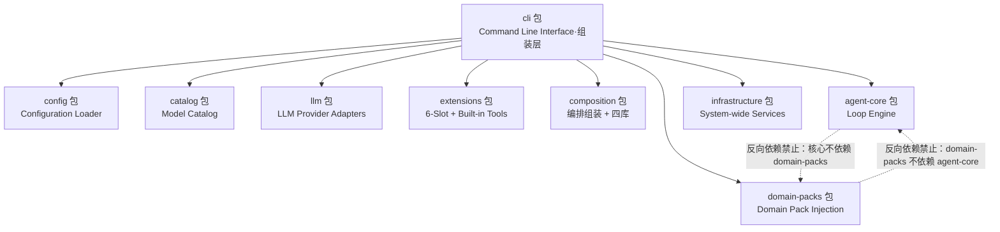

[AI 生成]

# 包结构和依赖关系

> 包结构和依赖关系：10 个包（v3 九个 + domain-packs）的职责、依赖规则和关键文件。
> 状态：stable
> 维护：@XZF（主笔）
> 讨论：无
> 待决：无

---

## 1. 包总览

> **目标蓝图（演进方向）标注（2026-08-10 追平）**：本节与 §2、§3 描述的 `packages/` 十包结构是**目标蓝图**（Phase 2+ 演进方向），**非当前实现**。当前实现（现状）为 `璇玑/orbita-sdk/cell-base/` 单仓 + `璇玑/orbita-sdk/coding-pack/` 领域包（见 §4-§7 与 `02-architecture-layers.md` §3）。十包蓝图的价值：定义最终形态的包边界与依赖规则；gap-check 对蓝图文件路径不计入代码差距。

v4 在 v3 九个包基础上新增 `domain-packs/` 包，承载 Domain Pack 系统（见 18-domain-pack.md）。核心包领域中立，领域能力通过 Pack 注入。第一个官方 Pack 是 coding-pack，让 璇玑 开箱即用即得完整 coding 协作能力。

```
璇玑/
└── packages/
    ├── shared/           # 共享类型、核心不变量、工具注册表（零依赖）
    ├── config/           # 配置加载和验证
    ├── catalog/          # 模型数据（自动生成 + 描述符）
    ├── llm/              # LlmProvider 接口 + 适配器
    ├── extensions/       # 6-slot 扩展系统 + 内置工具
    ├── composition/      # 编排组装层（四级编排 + 四库 + 两层 Pattern）
    ├── agent-core/       # Agent Loop 引擎（纯引擎，角色/编排无关）
    ├── infrastructure/   # 基础设施接口实现（含 v4：WeightRegistry/EventSourcedState/UserProfile）
    ├── domain-packs/     # ★ v4 新增：领域包（第一个官方 Pack：coding-pack）
    │   └── coding-pack/  # coding 领域能力：身份/技能/工具/GitWorktree/Preset
    └── cli/              # SimpleRenderer + 命令行入口
```

**包的定位差异**：

| 类别 | 包 | 性质 |
|------|----|------|
| 核心微内核 | shared, agent-core | 领域中立，任何领域都通用 |
| 核心机制 | config, catalog, llm, extensions, composition, infrastructure | 领域中立框架机制 |
| 领域资产 | domain-packs | 领域特定，可插拔，核心不依赖 |
| 组装层 | cli | 把上面所有包组装成可运行进程 |

核心九个包（不含 domain-packs）不含任何领域语义字段（不出现 `filePath`、`cwd`、`repoUrl`、`branchTemplate`）。所有 coding 专属资产迁移到 coding-pack（渗剥点清单见 18-domain-pack.md 第 3 节）。

---

## 2. 依赖关系

**依赖规则**：

| 包 | 依赖 | 被谁依赖 |
|----|------|----------|
| shared | 无（零依赖） | 所有包 |
| config | shared | cli |
| catalog | shared | llm |
| llm | shared + 官方 SDK（openai, @anthropic-ai/sdk） | agent-core |
| extensions | shared | agent-core |
| composition | shared + agent-core | cli, domain-packs |
| agent-core | shared + llm + extensions | composition, cli |
| infrastructure | shared | cli |
| domain-packs | shared + composition（类型） | cli |
| cli | 所有（组装层） | 无 |

**禁止反向依赖**：

- agent-core 不能依赖 cli
- extensions 不能依赖 agent-core
- shared 不能依赖任何包
- agent-core 不能依赖 composition（Core 是纯引擎，编排逻辑全部在 Composition Layer）
- extensions 不能依赖 composition（通过 SubagentDispatcher 接口反转，接口在 shared）

**domain-packs 依赖规则**（v4 新增）：

- domain-packs 依赖 shared（核心类型）+ composition（Pattern/四库类型）。Pack 通过 `register(registry)` 注入资产，registry 的类型定义在 shared/composition。
- domain-packs 不依赖 agent-core。Pack 通过接口（`WorkspaceBackend`、`CompletionGuard`、`EvaluationRubric`）与引擎交互，不直接引用 Loop 引擎实现。
- 核心包不依赖 domain-packs。Pack 是可选的，bootstrap 通过配置加载 Pack，核心代码不静态 import 任何 Pack。这保证核心是空核，换 Pack 不改核心。
- domain-packs 内部 Pack 之间可有依赖（如 research-pack 依赖 coding-pack），通过 Pack 的 `dependencies` 字段声明，加载器做拓扑排序。



---

## 3. 各包详细内容

### shared/

**职责**：所有共享类型定义、核心不变量、工具注册表。零运行时依赖，只有 TypeScript 类型和常量。可以被任何包安全引用。契约层直接复用 pi（来源 `cell_sdk/pi-main/`，路径待验证——当前 fork 位于 `璇玑/pi-sdk/`，G9）：`pi-telemetry` 的 vendor-neutral 遥测类型（span/event schema）、`pi-protocol` 的 CBOR 会话协议作为传输基底（决策 2 + 决策 140：纯类型/纯数据结构属直接复用档，不设适配层）。

**依赖**：pi-telemetry、pi-protocol（来源 cell_sdk/pi-main/，纯契约/协议层）

**关键文件**：
- `types/agent.ts` - Agent 角色类型（v4：角色降级为 Identity 属性，架构只认 Agent）
- `types/session.ts` - Session 类型（v4：含 `domainState` 领域状态容器）
- `types/context.ts` - 上下文三层类型
- `types/invocation.ts` - SubagentInvocation, CheckReport, MetaCheckReport 等
- `types/events.ts` - DomainEvent 定义（v4：事件溯源）
- `types/infrastructure.ts` - 接口类型（含 v4：WeightRegistry、EventSourcedState、UserProfile）
- `types/extensions.ts` - 6-slot 接口类型
- `types/pack.ts` - DomainPack、PackRegistry、Preset 等接口（v4 新增）
- `types/workspace.ts` - WorkspaceSlot 接口、WorkspaceBackend 接口（v4 新增，领域中立版）
- `types/telemetry.ts` - 遥测类型（复用 pi-telemetry 的 span/event schema，来源 cell_sdk/pi-main/packages/telemetry）
- `protocols/protocol.ts` - Entry Layer 对齐层（CLI/Web/IDE 统一协议；底层传输可引用 pi-protocol 的 CBOR framing，来源 cell_sdk/pi-main/packages/protocol）
- `core-invariants.ts` - 核心不变量（架构宪法）
- `subagent-dispatcher.ts` - SubagentDispatcher 接口（依赖反转：extensions 通过此接口调用 composition 的 PatternRuntime）
- `tool-registry.ts` - 工具注册表（v4：只定义 `ToolRiskLevel` 枚举和 `ToolDescriptor` 接口，具体工具映射由 Pack 注册）

**目录结构**：
```
shared/
├── types/
│   ├── agent.ts
│   ├── session.ts
│   ├── context.ts
│   ├── invocation.ts
│   ├── events.ts
│   ├── infrastructure.ts
│   ├── extensions.ts
│   ├── pack.ts          # v4 新增
│   ├── workspace.ts     # v4 新增
│   └── telemetry.ts     # 复用 pi-telemetry 类型
├── protocols/
│   └── protocol.ts      # Entry 对齐层，可引用 pi-protocol CBOR
├── core-invariants.ts
├── subagent-dispatcher.ts
├── tool-registry.ts
└── index.ts
```

---

### config/

**职责**：配置加载和验证。使用 zod 进行类型安全的 schema 验证。优先级：环境变量 > 配置文件 > 默认值。

**依赖**：shared

**关键文件**：
- `loader.ts` - 加载配置：默认值 < 配置文件 < 环境变量
- `defaults.ts` - 默认配置（v4：默认 `packs: ["@璇玑/coding-pack"]`，开箱即用）
- `schema.ts` - 配置 schema（zod 验证，含 `packs` 字段）
- `index.ts`

**目录结构**：
```
config/
├── loader.ts
├── defaults.ts
├── schema.ts
└── index.ts
```

---

### catalog/

**职责**：模型数据管理。存放自动生成的模型清单、提供商描述符和模型 ID 分类逻辑。llm 包只从 catalog 导入类型，不导入值。

**依赖**：shared

**关键文件**：
- `models.json` - 自动生成的模型清单
- `descriptors.ts` - 提供商描述符
- `identity/classify.ts` - 模型 ID 分类
- `index.ts`

**目录结构**：
```
catalog/
├── models.json
├── descriptors.ts
├── identity/
│   └── classify.ts
└── index.ts
```

---

### llm/

**职责**：定义 LlmProvider 薄包装接口（`stream(req) → events`）与 StreamFn 接口，实现经 Adapter Layer 委托 pi-ai（决策 19 + 决策 140：pi-ai 属有状态/行为类，走适配层；`stream-fn/pi-ai.ts` 桥接 璇玑 StreamFn 与 pi-ai 的 `createModels()` + `models.stream()`）。不重写 provider 适配器——pi-ai 的 provider 工厂/适配器/OAuth/utils 原样引入作为适配层内部依赖。不依赖任何第三方多提供商抽象库（pi-ai 本身从零写，仅封装官方 SDK）。

**依赖**：shared + catalog（类型）+ pi-ai（`@earendil-works/pi-ai`）

**关键文件**：
- `provider.ts` - LlmProvider 薄包装接口定义（供 Loop/Identity 消费）
- `types.ts` - LLM 相关类型（Message, ToolCall, Response 等）
- `tokenizer.ts` - tiktoken 包装（token 计数，随 pi-ai）
- `retry.ts` - 重试逻辑（指数退避）
- `index.ts`

**Phase 1 交付**：LlmProvider 包装层 + pi-ai 全部 provider（OpenAI/Anthropic/Codex/Bedrock/Google/Vertex/Mistral/Azure）。

**目录结构**：
```
llm/
├── provider.ts
├── types.ts
├── tokenizer.ts
├── retry.ts
└── index.ts
```

---

### extensions/

**职责**：6-slot 扩展系统 + 内置工具实现。per-agent，每个 Agent 创建时注入不同配置。`dispatch_subagent` 工具是整个多 Agent 系统的入口点，只有主 Agent 持有此工具。

**依赖**：shared

**关键文件**：
- `slots/provider-slot.ts` - 如何与 LLM 交互（接口）
- `slots/tool-slot.ts` - 如何执行工具调用（接口）
- `slots/hook-slot.ts` - 在哪些节点插入逻辑（接口）
- `slots/middleware-slot.ts` - 如何处理请求/响应（接口）
- `slots/isolation-slot.ts` - 如何隔离文件系统（接口）
- `slots/workspace-slot.ts` - 工作区如何管理（接口）
- `tools/read.ts` - 读文件
- `tools/write.ts` - 写文件
- `tools/edit.ts` - 编辑文件
- `tools/bash.ts` - 执行命令
- `tools/grep.ts` - 搜索内容
- `tools/glob.ts` - 查找文件
- `tools/ls.ts` - 列目录
- `tools/find.ts` - glob 查找文件（ignore/limit 过滤，尊重忽略规则）
- `tools/file-mutation-queue.ts` - 同文件写操作串行化队列（并发安全）
- `tools/dispatch-subagent.ts` - dispatch_subagent 工具（工厂函数，通过 SubagentDispatcher 接口派发，不直接依赖 composition）
- `workspaces/shared-workspace.ts` - 直接读写主工作区
- `workspaces/isolated-workspace.ts` - 复制到临时目录操作
- `hooks/noop-hook.ts` - 内置 hook（Phase 1: no-op）
- `middleware/noop-middleware.ts` - 内置 middleware（Phase 1: no-op）
- `index.ts`

**目录结构**：
```
extensions/
├── slots/
│   ├── provider-slot.ts
│   ├── tool-slot.ts
│   ├── hook-slot.ts
│   ├── middleware-slot.ts
│   ├── isolation-slot.ts
│   └── workspace-slot.ts
├── tools/
│   ├── read.ts
│   ├── write.ts
│   ├── edit.ts
│   ├── bash.ts
│   ├── grep.ts
│   ├── glob.ts
│   ├── ls.ts
│   └── dispatch-subagent.ts
├── workspaces/
│   ├── shared-workspace.ts
│   └── isolated-workspace.ts
├── hooks/
│   └── noop-hook.ts
├── middleware/
│   └── noop-middleware.ts
└── index.ts
```

---

### composition/

**职责**：编排组装层。定义"谁来编排 Agent、怎么编排"。四级编排模式（默认/预设/组装/动态）。10 个内置模块 + 4 个内置模式。Phase 1 实现 L1+L2，L3+L4 预留接口。包含四库（v4 在原三库基础上新增 Loop 库）：架构提示词库（Architecture Prompt Library）、身份信息库（Identity Library）、技能库（Skills Library）、Loop 库（Loop Library）。两层 Pattern：Coordination × Execution（见 03-execution-modes.md）。

**依赖**：shared

**关键文件**：
- `module/registry.ts` - ModuleRegistry
- `module/builtin/` - 10 个内置模块
- `module/custom/` - 用户自定义模块（L3）
- `architecture-prompts/catalog.yaml` - 架构提示词目录
- `architecture-prompts/core/` - 核心架构提示词
- `architecture-prompts/guides/` - 指南类提示词
- `architecture-prompts/protocols/` - 协议类提示词
- `architecture-prompts/templates/` - 模板类提示词
- `identity/catalog.yaml` - 身份信息目录
- `identity/builtin/` - 内置身份定义（v4：coding 身份移至 coding-pack，核心只留框架机制身份）
- `skills/catalog.yaml` - 技能目录
- `skills/builtin/` - 内置技能（v4：coding 技能移至 coding-pack）
- `skills/templates/` - 技能模板
- `loops/catalog.yaml` - Loop 库目录（v4 新增）
- `loops/builtin/` - 内置 Loop（react-loop 默认）
- `pattern/registry.ts` - PatternRegistry（含 Coordination + Execution 两层注册）
- `pattern/compiler.ts` - PatternCompiler
- `pattern/runtime.ts` - PatternRuntime（驱动 Agent Loop，实现 SubagentDispatcher 接口）
- `pattern/selector.ts` - PatternSelector（四级选择 + Capability 契约匹配）
- `pattern/builtin/` - 内置模式 YAML
- `pattern/custom/` - 用户自定义模式
- `pack/registry.ts` - PackRegistry 实现（v4 新增：接收 Pack 的 `register()` 调用，分发到四库 + Pattern）
- `runtime/agent-manager.ts` - Agent 创建/销毁（从 agent-core 移来）
- `runtime/state-runner.ts` - 状态机执行（从 agent-core 移来）
- `canvas/` - 可视化画板（L3，Phase 2+）
- `dynamic/` - 动态组装（L4，Phase 2+）
- `index.ts`

**目录结构**：
```
composition/
├── architecture-prompts/   # 架构提示词库
│   ├── catalog.yaml
│   ├── core/
│   ├── guides/
│   ├── protocols/
│   └── templates/
├── identity/               # 身份信息库
│   ├── catalog.yaml
│   └── builtin/
├── skills/                 # 技能库
│   ├── catalog.yaml
│   ├── builtin/
│   └── templates/
├── loops/                  # Loop 库（v4 新增）
│   ├── catalog.yaml
│   └── builtin/
├── pack/                   # Pack 注册表（v4 新增）
│   └── registry.ts
├── runtime/                # PatternRuntime + Agent 生命周期
│   ├── pattern-runtime.ts
│   ├── agent-manager.ts
│   └── state-runner.ts
├── module/
│   ├── registry.ts
│   ├── builtin/
│   └── custom/
├── pattern/
│   ├── registry.ts
│   ├── compiler.ts
│   ├── runtime.ts
│   ├── selector.ts
│   ├── builtin/
│   └── custom/
├── canvas/                 # Phase 2+
├── dynamic/                # Phase 2+
└── index.ts
```

---

### agent-core/

**职责**：只管执行单个 Agent。收输入 -> 构建上下文 -> 调 LLM -> 执行工具 -> 返回产出。不创建/销毁 Agent（那是 Composition 的 runtime/agent-manager.ts），不管编排（那是 Composition 的 pattern/），不定义角色（那是 Identity Library 的事）。角色无关、编排无关、身份无关。领域中立——不含任何 coding 语义字段。

**从 agent-core 移走的**：
- `roles/` -> composition/（YAML 已有）| 角色定义是编排概念，不是引擎概念
- `lifecycle/agent-manager.ts` -> composition/runtime/ | Agent 创建/销毁是 PatternRuntime 的事
- `lifecycle/state-machine.ts` -> shared/types/ + composition/ | 类型定义放 shared，执行放 composition

**依赖**：shared + llm + extensions + composition

**关键文件**：
- `loop/agent-loop.ts` - Agent Loop 引擎（通用，角色无关；v4：默认 react-loop，可插拔）
- `loop/inner-loop.ts` - Inner Loop（工具执行循环）
- `loop/compaction.ts` - 上下文压缩（三规则：工具对保护/摘要替代/激进裁剪，不变量保留）
- `context/context-builder.ts` - 构建上下文（Layer 1+2 或 Layer 2+3）
- `context/context-gate.ts` - Layer 1 访问门控（Subagent 隔离）
- `slots/provider-slot.ts` - 接口：怎么调 LLM
- `slots/tool-slot.ts` - 接口：怎么执行工具
- `slots/hook-slot.ts` - 接口：在哪插入逻辑
- `slots/middleware-slot.ts` - 接口：怎么处理请求/响应
- `slots/isolation-slot.ts` - 接口：怎么隔离文件系统
- `slots/workspace-slot.ts` - 接口：怎么管理工作区
- `error/error-handler.ts` - 错误处理（重试、降级、超时）

**目录结构**：
```
agent-core/
├── loop/
│   ├── agent-loop.ts
│   ├── inner-loop.ts
│   └── compaction.ts
├── context/
│   ├── context-builder.ts
│   └── context-gate.ts
├── slots/
│   ├── provider-slot.ts
│   ├── tool-slot.ts
│   ├── hook-slot.ts
│   ├── middleware-slot.ts
│   ├── isolation-slot.ts
│   └── workspace-slot.ts
├── error/
│   └── error-handler.ts
└── index.ts
```

---

### infrastructure/

**职责**：基础设施接口的 Phase 1 最笨实现。system-wide，启动时注入。核心逻辑只依赖接口，Phase 2/3 换实现时核心零改动。v4 新增三个基础设施：WeightRegistry（军功簿学习闭环）、EventSourcedState（事件溯源状态）、UserProfile（User 一等公民）。可观测性（Logger/Metrics/TraceSpan）类型直接复用 pi-telemetry（来源 cell_sdk/pi-main/packages/telemetry，路径待验证——当前 fork 位于 璇玑/pi-sdk/，G9；决策 2 + 决策 140：纯类型属直接复用档，不设适配层）。

**依赖**：shared + pi-telemetry（遥测类型，来源 cell_sdk/pi-main/）

**关键文件**：
- `session/local-file-store.ts` - SessionStore: JSONL 文件
- `event/in-process-bus.ts` - EventBus: EventEmitter
- `auth/single-user-auth.ts` - AuthProvider: 永远返回 local/owner
- `transport/in-process-transport.ts` - AgentTransport: 直接函数调用
- `scheduler/immediate-scheduler.ts` - TaskScheduler: 同步执行
- `permission/allow-all.ts` - PermissionResolver: 全允许
- `logger/pino-logger.ts` - Logger: pino 写本地文件
- `concurrency/fixed-governor.ts` - ConcurrencyGovernor: 固定 max=10
- `concurrency/memory-monitor.ts` - ConcurrencyMonitor: 内存计数器
- `cost/allow-all-governor.ts` - CostGovernor: 不限制
- `cost/log-only-module.ts` - CostModule: 仅记录
- `pool/map-agent-pool.ts` - AgentPool: Map 存储
- `weight/noop-weight-registry.ts` - WeightRegistry: NoOp（v4 新增；Phase 2+ SQLite 持久化）
- `state/mutable-state-store.ts` - EventSourcedState: 可变对象 + activityLog（v4 新增；接口按事件溯源设计）
- `user/in-memory-user-profile.ts` - UserProfile: 内存存储（v4 新增）
- `container.ts` - 依赖注入容器
- `index.ts`

**目录结构**：
```
infrastructure/
├── session/
│   └── local-file-store.ts
├── event/
│   └── in-process-bus.ts
├── auth/
│   └── single-user-auth.ts
├── transport/
│   └── in-process-transport.ts
├── scheduler/
│   └── immediate-scheduler.ts
├── permission/
│   └── allow-all.ts
├── logger/
│   └── pino-logger.ts
├── concurrency/
│   ├── fixed-governor.ts
│   └── memory-monitor.ts
├── cost/
│   ├── allow-all-governor.ts
│   └── log-only-module.ts
├── pool/
│   └── map-agent-pool.ts
├── weight/                # v4 新增
│   └── noop-weight-registry.ts
├── state/                 # v4 新增
│   └── mutable-state-store.ts
├── user/                  # v4 新增
│   └── in-memory-user-profile.ts
├── container.ts
└── index.ts
```

---

### domain-packs/（v4 新增）

**职责**：承载 Domain Pack 系统（见 18-domain-pack.md）。每个 Pack 是一组领域能力的打包——原料（注入四库 + Pattern）+ 配方（Preset）+ 领域定制（schema/backend/guard/rubric）。核心领域中立，所有领域能力通过 Pack 注入。第一个官方 Pack 是 coding-pack，把 v3 核心携带的 coding 专属资产（15 身份、内置技能、工具分级映射、Worktree 隔离、Tournament 评估权重、完成守卫）全部迁移到此。

**依赖**：shared + composition（类型）

**核心不变量**：
- domain-packs 不依赖 agent-core（通过 `WorkspaceBackend`/`CompletionGuard`/`EvaluationRubric` 接口交互）
- 核心包不依赖 domain-packs（Pack 可选，bootstrap 通过配置加载）
- Pack 间可有依赖（`dependencies` 字段，拓扑排序加载）

**关键文件**：
- `coding-pack/src/index.ts` - Pack 入口（`DomainPack` 实现导出）
- `coding-pack/src/register.ts` - `register(registry)` 实现，向四库 + Pattern 注入资产
- `coding-pack/src/workspace/git-worktree-backend.ts` - `WorkspaceBackend` 实现（三级隔离，决策 49）
- `coding-pack/src/guards/file-mutation-guard.ts` - `CompletionGuard` 实现（文件变异检测）
- `coding-pack/src/rubrics/coding-default.ts` - `EvaluationRubric` 实现（五维度量规）
- `coding-pack/src/presets/` - Preset 集（code-review-session、feature-implementation、security-audit、bugfix-session）
- `coding-pack/identities/` - 15 个内置身份 YAML（security-reviewer、frontend-dev、backend-dev 等）
- `coding-pack/skills/` - coding 技能（owasp-top-10、dependency-audit、pii-detection）
- `coding-pack/prompts/` - coding 专属架构提示词
- `coding-pack/index.ts` - Pack barrel export

**目录结构**：
```
domain-packs/
├── coding-pack/               # 第一个官方 Pack
│   ├── src/
│   │   ├── index.ts           # DomainPack 实现
│   │   ├── register.ts        # register(registry) 实现
│   │   ├── workspace/
│   │   │   └── git-worktree-backend.ts
│   │   ├── guards/
│   │   │   └── file-mutation-guard.ts
│   │   ├── rubrics/
│   │   │   └── coding-default.ts
│   │   └── presets/
│   │       ├── code-review-session.ts
│   │       ├── feature-implementation.ts
│   │       ├── security-audit.ts
│   │       └── bugfix-session.ts
│   ├── identities/            # 15 个内置身份 YAML
│   ├── skills/                # coding 技能
│   ├── prompts/               # coding 专属架构提示词
│   └── index.ts
└── (未来: research-pack/, writing-pack/)
```

**Pack 契约**（定义在 shared/types/pack.ts）：

```typescript
interface DomainPack {
  /** Pack 唯一标识，如 "coding"、"research" */
  name: string;
  /** 语义化版本号 */
  version: string;
  /** 依赖的其他 Pack 名称列表 */
  dependencies?: string[];
  /** 注册原料到 PackRegistry（注入四库 + Pattern） */
  register(registry: PackRegistry): void;
  /** Preset 集（配方） */
  presets: Preset[];
  /** domainState 的 schema（Zod） */
  sessionStateSchema?: ZodSchema;
  /** 工作区后端实现 */
  workspaceBackend?: WorkspaceBackend;
  /** 完成守卫实现 */
  completionGuard?: CompletionGuard;
  /** 默认评估量规 */
  defaultRubric?: EvaluationRubric;
}
```

**发行方式**：璇玑 npm 包（`@璇玑/core`）默认依赖 `@璇玑/coding-pack` 并自动启用。核心代码是空核，但开箱即用。用户可发布自己的 Pack（Phase 2+）。

---

### cli/

**职责**：用户入口。Phase 1 使用 SimpleRenderer（纯 stdout + readline），Phase 2 替换为 OrbitaTuiRenderer。bootstrap.ts 负责组装所有模块（含 Pack 加载）并启动主 Agent Loop。

**依赖**：所有包（组装层）

**关键文件**：
- `renderer.ts` - SimpleRenderer（stdout + readline）
- `command.ts` - 命令解析
- `bootstrap.ts` - 启动流程（组装所有模块 + 加载 Domain Pack）
- `index.ts` - 入口点

**bootstrap 流程**（v4 加入 Pack 加载步骤）：
1. 加载配置
2. 创建 DI 容器
3. 注册所有 infrastructure 实现
4. 创建四库空容器（identity/prompt/skill/loop）
5. ★ 加载并注册 Domain Pack(s)：读 `config.packs`，静态 import 每个 Pack，调用 `pack.register(registry)` 向四库 + Pattern 注入资产
6. builtin 注入（核心自带 4 工具：dispatch_subagent、contact_main_agent、submit_output、search_catalog）
7. 加载用户覆盖层（user/project/group，覆盖优先级高于 Pack）
8. 创建 PatternRuntime（实现 SubagentDispatcher 接口）
9. 创建 dispatch_subagent 工具（注入 PatternRuntime 作为 dispatcher）
10. 创建主 Agent + Meta Check Agent（注入 dispatch_subagent 工具）
11. 注册到 AgentPool
12. 启动 EventBus
13. 进入主 Agent Loop

**目录结构**：
```
cli/
├── renderer.ts
├── command.ts
├── bootstrap.ts
└── index.ts
```

---

## 4. protocol.ts 对齐层

`protocol.ts` 是 Entry Layer（CLI/Web/IDE）与 Core Layer 之间的对齐层，定义了统一的请求/响应协议。

```typescript
// shared/protocols/protocol.ts

/** Complexity classification — hint for Sijian Gate */
export type CommandComplexity = "simple" | "batch" | "escalate";

/** Entry 来源标识 */
export type EntrySource = "cli" | "web" | "ide" | "rpc";

/** Internal command — normalized user input */
export interface InternalCommand {
  rawInput: string;
  normalizedInput: string;
  userId?: string;
  sessionId?: string;  // optional, for continuing sessions
  complexity: CommandComplexity;
  metadata: {
    source: EntrySource;
    timestamp: number;
    [key: string]: unknown;
  };
}

/** Entry 层接受/拒绝结果（不做业务路由） */
export interface EntryResult {
  command: InternalCommand;
  accepted: boolean;  // Entry only validates input, does NOT do business routing
  reason?: string;
}

/** Entry 层向外辐射的事件类型（9 种：核心 6 + 透明 3） */
export type EntryEvent =
  | { type: "text_delta"; text: string }
  | { type: "tool_start"; toolName: string; args: unknown }
  | { type: "tool_result"; toolName: string; result: unknown }
  | { type: "subagent_status"; agentId: string; status: "running" | "done" | "failed" }
  | { type: "turn_complete"; finalMessage: string }
  | { type: "error"; code: string; message: string }
  | { type: "meta_check"; action: "triggered" | "passed" | "revised"; original?: string; revised?: string }
  | { type: "permission_request"; toolName: string; riskLevel: "moderate" | "restricted"; resolution: "pending" | "approved" | "denied" }
  | { type: "batch_approved"; charterRule: string; auditTag: string };
```

**为什么需要 protocol.ts**：
- Phase 1 只有 CLI 使用，但协议已定义好。
- Phase 2 Web 客户端通过 HTTP/WebSocket 使用同一协议。
- Phase 3 IDE 插件通过 IPC 使用同一协议。
- Entry Layer 不预留内部接口，通过 protocol.ts 对齐。

**契约语义**：
- `InternalCommand`：Entry Layer 发给 Sijian Gate 的标准化命令（complexity/source 由 EntryAdapter 标注）
- `EntryResult`：Entry 层接受/拒绝结果（Entry 只做输入校验，不做业务路由）
- `EntryEvent`：Entry Layer 向 UI 辐射的事件流（9 种：核心 6 + 透明 3）

**EntryAdapter 双向接口**：
- `adapt(rawInput)`：原始输入 → `InternalCommand`（翻译 + 复杂度分类）
- `stream()`：`AsyncIterator<EntryEvent>`：向外辐射事件流

### cell-base/src/entry/

**职责**：Entry Layer 类型定义 + Surface 抽象。提供 EntryEvent 协议、EntryAdapter 双向接口、CLI 参考实现，以及 Phase 3.3 新增的 Surface 双渲染区抽象。

**依赖**：shared

**关键文件**：
- `protocol.ts` - EntryEvent 9 种 + InternalCommand + EntryResult
- `entry-adapter.ts` - EntryAdapter 接口（adapt + stream）
- `cli-adapter.ts` - cell-base 参考实现
- `surface.ts` - [新增 Phase 3.3] Surface 接口 + SurfaceManager + SurfaceLayout

**目录结构**：
```
cell-base/src/entry/
├── protocol.ts          # EntryEvent 9 种 + InternalCommand + EntryResult
├── entry-adapter.ts     # EntryAdapter 接口（adapt + stream）
├── cli-adapter.ts       # cell-base 参考实现
└── surface.ts           # [新增 Phase 3.3] Surface 接口 + SurfaceManager + SurfaceLayout
```

> Entry Layer 完整架构设计（EntryAdapter 接口签名 / protocol.ts 对齐层 / Surface 抽象 / bootstrap 流程 / Phase 演进）见 `26-entry-layer.md`。本文档描述代码包结构，26 描述架构设计。

### orbita-cli/src/tui/

**职责**：TUI 渲染层。基于 pi-tui 的全屏终端 UI，Phase 3.3 新增双 Surface 布局引擎（DualSurfaceLayout + SurfaceContainer），支持左右/上下/折叠三种布局模式。

**依赖**：cell-base + coding-pack + pi-tui

**关键文件**：
- `layouts/dual-surface-layout.ts` - [新增 Phase 3.3] 双 Surface 布局引擎（左右/上下/折叠）
- `layouts/surface-container.ts` - [新增 Phase 3.3] 单 Surface 容器 + 独立输入框
- `streaming.ts` - StreamingBridge（已更新：consumeEntryEvents 完整映射）
- `app.ts` - TuiApp 主编排器
- `components/` - 自定义组件
- `slash-commands.ts` - 斜杠命令

**目录结构**：
```
orbita-cli/src/tui/
├── layouts/             # [新增 Phase 3.3] 双 Surface 布局引擎
│   ├── dual-surface-layout.ts   # 左右/上下/折叠布局
│   └── surface-container.ts     # 单 Surface 容器 + 独立输入框
├── streaming.ts         # StreamingBridge（已更新：consumeEntryEvents 完整映射）
├── app.ts               # TuiApp
├── components/          # 自定义组件
├── ...
```
---

## 5. 技术栈选择

| 领域 | 选择 | 理由 |
|------|------|------|
| 运行时 | Node.js 22+ | 稳定，生态丰富，ESM 原生支持 |
| 语言 | TypeScript 5.x | 类型安全，所有包共享类型 |
| 包管理 | npm | Phase 1 用 npm，后续考虑 pnpm |
| LLM SDK | openai, @anthropic-ai/sdk | 官方 SDK，最稳定，最新功能 |
| Token 计数 | tiktoken | OpenAI 的 tokenizer，准确 |
| 流式 JSON | partial-json | 流式工具参数解析 |
| 日志 | pino | 快速，结构化 JSON |
| 配置验证 | zod | 类型安全的 schema 验证（Pack 的 sessionStateSchema 也用 zod） |
| 测试 | Vitest | 快速，ESM 原生支持，API 类似 Jest |

---

## 6. Phase 演进对照

| 包 | Phase 1 | Phase 2 | Phase 3 |
|----|---------|---------|---------|
| shared | 全量类型 | + 多租户类型 | + RBAC 类型 |
| config | 默认值+文件+环境变量 + packs 列表 | + 远程配置 | + 多租户配置 |
| llm | OpenAI + Anthropic | + Google + streaming优化 | + 模型路由 + fallback |
| extensions | 6 slot + 内置工具 | + OrbitaTuiRenderer | + 外部 tool server |
| composition | 四库（含 Loop 库）+ 两层 Pattern（白名单） | + Capability 契约完整版 | + 可视化画板 + 动态组装 |
| agent-core | react-loop 默认 + 可插拔 | + 多 Loop | + 链式 Subagent |
| infrastructure | 全部最笨实现 + WeightRegistry(NoOp) + EventSourcedState + UserProfile | + session-server + WeightRegistry(SQLite) | + 分布式全栈 |
| domain-packs | coding-pack 单 Pack，配置显式加载 | + research-pack/writing-pack + 目录扫描 + 动态加载 | + 多 Pack 共存 + 热插拔 |
| cli | SimpleRenderer | OrbitaTuiRenderer | + Web + IDE |

---

## 7. 多入口共享 bootstrap

所有入口共享同一个 `createOrbitaSession()` 函数。v4 在初始化 Composition Layer 前加入 Domain Pack 加载步骤。

```typescript
// packages/cli/src/bootstrap.ts
function createOrbitaSession(config: OrbitaConfig): OrbitaSession {
  // 1. 加载配置
  // 2. 初始化 Infrastructure 容器
  // 3. 创建 RequestContext
  // 4. 加载并注册 Domain Pack(s)
  //    - 读 config.packs，静态 import 每个 Pack
  //    - 调用 pack.register(registry) 向四库 + Pattern 注入资产
  // 5. builtin 注入（核心自带 4 工具）
  // 6. 加载用户覆盖层（user/project/group）
  // 7. 初始化 Composition Layer（PatternRuntime 等）
  // 8. 返回 Session
}

// 所有入口共享：
// CLI 入口 -> createOrbitaSession(loadConfig())
// SDK 入口（Phase 2）-> createOrbitaSession(config)
```

**bootstrap 中 Pack 加载的伪代码**：

```typescript
// bootstrap.ts（Phase 1）
async function bootstrap(config: OrbitaConfig) {
  const registry = new PackRegistryImpl();

  // 按配置顺序加载 Pack
  for (const packName of config.packs) {
    const pack = await import(packName);           // 静态 import
    const instance: DomainPack = pack.default;

    // 依赖检查
    if (instance.dependencies) {
      for (const dep of instance.dependencies) {
        if (!loadedPacks.has(dep)) {
          throw new Error(`Pack ${instance.name} 依赖 ${dep}，但 ${dep} 未加载`);
        }
      }
    }

    // 注册（向四库 + Pattern 注入资产）
    instance.register(registry);
    loadedPacks.set(instance.name, instance);
  }

  // builtin 注入（核心自带 4 工具）
  registry.registerCoreTools([dispatchSubagent, contactMainAgent, submitOutput, searchCatalog]);

  // 用户覆盖层加载（覆盖优先级高于 Pack）
  await loadUserOverrides(registry);
}
```

**默认配置开箱即用**：用户不写 `packs` 配置时，默认加载 `@璇玑/coding-pack`，即得完整 coding 协作能力。

---

> 文档版本：v2.8
> 本版变更（累积最近 3 条，最新在上）：
>   - v2.8：项目更名 wuwo→璇玑（ORBITA），全文品牌/路径/标识符替换（见决策 146）
>   - v2.7：T8 回流：coding-pack tools 列表补 find.ts / file-mutation-queue.ts（S1-S3 能力迁移落地，ls.ts 补齐实现）
>   - v2.6：L111/L204/L416 随决策 140 分面适配：契约/遥测纯类型直接复用（补决策 140 引用），llm/ 经 Adapter Layer 委托 pi-ai；决策计数 112→140
> 基于：璇玑 v4 设计总纲（§3 Domain Pack）、18-domain-pack.md、02-architecture-layers.md
> 决策总数：140 条（v4）
> 文档总数：29 份（v4）
> 原则总数：33 条
