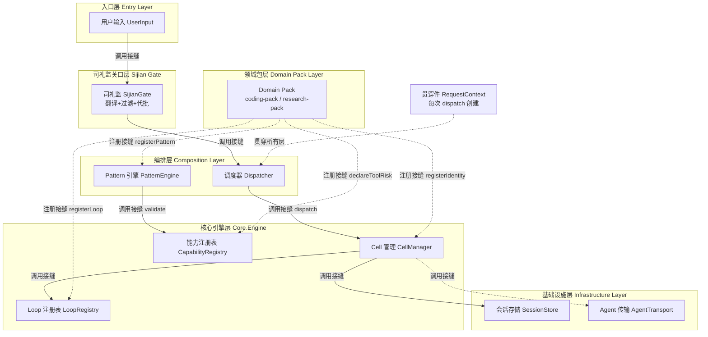

[AI 生成]

# 接缝地图

> 接缝地图：v3 全部接缝保留 + v4 新增 Pack/Loop/Pattern/WeightRegistry/司礼监接缝。
> 状态：stable
> 维护：@XZF（主笔）
> 讨论：无
> 待决：无

---

## 1. 接缝定义

**接缝（seam）** 是系统中一个边界，穿过该边界可以改变行为而不修改边界另一侧的代码。

**为什么重要**：接口是有成本的。每次引入一个接缝，就增加一个间接层。只有那些确定会变化、或多实现共存的边界才值得抽象成接缝。稳定不变的边界直接硬编码。

**设计原则**（决策 3）：
- 会变化的边界必须是接口
- 不变化的边界直接硬编码，不抽象

**v4 扩展**（决策 70/71/72/73）：核心微内核领域中立，所有领域能力、执行引擎、编排拓扑都通过注册接缝注入。接缝总数从 v3 的 19 个扩展到 v4 的 28 个，但核心代码零领域语义——所有变化点都收敛到接缝。Phase 1 给最笨实现（NoOp / 单实现 / 硬编码树），接口按终局形态设计（原则 2 延伸）。

---

## 2. 关键接缝列表

### 2.1 层间接缝（运行期调用方向）

| 接缝 | 位置 | 类型 | 说明 |
|------|------|------|------|
| Entry → Sijian Gate | protocol.ts | 对齐层 | CLI / Web / IDE / SDK / RPC 通过统一协议接入；v4 默认经司礼监关口（v3 直达 Composition） |
| Sijian Gate → Composition | InternalCommand | 关口接缝 | v4 新增。前置过滤 + 翻译 + 代批；代批直接返回用户，呈送走 InternalCommand（详见 §5） |
| Composition → Domain Pack | 四库资产消费 | 资产边界 | v4 新增。Composition 消费 Pack 注入的身份 / 技能 / Loop / Prompt + WorkspaceBackend |
| Domain Pack → Infrastructure | PackRegistry 注入 | 注入边界 | v4 新增。Pack 在 bootstrap 时向四库 + Pattern + 工具集注入资产（详见 §2.4） |
| Core → Infrastructure | 13 个接口 | 依赖注入 | Core Layer 只依赖接口，实现在启动时注入（v3 的 10 个 + v4 的 3 个：WeightRegistry / EventSourcedState / UserProfile） |
| Infrastructure → Runtime | SessionStore / EventBus / Logger | 生命周期边界 | 基础设施随进程启动和关闭，system-wide，全局共享 |
| Extensions → Composition | SubagentDispatcher (shared) | 接口反转 | 决策 63。dispatch_subagent 通过接口调用 PatternRuntime，避免 extensions 直接依赖 composition |
|| 可观测性传播 | RequestContext | 传播接缝 | traceId 从 RequestContext 贯穿 Entry → Sijian Gate → Composition → Core → Infrastructure。每层创建子 TraceSpan。详见 07-infrastructure.md §7.3。

### 2.2 库间接缝（可替换实现）

| 接缝 | 位置 | 类型 | 说明 |
|------|------|------|------|
| LLM Provider | ProviderSlot | 实现替换 | 支持多 LLM 提供商，未来可切换模型或增加 fallback。默认实现经 Adapter Layer 复用 pi-ai（`cell-base/src/pi-adapter/chat/stream-fn.ts`，决策 140；orbita-sdk/pi-adapter 包导出 `createPiAIStreamFn`），可替换为自定义 StreamFn |
| 工具执行 | ToolSlot | 行为扩展 | 内置 tool registry（核心 4 工具 + Pack 工具），未来可升级为外部 tool server |
| Loop 引擎 | Loop 库 | 执行引擎替换 | v4 新增。四库之一，运行期只读；默认 react-loop，可注册自定义 Loop |
| 事件系统 | EventBus | 通信模式 | 当前 InProcess，未来可升级为跨节点持久化；v4 暴露为通信工具 |
| 存储引擎 | SessionStore | 持久化策略 | 当前文件，未来可换数据库 |
| 通信传输 | AgentTransport | 图状通信 | v4 扩展。从树形单链路扩展为点对点 + 发布订阅 + 频道 |
| 学习权重 | WeightRegistry | 学习闭环数据 | v4 新增。记录历史表现，影响 dispatch 权重；Phase 1 NoOp，Phase 2+ 持久化 |

### 2.3 模块间接缝（Core 内部）

| 接缝 | 位置 | 类型 | 说明 |
|------|------|------|------|
| Agent 创建 | agent-core.createAgent | 生命周期 | extensions 在创建时注入，可更换实现 |
| 任务调度 | TaskScheduler | 并发控制 | 当前同步执行，未来可升级为异步队列 |
| 权限解析 | PermissionResolver | 安全策略 | 当前 AllowAll，未来可升级为 RBAC |
| 子 → 父通信 | contact_main_agent (extensions) | 向上通信 | 子 Agent 通过 contactMainAgent 向主 Agent 请求决策或汇报进度。两种模式：need_decision（阻塞）和 progress_update（非阻塞）。v4 扩展为图状通信的一种（点对点），详见 03-execution-modes.md |

### 2.4 注册类接缝（bootstrap 注入方向，v4 新增）

v4 的核心是"空核 + 注入"。注册类接缝是 bootstrap 时的资产注入边界，运行期只读。注入方向与调用方向相反——资产从 Domain Pack 层注入到核心，但运行期核心通过四库机制消费这些资产。这个"反向注入"是 v4 微内核架构的核心特征。

| 接缝 | 位置 | 类型 | 说明 |
|------|------|------|------|
| Domain Pack 注册 | bootstrap 时 Pack → PackRegistry | 资产注册 | Pack 通过 register() 向四库 + Pattern + 工具集注入领域资产（身份 / 技能 / Loop / Prompt / WorkspaceBackend / CompletionGuard / EvaluationRubric / Preset） |
| Loop 库注册 | 开发期 Loop → Loop 库 catalog | 代码资产注册 | 命令式代码，运行期只读；需通过不变量合规审计（双层循环 / Compaction 三规则 / 上下文三层模型） |
| Coordination Pattern 注册 | Pattern → Pattern Registry | Capability 契约匹配 | 声明 provides / requires / compatibleWith；Phase 1 白名单，Phase 2+ 完整契约匹配 |
| Execution Pattern 注册 | Pattern → Pattern Registry | Capability 契约匹配 | 同上；与 Coordination 组合需通过 compatibleWith 白名单校验 |
|| 横切增益模块注册 | 开发期 Enricher → EnricherRegistry | 只读上下文增强 | v4 新增。增益模块只读上下文、不改写 InternalCommand、不拦截/不拒绝；可被跳过；多实现共存。首个实例：翰林格物学士（HanlinEnricher）

---

## 3. 接缝契约

每个接缝的输入 / 输出约束。v3 的 10 个契约全部保留，v4 新增 5 个。

### 3.1 SessionStore

```
输入:  { sessionId, workspaceId, data }
输出:  SessionRecord | null
约束:  读/写必须原子，不允许部分写入
```

### 3.2 EventBus

```
输入:  { type, payload, traceId }
输出:  void（发布）/ AsyncIterator<Event>（订阅）
约束:  发布不阻塞，订阅者失败不影响发布者
```

### 3.3 AuthProvider

```
输入:  { token | credentials }
输出:  AuthContext { userId, roles, scopes? }
约束:  认证失败必须抛出异常，不允许返回部分身份
```

### 3.4 AgentTransport

```
输入:  { target, message, requestContext }
输出:  Response
约束:  传输层不修改消息内容，只负责送达
```

### 3.5 TaskScheduler

```
输入:  { agent, task, contextMode, workspace }
输出:  TaskId
约束:  调度必须幂等，相同 task 多次提交返回同一 TaskId 或拒绝
```

### 3.6 PermissionResolver

```
输入:  { userId, resource, action }
输出:  boolean | PermissionDenied
约束:  拒绝必须提供原因，允许必须记录审计日志
```

### 3.7 ConcurrencyGovernor

```
输入:  requestContext
输出:  Slot | ConcurrencyLimitExceeded
约束:  获取 slot 后必须最终释放，否则资源泄漏
```

### 3.8 CostGovernor

```
输入:  { userId, tokens, model }
输出:  { allowed, remaining }
约束:  检查必须快速（O(1)），不允许阻塞请求路径
```

### 3.9 Logger / Metrics

```
输入:  { level, message, context, traceId }
输出:  void
约束:  日志收集失败不影响业务逻辑，只降级到控制台输出
```

### 3.10 AgentPool

```
输入:  { agentId, agent }
输出:  Agent | AgentPoolError
约束:  注册和注销必须原子，不允许出现半注册状态
```

### 3.11 WeightRegistry（v4 新增）

```
输入:  { identityId, taskOutcome, score, context }
输出:  { updatedWeight, rank }
约束:  写入必须 append-only（历史可回放，score 事件经 EventSourcedState.append 存储）；读取按权重排序 + ε-greedy 探索比例；并发 recordScore 用乐观锁（expectedRevision，retry 最多 3 次）；权重变更不影响已派发任务
```

WeightRegistry 是跨任务学习闭环（决策 78）。竞功制下叫"军功簿"，内阁制下叫"考绩簿"。军功勘验使 updateWeights 写入，首辅 / 总督下次 dispatch 按权重推荐 Identity。

WeightRegistry 接口现包含 `replay` 和 `snapshot` 方法，完整支持"append-only 历史可回放"声明。内部委托 EventSourcedState 实现事件存储和投影（见 07-infrastructure.md §9.1）。

### 3.12 PackRegistry（v4 新增）

```
输入:  DomainPack { name, version, register, presets, sessionStateSchema?, workspaceBackend?, ... }
输出:  void（注册成功）| PackConflictError
约束:  注册只在 bootstrap 时发生，运行期不可变；同名 Pack 注册冲突必须拒绝；Pack 依赖必须先于自身注册
```

PackRegistry 是 Domain Pack 向四库注入资产的接缝（决策 71）。Pack 调用 register() 注入身份 / 技能 / Loop / Prompt / 工具 / Pattern / WorkspaceBackend / CompletionGuard / EvaluationRubric / Preset。四层加载优先级：pack < builtin < user < project < group。

### 3.13 LoopRegistry（v4 新增）

```
输入:  { name, loopImpl, invariants_audit }
输出:  void | LoopInvariantViolation
约束:  Loop 是命令式代码，注册时必须通过不变量审计（双层循环 / Compaction 三规则 / 上下文三层模型）；运行期只读，不能创建新 Loop
```

LoopRegistry 是 Loop 库的注册接缝（决策 72）。Loop 库是四库之一但不对称——命令式代码（vs 其他三库是声明式数据），运行期只读，无 Loop 专家（vs 身份有专家可运行期造）。新 Loop 注册是开发期行为（写代码 + 审计 + 发布）。

### 3.14 PatternRegistry（v4 新增）

```
输入:  CoordinationPattern { name, description, compatibleExecutions, provides, requires, topology, dispatchStrategy }
       ExecutionPattern { name, description, compatibleCoordinations, provides, requires, executionModel, loopBinding }
输出:  void | CapabilityMismatchError
约束:  Coordination 和 Execution 各自注册；组合时必须通过 compatibleExecutions/compatibleCoordinations 双向白名单校验（Phase 1）或 requires/provides 契约匹配（Phase 2+）；无兼容组合必须拒绝

PatternRegistry 是两层 Pattern 的注册接缝（决策 73 / 85 / D7）。Coordination（hierarchy / market / peer-mesh / federation）和 Execution（dag / tournament / chain / fan-out）各自独立类型注册（registerCoordination / registerExecution 双方法）。组合矩阵由 compatibleExecutions / compatibleCoordinations 双向白名单推导。

> **注**：council 协调拓扑经此现有缝注册（compatibleExecutions=[fan-out,chain,tournament,dag]）；其 4 个具体模式 Pattern（council-menke=fan-out / council-muliao=chain / council-dihuang=tournament / council-zhinang=dag）也经此注册，各自带真实 execution 值。council 不新开注册缝。

### 3.15 BatchApproveCharter（v4 新增，司礼监条陈）

```
输入:  InternalCommand + charter 条目（matchCondition + handler + riskLevel）
输出:  { approved: boolean, batchTag?: string }
约束:  代批必须命中条陈（不得自行扩充）；必须打"批红"标签；必须同步审计后验；条陈只能由总控授权修改（sijian-charter-immutable）
```

BatchApproveCharter 是司礼监代批的授权清单接缝（决策 77）。呈送标准（任一命中即必须呈送）：多 steps / 依赖外部资源 / 涉及修改数据 / 非最低风险 / 不在条陈范围。

### 3.16 EnricherRegistry（v4 新增，翰林格物学士）

````
输入: EnricherModule { name, provides: [{name: "context-enrichment"}], requires, readonly: true }
输出: void | CapabilityMismatchError
约束: 增益模块只读上下文、不改写 InternalCommand 结构、不拦截/不拒绝（区别于司礼监关卡模块的拒绝/绕过权）；可被「跳过」；多实现共存（不同领域增益）。
````

EnricherRegistry 是横切增益模块的注册接缝（决策 87）。引入依据见 §6.2：多实现共存的边界 → 接口 + 注册表。翰林格物学士（HanlinEnricher）是首个实例。


---

## 4. Composition Layer 特别说明

Composition Layer 位于 Sijian Gate 和 Domain Pack Layer 之间（v3 位于 Entry 和 Core 之间），是**唯一上下知两层的模块**。

**为什么特殊**：
- 它理解 Sijian Gate 翻译后的意图（InternalCommand：CLI 命令、Web 请求、IDE 事件经关口翻译后的结构化意图）
- 它也理解 Core Layer 的能力（Agent Loop、Extensions 能力、工具可用性）和 Domain Pack 的资产（四库内容、WorkspaceBackend、Rubric）
- 两层 Pattern（Coordination × Execution）让它在两层之间翻译意图到执行——v3 的四级编排（默认 / 预设 / 可视化 / 动态判断）在 v4 演进为两层 Pattern 的组合矩阵 + Preset 渐进推断

**集成边界**：
- 对上层（Sijian Gate）：接收 InternalCommand，呈送时才创建 RequestContext
- 对下层（Core）：调用 Agent Loop 执行，配置 Extensions，通过 PatternRuntime 编排
- 对 Pack 层：消费四库资产（身份 / 技能 / Loop / Prompt），使用 WorkspaceBackend / CompletionGuard / EvaluationRubric
- 它不直接依赖 Infrastructure，而是通过 RequestContext 传递的接口引用间接访问

**v4 变化**：
- v3 的"唯一上下知两层"在 v4 扩展为"上知关口、下知 Core + Pack"
- 两层 Pattern 替代单层模式（决策 73）
- 接口反转保留（决策 63，SubagentDispatcher 定义在 shared 包）

> 详见 03-execution-modes.md。

---

## 5. 司礼监关口接缝（v4 新增）

司礼监（Sijian Gate）是 v4 新增的前置关口接缝，位于 Entry Layer 和 Composition Layer 之间。这是 v4 的核心新增接缝，解决"95% 日常请求走完整流程开销过大"的问题。

**接缝性质**：前置过滤 + 翻译 + 有限代批。司礼监有**有限代批权**（不只是翻译层），代批权来自总控预授权的"条陈"。

**三重职责**：
1. **前置过滤（prefilter）**：超出能力 / 违反策略 / 格式错误的请求 → 不受理或驳回。过滤非代决策类请求。
2. **翻译（translate）**：用户输入 → InternalCommand，保留原始映射，可逆。
3. **代批判断（autoApprove / escalate）**：
   - 命中条陈 + 简单低风险 → 代批，打"批红"标签，同步审计 Agent 后验，直接返回用户（不经内阁）
   - 复杂 / 高风险 / 不在条陈 → 呈送总控（SupremeController）走完整流程

**条陈（BatchApproveCharter）**：代批授权清单，由总控预先授权，司礼监不得自行扩充。每条指定匹配条件 + handler + 必须是 minimal（最低）风险。

**呈送标准**（任一命中即必须呈送，不得代批）：多 steps / 依赖外部资源 / 涉及修改数据 / 非最低风险 / 不在条陈范围。

**四不变量**（架构宪法，代码强制）：
- `sijian-no-arbitrary-approve`：代批必须有据（命中条陈）
- `sijian-must-be-traceable`：批红标签 + 审计后验
- `sijian-escalate-complex`：复杂不得代批
- `sijian-charter-immutable`：条陈只能总控授权修改

**接缝方向**：
- Entry → 司礼监：protocol.ts 对齐后的标准化请求
- 司礼监 → 用户（代批）：直接结果 + 批红标签
- 司礼监 → Composition（呈送）：InternalCommand
- 司礼监 → Infrastructure（审计）：代批后验日志

**价值**：95% 日常请求走代批快速通道省完整流程开销；批红标签 + 审计后验保证可追溯。

> 详见 15-sijian-batch.md。

---

## 6. 接缝设计原则补充

### 6.1 注册接缝 vs 调用接缝

v4 区分两类接缝：
- **调用接缝**（层间 / 库间 / 模块间）：运行期数据和控制流穿过，方向从上往下。v3 已有。
- **注册接缝**（Pack / Loop / Pattern）：bootstrap 时资产注入，运行期只读。v4 新增。

注册接缝的注入方向与调用方向相反——资产从 Domain Pack 层注入到核心，但运行期核心通过四库机制消费这些资产。这个"反向注入"是 v4 微内核架构的核心特征（决策 70 / 71）。

### 6.2 何时引入新接缝

- 确定会变化的边界（如 LLM Provider、存储引擎）→ 接口
- 多实现共存的边界（如 Loop 库、Pattern）→ 接口 + 注册表
- 稳定不变的边界 → 硬编码

### 6.3 接缝成本

每个接缝增加一个间接层。v4 的 28 个接缝是经过审慎选择的——每一个都对应一个确定会变化的维度（七维度插件化总表，见 05-agent-roles.md §2）。Phase 1 给最笨实现，接口按终局形态设计。后续每个维度升级 = 换实现不改接口。

---
## 7. 接缝 TS 接口签名（② 层实现依据）

> 以下签名全部来自 ② 层 `20-foundation-interfaces.md` §3.1/§3.4-§3.7 和 `08-microkernel-core.md` §3.2/§5/§6，不新发明接口。

### 7.1 PackRegistry（注册接缝：Domain Pack → 四库 + Pattern）

```typescript
interface PackRegistry {
  registerIdentity(id: IdentityDefinition): void;
  registerArchitecturePrompt(prompt: ArchitecturePromptAsset): void;
  registerSkill(skill: SkillAsset): void;
  registerLoop(loop: LoopEntry): void;
  registerCoordinationPattern(pattern: CoordinationPattern): void;
  registerExecutionPattern(pattern: ExecutionPattern): void;
  declareToolRisk(toolName: string, level: RiskLevel): void;
}
```

来源：`20-foundation-interfaces.md` §3.7。7 个注册方法，每个对应一个资产维度。

> **参数类型定义**：register* 方法的参数类型（IdentityEntry / ArchitecturePromptEntry / SkillEntry / LoopEntry / ToolDescriptor）完整定义见 18-domain-pack.md §2.1.1。CoordinationPattern / ExecutionPattern 定义见 03-execution-modes.md。

### 7.2 DomainPack（注册接缝：Pack 定义）

```typescript
interface DomainPack {
  name: string;
  version: string;
  dependencies?: string[];
  register: (registry: PackRegistry) => void;
  presets?: PresetMap;
  sessionStateSchema?: ZodSchema;
  workspaceBackend?: WorkspaceBackend;
  completionGuard?: CompletionGuard;
  defaultRubric?: RubricDefinition;
}
```

来源：`20-foundation-interfaces.md` §3.6。9 个字段，`register` 是 bootstrap 时调用的注入入口。

### 7.3 LoopRegistry（注册接缝：Loop 库）

```typescript
interface LoopRegistry {
  register(entry: LoopEntry): void;
  get(name: string): LoopEntry;
  list(): LoopEntry[];
}

interface LoopEntry {
  name: string;
  description: string;
  factory: () => LoopInstance;
  audit?: AuditReport;
}
```

来源：`20-foundation-interfaces.md` §3.5。3 方法 + LoopEntry 结构体。`audit` 字段绑定不变量审计标准（见 06-core-engine.md）。

### 7.4 CellManager（调用接缝：Core 内部 Cell 生命周期）

```typescript
interface CellManager {
  register(cell: Cell): void;
  unregister(cellId: string): void;
  get(cellId: string): Cell | undefined;
  findByCapability(cap: string): Cell[];
  list(): Cell[];
  shutdown(cellId: string): void;
}
```

来源：`08-microkernel-core.md` §3.2/§5。6 方法。Cell 是 Agent 的运行期实例，按 Capability 匹配查找。

### 7.5 CapabilityRegistry（调用接缝：能力契约匹配）

```typescript
interface CapabilityRegistry {
  register(contract: CapabilityContract): void;
  findByCapability(name: string): CapabilityContract[];
  validate(pattern: CoordinationPattern | ExecutionPattern): boolean;
}

interface CapabilityContract {
  patternName: string;
  requires: string[];
  provides: string[];
}
```

来源：`08-microkernel-core.md` §3.2/§6.2。3 方法 + 契约结构体。`validate` 在 Composition Layer 组合 Pattern 前调用。

### 7.6 SubagentDispatcher（调用接缝：Composition → Core）

```typescript
interface SubagentDispatcher {
  dispatch(request: DispatchRequest): Promise<DispatchResult>;
}

interface DispatchRequest {
  identityId: string;
  task: string;
  budget: DispatchBudget;
  context: RequestContext;
}

interface DispatchResult {
  cellId: string;
  status: 'completed' | 'failed' | 'timeout';
  output: string;
}

interface DispatchBudget {
  maxTokens: number;
  maxSteps: number;
  timeoutMs: number;
}
```

来源：`20-foundation-interfaces.md` §3.4。1 方法 + 3 辅助结构体。dispatch 是 Composition Layer 唯一进入 Core 的入口。
> dispatch 后 CheckAgent 检查压缩产出（CheckAgent 形式化契约见 06-core-engine.md §3a）。

### 7.7 RequestContext（贯穿件）

```typescript
interface RequestContext {
  requestId: string;
  userId: string;
  sessionId: string;
  identity: IdentityDefinition;
  permissions: string[];
  budget: DispatchBudget;
  workspaceId?: string;
  namespace: string;
  traceId: string;
  parentRequestId?: string;
  mode: string;
}
```

来源：`20-foundation-interfaces.md` §3.1。11 字段，每次 dispatch 创建一个，贯穿所有层。

### 7.8 EntryGateProtocol（调用接缝：Entry → Sijian Gate）

来源：`02-architecture-layers.md` §9.6.1。各接入点（CLI/Web/IDE/SDK/RPC）通过此协议统一接入司礼监关口。Phase 1 实现：直接透传（无代批）。

### 7.9 SijianCompositionBridge（调用接缝：Sijian Gate → Composition）

来源：`02-architecture-layers.md` §9.6.2。司礼监呈送时通过此桥接将 InternalCommand 交给 Composition Layer。代批时不经此桥接（直接返回用户）。

### 7.10 CompositionPackBoundary（调用接缝：Composition → Domain Pack）

来源：`02-architecture-layers.md` §9.6.3。Composition Layer 通过此边界消费 Pack 注入的四库资产（身份 / 技能 / Loop / Prompt）+ WorkspaceBackend / CompletionGuard / EvaluationRubric。

### 7.11 PackInfrastructureBoundary（注入边界：Domain Pack → Infrastructure）

来源：`02-architecture-layers.md` §9.6.4。Pack 在 bootstrap 时向 Infrastructure 模块注入领域资产（如 WorkspaceBackend 实现）。注入方向与调用方向相反（决策 70/71）。

### 7.12 InfrastructureCoreBoundary（依赖注入：Core → Infrastructure）

来源：`02-architecture-layers.md` §9.6.5。Core Layer 只依赖 Infrastructure 接口（13 个），实现在启动时注入。v3 的 10 个 + v4 新增 3 个（WeightRegistry / EventSourcedState / UserProfile）。

### 7.13 EntryAdapter（调用接缝：Entry Layer 适配器）

来源：`26-entry-layer.md` §4。各接入点通过 EntryAdapter 将原始输入翻译为 InternalCommand。

```typescript
interface EntryAdapter {
  parse(raw: RawInput): InternalCommand;
  render(output: AgentOutput): RenderedOutput;
}
```

### 7.14 SessionStore（调用接缝：存储引擎）

来源：`07-infrastructure.md` §1.1。契约见 §3.1。Phase 1 实现：文件存储。

### 7.15 EventBus（调用接缝：事件系统）

来源：`07-infrastructure.md` §2.1。契约见 §3.2。Phase 1 实现：InProcess。

### 7.16 AgentTransport（调用接缝：通信传输）

来源：`07-infrastructure.md` §2.2。契约见 §3.4。v4 从树形单链路扩展为图状通信（点对点 + 发布订阅 + 频道）。Phase 1 实现：点对点同步。

### 7.17 AuthProvider（调用接缝：认证）

来源：`07-infrastructure.md` §3.1。契约见 §3.3。Phase 1 实现：AllowAll。

### 7.18 PermissionResolver（调用接缝：权限解析）

来源：`07-infrastructure.md` §3.2。契约见 §3.6。Phase 1 实现：AllowAll。

### 7.19 TaskScheduler（调用接缝：任务调度）

来源：`07-infrastructure.md` §4.1。契约见 §3.5。Phase 1 实现：同步执行。

### 7.20 AgentPool（调用接缝：Agent 注册池）

来源：`07-infrastructure.md` §4.2。契约见 §3.10。Phase 1 实现：内存 Map。

### 7.21 ConcurrencyGovernor（调用接缝：并发控制）

来源：`07-infrastructure.md` §5.1。契约见 §3.7。Phase 1 实现：固定上限。

### 7.22 CostGovernor（调用接缝：成本控制）

来源：`07-infrastructure.md` §6.1。契约见 §3.8。Phase 1 实现：NoOp。

### 7.23 WeightRegistry（调用接缝：学习权重）

来源：`07-infrastructure.md` §9.1。契约见 §3.11。Phase 1 实现：NoOp（决策 78）。跨任务学习闭环：竞功制下叫
军功簿      ，内阁制下叫       考绩簿
。

### 7.24 ProviderSlot（库间接缝：LLM Provider）

> [已废弃 v2.9起] 原 complete/listModels 非流式形态（来源 20-foundation-interfaces.md §3.3 待验证）已废弃。
> 权威定义见 07-infrastructure.md §21 LlmProvider（决策 19/35，T8 回流）：
> stream 流式 + fallback 链（决策 35），组装层薄包装 StreamFn。

```typescript
interface ProviderSlot {
  complete(request: CompletionRequest): Promise<CompletionResult>;
  listModels(): string[];
}
```

### 7.25 ToolSlot（库间接缝：工具执行）

> [已废弃 v2.9起] 原 register/execute/list 形态（来源 20-foundation-interfaces.md §3.2 待验证）已废弃。
> 权威定义见 06-core-engine.md §2.2 ToolSlot（候选 A，2026-08-13 用户确认）：
> list 返回 LLM 元数据 / execute 直接执行（含授权检查）/ has 授权视图。无 register
> （装配时由 ToolRegistry.slotFor 生成，Cell 只持有插槽不接触注册表）、无句柄生命周期。

```typescript
interface ToolSlot {
  list(): readonly ToolDescriptor[];
  execute(call: ToolCall, signal?: AbortSignal): Promise<ToolResult>;
  has(name: string): boolean;
}
```

### 7.26 PatternRegistry（注册接缝：Coordination + Execution Pattern）

来源：`20-foundation-interfaces.md`（待验证节号）。区别于 CapabilityRegistry（§7.5，运行期校验），PatternRegistry 负责 bootstrap 时 Pattern 注册。契约见 §3.14。

```typescript
interface PatternRegistry {
  registerCoordination(pattern: CoordinationPattern): void;
  registerExecution(pattern: ExecutionPattern): void;
  getCoordination(name: string): CoordinationPattern;
  getExecution(name: string): ExecutionPattern;
  listCombinations(): CombinationMatrix;
}
```

### 7.27 EnricherRegistry（翰林格物学士，v4 决策 87）

**定位**：横切增益模块注册表。翰林格物学士（HanlinEnricher）是只增加上下文、不拦截请求、可跳过的横切组件。在司礼监关口之后、编排执行之前，对 InternalCommand 进行上下文增益。

**核心语义**：
- **只增不改**：Enricher 只能往 context 追加信息，不能修改/删除已有信息
- **不拦截**：Enricher 不能阻止请求继续（与司礼监代批不同）
- **可跳过**：Enricher 失败时系统继续运行（降级为不增益），不阻塞主流程

来源：`20-foundation-interfaces.md`（待验证节号）。契约见 §3.16。翰林格物学士（HanlinEnricher）是首个实例（决策 87 / 原则 31）。

```typescript
// 翰林格物学士：横切增益模块
interface HanlinEnricher {
  name: string;                    // 增益模块名
  description: string;

  // 增益上下文（只增不改）
  enrich(input: EnrichInput): Promise<EnrichOutput>;

  // 是否适用当前请求（不适用则跳过）
  applicable(input: EnrichInput): boolean;

  // 优先级（数字小的先执行）
  priority?: number;               // 默认 100
}

interface EnrichInput {
  command: InternalCommand;        // 司礼监翻译后的命令
  requestContext: RequestContext;
  existingContext: Record<string, unknown>;  // 已有上下文
}

interface EnrichOutput {
  additionalContext: Record<string, unknown>;  // 追加的上下文（只增）
  metadata?: {
    enricherName: string;
    duration: number;
    skipped?: boolean;             // 是否被跳过
  };
}

// 注册表
interface EnricherRegistry {
  register(enricher: HanlinEnricher): void;
  unregister(name: string): void;
  list(): HanlinEnricher[];

  // 按优先级依次执行所有 applicable 的 enricher
  // 任何一个失败不影响整体（降级为 skipped）
  enrichAll(input: EnrichInput): Promise<{
    enrichedContext: Record<string, unknown>;
    appliedEnrichers: string[];
    skippedEnrichers: string[];    // 因失败或不适用被跳过的
  }>;
}
```

**执行流程**：
1. 司礼监关口通过后，呈送编排层之前
2. EnricherRegistry.enrichAll() 按优先级依次执行
3. 每个 Enricher 先检查 applicable() → true 则执行 enrich()
4. enrich() 抛异常 → 记录警告 + 加入 skippedEnrichers → 继续
5. 所有 Enricher 完成 → 合并 additionalContext → 传入编排层

**Phase 标注**：
- **Phase 1**：NoOpEnricherRegistry（enrichAll 直接返回空上下文，无增益）
- **Phase 2+**：SimpleEnricherRegistry（支持注册 + 按优先级执行 + 失败跳过）

**与司礼监的关系**：Enricher 在司礼监之后执行。司礼监决定"是否呈送"，Enricher 决定"呈送时带多少上下文"。详见 15-sijian-batch.md §5 呈送标准。

### 7.28 AgentFactory（调用接缝：Agent 创建）

来源：`08-microkernel-core.md` §5。extensions 在创建时注入，可更换实现。区别于 CellManager（§7.4，运行期 Cell 生命周期），AgentFactory 负责创建期。

```typescript
interface AgentFactory {
  create(config: AgentConfig): Agent;
}
```


### 7.29 签名统计

| # | 接口 | 方法/字段数 | 接缝类型 | 来源（② 层） |
|---|------|-----------|---------|-------------|
| 1 | PackRegistry | 7 方法 | 注册 | 20-foundation-interfaces §3.7 |
| 2 | DomainPack | 9 字段 | 注册 | §3.6 |
| 3 | LoopRegistry | 3 方法 + 结构体 | 注册 | §3.5 |
| 4 | CellManager | 6 方法 | 调用 | 08-microkernel-core §3.2/§5 |
| 5 | CapabilityRegistry | 3 方法 + 结构体 | 调用 | §3.2/§6.2 |
| 6 | SubagentDispatcher | 1 方法 + 3 结构体 | 调用 | 20-foundation-interfaces §3.4 |
| 7 | RequestContext | 11 字段 | 贯穿件 | §3.1 |
| 8 | EntryGateProtocol | — | 调用（层间） | 02-architecture-layers §9.6.1 |
| 9 | SijianCompositionBridge | — | 调用（层间） | §9.6.2 |
| 10 | CompositionPackBoundary | — | 调用（层间） | §9.6.3 |
| 11 | PackInfrastructureBoundary | — | 注入（层间） | §9.6.4 |
| 12 | InfrastructureCoreBoundary | — | 依赖注入（层间） | §9.6.5 |
| 13 | EntryAdapter | 2 方法 | 调用 | 26-entry-layer §4 |
| 14 | SessionStore | 见 §3.1 契约 | 调用 | 07-infrastructure §1.1 |
| 15 | EventBus | 见 §3.2 契约 | 调用 | §2.1 |
| 16 | AgentTransport | 见 §3.4 契约 | 调用 | §2.2 |
| 17 | AuthProvider | 见 §3.3 契约 | 调用 | §3.1 |
| 18 | PermissionResolver | 见 §3.6 契约 | 调用 | §3.2 |
| 19 | TaskScheduler | 见 §3.5 契约 | 调用 | §4.1 |
| 20 | AgentPool | 见 §3.10 契约 | 调用 | §4.2 |
| 21 | ConcurrencyGovernor | 见 §3.7 契约 | 调用 | §5.1 |
| 22 | CostGovernor | 见 §3.8 契约 | 调用 | §6.1 |
| 23 | WeightRegistry | 见 §3.11 契约 | 调用 | §9.1 |
| 24 | ProviderSlot | 2 方法 | 库间 | 20-foundation-interfaces §3.3（待验证） |
| 25 | ToolSlot | 3 方法 | 库间 | §3.2（待验证） |
| 26 | PatternRegistry | 5 方法 | 注册 | §3.8（待验证） |
| 27 | EnricherRegistry | 4 方法 | 注册 | §3.9（待验证） |
| 28 | AgentFactory | 1 方法 | 调用 | 08-microkernel-core §5 |
| — | **合计** | **≥28 接缝** | **7 注册 + 18 调用 + 1 注入 + 1 依赖注入 + 1 贯穿件** | — |

---

## 8. 接缝拓扑图

> 调用接缝（`-->`）= 运行期数据/控制流方向，从上往下；注册接缝（`-.->`）= bootstrap 时资产注入方向，从 Pack 注入核心。RequestContext 为贯穿件，非接缝。



图中实线（`-->`）为调用接缝——运行期数据/控制流穿过；虚线（`-.->`）含注册接缝（bootstrap 注入，方向从 Pack 层向核心层）和 RequestContext 贯穿件（非接缝，纯数据结构）。

---

## 9. before/after 示例

> 每个接缝类型展示「无接口（硬编码耦合）」vs「有接口（解耦可插拔）」的对比。

### 9.1 注册接缝：Pack → PackRegistry

**before（硬编码）**：

```typescript
// coding 语义写死在核心代码中
function createAgent(task: string) {
  const identity = {
    systemPrompt: "You are a coding agent",
    tools: ["read_file", "write_file"],
  };
  // ↑ filePath / cwd 等领域语义污染核心层
}
```

**after（接口解耦）**：

```typescript
// 核心层无 coding 语义，coding-pack 通过 register 注入
pack.register(registry => {
  registry.registerIdentity({
    name: "coder",
    systemPrompt: "...",
  });
  registry.declareToolRisk("write_file", "moderate");
});
// 核心层只消费 IdentityDefinition，不知道是 coding 还是 research
```

### 9.2 注册接缝：Loop → LoopRegistry

**before（硬编码）**：

```typescript
// Loop 硬编码在核心引擎中
function runLoop(agent: Agent) {
  while (agent.hasTask) {
    const result = callLLM(agent.messages);
    if (result.toolCalls) executeTools(result.toolCalls);
    else agent.respond(result.text);
  }
  // ↑ 想换引擎必须改核心代码
}
```

**after（接口解耦）**：

```typescript
// Loop 从注册表获取，核心引擎不知道具体实现
const loop = loopRegistry.get("react-loop");
const instance = loop.factory();
instance.run(agent);
// 换引擎只需 registry.register({ name: "plan-execute", factory: () => new PlanExecuteLoop() })
```

### 9.3 注册接缝：Pattern → CapabilityRegistry

**before（硬编码）**：

```typescript
// 编排模式 if-else 链
function dispatch(task: string, mode: string) {
  if (mode === "hierarchy") { /* 朝廷模式逻辑 */ }
  else if (mode === "market") { /* 竞功模式逻辑 */ }
  // ↑ 新增模式必须改 dispatch 函数
}
```

**after（接口解耦）**：

```typescript
// Pattern 从注册表获取，靠 Capability 契约匹配
const coordPattern = patternRegistry.get(coordinationName);
if (!capabilityRegistry.validate(coordPattern))
  throw new Error("Coordination/Execution 不兼容");
const executor = patternRegistry.get(executionName);
coordPattern.execute(executor, task, requestContext);
// 新增模式只需 register + 声明 requires/provides
```

### 9.4 调用接缝：Composition → SubagentDispatcher

**before（硬编码）**：

```typescript
// 编排层直接创建 Agent，紧耦合
function spawnSubagent(task: string) {
  const agent = new Agent(task, getDefaultIdentity());
  agent.run();
  // ↑ 编排层知道 Agent 构造细节，无法替换引擎
}
```

**after（接口解耦）**：

```typescript
// 编排层只通过 dispatch 进入核心，不知道 Cell 如何创建
const result = await dispatcher.dispatch({
  identityId: "coder",
  task,
  budget: { maxTokens: 8000, maxSteps: 20, timeoutMs: 30000 },
  context: requestContext,
});
// 核心层管理 Cell 生命周期，编排层只拿 result
```

### 9.5 调用接缝：Core → Infrastructure

**before（硬编码）**：

```typescript
// 核心引擎直接操作文件系统
function saveState(state: AgentState) {
  fs.writeFileSync(`/states/${agent.id}.json`, JSON.stringify(state));
  // ↑ 存储实现写死，无法换 in-memory / Redis
}
```

**after（接口解耦）**：

```typescript
// 核心引擎通过 Infrastructure 接口操作，实现由注入决定
await infra.sessionStore.save(agent.id, state);
// 启动时注入：new CellInfra({ sessionStore: new InMemoryStore() })
// 换实现不改核心代码
```

---

## 10. 七维度插件化映射

> 每个接缝对应至少一个可插拔维度。下表映射 28 接缝到七维度插件化总表（见 05-agent-roles.md §2）。七维度是 璇玑 可插拔能力的核心骨架——每个维度独立替换不影响其他维度。

### 10.1 维度 → 接缝映射

| 维度 | 含义 | 关联接缝（§7 编号） | 注册入口 |
|------|------|---------------------|----------|
| 身份（Identity） | 谁来做 | PackRegistry §7.1 / DomainPack §7.2 | registerIdentity |
| 架构提示词（Architecture Prompt） | 怎么做 | PackRegistry §7.1 | registerArchitecturePrompt |
| 技能（Skills） | 额外能力 | PackRegistry §7.1 | registerSkill |
| Loop 引擎 | 用什么引擎跑 | LoopRegistry §7.3 / PatternRegistry §7.26 | register / registerLoop |
| 工具（Tools） | 工具池 | ToolSlot §7.25 / PackRegistry §7.1 | register + declareToolRisk |
| 编排模式（Pattern） | 怎么组织 | PatternRegistry §7.26 / CapabilityRegistry §7.5 | registerCoordination/Execution |
| 工作区后端（WorkspaceBackend） | 在哪工作 | DomainPack §7.2 / CompositionPackBoundary §7.10 | workspaceBackend 字段 |

### 10.2 跨维度接缝（基础设施服务）

以下接缝不绑定单一维度，服务于多个或全部维度的基础设施层：

| 接缝 | 服务维度 | 说明 |
|------|----------|------|
| EntryGateProtocol §7.8 / EntryAdapter §7.13 | 全部 | 接入层对齐，所有维度经此注入 |
| SijianCompositionBridge §7.9 | 全部 | 关口层翻译 + 代批 |
| InfrastructureCoreBoundary §7.12 | 全部 | Core 层依赖注入总边界 |
| SessionStore §7.14 / EventBus §7.15 / AgentTransport §7.16 | 全部 | 存储 / 事件 / 通信基础设施 |
| AuthProvider §7.17 / PermissionResolver §7.18 | 全部 | 安全基础设施 |
| TaskScheduler §7.19 / AgentPool §7.20 | 全部 | 调度基础设施 |
| ConcurrencyGovernor §7.21 / CostGovernor §7.22 | 全部 | 资源管控基础设施 |
| WeightRegistry §7.23 | 身份 | 学习权重影响身份选择（跨任务） |
| ProviderSlot §7.24 | 全部 | LLM 供给，所有维度间接依赖 |
| SubagentDispatcher §7.6 / CellManager §7.4 / AgentFactory §7.28 | 全部 | Agent 生命周期 |
| RequestContext §7.7 | 全部 | 贯穿件，非接缝 |
| EnricherRegistry §7.27 | 全部 | 横切增益，只读增强上下文 |

---

## 11. 依赖影响矩阵

> 接缝之间的依赖关系：换一个实现时，哪些接缝受影响、哪些不受影响。此矩阵是「换实现不改接口」原则（原则 2）的验证工具。

### 11.1 接缝组依赖关系

| 接缝组 | 包含接缝（§7 编号） | 依赖的接缝组 | 换实现时影响范围 | 不受影响 |
|--------|---------------------|-------------|-----------------|----------|
| **接入层** | §7.8 EntryGateProtocol / §7.13 EntryAdapter | 无（最上层） | 新增接入点只改 EntryAdapter | 司礼监及以下全部不变 |
| **关口层** | §7.9 SijianCompositionBridge | 接入层 | 代批逻辑变化只改条陈（§3.15） | Composition 及以下不变 |
| **编排层** | §7.5 CapabilityRegistry / §7.6 SubagentDispatcher / §7.26 PatternRegistry | 关口层 | 新增 Pattern 只注册不改 dispatch | Core 层不变 |
| **Pack 层** | §7.1 PackRegistry / §7.2 DomainPack / §7.10 CompositionPackBoundary / §7.11 PackInfrastructureBoundary | 编排层 | 新增 Pack 只 register 不改核心 | Core 层不变 |
| **Core 层** | §7.4 CellManager / §7.28 AgentFactory | Pack 层 / Infrastructure 层 | 换 Cell 管理策略不改 Infrastructure | Infrastructure 不变 |
| **Infrastructure 层** | §7.12–§7.23（12 接口） | 无（最下层） | 换存储/通信/调度实现不改 Core | Core 和上层不变 |
| **库间** | §7.3 LoopRegistry / §7.24 ProviderSlot / §7.25 ToolSlot | Infrastructure 层 | 换 LLM/工具引擎不改编排 | 编排层不变 |
| **注册类** | §7.26 PatternRegistry / §7.27 EnricherRegistry | 库间 | 新增增益模块只 register | 其他注册接缝不变 |
| **贯穿件** | §7.7 RequestContext | 全部 | 字段扩展不破坏现有消费者（只加不改） | 所有层适配新字段即可 |

### 11.2 关键不变量

- **核心层零领域语义**：换 Pack 不改核心代码（原则 18）
- **编排层零 Pattern 硬编码**：换 Pattern 不改 dispatch（原则 7 / 原则 20）
- **基础设施零业务逻辑**：换实现不改接口（原则 1 / 原则 2）
- **注册方向与调用方向解耦**：注册接缝（bootstrap 注入）不影响调用接缝（运行期数据流）
- **关卡与增益分离**：司礼监（拦截/拒绝权）与翰林增益（只读/可跳过）互不干扰（原则 22 / 原则 31）

### 11.3 换实现影响速查

| 我想换… | 改什么 | 不改什么 |
|---------|--------|---------|
| LLM 提供商 | ProviderSlot §7.24 实现 | 编排层 / Core 层 / Pack 层 |
| 存储引擎（文件→DB） | SessionStore §7.14 实现 | Core 层 / 编排层 |
| 编排模式（新增 hierarchy 变体） | PatternRegistry §7.26 注册 | dispatch / Core 层 |
| Loop 引擎（react→plan-execute） | LoopRegistry §7.3 注册 | Core 层 / 编排层 |
| 工具集（新增 Pack 工具） | ToolSlot §7.25 注册 + Pack register | 核心工具注册路径 |
| 领域（coding→research） | 换 Pack（§7.1/§7.2 register） | Core 层零改动 |
| 认证策略（AllowAll→RBAC） | PermissionResolver §7.18 实现 | Core 层 / 编排层 |

---


## 12. 术语

| 中文 | 英文 |
|------|------|
| 接缝 | seam |
| 注册接缝 | registration seam |
| 调用接缝 | invocation seam |
| 接口反转 | interface inversion |
| 条陈 | BatchApproveCharter |
| 批红标签 | batch approval tag |
| 能力契约 | Capability contract |
| 学习闭环 | learning loop |
| 军功簿 / 考绩簿 | WeightRegistry |
| 领域包注册表 | PackRegistry |
| Loop 注册表 | LoopRegistry |
| Pattern 注册表 | PatternRegistry |

---

## 13. 相关文档

- 02-architecture-layers.md — 分层架构（七层 + 司礼监关口层 + Domain Pack 层）
- 03-execution-modes.md — Coordination × Execution 两层 Pattern + Capability 契约 + 组合矩阵
- 04-four-libraries.md — 四库体系（身份 / 架构提示词 / 技能 / Loop）
- 06-core-engine.md — Loop 引擎 + 不变量审计标准（LoopRegistry 校验依据）
- 07-infrastructure.md — Infrastructure 接口完整定义（含 WeightRegistry / EventSourcedState / UserProfile）

---

## 14. 已知未定义接口登记（B/C 类，2026-08-13 全量清点）

> 2026-08-13 对 ① 层全量清点（定义 vs 反引号引用求差集 + 逐名核实）登记的**已知未定义接口**。
> 处置原则：**不编造定义**（G9）——实现有需要时再定义，本登记保证缺口可追踪。A 类（核心契约）已回流消除，见 06 §2.2/§4/§5、07 §21、23 §4。

### B 类 · 基础设施细节（标注「待定义」，实现需要时定义）

| 接口 | 引用处 | 说明 | 处置 |
|------|--------|------|------|
| `WorkspaceIsolation` | 07-infrastructure §10.1 | 工作区隔离接口（v3 保留，实现移 coding-pack） | 待定义 |
| `GitWorktreeIsolation` | 07-infrastructure §10.1 | 具体实现（git worktree），移 coding-pack WorkspaceBackend | 待定义 |
| `ProjectState` / `WorkspaceSlot` | 01-overview / 02-architecture-layers 渗剥点 | v3 概念（files/cwd），v4 已迁 domainState / WorkspaceBackend | 历史引用，无 ① 层定义 |
| `LimitExceededError` | 07-infrastructure §并发 | acquire 超限抛错 | 待定义 |
| `EvenSplitAllocator` / `WeightedAllocator` | 05-agent-roles §BudgetAllocator | Phase 1 均分 / Phase 2+ 加权实现 | 待定义 |
| `WeightFeedback` | 06-core-engine §WeightRegistry 引用 | 回写 WeightRegistry 的反馈类型（Phase 2+） | 待定义 |
| `RendererSurface` | 26-entry-layer §DesktopAdapter | 渲染进程推送面（Electron webContents.send） | 待定义 |

### C 类 · 角色命名引用（标注「角色类型待定设计意图」）

| 名字 | 引用处 | 说明 | 处置 |
|------|--------|------|------|
| `AuditAgent` / `ExecutionAgent` / `PlanningAgent` / `ReviewAgent` / `SupervisionAgent` | 01-overview 角色层 / 10-decisions 决策 68 | 内阁制七层角色命名；决策 74 角色已降级为 `Identity.role: string`，非独立契约接口 | 角色类型待定设计意图 |
| `Dihuang` / `Menke` / `Muliao` | 01-overview 角色层 | tournament / fan-out / chain 模式角色命名 | 角色类型待定设计意图 |

> 附注：反引号悬空清单中另有 5 个为提取误报（实际有定义）：`CapabilityDeniedError`（05-agent-roles）、`EntryEvent` / `EntryResult`（08-package-structure）、`FileMutationGuard` / `GitWorktreeBackend`（18-domain-pack）。
- 15-sijian-batch.md — 司礼监代批机制 + 条陈 + 四不变量
- 18-domain-pack.md — Domain Pack 系统 + PackRegistry + coding 渗剥点清单
- 10-decisions.md — 决策 3（接缝原则）、63（接口反转）、70（通用化）、71（Pack）、72（Loop 库）、73（两层 Pattern）、77（司礼监）、78（WeightRegistry）、85（Capability 契约）

---

> 文档版本：v2.14
> 本版变更（累积最近 3 条，最新在上）：
>   - v2.14：项目更名 wuwo→璇玑（ORBITA），全文品牌/路径/标识符替换（见决策 146）
>   - v2.13：LLM Provider 行路径修正 stream-fn/pi-ai.ts → cell-base/src/pi-adapter/chat/stream-fn.ts（gap-check 漂移修复）
>   - v2.12：§2.2 LLM Provider 接缝补注：默认实现经 Adapter Layer 复用 pi-ai（决策 140），可替换为自定义 StreamFn；决策计数 108→140
> 基于：璇玑 v4 架构设计总纲 §3 / §4 / §5 / §8 / §9、v3 09-seam-map.md 全部有效内容、② 层 20-foundation-interfaces §3.1/§3.4-§3.7 + 08-microkernel-core §3.2/§5/§6
> 决策总数：140 条
> 文档总数：25 份
> 原则总数：33 条
