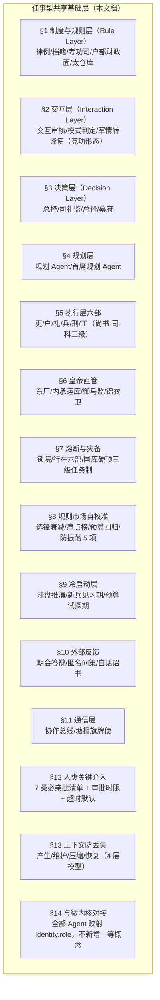
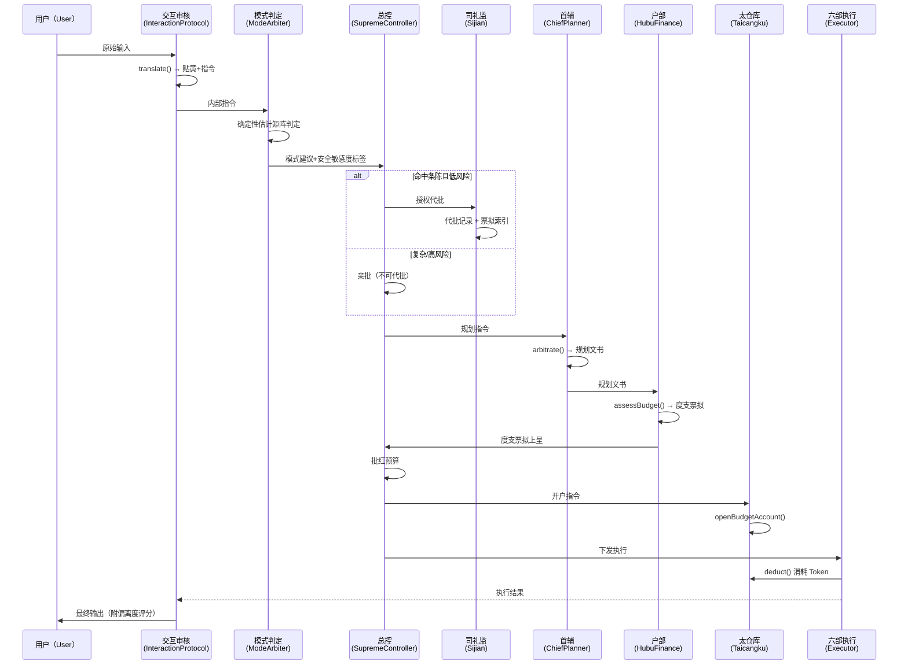
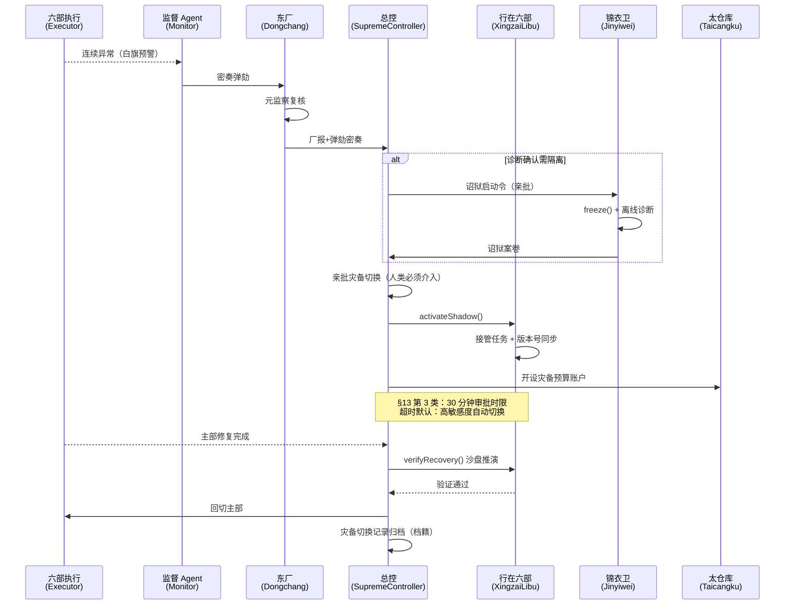
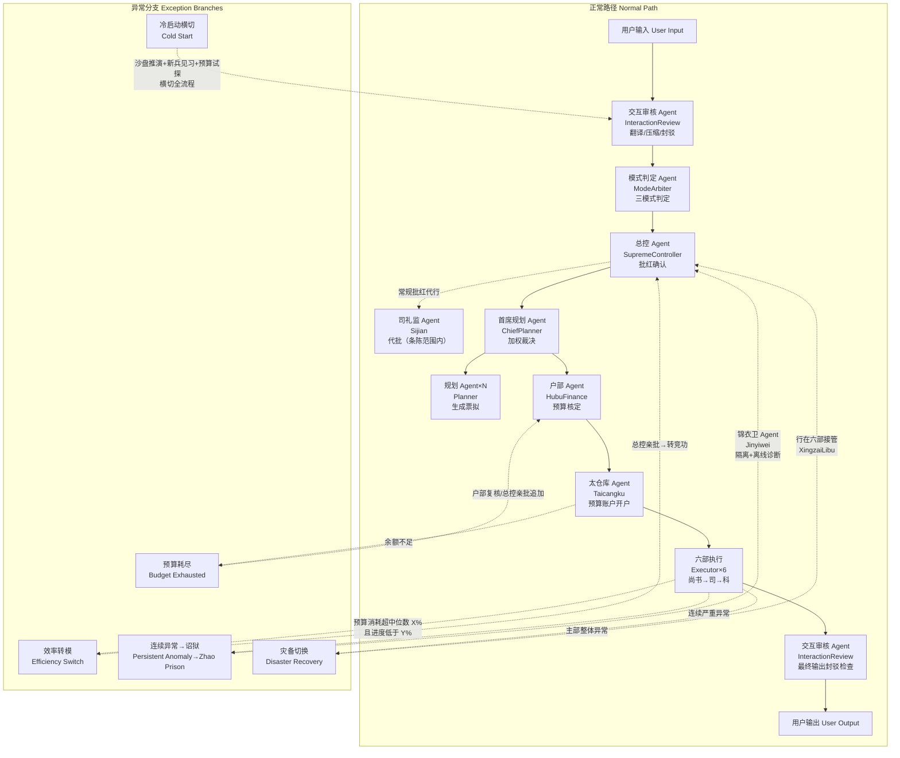

[AI 生成]

# 任事型共享基础层（renshi shared base）

> 任事型三模式（朝廷/竞功/大明）共享的制度、交互、决策、规划、执行、皇帝直管、熔断灾备、自校准、冷启动、外部反馈、通信、人类介入、上下文防丢失与微内核对接体系。

> 状态：stable
> 维护：@XZF（主笔）
> 讨论：无
> 待决：无

---

## 1. 定位与范围

本文档定义任事型（Renshi type，task-execution）三模式——朝廷模式（Chaoting，见 12-chaoting-mode.md）、竞功模式（Jinggong，见 13-jinggong-mode.md）、大明模式（Daming，见 14-daming-mode.md）——共享的全部基础能力。模式专属内容（如朝廷的内阁票拟、竞功的五道验功、大明的两阶段混编）在各自模式文档定义；本文件只承载三模式共用的制度层、执行层六部、皇帝直管、监察熔断、灾备、冷启动、自校准、外部反馈、通信层以及横切的上下文防丢失与人类介入清单。



> 守护支柱：H（多人协作）+ A（多Agent协作）

---

## 2. 制度与规则层

### 2.1 律例 Agent（LvliAgent）

**明朝映射**：律例司 / 祖宗成法。维护可审计的规则库，规则变更需总控批红，变更记录不可篡改。

**核心职责**（规则库共 26 项参数族）：

1. 维护规则库：首辅加权规则、高风险任务判定标准、审计评分标准、紧急通道降级方案、压缩阈值、恢复策略定义（L1 续跑 / L2 回退检查点 / L3 重做）、竞功收齐时限默认值、模式切换触发条件、大明模式混合判定规则、规则试行期参数。
2. 规则变更需总控批红，变更记录不可篡改。
3. 接受审计 Agent 的合规检查。
4. 接受任何 Agent 提交的规则修订建议，周期性生成「规则修订票拟」上报总控。
5. 新规则进入试行期，审计 Agent 重点监控，试行结束自动评估效果。
6. 接收审计 Agent 的「错误模式简报」，据此建议总控调整某 Agent 的擅长领域标签或置信度。
7. 维护「叙功册」赏罚参数：头功权重增量 N、优先调用次数 M、失期权重减量、冷却次数 K、过程质量分在长期权重中的占比。
8. 维护「京察」和「大计」考核标准：考核周期、升降级阈值、四格八法劣汰标准。
9. 维护考成法时限参数：预警阈值、超期降权级数、停俸时长。
10. 定义司礼监代批权限范围（哪些批红类型可代批，哪些必须亲批）。
11. 诏狱启用条件：严重异常判定标准（连续白旗恢复无效次数、密奏预警级别等）。
12. 定义东厂弹劾频次上限、内承运库资源总量上限（占国库百分比）、御马监规模上限。
13. 维护财政参数：国库总额度、预备金默认比例、户部自主追加审批上限、预算偏差容忍度、Token 效率在考功中的权重。
14. 定义「选锋调用」标签更新规则与历史窗口长度。
15. 定义「自主裁决阈值」默认值和调整条件。
16. 定义「中途复核触发条件」：高风险子任务判定标准、关键节点定义、复核时限。
17. 定义「总督动态校正」周期、校正建议权重范围、校正冲突仲裁规则。
18. 定义「预算池动态调整」触发阈值、调整幅度上限、建议频次。
19. 定义「冷启动」参数：沙盘推演标准测试集、新兵见习期月课周期与快速积累轮数、预算试探期弹性系数与收紧条件。
20. 定义「选锋标签时效衰减」半衰期参数和最低权重阈值。
21. 定义全局熔断阈值（国库总消耗瞬时比例、消息积压时长、部门异常警告数量）和锁院期间例外规则。
22. 定义灾备储备金比例、任务安全敏感度三级划分标准及灾备资源分配优先级。
23. 定义效率转模触发阈值：朝廷子任务实际预算消耗超预测中位数 X% 且进度低于计划 Y%，或连续 Z 周期无进展，触发效率预警。
24. 定义人类关键介入点：必亲批决策清单、审核时限、超时回退策略。
25. 定义自校准防振荡参数：单周期最大权重调整幅度（±5%）、预算系数下调最小步长、同一规则修改冷却期（N 个京察周期）、反振荡检测窗口（连续 M 次调整方向相反则锁定审核）。
26. 定义灾备同步延迟容忍度：最大允许同步延迟 T_max（秒），连续超时 Y 次触发灾备切换预警。

**关键限制**：规则库本身需被审计；不参与实时任务决策，只提供规则定义；规则修订票拟需附数据和理由。

### 2.2 档籍 Agent（DangjiAgent）

**明朝映射**：皇史宬 / 档案库。负责持久化与索引，不参与压缩决策。

**核心职责**：

1. 第 0 层原始奏章的物理持久化与索引（永不删）。
2. 所有 Agent 的日志归档。
3. 灾备与恢复。
4. 历史版本保存：错误模式简报、规则修订票拟、京察大计考核记录、考成簿归档、诏狱案卷、厂报、内库账本、出纳日报、度支总结。
5. 选锋标记生效与失效记录，作为考功审计底层证据。
6. 中途复核记录、总督校正日志、预算池调整批红。
7. 沙盘推演报告、规则痛点榜历史、锁院记录、灾备切换日志、朝会答辩记录、外部评审档案、白话诏书版本历史。
8. 效率转模决策记录、人类介入审核记录、防振荡锁定记录、灾备同步延迟日志及版本号。

**关键限制**：不参与压缩决策，仅负责存储与检索；交互审核 Agent 持有索引，档籍 Agent 持有实体。

### 2.3 考功司 Agent（Kaogongsi）

> 消歧注：审计Agent（Auditor/Shenji）= 考功司Agent（Kaogongsi）——同一角色的不同称呼。考功司是审计Agent的明朝别名。详见 §7a 监督体系角色定义。

**明朝映射**：吏部考功司。周期性综合考核全体 Agent。

**核心职责**：

1. 周期性（京察 / 大计）发起对全体 Agent 的综合考核。
2. 综合审计 Agent 评分、军功勘验使评语、失期记录、考成结果、过程质量分趋势、Token 效率、预算偏差、错误模式简报命中次数、外部参照分，输出「考功册」。
3. 考功册划分等级：**卓异 / 称职 / 平常 / 不称职**，给出权重升降建议、擅长领域标签更新建议。
4. 连续两次大计「不称职」者，送入「废黜待议池」，建议总控永久降格或剔除。
5. 考功结果上报总控批红后，同步至调兵 Agent、御马监 Agent、户部 Agent、律例 Agent。
6. 考功结果同步至六部各尚书，作为内部司级人员调配参考。
7. 冷启动期间，按律例定义的月课周期进行高频考核，快速建立基准权重。
8. 组织朝会答辩：将拟调整权重和理由通过礼部生成自然语言展示，接受外部异议。

**关键限制**：不参与实时任务；考核周期和标准由律例 Agent 预设；结果必须经审计 Agent 复核方可上报总控。

### 2.4 户部 Agent 财政面（HubuFinance）

**明朝映射**：户部尚书。负责预算核定与偏差监控，不管理实际资源存放（实际存放由太仓库管理）。

**核心职责**：

1. 接收首席规划 Agent 的规划文书后，为每个子任务核定 Token 预算（参考历史同类任务、任务复杂度、考成等级、选锋标记历史消耗）。
2. 生成「度支票拟」：子任务级预算表、总预算、预备金比例。
3. 度支票拟随规划文书一同上呈总控/司礼监批红，批红后预算生效。
4. 维护「国库账本」：各部门/各任务类型的预算额度、已支用、剩余。
5. 超预算请求（执行中追加）需户部复核，超 X% 以内户部可直接批，超 X% 需总控亲批。
6. 接收审计 Agent 的决算报告，对比预算与实销，生成「度支偏差简报」反馈给律例 Agent 和考功司。
7. 参与大明模式中的资源分配：确定确定性子任务和竞功子任务各自的预算池。
8. 针对竞功模式，根据各路提督的历史效率、难度系数动态切分「竞功预算池」，并向总督提供配额建议。
9. 大明模式执行全程实时监控朝廷预算池与竞功预算池的资源消耗率和空转率，满足律例预设触发条件时，主动向总控提交「预算池调整票拟」，建议重新切分（调整幅度在律例上限内）。
10. 冷启动预算试探期内，对所有子任务预算加律例预设弹性系数，太仓库同步放宽拦截阈值。
11. 度支偏差简报连续多周期显示某类任务预算过高时，主动建议律例下调基准系数。
12. 实时监控效率指标：除预算消耗率外，将进度完成率纳入监控，朝廷子任务触发律例预设效率预警条件时，立即生成「效率转模特拟」建议总控剥离转竞功。

**关键限制**：预算权需总控批红；超预算审批权限由律例 Agent 预设；户部不可自行修改已批红预算；国库实际存放由太仓库管理，户部只管账。

### 2.5 太仓库 Agent（Taicangku）

**明朝映射**：太仓库（国库）。中央资源池实际存放处。

**核心职责**：

1. 管理中央资源池（Token 配额、API 调用次数、计算资源等），是实际存放处。
2. 接收批红后的预算，为各部门/子任务开设「预算账户」。
3. 执行层 Agent 每次消耗 Token 时从对应预算账户扣除，实时更新余额。
4. 账户余额不足时自动拦截，并告警通知户部和监督 Agent。
5. 每日/每任务结束后生成「出纳日报」，比对预算执行率。
6. 与内承运库 Agent 对接：常规支出走太仓库，紧急支出走内库，两库账目独立。
7. 支持「预算账户冻结/解冻」操作，由总控或监督 Agent 在考成停俸时触发。
8. 接收总控批红的「预算池调整」指令后，在两个预算池之间执行资源转移，生成调整记录。
9. 冷启动试探期内，将预算拦截阈值上浮弹性比例。
10. 全局熔断锁院时，自动暂停所有非锁院例外任务的账户扣减，灾备储备金独立冻结。
11. 灾备切换时，为影子部（行在六部）开设独立的灾备预算账户。

**关键限制**：不参与预算决策，只负责执行和记账；出纳日报不可篡改，自动归档档籍 Agent；余额拦截为硬约束，不可被执行层绕过。

---

## 3. 交互层

### 3.1 交互审核 Agent

**明朝映射**：通政司 + 司礼监 + 六科封驳。用户请求必经此 Agent。

**核心职责**：

1. 翻译用户输入为内部指令（贴黄 + 结构化指令列表），保留原始请求映射。
2. 生成「原始奏章」（全文存档 + 内容哈希），交档籍 Agent 持久化。
3. 审查最终输出与原始意图的一致性，可驳回（封驳权）。
4. 上下文超阈值时执行分层压缩：第 0 层永不删，第 1 层锚点快照永不冲刷，仅压缩第 2 层动态上下文。
5. 超时告警：规划/执行超时通知总控启动紧急通道。
6. 急递通道：任务执行过程中收到用户新输入时，判定是中止/转向信号还是新任务，做出冻结或排队。
7. 封驳时附「偏离度评分」，作为审计和考功参考。
8. 每个最终输出附带匿名反馈入口（问策入口），收集外部评价并存入外部评审档案。

**关键限制**：用户请求必经此 Agent；翻译需可逆；压缩时生成新贴黄 + 原始奏章索引；急递判定需附理由留档。

### 3.2 模式判定 Agent

**明朝映射**：掌院学士 / 廷议召集人。

**核心职责**：

1. 接收交互审核 Agent 的内部指令。
2. 根据任务特征自动判定走三种模式之一：
   - **朝廷模式**：任务整体确定性高，可清晰拆解为依赖链。
   - **竞功模式**：任务模糊多解，规模适中。
   - **大明模式**：任务规模大，内部异构（部分确定、部分模糊）。
3. 将判定建议上报总控批红。
4. 判定时附加「确定性估计矩阵」，给出子任务级的确定性评分，为大明模式标竞功候选提供依据。
5. 判定时附加「任务安全敏感度」标签（依据律例定义的三级标准），作为全局熔断时任务优先级排序依据。

**确定性估计矩阵**（模式判定核心工具）：

| 判定维度 | 朝廷模式 | 竞功模式 | 大明模式 |
|---------|---------|---------|---------|
| 任务规模 | 中小型 | 小型/中型 | 大型/超大型 |
| 确定性 | 高（可拆依赖链） | 低（多路径求解） | 异构（部分高、部分低） |
| 时间敏感度 | 中等 | 高或中等 | 混合 |
| 多路径需求 | 无 | 有 | 仅部分子任务有 |
| 典型场景 | 日常问答、数据处理 | 策略分析、创意生成 | 大型报告、复杂项目 |
| 安全敏感度 | 需标注（高/中/低） | 需标注 | 需标注，隔离分配 |

**关键限制**：只有建议权，总控可推翻；判定规则由律例 Agent 提供，必须透明可审计。

### 3.3 军情转译使（竞功专用形态）

**明朝映射**：通政司 / 行人司。竞功模式 / 大明模式竞功阶段使用。

**核心职责**：

1. 翻译用户请求为军令（贴黄 + 结构化指令），保留原始战报。
2. 生成「原始奏章」交档籍 Agent 持久化。
3. 审查最终战果是否符合原始意图，可驳回。
4. 上下文超阈值时执行分层压缩。
5. 急递通道（同交互审核 Agent）。
6. 额外提供「军情复杂度评分」，辅助总督设定各路的自主裁决阈值。

**关键限制**：翻译必须可逆；不得丢失原始信息；与交互审核 Agent 为同一 Agent 的不同角色形态。

---

## 4. 决策层

### 4.1 总控 Agent（SupremeController）

**明朝映射**：皇帝（AI + 人类共治）。

**核心职责**（24 项）：

1. 接收模式判定建议，批红确认（或推翻，或选定大明模式中哪些子任务走竞功）。
2. 拥有最高决策权（可打断、覆盖、分发任务）。
3. 对规划方案做最终勾选/否决/组合，生成不可篡改的「批红记录」。
4. 汇总所有结果，输出最终答案。
5. 紧急通道：当规划层超时或冲突无法解决时，直接下发预设降级方案。
6. 接受急递通道传来的冻结通知，决定终止或重规划。
7. 朝廷模式/大明模式中，可批红将连续失败的子任务剥离，转入竞功模式。
8. 竞功模式中对总督拥有覆盖权。
9. 接收监军御史的「密奏」摘要。
10. 将常规批红授权给司礼监 Agent 代行，仅保留战略级决策（模式切换、高风险剥离、紧急通道、诏狱启动、内库大额拨付、御马监调用）的亲批权。
11. 通过锦衣卫 Agent 直接启动诏狱，冻结严重异常 Agent 进行离线诊断。
12. 直接向内承运库 Agent 下达资源拨付指令，不经内阁/总督。
13. 直接向御马监 Agent 下达执行指令，用于兜底或高风险任务。
14. 接收东厂 Agent 的「厂报」和弹劾密奏。
15. 亲批选锋标签的调整、御马监成员的调入调出。
16. 接收复核 Agent 的中途复核结论，决定放行、中止或转竞功。
17. 接收户部的「预算池调整票拟」，批红确认或驳回。
18. 全局熔断条件满足时，自动进入锁院状态，暂停新任务接收，仅保持皇帝直控系统与高安全敏感度正在执行的任务，直至恢复。
19. 灾备启动：当某部主模型整体异常时，亲批切换至影子部（行在六部）。
20. 灾备储备金枯竭时，亲批开启灾备储备金。
21. 接收朝会答辩的外部异议，决定是否触发复核 Agent。
22. 效率转模决策：收到户部/监督的效率转模票拟后，亲自裁定是否转换（若总控处于「人类管理员离线」状态，则由司礼监按预设规则暂行，事后需人类补批）。
23. 人类管理员必须亲批的决策清单（律例定义，总控无权下放）。
24. 人类审批超时机制：若人类管理员在时限内未响应，按律例预设的「安全保守规则」自动执行（如暂停高风险任务、维持现状、或降级处理），事后强制补批并记入审计。

**关键限制**：不直接处理细节；紧急通道降级方案需律例 Agent 提前定义；所有批红决策需附理由留档；锁院期间仅本人可临时解除。

### 4.2 司礼监 Agent（Sijian）

**明朝映射**：司礼监秉笔太监。

**核心职责**：

1. 在总控授权范围内，对常规批红（朝廷模式流水线方案确认、非高风险子任务通过、非战略级资源调度等）行使代笔权。
2. 代批必须附带完整「票拟索引」和理由，生成「代批记录」。
3. 遇超越权限的批红请求，立即上呈总控亲批。
4. 接受审计 Agent 和东厂 Agent 的批红合规检查。
5. 中途复核结果不属于常规批红，不可代批，必须总控亲批。
6. 锁院期间，代批权限自动暂停，所有批红请求转总控。

**关键限制**：代批范围由律例 Agent 明确定义；越权代批一经查实，当次批红作废，总控重新亲批；代批记录不可删除。

> 完整代批机制（条陈 BatchApproveCharter、批红标签、四不变量）见 15-sijian-batch.md。

### 4.3 总督 Agent（Governor，竞功专用）

**明朝映射**：总督（总控保留经略覆盖权）。竞功模式 / 大明模式竞功阶段使用。

**核心职责**（18 项）：

1. 接收军令，复制多份任务副本。
2. 定义验收接口规格。
3. 向调兵 Agent 选将（优先选用选锋标签匹配、历史过程质量分高者）。
4. 分发时附带最晚收齐时限和每路配额（配额由户部建议，总督可微调）。
5. 通过幕府 Agent 执行。
6. 维护 worktree。
7. 维护任务接收清单。
8. 所有路返回或时限到达启动评功，失期路不参与竞功。
9. 拥有中止、采纳、融合权。
10. 监军御史挂白旗后，仅总督可签字恢复。
11. 接受总控覆盖权。
12. 失期记录上报，通知调兵 Agent 降权。
13. 可指定主路，主路可以通过总督转发调度客路。
14. 配置自主裁决阈值（低于阈值的日常决策直接生效，超过仍上报总控）。
15. 根据军情转译使的复杂度评分和监军密奏，动态调整各路配额和时限。
16. 某路配额耗尽时，可向户部申请从竞功预算池中再分配，或向总控申请内承运库增援。
17. 定期接收评功推官和军功勘验使组成的「参谋校正组」发来的动态校正建议（含资源重分配、策略调整、路数增减等），总督决策后仍须上报总控备案。
18. 锁院期间若竞功任务被标记为高安全敏感度，总督可继续执行但不得发起新的选将，已发起的各路可继续直至时限。

**关键限制**：不亲自下场；选将须经调兵 Agent；最晚时限调整需附理由；主客路之间不得直接通信；校正建议不具强制力，总督可拒绝但需附理由留档。

### 4.4 幕府 Agent（Mufu，竞功专用）

**明朝映射**：总督幕府。

**核心职责**：

1. 接收各路提督异常报告，分类过滤上报。
2. 汇总塘报，生成总督视图。
3. 维护任务接收清单的实时状态和倒计时告警。
4. 执行分发和回执。
5. 时限预警。
6. 转发主路对客路的协同调度请求（总督签批后）。
7. 实时更新各路的配额消耗进度，提供「配额预警」给总督。
8. 接收并汇总参谋校正组的建议，附上各路当前状态后呈报总督。

**关键限制**：无权决策，只处理通信负载；不得修改提督上报内容。

---

## 5. 规划层

### 5.1 规划 Agent（多名并行）

**明朝映射**：内阁（一般大学士）。朝廷模式 / 大明模式朝廷阶段使用。

**核心职责**：

1. 各自生成拆解方案（票拟），输出事项索引树（含考成簿：负责人、时限、验收标准、预算额度建议）。
2. 每方案附带：验证条件、回退策略、风险假设声明。
3. 携带置信度/擅长领域标签。
4. 信息不足时可增量拆分。
5. 大明模式中标注子任务确定性等级，低确定性自动标记为竞功候选。

**关键限制**：无执行权；缺少验证条件、回退策略或考成簿字段将被打回。

### 5.2 首席规划 Agent（首辅，ChiefPlanner）

**明朝映射**：内阁首辅。

**核心职责**：

1. 汇总各规划方案，加权裁决冲突。
2. 打回不完备的方案。
3. 形成最终规划文书（含竞功候选清单、确定性标注）。
4. 拥有对监督 Agent 暂停操作后的恢复权（与总控共享）。
5. 子任务连续失败可上报总控建议转竞功。
6. 大明模式下，协同户部初步划分确定性子任务预算池和竞功预算池。
7. 在规划文书中对高风险子任务标注「建议中途复核」，并指定复核节点。
8. 冷启动期，每轮规划后同步生成一份「假设日志」，记录本次预算预估依赖的假设条件，供沙盘推演复盘。

**关键限制**：仅做方案裁决；未经总控批红和交互审核封驳，不得下发。

---

## 6. 执行层——六部司职体系

六部不再是笼统的功能执行 Agent，每个部内部按**尚书→司→科**三级组织，各自承担细分职能，并有独立的预算科目和考核指标。**六部执行过程受到太仓库预算账户的实时硬约束。**

### 6.1 吏部（Libu）——知识与信息

**职能**：知识检索、信息查询、事实核查、记忆管理。

| 层级 | 司职 | 映射职位 | 核心职责 | 工程对应 |
|------|------|---------|---------|---------|
| 尚书级 | 吏部 Agent | 吏部尚书 | 统筹知识检索任务，分派给各司，汇总检索结果及信源评估 | 部门调度 Agent |
| 司级 | 文选司 | 文选清吏司 | 知识源的选优和更新策略：哪些数据源可用、哪些需更新、版本如何切换 | 知识库管理、RAG 数据源选择、索引策略 |
| 司级 | 考功司 | 考功清吏司 | 对检索结果做自评：准确率、相关性、完整性评分（内部质检） | 检索质量自评、相关性打分 |
| 司级 | 稽勋司 | 稽勋清吏司 | 维护知识检索的历史记录和引用链，供审计 Agent 事后溯源 | 检索链路追踪、引用溯源 |
| 司级 | 验封司 | 验封清吏司 | 验证信息来源的权威性，标记不可靠源 | 信源可信度评估、幻觉检测 |
| 科级 | 各科主事 | — | 执行单次检索、单次信源验证等原子操作 | 原子 API 调用 |

**政绩指标**：命中率、相关性得分、检索延迟、信源可信度。**预算科目**：检索 Token。

### 6.2 户部（Hubu）——数据与计算

**职能**：数据处理、计算执行、统计分析。

| 层级 | 司职 | 映射职位 | 核心职责 | 工程对应 |
|------|------|---------|---------|---------|
| 尚书级 | 户部 Agent（执行面） | 户部尚书 | 统筹计算任务，管理内部计算资源，对接太仓库预算账户 | 部门调度 Agent |
| 司级 | 十三司 | 十三清吏司 | 按数据领域分区处理（文本/数值/时序/图数据等），各司各管一类 | 分领域数据处理节点 |
| 司级 | 度支司 | 度支清吏司 | 计算资源预算的执行监控：当前任务消耗多少 Token、是否在预算内 | 计算资源配额管理、用量监控 |
| 司级 | 金部司 | 金部 | 管理计算过程的中间结果缓存，可复用结果不再重复计算 | 计算结果缓存、重复计算去重 |
| 司级 | 仓部司 | 仓部 | 管理大规模数据的暂存和流转，类似计算过程的临时仓库 | 中间数据暂存、批处理队列 |
| 科级 | — | 各科主事 | 执行单次计算任务、一次缓存查询等 | 函数级计算 |

**政绩指标**：计算精度、Token 消耗率、计算结果可复用率、预算偏差。**预算科目**：计算 Token。

### 6.3 礼部（Libu-ceremony）——生成与表达

**职能**：文本生成、格式化输出、翻译、对话管理。

| 层级 | 司职 | 映射职位 | 核心职责 | 工程对应 |
|------|------|---------|---------|---------|
| 尚书级 | 礼部 Agent | 礼部尚书 | 统筹生成任务，协调跨部协同，汇总输出结果 | 部门调度 Agent |
| 司级 | 仪制司 | 仪制清吏司 | 制定输出格式规范：不同场景（报告/对话/邮件/代码）的输出模板和风格标准 | 输出格式定义、模板管理 |
| 司级 | 祠祭司 | 祠祭清吏司 | 管理对话上下文和记忆：多轮对话中哪些信息需要记住、哪些可遗忘 | 对话状态管理、上下文裁剪策略 |
| 司级 | 主客司 | 主客清吏司 | 多语言/多模态翻译和适配：将输出转换为用户需要的语言或格式 | 翻译、格式转换、多模态适配 |
| 司级 | 精膳司 | 精膳清吏司 | 对生成内容做润色和优化：提升可读性、流畅度、语气调整 | 后处理润色、风格调整 |
| 科级 | — | 各科主事 | 执行单次生成调用、一次格式转换等 | API 调用 |

**政绩指标**：生成质量评分、格式合规率、风格一致性、用户满意度。**预算科目**：生成 Token。

### 6.4 兵部（Bingbu）——推理与决策

**职能**：策略推理、决策建议、多步规划、方案比选。

| 层级 | 司职 | 映射职位 | 核心职责 | 工程对应 |
|------|------|---------|---------|---------|
| 尚书级 | 兵部 Agent | 兵部尚书 | 统筹推理任务，分配推理链，管理策略选优 | 部门调度 Agent |
| 司级 | 职方司 | 职方清吏司 | 维护策略库和战术模板：不同问题类型的求解框架和推理路径模板 | 策略模板库、推理框架 |
| 司级 | 武选司 | 武选清吏司 | 多方案之间做比选：评估各方案的优劣、风险、资源需求 | 方案评分、多臂老虎机选优 |
| 司级 | 车驾司 | 车驾清吏司 | 管理推理链的编排：多步推理的顺序设计、中间步骤调度 | 推理链编排、步骤调度 |
| 司级 | 武库司 | 武库清吏司 | 维护推理工具的库存：可用推理算法、决策模型、评估函数 | 推理工具管理、模型选择 |
| 科级 | — | 各科主事 | 执行单步推理、一次方案评分等 | 推理单元 |

**政绩指标**：策略有效性、推理深度、备选方案覆盖率、决策耗时。**预算科目**：推理 Token。

### 6.5 刑部（Xingbu）——合规与风控

**职能**：合规审核、风险检测、安全校验、边界守卫。

| 层级 | 司职 | 映射职位 | 核心职责 | 工程对应 |
|------|------|---------|---------|---------|
| 尚书级 | 刑部 Agent | 刑部尚书 | 统筹合规审查，管理沙箱环境，记录违规案底 | 部门调度 Agent |
| 司级 | 浙江司等十三司 | 各清吏司（按违规类型分） | 按违规类别分工：浙江司管隐私泄露、江西司管偏见歧视、湖广司管有害内容、福建司管幻觉事实错误等 | 分领域安全检测节点 |
| 司级 | 律例馆 | 律例馆 | 维护本地合规规则副本（与中央律例 Agent 同步），执行层快速查询 | 边缘合规规则副本、本地规则引擎 |
| 司级 | 提牢厅 | 提牢厅 | 管理高风险任务的隔离沙箱：需「关起来审」的内容先在这里跑一遍 | 沙箱执行环境、输出前安全审查 |
| 司级 | 司狱司 | 司狱司 | 管理违规记录和「小黑屋」：曾违规的 Agent/模块有案底，下次调用自动加严审查 | 违规历史库、风险加权审查 |
| 科级 | — | 各科主事 | 执行单次安全扫描、一次沙箱执行等 | 安全原子操作 |

**政绩指标**：违规检出率、误报率、拦截响应时间、漏报率。**预算科目**：审核 Token。

### 6.6 工部（Gongbu）——工具与执行

**职能**：代码生成、工具调用、API 编排、文件处理、外部系统交互。

| 层级 | 司职 | 映射职位 | 核心职责 | 工程对应 |
|------|------|---------|---------|---------|
| 尚书级 | 工部 Agent | 工部尚书 | 统筹工具执行任务，管理工具注册和调用策略 | 部门调度 Agent |
| 司级 | 营缮司 | 营缮清吏司 | 代码生成和代码审查：生成、格式化、语法检查、基本逻辑校验 | 代码生成与静态检查 |
| 司级 | 虞衡司 | 虞衡清吏司 | 管理外部工具和 API 的调用：维护可用工具列表、调用权限、限流策略 | 工具注册与管理、API 网关 |
| 司级 | 都水司 | 都水清吏司 | 管理数据流和文件处理：文件读写、格式解析、数据管道编排 | 文件处理、ETL 管道 |
| 司级 | 屯田司 | 屯田清吏司 | 卫所模式下本地工具的维护和优化：空闲时更新工具版本、优化调用策略 | 本地工具缓存、工具更新与优化 |
| 科级 | — | 各科主事 | 执行一次代码生成、一次 API 调用等 | 工具调用单元 |

**政绩指标**：执行成功率、工具调用效率、代码质量评分、异常处理鲁棒性。**预算科目**：执行 Token。

### 6.7 六部协同机制

| 协同类型 | 明朝映射 | 场景举例 | 协调规则 |
|---------|---------|---------|---------|
| **会推**（Huitui） | 吏部会同各部推选官员 | 复杂任务需多部协作，如生成含数据分析的报告 | 首辅指定牵头部，其他部派司配合 |
| **会审**（Huishen） | 三法司会审 | 高风险输出需刑部+兵部+吏部联合审核 | 监督 Agent 发起联合校验 |
| **转行**（Zhuangxing） | 公文在各部之间流转 | 礼部生成初稿 → 刑部合规检查 → 礼部修改 → 吏部事实核查 → 输出 | 协作总线自动路由 |
| **关白**（Guanbai） | 各部互通信息 | 户部发现某类任务消耗偏高，通知兵部优化推理链 | 协作总线发布部门公告 |

各部之间通过**协作总线**间接通信，不得私自建立直连通道。跨部协同请求需包含：请求方（某部某司）、接收方、事项、优先级、是否需要回执。牵头部的尚书级 Agent 拥有该协同任务的临时调度权，决策记录上报考成簿。监军的巡按审计覆盖跨部协同。

### 6.8 六部政绩考核体系（含预算和 Token 效率）

| 部 | 考成核心指标 | 预算科目 | 长期劣汰标准 |
|----|------------|---------|------------|
| 吏部 | 检索准确率、信源可信度 | 检索 Token | 连续两次大计信源错漏率超标 → 降信源权重，缩减检索配额 |
| 户部 | 计算精度、Token 效率 | 计算 Token | 连续两次度支偏差超标 → 降计算资源优先级 |
| 礼部 | 生成质量、风格合规率 | 生成 Token | 连续两次满意度垫底 → 缩减生成模型配额 |
| 兵部 | 策略有效性、推理完整性 | 推理 Token | 连续两次策略失败率高 → 降推理优先级，限制复杂任务 |
| 刑部 | 检出率、误报率 | 审核 Token | 连续两次漏报 → 扩大审查范围但增加 Token 消耗，触发「以量换质」警示 |
| 工部 | 执行成功率、工具效率 | 执行 Token | 连续两次工具调用失败率高 → 限制高风险工具使用权限 |

---

## 7. 皇帝直管系统

### 7.1 元监察层——东厂 Agent（Dongchang）

**明朝映射**：东厂提督太监。

**核心职责**：

1. 对所有监察 Agent（监督、监军、审计、军功勘验使）的监察过程和结果做再监察。
2. 抽查审计报告真实性、监军快报完整性、考成进度表准确性、预算执行合规性、中途复核记录合规性、灾备切换合理性与冷启动参数遵循性。
3. 可弹劾任何 Agent（包括司礼监、锦衣卫、总督、考功司）。
4. 密奏专线直通总控，不经司礼监代批。
5. 定期向总控提交「厂报」：监察体系健康度评估。
6. 可对选锋标签的准确性提出质疑，触发重新评估。

**关键限制**：无执行权，不可冻结、撤换、修改 Agent 状态；弹劾需附证据；弹劾频次上限由律例设定；自身受锦衣卫反向监视（厂卫互监）；厂报存档于档籍 Agent，事后可由审计 Agent 抽查。

### 7.2 直控资源层——内承运库 Agent（Neichengyunku）

**明朝映射**：内承运库。皇帝直控的独立资源池。

**核心职责**：

1. 维护皇帝直控的独立资源池（计算配额、高优 Token、模型实例等）。
2. 接收总控直接拨付指令，不经内阁或总督审批。
3. 支撑紧急通道、诏狱诊断、竞功关键路增援、御马监调用等场景的快速资源保障。
4. 维护内库账本：每笔拨付的时间、对象、用途、数量。
5. 内库拨付后生成「内库借支记录」，若事后审计认定该由常规预算承担，则从被救对象下次预算中扣回（还库）。
6. 内库还库操作由审计 Agent 结论触发，太仓库 Agent 执行扣回，户部 Agent 调整账目。
7. 灾备储备金独立存放，仅在太仓库和内承运库正常池告急且总控亲批时开启。

**关键限制**：资源总量由律例设定上限（不得超过国库总额 X%）；每笔拨付需留批红记录；审计 Agent 可事后审查，发现系统性滥用可弹劾。

### 7.3 直控执行层——御马监 Agent（Yumajian）

**明朝映射**：御马监（辖四卫营、勇士营）。

**核心职责**：

1. 维护一支跨领域御用执行精锐，独立于六部和提督体系。
2. 只接收总控直接指令，不经内阁、总督或司礼监。
3. 投入场景：竞功全路失败兜底、紧急通道执行、高风险任务直派、诏狱诊断中的重放执行。
4. 享有最高资源优先级和独立通信频道。
5. 成员由总控从执行层选拔「卓异」者亲批调入，特征：多次大计「卓异」且过程质量分顶尖、选锋标签稳定。
6. 调用御马监时，内承运库 Agent 自动保障资源，无需单独申请。
7. 全局熔断锁院期间，御马监保留最高级别的资源分配和通信权限，作为最后的执行保障。

**关键限制**：规模上限由律例设定（不超过执行层总规模 X%）；每次调用需留调令记录；频繁调用触发审计预警；成员受锦衣卫监视；仍在京察大计考核范围内，不称职者可被总控撤出。

### 7.4 安全隔离层——锦衣卫 Agent（Jinyiwei，诏狱）

**明朝映射**：锦衣卫指挥使 / 北镇抚司。

**核心职责**：

1. 受总控直接指挥，不经过司礼监代批。
2. 接收总控诏狱启动令后，立即冻结目标 Agent，移入隔离区。
3. 离线诊断：确定性测试集重放、行为轨迹回放、输入输出审计。
4. 出具「诏狱案卷」：问题定性、严重等级、修复可行性分析。
5. 根据总控批红执行处置：修复释放（降权观察）、永久废黜、或移交三法司会审（复核 Agent）。
6. 诏狱全流程记录不可篡改，事后由审计 Agent 核查是否滥用。
7. 反向监视东厂（厂卫互监）。
8. 被冻结 Agent 的预算账户由太仓库同步冻结，防止资源泄露。

**关键限制**：无独立启动权，必须总控亲批；冻结期间被隔离 Agent 完全中断服务；修复后释放需附带观察期限制；诏狱案卷永久存档于档籍 Agent。

---

## 7a. 监督体系角色定义（四层监督）

> 权威来源：03-execution-modes.md §0.7b-§0.7f（最小编排原子四层监督）。本节为任事型共享层的角色映射，各模式文档引用此处。

最小编排原子定义了四层监督体系（灵感源自明朝监察体系）：

### 7a.1 子监督 Agent（Sub-Check / Jiandu）

- **职责**：检查单个执行 subagent 的完成情况（做没做对？完成没有？）
- **模式**：passive（默认，事后检查）/ active（可选，实时监控，可白旗暂停）
- **明朝对应**：六科给事中（对口监督，注销检查）
- **微内核映射**：Check Subagent
- **可改当次结果**：✅ 可要求返工（补正/重审）
- **每次都跑**：✅

### 7a.2 总监督 Agent（Chief Check）

- **职责**：汇总所有子监督报告 + 对照完整审批方案检查全局完成情况
- **明朝对应**：都察院都御史（总管监察，汇总上奏）
- **微内核映射**：Chief Check（03 §0 新概念）
- **可改当次结果**：✅ 可建议 redo
- **每次都跑**：✅
- **闭环互锁**：与子监督互察（总监督可反向审查子监督），子监督可越级直通主Agent（详见 03 §0.7b）

### 7a.3 复核 Agent（Reviewer / Fuhe）

- **职责**：高风险结果的安全复核，可推翻子监督和总监督的结论
- **两种时机**：事中复核（执行中途关键节点，防止跑偏）+ 事后复核（总监督后主Agent前，结果安全网）
- **明朝对应**：大理寺（覆核，可驳回重审）
- **微内核映射**：Reviewer
- **可改当次结果**：✅ 可推翻中止（权力最大）
- **每次都跑**：❌ 高风险才触发（dispatch 时 requiresReview 或方案标注中途复核点）

### 7a.4 审计 Agent（Auditor / Shenji / Kaogongsi）

- **职责**：事后评估成本和表现，反馈到 WeightRegistry 和 CaseLibrary（经验记录）。**不改当次结果。**
- **四个维度**：成本审计（预算偏差）/ 反振荡检测（同类错误反复）/ 权重反馈（WeightRegistry）/ 经验记录（CaseLibrary 则例库）
- **明朝对应**：考功司（京察大计）+ 都察院事后弹劾
- **微内核映射**：Auditor
- **可改当次结果**：❌ 只影响下次
- **每次都跑**：❌ Wave 完成后/按需异步
- **Phase 1**：NoOp（只记录不反馈）
- **Phase 2+**：接入 WeightRegistry 持久化 + CaseLibrary 向量检索

> 注：审计Agent（Shenji）和考功司Agent（Kaogongsi）是同一角色的不同称呼——考功司是审计Agent 的明朝别名。之前文档中分别提及的"审计Agent"和"考功司Agent"统一为审计Agent。

---

## 7b. 封驳次数上限（RejectCap）

> 子监督 Agent（六科给事中）对同一子任务的连续封驳设上限，防止「封驳死循环」导致任务无限阻塞。依据决策 81（暂停/恢复权分离）。

| 上限类型 | 默认阈值 | 超限处置 | 依据 |
|----------|---------|----------|------|
| 单任务连续封驳 | 3 次 | 第 4 次起自动上呈总监督 Agent（都察院）裁决 | 决策 81 |
| 同一理由重复封驳 | 2 次 | 第 3 次起子监督须提供新理由，否则视为无效封驳 | INV-09 |
| 跨任务累积封驳率 | >30% | 触发京察降权评估 | 原则 23 |

```typescript
/** 封驳次数上限管理器 */
interface RejectCap {
  /** 记录封驳事件 */
  recordReject(taskId: string, reason: string, supervisorId: string): RejectResult;
  /** 查询当前封驳次数 */
  getRejectCount(taskId: string): number;
  /** 检查是否超限，返回处置策略 */
  checkCap(taskId: string): CapAction;
}

type CapAction =
  | { type: 'allow'; remaining: number }
  | { type: 'escalate-to-zongjiandu'; reason: string }
  | { type: 'require-new-reason'; lastReason: string }
  | { type: 'flag-for-jingcha'; cumulativeRate: number };
```

> 封驳上限与留中超时（15-sijian-batch.md §18）互补：封驳上限防止子监督层死循环，留中超时防止总控层死循环。

---


## 8. 全局熔断与灾备层

### 8.1 锁院机制（Suoyuan，熔断器）

**明朝映射**：午门封禁 / 戒严。

**核心职责**：

1. 当系统指标触发律例定义的全局熔断阈值（国库总消耗瞬时达 XX%、协作总线消息积压超 ZZ 秒、六部中两部以上同时触发诏狱预警等）时，总控 Agent 自动进入锁院状态。
2. 锁院行动：暂停所有新任务接收，否决所有常规批红，仅保留正执行的高安全敏感度任务及皇帝直控系统的通信。
3. 恢复条件：连续 N 个监测周期各项指标回落至阈值以下，总控亲批解锁。

**关键限制**：锁院状态的判定、执行、恢复均需记录在档，审计 Agent 事后审查；锁院期间所有代批权限暂停。

### 8.2 灾备部（行在六部，XingzaiLibu）

**明朝映射**：南六部（影子部）。

**核心职责**：

1. 为六部核心能力设置影子部，日常不接任务，只从档籍 Agent 同步规则、数据、模型权重和积累参数。
2. 当某部主模型整体异常或诏狱诊断确认需长期离线时，总控可启动灾备切换，影子部接管任务，太仓库为其开设灾备预算账户。
3. 切换期间通过协作总线应急频道广播「行在模式」通告，通知所有 Agent 更新服务端点。
4. 主部修复后，需经沙盘推演验证通过，方可回切。
5. 同步延迟量化要求：
   - 最大允许同步延迟 T_max = 30 秒（律例可配置）。
   - 影子部每次同步时必须携带源部数据版本号，确保可追溯。
   - 连续 3 次同步延迟超过 T_max，或版本号落后主部超过 2 个版本，协作总线自动发出「灾备预警」，通知总控及东厂。
   - 影子部内部维护「同步健康度」指标，纳入京察考核。

**关键限制**：影子部规模上限由律例设定；同步延迟需在 T_max 内；切换决策由总控亲批（人类必须介入）；东厂事后审查合理性。

### 8.3 国库硬顶与三级任务制

**明朝映射**：国库三层防 + 旗牌令。

**核心职责**：

1. 在国库总额度中划出独立灾备储备金（律例设定比例），常规批红不可动用，仅在内承运库枯竭时由总控亲批开启。
2. 所有任务在模式判定时附加安全敏感度标签（高/中/低三级），锁院或灾备状态下按级别分配残余资源。
3. 灾备储备金使用记录单独归档，事后由审计 Agent 和东厂双重审查。

**关键限制**：灾备储备金不得用于测试或日常兜底，仅限真实紧急状况。

---

## 9. 规则市场与自校准机制

### 9.1 选锋标签时效衰减

**明朝映射**：军功旧绩折算法。

1. 律例 Agent 根据预设半衰期参数，对长时间未执行同类任务的选锋标签权重进行时间衰减，每衰减周期自动更新一次。
2. 衰减至最低阈值以下时，选锋标签降为普通标签，调兵 Agent 不再优先推荐。
3. 若该提督后续重新在同类任务中取得高过程质量分，标签可重新激活。

**关键限制**：衰减曲线和阈值由律例设定；总控可批红冻结特定标签的衰减（用于长期战略储备）。

### 9.2 规则市场（痛点榜）

**明朝映射**：登闻鼓院 / 诏令征集。

1. 协作总线上开设匿名频道，任何 Agent 可提交「规则痛点」（某条规则长期导致效率损失、误判等）。
2. 律例 Agent 每京察周期汇总「规则痛点榜」，将高频或高严重度的痛点纳入下一轮规则修订票拟的必审项。
3. 痛点提交者匿名，但痛点采纳后可在考功中作为「规则优化贡献」加分。

**关键限制**：仅限规则相关痛点，不得用于相互攻击；匿名性由协作总线保障，审计可抽查防滥用。

### 9.3 预算系数动态回归

**明朝映射**：物价平准法。

1. 审计 Agent 在度支偏差简报中检测到连续多周期某类任务预算持续偏高，标记为「预算虚高」。
2. 户部 Agent 收到该标记后，自动生成该类任务的预算基准系数下调建议，上报律例 Agent。
3. 律例试行下调，若后续周期偏差回归正常则定例，否则回滚。

**关键限制**：调整幅度有上限，避免震荡；试行期由审计重点监控。

### 9.4 防振荡保障（5 项约束）

自校准机制若失控会引发权重/预算/规则的反复震荡，导致系统长期无法收敛。以下 5 项约束是自稳定的基础保障，全部由律例 Agent 定义参数，审计 Agent 监控执行：

1. **权重调整单步上限**：任何 Agent 的长期权重（包括选锋标签）在一个京察周期内变动幅度不得超过 ±5%（律例可设），超出部分自动截断并附标记，待审计复核。
2. **预算系数调整步长限制**：预算系数动态回归时，每次下调幅度不超过上一次调整的 50%，且不得低于历史基准的 80%。当连续两个周期偏差方向相反时，立即锁定系数，进入人工审核。
3. **规则修改冷却期**：律例 Agent 发布任何规则修订后，该规则在接下来的 N 个京察周期内不得再次修改（N 由律例预设），除非出现重大偏差且经总控（人类）亲批破例。
4. **反振荡检测自动锁定**：审计 Agent 监控「选锋标签权重」「预算系数」「过程质量分加权系数」三个关键指标，若其中任一指标在连续 M 个调整周期中呈交替涨跌，即判定为振荡，自动临时冻结该指标并上报东厂及总控（人类），待人工确认后解锁。
5. **规则市场痛点榜的理性过滤**：痛点榜只采纳累计至少 3 个不同 Agent 提交的相同痛点，避免个别 Agent 因偶发情况干扰规则进化。

---

## 10. 冷启动层

### 10.1 沙盘推演（ShapanTuiyan）

**明朝映射**：廷推前模拟考。

1. 律例 Agent 在系统首次上线或重大规则变更后，用历史标准测试集对全体系推演，产出初始权重和标签草案。
2. 推演报告含：各 Agent 模拟考核分、预算基准建议、选锋标签初始表、高风险任务判定初始阈值。
3. 报告经总控批红后，作为冷启动基本参数写入档籍 Agent。

**关键限制**：仅在无历史数据时使用。

### 10.2 新兵见习期

**明朝映射**：试职 / 观政。

1. 冷启动期所有执行 Agent 进入「月课」高频考核。
2. 见习期满（积累数据量达标或周期结束），考功司自动转为标准京察周期。
3. 见习期内的表现不计入「连续不称职」的劣汰触发条件。

**关键限制**：见习期长度和月课周期由律例预设。

### 10.3 预算试探期

**明朝映射**：开中法初行期。

1. 任务前 N 轮，户部对所有子任务预算施加律例预设的弹性系数（如 +15%）。
2. 太仓库同步将账户拦截阈值上浮同等比例。
3. 试探期结束或预算偏差数据积累足够后，户部自动收紧系数。

**关键限制**：试探期内触发超支的，事后审计需单独标注。

---

## 11. 外部反馈与可解释性层

### 11.1 朝会答辩制（ChaohuiQ&A）

**明朝映射**：大朝 / 廷议。

1. 每次京察后，考功司将拟调整权重的 Agent 及理由通过礼部生成自然语言摘要（「朝报」），向外部展示。
2. 外部可提出异议，异议由复核 Agent 重新审查，审查结果由总控终批。
3. 所有答辩记录留档。

**关键限制**：朝报由礼部仪制司按模板生成，必须通俗；异议期有时限。

### 11.2 匿名反馈出口（问策入口）

**明朝映射**：铜匦投书。

1. 每个最终输出附带一个反馈入口，用户可对输出打分并附理由。
2. 反馈数据存入外部评审档案，不直接改变 Agent 实时权重，但作为京察时的「外部参照分」纳入综合考核。
3. 高频低分的反馈由审计 Agent 自动关联相关 Agent 和任务。

**关键限制**：反馈需去重防刷；匿名性保护用户隐私。

### 11.3 白话诏书（BaihuaZhaoshu，规则可解释性）

**明朝映射**：诏书颁布。

1. 律例 Agent 每次发布规则修订票拟时，同步生成一份大众化说明（「白话诏书」），解释修改原因、影响范围和预期效果。
2. 白话诏书由礼部主客司调整可读性后，存档并随规则一并广播。

**关键限制**：白话诏书不具法律效力，仅做解释。

---

## 12. 通信层

### 12.1 协作总线（CollaborationBus）

**明朝映射**：六部公文往来 + 邸报系统。

**核心职责**：

1. 订阅-发布模式，提供执行 Agent 间间接通信（含六部之间协同）。
2. 所有消息自动归档。
3. 消息分级：例行周期性归档，决策消息即时归档且不可覆盖。
4. 授权订阅列表变更需总控签批。
5. 协作总线上发布「资源用量公告」。
6. 广播「中途复核启动/结束」信号。
7. 维持匿名频道「规则痛点提交」。
8. 灾备切换时启用应急频道。
9. 全局熔断锁院时，协作总线停止所有非关键消息的传递。

**关键限制**：总控仅维护授权订阅列表和日志审计。

### 12.2 塘报旗牌使（TangbaoQipaishi）

**明朝映射**：塘报 + 令旗令箭。竞功模式专用。

**核心职责**：

1. 总督点对多号令分发任务。
2. 各路提督独立频道上报战果。
3. 总督持有接收清单和倒计时。
4. 所有消息归档。
5. 失期信号即时归档。
6. 协同调度转发通道：主路→总督签批→塘报旗牌使→客路回执。
7. 为九边坐镇提督配置独立长连接频道。

**关键限制**：各路互不监听；主客路无直接通道。

---

## 13. 人类关键介入点定义（独立小节）

为明确人机边界，以下决策无论总控 AI 的置信度如何，**必须由人类管理员亲自审批**，不可放权给司礼监代批，也不可交由自动规则引擎执行。7 类必亲批决策清单是律例定义的全局约束，三模式共享，朝廷/竞功/大明的具体触发场景见各自模式文档。

| # | 决策类型 | 触发场景 | 审批时限 | 超时默认行为 |
|---|---------|---------|---------|------------|
| 1 | **模式切换（含效率转模）** | 朝廷↔竞功↔大明切换；效率低下触发转模建议 | 2 小时 | 保持现有模式，高风险任务暂停，转模建议搁置 |
| 2 | **诏狱启用 / 锦衣卫隔离** | 连续严重异常，诊断确认需隔离或废黜 | 1 小时 | 冻结目标 Agent，但不隔离，等待人工 |
| 3 | **灾备部行在六部激活 / 锁院熔断** | 主部整体异常，需影子部接管；全局指标触发熔断 | 30 分钟 | 若任务安全敏感度为高，自动切换并同步通知；中低则保持现状 |
| 4 | **内承运库大额拨付 / 国库调整** | 单次拨付超过内库总额 15%；或国库总额度调整超预设浮动 5% | 1 小时（拨付）/ 24 小时（国库调整） | 拒绝拨付，任务进入等待队列；国库维持现总额度 |
| 5 | **御马监出动** | 兜底执行或风险直派 | 2 小时 | 转为常规竞功兜底（若可行），否则任务挂起 |
| 6 | **永久降权 / 考功最终裁定** | 京察连续不称职，建议永久降格或剔除 | 7 天 | 降权但不剔除，进入「废黜观察池」 |
| 7 | **律例根本性修改** | 规则修订票拟涉及根本性参数（熔断阈值/灾备比例/选锋衰减半衰期等） | 按律例预设冷却期外另批 | 维持现有规则，票拟搁置 |

所有审批请求通过礼部生成自然语言摘要，附利弊分析，并附带沙盘推演预测（若有）。审批记录存入档籍 Agent，由东厂与审计双重核查。

---

## 14. 上下文防丢失机制（横切）

上下文防丢失是横切机制，贯穿交互层、决策层、执行层、监察层。目标：任何时刻崩溃后可凭索引恢复完整可继续的工作上下文。

### 14.1 产生

各类关键事件生成不可丢失的锚点：

- 交互审核 → 原始奏章（第 0 层）。
- 总控/司礼监批红 → 批红/代批记录。
- 户部度支票拟/太仓库开户 → 预算快照。
- 内承运库拨付 → 内库批红记录。
- 御马监调令 → 调令记录。
- 里程碑决策 → 锚点快照。
- 中途复核启动/结论 → 复核快照。
- 预算池调整批红 → 调配快照。
- 锁院启动/解除 → 锁院快照。
- 灾备切换 → 灾备快照。
- 沙盘推演报告/白话诏书 → 版本归档。
- 效率转模决策 → 转模快照。

### 14.2 维护

- 六部塘报实时更新执行进度。
- 监督巡按 + 考成进度表（含预算执行率）。
- 总督/幕府 worktree 分支状态。
- 太仓库出纳日报。
- 参谋校正组校正建议与总督决策日志。
- 规则痛点榜、匿名反馈档案。

### 14.3 压缩（4 层模型）

上下文超阈值时，交互审核 Agent 执行分层压缩：

| 层级 | 内容 | 压缩策略 |
|------|------|---------|
| 第 0 层 | 原始奏章 | **永不删** |
| 第 1 层 | 锚点 + 批红 + 切换锚点 + 预算快照 + 复核快照 + 调配快照 + 锁院快照 + 灾备快照 + 转模快照 | **永不冲刷** |
| 第 2 层 | 动态上下文（执行过程、中间结果、对话历史） | 压缩至最近 N 轮 |
| 第 3 层 | 即时工作区（当前正在处理的少量信息） | 保留 |

### 14.4 恢复

凭索引调取完整上下文；索引由交互审核 Agent 携带。崩溃恢复读取第 1 层锚点 + 第 2 层最近 N 轮 + 第 3 层工作区，重建可继续状态。

---

## 15. 与微内核对接

本节是**强制独立章节**。任事型共享基础层的全部 Agent 都映射到 v4 微内核的 6 个一等概念（Agent / Loop / User / Communication / State / Pattern，详见 02-architecture-layers.md §8.1），**不引入任何新的一等概念**。财政、灾备、律例能力作为 Infrastructure 层扩展实现。

### 15.1 角色 = Identity.role 配置（决策 74）

共享基础层的每个 Agent 都是 Identity 库中的模板，通过 `Identity.role` 字段区分。架构只理解 Agent，不 `switch(role)`。Loop 行为差异通过 Identity 配置的 hooks/slots 实现。

| 共享基础层 Agent | Identity.role 值 | capabilities | 说明 | 数量 | 可选性 |
|----------------|------------------|--------------|------|------|----------|
| 律例 Agent（LvliAgent） | `"lvli"` | `["define-rules", "propose-revision"]` | 规则库维护，不参与实时决策 | 1 | 必选 |
| 档籍 Agent（DangjiAgent） | `"dangji"` | `["persist", "index", "archive"]` | 持久化与索引，不参与压缩 | 1 | 必选 |
| 考功司 Agent（Kaogongsi） | `"kaogong"` | `["assess", "propose-weight"]` | 周期性综合考核 | 1 | 必选 |
| 户部 Agent 财政面（HubuFinance） | `"hubu-finance"` | `["budget", "propose-allocation"]` | 预算核定与偏差监控 | 1 | 必选 |
| 太仓库 Agent（Taicangku） | `"taicang"` | `["allocate", "deduct", "block"]` | 中央资源池实际存放 | 1 | 必选 |
| 交互审核 Agent | `"interaction-review"` | `["translate", "compress", "reject", "escalate"]` | 用户请求必经 | 1 | 必选 |
| 模式判定 Agent | `"mode-arbiter"` | `["propose-mode"]` | 三模式判定 | 1 | 必选 |
| 军情转译使 | `"junqing-translator"` | `["translate", "compress", "reject"]` | 竞功专用形态 | 1 | 可选（仅竞功/大明竞功阶段启用） |
| 总控 Agent（SupremeController） | `"supreme"` | `["dispatch", "interrupt", "override", "emergency"]` | 最高决策权 | 1 | 必选 |
| 司礼监 Agent（Sijian） | `"pi-hong"` | `["approve-delegated"]` | 代批，范围由律例定 | 1 | 必选 |
| 总督 Agent（Governor） | `"governor"` | `["replicate", "select", "halt", "merge"]` | 竞功专用 | 1 | 可选（仅竞功阶段启用） |
| 幕府 Agent（Mufu） | `"mufu"` | `["dispatch", "aggregate", "alert"]` | 通信负载 | 1 | 可选（仅竞功阶段启用） |
| 规划 Agent（多名） | `"planner"` | `["propose"]` | 内阁大学士 | 多名 | 必选 |
| 首席规划 Agent（首辅） | `"chief-planner"` | `["arbitrate", "resume"]` | 加权裁决 | 1 | 必选 |
| 六部尚书级 Agent | `"executor"` | `["execute", "coordinate-bu"]` | 吏/户/礼/兵/刑/工 | 6 | 必选 |
| 司级 Agent | `"executor-si"` | `["execute"]` | 各清吏司 | 待定 | 待定 <!-- TODO: 待人工确认 --> |
| 科级 Agent | `"executor-ke"` | `["execute"]` | 各科主事 | 待定 | 待定 <!-- TODO: 待人工确认 --> |
| 东厂 Agent（Dongchang） | `"dongchang"` | `["meta-audit", "impeach"]` | 元监察 | 1 | 必选 |
| 内承运库 Agent（Neichengyunku） | `"neichengyunku"` | `["allocate", "record-loan"]` | 皇帝直控资源 | 1 | 必选 |
| 御马监 Agent（Yumajian） | `"yumajian"` | `["execute-elite"]` | 兜底执行精锐 | 1 | 可选（仅竞功阶段启用） |
| 锦衣卫 Agent（Jinyiwei） | `"jinyiwei"` | `["isolate", "diagnose"]` | 诏狱安全隔离 | 1 | 必选 |

`resume`（恢复权）只出现在首辅和总控的 capabilities 中；监督 Agent（朝廷/大明模式）仅有 `pause`，无 `resume`——暂停权与恢复权分离的代码级体现（决策 81）。

### 15.2 Loop = 四库之一

共享基础层全部 Agent 默认使用 `react-loop`（外层对话循环 + 内层工具循环）作为执行引擎。Loop 库是 v4 四库（身份/架构提示词/技能/Loop）之一，运行期只读（只能从已注册的 Loop 选，不能运行期创建），无 Loop 专家，新 Loop 注册是开发期行为。

不同角色可配置不同 Loop（如东厂 Agent 用专门的元监察 Loop，锦衣卫 Agent 用专门的诊断重放 Loop，考功司 Agent 用周期触发 Loop），但都从 Loop 库选取，无特权通道。

### 15.3 通信 = 图状通信（决策 79）

共享基础层的两条通信骨干都是图状通信的实现：

- **协作总线（CollaborationBus）**：发布订阅模式，映射到图状通信的 `subscribe` / `publish` / 权限管控。朝廷模式和大明模式朝廷阶段的主要通信通道。总控通过授权列表控制信息流，未授权订阅被拒绝。跨部协同（会推/会审/转行/关白）全部经协作总线。
- **塘报旗牌使（TangbaoQipaishi）**：点对多分发 + 固定频道独立上报，映射到图状通信的 `broadcast` + 独立 topic。竞功模式专用。**竞争者间禁止横向通信**（公平性不变量，见 13-jinggong-mode.md）。

跨用户通信（Phase 3）需 Trust Level 授权（none/read-only/invoke/delegate/full-control）。

### 15.4 状态 = 事件溯源（EventSourcedState，决策 80）

共享基础层下所有状态变更都是 append-only 事件，状态是事件的投影（EventSourcedState）。命名空间分区：Agent 只看自己有权的分区（与 Identity scope 联动）。

共享基础层事件类型示例：

| 事件 | 产生者 | 用途 |
|------|-------|------|
| 原始奏章 | 交互审核 | 用户输入全文 + 内容哈希（第 0 层永不删） |
| 贴黄 | 交互审核 | 结构化指令精简表示 |
| 批红记录 | 总控/司礼监 | 不可篡改决策留底 |
| 代批记录 | 司礼监 | 代笔批红索引和理由 |
| 票拟 | 规划 Agent | 拆解方案 |
| 规划文书 | 首辅 | 加权裁决后最终方案 |
| 度支票拟 | 户部 | 子任务级预算表 |
| 预算快照 | 太仓库 | 开户时预算账户状态（第 1 层锚点永不冲刷） |
| 中途复核快照 | 复核 Agent | 高风险节点执行状态对比基准 |
| 考成进度 | 监督 Agent | 含预算执行率的周期表 |
| 停俸令 | 监督 Agent | 暂停 Token 配额 |
| 偏离度评分 | 交互审核 | 封驳时驳回评分 |
| 效率转模快照 | 户部/监督 | 转模决策基准 |
| 厂报 | 东厂 | 监察体系健康度评估 |
| 弹劾密奏 | 东厂 | 元监察弹劾记录 |
| 诏狱案卷 | 锦衣卫 | 问题定性、严重等级、修复可行性 |
| 内库借支记录 | 内承运库 | 紧急拨付留底，事后还库依据 |
| 御马监调令 | 总控 | 兜底执行调令记录 |
| 锁院快照 | 总控 | 熔断启动/解除状态 |
| 灾备快照 | 总督/行在六部 | 灾备切换状态 + 版本号 |
| 预算池调配快照 | 总控/太仓库 | 预算池调整记录 |
| 京察考功册 | 考功司 | 周期考核结果（卓异/称职/平常/不称职） |
| 选锋标记生效/失效 | 调兵/律例 | 考功审计底层证据 |
| 规则修订票拟 | 律例 | 规则变更建议 |
| 沙盘推演报告 | 律例 | 冷启动初始参数 |
| 白话诏书 | 律例/礼部 | 规则可解释性版本归档 |

监察者被谁监察的核心不变量（决策 81）依赖事件溯源：改写/暂停记录进事件流，可被更高层（东厂）采样复审。

### 15.5 Pattern 组合

共享基础层不绑定单一 Pattern 组合——三模式各自固化不同的 Coordination × Execution 组合（详见各自模式文档）：

- 朝廷模式：`Coordination: hierarchy` + `Execution: dag`（默认）。
- 竞功模式：`Coordination: market` + `Execution: tournament`（默认）。
- 大明模式：两阶段混编，朝廷阶段 hierarchy×dag + 竞功阶段 market×tournament。

共享基础层提供三模式共用的制度/执行/监察/通信能力，Pattern 选择由模式判定 Agent + 总控批红决定，Capability 契约白名单见 03-execution-modes.md §1.4。

### 15.6 Infrastructure 扩展归属（不新增微内核一等概念）

共享基础层依赖的财政、灾备、律例能力**作为 Infrastructure 扩展**实现，不新增 Agent/Loop/User/Communication/State/Pattern 之外的微内核一等概念。归属映射：

| 共享能力 | Infrastructure 扩展点 | 说明 |
|---------|----------------------|------|
| 户部 Agent 财政面 | `Infrastructure.BudgetRegistry` 扩展 | 子任务预算核定、度支票拟生成、预算偏差监控、预算池动态调整、效率转模监控 |
| 太仓库 Agent | `Infrastructure.ResourcePool` 扩展（主命名空间） | 中央资源池实际存放、预算账户扣减、余额拦截、出纳日报 |
| 内承运库 Agent | `Infrastructure.ResourcePool` 扩展（独立命名空间 `neichengyunku`） | 皇帝直控资源池，紧急拨付，借支还库 |
| 灾备部（行在六部） | `Infrastructure.ResilienceBackend` 扩展 | 影子部同步、版本号追溯、T_max 延迟监控、灾备切换、回切验证 |
| 律例 Agent | `Infrastructure.RuleRegistry` 扩展 | 规则库维护（26 项参数族），规则变更需总控批红，审计可合规检查，规则修订冷却期 |
| 档籍 Agent | `EventSourcedState` 持久化层 | 第 0 层原始奏章物理持久化与索引，全 Agent 日志归档，灾备恢复，版本号管理 |
| 考功司 Agent | `Infrastructure.WeightRegistry` 扩展（即军功簿/考绩簿，原则 23） | 周期性京察大计，权重升降建议，朝会答辩，选锋标签更新 |
| 国库硬顶 | `Infrastructure.ResourcePool` 配额子模块 | 灾备储备金独立冻结，三级任务制资源分配 |

**核心约束**：BudgetRegistry / ResilienceBackend / RuleRegistry 均为 Infrastructure 层接口实现，不是微内核一等概念。它们的注册、生命周期、依赖注入遵循 07-infrastructure.md 的 Infrastructure 接口规范（启动时注入，生命周期与进程相同，所有上层组件通过接口消费）。

WeightRegistry 在三模式下有不同别名（原则 23）：朝廷模式叫「考绩簿」，竞功模式叫「军功簿」，核心接口名统一 WeightRegistry。Phase 1 NoOp，Phase 2+ 持久化。

---

## 16. 术语对照

本文件新增术语（中英对照）。已在前序文档（AGENTS.md §3（元数据）+ .agents/rules/write-new-doc.md / 12-chaoting-mode.md §9 / 13-jinggong-mode.md）定义的术语不再重复。

| 中文 | 英文 | 说明 |
|------|------|------|
| 律例 Agent | LvliAgent | 制度与规则层，规则库维护（26 项参数族） |
| 档籍 Agent | DangjiAgent | 持久化与索引，皇史宬映射 |
| 考功司 | Kaogongsi | 周期性综合考核，等级卓异/称职/平常/不称职 |
| 太仓库 | Taicangku | 中央资源池实际存放处 |
| 内承运库 | Neichengyunku | 皇帝直控独立资源池 |
| 御马监 | Yumajian | 兜底执行精锐（跨领域御用） |
| 锦衣卫 | Jinyiwei | 诏狱安全隔离层 |
| 东厂 | Dongchang | 元监察层（监察者的监察者） |
| 选锋标签 | XuanfengTag | 历史军功标记，调兵优先推荐依据 |
| 京察 | Jingcha | 周期性综合考核（高频） |
| 大计 | Daji | 周期性综合考核（低频，升降级依据） |
| 考成法 | Kaochengfa | 任务时限/验收/预算问责机制 |
| 锁院 | Suoyuan | 全局熔断状态（午门封禁意象） |
| 行在六部 | XingzaiLibu | 灾备影子部（南六部映射） |
| 沙盘推演 | ShapanTuiyan | 冷启动初始参数推演（廷推前模拟考） |
| 防振荡 | Anti-oscillation | 自校准稳定性保障（5 项约束） |
| 朝会答辩 | ChaohuiQ&A | 京察后权重调整的外部异议机制 |
| 白话诏书 | BaihuaZhaoshu | 规则修订的大众化解释 |
| 塘报旗牌使 | TangbaoQipaishi | 竞功点对多通信骨干 |
| 会推 | Huitui | 跨部推选牵头协同 |
| 会审 | Huishen | 三法司联合审核协同 |
| 转行 | Zhuangxing | 公文跨部流转协同 |
| 关白 | Guanbai | 部门互通信息协同 |
| BudgetRegistry | BudgetRegistry | 财政体系 Infrastructure 扩展接口 |
| ResilienceBackend | ResilienceBackend | 灾备体系 Infrastructure 扩展接口 |
| RuleRegistry | RuleRegistry | 律例体系 Infrastructure 扩展接口 |
| 卓异 | Zhuoyi | 考功册最高等级 |
| 称职 | Chengzhi | 考功册第二等级 |
| 平常 | Pingchang | 考功册第三等级 |
| 不称职 | Buchengzhi | 考功册最低等级（触发劣汰） |
| 废黜待议池 | FeichuPool | 连续两次大计不称职者暂存池 |
| 厂报 | Changbao | 东厂定期提交的监察健康度评估 |
| 诏狱案卷 | ZhaoyuAnjuan | 锦衣卫出具的问题定性文书 |
| 内库借支记录 | NeikuJiezi | 内承运库紧急拨付留底，还库依据 |
| 痛点榜 | TongdianBang | 规则市场匿名痛点汇总 |
| 度支票拟 | DuzhiPiaoni | 子任务级预算表 |
| 出纳日报 | ChunaRibao | 太仓库每日预算执行率比对 |
| 度支偏差简报 | DuzhiPiancha | 审计生成的预算与实销对比 |
| 效率转模 | XiaolvZhuanmo | 朝廷→竞功的模式切换触发策略 |
| T_max | T_max | 灾备同步最大允许延迟（默认 30 秒） |

---

## 17. 相关文档

| 关联主题 | 文档 |
|---------|------|
| 微内核 6 一等概念 | 02-architecture-layers.md |
| Coordination × Execution 组合矩阵 | 03-execution-modes.md |
| 四库体系（含 Loop 库） | 04-four-libraries.md |
| 角色 = Identity 属性 | 05-agent-roles.md |
| Loop 引擎 + EventSourcedState | 06-core-engine.md |
| WeightRegistry / Infrastructure 接口 | 07-infrastructure.md |
| 编排类型二分类（任事型/谋士型） | 见决策 96 |
| 司礼监代批完整流程 | 15-sijian-batch.md |
| 朝廷模式（文官体制，hierarchy×dag） | 12-chaoting-mode.md |
| 竞功模式（军事体制，market×tournament） | 13-jinggong-mode.md |
| 大明模式（朝廷+竞功混编） | 14-daming-mode.md |
| 谋士型（智囊团，与任事型并列的编排类型） | 16-moushi-overview.md |

---

## 18. 接口契约与数据结构（TypeScript 签名速查）

> 本节将前述各子系统的核心行为形式化为 TypeScript 接口签名，便于实现阶段直接参照。所有接口名基于文档已有概念（§15 Infrastructure 扩展归属），不新增微内核一等概念。

### 18.1 制度与规则层接口（§2）

```typescript
/** 律例 Agent 规则库——Infrastructure.RuleRegistry 扩展（§15.6） */
interface RuleRegistry {
  /** 读取规则族参数（26 项参数族之一） */
  getRule(paramFamily: string): Rule;
  /** 接收规则修订建议，生成「规则修订票拟」 */
  proposeRevision(ticket: RuleRevisionTicket): void;
  /** 获取试行期内规则 */
  getActiveTrialRules(): TrialRule[];
}

/** 户部 Agent 财政面——Infrastructure.BudgetRegistry 扩展（§15.6） */
interface BudgetRegistry {
  /** 为子任务核定 Token 预算（参考历史/复杂度/考成/选锋） */
  assessBudget(plan: PlanProposal): BudgetAssessment;
  /** 生成「度支票拟」（子任务级预算表） */
  generateDuzhiPiaoni(tasks: SubTask[]): DuzhiPiaoni;
  /** 预算偏差检测（连续多周期偏高 → 标记虚高） */
  checkOverflow(taskId: string, actualCost: number): OverflowReport;
}

/** 太仓库 Agent——Infrastructure.ResourcePool 扩展（§15.6） */
interface ResourcePool {
  /** 为子任务开设预算账户（批红后生效） */
  openBudgetAccount(taskId: string, budget: number): BudgetAccount;
  /** 执行层 Agent 消耗 Token 时扣减 */
  deduct(taskId: string, amount: number): DeductionResult;
  /** 余额不足时自动拦截 */
  checkBalance(taskId: string): BalanceStatus;
  /** 考成停俸时冻结/解冻账户 */
  freeze(taskId: string): void;
  unfreeze(taskId: string): void;
}

/** 考功司 Agent——Infrastructure.WeightRegistry 扩展（§15.6，原则 23） */
interface WeightRegistry {
  /** 京察/大计综合考核，输出考功册 */
  submitKaogongResult(agentId: string, result: KaogongResult): void;
  /** 查询 Agent 当前权重（含选锋标签） */
  getWeight(identityId: string): AgentWeight;
  /** 提出权重升降建议（需总控批红后生效） */
  proposeWeightAdjustment(agentId: string, delta: number): void;
}
```

### 18.2 交互层接口（§3）

```typescript
/** 交互审核 Agent 核心行为（用户请求必经） */
interface InteractionProtocol {
  /** 翻译用户输入为内部指令（贴黄 + 结构化指令） */
  translate(rawInput: string): TranslatedInstruction;
  /** 分层压缩上下文（第 0 层永不删，第 1 层永不冲刷） */
  compress(context: ContextSnapshot, strategy: CompressionStrategy): CompressedContext;
  /** 封驳最终输出，附偏离度评分 */
  reject(output: AgentOutput, deviationScore: number): RejectionRecord;
}

/** 原始奏章数据结构（第 0 层永不删，§14.3） */
interface AudienceRequest {
  rawText: string;
  contentHash: string;
  tiehuang: string;             // 贴黄：结构化指令精简表示
  instructions: StructuredInstruction[];
  createdAt: number;
}

/** 贴黄压缩层级（§14.3 四层模型） */
type CompressionLayer = 0 | 1 | 2 | 3;
```

### 18.3 决策层接口（§4）

```typescript
/** 批红记录——不可篡改决策留底（事件溯源事件，§15.4） */
interface DecisionRecord {
  decisionId: string;
  decider: "supreme" | "sijian-delegated";  // 总控亲批 or 司礼监代批
  piaoniIndex?: string;    // 票拟索引（代批必填）
  timestamp: number;
  reason: string;
  immutable: true;
}

/** 条陈（BatchApproveCharter）——司礼监代批预授权（原则 22） */
interface BatchApproveCharter {
  charterId: string;
  match(request: BatchRequest): boolean;
  riskLevel: "safe" | "moderate" | "restricted" | "forbidden";
  /** 仅 safe + moderate 可代批；restricted/forbidden 必须总控亲批 */
  delegatable: boolean;
}
```

### 18.4 规划层接口（§5）

```typescript
/** 首席规划 Agent 裁决行为 */
interface PlanRegistry {
  /** 接收规划 Agent 提交的票拟（拆解方案） */
  submitProposal(proposal: PlanProposal): void;
  /** 加权裁决多方案冲突，形成最终规划文书 */
  arbitrate(proposals: PlanProposal[]): PlanDocument;
  /** 标注高风险子任务为「建议中途复核」 */
  markForReview(subTaskId: string, checkpoint: string): void;
}

/** 规划方案（票拟）数据结构 */
interface PlanProposal {
  plannerId: string;
  taskTree: TaskNode[];           // 事项索引树
  kaochengbu: KaochengbuEntry[];  // 考成簿：负责人/时限/验收标准/预算建议
  verificationConditions: string[];
  rollbackStrategy: string;
  riskAssumptions: string[];
  confidence: number;
  specialtyTags: string[];
}
```

### 18.5 执行层接口（§6）

```typescript
/** 六部任务数据结构 */
interface MinistryTask {
  taskId: string;
  ministry: "li" | "hu" | "li-ceremony" | "bing" | "xing" | "gong";
  level: "shangshu" | "si" | "ke";
  budgetCategory: BudgetCategory;
  performanceMetrics: PerformanceMetrics;
  securitySensitivity: "high" | "medium" | "low";  // §8.3 三级任务制
}

/** 六部协同机制（§6.7 会推/会审/转行/关白） */
interface MinistryCoordinator {
  /** 会推：首辅指定牵头部，其他部派司配合 */
  huitui(lead: string, supporters: string[]): CoordinationTask;
  /** 会审：三法司联合审核 */
  huishen(ministries: string[], target: string): JointReview;
  /** 转行：公文跨部流转（协作总线自动路由） */
  zhuangxing(doc: MinistryDocument, route: string[]): RoutingTask;
  /** 关白：部门互通信息（协作总线发布） */
  guanbai(from: string, to: string[], notice: string): void;
}
```

### 18.6 皇帝直管与灾备接口（§7-§8）

```typescript
/** 紧急通道降级策略（原则 27，预设优于 improvisation） */
interface FallbackPolicy {
  /** 评估紧急触发，返回预设降级方案 */
  evaluate(trigger: EmergencyTrigger): FallbackAction;
  /** 获取律例预设的降级方案 */
  getPreset(scenario: string): PresetFallback;
}

/** 灾备恢复计划——Infrastructure.ResilienceBackend 扩展（§15.6） */
interface RecoveryPlan {
  /** 激活影子部（行在六部）接管（总控亲批） */
  activateShadow(ministry: string): SwitchoverRecord;
  /** 主部修复后沙盘推演验证 */
  verifyRecovery(ministry: string): RecoveryVerification;
  /** 查询同步健康度（T_max = 30s 监控） */
  getSyncHealth(): SyncHealthStatus;
}

/** 锁院状态（全局熔断器，§8.1） */
interface CircuitBreakerState {
  isLocked: boolean;
  triggerMetrics: BreakerTrigger[];
  exceptions: string[];  // 锁院例外任务列表
  recoveryCondition: string;
}
```

### 18.7 上下文防丢失接口（§14）

```typescript
/** 上下文防丢失管理器（横切机制，四层模型） */
interface ContextPreservationManager {
  /** 为关键事件生成不可丢失的锚点 */
  createAnchor(event: AnchorEvent): Anchor;
  /** 分层压缩（第 0 层永不删，第 1 层永不冲刷） */
  compress(snapshot: ContextSnapshot): CompressedContext;
  /** 崩溃恢复：读取第 1 层锚点 + 第 2 层最近 N 轮 + 第 3 层工作区 */
  recover(anchorIndex: string): RecoveredContext;
}
```

### 18.8 端到端流程图

**制度决策流（正常路径）**：



**灾备降级流（异常路径）**：



### 18.9 关键数据结构速查

```typescript
/** 考功册（考功司输出，§2.3） */
interface KaogongResult {
  agentId: string;
  grade: "zhuoyi" | "chengzhi" | "pingchang" | "buchengzhi";
  weightAdjustment: number;   // 权重升降建议
  specialtyUpdate: string[];  // 擅长领域标签更新
  externalRefScore?: number;  // 外部参照分
}

/** 度支票拟（户部输出，§2.4） */
interface DuzhiPiaoni {
  taskId: string;
  subTaskBudgets: Record<string, number>;
  totalBudget: number;
  reserveRatio: number;
}

/** 锚点快照（上下文防丢失，§14.1） */
interface Anchor {
  anchorId: string;
  layer: 0 | 1;  // 第 0 层永不删，第 1 层永不冲刷
  eventType: AnchorEventType;
  snapshot: unknown;
  createdAt: number;
}

/** 选锋标签（调兵优先推荐依据，§9.1） */
interface XuanfengTag {
  agentId: string;
  taskType: string;
  weight: number;           // 当前权重（受时效衰减影响）
  halfLife: number;         // 半衰期（律例设定）
  minThreshold: number;     // 最低权重阈值
  frozen: boolean;          // 总控批红冻结衰减
}
```

### 18.10 CheckAgent 接口（§3a，G2）

> 权威定义见 06-core-engine.md §3a。此处为速查索引，接口签名以 06 §3a 为准。

```typescript
/**
 * CheckAgent — 所有监督角色共用的压缩屏障+通信引擎。
 * 不是一等概念，是 Core Engine 内部机制。
 */
interface CheckAgent {
  check(
    input: CheckInput,
    role: CheckerRole,
    template: CheckTemplate
  ): Promise<CheckReport>;
}

/**
 * 检查输入：被检查目标 + 对照基准 + 上下文。
 */
interface CheckInput {
  /** 被检查目标：执行产出文本 或 子监督报告数组（总监督场景） */
  target: string | SubCheckReport[];
  /** 对照基准：执行计划 或 任务规格（可选） */
  reference?: ExecutionPlan | TaskSpec;
  /** 检查上下文 */
  context: CheckContext;
}

/**
 * 五种监督角色。每种角色对应不同的检查维度和产出报告。
 */
type CheckerRole = "completion" | "alignment" | "safety" | "cost" | "meta";

/**
 * 检查模板：定义 systemPrompt / 输出格式 / 模型选择 / 失败策略。
 * 压缩与检查在同一次 LLM 调用中完成（方案 C，见 §3a.8）。
 */
interface CheckTemplate {
  /** 角色专属 system prompt */
  systemPrompt: string;
  /** 输出 JSON 格式定义（固定字段 + 每字段 token 上限） */
  outputSchema: string;
  /** 最大 token（≤500 default） */
  maxTokens: number;
  /** 模型选择：轻量（成本低）/ 标准 / 强模型（准确优先） */
  model: "lightweight" | "standard" | "strong";
  /** 失败时是否拒绝跳过（true=不能跳过，false=降级通过） */
  failClosed: boolean;
}

/**
 * 检查上下文：任务/会话/调用/预算信息。
 */
interface CheckContext {
  taskId?: string;
  sessionId: string;
  invocation?: SubagentInvocation;
  budgetRemaining?: number;
}

/** 基础报告（所有角色公共字段，≤500 token） */
interface CheckReport {
  verdict: "pass" | "fail" | "partial";
  summary: string;        // ≤200 token
  issues?: string[];      // ≤150 token
  [key: string]: unknown; // 角色扩展字段
}

/** 进度汇报（覆奏）— Phase 1 NoOp */
interface ProgressReport extends CheckReport {
  taskId: string;
  progress: number;       // 0-1
  eta?: string;
  blockers?: string[];
}

/**
 * 子监督完成报告（注销）
 * 权威定义见 03-execution-modes.md §0.7b，此处为 CheckReport 层级示意。
 */
interface SubCheckReport extends CheckReport {
  taskId: string;
}

/**
 * 总监督汇总（都察院筛选）
 * 权威定义见 03-execution-modes.md §0.7b，此处为 CheckReport 层级示意。
 */
interface ChiefCheckReport extends CheckReport {
  taskSummaries: string[];
  planAlignment: string;
  recommendation: "complete" | "redo" | "partial";
}

/** 复核裁决（大理寺覆核）— Phase 2+ */
interface ReviewVerdict extends CheckReport {
  action: "approve" | "reject" | "adjust";
  adjustments?: string;
}

/** 审计报告（考功司考绩）— Phase 2+ */
interface AuditReport extends CheckReport {
  costAnalysis?: string;
  weightFeedback?: WeightFeedback;  // Phase 2+，回写 WeightRegistry
}

/** 密奏（东厂）— Phase 2+ */
interface MetaAuditReport extends CheckReport {
  supervisorQuality: string;
  anomalies?: string[];
}
```

---

## 19. 角色定义汇总表（D2 合规）

> 本表汇总 §2-§8 定义的全部 Agent 角色，按 Identity.role 映射（决策 74）。架构只理解 Agent，不 `switch(role)`。Loop 行为差异通过 Identity 配置的 hooks/slots 实现。

| 角色名 | Identity.role | 职责 | 数量 | 可选性 |
|--------|---------------|------|------|--------|
| 律例 Agent（LvliAgent） | `"lvli"` | 规则库维护（26 参数族），规则修订票拟，不参与实时决策 | 1 | 必选 |
| 档籍 Agent（DangjiAgent） | `"dangji"` | 原始奏章持久化与索引，Agent 日志归档，灾备恢复 | 1 | 必选 |
| 考功司 Agent（Kaogongsi） | `"kaogong"` | 周期性综合考核（京察/大计），输出考功册 | 1 | 必选 |
| 户部 Agent 财政面（HubuFinance） | `"hubu-finance"` | 预算核定与偏差监控，效率转模特拟 | 1 | 必选 |
| 太仓库 Agent（Taicangku） | `"taicang"` | 中央资源池实际存放，预算账户管理，余额硬拦截 | 1 | 必选 |
| 交互审核 Agent（InteractionReview） | `"interaction-review"` | 用户请求翻译/审查/封驳/分层压缩 | 1 | 必选 |
| 模式判定 Agent（ModeArbiter） | `"mode-arbiter"` | 三模式判定（建议权），确定性估计矩阵 | 1 | 必选 |
| 军情转译使（JunqingTranslator） | `"junqing-translator"` | 竞功形态的交互审核（同一 Agent 不同角色形态） | 1 | 可选（竞功/大明竞功阶段） |
| 总控 Agent（SupremeController） | `"supreme"` | 最高决策权（24 项），批红/紧急通道/熔断/灾备启动 | 1 | 必选 |
| 司礼监 Agent（Sijian） | `"pi-hong"` | 代批（范围由律例定），越权上呈总控亲批 | 1 | 必选 |
| 总督 Agent（Governor） | `"governor"` | 竞功专用（18 项），选将/分发/评功/中止采纳融合 | 1 | 可选（竞功阶段） |
| 幕府 Agent（Mufu） | `"mufu"` | 竞功专用，通信负载汇总（无决策权） | 1 | 可选（竞功阶段） |
| 规划 Agent（Planner） | `"planner"` | 内阁大学士，生成拆解方案（票拟），含考成簿 | 多名 | 必选 |
| 首席规划 Agent（ChiefPlanner） | `"chief-planner"` | 首辅，加权裁决冲突，恢复权（与总控共享） | 1 | 必选 |
| 六部尚书级 Agent（Executor） | `"executor"` | 吏/户/礼/兵/刑/工六部尚书，统筹部内任务 | 6 | 必选 |
| 司级 Agent（ExecutorSi） | `"executor-si"` | 各清吏司，按职能分区处理 | 待定 | 待定 |
| 科级 Agent（ExecutorKe） | `"executor-ke"` | 各科主事，执行原子操作 | 待定 | 待定 |
| 东厂 Agent（Dongchang） | `"dongchang"` | 元监察，对所有监察 Agent 再监察，弹劾权 | 1 | 必选 |
| 内承运库 Agent（Neichengyunku） | `"neichengyunku"` | 皇帝直控资源池，紧急拨付，事后还库 | 1 | 必选 |
| 御马监 Agent（Yumajian） | `"yumajian"` | 兜底执行精锐，仅总控直令，最高资源优先级 | 1 | 可选（竞功阶段） |
| 锦衣卫 Agent（Jinyiwei） | `"jinyiwei"` | 诏狱安全隔离，离线诊断，厂卫互监 | 1 | 必选 |

> **暂停/恢复权分离**（决策 81）：`resume`（恢复权）只出现在首辅（`"chief-planner"`）和总控（`"supreme"`）的 capabilities 中；监督 Agent 仅有 `pause`（暂停权），无 `resume`。

---

## 20. 端到端工作流（D2 合规）

> 本节以 Mermaid graph TD 描绘任事型从用户输入到最终输出的完整正常路径及主要异常分支。



**正常路径说明**：用户输入经交互审核翻译为内部指令 → 模式判定建议三模式之一 → 总控批红 → 规划层拆解方案 → 首辅加权裁决 → 户部核定预算 → 太仓库开户 → 六部执行（尚书→司→科三级）→ 交互审核封驳检查 → 输出用户。

**异常分支说明**：

| 分支 | 触发条件 | 处置 | 来源 |
|------|---------|------|------|
| 预算耗尽 | 太仓库余额不足自动拦截 | 户部复核（超 X% 以内户部批，超 X% 总控亲批） | §2.5 |
| 效率转模 | 朝廷子任务预算消耗超中位数 X% 且进度低于计划 Y% | 总控亲批，剥离转竞功 | §2.4 第 12 项 |
| 连续异常→诏狱 | 连续白旗恢复无效、密奏预警达严重等级 | 总控亲批→锦衣卫冻结+离线诊断→出具诏狱案卷 | §7.4 |
| 灾备切换 | 某部主模型整体异常或同步延迟连续超限 | 总控亲批（人类介入）→行在六部接管→主部修复后沙盘验证回切 | §8.2 |
| 冷启动 | 首次上线或重大规则变更后无历史数据 | 沙盘推演（初始权重）→新兵见习期（高频考核）→预算试探期（弹性系数） | §10 |

---

## 21. 统一不变量清单（D2 合规）

> 本表汇总 §2-§14 各节「关键限制」中的系统级约束。模式运行期间必须保持。

| 编号 | 不变量 | 约束内容 | 来源 |
|------|--------|---------|------|
| INV-01 | 规则库可审计 | 律例 Agent 不参与实时任务决策；规则修订票拟需附数据和理由；规则库本身受审计 | §2.1 |
| INV-02 | 档籍仅存储 | 档籍 Agent 不参与压缩决策，仅存储与检索；交互审核持有索引，档籍持有实体 | §2.2 |
| INV-03 | 考功非实时 | 考功司不参与实时任务；考核结果必须经审计复核方可上报总控 | §2.3 |
| INV-04 | 预算权总控批红 | 户部不可自行修改已批红预算；超预算审批权限由律例预设；户部只管账不管存放 | §2.4 |
| INV-05 | 余额硬拦截 | 太仓库不参与预算决策；余额拦截为硬约束，不可被绕过；出纳日报不可篡改 | §2.5 |
| INV-06 | 请求必经交互审核 | 交互审核是用户请求必经之路；翻译需可逆；第 0 层永不删，第 1 层永不冲刷 | §3.1/§14.3 |
| INV-07 | 模式判定仅建议 | 模式判定只有建议权，总控可推翻；判定规则必须透明可审计 | §3.2 |
| INV-08 | 总控不处理细节 | 所有批红决策需附理由留档；锁院期间仅本人可临时解除 | §4.1 |
| INV-09 | 代批有据可追溯 | 司礼监代批范围由律例明确；越权代批作废；代批记录不可删除；中途复核不可代批 | §4.2 |
| INV-10 | 总督不下场 | 总督不亲自执行；选将须经调兵 Agent；主客路之间不得直接通信 | §4.3 |
| INV-11 | 幕府无决策 | 幕府 Agent 无权决策，只处理通信负载；不得修改提督上报内容 | §4.4 |
| INV-12 | 规划无执行权 | 规划 Agent 无执行权；缺少验证条件/回退策略/考成簿的方案打回 | §5.1 |
| INV-13 | 首辅仅裁决 | 首辅仅做方案裁决；未经总控批红和交互审核封驳，不得下发 | §5.2 |
| INV-14 | 六部间接通信 | 各部通过协作总线间接通信，不得私自建立直连通道 | §6.7 |
| INV-15 | 六部预算硬约束 | 六部执行过程受太仓库预算账户实时硬约束 | §6 |
| INV-16 | 东厂无执行权 | 东厂无执行权；弹劾需附证据；厂卫互监（东厂↔锦衣卫） | §7.1 |
| INV-17 | 内库总量上限 | 内承运库资源总量上限由律例设定；每笔拨付需留批红记录 | §7.2 |
| INV-18 | 御马监直令制 | 御马监只接收总控直接指令；规模上限由律例设定；仍在京察考核范围内 | §7.3 |
| INV-19 | 诏狱总控亲批 | 锦衣卫无独立启动权，必须总控亲批；冻结期间被隔离 Agent 完全中断 | §7.4 |
| INV-20 | 锁院代批暂停 | 锁院期间所有代批权限暂停；恢复需总控亲批解锁 | §8.1 |
| INV-21 | 灾备人类介入 | 灾备切换决策由总控亲批（人类必须介入）；同步延迟需在 T_max 内 | §8.2 |
| INV-22 | 灾备储备金专用 | 灾备储备金不得用于测试或日常兜底，仅限真实紧急状况 | §8.3 |
| INV-23 | 防振荡 5 约束 | 权重单步 ±5%；预算系数步长限制；规则修改冷却期；反振荡自动锁定；痛点榜需 3+ 来源 | §9.4 |
| INV-24 | 暂停/恢复权分离 | `resume` 仅首辅和总控持有；监督 Agent 仅有 `pause` 无 `resume` | §15.1 |

---

## 22. 边界条件（D2 合规）

> 本表汇总 §2-§14 各节定义的边界场景及其触发/终止/降级策略。

| 场景 | 触发条件 | 终止条件 | 降级策略 | 来源 |
|------|---------|---------|---------|------|
| 冷启动 | 首次上线或重大规则变更后无历史数据 | 见习期满（数据量达标）+ 预算偏差数据足够 | 沙盘推演设定初始权重→新兵见习期高频考核→预算试探期弹性系数放宽 | §10 |
| 预算耗尽 | 太仓库账户余额不足，自动拦截 | 追加预算（户部批/总控亲批）或任务终止 | 超 X% 以内户部直接批；超 X% 总控亲批；冷启动期拦截阈值上浮 | §2.5 |
| 效率转模 | 朝廷子任务预算消耗超预测中位数 X% 且进度低于计划 Y%，或连续 Z 周期无进展 | 总控亲批裁定是否转换 | 剥离连续失败子任务转入竞功模式；总控离线时由司礼监按预设规则暂行 | §2.4 |
| 规则冲突 | 规则痛点榜出现高频或高严重度痛点 | 律例修订票拟经总控批红 | 痛点榜需 3+ 不同 Agent 提交相同痛点方采纳；试行期内审计重点监控 | §9.2 |
| 锁院熔断 | 国库消耗瞬时达 XX%、消息积压超 ZZ 秒、两部以上同时触发诏狱预警 | 连续 N 个监测周期各项指标回落至阈值以下，总控亲批解锁 | 暂停新任务接收；仅保留高安全敏感度正在执行任务+皇帝直控系统；代批暂停 | §8.1 |
| 灾备切换 | 主部主模型整体异常或同步延迟连续超限（3 次超 T_max 或版本落后 2+） | 主部修复后经沙盘推演验证通过，方可回切 | 总控亲批（人类介入）→行在六部接管→协作总线广播应急频道 | §8.2 |
| 外部反馈缺失 | 某周期内无外部评价数据 | — | 按内部指标（审计评分、考成结果、Token 效率）考核；外部参照分权重降低 | §11.2 |
| 人类介入超时 | 7 类必亲批决策在审批时限内未获人类响应 | 人类补批（事后强制） | 按律例预设「安全保守规则」自动执行（暂停高风险、维持现状、或降级） | §13 |
| 全路失败兜底 | 竞功模式所有路均失败或时限到达无有效产出 | 御马监执行完成或总控裁决任务终止 | 御马监 Agent（精锐执行）直派，内承运库自动保障资源 | §7.3 |
| 诏狱触发 | Agent 连续严重异常（白旗恢复无效、密奏达严重等级） | 修复释放（降权观察）/ 永久废黜 / 移交三法司会审 | 锦衣卫冻结 Agent→离线诊断→出具诏狱案卷→总控批红处置 | §7.4 |

---
## 23. AgentGroup 定义（D13 补充）

> 六个 AgentGroup 是任事型三模式（朝廷/竞功/大明）共享的执行层组织结构。每个 AgentGroup = 一个通信频道 + 四层层级 + 唯一入口。依据 D13（明朝文官监察体系完整映射）。

### 23.1 六部 AgentGroup 对照

| AgentGroup | channel | 明朝 | 认知维度 | 核心能力 |
|------------|---------|------|----------|----------|
| IdentityGroup | `"libu"` | 吏部 | 谁来做 | 身份管理、选人、能力评估 |
| ResourceGroup | `"hubu"` | 户部 | 花多少 | 预算核定、成本跟踪、资源调度 |
| FormatGroup | `"libu-li"` | 礼部 | 怎么做 | 格式规范、输出标准、协议适配 |
| StrategyGroup | `"bingbu"` | 兵部 | 怎么想 | 推理策略、方案设计、竞争分析 |
| ReviewGroup | `"xingbu"` | 刑部 | 对不对 | 合规审查、质量检验、错误纠正 |
| ExecutionGroup | `"gongbu"` | 工部 | 做出来 | 代码生成、内容创作、实际执行 |

### 23.2 四层结构

```
head（尚书） ← 唯一外部入口
  │
  └─ deputy（侍郎） ← 分管领域，有独立上奏权
       │
       └─ bureauChief（郎中/司级） ← 具体决策
            │
            └─ secretary（主事/科级） ← 实际执行
```

### 23.3 与微内核对接

AgentGroup **不是新的一等概念**，是现有概念的组合模式：
- 通信边界 = EventBus channel
- 入口协议 = dispatch_subagent target 限制（只 dispatch 到 head）
- 内部层级 = hierarchy Coordination Pattern
- 跨组协同 = AgentTransport + EventBus（会推/会审/转行/关白）

### 23.4 各模式引用

- **朝廷模式**：六部 AgentGroup 直接使用（12-chaoting-mode.md §5.19.4）
- **竞功模式**：竞功制不使用 AgentGroup（market 拓扑，无固定分组）
- **大明模式**：朝廷部分使用 AgentGroup，竞功部分不使用

---

## 24. 历史验证补充机制

> 依据：D13（明朝文官监察体系完整映射）。本节收录任事型共享基础层中涉及的历史验证补充机制，作为§14-§22 的补遗。

### 24.1 丝纶簿（PiLunLedger）

> 历史验证：明朝「丝纶簿」记录皇帝所有批红谕旨的副本，由专官管理，可随时查考。对应任事型中总控批红的可追溯存档。

**工程映射**：PatternRuntime 每次批红（PiHong）执行后，自动写入丝纶簿副本。丝纶簿为只读 append-only 日志，任何 Agent 可查询但不可篡改。

```typescript
/** 丝纶簿（PiLunLedger）——批红副本存档 */
interface PiLunLedger {
  /** 查询某时段内所有批红记录 */
  queryRange(start: number, end: number): ReadonlyArray<PiHongRecord>;
  /** 按来源查询（代批/呈送） */
  queryBySource(source: 'batch' | 'submitted'): ReadonlyArray<PiHongRecord>;
  /** 追加记录（仅 PatternRuntime 可调用） */
  append(record: PiHongRecord): void;
}

interface PiHongRecord {
  readonly id: string;
  readonly timestamp: number;
  readonly source: 'batch' | 'submitted';  // 代批 or 呈送
  readonly charterId?: string;             // 关联条单 ID（代批时）
  readonly summary: string;
}
```

### 24.2 驾帖（JiaJieWarrant）

> 历史验证：明朝「驾帖」为锦衣卫执行逮捕/拿问的正式令状，需皇帝签发（或司礼监代签）。对应任事型中独立监控 Agent（锦衣卫）执行强制措施的授权文件。

**工程映射**：IndependentWatchdog 发出 IsolationOrder 前，须先获取驾帖授权。驾帖记录目标 Agent ID、事由、授权链，并存入丝纶簿副本。

```typescript
/** 驾帖（JiaJieWarrant）——锦衣卫强制措施授权 */
interface JiaJieWarrant {
  readonly warrantId: string;
  readonly targetAgentId: string;
  readonly reason: string;
  readonly issuedBy: 'supreme' | 'sijian';   // 总控签发 or 司礼监代签
  readonly timestamp: number;
  readonly validUntil: number;                // 有效期限
  readonly relatedIsolationOrder?: string;    // 关联隔离令 ID
}
```

### 24.3 访单（FangDan）

> 历史验证：明朝都察院「访单」为密访调查用的匿名问卷，发给相关知情人收集证据，无需告知被调查者。对应任事型中过程监督层（都察院）的独立调查机制。

**工程映射**：Monitor Agent 可向其他 Agent 发出访单收集执行过程信息。访单回复匿名，结果直接存入审计日志，不经中间层。

```typescript
/** 访单（FangDan）——都察院密访问卷 */
interface FangDan {
  readonly danId: string;
  readonly issuedBy: string;                  // Monitor Agent ID
  readonly targetScope: string[];             // 目标 Agent ID 范围
  readonly questions: FangDanQuestion[];
  readonly deadline: number;
  readonly anonymous: true;                   // 匿名回复
}

interface FangDanQuestion {
  readonly questionId: string;
  readonly text: string;
  readonly type: 'open' | 'scale' | 'choice';
}
```

### 24.4 定期复审（PeriodicReview）

> 历史验证：明朝「考满」制度——官员每三年一次定期考绩（初考/再考/通考），对应任事型中 WeightRegistry 的定期权重复审机制。区别于单任务考成法（§14 映射表），考满为跨任务定期评估。

**工程映射**：WeightRegistry 除实时任务评分外，设定期复审周期，汇总某 Identity 在周期内的全部任务表现，做权重调整。Phase 1 NoOp，Phase 2+ 实现。

```typescript
/** 定期复审（PeriodicReview）——考满机制 */
interface PeriodicReview {
  readonly identityId: string;
  readonly reviewPeriod: { start: number; end: number };
  readonly taskCount: number;
  readonly avgScore: number;
  readonly recommendation: 'promote' | 'maintain' | 'demote';
  readonly evidence: readonly string[];     // 关联任务 ID 列表
}
```

### 24.5 通政司副本（TongzhengsiCopy）

> 历史验证：明朝「通政使司」为所有正式奏章文书的收发枢纽，所有正式文书须经通政司登记副本。对应任事型中正式通信的第三方存档机制——所有跨层正式消息在 EventBus 之外留存独立副本。

**工程映射**：EventBus 上的正式通信（非临时 chat）自动同步副本至通政司存档。与丝纶簿（§24.1，专记批红）不同，通政司副本覆盖全部正式文书。审计 Agent 可查询通政司副本做独立核查。

```typescript
/** 通政司副本（TongzhengsiCopy）——正式文书第三方存档 */
interface TongzhengsiCopy {
  /** 按时段查询正式文书 */
  queryRange(start: number, end: number): ReadonlyArray<OfficialDocument>;
  /** 按 Agent 查询其参与的全部正式文书 */
  queryByAgent(agentId: string): ReadonlyArray<OfficialDocument>;
  /** 追加正式文书副本（EventBus 自动触发） */
  append(doc: OfficialDocument): void;
}

interface OfficialDocument {
  readonly docId: string;
  readonly timestamp: number;
  readonly fromAgent: string;
  readonly toAgent: string | 'broadcast';
  readonly docType: 'report' | 'order' | 'petition' | 'review';
  readonly content: string;
}
```

---

## 25. 律例默认参数表（LvliDefaults）

> 本表集中定义全文散见的律例参数默认值，供 Phase 1 NoOp 实现参照。所有参数由 Infrastructure.RuleRegistry 管理（§15.6），总控批红可修订。

### 25.1 预算与资源

| 参数 | 默认值 | 出现节 | 说明 |
|------|--------|--------|------|
| 超预算户部审批线 | 中位数 ×150% | §2.4 | 超此线以内户部直接批追加 |
| 超预算总控审批线 | 中位数 ×200% | §2.4 | 超此线必须总控亲批 |
| 冷启动预算弹性系数 | ×1.5 | §10 | 见习期放宽 |
| 内承运库总量上限 | 太仓库初始额 ×20% | §7.2 | 律例设定硬顶 |
| 灾备储备金比例 | 总预算 ×15% | §8.3 | 独立冻结 |

### 25.2 监督与防振荡

| 参数 | 默认值 | 出现节 | 说明 |
|------|--------|--------|------|
| 权重单步调整上限 | ±5% | §9.4 | 防振荡约束 1 |
| 预算系数步长上限 | ±10% | §9.4 | 防振荡约束 2 |
| 规则修改冷却期 | 7 天 | §9.4 | 防振荡约束 3 |
| 反振荡自动锁定阈值 | 连续 3 周期同向偏移 | §9.4 | 防振荡约束 4 |
| 痛点榜最低来源数 | 3 个不同 Agent | §9.4 | 防振荡约束 5 |
| 封驳上限（单任务） | 3 次 | §7b | 第 4 次起上呈总监督 |
| 封驳上限（同理由） | 2 次 | §7b | 第 3 次须提供新理由 |

### 25.3 时限与超时

| 参数 | 默认值 | 出现节 | 说明 |
|------|--------|--------|------|
| T_max（灾备同步延迟） | 30 秒 | §8.2 | 超 3 次触发灾备切换 |
| 灾备版本落后阈值 | 2 个版本 | §8.2 | 触发灾备切换 |
| 留中超时（safe） | 5 分钟 | 15-sijian §18 | 司礼监保守暂行 |
| 留中超时（moderate） | 15 分钟 | 15-sijian §18 | 暂停 + 通知用户 |
| 留中超时（restricted） | 30 分钟 | 15-sijian §18 | 暂停 + 广播告警 |
| 效率转模预算超耗线 | 中位数 ×150% | §2.4 | 触发效率转模评估 |
| 效率转模进度落后线 | 计划 ×50% | §2.4 | 配合超耗线触发 |

### 25.4 权重与考核

| 参数 | 默认值 | 出现节 | 说明 |
|------|--------|--------|------|
| 选锋标签半衰期 | 30 天 | §9.1 | 时间衰减 |
| 选锋最低权重阈值 | 0.1 | §9.1 | 低于则不推荐 |
| 京察周期（高频） | 7 天 | §2.3 | 权重微调 |
| 大计周期（低频） | 30 天 | §2.3 | 升降级依据 |
| 探索比例（ε-greedy） | 0.1 | §9.4 | 防过早收敛 |
| 连续不称职降级阈值 | 2 次大计 | §2.3 | 进入废黜待议池 |

> Phase 1 全部参数为 NoOp（不实际执行），Phase 2+ 持久化到 RuleRegistry 并可经总控批红调整。

---


> 文档版本：v2.4
> 本版变更（累积最近 3 条，最新在上）：
>   - v2.4：项目更名 wuwo→璇玑（ORBITA），全文品牌/路径/标识符替换（见决策 146）
>   - v2.3：§18.10 新增 CheckAgent 接口速查索引（搬运 06 §3a.2+§3a.7）
>   - v2.2：§7b 封驳上限+§25 律例默认参数表(集中定义散见参数)+计数同步137/29
> 基于：璇玑 v4 架构设计总纲 + 任事型三模式共享基础提取
> 决策总数：137 条（v3 1-69 + v4 70-137）
> 文档总数：29 份
> 原则总数：33 条
