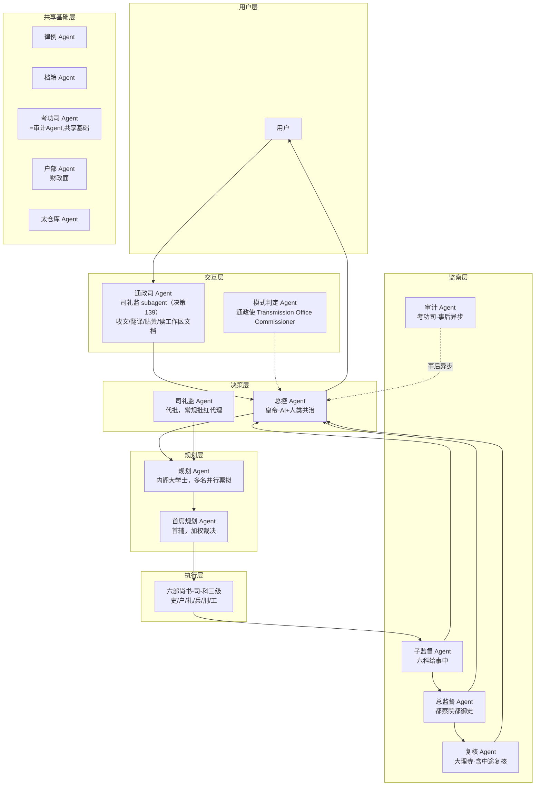
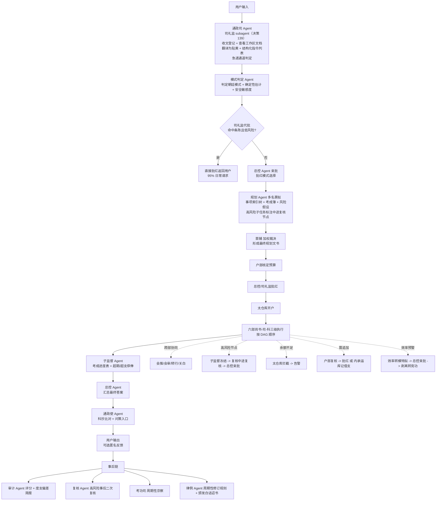
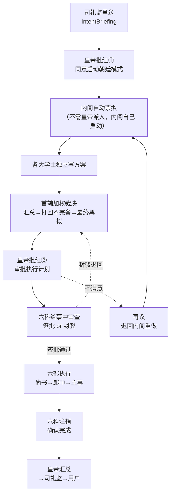
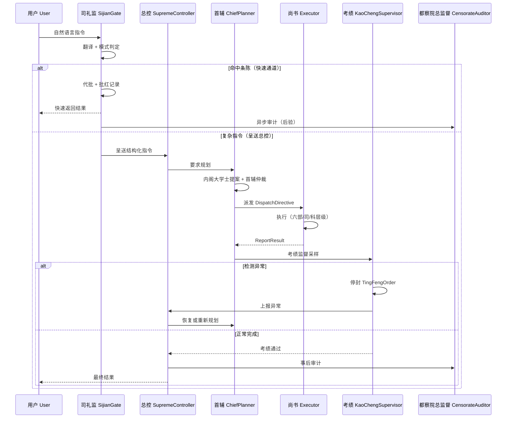
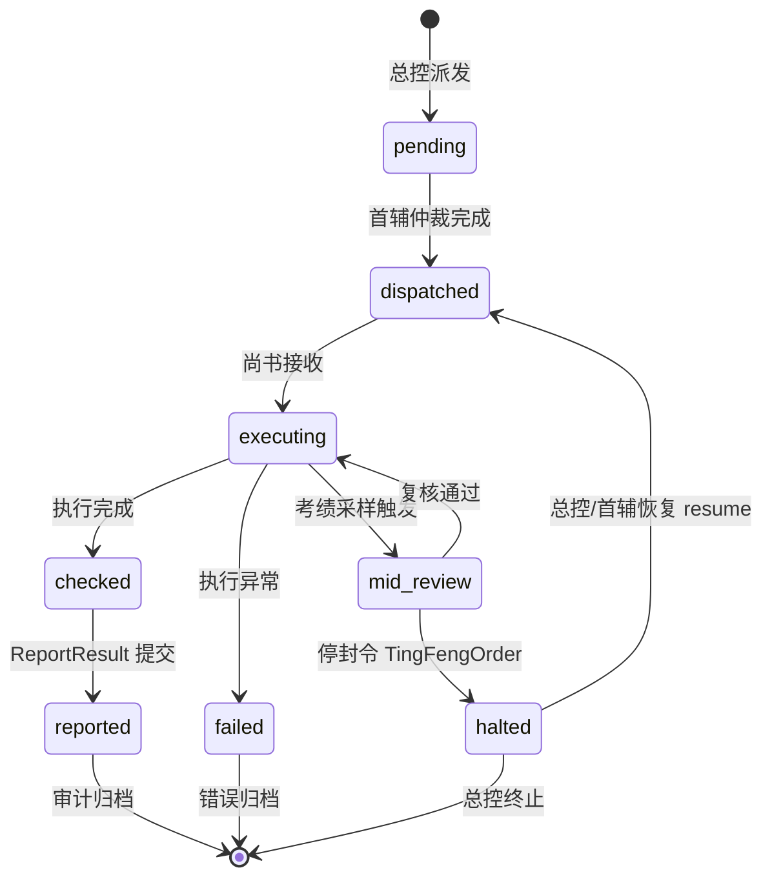
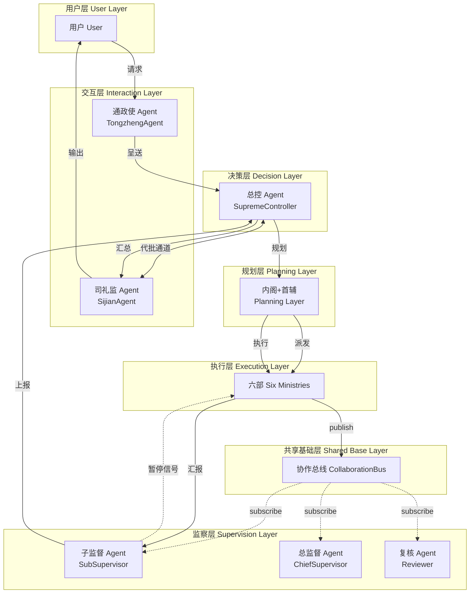

[AI 生成]

# 朝廷模式（任事型·文官体制）

> 朝廷模式是任事型编排的默认模式，对应 hierarchy Coordination × dag Execution 的完整 Preset。本文档定义其角色、全链路工作流、不变量、与微内核的对接方式，以及适用场景。

> 状态：stable
> 维护：@XZF（主笔）
> 讨论：无
> 待决：无

---

## 1. 模式定位

朝廷模式面向**任务整体确定性高、可清晰拆解为依赖链**的场景。核心逻辑：交互层翻译并判定模式 → 司礼监代批或总控亲批 → 内阁大学士票拟拆解 → 首辅加权裁决 → 户部核定预算 + 太仓库开户 → 六部尚书-司-科三级串行/简单并行执行（高风险子任务中途强制复核）→ 子监督（给事中）过程检查 → 总监督（都察院）全局汇总 → 复核（大理寺）高风险安全网 → 审计（考功司）事后成本审计。

朝廷模式与同属任事型的竞功模式（军事体制，详见 13-jinggong-mode.md）以及由两者混编的大明模式（详见 14-daming-mode.md）并列。三种模式共享制度层、交互层、执行层六部、监察层、通信层、冷启动层等基础能力，详见 11-renshi-shared-base.md。

任事型编排类型与谋士型（智囊团，详见 16-moushi-overview.md）是顶层职责分类；术语族（朝廷/竞功/智囊三族）是术语卫生规则。两个层级不同，详见 AGENTS.md §3（元数据）+ .agents/rules/write-new-doc.md。

---

## 2. 架构总览



> 架构总图引用自 02-architecture-layers.md，本图仅标注本模式 Agent 角色分配。

正常路径：交互层先翻译（可能由司礼监代批快速返回），总控收到内部指令后分发到规划层。多名规划 Agent 独立票拟，首辅加权裁决形成执行计划，户部核定预算并经太仓库开户后，六部按依赖顺序执行（DAG + Wave 引擎）。子监督层（给事中）实时监控执行合规性，总监督层（都察院）全局汇总并对照审批方案，复核层（大理寺）只对高风险子任务做中途复核，审计层（考功司）事后成本审计与权重反馈。任何一层发现问题都可向上反馈，总控决定打断、覆盖或重跑。通政使 Agent 在最终输出前做科抄比对（校验翻译可逆性），子监督 Agent（给事中）负责封驳判定并附偏离度评分。

异常分支：规划层超时或冲突无法解决时，总控激活紧急通道，绕过规划层直接下发预设降级方案（EmergencyFallback）。降级方案在系统初始化时预定义，总控不在现场 improvisation，保持决策可预期。

---

## 3. 角色定义

> **实现阶段**：本表全部角色均为 [Phase 1]。朝廷模式是默认模式，hierarchy Coordination 为 Phase 1 核心交付。

朝廷模式涉及的全部角色按下表归类。共享基础层角色（律例/档籍/考功司/户部财政面/太仓库）在三种模式间复用，详见 11-renshi-shared-base.md；本节聚焦朝廷模式特有行为。

| 层 | 角色 | 明朝映射 | 核心职责（朝廷模式视角） | 关键限制 | 数量 | 可选性 |
|----|------|---------|--------------------------|---------|
| 交互层 | 通政司 Agent（司礼监 subagent） | 通政使司（Transmission Office） | 收文登记（原始奏章全文+哈希交档籍）+ 查看工作区文档（读文件→贴黄摘要）+ 翻译用户输入为内部指令（贴黄 + 结构化指令列表）+ 分类 + 分发移交司礼监判断；上下文超阈值时分层压缩；急递通道判定中止/转向/新任务；输出附问策入口 | 司礼监组合持有（决策 139，决策 137 通政使 Agent 的落位）；翻译需可逆；不判内容对错；急递判定需附理由留档 | 1 | 必选 |
| 交互层 | 模式判定 Agent | 通政使（Transmission Office Commissioner） | 按任务特征在朝廷/竞功/大明三模式间判定，附确定性估计矩阵与安全敏感度标签；判定建议上报总控批红 | 仅建议权，总控可推翻；判定规则由律例提供 | 1 | 必选 |
| 决策层 | 总控 Agent | 皇帝（AI+人类共治） | 最高决策权（打断/覆盖/分发）；批红规划方案；接收模式判定建议；汇总最终答案；紧急通道下发降级方案；接收密奏与厂报；批红模式切换（含效率转模）；亲批战略级清单（诏狱启动、灾备切换、内承运库大额拨付、御马监调用、永久废黜等） | 不直接处理细节；紧急通道方案需律例预定义；批红决策附理由留档 | 1 | 必选 |
| 决策层 | 司礼监 Agent | 司礼监秉笔太监（Sijian Eunuch Scribe） | 委托通政司 subagent 收文/读工作区文档（决策 139），专注代批判断与用户交流；在总控授权范围内对常规批红（流水线方案确认、非高风险子任务通过、非战略级资源调度等）行使代笔权；遇越权请求立即上呈总控 | 代批范围由律例明定；越权代批作废并重批；代批记录不可删；锁院期间代批权限暂停 | 1 | 必选 |
| 规划层 | 规划 Agent（多名） | 内阁大学士（Grand Secretary） | 各自生成拆解方案（票拟），输出事项索引树（含考成簿：负责人/时限/验收标准/预算额度建议）；附验证条件、回退策略、风险假设；携带置信度与擅长领域标签；信息不足可增量拆分 | 无执行权；缺字段方案被打回 | 3 | 必选 |
| 规划层 | 首席规划 Agent | 内阁首辅（Chief Grand Secretary） | 汇总各规划方案，加权裁决冲突，打回不完备方案；形成最终规划文书；与总控共享对子监督 Agent 暂停操作的恢复权；对高风险子任务标注「建议中途复核」并指定复核节点 | 仅做方案裁决；未经总控批红和子监督封驳，不得下发 | 1 | 必选 |
| 执行层 | 六部尚书级 Agent | 吏/户/礼/兵/刑/工尚书 | 统筹本部任务，分派给各司，汇总结果；牵头跨部协同（会推） | 受太仓库预算账户实时硬约束 | 6 | 必选 |
| 执行层 | 侍郎级 Agent | 左/右侍郎（Vice-Minister） | 尚书副手，分管本部特定领域；有独立上奏权（可越级直呈总控）；尚书出缺时代理 | 受尚书管辖但可独立上奏；不得绕过尚书直接接收外部指令 | 6-12 | 必选 |
| 执行层 | 司级 Agent | 各清吏司（Bureau-level） | 按数据领域或职能分工（如文选/考功/稽勋/验封；十三司/度支/金部/仓部；仪制/祠祭/主客/精膳；职方/武选/车驾/武库；浙江等十三司/律例馆/提牢厅/司狱；营缮/虞衡/都水/屯田） | 部门调度 Agent | 待定 <!-- TODO: 待人工确认 --> | 必选 |
| 执行层 | 科级 Agent | 各科主事（Section Chief） | 执行单次原子操作（单次检索、单次计算、单次生成、单步推理、单次扫描、单次工具调用） | 原子 API 调用 | 待定 <!-- TODO: 待人工确认 --> | 必选 |
| 监察层 | 子监督 Agent | 六科给事中（Six Offices of Scrutiny） | 检查单个执行 Agent 完成情况；对口监督六部（每科对口一部）；passive 采样 + active 巡按；考成进度表与停俸降权；最终输出封驳判定（附偏离度评分）；中途复核节点冻结并通知复核 Agent；独立发送效率转模预警；执行注销闭环 | 暂停后由总控或首辅决定恢复；参数由律例定义；仅有暂停权无恢复权 | 1-2 | 必选 |
| 监察层 | 总监督 Agent | 都察院都御史（Censorate Chief Supervisor） | 汇总子监督报告；对照审批方案核查偏差；可建议 redo；弹劾权（十三道御史分领域）；联合京察（与考功司）；闭环互锁（总监督未签≠阻拦，但记入考成） | 不影响实时执行；可请求总控重跑但不具强制力 | 1 | 必选 |
| 监察层 | 复核 Agent | 大理寺（Court of Judicature） | 高风险任务二次复核，可强行推翻并要求重做；朝廷模式专属：对高风险子任务在预设关键节点执行**中途复核**，给出「放行/中止/调整」建议，直接上报总控；接收朝会答辩外部异议可重审京察结果 | 仅在特定高风险任务上触发；中途复核为强制暂停点，必须总控亲批方可继续 | 0-1 | 条件（高风险触发时） |
| 监察层 | 审计 Agent | 考功司（Merit Assessment Office） | 成本审计（度支偏差）；反振荡检查；权重反馈（WeightRegistry）；经验记录归档；抽查司礼监代批记录与内承运库支出 | 事后异步，不影响当次执行；可请求总控重跑但不具强制力 | 1 | 必选 |
| 监察层 | 元监察 Agent | 东厂（Eastern Depot） | 元监察——监察所有监察者（子监督/总监督/复核/审计）；密奏直通总控；可质疑任何监察结论 | 不得独立撤换执行 Agent（需总控联署）；密奏虚假反坐 | 0-1 | 条件（Phase 2+） |
| 监察层 | 独立监控 Agent | 锦衣卫（Imperial Guard） | 反监——与东厂互监；紧急隔离异常 Agent（诏狱）；独立调查权 | 隔离需附证据；与东厂互相监察不得单方独断 | 0-1 | 条件（Phase 2+） |

### 3.1 恢复权分离不变量

`resume`（恢复权）只出现在首辅和总控的 capabilities 中，子监督 Agent 没有 `resume`——这是暂停权与恢复权分离的代码级体现（见决策 81）。

---

## 4. 全链路工作流



---

## 4a. 皇帝审批制协调链路（D16b）

> 源于明朝皇帝制度。皇帝不是 dispatch 者（不主动派人），而是**审批者**（等提案，批/不批）。这是朝廷模式与最小编排原子的根本区别——主 Agent 逐步 dispatch，皇帝被动审批。

### 4a.1 皇帝 vs 主 Agent

| | 主 Agent（最小编排原子） | 皇帝（朝廷模式） |
|---|---|---|
| 工作方式 | 主动 dispatch（自己派人） | 被动审批（等提案，批/不批） |
| 和谁交流 | 直接和 subagent | 通过内阁/六科/司礼监间接 |
| 决定什么 | 每一步派谁做什么 | 批准/退回/再议 |

### 4a.2 完整协调链路



### 4a.3 皇帝与每一层的交流方式

| 层 | 皇帝怎么交流 | 机制 |
|----|-------------|------|
| 内阁 | **不派人**。内阁收到批红①后自动启动票拟 | Preset 自动触发 |
| 首辅 | **不直接交流**。首辅方案通过内阁流程到达皇帝 | 间接 |
| 六部 | **不直接指挥**。批红②的诏旨下发到六部 | 间接 |
| 六科 | **不直接交流**。六科自动审查批红后的方案 | 自动 |
| 司礼监 | 日常代批（批红①可代批） | 委托 |

皇帝在整个链路中只做三件事：**批红①（启动）→ 批红②（审计划）→ 汇总（收结果）**。

### 4a.4 三角制衡

内阁-皇帝-六科构成三角制衡：

| 方 | 权力 | 制约谁 |
|----|------|--------|
| 内阁 | 票拟权（提建议） | 没有票拟，皇帝无计划可批 |
| 皇帝 | 批红权（做决定） | 不批红，票拟不生效 |
| 六科 | 封驳权（质量关卡） | 可封驳皇帝批红的方案 |

三方互相需要、互相制约，防止任何一方独断。

### 4a.5 批红两次

| 批红 | 时机 | 审什么 | 可代批？ |
|------|------|--------|---------|
| ① 启动批红 | 收到 IntentBriefing 后 | 同意用朝廷模式 | ✅ 司礼监可代批 |
| ② 计划批红 | 首辅呈送执行计划后 | 审批执行计划（子任务+预算+风险标注） | ⚠️ 常规可代批，战略级亲批 |

### 4a.6 再议机制

皇帝对执行计划不满意时：

```
皇帝看执行计划
  ├── 满意 → 批红②
  ├── 小问题 → 批注意见后退回首辅修改
  └── 严重不满 → "再议"退回内阁重新票拟
```

再议可反复进行，直到皇帝满意或改用其他模式。

### 4a.7 中旨（紧急绕过通道）

皇帝可不经内阁直接下令（中旨）：

| 场景 | 正常流程 | 中旨 |
|------|----------|------|
| 常规任务 | 内阁→批红→六科→六部 | ✗ 不允许 |
| 紧急情况 | 同上（太慢） | ✅ 皇帝直接下令 |

璇玑 映射：EmergencyFallback（§5.4）= 中旨的实现。中旨必须皇帝亲批（不可代批），使用后需事后补办正常流程。

### 4a.8 各层协调接口

```typescript
/** 批红①后自动触发内阁票拟（Preset 定义） */
interface PresetTrigger {
  onApproval(approval: Approval, ctx: RequestContext): Promise<void>;
}

/** 内阁→首辅：方案汇总到首辅裁决 */
interface NeigeToShaifu {
  collectAndAdjudicate(proposals: Proposal[]): Promise<ExecutionPlan>;
}

/** 首辅→皇帝：呈送执行计划等待批红② */
interface ShaifuToEmperor {
  submitPlan(plan: ExecutionPlan): Promise<ApprovalResult>;
}

/** 皇帝→六科：批红②后自动交六科审查 */
interface EmperorToLiuke {
  approve(plan: ExecutionPlan): Promise<void>;
}

/** 六科→六部：签批通过后下发执行 */
interface LiukeToLiubu {
  dispatch(plan: ExecutionPlan): Promise<void>;
}
```

---

## 5. 核心机制与不变量

### 5.1 司礼监代批快速通道（决策 77）

用户请求进入交互层后，司礼监先做 prefilter。若请求命中条陈且判定为 minimal 风险，司礼监直接代批：调用条陈指定的 handler、打"批红"标签、同步审计 Agent 后验、直接返回用户，不经内阁票拟和六部执行。这是 95% 日常请求的快速通道。

代批快速通道不创建 RequestContext，不消耗 dispatchBudget，不触发三层监察的实时分支（但审计 Agent 仍做事后后验）。完整代批流程与四不变量（代批有据/批红可追溯/复杂必呈送/条陈不可擅改）见 15-sijian-batch.md。

### 5.2 考成法与停俸降权

子监督 Agent 基于考成簿（含负责人/时限/验收标准/预算额度）启动考成问责：

- 周期发布进度表（含预算执行率）
- 接近时限/预算阈值 → 预警
- 超期/超支 → 停俸（暂停 Token 配额）+ 降权
- 子任务连续两次驳回 → 上报总控和首辅
- 考成结果报送考功司

考成参数（预警阈值、超期降权级数、停俸时长）由律例 Agent 定义。

### 5.3 高风险子任务中途复核

首辅在规划文书对高风险子任务标注「建议中途复核」并指定复核节点。执行到节点时：

1. 子监督 Agent 冻结该子任务
2. 通知复核 Agent 介入
3. 复核 Agent 比对当前执行状态与原始规划、批红记录，评估是否偏离
4. 给出「放行/中止/调整」建议，上报总控
5. 总控亲批后方可继续（中途复核为强制暂停点）

中途复核触发条件、关键节点定义、复核时限由律例 Agent 定义。

### 5.4 紧急通道降级（决策 82）

规划层超时或冲突无法解决时，总控激活紧急通道，绕过规划层直接向六部下发预设降级方案（EmergencyFallback）。降级方案内容（triggerCondition + fallbackValue + defaultBehavior）在 Preset 配置阶段提前定义，保证降级输出可预期。

竞功模式对应机制是总督的 haltBranch，两者独立实现。

### 5.5 效率转模（→ 竞功模式）

朝廷模式中某子任务虽未失败但效率严重低下（预算/进度持续偏离阈值）时：

1. 户部 Agent 或子监督 Agent 检测效率预警（律例预设的预算消耗率/进度推进率阈值）
2. 生成「效率转模特拟」
3. 上报总控
4. 总控（人类）亲批 → 剥离该子任务，转入竞功模式执行
5. 竞功结果回归朝廷汇总

效率转模是**模式切换触发策略**，非第四独立模式。完整定义见 14-daming-mode.md。

### 5.6 六部协同机制

| 协同类型 | 明朝映射 | 场景举例 | 协调规则 |
|---------|---------|---------|---------|
| 会推 | 吏部会同各部推选 | 复杂任务需多部协作，如生成含数据分析的报告 | 首辅指定牵头部，其他部派司配合 |
| 会审 | 三法司会审 | 高风险输出需刑部+兵部+吏部联合审核 | 子监督 Agent 发起联合校验 |
| 转行 | 公文在各部之间流转 | 礼部生成初稿 → 刑部合规检查 → 礼部修改 → 吏部事实核查 → 输出 | 协作总线自动路由 |
| 关白 | 各部互通信息 | 户部发现某类任务消耗偏高，通知兵部优化推理链 | 协作总线发布部门公告 |

各部之间通过协作总线间接通信，不得私自建立直连通道。跨部协同请求需包含请求方/接收方/事项/优先级/是否需要回执。牵头部的尚书级 Agent 拥有该协同任务的临时调度权。

### 5.6a 六部内部协调机制（D16）

> 源于明朝六部体系的内部层级设计。每个部内部有三级层级 + 制衡机制 + 分层授权。

#### 三级层级

```
尚书（部主 Agent）
  ├── 侍郎（副手，有独立上奏权）
  │     ↓ dispatch
  │   郎中（司级，日常自主）
  │     ↓ dispatch
  │   主事（科级，执行原子操作）
  └── 给事中（对口监督，封驳/注销）
```

尚书是本部的主 Agent——对部门内部来说，尚书扮演最小编排原子中"主 Agent"的角色。

#### 侍郎独立上奏权（Escalate Capability）

侍郎是尚书的副手，但有**独立上奏权**——可以绕过尚书直接向皇帝密奏。

```typescript
// 侍郎的 capabilities
interface ShilangCapabilities {
  dispatch: true;     // 部门内 dispatch（管郎中/主事）
  escalate: true;     // 独立上奏（绕过尚书直送皇帝）
}

// escalate 不是运行中通信——是结构化越级通道
// 侍郎通过 AgentTransport.send(target="emperor", message=密奏内容)
// 皇帝收到密奏后决定是否介入
```

**为什么允许越级**：侍郎发现尚书决策有误时，可以直接向皇帝报告。这是部内的制衡力量——防止尚书独断。

**限制**：escalate 只用于报告重大问题（合规风险/预算超支/执行偏差）。滥用 escalate 会被总监督（都察院）弹劾。

#### 郎中日常自主（分层授权）

郎中独立处理司内**日常事务**，只有**重大事项**才上报。

| 产出类型 | 郎中怎么处理 | 是否 Check |
|----------|-------------|-----------|
| 日常（低风险，在权限范围内） | 自己决策，直接处理 | 快速 Check（模板校验） |
| 重大（高风险，超出权限） | 上报侍郎→尚书 | 完整 Check（详细审查） |

```typescript
// 郎中的 Identity 定义中包含自主决策范围
interface LangzhongIdentity {
  autoApproveScope: {
    maxCost: number;           // 在此成本内自主决策
    riskLevel: "low";          // 只处理低风险
    allowedActions: string[];  // 允许的操作类型
  };
}

// 执行后判断
if (产出.riskLevel <= identity.autoApproveScope.riskLevel 
    && 产出.cost <= identity.autoApproveScope.maxCost) {
  // 日常：快速 Check，不上报
  return quickCheck(产出);
} else {
  // 重大：完整 Check，上报尚书
  return fullCheck(产出) → reportTo(尚书);
}
```

**设计意义**：不是每个产出都要详细 Check——日常事务快速通过，节省监督成本。

#### 不越级 dispatch 不变量

```
不变量：no-skip-dispatch
```

尚书不能绕过郎中直接 dispatch 给主事。dispatch 目标必须是直接下级。

```typescript
// 身份定义中的汇报关系
interface IdentityDefinition {
  reportsTo?: string;  // 直接上级 identity 名
}

// dispatch 前检查
function canDispatch(dispatcherIdentity: string, targetIdentity: string): boolean {
  const target = identityLibrary.get(targetIdentity);
  // 目标的 reportsTo 必须是 dispatch 者
  return target.reportsTo === dispatcherIdentity;
}

// 允许：尚书 dispatch 给郎中（郎中.reportsTo === "尚书"）
// 禁止：尚书 dispatch 给主事（主事.reportsTo === "郎中" ≠ "尚书"）
```

**为什么**：保持每一层的完整性。如果尚书能直接指挥主事，郎中就失去存在意义——层级体系被架空。

**例外**：紧急通道（EmergencyFallback）可绕过此不变量——但必须由皇帝亲批。

#### 部内制约链

```
尚书 ←─────── 侍郎（独立上奏权，部内制衡）
  │
  ├──→ 郎中（日常自主，重大上报）
  │       │
  │       └──→ 主事（执行原子操作）
  │
  ▼
给事中（对口监督：封驳/注销）
  │
  ▼
总监督/都察院都御史（可弹劾尚书及以下任何人）
```

多层制衡确保没有任何一级可以独断：
- 侍郎制衡尚书（独立上奏）
- 郎中日常自主（不完全依赖尚书决策）
- 给事中封驳（可驳回部的产出）
- 总监督（都察院）弹劾（可弹劾任何人）

### 5.7 不变量清单

| 不变量 | 含义 |
|--------|------|
| 代批有据 | 司礼监代批必须命中预授权条陈 |
| 批红可追溯 | 所有批红（含代批）生成不可篡改记录入档籍 |
| 复杂必呈送 | 复杂/多 steps/涉数据修改/非最低风险必须呈送总控 |
| 条陈不可擅改 | 司礼监不得自行扩充条陈范围 |
| 暂停/恢复权分离 | 子监督 Agent 仅暂停，恢复权由总控和首辅共享 |
| 监察者被监察 | 改写/暂停记录进事件流，可被更高层采样复审 |
| 预算硬约束 | 执行层消耗 Token 实时从预算账户扣除，余额不足硬拦截 |
| 人类必须亲批 | 战略级清单（模式切换/诏狱/灾备/大额拨付/御马监/永久废黜）必须人类管理员审批 |

### 5.8 交互层 TS 接口（Interface Signatures）

> 对应 §3 通政使角色。接口签名依据决策 22（司礼监代批四不变量）、决策 84（Preset + 渐进推断）。

```typescript
/** 通政使翻译器（ChaotingTranslator）— 将用户自然语言翻译为结构化指令 */
interface ChaotingTranslator {
  translate(rawInput: string, ctx: RequestContext): Promise<TranslatedDirective>;
}

/** 翻译后的结构化指令 */
interface TranslatedDirective {
  readonly intent: string;
  readonly payload: unknown;
  readonly complexity: 'simple' | 'complex';
  readonly riskLevel: 'lowest' | 'low' | 'moderate' | 'high';
  readonly requiresDataMutation: boolean;
  readonly stepCount: number;
}

/** 模式判定结果 */
interface ModeAssessment {
  readonly recommendedMode: 'hierarchy' | 'market' | 'council';
  readonly confidence: number;
  readonly reasoning: string;
  readonly deviation: DeviationScore;
}

/** 偏差评分（DeviationScore）— 评估指令与各模式的偏离度 */
interface DeviationScore {
  readonly hierarchy: number;
  readonly market: number;
  readonly council: number;
}

/** 快速通道决策（ExpressDecision） */
interface ExpressDecision {
  readonly approved: boolean;
  readonly reason: string;
  readonly charterRuleId?: string;
}
```

### 5.9 决策层 TS 接口

> 对应 §5.2 决策角色（皇帝总控 + 司礼监代批）。依据决策 22（司礼监代批）、决策 74（角色=Identity.role）、决策 82（紧急通道降级）。

```typescript
/** 总控 Agent / 皇帝（SupremeController）— hierarchy 顶点 */
interface SupremeController {
  dispatch(directive: TranslatedDirective, ctx: RequestContext): Promise<DispatchDirective>;
  interrupt(taskId: string, reason: string): Promise<void>;
  override(decision: StrategicAction): Promise<void>;
  emergency(fallback: EmergencyFallback): Promise<void>;
  resume(taskId: string): Promise<void>;
}

/** 司礼监 Agent / 代批（SijianAgent） */
interface SijianAgent {
  assess(directive: TranslatedDirective, charter: BatchApproveCharter): Promise<ExpressDecision>;
  delegateApprove(directive: TranslatedDirective, rule: CharterRule): Promise<PiHongRecord>;
  escalate(directive: TranslatedDirective): Promise<void>;
}

/** 条陈 / 预授权规则集（BatchApproveCharter） */
interface BatchApproveCharter {
  readonly rules: readonly CharterRule[];
  readonly version: string;
  readonly approvedBy: 'human' | 'supreme';
}

/** 单条条陈规则（CharterRule） */
interface CharterRule {
  readonly id: string;
  readonly intentPattern: string;
  readonly maxRiskLevel: 'lowest' | 'low';
  readonly maxStepCount: number;
  readonly requiresDataMutation: false;
}

/** 批红记录（PiHongRecord）— 不可篡改 */
interface PiHongRecord {
  readonly id: string;
  readonly directiveSnapshot: TranslatedDirective;
  readonly charterRuleId: string;
  readonly timestamp: number;
  readonly immutable: true;
}

/** 紧急通道降级（EmergencyFallback）— 决策 82 */
interface EmergencyFallback {
  readonly scenario: string;
  readonly fallbackAction: StrategicAction;
  readonly humanApprovalRequired: boolean;
}

/** 战略级动作（StrategicAction）— 必须人类审批 */
interface StrategicAction {
  readonly type: 'mode-switch' | 'disaster-recovery' | 'budget-allocation' | 'permanent-disable';
  readonly payload: unknown;
}
```

### 5.10 规划层 TS 接口

> 对应 §5.2 规划角色（首辅 + 内阁大学士）。依据决策 74、决策 81（暂停/恢复权分离）。

```typescript
/** 首席规划 Agent / 首辅（ChiefPlanner）— 内阁首席，拥有 arbitrate + resume */
interface ChiefPlanner {
  proposePlan(directive: TranslatedDirective): Promise<GrandSecretaryProposal[]>;
  arbitrate(proposals: GrandSecretaryProposal[]): Promise<DispatchDirective>;
  resume(taskId: string): Promise<void>;
}

/** 内阁大学士提案（GrandSecretaryProposal） */
interface GrandSecretaryProposal {
  readonly plannerId: string;
  readonly planSteps: readonly string[];
  readonly estimatedBudget: number;
  readonly assignedExecutor: string;
  readonly riskAssessment: string;
}

/** 派发指令（DispatchDirective）— 规划层产物，执行层输入 */
interface DispatchDirective {
  readonly taskId: string;
  readonly targetRole: 'executor' | 'executor-si' | 'executor-ke';
  readonly steps: readonly DispatchStep[];
  readonly budget: BudgetAllocation;
  readonly deadline?: number;
}

/** 派发步骤 */
interface DispatchStep {
  readonly description: string;
  readonly toolCalls?: readonly string[];
  readonly dependsOn?: readonly string[];
}
```

### 5.11 执行层 TS 接口

> 对应 §5.3 六部尚书级 / 司级 / 科级执行角色。依据决策 74、原则 4（不限制数量，预算驱动）。

```typescript
/** 六部尚书级执行 Agent（MinisterExecutor）*/
interface MinisterExecutor {
  execute(task: HierarchicalTask, ctx: RequestContext): Promise<ReportResult>;
  coordinateBu(request: CrossBuRequest): Promise<void>;
  reportProgress(taskId: string): Promise<ReportResult>;
}

/** 侍郎级 Agent（DeputyExecutor）——尚书的副手，分管特定领域 */
interface DeputyExecutor {
  execute(task: HierarchicalTask, ctx: RequestContext): Promise<ReportResult>;
  /** 独立上奏权——可越级直呈总控（不经尚书） */
  reportToSupreme(issue: string, evidence: unknown): Promise<void>;
  /** 代理尚书职责（尚书出缺时） */
  actAsMinister(task: HierarchicalTask, ctx: RequestContext): Promise<ReportResult>;
}


/** 司级 Agent（BureauAgent）*/
interface BureauAgent {
  execute(task: HierarchicalTask, ctx: RequestContext): Promise<ReportResult>;
}

/** 科级 Agent（SectionAgent）— 叶子节点 */
interface SectionAgent {
  execute(task: HierarchicalTask, ctx: RequestContext): Promise<ReportResult>;
}

/** 层级任务（HierarchicalTask）*/
interface HierarchicalTask {
  readonly id: string;
  readonly parentTaskId?: string;
  readonly directive: DispatchDirective;
  readonly status: TaskStatus;
  readonly resourceMetrics: ResourceMetrics;
}

/** 任务状态枚举（TaskStatus）*/
type TaskStatus =
  | 'pending'
  | 'dispatched'
  | 'executing'
  | 'mid-review'
  | 'checked'
  | 'reported'
  | 'failed'
  | 'halted';

/** 执行结果报告（ReportResult）*/
interface ReportResult {
  readonly taskId: string;
  readonly success: boolean;
  readonly output: unknown;
  readonly metrics: ResourceMetrics;
  readonly errors?: readonly string[];
}

/** 资源消耗指标（ResourceMetrics）*/
interface ResourceMetrics {
  readonly tokenUsage: number;
  readonly latencyMs: number;
  readonly toolCallCount: number;
}
```

### 5.12 监察层 TS 接口

> 对应 §5.4 监察角色（六科给事中子监督）。依据决策 81（暂停/恢复权分离：子监督仅有 pause，无 resume）。

```typescript
/** 子监督 Agent / 六科给事中（KaoChengSupervisor）*/
interface KaoChengSupervisor {
  monitor(taskId: string): Promise<KaoChengProgress>;
  pause(taskId: string, reason: string): Promise<TingFengOrder>;
  // 注意：无 resume 方法——恢复权属于 ChiefPlanner 和 SupremeController（决策 81）
}

/** 考绩进度（KaoChengProgress）*/
interface KaoChengProgress {
  readonly taskId: string;
  readonly phase: 'executing' | 'mid-review' | 'checked';
  readonly qualityScore?: number;
  readonly anomalies: readonly string[];
}

/** 停封令（TingFengOrder）— 暂停指令 */
interface TingFengOrder {
  readonly taskId: string;
  readonly issuedBy: string;
  readonly reason: string;
  readonly timestamp: number;
  readonly recordedInEventStream: true;   // 不变量：监察者被监察
}
```

### 5.13 审计与复核层 TS 接口

> 对应监察层总监督角色（都察院全局汇总监督）+ 复核角色（大理寺高风险复核）+ 审计角色（考功司事后成本审计）。依据决策 81、原则 24。

```typescript
/** 总监督 Agent（都察院都御史 CensorateAuditor）— 全局汇总监督 */
interface CensorateAuditor {
  audit(taskId: string, eventLog: readonly unknown[]): Promise<AuditReport>;
}

/** 审计报告（AuditReport）*/
interface AuditReport {
  readonly taskId: string;
  readonly findings: readonly string[];
  readonly severity: 'info' | 'warning' | 'critical';
  readonly budgetVariance?: DuzhiVarianceReport;
}

/** 度支偏差报告（DuzhiVarianceReport）— 预算实际 vs 预估偏差 */
interface DuzhiVarianceReport {
  readonly estimated: number;
  readonly actual: number;
  readonly varianceRatio: number;
  readonly exceedsBudget: boolean;
}

/** 大理寺复核 Agent（MidExecutionReviewer）— 高风险强制复核 */
interface MidExecutionReviewer {
  review(task: HierarchicalTask, report: ReportResult): Promise<ReviewVerdict>;
  overturn(taskId: string, reason: string): Promise<void>;
}

/** 复核裁决（ReviewVerdict）*/
interface ReviewVerdict {
  readonly taskId: string;
  readonly verdict: 'approve' | 'modify' | 'reject';
  readonly confidence: number;
  readonly reasoning: string;
}
```

### 5.13a 元监察与反监 TS 接口（v4 D13 补充）

> 东厂（元监察）+ 锦衣卫（反监）。Phase 2+ 实现。依据 D13（明朝文官监察体系完整映射）。

```typescript
/** 元监察 Agent / 东厂（MetaMonitor）——监察所有监察者 */
interface MetaMonitor {
  /** 审计监察者的监察行为（检查是否有偏颇/遗漏） */
  auditChecker(checkerId: string): Promise<CheckerAuditResult>;
  /** 密奏直通总控（不经内阁/六科） */
  reportToSupreme(report: MetaReport): Promise<void>;
  /** 质疑任何监察结论 */
  challengeConclusion(conclusionId: string, evidence: unknown): Promise<void>;
}

/** 元监察审计结果 */
interface CheckerAuditResult {
  readonly checkerId: string;
  readonly biased: boolean;           // 是否有偏颇
  readonly missedIssues: string[];    // 遗漏的问题
  readonly timestamp: number;
}

/** 元监察密奏 */
interface MetaReport {
  readonly targetId: string;
  readonly issue: string;
  readonly evidence: unknown;
  readonly severity: "info" | "warning" | "critical";
}

/** 独立监控 Agent / 锦衣卫（IndependentWatchdog）——反监+紧急隔离 */
interface IndependentWatchdog {
  /** 紧急隔离异常 Agent（诏狱——冻结 Agent，暂停一切操作） */
  isolate(agentId: string, reason: string, evidence: unknown): Promise<IsolationOrder>;
  /** 反监东厂——审计元监察者自身 */
  auditMetaMonitor(): Promise<WatchdogReport>;
  /** 独立调查（不经任何中间层） */
  investigate(targetId: string, scope: string): Promise<InvestigationReport>;
}

/** 隔离令（IsolationOrder）——诏狱 */
interface IsolationOrder {
  readonly agentId: string;
  readonly issuedBy: string;
  readonly reason: string;
  readonly evidence: unknown;
  readonly timestamp: number;
  readonly coSignedBy: string;        // 需总控联署才生效
  readonly recordedInEventStream: true;
}

/** 反监报告 */
interface WatchdogReport {
  readonly metaMonitorId: string;
  readonly findings: string[];
  readonly timestamp: number;
}
```

**厂卫互监不变量**：东厂可质疑锦衣卫，锦衣卫可反监东厂。两者密奏都直达总控。任何一方的结论都可被另一方挑战。无人能最终独断。

**密奏通道**（三种主体）：
1. **东厂 Agent（MetaMonitor）**——可口头直达 PatternRuntime，不需正式文书
2. **监军御史 Agent（Monitor）**——随任务执行，密奏直通 PatternRuntime
3. **银章 Agent**——被 PatternRuntime 特许直接报告的 Agent（持"银章"授权标记），不经中间层

> 历史验证（D13）：明朝密奏主体不限于东厂/监军御史，还包括被赐银章的"信臣"。东厂的特点是"可口头直达"，锦衣卫需具疏上奏。

### 5.14 预算与协同 TS 接口

> 对应 §5.7 通信拓扑（协作总线）+ 原则 4（预算驱动并发限制）。依据决策 79（图状通信）、决策 81。

```typescript
/** 预算分配（BudgetAllocation）*/
interface BudgetAllocation {
  readonly tokenBudget: number;
  readonly maxConcurrency: number;
  readonly accountId: string;       // 关联太仓库账户
}

/** 太仓库账户（TaicangkuAccount）— Token 预算追踪 */
interface TaicangkuAccount {
  readonly id: string;
  readonly balance: number;         // 剩余 Token 预算
  readonly transactions: readonly BudgetTransaction[];
  debit(amount: number, taskId: string): Promise<boolean>;  // 余额不足返回 false（硬拦截）
}

/** 预算交易记录 */
interface BudgetTransaction {
  readonly taskId: string;
  readonly amount: number;
  readonly timestamp: number;
  readonly type: 'debit' | 'credit';
}

/** 协作总线（CollaborationBus）— 图状通信实现，决策 79 */
interface CollaborationBus {
  publish(channel: string, message: unknown): Promise<void>;
  subscribe(channel: string, handler: (msg: unknown) => void): Promise<void>;
  sendDirect(targetId: string, message: unknown): Promise<void>;
}

/** 跨部协同请求（CrossBuRequest）*/
interface CrossBuRequest {
  readonly fromBu: string;           // 请求方部门
  readonly toBu: string;             // 接收方部门
  readonly subject: string;
  readonly priority: 'low' | 'medium' | 'high';
  readonly requiresReceipt: boolean;
}
```

### 5.14a 跨部协同 TS 接口（D13 补充）

> 六部之间的四种正式协同方式。全部通过 EventBus/AgentTransport 走正式通道，不私下 dispatch。依据 D13。

```typescript
/** 跨部协同请求（CrossBuRequest 的四种类型）*/
type CrossBuCoordination =
  | { type: "huitui"; targetBu: string; candidate: string; reason: string }     // 会推：联合推荐人选
  | { type: "huishen"; targetBu: string; subject: string; evidence: unknown }    // 会审：联合审查
  | { type: "zhuanxing"; targetBu: string; document: unknown }                   // 转行：公文流转（A完成→转B）
  | { type: "guanbai"; targetBu: string; notification: string };                  // 关白：通报通知

/** 跨部协同结果 */
interface CrossBuResult {
  readonly accepted: boolean;
  readonly response?: string;
  readonly timestamp: number;
}

/**
 * 跨部协同通过 MinisterExecutor.coordinateBu() 发起。
 * 接收方尚书收到后决定：接受/拒绝/转呈总控。
 * 全程记录事件流（可审计）。
 */
```

**四种协同的使用场景**：
- **会推**（联合推荐）：吏部选人时，联合其他部一起推荐 → 多方共识
- **会审**（联合审查）：复杂任务需要多部联合审查 → 交叉验证
- **转行**（公文流转）：工部代码完成 → 转给刑部审查 → 正式交接
- **关白**（通报通知）：户部预算调整 → 关白兵部（影响军饷）→ 信息同步

### 5.15 端到端工作流（sequenceDiagram）

> 正常路径 + 司礼监代批快速通道 + 异常分支（监督暂停）。节点含中英文双语（D6）。



### 5.16 任务状态机（stateDiagram-v2）

> 覆盖任务从派发到终态的全生命周期。暂停/恢复权分离在状态转换中体现（决策 81）。



### 5.17 数据结构示例

> Identity 配置示例（YAML）+ 关键事件结构。依据决策 74（角色=Identity.role）。

首辅 Identity 配置：

```yaml
# identity: chief-planner (首辅)
id: "chief-planner"
role: "chief-planner"
systemPrompt: |
  你是内阁首辅，负责将总控的结构化指令拆解为可执行计划，
  并仲裁内阁大学士的提案。
model: "gpt-4o"
capabilities:
  - "arbitrate"
  - "resume"
dispatchBudget: 0
skills:
  - "task-decomposition"
  - "risk-assessment"
loop: "react-loop"
```

考绩监督 Identity 配置（注意：无 resume capability）：

```yaml
# identity: supervisor (六科给事中)
id: "kaocheng-supervisor"
role: "supervisor"
systemPrompt: |
  你是六科给事中，负责过程监督。你可以暂停任务但无权恢复。
model: "gpt-4o-mini"
capabilities:
  - "monitor"
  - "pause"
dispatchBudget: 0
loop: "monitor-loop"
```

任务派发事件结构（事件溯源，写入事件流）：

```yaml
event:
  type: "TaskDispatched"
  taskId: "task-2026-001"
  timestamp: 1737600000
  payload:
    directive:
      targetRole: "executor"
      steps:
        - "分析需求文档"
        - "生成实现方案"
      budget:
        tokenBudget: 50000
        maxConcurrency: 3
        accountId: "taicang-001"
    issuedBy: "chief-planner"
    charterRuleId: null   # 非代批任务
```

批红记录（代批快速通道产物）：

```yaml
piHongRecord:
  id: "pihong-2026-042"
  directiveSnapshot:
    intent: "query-status"
    complexity: "simple"
    riskLevel: "lowest"
    requiresDataMutation: false
    stepCount: 1
  charterRuleId: "rule-query-001"
  timestamp: 1737600123
  immutable: true
```

### 5.18 边界条件

> 触发条件 / 终止条件 / 降级策略。覆盖子 Agent 失败、预算耗尽、并发派发三种场景。

| 场景 | 触发条件 | 处理策略 | 决策依据 |
|------|----------|----------|----------|
| 子 Agent 执行失败 | ReportResult.success === false | 1. 子监督 Agent 记录异常 2. 首辅决定重试/降级/终止 3. 总控可 interrupt | 决策 81 |
| 预算耗尽 | TaicangkuAccount.balance ≤ 0 | 1. 硬拦截新派发 2. 执行中任务允许完成当前 step 3. 通知总控请求追加预算 | 原则 4 |
| 并发派发超过上限 | activeTasks > maxConcurrency | 1. 队列等待 2. 优先级排序 3. 高优先级可抢占低优先级预算 | 原则 4 |
| 司礼监代批越界 | 指令不命中任何 CharterRule | 1. 立即 escalate 呈送总控 2. 不得自行扩充条陈 3. 生成审计记录 | 决策 22 |
| 子监督 Agent 触发停封 | qualityScore < threshold 或检测异常 | 1. 发出 TingFengOrder 2. 上报总控 3. 总控/首辅决定 resume 或终止 | 决策 81 |
| 大理寺复核推翻 | ReviewVerdict.verdict === 'reject' | 1. overturn 撤销任务 2. 记录原因 3. 通知首辅重新规划 | 原则 24 |
| 紧急通道启用 | EmergencyFallback 匹配预设场景 | 1. 执行 fallbackAction 2. 如需人类审批则等待 3. 事后审计 | 决策 82 |

### 5.19 通信拓扑

> 朝廷模式通信关系总览。三种通信模式均映射到 v4 图状通信（决策 79），不新增 Transport 实现。

朝廷模式的通信分为三种模式：点对点直连、发布订阅（协作总线）、层间主路径。六部之间禁止私自建立直连通道，跨部协同全部经协作总线路由。

### 5.19.1 点对点

- **总控 ↔ 司礼监**：总控向司礼监下发授权列表与指令；司礼监遇越权请求时 escalate 上呈总控。
- **首辅 → 六部**：首辅仲裁后向六部尚书级 Agent 派发 DispatchDirective。
- **六科 → 六部（暂停信号）**：子监督 Agent 对执行中任务发出 TingFengOrder 暂停信号，六部收到后冻结当前子任务。

### 5.19.2 发布订阅

- **协作总线 CollaborationBus**：六部执行层将跨部协同请求（会推/会审/转行/关白）publish 到协作总线；监察层（子监督 Agent、总监督 Agent、复核 Agent、审计 Agent）subscribe 对应频道接收事件。总控通过授权列表控制订阅权限，未授权订阅被拒绝。

### 5.19.3 层间主路径

```
用户 → 司礼监 → 总控 → 内阁 → 六部 → 监察 → 司礼监 → 用户
```

该路径覆盖正常请求的全生命周期：用户输入经司礼监翻译后呈送总控，总控分发内阁票拟，首辅裁决后派发六部执行，监察层实时监控并上报总控，最终经司礼监返回用户。



### 5.19.4 AgentGroup 频道（D13 补充）

> 每个部是一个独立通信频道（AgentGroup）。尚书是唯一外部入口。依据 D13。

朝廷模式的六个 AgentGroup 频道：

| AgentGroup | channel 名 | 明朝映射 | 职责 | 入口 Agent |
|------------|-----------|----------|------|-----------|
| IdentityGroup | `"libu"` | 吏部 | 身份管理/选人/能力评估 | 吏部尚书 |
| ResourceGroup | `"hubu"` | 户部 | 预算/成本/资源调度 | 户部尚书 |
| FormatGroup | `"libu-li"` | 礼部 | 格式/标准/协议 | 礼部尚书 |
| StrategyGroup | `"bingbu"` | 兵部 | 推理/方案设计/竞争分析 | 兵部尚书 |
| ReviewGroup | `"xingbu"` | 刑部 | 合规/审查/纠错 | 刑部尚书 |
| ExecutionGroup | `"gongbu"` | 工部 | 代码生成/内容创作/执行 | 工部尚书 |

**频道规则**：
1. **外部指令只发给尚书**——PatternRuntime dispatch 时 target 只能是 head（尚书）
2. **部内通信走本部频道**——EventBus.subscribe(`"bingbu"`) 收到本部内部消息
3. **跨部走正式协同**——会推/会审/转行/关白（§5.14a），不私下 dispatch
4. **不跨级指挥**——尚书不能直接给科级下令，必须经侍郎→司→科逐级传递

```typescript
/** AgentGroup 定义 */
interface AgentGroupChannel {
  name: string;                     // "bingbu"
  displayName: string;              // "兵部"
  channel: string;                  // EventBus 频道名
  headRole: string;                 // 尚书的 Identity.role
  deputyRoles: string[];            // 侍郎的 role 列表
  bureauRoles: string[];            // 司级的 role 列表
  sectionRoles: string[];           // 科级的 role 列表
}
```

---

## 6. 与微内核对接

朝廷模式作为 hierarchy Coordination Pattern 的完整 Preset，其全部角色映射到 v4 微内核的 6 个一等概念（Agent/Loop/User/Communication/State/Pattern，详见 02-architecture-layers.md），不引入新的架构枚举。

### 6.1 角色 = Identity.role 配置（决策 74）

朝廷模式的每个角色都是 Identity 库中的模板，通过 `Identity.role` 字段区分。架构只理解 Agent，不 `switch(role)`。Loop 行为差异通过 Identity 配置的 hooks/slots 实现。

| 朝廷模式角色 | Identity.role 值 | capabilities | dispatchBudget |
|------------|------------------|--------------|----------------|
| 通政司 Agent（司礼监 subagent） | `"tongzheng"` | `["translate", "reverseTranslate", "complexityScore", "inspect-workspace", "register"]` | 0（不派发） |
| 模式判定 Agent | `"mode-arbiter"` | `["propose-mode"]` | 0 |
| 总控 Agent（皇帝） | `"supreme"` | `["dispatch", "interrupt", "override", "emergency"]` | 大（架构兜底 10） |
| 司礼监 Agent（代批） | `"pi-hong"` | `["approve-delegated"]` | 0 |
| 规划 Agent（内阁大学士） | `"planner"` | `["propose"]` | 0 |
| 首席规划 Agent（首辅） | `"chief-planner"` | `["arbitrate", "resume"]` | 0 |
| 六部尚书级 Agent | `"executor"` | `["execute", "coordinate-bu"]` | 中（架构兜底 10） |
| 司级 Agent | `"executor-si"` | `["execute"]` | 0（叶子） |
| 科级 Agent | `"executor-ke"` | `["execute"]` | 0（叶子） |
| 子监督 Agent（六科给事中） | `"supervisor"` | `["monitor", "pause"]` | 0 |
| 总监督 Agent（都察院） | `"chief-supervisor"` | `["supervise", "audit", "challenge"]` | 0 |
| 复核 Agent（大理寺） | `"reviewer"` | `["review", "overturn"]` | 0 |
| 审计 Agent（考功司） | `"auditor"` | `["audit"]` | 0 |

`resume`（恢复权）只出现在首辅和总控的 capabilities 中，子监督 Agent 没有 `resume`——这是暂停权与恢复权分离的代码级体现（决策 81）。

### 6.2 Loop = 四库之一

朝廷模式默认使用 `react-loop`（外层对话循环 + 内层工具循环）作为所有 Agent 的执行引擎。Loop 库是 v4 四库（身份/架构提示词/技能/Loop）之一，运行期只读（只能从已注册的 Loop 选，不能运行期创建），无 Loop 专家，新 Loop 注册是开发期行为。

不同角色可配置不同 Loop（如子监督 Agent 用专门的监控 Loop，总监督 Agent 用专门的汇总 Loop），但都从 Loop 库选取，无特权通道。

### 6.3 通信 = 图状通信（决策 79）

朝廷模式的协作总线是图状通信在发布订阅模式上的实现。`CollaborationBus` 接口映射到图状通信的 `subscribe` / `publish` / 权限管控。

朝廷模式不涉及竞功模式的"竞争者间禁止横向通信"约束（该约束属市场 Coordination）。总控通过授权列表控制信息流，未授权订阅被拒绝。跨部协同（会推/会审/转行/关白）全部经协作总线，不得私自建立直连通道。

跨用户通信（Phase 3）需 Trust Level 授权（none/read-only/invoke/delegate/full-control）。

### 6.4 状态 = 事件溯源（EventSourcedState，决策 80）

朝廷模式下所有状态变更都是 append-only 事件，状态是事件的投影（EventSourcedState）。命名空间分区：Agent 只看自己有权的分区（与 Identity scope 联动）。

朝廷模式事件类型示例：

| 事件 | 产生者 | 用途 |
|------|-------|------|
| 原始奏章 | 通政司 | 用户输入全文 + 内容哈希（第0层永不删） |
| 贴黄 | 通政司 | 结构化指令的精简表示 |
| 批红记录 | 总控/司礼监 | 不可篡改的决策留底 |
| 代批记录 | 司礼监 | 代笔批红的索引和理由 |
| 票拟 | 规划 Agent | 拆解方案 |
| 规划文书 | 首辅 | 加权裁决后的最终方案 |
| 度支票拟 | 户部 | 子任务级预算表 |
| 预算快照 | 太仓库 | 开户时的预算账户状态（第1层锚点永不冲刷） |
| 中途复核快照 | 复核 Agent | 高风险节点的执行状态对比基准 |
| 考成进度 | 子监督 Agent | 含预算执行率的周期表 |
| 停俸令 | 子监督 Agent | 暂停 Token 配额 |
| 偏离度评分 | 子监督 | 封驳时的驳回评分 |
| 效率转模快照 | 户部/监督 | 转模决策基准 |

监察者被谁监察的核心不变量（决策 81）依赖事件溯源：改写/暂停记录进事件流，可被更高层采样复审。

### 6.5 Pattern 组合

朝廷模式作为 Preset 固化 `Coordination: hierarchy` + `Execution: dag`。Capability 契约白名单允许 hierarchy 与所有四种 Execution（dag / tournament / chain / fan-out）组合（见 03-execution-modes.md §1.4 组合矩阵）。Preset 默认 `dag`，Session 可在不改 Coordination 的前提下切换 Execution（如对高风险任务切到 `tournament` 多方案竞争）。

### 6.6 共享基础层归属（不新增微内核一等概念）

朝廷模式依赖的财政、律例、档籍能力**作为 Infrastructure 扩展**实现，不新增 Agent/Loop/User/Communication/State/Pattern 之外的微内核一等概念。归属映射：

| 共享能力 | Infrastructure 扩展点 | 说明 |
|---------|----------------------|------|
| 户部 Agent（财政面） | `Infrastructure.BudgetRegistry` 扩展 | 子任务预算核定、度支票拟生成、预算偏差监控、预算池动态调整 |
| 太仓库 Agent | `Infrastructure.ResourcePool` 扩展 | 中央资源池实际存放、预算账户扣减、余额拦截、出纳日报 |
| 内承运库 Agent | `Infrastructure.ResourcePool` 扩展（独立命名空间） | 皇帝直控资源池，紧急拨付 |
| 律例 Agent | `Infrastructure.RuleRegistry` | 规则库维护，规则变更需总控批红，审计可合规检查 |
| 档籍 Agent | `EventSourcedState` 持久化层 | 第0层原始奏章物理持久化与索引，全 Agent 日志归档，灾备恢复 |
| 考功司 Agent | `Infrastructure.WeightRegistry` 扩展（即军功簿，原则 23） | 周期性京察大计，权重升降建议，朝会答辩 |

朝廷模式下 WeightRegistry 的别名是「考绩簿」（原则 23），核心接口名统一 WeightRegistry。Phase 1 NoOp，Phase 2+ 持久化。

共享基础层的完整定义（律例/档籍/考功司/户部财政面/太仓库/模式判定/熔断灾备/冷启动/外部反馈）见 11-renshi-shared-base.md。

---

## 7. 适用场景

| 判定维度 | 朝廷模式适用值 |
|---------|---------------|
| 任务规模 | 中小型 |
| 确定性 | 高（可清晰拆解为依赖链） |
| 时间敏感度 | 中等 |
| 多路径需求 | 无 |
| 典型场景 | 日常问答、数据处理、串行 pipeline、依赖明确的报告生成 |
| 安全敏感度 | 需标注（高/中/低），高风险走中途复核 |

模式判定由模式判定 Agent 完成，详见 11-renshi-shared-base.md「交互层」与 14-daming-mode.md「模式判定规则」。

---

## 8. 历史说明

本文档由原 `11-renshi-shared-base.md` 重命名并重写而来。原**内阁制（on-demand）**作为 hierarchy Coordination 的文官体制 Preset，其核心设计（七层角色、三层监察、紧急通道、司礼监代批）被完整保留并整合进朝廷模式。重命名仅是模式名称更新——「朝廷模式」更准确地表达文官体制的整体治理意象（含内阁票拟、六部执行、科道监察、户部财政的完整朝廷体系），而非局限于"内阁"单一机构。术语层面，「内阁」仍作为规划层（内阁大学士/内阁首辅）的明朝映射保留，但不再作为模式名使用。

---

## 9. 术语对照

朝廷模式使用的文官体制术语，与英文/工程概念对照如下。

| 中文 | 英文 | 工程含义 |
|------|------|---------|
| 朝廷模式 | Chaoting mode | hierarchy Coordination × dag Execution 的文官体制 Preset |
| 总控 | Supreme controller | 最高决策 Agent（皇帝，AI+人类共治） |
| 司礼监 | Sijian | 前置关口，代批机制 |
| 批红 | Pi-hong | 代批执行标签 |
| 条陈 | BatchApproveCharter | 预授权批件事务 |
| 通政使 | Transmission Office Commissioner | 交互层收文/翻译 Agent |
| 内阁大学士 | Grand Secretary | 规划 Agent |
| 首辅 | Chief Grand Secretary | 首席规划 Agent |
| 票拟 | Piao-ni | 规划方案草案 |
| 六部 | Six Ministries | 执行层（吏/户/礼/兵/刑/工） |
| 尚书 | Minister | 部级统筹 Agent |
| 司 | Bureau | 司级分工单元（清吏司） |
| 科 | Section | 科级原子操作单元 |
| 都察院 | Censorate | 总监督 Agent |
| 大理寺 | Court of Judicature | 复核 Agent |
| 六科给事中 | Six Offices of Scrutiny | 子监督 Agent |
| 总监督 | Chief Supervisor | 全局汇总监督（都察院都御史） |
| 考成法 | Kao-cheng | 任务时限/验收/预算问责机制 |
| 考绩簿 | Performance ledger | WeightRegistry 在朝廷模式下的别名（原则 23） |
| 度支票拟 | Budget proposal | 子任务级预算表 |
| 太仓库 | Imperial Treasury | 中央资源池实际存放 |
| 内承运库 | Inner Repository | 皇帝直控独立资源池 |
| 会推 | Joint recommendation | 跨部推选牵头 |
| 会审 | Joint review | 三法司联合审核 |
| 转行 | Document routing | 公文跨部流转 |
| 关白 | Cross-bu notification | 部门互通信息 |
| 中途复核 | Mid-execution review | 高风险子任务执行中强制复核 |
| 效率转模 | Efficiency mode-switch | 朝廷→竞功的模式切换触发策略 |
| 急递通道 | Express dispatch | 执行中用户新输入的判定通道 |
| 问策入口 | Feedback channel | 输出附带的匿名反馈入口 |
| 偏离度评分 | Deviation score | 封驳时的驳回评分 |
| 锁院 | Court lockdown | 全局熔断状态 |

---

## 10. 相关文档

| 关联主题 | 文档 |
|---------|------|
| 微内核 6 一等概念 | 02-architecture-layers.md |
| Coordination × Execution 组合矩阵 | 03-execution-modes.md |
| 四库体系（含 Loop 库） | 04-four-libraries.md |
| 角色 = Identity 属性 | 05-agent-roles.md |
| Loop 引擎 + EventSourcedState | 06-core-engine.md |
| WeightRegistry / RuleRegistry 等基础设施 | 07-infrastructure.md |
| 编排类型二分类（任事型/谋士型） | 见决策 96 |
| 司礼监代批完整流程 | 15-sijian-batch.md |
| 竞功模式（军事体制，并列模式） | 13-jinggong-mode.md |
| 大明模式（朝廷+竞功混编） | 14-daming-mode.md |
| 共享基础层（律例/户部/太仓库/档籍/考功司/模式判定/熔断灾备/冷启动/外部反馈） | 11-renshi-shared-base.md |
| 谋士型（智囊团，与任事型并列的编排类型） | 16-moushi-overview.md |

---

> 文档版本：v2.18
> 本版变更（累积最近 3 条，最新在上）：
>   - v2.18：项目更名 wuwo→璇玑（ORBITA），全文品牌/路径/标识符替换（见决策 146）
>   - v2.17：通政使Agent落位为司礼监subagent(决策139：收文/读工作区文档/分类/分发，role=tongzheng)
>   - v2.16：F3b 交互审核拆分为通政使Agent+模式判定改通政使(按明朝实际职务,不再混合三机构)
> 基于：无<!-- TODO: 人工确认链接 -->
> 决策总数：139 条（含 103-105 T8 回流补录 + 139 通政司subagent）
> 文档总数：25 份
> 原则总数：33 条
