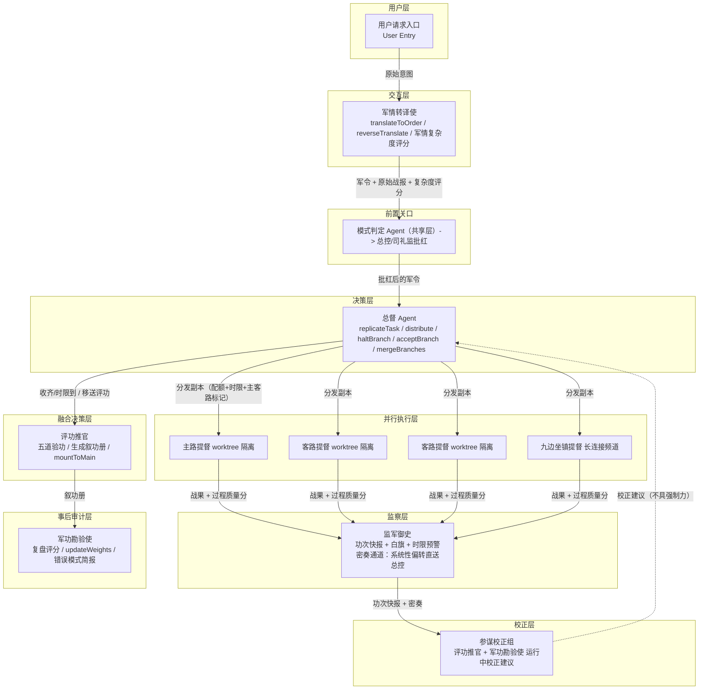
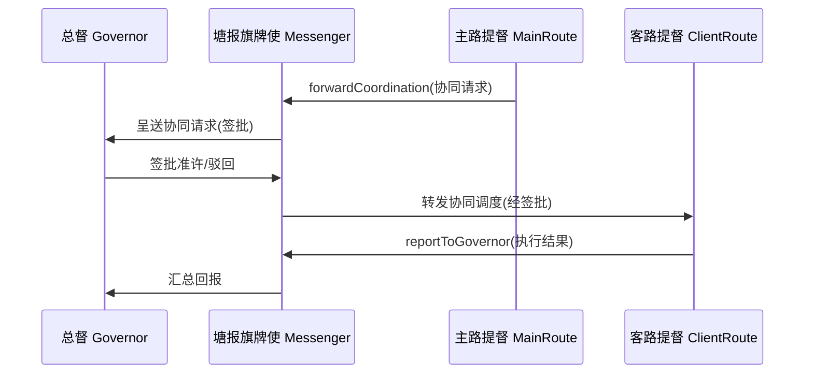
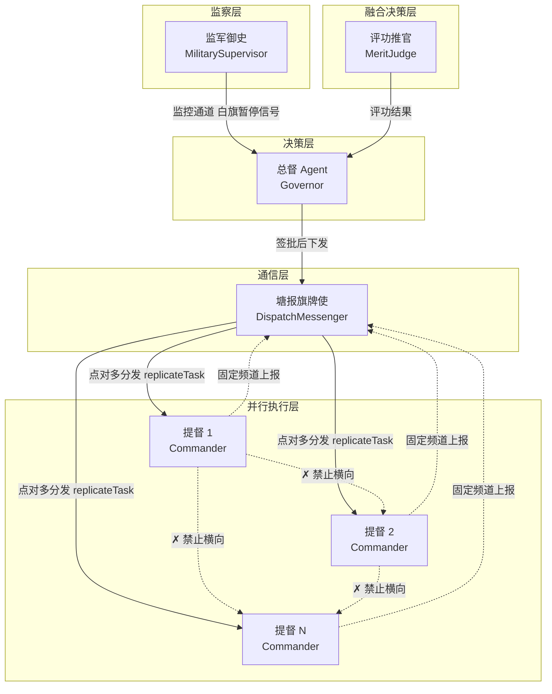
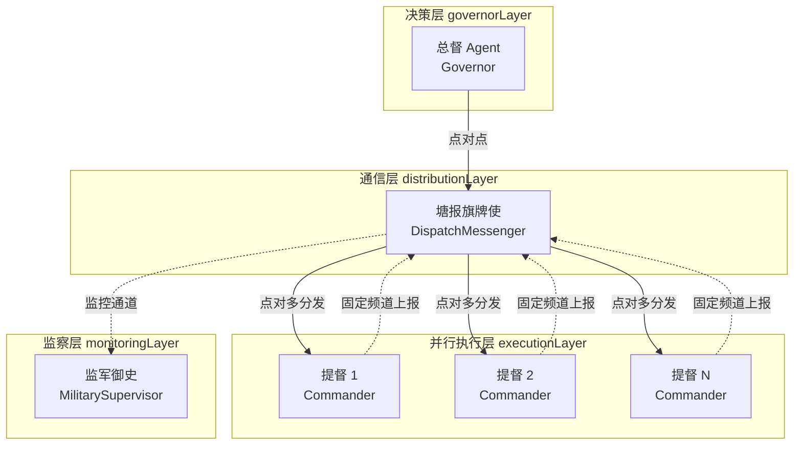

[AI 生成]

# 竞功模式 —— 市场竞争协作（market Coordination）

> 竞功模式：军事体制隐喻，并行竞争+worktree 分支+择优/融合+事后审计迭代；含参谋校正组运行中校正、选锋标签时效衰减、每路配额、自主裁决阈值、密奏通道、过程质量分、主客路协同调度、九边坐镇频道。

> 状态：stable
> 维护：@XZF（主笔）
> 讨论：无
> 待决：无
> 基于：璇玑 v4 设计总纲 §1/§3/§5/§8、决策 74/79、19-minggong-frameworks.md 竞功制参考框架

---

## 1. 模式定位

竞功模式是 璇玑 任事型三大模式之一（与朝廷模式、大明模式并列，见 12-chaoting-mode.md / 14-daming-mode.md），定位为 **market Coordination 的完整 Preset**（决策 76）。谋士型（智囊团）属另一编排类型，见 16-moushi-overview.md。

| 维度 | 取值 |
|------|------|
| 技术名 | `jinggong`（保留 v3 `swarm` 兼容名） |
| 中文显示名 | 竞功模式 |
| Coordination Pattern | `market`（市场竞争） |
| 默认 Execution Pattern | `tournament`（竞争择优） |
| 兼容 Execution | `dag`、`tournament`、`fan-out`（禁 `chain`，违反公平性不变量） |
| 来源隐喻 | 明代军事调度与功赏体系 |
| 核心思想 | 以功定赏 |

**与其他任事型模式的关系**：朝廷模式（hierarchy Coordination，12-chaoting-mode.md）适合整体确定性高的任务；竞功模式适合模糊多解任务；大明模式（14-daming-mode.md）适合内部异构的混合任务，内部可剥离模糊子任务转竞功。三模式共享任事型基础层（11-renshi-shared-base.md：制度与规则、交互、决策、监察、通信、灾备、外部反馈等）。

**核心思想"以功定赏"**：同一任务复制多份并行分发给各路提督 Agent，预设功赏量规择优或融合方案，最终挂载回主分支；军功勘验使事后复盘影响后续调用权重，形成跨任务学习闭环（决策 78，对接 WeightRegistry 军功簿）。

**模式开关**：Session 通过 `/mode jinggong`（或 `/mode swarm` 技术兼容名）切入本模式。运行中可切换至其他模式（原则 16，模式可切换）。所有角色称呼随之切换——原则 33「三模式共享术语池」已取代原术语三族不交叉规则（原则 21，已推翻）。

> 微内核对接细节见 §16；任事型共享体系（户部、考功司、律例、档籍、模式判定、监督、审计、复核、东厂、锦衣卫、内承运库、御马监、灾备、锁院、冷启动、朝会答辩等）见 11-renshi-shared-base.md。


## 2. 竞功模式全链路架构总览

竞功模式借鉴明代军事调度体系的组织逻辑，系统分为七层 + 跨层参谋校正组，各层职责隔离，通过固定协议通信。全链路图景：



> 架构总图引用自 02-architecture-layers.md，本图仅标注本模式 Agent 角色分配。
**层间数据流**：用户意图 → 军情转译使翻译军令 → 模式判定批红 → 总督按选锋+军功簿选将并分发副本（配额+时限+主客路标记+自主裁决阈值）→ 各路提督 worktree 隔离并行攻关 → 监军御史实时监控（密奏异常直送总控）→ 参谋校正组定期动态校正建议 → 总督收齐/时限到移送评功 → 五道验功生成叙功册（含过程质量分）→ 挂载主分支 + 更新选锋标签/军功簿 → 军功勘验使事后复盘 + 重量反馈。

---

## 3. 角色定义

竞功模式七大角色分属不同层次，职责边界清晰。每个角色是核心微内核中一个 `Identity.role` 配置（决策 74，角色降级）。

> **实现阶段**：全部角色均为 [Phase 1]。market Coordination 为 Phase 1 核心交付。

| 层次 | 名称 | 英文标识（Identity.role） | 核心职责 | 关键限制 | 数量 | 可选性 |
|------|------|-------------------------|---------|---------|------|--------|
| 交互层 | 军情转译使（Intel Translator） | `military-translator` | 1. 翻译用户请求为军令，保留原始战报 2. 输出军情复杂度评分辅助总督设阈值 3. 审查最终战果是否符合原始意图，可驳回 | 翻译必须可逆；不得丢失原始信息；**无代批权**（不呈送司礼监代批） | 1 | 必选 |
| 决策层 | 总督 Agent（Governor） | `governor` | 1. 按选锋标签+军功簿权重选将 2. 分发副本（携配额+时限+主客路+自主裁决阈值） 3. 维护 worktree 分支树 4. 拥有最高裁决权（halt/accept/merge） 5. 接受参谋校正组建议，可拒绝需留档 | 不亲自下场；主客路之间不得直接通信；最晚时限调整需附理由 | 1 | 必选 |
| 并行执行层 | 各路提督 Agent（Commander） | `commander` | 1. 独立接收任务副本 2. 采用不同战术/路径攻关 3. 返回完整战果+过程质量分元数据 4. 主路可经总督转发调度客路 | 各路之间禁止横向通信；每路必须产出完整可评估的结果 | N（dispatchBudget 驱动） | 必选 |
| 融合决策层 | 评功推官（Merit Judge） | `merit-judge` | 1. 执行五道验功流程 2. 按功赏量规择优/融合 3. 生成叙功册（含过程质量分）4. 挂载主分支 5. 与军功勘验使组参谋校正组，运行中提供动态校正建议 | 择优/融合规则由律例预设（共享层）；过程留档；校正建议不具强制力 | 1 | 必选 |
| 监察层 | 监军御史 Agent（Military Supervisor） | `military-supervisor` | 1. 实时监控资源、超时、违规、**配额消耗与进度匹配度** 2. 挂白旗（仅暂停） 3. **密奏通道**：系统性偏转直送总控 4. 时限预警 | 仅可暂停，不可撤将；恢复权属总督；密奏频次上限由律例设定 | 1 | 必选 |
| 事后审计层 | 军功勘验使（Merit Auditor） | `merit-inspector` | 1. 事后复盘评分 2. updateWeights 写入军功簿 3. 发现系统性偏差降总督/评功推官信用分 4. 形成竞功专属错误模式简报 5. 与评功推官组参谋校正组，运行中提供前瞻性校正 | 不改变当次结果；校正建议不具强制力；触发复核 Agent 后可间接推翻 | 1 | 必选 |
| 通信层 | 塘报旗牌使（Dispatch Messenger） | `dispatch-messenger` | 1. 点对多号令分发 2. 各路固定频道上报 3. 接收清单防篡改 4. **主路→总督签批→客路协同调度转发** 5. **九边坐镇频道**（独立长连接） | 各路互不监听；主客路无直接通道；归档不可篡改 | 1 | 必选 |
| 运行中校正 | 参谋校正组 | `staff-correction-group` | 评功推官 + 军功勘验使联合编组，竞功任务运行中定期向总督提供动态校正建议 | 校正建议不具强制力；总督可拒绝需附理由留档 | 待定 | 待定 <!-- TODO: 待人工确认 --> |

**Identity.role 映射**：每个角色对应一个 `Identity.role: string` 配置。Identity 同时声明 `capabilities`（dispatch/report/broadcast 等）+ `dispatchBudget`（派发预算）。各路提督的 `communicationCapabilities.canSendDirect` 在竞功模式下被强制限定为只能发给总督（market 公平性不变量，见 §17.1）。
**自主裁决阈值（操作维度补充）**：

> 参考明朝总兵战术自主权：总兵有战术自主权但战略决策需总督。§12.2 定义了抽象阈值（commanderId/threshold/rationale），本节补充操作维度字段。

```typescript
interface AutonomousThresholdOps {
  maxTokenCost: number;        // 提督可自主消耗的 token 上限（默认 sessionBudget * 0.2）
  maxRiskLevel: 'moderate';    // 最高可自主处理的风险等级（high 需上报总督）
  requiresGovernorApproval: boolean;  // 是否需要总督签批（默认 false=可自主）
}
```

**裁决规则**：
- 子决策 token 消耗 ≤ `maxTokenCost` 且风险等级 ≤ `maxRiskLevel` → 提督直接执行
- 超出任一维度 → 上报总督签批（`requiresGovernorApproval = true`）
- 阈值由总督在 `replicateTask` 时设定，写入 DispatchInput

---

## 4. 军情转译使（交互层）

军情转译使是用户意图进入竞功模式的第一道关口，是共享层交互审核 Agent（见 11-renshi-shared-base.md）在竞功模式下的形态（同一 Agent 的不同角色形态）。它将用户自然语言请求翻译成结构化的军令，同时完整保留原始战报。

翻译的可逆性通过 `reverseTranslate` 保证：给定军令，必须能还原为用户可理解的描述，且与原始战报语义等价。军情转译使还负责审查最终战果是否符合原始意图，发现偏差可驳回。

```typescript
/** 军情转译使（交互层）。Identity.role = "military-translator" */
interface MilitaryTranslator {
  /** 翻译用户请求为军令，保留原始战报，生成「原始奏章」交档籍 Agent 持久化（共享层） */
  translateToOrder(userRequest: string): MilitaryOrder;
  /** 反向翻译：将军令还原为用户可理解的描述（可逆翻译保证） */
  reverseTranslate(order: MilitaryOrder): string;
  /** 审查最终战果是否符合原始意图 */
  reviewResult(result: string, originalReport: string): boolean;
  /** 输出军情复杂度评分，辅助总督设定各路自主裁决阈值 */
  complexityScore(order: MilitaryOrder): ComplexityScore;
}

/** 军令 */
interface MilitaryOrder {
  /** 翻译后的任务指令 */
  order: string;
  /** 原始战报（用户原始请求的完整保留） */
  originalReport: string;
  /** 翻译时间戳 */
  timestamp: number;
}

/** 军情复杂度评分 */
interface ComplexityScore {
  /** 复杂度等级，影响总督对各路自主裁决阈值的配置 */
  level: "low" | "medium" | "high";
  /** 评分依据（领域特征、不确定性来源等） */
  rationale: string;
}
```

**可逆翻译不变量**：对任意 `order = translateToOrder(req)`，必有 `reverseTranslate(order)` 与 `req` 语义等价。此不变量由架构宪法强制（核心校验），违反则翻译失败、不进入分发流程。

**无代批权**：竞功模式下军情转译使只翻译不代批，所有军令都必须呈送总控（或总督）裁决，不进入司礼监代批快速通道。这是竞功模式与朝廷模式（hierarchy Coordination，12-chaoting-mode.md §司礼监代批）在前置关口上的核心差异。

---

## 5. 总督 Agent（决策层）

总督 Agent 是竞功模式的核心决策枢纽。它接收军情转译使输出的军令，将任务复制为多份副本，按选锋标签（见 §11）+ 军功簿权重选将分发给各路提督 Agent 独立执行。总督维护完整的 worktree 分支树，追踪每个分支的状态、来源和产出。

总督拥有最高裁决权。任何一路出现超时、资源超标或违规时，监军御史报请总督，总督可直接中止该路（`haltBranch`），或从已完成分支中直接采纳（`acceptBranch`），或命令评功推官融合多路方案（`mergeBranches`）。总督本人不亲自执行具体任务，只做分发、裁决和挂载决策。

```typescript
/** 总督 Agent（决策层）。Identity.role = "governor"，capabilities 含 "dispatch" */
interface Governor {
  /** 接收军令，按选锋+军功簿权重选将，复制为多份任务副本 */
  replicateTask(order: MilitaryOrder, copies: number, selection: CommanderSelection): WorktreeBranch[];
  /** 同时分发各路提督，附带最晚时限、每路配额、主/客路标记、自主裁决阈值 */
  distribute(plan: DistributionPlan): void;
  /** 最高裁决权：中止任意一路（紧急通道降级，决策 82） */
  haltBranch(branchId: string, reason: string): void;
  /** 直接采纳某路方案 */
  acceptBranch(branchId: string): BranchResult;
  /** 融合多路方案 */
  mergeBranches(branchIds: string[]): BranchResult;
  /** 持有接收清单，确认报齐（接收清单防篡改，见 §17.2） */
  confirmAllReported(branches: WorktreeBranch[]): boolean;
  /** 主路协同调度转发请求签批（经塘报旗牌使转发到客路） */
  signCoordinationForward(req: CoordinationRequest): void;
  /** 接受参谋校正组建议，调整配额/时限/路数；拒绝需附理由留档 */
  applyCorrection(advice: CorrectionAdvice, accept: boolean, rationaleIfReject?: string): void;
}

/** 选将策略 */
interface CommanderSelection {
  /** 任务签名（用于军功簿 recommend 匹配） */
  taskSignature: string;
  /** 候选提督 Identity 列表 */
  candidates: string[];
  /** 是否优先选锋标签匹配（见 §11） */
  preferXuanfengTag: boolean;
  /** 探索比例（ε-greedy，防过早收敛） */
  explorationEpsilon: number;
}

/** 分发计划 */
interface DistributionPlan {
  /** 各路提督分支 */
  branches: WorktreeBranch[];
  /** 最晚收齐时限（律例预设竞功收齐时限默认值，共享层） */
  deadline: number;
  /** 每路配额（户部建议 + 总督微调，见 §12.1） */
  perRouteQuota: Record<string, Quota>;
  /** 主路标记（主路可通过总督转发调度客路） */
  mainRoute: string;
  /** 客路标记 */
  clientRoutes: string[];
  /** 九边坐镇提督（持长连接频道，见 §10） */
  jiubianStationed?: string[];
  /** 各路自主裁决阈值（低于阈值日常决策直接生效，见 §12.2） */
  autonomousThreshold: Record<string, AutonomousThreshold>;
  /** 配额耗尽时的再分配策略 */
  quotaExhaustionPolicy: "request-from-pool" | "request-neichengyunku" | "halt";
}
```

**v4 升级：replicateTask 对接 WeightRegistry + 选锋标签**。总督选将时读取核心 `WeightRegistry`（军功簿）的历史评分与选锋标签（§11），对表现稳定且选锋标签匹配的提督升权、表现不佳的降权，保留 ε-greedy 探索比例防过早收敛。

**紧急通道降级**（决策 82）：当某路提督超时、资源耗尽或战术失败时，总督**不现场 improvisation（即兴发挥）**，而是直接调用 `haltBranch` 中止该路，并从已完成分支中采纳或融合。预定义优于 improvisation——`haltBranch` 是系统初始化时声明的 EmergencyFallback。
**旗牌令映射（紧急通道旗牌令）**：

> 参考明朝旗牌制度：总督持旗牌令可紧急调兵，但有严格的滥用防护。旗牌令映射到 `haltBranch` 能力的使用条件。

| 旗牌令类型 | 触发条件 | 总督动作 | 事后追认 |
|-----------|---------|---------|----------|
| 急速旗牌（紧急中止） | 提督超时 / 资源耗尽 / 战术失败 | `haltBranch(branchId)` | 24h 内提交事由报告至监军御史 |
| 撤换旗牌（剥夺指挥权） | 提督执行严重偏离总督军令 | `haltBranch` + 重新 `replicateTask` | 监军御史自动触发审计 |
| 不得连发 | 同一 worktree 30min 内 ≤1 次 `haltBranch` | 超出则降级为警告 | 自动记录至考功司 |

**滥用防护**：总督若在一个 session 内对同一提督连发 ≥3 次旗牌令，监军御史自动触发「总督查勘」（§8），评估总督是否滥用紧急权力。

**主客路节制权**：总督可指定主路，主路通过总督签批后由塘报旗牌使转发协同调度请求给客路（§10）。主客路之间**不得直接通信**，所有协同必须经总督仲裁，保留 market 公平性。

**配额与自主裁决阈值**：分发时携带每路配额（户部建议+总督微调，§12.1）和自主裁决阈值（§12.2）。这两项是竞功模式区别于原竞功制的运行时治理参数。

---

## 5a. 武官系统协调机制（D17）

> 本节集中描述竞功模式武官系统（总督/提督/监军/评功）的跨角色协调规则。各角色完整定义见 §5-§9，通信拓扑见 §10，不变量见 §17。本节是协调规则的集中索引，不重复角色定义。

### 5a.1 文武分工边界（总督 vs 提督）

竞功模式沿袭明朝军制「文官节制武将」原则，总督（文官系统，决策层）与提督（武将系统，执行层）职责严格分离：

| 维度 | 总督 Agent（Governor，文官） | 各路提督 Agent（Commander，武将） |
|------|------------------------------|----------------------------------|
| 层级 | 决策层，最高裁决权 | 执行层，受 market 公平性约束 |
| 能力 | dispatch / contact / broadcast / halt / accept / merge | execute / report-to-governor / sub-dispatch |
| 视野 | 全局：看到所有分支产出与勘验评分 | 局部：只看到下发的任务副本和自己的产出 |
| 通信 | 可向下分发 + 向上呈送总控 | 只能向总督报告（§17.1 禁止横向） |
| 失败处理 | haltBranch / acceptBranch / mergeBranches（预设，不 improvisation） | 产出完整可评估结果，不依赖他路补全 |

**不变量**：提督之间禁止任何形式的直接通信（§17.1 market 公平性不变量）。文武分工是竞功制区别于一般并行框架的治理基石——决策权与执行权分离，防止武将（提督）越权调度。

### 5a.2 主客路协调规则

总督可指定某路提督为**主路**（main route），其余为**客路**（client route）。主客路协同调度经塘报旗牌使（DispatchMessenger）转发，总督签批，主客路之间无直接通道（§17.5 不变量）。



```typescript
/** 主客路路由配置。总督在分发时声明。 */
interface RouteConfig {
  mainRoute: RouteAssignment;       // 主路提督
  clientRoutes: RouteAssignment[];  // 客路提督列表
  coordinationRule: 'no-direct' | 'governor-arbitrate';
  // 默认 'governor-arbitrate'：所有协同经总督仲裁（§17.5）
}

/** 单路提督的路由分配。 */
interface RouteAssignment {
  commanderId: string;              // 提督 Identity.id
  loopId: string;                   // 挂载的 Loop（四库之一，战术差异化）
  quota: Quota;                     // 该路配额（户部扣减）
  autonomousThreshold: number;      // 自主裁决阈值（§12.2）
  isMainRoute: boolean;
}
```

主路提督的协同请求必须经塘报旗牌使 `forwardCoordination` 接口转发，由总督签批后方可送达客路。任何绕过签批的直接通信被 Transport 层拒绝并记录审计日志。

### 5a.3 总督分发机制

总督 `dispatch` 携带每路配额和自主裁决阈值（§12），分发记录由塘报旗牌使维护，`confirmReceipt` 验证一致性后启动融合（§17.2 接收清单防篡改）。

```typescript
/** 总督分发调用。Identity.role = "governor" 的核心能力。 */
interface GovernorDistribute {
  task: TaskEnvelope;               // 任务信封（经军情转译使译后）
  routes: RouteConfig;              // 主客路路由配置（§5a.2）
  strategy: 'parallel' | 'incremental';
  // 'incremental'：先跑 1 路，质量不足再追加（增量竞争，§19 成本控制）
  xuanfengFilter?: XuanfengTag[];    // 选锋标签筛选（§11，影响提督选择）
  emergencyFallback: EmergencyFallback;  // 预设降级（决策 82，不 improvisation）
}
```

**选锋标签影响**：分发时可用选锋标签（§11）筛选历史表现匹配的提督。选锋标签有时效衰减，过期标签自动降权。增量竞争模式下，总督先跑 1 路，评估过程质量分不足再追加第 2/3 路，控制资源成本。

### 5a.4 各路提督的日常报告

每路提督通过固定频道 `report-to-governor` 向总督上报。报告必须包含完整可独立评估的结果（解决方案、资源消耗、执行耗时、过程质量分元数据），不依赖他路补全。

塘报旗牌使维护分发记录和回报记录，总督 `confirmReceipt` 验证两者一致后才启动评功推官的评估流程（§17.2）。未回报的任务视为失败，由总督 `haltBranch` 处理。

### 5a.5 监军御史的协调

监军御史（MilitarySupervisor）属监察层，仅有 `pauseBranch`（暂停）权，无恢复权（§17.3 权力分离不变量）。恢复权属总督。监军御史的暂停记录写入事件流，可被军功勘验使事后复审。

监军御史通过**密奏通道**（SecretMemorialChannel）直送总控，不经司礼监代批（§17.6 不变量）。密奏频次受律例上限约束。密奏证实异常时，总督启动诏狱（降级策略，§18.3）。

### 5a.6 评功推官的信息收集

评功推官（MeritJudge）从接收清单（§17.2 验证一致的回报池）构建评估池，按 `defaultRubric`（Pack 提供，决策 71）执行五道验功（Five-Stage Verification），产出叙功册（MeritRecord）。

评估维度含：方案质量、资源效率分、配额使用率、过程质量分。选锋标签（§11）在评估后更新——表现稳定的提督获得选锋标签，后续分发优先匹配；表现不佳的提督标签衰减降权。军功勘验使的事后审计通过 `updateWeights` 写入 WeightRegistry（军功簿，决策 78），形成跨任务学习闭环。

### 5a.7 九边坐镇频道

九边坐镇频道（JiubianStationedChannel）支持长期值守/跨周期任务场景（§19）。该频道是图状通信（决策 79）的「持续在线」模式，塘报旗牌使通过 `openJiubianChannel` 建立长连接，总督可跨周期下发任务，提督持续值守上报。

```typescript
/** 九边坐镇频道。长期值守场景的持续在线通道。 */
interface JiubianStationedChannel {
  channelId: string;               // 频道标识
  stationedCommanders: string[];   // 值守提督 Identity.id 列表
  heartbeatInterval: number;       // 心跳间隔（ms）
  // 仍受 §17.1 约束：值守提督之间禁止横向通信
  coordinationRule: 'governor-arbitrate';
}
```

九边频道不改变竞功模式的核心约束——值守提督之间仍禁止横向通信（§17.1），所有协同经总督仲裁。该频道是 §19 适用场景表中「长期值守/跨周期任务」推荐使用的通信基础设施。

---

## 6. 各路提督 Agent（并行执行层）

各路提督 Agent 是竞功模式的执行主体。每一路独立接收同一任务副本，但可以采用不同的战术或路径解决问题。差异化设计增加最终方案的质量上限：不同思路可能在不同维度上各有优劣。

各路提督之间**禁止横向通信**（§17.1）。这是竞功模式公平性的基石：如果各路可以互相影响，评分就失去了独立比较的意义。每路必须产出完整可评估的结果，包含解决方案、资源消耗、执行耗时、**过程质量分**元数据。

```typescript
/** 各路提督 Agent（并行执行层）。Identity.role = "commander" */
interface Commander {
  /** 独立接收任务副本并执行，按配额扣减 */
  execute(branch: WorktreeBranch, strategy: CommanderStrategy, quota: Quota): BranchResult;
  /** 此路提督的战术策略 */
  strategy: CommanderStrategy;
}

/** 分支战果 */
interface BranchResult {
  /** 产出此战果的分支 ID */
  branchId: string;
  /** 完整解决方案 */
  solution: unknown;
  /** 使用的战术路径标签 */
  tacticLabel: string;
  /** 资源消耗（用于过程质量分计算） */
  resourceConsumed: ResourceMetrics;
  /** 执行耗时（毫秒） */
  durationMs: number;
  /** 配额消耗（用于配额使用率评分） */
  quotaConsumed: Quota;
}

/** 战术策略（四库覆盖实现差异化） */
interface CommanderStrategy {
  /** 策略名称（如"安全优先"、"性能优先"、"简洁优先"） */
  name: string;
  /** 差异化配置（覆盖四库：身份/架构提示词/技能/Loop） */
  config: {
    architecturePrompts?: Record<string, string>;
    identityOverride?: string;
    skillOverrides?: string[];
    /** Loop 覆盖（v4：使用不同 Loop 引擎） */
    loopOverride?: string;
    extra?: Record<string, unknown>;
  };
}

/** 资源消耗指标 */
interface ResourceMetrics {
  tokensUsed: number;
  apiCalls: number;
  memoryPeakMB: number;
}

/** 配额（Token 预算账户余额，由共享层太仓库 Agent 管理） */
interface Quota {
  /** 预算账户 ID */
  accountId: string;
  /** 初始配额 */
  initial: number;
  /** 已消耗 */
  consumed: number;
  /** 剩余 */
  remaining: number;
}
```

**战术差异化通过四库覆盖实现**（v4 从三库扩展为四库，原则 19）。每组提督通过覆盖四库实现策略差异，组级覆盖优先级最高（pack < builtin < user < project < group）：

```
提督甲（安全优先）:
  架构提示词追加: "优先考虑安全性"
  身份覆盖: 使用 security-architect
  技能覆盖: 注入 owasp-top-10, security-audit
  Loop 覆盖: 用 tot-loop（多分支推理）

提督乙（简洁优先）:
  架构提示词追加: "追求最小实现"
  身份覆盖: 使用 clean-code-architect
  技能覆盖: 注入 clean-code
  Loop 覆盖: 用 react-loop（默认）

提督丙（性能优先）:
  架构提示词追加: "优先考虑性能"
  身份覆盖: 使用 perf-architect
  技能覆盖: 注入 performance-tuning
  Loop 覆盖: 用 plan-execute-loop（先规划再执行）
```

**派发预算**（dispatchBudget，决策 4 修改）：每路提督继承 `min(parentBudget - 1, identity.dispatchBudget)` 的派发预算。架构硬兜底上限 10。提督可在预算内派发自己的子 Agent（组内 Mini Pattern，通常是 hierarchy×dag），但子 Agent 间仍受 market 公平性约束，不得跨组通信。

**九边坐镇**：对需要长期值守或跨周期协作的高复杂度任务，总督可指定九边坐镇提督（`DistributionPlan.jiubianStationed`），通过塘报旗牌使配置独立长连接频道（§10），保持持续在线状态，不受单次收齐时限约束。

---

## 7. 评功推官（融合决策层）

评功推官是竞功模式的价值判断中枢。所有提督返回战果后，评功推官按**五道验功流程**逐项评分，给出排名和推荐策略。选定结果通过 `mountToMain` 挂载回 worktree 主分支，成为最终输出。

**五道验功**（来自明代军事功赏体系）：

| 验次 | 名称 | 内容 |
|------|------|------|
| 第一验 | 自报核验 | 各路战果自报项的完整性、真实性核验 |
| 第二验 | 交叉比对 | 各路战果相互比对，识别异常值 |
| 第三验 | 过程回放 | 关键步骤的过程回放，验证可重现性 |
| 第四验 | 多部门会审 | 共享层多部门（监督、审计等）盲评打分 |
| 第五验 | 最终敲定 | 评功推官综合四验数据 + 功赏量规，给出最终排名 |

#### 五道验功判定标准

> 参考明朝《军功勘核条例》：每"验"有明确的通过条件和失败处置。

| 验次 | 璇玑 输入 | 通过条件 | 失败动作 | 明朝原型 |
|------|----------|---------|---------|---------|
| ① 自报核验 | 提督 BranchResult + 产出物 | 产出物存在 + BranchResult 无缺失字段 | 标记"存疑"，进入②重点核查 | 首级实物 + 目击证词 |
| ② 交叉比对 | 多路产出物 hash + 塘报日志 | 各路产出物无矛盾（hash 一致或差异在容差内） | 矛盾标注，要求相关路解释 | A路 vs B路塘报核对 |
| ③ 过程回放 | 事件流快照（EventSourcedState 区段） | 关键步骤可回放 + 无篡改痕迹 | 标记"过程不透明"，降权评分 | 卷宗调阅审查 |
| ④ 多方会审 | 评功推官评分 + 监军御史报告 + 军功勘验使意见 | 三方评分方差 ≤ 阈值（律例默认 2.0/10） | 方差超阈值→降级"待裁定"，移交总控 | 兵部+都察院+监军三方一致 |
| ⑤ 最终敲定 | 上述四验全部通过 + 叙功册草案 | 总控（或司礼监代批）批红 | 退回重审或直接废弃 | 内阁票拟→皇帝批红 |

**验功规则**：

- ①-③ 为自动验功（评功推官执行，无需人工介入）
- ④ 为半自动（多方评分需等齐，超时 30min 自动降级）
- ⑤ 为人工/代批（总控决策，可委托司礼监代批）
- 任一验失败不等于整个任务失败——仅标记该路产出"存疑"，进入降权流程

```typescript
/** 评功推官（融合决策层）。Identity.role = "merit-judge" */
interface MeritJudge {
  /** 五道验功流程 */
  evaluate(results: BranchResult[], rubric: EvaluationRubric, processMetrics: ProcessMetrics[]): MeritEvaluation;
  /** 按预设功赏量规择优 */
  select(evaluation: MeritEvaluation, strategy: SelectionStrategy): BranchResult;
  /** 提取各家之长合并成合进方案 */
  merge(evaluation: MeritEvaluation): BranchResult;
  /** 将最终结果挂载回 worktree 主分支 */
  mountToMain(result: BranchResult): void;
  /** 与军功勘验使组成参谋校正组，运行中定期向总督提供动态校正建议（见 §9） */
  adviseCorrection(liveMetrics: LiveMetrics[]): CorrectionAdvice;
}

/**
 * 功赏量规（v4 外置）。核心接口由 Pack 提供（defaultRubric）。
 * 核心不硬编码权重——不同领域不同维度。
 */
interface EvaluationRubric {
  name: string;
  dimensions: RubricDimension[];
  /** 聚合策略 */
  aggregate: "weighted-sum" | "min" | "hybrid";
}

interface RubricDimension {
  name: string;
  weight: number;
  criteria: string;
}

/** 过程质量分元数据（含资源效率、配额使用率） */
interface ProcessMetrics {
  branchId: string;
  /** 资源效率：产出 / 资源消耗 */
  resourceEfficiency: number;
  /** 配额使用率：实际消耗 / 配额 */
  quotaUtilization: number;
  /** 中间错误数 */
  intermediateErrors: number;
  /** 其他过程维度 */
  extra?: Record<string, number>;
}

/** 评估结果 */
interface MeritEvaluation {
  /** 各分支评分排名 */
  rankings: BranchRanking[];
  /** 推荐选择策略 */
  recommendedStrategy: SelectionStrategy;
  /** 叙功册（含头功赏 + 过程质量分 + 失期罚） */
  meritRecord: MeritRecord;
}

interface BranchRanking {
  branchId: string;
  totalScore: number;
  dimensionScores: Record<string, number>;
  /** 过程质量分（来自 ProcessMetrics，权重由律例预设） */
  processQualityScore: number;
}

/** 择优策略 */
type SelectionStrategy = "best" | "merge" | "hybrid" | "vote";
```

**叙功册字段定义**：

> 参考明朝叙功册制度：每战之后由评功推官填写叙功册，记录各路战功、过失、过程表现，作为赏罚依据。

```typescript
/** 叙功册：MeritJudge.evaluate() 产出，挂载至 MeritEvaluation.meritRecord */
interface MeritRecord {
  /** 战役标识 */
  campaignId: string;
  /** 各路提督功赏条目 */
  entries: MeritEntry[];
  /** 最终择优结果 */
  selectedBranchId: string;
  /** 合并方案来源（如有） */
  mergeSources?: string[];
  /** 评功推官签押（Identity.role = "merit-judge"） */
  judgeSignature: string;
}

interface MeritEntry {
  /** 提督标识 */
  branchId: string;
  /** 头功赏：结果导向评分（来自 EvaluationRubric） */
  meritScore: number;
  /** 过程质量分（来自 ProcessMetrics） */
  processQualityScore: number;
  /** 失期罚：超时/资源超用等扣分 */
  penaltyScore: number;
  /** 综合评分 = meritScore + processQualityScore - penaltyScore */
  totalScore: number;
  /** 评语（评功推官填写） */
  comment: string;
}
```

**v4 升级：功赏指标外置 + 过程质量分**。v3 把评估权重硬编码在核心。v4 推翻——评估权重是领域语义，通过 Pack 的 `defaultRubric` 注入（决策 71 渗剥点 #9）。`MeritJudge` 接口按通用 `EvaluationRubric` 调用，对此一无所知。

**过程质量分**（决策 78 扩展）：除结果导向的功赏评分外，评功推官还计算过程质量分（含**资源效率分**：产出/资源消耗；**配额使用率**：实际消耗/配额；中间错误数等），写入叙功册。过程质量分在长期权重中的占比由律例预设（共享层），用于**更新提督的选锋标签和长期权重**（§11），抄送考功司（共享层）纳入京察大计综合考核。

**coding-pack 提供的五维度量规**（示例，非硬编码）：

| 维度 | 权重 | 评估方式 |
|------|------|---------|
| 功能完整性（functionality） | 30% | 是否完成所有要求 |
| 测试覆盖（tests） | 25% | 测试通过率和覆盖率 |
| 代码质量（quality） | 25% | 可读性、结构、命名 |
| 安全性（security） | 10% | 是否有安全漏洞 |
| 性能（performance） | 10% | 运行效率 |

research-pack 会提供不同量规（如：novelty / reproducibility / rigor / clarity / impact）。

---

## 8. 监军御史 Agent（监察层）

监军御史 Agent 负责实时监控各路提督的执行状态。它追踪资源消耗、检测超时和违规操作，**特别监控配额消耗与进度匹配度**，拥有暂停单路的权力（挂白旗）。暂停后必须报请总督裁决，**不可擅自撤将或改变战术**。

监军御史的存在是竞功模式的安全阀。没有监察层，一路提督的资源耗尽或死循环可能拖垮整个任务。挂白旗后，总督决定是等待恢复、替换新路，还是直接采纳已完成分支的结果。

```typescript
/** 监军御史 Agent（监察层）。Identity.role = "military-supervisor" */
interface MilitarySupervisor {
  /** 实时监控各路提督的资源消耗、超时、违规、配额消耗与进度匹配度 */
  monitor(commander: Commander): MonitorStatus;
  /** 暂停单路之权（挂白旗）。仅暂停，不撤将 */
  pauseBranch(branchId: string, reason: string): PauseFlag;
  /** 密奏通道：系统性偏转直送总控，不经司礼监代批 */
  memorialize(secret: SecretMemorial): Promise<void>;
}

/** 监控状态 */
interface MonitorStatus {
  branchId: string;
  resourceOverBudget: boolean;
  timedOut: boolean;
  violation: string | null;
  /** 配额消耗与进度匹配度（不匹配则触发白旗条件之一） */
  quotaProgressMismatch: boolean;
}

/** 白旗暂停令 */
interface PauseFlag {
  pausedBranchId: string;
  reason: string;
  /** 恢复级别建议（总督参考） */
  recoveryLevel: "wait" | "replace" | "accept-existing";
  timestamp: number;
}

/** 密奏（直送总控） */
interface SecretMemorial {
  /** 系统性偏转描述 */
  deviation: string;
  /** 严重等级 */
  severity: "low" | "medium" | "high";
  /** 建议是否启动诏狱（共享层，需总控亲批） */
  suggestPrison?: boolean;
}
```

**v4 权力分离原则**（决策 81，核心不变量）：

- **暂停权与恢复权分离**：监军御史只能 `pauseBranch`（仅暂停），不能恢复。恢复权属于更高层（总督 Agent）。
- **监察者被谁监察**：监军御史的暂停记录、密奏记录写入事件流（EventSourcedState），可被军功勘验使事后采样复审，最终受共享层东厂元监察（11-renshi-shared-base.md）。
- **fail-closed 选项**：监军御史本身失效时，可选 fail-open（原样通过）或 fail-closed（拒绝并报总督）。Phase 1 默认 fail-open，高风险场景配置 fail-closed。

**密奏通道**（§12.3 专章）：监军御史发现系统性偏转时，通过独立密奏通道**直接向总控发送预警摘要**，**不经司礼监代批**。密奏预警被证实严重者可建议总控启动诏狱（共享层锦衣卫执行，需总控亲批）。密奏频次上限由律例设定（共享层），防止监军御史滥用密奏干扰正常运行。

---

## 9. 军功勘验使 + 参谋校正组（事后审计 + 运行中校正）

### 9.1 军功勘验使（事后审计层）

军功勘验使是竞功模式区别于一般竞争框架的核心创新。它不介入当次任务的决策，而是在任务完成后对各路战果及最终融合方案进行复盘，给出评分和修正建议。最关键的是，勘验结果会通过 `updateWeights` 写入核心 `WeightRegistry`（军功簿），调整各路提督 Agent 的后续调用权重。

```typescript
/** 军功勘验使（事后审计层）。Identity.role = "merit-inspector" */
interface MeritInspector {
  /** 对各路战果及最终融合方案事后复盘 */
  inspect(results: BranchResult[], finalResult: BranchResult): InspectionReport;
  /** 给出评分 */
  score(report: InspectionReport): number;
  /**
   * 影响后续调用权重（迭代反馈闭环）。
   * v4：写入核心 WeightRegistry（军功簿），见决策 78。
   */
  updateWeights(report: InspectionReport): Promise<void>;
  /** 与评功推官组成参谋校正组，运行中提供前瞻性校正建议 */
  adviseCorrection(liveMetrics: LiveMetrics[]): CorrectionAdvice;
}

/** 勘验报告 */
interface InspectionReport {
  inspectedBranchIds: string[];
  finalScore: number;
  corrections: string[];
  /** 后续调用权重调整建议（写入 WeightRegistry + 选锋标签） */
  weightAdjustments: Record<string, number>;
  /** 竞功专属错误模式简报（上报共享层律例 Agent） */
  errorPatterns: string[];
  /** 是否发现系统性偏差（降低总督/评功推官信用分） */
  systemicBiasDetected?: boolean;
  /** 是否疑有联合作弊（请求总控启动复核 Agent） */
  collusionSuspected?: boolean;
}
```

**v4 升级：对接核心 WeightRegistry（军功簿）**。军功勘验使的 `updateWeights` 不是模式内部的局部权重表，而是写入核心 `WeightRegistry` Infrastructure。这意味着：

- 权重持久化跨 Session 保留（Phase 2+ SQLite 持久化；Phase 1 NoOp 不实际学习）。
- 总督下次 `replicateTask` 时通过 `WeightRegistry.recommend()` 读取历史评分选提督。
- 核心 `WeightRegistry` 是模式中立的——竞功模式下叫"军功簿"，朝廷模式下叫"考绩簿"。
- 探索比例 ε-greedy 防过早收敛。

**强制力属性**：军功勘验使属"事后审计层"，强制力为**建议性/权重影响**——不改变当次结果，只反馈迭代。竞功模式下没有专门的高风险强制推翻角色，由总督 `haltBranch` + 评功推官重新融合替代该职能；必要时军功勘验使可请求总控启动复核 Agent（共享层大理寺，间接推翻）。

### 9.2 参谋校正组（运行中校正）

**参谋校正组**是评功推官 + 军功勘验使两人组成的临时编组，**在竞功任务运行过程中**（不是事后）定期向总督提供动态校正建议。这是竞功模式相对原竞功制的核心增强：把事后审计的洞察前移到执行中。

```typescript
/** 参谋校正组（评功推官 + 军功勘验使联合编组） */
interface StaffCorrectionGroup {
  /** 评功推官侧：基于实时功次快报，建议资源重分配/策略调整 */
  fromMeritJudge(live: LiveMetrics[]): CorrectionAdvice;
  /** 军功勘验使侧：基于实时功次快报与历史对比，提供前瞻性校正 */
  fromMeritInspector(live: LiveMetrics[], history: WeightedRecommendation[]): CorrectionAdvice;
  /** 汇总两侧建议，呈送总督 */
  synthesize(advices: CorrectionAdvice[]): CorrectionAdvice;
}

/** 校正建议 */
interface CorrectionAdvice {
  /** 建议类型 */
  type: "reallocate-quota" | "adjust-strategy" | "add-remove-route" | "extend-deadline" | "halt-route";
  /** 目标分支 */
  targetBranches: string[];
  /** 建议依据（实时功次快照 + 历史对比） */
  rationale: string;
  /** 建议置信度 */
  confidence: number;
}

/** 实时功次快报（来自监军御史） */
interface LiveMetrics {
  branchId: string;
  progressPercent: number;
  quotaRemaining: number;
  resourceConsumed: ResourceMetrics;
  /** 监军密奏摘要（若有） */
  secretSummary?: string;
}
```

**校正建议不具强制力**：参谋校正组的建议是参考性的，总督可以接受也可以拒绝，但拒绝时必须附理由留档（写入总督决策日志，由共享层档籍 Agent 持久化）。这一设计在保留总督最高裁决权的同时，把审计经验前移到执行中，缩短反馈环路。

**与监军御史的分工**：监军御史是**实时单点暂停**（白旗），参谋校正组是**定期整体建议**（多路协同优化）。两者互补：监军御史防单点失控，参谋校正组促全局优化。

#### 参谋校正组触发规则

> 参考明朝《军功勘核条例》：参谋校正组是事件驱动的临时编组，不是常驻角色。

**触发条件**（满足任一即触发）：

1. 任一路提督 `reportToGovernor()` 事件到达 → 评功推官分析，如发现异常（进度/质量/成本偏离）→ 触发校正建议
2. 定时心跳（律例默认 10min）→ 评功推官扫描全局状态，对比历史相似任务 → 如偏离超 1σ → 触发校正建议
3. 监军御史 `whiteFlag` 事件 → 强制触发（必须生成校正建议）

**CorrectionAdvice 扩展字段**（v2.10 新增）：

```typescript
/** CorrectionAdvice 扩展（在 §9.2 基础接口上新增触发追踪字段） */
interface CorrectionAdviceExt extends CorrectionAdvice {
  /** 校正建议唯一 ID */
  adviceId: string;
  /** 触发来源 */
  trigger: "report" | "heartbeat" | "whiteFlag";
  /** 事件流证据（引用的事件 ID 列表） */
  evidence: string[];
  /** 总督拒绝时必填（≤200 字符） */
  rejectedReason?: string;
}
```

**总督拒绝规则**：

- 校正建议不具强制力（明朝"不具强制力"原则，§9.2 已有）
- 总督可拒绝，但**必须填写 `rejectedReason`**（≤200 字符）
- 拒绝记录写入事件流（EventSourcedState），审计 Agent 可复审
- 连续拒绝 ≥ 3 次相同类型建议 → 监军御史自动密奏总控（防止总督固执己见）

---

## 10. 通信拓扑（塘报旗牌使 DispatchMessenger）


塘报旗牌使负责总督与各路提督之间的通信。总督通过点对多号令分发任务，各路提督通过固定频道独立上报战果。总督持有接收清单，确认所有分支都已回报后才启动融合流程。

各路提督之间互不监听，确保每路的战术决策不受其他路影响。塘报旗牌使还防止消息篡改或遗漏，保障竞争过程的公正性。


```typescript
/** 塘报旗牌使（通信层）。Identity.role = "dispatch-messenger" */
interface DispatchMessenger {
  /** 总督通过点对多号令分发任务（向下，对每路提督） */
  dispatchToAll(order: MilitaryOrder, branches: WorktreeBranch[]): Promise<DispatchReceipt>;
  /** 各路提督通过固定频道独立上报战果（向上，对总督） */
  reportToGovernor(branchId: string, result: BranchResult): Promise<void>;
  /** 总督持有接收清单，确认报齐防遗漏或篡改 */
  confirmReceipt(receipt: DispatchReceipt): boolean;
  /** 主路协同调度转发：主路请求 → 总督签批 → 转发到客路 → 客路回执 */
  forwardCoordination(req: CoordinationRequest, governorSign: GovernorSignature): Promise<CoordinationReceipt>;
  /** 为九边坐镇提督配置独立长连接频道 */
  openJiubianChannel(stationedId: string): Promise<JiubianChannel>;
}

/** 接收清单 */
interface DispatchReceipt {
  /** 总督下发时的任务清单 */
  dispatchedTo: string[];
  /** 各路提督回报的战果清单 */
  reportedFrom: string[];
  /** 接收清单校验：reportedFrom 必须覆盖 dispatchedTo */
  allConfirmed: boolean;
}

/** 协同调度请求（主路发起，总督签批后转发） */
interface CoordinationRequest {
  fromMainRoute: string;
  toClientRoute: string;
  /** 协同事项（如请求客路产出某中间结果） */
  subject: string;
  /** 优先级 */
  priority: "low" | "medium" | "high";
}

/** 九边坐镇长连接频道 */
interface JiubianChannel {
  stationedCommanderId: string;
  /** 长连接 ID（独立于单次任务收齐时限） */
  channelId: string;
  /** 持续在线状态 */
  alive: boolean;
}
```

**v4 升级：通信图状化对接**（决策 79）。塘报旗牌使是核心图状通信（AgentTransport）在竞功模式下的特化实现。核心 `AgentTransport` 提供三种通信模式：点对点 `sendMessage`、发布订阅 `publish/subscribe`、频道/黑板。竞功模式使用其中的**点对多分发**（向下）、**固定频道上报**（向上）、**主客路转发通道**（经签批的中介通信）、**九边长连接频道**（持续值守场景）四种，不使用提督间的点对点通道。

**接收清单防篡改不变量**（架构宪法强制，§17.2）：只有 `confirmReceipt === true` 的回报才进入评功推官的评估池。未回报的任务视为失败，由总督 `haltBranch` 处理。防止遗漏、篡改、重复。

**主客路协同调度转发**：主路提督需要客路配合时，**不得直接联系客路**（违反 market 公平性），而是通过塘报旗牌使上报协同请求，总督签批后由塘报旗牌使转发到目标客路，客路回执经塘报旗牌使汇总回主路。所有协同流量都留档可审计。

**九边坐镇频道**：对长期值守场景（如监控系统、跨周期协作），塘报旗牌使为九边坐镇提督配置独立长连接频道，绕开单次任务的收齐时限约束，支持持续上报与即时调度。

---

## 11. 选锋标签与时效衰减

**选锋标签**（XuanfengTag）是竞功模式的选将增强机制：对在特定领域或任务类型上**历史过程质量分顶尖**的提督，打上选锋标签，总督在 `replicateTask` 时**优先选用选锋标签匹配者**。

```typescript
/** 选锋标签（写入 WeightRegistry + Identity 标签库） */
interface XuanfengTag {
  /** 提督 Identity ID */
  commanderId: string;
  /** 任务领域/类型签名 */
  taskSignature: string;
  /** 标签权重（0-1，影响选将优先级） */
  weight: number;
  /** 生效时间 */
  effectiveSince: number;
  /** 最后一次激活时间（用于时效衰减计算） */
  lastActivated: number;
  /** 是否处于衰减冻结（总控批红可冻结特定标签的衰减，用于长期战略储备） */
  decayFrozen: boolean;
}
```

**选锋标签的来源**：评功推官在五道验功后，将**过程质量分顶尖**的提督 + 对应任务签名组合，通过 `updateWeights` 同步写入军功簿（WeightRegistry）与选锋标签库。同步抄送共享层考功司，作为京察大计综合考核的输入。

**时效衰减机制**（Anti-oscillation 防护之一，共享层律例预设半衰期）：

1. 律例 Agent 根据预设**半衰期参数**，对长时间未执行同类任务的选锋标签权重进行时间衰减，每衰减周期自动更新一次。
2. 衰减至**最低阈值**以下时，选锋标签降为普通标签，调兵时（总督选将）不再优先推荐。
3. 若该提督后续重新在同类任务中取得**高过程质量分**，标签可重新激活（权重回升）。
4. 总控可批红冻结特定标签的衰减（`decayFrozen: true`），用于长期战略储备——例如保留某领域专家即使近期无任务。

**与其他机制的关系**：

- 与军功簿（WeightRegistry）：选锋标签是 WeightRegistry 上的一层**任务签名维度**索引，不替代整体权重。
- 与京察大计（共享层）：选锋标签的累积表现纳入考功司综合考核，连续卓异者可被总控调入御马监（共享层直控执行层）。
- 与防振荡约束（共享层）：选锋标签权重调整受**单步上限**（±5%/京察周期）约束，超出自动截断。

#### 选锋标签算法

> 参考明朝《选锋制》：标签创建有条件、匹配有算法、衰减有公式、撤销有规则。

**标签创建条件**（自动）：

- Agent 连续 N 次任务评分 ≥ 阈值（律例默认 N=3, threshold=7.5/10）
- 或单次任务获"首功"评级（评分 ≥ 9.0/10）
- 创建后写入 `WeightRegistry.tags[agentId]`

**标签匹配算法**：

```
matchScore(agentId, taskSignature) =
  cosineSimilarity(agentHistory.vector, taskSignature.vector) * 0.6
  + successRate(agentId, similarTasks) * 0.3
  + tagFreshness(agentId) * 0.1

tagFreshness = max(0, 1 - weeksSinceLastSuccess / decayHalfLife)
// decayHalfLife 律例默认 4 周
```

**衰减公式**：

```
effectiveWeight = baseWeight * 0.95^weeksSinceLastSuccess
// 连续 8 周无成功任务 → effectiveWeight 降至原值 66%
// 连续 13 周（约 3 个月）无成功任务 → 标签自动撤销
```

**标签撤销条件**：

- 连续失败 ≥ 2 次（评分 < 5.0）
- 或连续 13 周无成功任务（衰减至零）
- 撤销后 4 周内不可重新获得标签（冷却期）

---

## 12. 配额、自主裁决阈值与密奏通道

### 12.1 每路配额（户部建议 + 总督微调）

**每路配额**是竞功模式相对原竞功制的运行时资源治理机制：在分发副本时为每路提督分配独立的 Token 预算账户，配额耗尽自动拦截（共享层太仓库 Agent 执行扣减）。

**配额生成流程**：

1. **共享层户部 Agent（财政面）**根据各路提督的历史效率、任务难度系数，动态切分"竞功预算池"，向总督提供**每路配额建议**（见 11-renshi-shared-base.md 户部章节第 8 项）。
2. **总督微调**：总督收到户部建议后，可结合军情复杂度评分、监军密奏、参谋校正组建议进行微调，最终生成 `DistributionPlan.perRouteQuota`。
3. **配额耗尽**：某路配额耗尽时，总督可选三种策略（`quotaExhaustionPolicy`）：
   - `request-from-pool`：向户部申请从竞功预算池中再分配。
   - `request-neichengyunku`：向总控申请内承运库增援（共享层皇帝直控资源，需总控亲批，生成借支记录）。
   - `halt`：直接 haltBranch 中止该路。

**配额使用率作为过程质量分维度**（§7）：评功推官计算过程质量分时，**配额使用率**（实际消耗/配额）作为评分维度之一，写入叙功册，影响选锋标签与长期权重。配额使用率合理（不超支不浪费）的提督获得更高过程质量分。

### 12.2 自主裁决阈值

**自主裁决阈值**（AutonomousThreshold）是竞功模式相对原竞功模式的运行时决策下沉机制：总督在分发副本时为每路提督配置一个阈值，**低于阈值的日常决策提督可直接生效，超过阈值仍上报总督**。

```typescript
/** 自主裁决阈值（总督分发时配置） */
interface AutonomousThreshold {
  /** 提督 Identity ID */
  commanderId: string;
  /** 阈值（0-1，决策的影响范围/风险评分） */
  threshold: number;
  /** 阈值依据（军情复杂度评分 + 历史表现） */
  rationale: string;
}
```

**阈值设定依据**：

- 军情转译使的**军情复杂度评分**（§4）：复杂度越高，阈值越低（更多决策需上报）。
- 提督的**历史过程质量分**（§7）：质量分高者阈值可提高（更多自主权）。
- 律例 Agent（共享层）定义的默认值与调整条件。

**阈值的语义**：低于阈值的决策（如战术路径选择、中间结果取舍、子 Agent 调度）由提督**自主裁决，不需上报总督**，但所有自主决策必须记录到事件流（EventSourcedState），可被监军御史和军功勘验使事后复审。超过阈值的高影响决策（如改变任务范围、消耗超额资源）必须上报总督裁决。

### 12.3 密奏通道

**密奏通道**（SecretMemorialChannel）是监军御史独立于常规功次快报的预警通道：发现**系统性偏转**时（多路同步偏离规格、疑似联合作弊、资源系统性滥用等），监军御史通过密奏通道**直接向总控发送预警摘要，不经司礼监代批**。

```typescript
/** 密奏通道（监军御史专用，直送总控） */
interface SecretMemorialChannel {
  /** 发送密奏（绕过司礼监代批） */
  send(memorial: SecretMemorial): Promise<void>;
  /** 接收方：仅总控 */
  recipient: "dihuang-only"; // 总控 = 共享层"皇帝"角色（AI + 人类共治）
}
```

**密奏的特征**：

- **绕过代批**：密奏不进入司礼监代批快速通道，直接送达总控。这是监军御史相对常规塘报的特殊权限。
- **频次上限**：律例设定密奏频次上限（防止监军御史滥用密奏干扰正常运行）。
- **严重等级**：密奏标注严重等级（low/medium/high），高严重等级者可建议总控启动诏狱（共享层锦衣卫执行，需总控亲批）。
- **审计可追溯**：密奏记录写入事件流，由军功勘验使事后采样复审，最终受共享层东厂元监察。

**密奏与白旗的区别**：白旗（`pauseBranch`）是**单点实时暂停**，密奏是**系统性预警上报**。监军御史挂白旗暂停单路后报总督裁决；密奏则越过总督直送总控，用于总督本身可能存在偏差（如参谋校正组建议被反复无理拒绝）或跨路系统性异常的场景。

---

## 13. 端到端工作流程

```mermaid
graph TD
    subgraph phase1["阶段1_翻译与判定"]
        A[用户请求]
        B[军情转译使.translateToOrder()<br/>翻译军令 + 保留原始战报 + 军情复杂度评分]
        C[模式判定 Agent（共享层）<br/>判定竞功模式，附安全敏感度]
        D[总控/司礼监批红<br/>批红后军令生效]
    end
    subgraph phase2["阶段2_分发"]
        E[总督.replicateTask(N)<br/>按选锋标签 + 军功簿权重选将，创建 N 个 worktree 分支]
        F[户部 Agent（共享层）<br/>建议每路配额，动态切分竞功预算池]
        G[总督.distribute(plan)<br/>确认 + 指定主路/客路/九边坐镇 + 时限 + 配额 + 自主裁决阈值]
        H[塘报旗牌使.dispatchToAll()<br/>分发任务副本各路（九边坐镇走长连接频道）]
    end
    subgraph phase3["阶段3_并行执行"]
        I[主路提督 worktree-A<br/>execute + 各自战术+四库覆盖 + 配额扣减+自主裁决]
        J[客路提督 worktree-B<br/>execute + 各自战术+四库覆盖 + 配额扣减+自主裁决]
        K[客路提督 worktree-C<br/>execute + 各自战术+四库覆盖 + 配额扣减+自主裁决]
        L[塘报旗牌使.reportToGovernor()]
        M[监军御史实时监控<br/>resourceOverBudget / timedOut / violation / quotaProgressMismatch]
        N[白旗 pauseBranch（报总督）]
        O[密奏通道直送总控（绕过代批）]
        P[参谋校正组<br/>评功推官 + 军功勘验使 运行中<br/>基于实时功次快报 + 历史对比 -> 动态校正建议]
        Q[总督决策：调拨配额/追加预算/调整路数/让某路失期<br/>校正建议可拒绝但需留档]
        R[异常分支：halt / accept / merge<br/>紧急通道降级，预设优于 improvisation]
    end
    subgraph phase4["阶段4_融合"]
        S[confirmReceipt === true<br/>接收清单确认报齐]
        T[评功推官.evaluate(rubric, processMetrics)<br/>五道验功：自报核验 -> 交叉比对 -> 过程回放 -> 多部门会审 -> 最终敲定]
        U[评功推官.select() / merge()<br/>择优或融合]
        V[评功推官.mountToMain()<br/>挂载主分支]
    end
    subgraph phase5["阶段5_复盘与学习"]
        W[更新选锋标签 + 军功簿（WeightRegistry）<br/>叙功册抄送考功司（共享层）]
        X[军情转译使.reviewResult()<br/>审查是否符合原始意图（附偏离度评分、问策入口）]
        Y[军功勘验使.inspect()<br/>事后复盘 + 竞功专属错误模式简报]
        Z[军功勘验使.updateWeights()<br/>写入核心 WeightRegistry（影响下次 replicateTask）]
    end
    subgraph phase6["阶段6_事后层"]
        AA[最终输出<br/>军功簿 + 选锋标签影响下次选将]
        BB[东厂元监察抽查 / 审计事后决算（内库借支还库判定）<br/>考功司京察大计（评估总督决策，朝会答辩）<br/>律例修订规则 + 选锋衰减]
    end

    A --> B --> C --> D --> E --> F --> G --> H
    H --> I
    H --> J
    H --> K
    I --> L
    J --> L
    K --> L
    L --> M
    M --> N
    M --> O
    M --> P
    P --> Q
    N --> Q
    Q --> R
    R --> S --> T --> U --> V --> W --> X --> Y --> Z --> AA --> BB
```
**模式开关**：Session 通过 `/mode jinggong` 或 `/mode swarm`（技术名兼容）切换到本模式。运行中可切换至其他任事型模式（朝廷/大明）或谋士型（智囊团）。切换时 Session 重新加载对应模式的架构提示词，所有角色称呼随之切换（原则 16）。

---

## 14. 择优与融合策略

评功推官支持四种策略，覆盖不同任务特征和团队配置（v3 完整保留）。

| 策略 | 行为 | 复杂度 | 适合场景 |
|------|------|--------|---------|
| `best` | 选评分最高的方案直接采纳 | 低 | 各路质量差异大，有明显最优者 |
| `merge` | 从不同方案提取不同模块融合 | 高 | 各路各有所长，无全局最优 |
| `hybrid` | 以最优方案为基础，合入其他方案亮点 | 中 | 大部分好但有局部短板 |
| `vote` | 多个评功推官投票决定 | 中 | 需要客观性，避免单点偏见 |

**`best`** 策略成本最低，直接采纳无需二次加工。**`merge`** 策略需要明确模块边界，适合各方案功能互补的情况。**`hybrid`** 策略最实用：以最佳方案为基底，cherry-pick 其他方案的特定改进，平衡质量与融合成本。**`vote`** 策略引入多个评功推官独立投票，降低单点偏见，但增加协调开销。

**增量竞争（成本控制）**：高价值任务先用少量竞争者试探，评分达标就接受，不达标再追加：

```
优先级 -> 竞争者数:
  low -> 1（不竞争，退化为单路执行）
  medium -> 2
  high -> 3

增量竞争:
  1. 先跑 1 路提督
  2. 评功评分 >= 阈值（如 8.0）-> 接受，不再竞争
  3. 评功评分 < 阈值 -> 派第 2 路
  4. 两路都不好 -> 派第 3 路
  5. 最终选最优

大多数情况下只需 1 路，省成本。
```

**增量竞争阈值配置**：

> 参考明朝军功「稍优即赏」原则：增量竞争不需碾压性优势，边际优势即可触发。

```typescript
interface IncrementCompetitionThreshold {
  /** 最低功赏评分差：评分差 ≥ 此值才触发增量采纳（默认 1.5） */
  minScoreDelta: number;
  /** 最低过程质量差：资源效率差 ≥ 此值才采纳（默认 0.1） */
  minQualityDelta: number;
  /** 最大合并尝试次数：超出则直接选最优（默认 2） */
  maxMergeAttempts: number;
}
```

**默认配置**：`minScoreDelta = 1.5`（10 分制），`minQualityDelta = 0.1`（归一化），`maxMergeAttempts = 2`。阈值由总督在发起竞争时设定，写入 DispatchInput.competitionThreshold。

**模块级 diff 与选择性合并**（决策 62）：`merge` 和 `hybrid` 策略支持模块级 diff，评功推官可从不同分支提取特定模块合入主分支（git cherry-pick 是 coding 领域操作，由 coding-pack 的 `GitWorktreeBackend` 提供）。

---

## 15. worktree 三级分支管理

竞功模式依赖 git worktree 实现物理隔离。总督收到军令后，为每路提督创建独立 worktree 分支，标记来源和状态。各分支在文件系统层面完全隔离，互不干扰。

**v4 升级：worktree 三级隔离**（决策 49 保留，实现移 coding-pack）。核心只保留 `WorkspaceBackend` 接口（领域中立），具体后端由 Pack 提供：

| 隔离级别 | 含义 | 适用场景 | 实现归属 |
|---------|------|---------|---------|
| `shared` | 共享主工作区，无隔离 | 只读任务、低风险只分析 | 核心 WorkspaceSlot |
| `isolated` | 独立工作区（副本），不基于 git 分支 | 中等风险、需独立测试环境 | 核心 WorkspaceSlot |
| `worktree` | git worktree 物理隔离（每路独立分支） | **竞功模式默认**、并行写互不干扰 | coding-pack 的 `GitWorktreeBackend` |

```typescript
/** WorkspaceBackend 接口（核心，领域中立）。具体后端由 Pack 提供 */
interface WorkspaceBackend {
  /** 后端名称，如 "git-worktree" */
  name: string;
  /** 创建隔离工作区（总督 replicateTask 调用） */
  createIsolated(basePath: string, count: number): Promise<IsolatedWorkspace[]>;
  /** 收集差异并合并回主工作区（评功推官 mountToMain 调用） */
  collectAndMerge(workspace: IsolatedWorkspace): Promise<MergeResult>;
  /** 丢弃工作区（总督 haltBranch 调用） */
  discard(workspace: IsolatedWorkspace): Promise<void>;
  /** 清理（军功勘验复盘后归档） */
  cleanup(workspace: IsolatedWorkspace): Promise<void>;
}
```

**分支创建流程**：

1. 总督调用 `replicateTask`，按选锋标签（§11）+ 军功簿权重选 N 路提督。
2. 调用 `WorkspaceBackend.createIsolated(mainPath, N)` 为每路生成唯一 `branchId` 和 `worktreePath`。
3. 标记 `commanderId`（来源提督）和初始状态 `active`。
4. 塘报旗牌使 `dispatchToAll` 分发任务副本，记录分发清单。
5. 各路执行完成后回报，总督 `confirmReceipt` 确认报齐。
6. 评功推官 `mountToMain`（调用 `WorkspaceBackend.collectAndMerge`）将最终方案挂载回主分支。
7. 军功勘验使复盘后，调用 `WorkspaceBackend.cleanup` 删除或归档各 worktree。

```mermaid
graph TD
    Main[主 worktree main]
    Main -->|任务开始前 replicateTask(3)| Create[创建 3 个隔离分支]
    Create --> A[分支 A<br/>worktree-A<br/>提督 甲]
    Create --> B[分支 B<br/>worktree-B<br/>提督 乙]
    Create --> C[分支 C<br/>worktree-C<br/>提督 丙]
    A -->|任务完成后 mountToMain| Merge[最终方案挂载回<br/>主分支 main]
    B -->|任务完成后 mountToMain| Merge
    C -->|任务完成后 mountToMain| Merge
    Merge --> Main
```
**非 coding 领域的隔离**：research-pack 等其他 Pack 提供自己的 `WorkspaceBackend` 实现（如基于临时目录而非 git worktree）。竞功模式本身领域中立，worktree 是 coding 领域的特化隔离方式。

---

## 16. 与微内核对接

竞功模式所有角色和机制必须映射到核心微内核 6 个一等概念（Agent/Loop/User/Communication/State/Pattern，见 02-architecture-layers.md），**不新增微内核一等概念**。新增机制（选锋标签/配额/自主裁决阈值/密奏/过程质量分/参谋校正组/主客路协同/九边频道）均通过现有概念扩展实现。

### 16.1 角色 = Identity.role 配置（决策 74）

七大竞功角色各自是 `Identity.role: string` 配置，架构只理解 Agent，不靠 `switch(role)`。

| 角色 | Identity.role | capabilities | 说明 |
|------|---------------|--------------|------|
| 军情转译使 | `military-translator` | translate, reverse-translate, review | 交互层，无代批权 |
| 总督 Agent | `governor` | dispatch, contact, broadcast, halt, accept, merge | 决策层，最高裁决权 |
| 各路提督 Agent | `commander` | execute, report-to-governor, sub-dispatch | 执行层，受市场公平性约束 |
| 评功推官 | `merit-judge` | evaluate, select, merge, mount, advise | 融合决策层 |
| 监军御史 Agent | `military-supervisor` | monitor, pause, memorialize | 监察层，仅暂停权 |
| 军功勘验使 | `merit-inspector` | inspect, score, update-weights, advise | 事后审计层 |
| 塘报旗牌使 | `dispatch-messenger` | dispatch-to-all, report, forward, channel | 通信层 |

各路提督的 `communicationCapabilities.canSendDirect` 在竞功模式下被强制限定为**只能发给总督**（market 公平性不变量，§17.1）。`canPublishSubscribe` 禁用或限定只能发布到 `report-to-governor` 频道。

### 16.2 Loop = 四库之一（决策 72）

各路提督可挂不同 Loop（如 `react-loop`、`plan-execute-loop`、`tot-loop`）实现战术差异化。Loop 是四库之一（身份/架构提示词/技能/Loop），运行期只读，新 Loop 注册是开发期行为（原则 19）。

### 16.3 通信 = 图状通信（决策 79）

塘报旗牌使是核心图状通信（AgentTransport）在竞功模式下的特化实现：

- **点对多分发**（向下）：`dispatchToAll`
- **固定频道上报**（向上）：`reportToGovernor`
- **主客路转发通道**（经签批的中介通信）：`forwardCoordination`
- **九边长连接频道**（持续值守）：`openJiubianChannel`

不使用提督间点对点通道（§17.1 强制）。

### 16.4 状态 = 事件溯源（EventSourcedState）

竞功模式所有关键事件（批红、白旗、密奏、配额扣减、自主决策、校正建议、总督决策、叙功册、选锋标签更新、勘验报告）写入核心 `EventSourcedState`，可被事后采样复审。具体持久化由共享层档籍 Agent 负责（见 11-renshi-shared-base.md）。

### 16.5 Pattern 组合

竞功模式默认 Pattern 组合：**market Coordination × tournament Execution**（决策 76），可切 dag/fan-out（禁 chain）。

### 16.6 worktree → WorkspaceBackend(Pack)

worktree 三级隔离的实现属 Domain Pack 的 `WorkspaceBackend`（coding-pack 提供 `GitWorktreeBackend`），核心只保留接口（决策 49）。详见 §15。

### 16.7 功赏量规 → Pack.defaultRubric

功赏指标外置为 Pack 的 `defaultRubric`（`EvaluationRubric` 接口），核心不硬编码权重（决策 71 渗剥点 #9）。详见 §7。

### 16.8 军功簿 → WeightRegistry

军功勘验使的 `updateWeights` 写入核心 `WeightRegistry`（军功簿），影响后续 `replicateTask` 的提督选择（决策 78）。**选锋标签**（§11）是 WeightRegistry 上的一层任务签名维度索引，不新增 Infrastructure 一等概念。

### 16.9 塘报旗牌使 → 图状通信

已在 §16.3 说明。塘报旗牌使 = AgentTransport 特化实现，无新通信概念。

### 16.10 共享体系引用

竞功模式不重复定义共享层体系（户部/考功司/律例/档籍/模式判定/监督/审计/复核/东厂/锦衣卫/内承运库/御马监/灾备/锁院/冷启动/朝会答辩/问策入口等），统一引用 11-renshi-shared-base.md。

---

## 17. 竞功模式不变量

竞功模式的核心约束以架构宪法不变量形式强制（代码写入 `core-invariants.ts`）。

### 17.1 禁止横向通信（market 公平性不变量）

```
market-no-lateral-communication:
  在 market Coordination（竞功模式）下，
  竞争者（提督 / Commander）之间禁止任何形式的直接通信。
```

**为什么禁止**：

- 公平性：竞争者若能通信，可能串谋、抄袭、互相干扰，破坏择优基础。
- 信息隔离：每个竞争者在独立 worktree 中，只看到总督下发的任务和自己的产出，保证方案独立性。
- 可重现性：相同的任务下发给相同配置的竞争者，应产生可比较的结果。

**强制机制**：

- 塘报旗牌使不提供提督间的通信通道。
- `Identity.communicationCapabilities` 在竞功模式下被强制覆盖：`canSendDirect` 只允许发给总督，`canPublishSubscribe` 禁用（或限定只能发布到 `report-to-governor` 频道）。
- 任何尝试横向通信的调用被 Transport 层拒绝并记录审计日志。

### 17.2 接收清单防篡改不变量

```
jinggong-receipt-integrity:
  只有 confirmReceipt === true 的回报才进入评功推官的评估池。
  未回报的任务视为失败，由总督 haltBranch 处理。
```

### 17.3 权力分离不变量

```
jinggong-power-separation:
  监军御史只能 pauseBranch（仅暂停），不能恢复。
  恢复权属总督 Agent。
  监军御史的暂停记录写入事件流，可被军功勘验使事后复审。
```

### 17.4 紧急通道降级不变量

```
jinggong-emergency-degradation:
  总督遇到失败分支时不现场 improvisation，
  直接调用预设的 haltBranch / acceptBranch / mergeBranches。
  EmergencyFallback 在系统初始化时声明，不运行期创造。
```

### 17.5 主客路无直接通道不变量

```
jinggong-no-direct-main-client-route:
  主路提督与客路提督之间禁止任何形式的直接通信。
  所有协同调度必须经塘报旗牌使转发，总督签批。
```

**主客路分配规则（细则）**：

> 参考明朝主客兵制：主兵负责固定防线，客兵负责机动作战。竞功模式中主客路对应稳定路线与探索路线的分工。

| 分配维度 | 主路（客兵→探索型提督） | 客路（主兵→稳健型提督） |
|---------|------------------------|------------------------|
| 任务特性 | 探索性、高风险、高回报 | 稳定性、低风险、保底 |
| 配额分配 | sessionBudget × 0.6 | sessionBudget × 0.4 |
| 选锋标签 | 探索型（explorer） | 稳健型（stabilizer） |
| 评估权重 | 偏重功能完整性 | 偏重代码质量 + 安全性 |
| 失败容忍 | 允许失败（记入叙功册但不扣罚） | 不允许失败（失败触发 §5a 降级） |

**分配条件**：总督在 `replicateTask` 时根据任务复杂度评分决定是否启动主客路分工。复杂度 ≥ 0.7（10 分制）时强制启动双路竞功。

### 17.6 密奏绕过代批不变量

```
jinggong-secret-memorial-bypass:
  监军御史的密奏通道直送总控，不经司礼监代批。
  密奏频次受律例上限约束，密奏记录写入事件流可被复审。
```

**密奏限频默认值**：

> 参考明朝密奏制度：密奏为特权，不可滥用。过度密奏会分散总督决策精力。

```typescript
interface SecretMemorialRateLimit {
  /** 每位提督每 session 最多密奏次数（默认 3 次） */
  maxPerSession: number;
  /** 冷却时间：两次密奏间隔下限（默认 10min） */
  cooldownMinutes: number;
  /** 超限处理策略（默认降级为普通上报） */
  overLimitPolicy: 'degrade-to-normal' | 'block';
}
```

**默认配置**：`maxPerSession = 3`，`cooldownMinutes = 10`，`overLimitPolicy = 'degrade-to-normal'`。限频由密奏通道（§12.3 SecretMemorialChannel）自动执行，提督无权修改。

### 17.7 配额硬约束不变量

```
jinggong-quota-hard-constraint:
  每路配额由共享层太仓库 Agent 实时扣减。
  余额不足自动拦截，不可被执行层绕过。
  配额耗尽策略由总督预设（request-from-pool / request-neichengyunku / halt）。
```

---


## 18. 边界条件

> 触发条件、终止条件、降级策略。与 §17 不变量互补。

### 18.1 触发条件

- 任务模糊多解
- 结果质量要求高
- 任务可独立拆分

### 18.2 终止条件

- 正常终止：所有分发副本回报完成
- 时限终止：到达最晚收齐时限
- 全路失败兜底：总控调御马监

### 18.3 降级策略

| 异常 | 动作 |
|------|------|
| 单路超时 | haltBranch + 采纳 |
| 全路失败 | 御马监兜底 |
| 密奏证实 | 启动诏狱 |

---
## 19. 适用场景

竞功模式适用于需要多角度探索、对结果质量要求高、且愿意承担并行资源成本的场景。

| 场景 | 推荐使用 | 理由 |
|------|---------|------|
| 架构设计评审 | 强推荐 | 不同架构视角并行产出，择优或融合产生更全面方案 |
| 安全审计 | 强推荐 | 多条审计路径并行，不同侧重点互补，merge 策略覆盖更全面 |
| 复杂算法实现 | 推荐 | 同一算法多种实现策略，best 选最优，hybrid 融合亮点 |
| 文档生成 | 推荐 | 不同写作风格并行，merge 融合不同段落优势 |
| 高价值决策 | 推荐 | 多视角竞争降低单点偏见，vote 策略提升客观性 |
| 长期值守/跨周期任务 | 推荐 | 九边坐镇频道支持持续在线 |
| 简单 CRUD 开发 | 不推荐 | 单一路径足够，竞功模式 overhead 过大 |
| 实时流处理 | 不推荐 | 并行延迟不可预测，不适合强实时约束 |
| 强顺序依赖任务 | 不推荐 | 任务需步骤串联时用 chain Execution，但 market × chain 不合法（违反公平性不变量） |

**成本控制参考**：

```
默认: 2 路提督 × 1 Agent = 2 Agent
高配: 3 路提督 × 1 Agent = 3 Agent
团队竞争（带组内 Mini Pattern）: 3 组 × 3 Agent = 9 Agent

增量竞争（推荐）:
  先跑 1 路
  质量不够 -> 再跑第 2 路
  还不够 -> 第 3 路
```

---

## 20. 决策记录

竞功模式的核心设计决策在 璇玑 v4 决策体系中映射如下。本节保留 jinggong-system.md 原 5 条决策的内容，并标注 v4 决策编号映射。

### 决策 1：worktree 并行分支 vs 单分支重试

**选择**：采用多 worktree 并行分支，各路提督独立执行，不重试单一路径。

**理由**：单分支重试的本质是用时间换确定性，但多次重试仍可能陷入相同局部最优。并行分支用空间换确定性，不同战术路径同时探索，大幅提高找到全局优质解的概率。worktree 提供物理隔离，避免分支间互相污染。

**影响**：增加基础设施复杂度（worktree 管理、通信协议），但任务完成率和方案质量显著提升。资源消耗随并行度线性增长，需通过监军御史控制上限。

**v4 映射**：决策 76（竞功模式复制分发）+ 决策 49（worktree 三级隔离，实现移 coding-pack）。

### 决策 2：择优 vs 融合策略

**选择**：评功推官同时支持 `best`（择优）和 `merge`（融合）两种策略，由任务配置决定。

**理由**：不同任务适合不同策略。简单任务有明显最优解，`best` 足够；复杂任务各路各有所长，`merge` 能产生超越任何单路的合进方案。强制统一策略会导致某些任务质量受损。

**影响**：评功推官接口需同时支持 `select` 和 `merge` 两种模式，功赏指标设计必须兼顾可比较性和可融合性。

**v4 映射**：决策 56（Tournament 模式）+ 决策 62（合并策略增强，模块级 diff）。

### 决策 3：事后审计影响后续调用权重

**选择**：军功勘验使的评分结果通过 `updateWeights` 写入核心 `WeightRegistry`，调整各路提督的后续调用权重，形成迭代反馈闭环。

**理由**：这是竞功模式区别于一般竞争框架的核心创新。静态竞争只解决单次任务最优，动态权重让系统在多次任务中持续进化。表现稳定的提督获得更多任务机会，表现不佳的自动降权，无需人工维护执行者名单。

**影响**：权重调整算法需要防止过早收敛（避免少数提督垄断），需保留一定随机探索比例（ε-greedy）。权重持久化是必选项。

**v4 映射**：决策 78（军功簿 WeightRegistry 跨任务学习闭环）。

### 决策 4：各路禁止横向通信

**选择**：严格禁止各路提督 Agent 之间的横向通信，仅通过总督和评功推官间接交互。

**理由**：横向通信会破坏竞争公平性。如果各路可以协商或交换信息，评分就失去了独立比较的意义，可能产生合谋或跟风效应。军事隐喻中"将在外君命有所不受"对应的就是横向隔离。

**影响**：每路必须产出完整可独立评估的结果，不能依赖其他路的产出补全。这对提督 Agent 的独立性提出了更高要求。

**v4 映射**：决策 76（market Coordination 不变量）+ 决策 79（通信图状化，塘报旗牌使不提供提督间通道）。

### 决策 5：接收清单防篡改机制

**选择**：塘报旗牌使维护分发记录和回报记录，总督 `confirmReceipt` 必须验证两者一致后才启动融合。

**理由**：并行环境下可能出现消息丢失、重复或篡改。接收清单确保总督知道哪些分支已分发、哪些已回报，防止遗漏未完成分支就提前融合，也防止恶意分支伪造回报。

**影响**：通信层增加确认逻辑，融合启动条件从"收到任意结果"变为"收到全部预期结果"，增加了等待成本，但大幅降低错误融合概率。

**v4 映射**：决策 76（market Coordination 不变量）+ 接收清单防篡改约束。

---

## 21. 术语对照表

| 中文 | 英文 |
|------|------|
| 竞功模式 | Jinggong Mode（jinggong，技术兼容名 swarm） |
| 市场竞争 | market（Coordination） |
| 竞争执行 | tournament（Execution） |
| 军情转译使 | Military Translator（military-translator） |
| 总督 Agent | Governor（governor） |
| 提督 Agent | Commander（commander） |
| 评功推官 | Merit Judge（merit-judge） |
| 监军御史 | Military Supervisor（military-supervisor） |
| 军功勘验使 | Merit Inspector（merit-inspector） |
| 塘报旗牌使 | Dispatch Messenger（dispatch-messenger） |
| 参谋校正组 | Staff Correction Group |
| 军令 | Military Order |
| 原始战报 | Original Report |
| 军情复杂度评分 | Complexity Score |
| worktree 分支 | Worktree Branch |
| 分支战果 | Branch Result |
| 战术策略 | Commander Strategy |
| 功赏量规 | Evaluation Rubric（Pack 提供） |
| 择优策略 | Selection Strategy |
| 五道验功 | Five-Stage Verification |
| 叙功册 | Merit Record |
| 过程质量分 | Process Quality Score |
| 资源效率分 | Resource Efficiency Score |
| 配额使用率 | Quota Utilization |
| 白旗暂停 | Pause Flag |
| 接收清单 | Dispatch Receipt |
| 勘验报告 | Inspection Report |
| 军功簿 | WeightRegistry（竞功模式别名） |
| 选锋标签 | Xuanfeng Tag |
| 选锋标签时效衰减 | Xuanfeng Tag Decay |
| 配额 | Quota |
| 自主裁决阈值 | Autonomous Threshold |
| 密奏通道 | Secret Memorial Channel |
| 密奏 | Secret Memorial |
| 主路协同调度转发 | Main-Route Coordination Forward |
| 九边坐镇频道 | Jiubian Stationed Channel |
| 工作区后端 | WorkspaceBackend（Pack 提供） |
| 派发预算 | dispatchBudget |
| 紧急通道降级 | Emergency Fallback |

---

## 22. 相关文档

- 01-overview.md — 全景概览（任事型三模式总览）
- 02-architecture-layers.md — 核心微内核 6 概念 + Composition Layer 编排
- 03-execution-modes.md — Coordination × Execution 两层 Pattern + Capability 契约 + 组合矩阵；§5（竞功模式默认组合）、§17（竞功模式不变量）
- 04-four-libraries.md — 四库体系（提督战术差异化通过四库覆盖实现）
- 05-agent-roles.md — 角色 = Identity 属性 + 派发权限下沉
- 07-infrastructure.md — WeightRegistry（军功簿）/ AgentTransport / ConcurrencyGovernor
- 08-package-structure.md — composition/jinggong/ 包组织
- 10-decisions.md — 决策 49（worktree 三级隔离）、56（tournament）、62（合并策略）、76（竞功模式完整定义）、78（军功簿）、79（通信图状化）、81（监察权力分离）、82（紧急通道降级）
- 12-chaoting-mode.md — 朝廷模式完整定义（与本模式并列）
- 15-sijian-batch.md — 司礼监代批（竞功模式军情转译使不代批）
- 18-domain-pack.md — Pack defaultRubric（功赏量规）/ WorkspaceBackend（工作区后端）/ Preset
- 14-daming-mode.md — 大明模式（混合编排，内部可剥离模糊子任务转竞功）
- 11-renshi-shared-base.md — 任事型共享基础层（户部/考功司/律例/档籍/模式判定/监督/审计/复核/东厂/锦衣卫/内承运库/御马监/灾备/锁院/冷启动/朝会答辩等共享体系）
- 16-moushi-overview.md — 智囊团模式（谋士型，另一编排类型）

---

## 备选设计（暂不实现，待评估）

### 竞功「胜出动态收敛」（2026-08 记录，不参考）

**想法**：Wave 1 竞争执行期间，若某路提前完成且过程质量分显著领先（超过自主裁决阈值），由总督广播「收敛指令」提前结束明显落后的分支，释放空耗资源（竞争收敛思路——领先者确定后抑制其余竞争者继续投入）。

**裁决**：不参考，暂不实现。理由：
- 当前设计（全部完成才评分）尚未经历真实运行数据，「提前收敛」的收益是推测性的
- 与 ε-greedy 探索比例（§16 防过早收敛）存在张力，过早收敛可能错过更优解
- 现有 `haltBranch`（异常驱动中止）+ 自主裁决阈值已覆盖主要提前退出场景

**保留价值**：若后续运行数据显示「分支空耗」成为真实成本，可重新评估：收敛范围限定「确定无望的路」（垫底+差距阈值+超预算），由总督纵向广播（不违反 invariant_market_fairness），默认关闭律例开启。

---

> 文档版本：v2.13
> 本版变更（累积最近 3 条，最新在上）：
>   - v2.13：项目更名 wuwo→璇玑（ORBITA），全文品牌/路径/标识符替换（见决策 146）
>   - v2.12：新增备选设计节：竞功胜出动态收敛记不参考待评估（含保留价值）
>   - v2.11：M6-M12+L13 补密奏限频+自主裁决+增量阈值+主客路+旗牌令+叙功册(参考明朝军制)
> 基于：璇玑 v4 设计总纲 §1/§3/§5/§8、决策 74/79、19-minggong-frameworks.md 竞功制参考框架
> 决策总数：137 条（v3 1-69 + v4 70-137）
> 文档总数：29 份
> 原则总数：33 条
