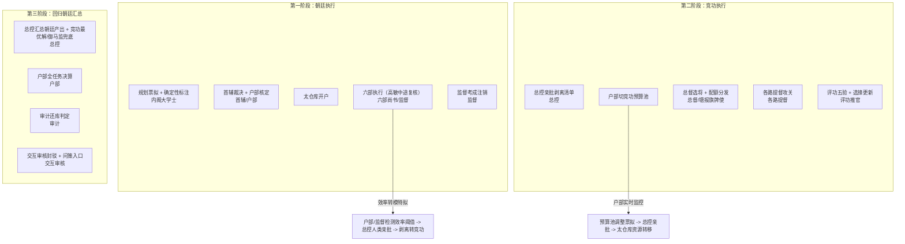
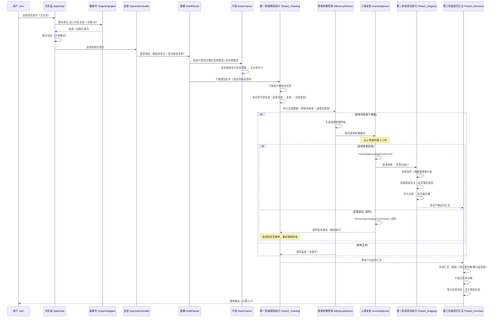
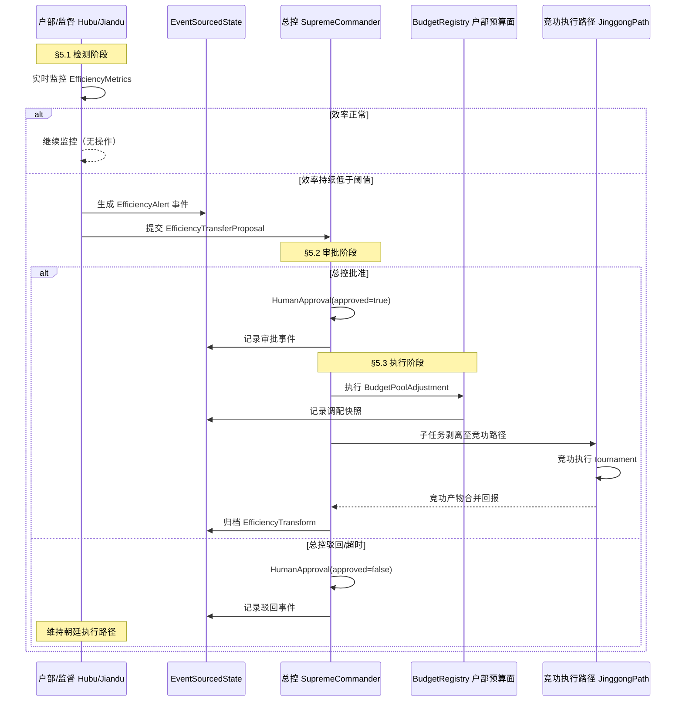
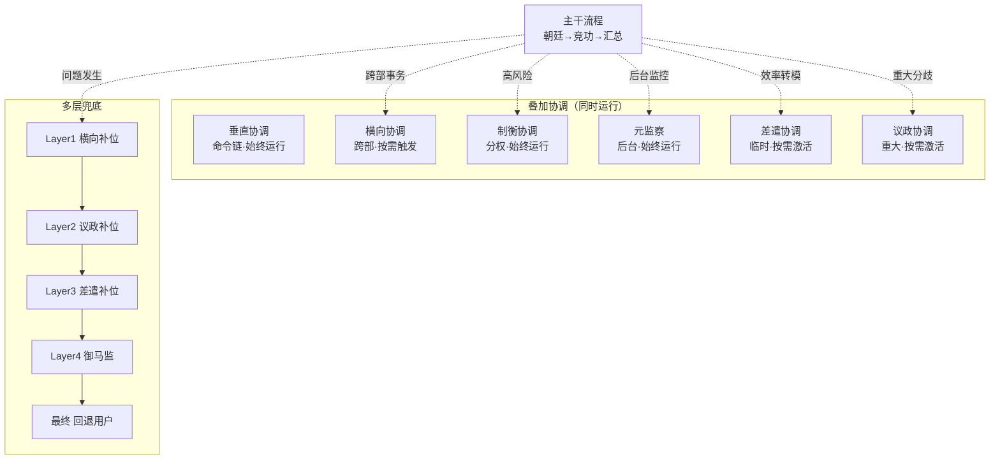
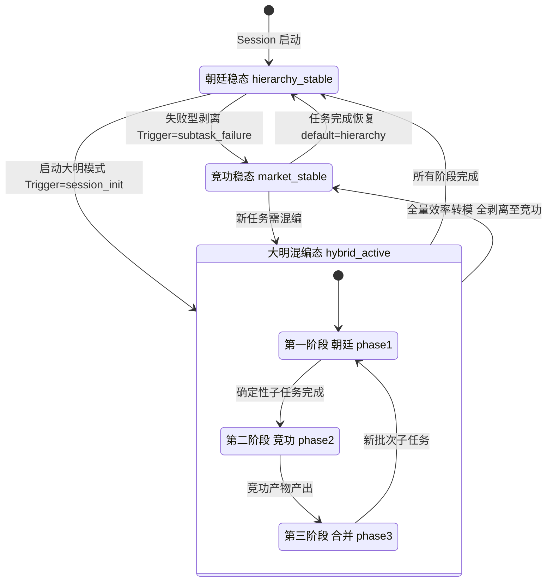
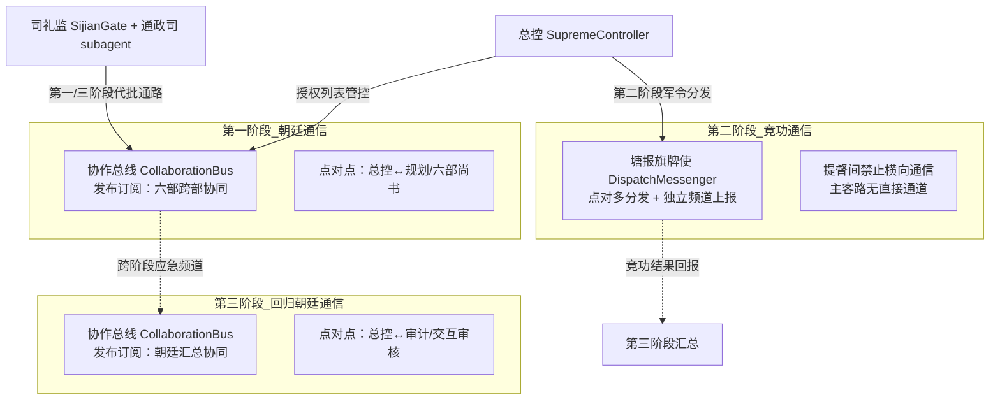

[AI 生成]

# 大明模式（Daming Mode / renshi-hybrid）

> 大明模式（renshi-hybrid）：任事型混合编排模式。朝廷模式拆解整体 → 确定性子任务走朝廷（六部+中途复核）→ 模糊子任务剥离转竞功 → 竞功结果回归汇总 → 户部预算池动态调整。效率转模是「模式切换触发策略」（机制），不是第四独立模式。
> 状态：stable
> 维护：@XZF（主笔）
> 讨论：无
> 待决：无

---

## 1. 模式定位

大明模式是 璇玑 任事型编排的第三种模式。任务规模大、内部异构（部分确定性强、部分模糊多解）时使用。它不是新的 Coordination Pattern，也不是新的微内核一等概念，而是朝廷模式与竞功模式的**混合编排策略**——对同一任务的不同子任务分别适用确定性路径（朝廷）与多解探索路径（竞功），并在两段执行之间做预算池动态调整与结果汇总。

| 属性 | 值 |
|------|----|
| 技术名 | `renshi-hybrid` |
| 中文显示名 | 大明模式 |
| Coordination | 非单一（第一阶段 `hierarchy`，第二阶段 `market`，第三阶段回 `hierarchy`） |
| 默认 Execution | 非单一（第一/三阶段 `dag`，第二阶段 `tournament`） |
| 来源隐喻 | 明朝朝廷+军镇混合治理 |
| 定位 | 任务级混合编排 Preset，复用朝廷+竞功两套 Preset |

**核心思想是「确定性分级 + 段间切换」**。规划层先对每个子任务做确定性评分（确定性估计矩阵），高确定性子任务按朝廷模式串行/简单并行执行（高风险节点中途复核），低确定性子任务标注为「竞功候选」剥离转入竞功阶段多路并行探索，最后所有产出回归朝廷模式汇总。户部在整个过程中实时监控确定性预算池与竞功预算池的消耗率和空转率，满足律例触发条件时主动提交预算池调整票拟。

**不引入新角色**。大明模式复用朝廷模式全部角色（见 12-chaoting-mode.md §3 角色定义）与竞功模式全部角色（见 13-jinggong-mode.md §3 角色定义），以及共享基础层体系（见 11-renshi-shared-base.md）。本模式只定义编排流程、判定规则与阶段切换触发条件，不重复定义角色。

**历史说明**：任事型原仅有内阁制（on-demand）+ 竞功制（swarm）两模式；本次（决策 97）将内阁制重命名为朝廷模式、竞功制重命名为竞功模式，并新增大明模式承载大型异构任务的混合编排。

---

## 2. 架构总览



> 架构总图引用自 02-architecture-layers.md，本图仅标注本模式 Agent 角色分配。

阶段切换由总控亲批触发，不是自动执行（见 §5 效率转模机制、§8.7 微内核对接）。

---

## 3. 模式判定规则

模式判定 Agent（共享基础层角色，见 11-renshi-shared-base.md §2 交互层）根据任务特征自动判定三种模式之一。大明模式的判定向量如下。

| 判定维度 | 大明模式取值 |
|----------|--------------|
| 任务规模 | 大型 / 超大型 |
| 确定性 | 异构（部分高、部分低，可标注） |
| 时间敏感度 | 混合 |
| 多路径需求 | 仅部分子任务有 |
| 典型场景 | 大型报告、复杂项目、跨域综合任务 |
| 安全敏感度 | 需标注（高/中/低），高敏感隔离分配 |

**确定性估计矩阵**：模式判定 Agent 对每个候选子任务输出确定性评分（0-1 浮点），高评分（≥律例阈值）走朝廷，低评分（<阈值）自动标记为「竞功候选」。矩阵同时输出子任务的安全敏感度标签（高/中/低三级），作为全局熔断时任务优先级排序依据。判定建议上报总控批红，总控可推翻或调整。

---

## 4. 三阶段全链路工作流

### 4.1 第一阶段：朝廷模式执行确定性任务

完整链路见 12-chaoting-mode.md §4。本节只列大明模式的差异点。

1. 多规划 Agent 票拟：规划文书含考成簿 + **确定性标注**，低确定性子任务自动标记为「竞功候选」，高风险子任务标注「建议中途复核」并指定复核节点。冷启动期每轮规划同步生成假设日志。
2. 首席规划 Agent（首辅）加权裁决：形成最终规划文书（含竞功候选清单、确定性标注），**协同户部初步划分确定性子任务预算池与竞功预算池**。
3. 户部核定确定性子任务预算（冷启动期施加弹性系数）→ 太仓库开户 → 司礼监/总控批红。
4. 六部执行确定性任务：太仓库预算账户实时硬约束；跨部协同走协作总线（会推/会审/转行/关白）。
5. 高风险复核节点 → 监督冻结 → 复核 Agent 中途复核 → 总控亲批（放行/中止/调整）。
6. **效率预警**（见 §5）→ 效率转模特拟 → 总控（人类）亲批 → 剥离转竞功或拒绝维持原路径。
7. 监督 Agent 考成进度表（含预算执行率），超期/超支停俸 → 全部确定性子任务注销。

### 4.2 第二阶段：竞功模式执行剥离的模糊任务

完整链路见 13-jinggong-mode.md §4。本节只列大明模式的差异点。

1. 总控亲批剥离子任务清单（依据：第一阶段确定性标注、考成反馈、效率转模建议）。
2. 户部切出竞功预算池，根据各路提督历史效率 + 难度系数动态建议**每路配额**。
3. 总督选将：优先选锋标签匹配且历史过程质量分高者（选锋标签受时效衰减约束）。
4. 各路提督攻关（含九边坐镇独立频道），监军御史密奏通道上报（含配额消耗与进度匹配度）。
5. 参谋校正组（评功推官 + 军功勘验使）定期向总督提供动态校正建议（资源重分配/策略调整/路数增减）；总督决策后须上报总控备案。
6. 配额耗尽 → 总督向户部申请竞功池再分配，或向总控申请内承运库增援（生成借支记录）。
7. 收齐或时限到 → 评功推官五道验功（含 Token 效率 + 配额使用率）→ 叙功册 → 更新选锋标签与长期权重 → 抄送考功司。
8. **全路失败兜底**：总控调御马监执行，内承运库自动保障资源（御马监规模上限由律例设定）。

### 4.3 第三阶段：回归朝廷汇总

1. 总控汇总：朝廷产出（第一阶段）+ 竞功最优解或御马监兜底结果（第二阶段）。
2. 户部全任务决算：朝廷实销 + 竞功实销 + 预算池调整记录 → 生成度支总结（冷启动期单独结算）。
3. 审计还库判定：第二阶段内承运库借支是否应由常规预算承担 → 若是，太仓库扣回、户部调账。
4. 审计冷启动效果 / 锁院合理性独立核查。
5. 交互审核 Agent 科抄比对：最终输出 vs 原始奏章 → 通过 / 封驳（附**偏离度评分**）。
6. 每个最终输出附带**问策入口**（匿名反馈）→ 用户可打分 → 存入外部评审档案，作为京察外部参照分。
7. 跨阶段复盘：东厂元监察全链路抽查；考功司将全链路数据纳入京察大计（外部参照分加持，朝会答辩）；律例接受痛点榜调整规则 + 选锋衰减 + 颁发白话诏书。

### 4.4 跨阶段协同：户部预算池动态调整

第一阶段与第二阶段并行/先后执行期间，户部实时监控两池资源消耗率与空转率。当满足律例预设触发条件（如一方池使用率连续低于 X% 而另一方超 Y%）时，户部主动向总控提交「预算池调整票拟」（调整幅度在律例上限内）→ 总控亲批 → 太仓库执行两池资源转移，生成调整记录归档档籍 Agent。

预算池动态调整映射见 §8.6。防振荡约束（权重调整单步上限 ±5% / 预算系数步长限制 / 规则修改冷却期 / 反振荡检测自动锁定 / 痛点榜理性过滤）见 11-renshi-shared-base.md §8。

---





> **定性声明**：效率转模是「模式切换触发策略」（机制），**不是第四独立模式**。任事型三模式 = 朝廷 / 竞功 / 大明。效率转模只在朝廷模式 / 大明模式朝廷阶段内部，把某个效率严重低下的子任务剥离转入竞功执行路径。

### 5.1 触发条件与检测

律例 Agent 预设效率转模触发阈值（见 11-renshi-shared-base.md §1 制度与规则层，律例第 23 项参数）：

- 朝廷子任务实际预算消耗超出预测中位数的 X%；
- 且进度推进低于计划的 Y%；
- 或连续 Z 个周期无明显进展。

检测方：
- 户部 Agent（财政面）：实时监控效率指标（预算消耗率 + 进度完成率）。
- 监督 Agent：独立同步效率指标，可独立发送「效率转模预警」。

检测命中 → 户部生成「效率转模特拟」→ 上呈总控。此阶段**不自动执行**剥离。

### 5.2 人类亲批流程

效率转模属**人类关键介入点**清单（见 11-renshi-shared-base.md §12 人类关键介入点）的第 1 类「模式切换」：必须由总控（人类）亲自审批，不可下放给司礼监代批，不可交由自动规则引擎执行。

- 审批时限：2 小时。
- 超时默认：保持现有路径，高风险任务暂停，转模建议搁置。事后强制补批并记入审计。
- 总控离线时：由司礼监按预设「安全保守规则」暂行（维持现状），事后人类补批。

### 5.3 批准后的执行

- 总控亲批剥离 → 该子任务从朝廷执行队列移除，转入竞功执行路径（第二阶段或独立的竞功子任务）。
- 户部调整预算池：从确定性预算池划拨资源到竞功预算池，生成调整记录。
- 太仓库执行账户转移。
- 效率转模决策记录（含触发阈值数据、审批人、时间）归档档籍 Agent，作为审计/考功证据。

**与失败型模式切换的区别**：朝廷模式还有「子任务连续失败 → 剥离转竞功」的失败型切换（见 12-chaoting-mode.md）；效率转模专门处理「未失败但效率严重低下」的非失败性低效场景，二者触发条件不同，但执行路径相同（均需总控人类亲批）。

#### 失败型剥离触发条件

> 与效率转模（非失败性低效）不同，失败型剥离是确定性子任务反复失败后强制转竞功。

| 触发条件 | 默认值 | 说明 |
|----------|--------|------|
| maxConsecutiveFailures | 3 | 同一子任务连续失败 3 次（超时/质量不达标/异常退出） |
| failureTypes | `[\'timeout\', \'quality\', \'crash\']` | 计入连续失败的类型（用户主动取消不计） |
| cooldownBeforeStrip | 5min | 失败后冷却 5min 再剥离（给 Agent 自修复机会） |
| stripDecision | 总控亲批 | 失败型剥离必须总控决策（司礼监不可代批） |

**效率转模 vs 失败型剥离对比**：

| 维度 | 效率转模（§5.1） | 失败型剥离（本节） |
|------|-----------------|-------------------|
| 触发原因 | 低效但未失败（进度慢/成本高） | 确定性失败（超时/质量差/崩溃） |
| 转换方向 | 朝廷→竞功（模糊子任务剥离） | 朝廷→竞功（失败子任务重试） |
| 决策权限 | 总控亲批（§5.2 已定义） | 总控亲批（不可代批） |
| 可恢复 | 完成后回到朝廷 | 重新成功后回到朝廷 |

### 5.4 效率转模 TypeScript 接口

> 依据：决策 97（效率转模）、原则 16（模式可切换扩展）、§5.1-§5.3 流程描述。
> 所有接口映射到已有微内核概念，不新增一等概念。

```typescript
/** 效率阈值配置（EfficiencyThreshold）— 决策 97 定义的触发条件 */
interface EfficiencyThreshold {
  maxTokenOverrun: number;       // token 超支比例上限（如 1.5 = 150%）
  maxTimeOverrun: number;        // 时间超支比例上限
  minProgressRatio: number;      // 最低进度比（如 0.3）
  sustainedMs: number;           // 持续低效时长门槛（ms）
}

/** 效率指标（EfficiencyMetrics）— 户部/监督实时监控产出（§5.1 检测阶段） */
interface EfficiencyMetrics {
  subtaskId: string;
  tokenConsumed: number;
  tokenBudget: number;
  elapsedMs: number;
  expectedMs: number;
  progressRatio: number;         // 0..1，实际进度/预期进度
  efficiencyScore: number;       // 0..1，综合效率评分
  measuredAt: number;            // epoch ms
}

/** 效率告警（EfficiencyAlert）— 阈值突破时由户部/监督生成（§5.1） */
interface EfficiencyAlert {
  alertId: string;
  subtaskId: string;
  sessionId: string;
  metrics: EfficiencyMetrics;
  threshold: EfficiencyThreshold;
  severity: 'warning' | 'critical';
  detectedBy: string;            // Identity.role（如 "hubu" | "jiandu"）
  createdAt: number;
}

/** 预算池调整（BudgetPoolAdjustment）— 确定性预算池→竞功预算池（§5.3） */
interface BudgetPoolAdjustment {
  fromPool: 'certainty';         // 确定性预算池
  toPool: 'competition';         // 竞功预算池
  tokenAmount: number;
  reason: string;
  eventId: string;               // EventSourcedState 事件 ID（调配快照）
}

/** 人类审批（HumanApproval）— 总控（人类）亲批记录（§5.2 审批阶段） */
interface HumanApproval {
  proposalId: string;
  approved: boolean;
  approverId: string;            // User.id（总控）
  comment?: string;
  decidedAt: number;
}

/** 效率转模提案（EfficiencyTransferProposal）— 总控审批前的提案（§5.2） */
interface EfficiencyTransferProposal {
  proposalId: string;
  alert: EfficiencyAlert;
  transferReason: string;        // 低效证据摘要
  proposedTarget: 'jinggong';   // 转移目标：竞功执行路径
  budgetAdjustment: BudgetPoolAdjustment;
  estimatedGain: string;         // 预估效率提升
  submittedAt: number;
}

/** 效率转模记录（EfficiencyTransform）— 转模完成后归档（§5.3，决策 97） */
interface EfficiencyTransform {
  transformId: string;
  proposal: EfficiencyTransferProposal;
  approval: HumanApproval;
  budgetAdjustment: BudgetPoolAdjustment;
  transferredAt: number;
  archivedBy: string;            // 档籍 Agent Identity.role
  eventSnapshotId: string;       // 转模快照 ID（§8.4 第 1 层锚点快照）
}
```

#### 效率转模推荐默认值

> 参考明朝总督出征前户部核定预算：超支到一定程度需上报追加。

| 风险等级 | maxTokenOverrun | minProgressRatio | sustainedMs | 适用场景 |
|----------|-----------------|------------------|-------------|---------|
| low-risk | 2.0（预算 2 倍） | 0.2（进度 <20%） | 1,800,000（30min） | 日常编码、文档生成 |
| medium-risk | 1.5（预算 1.5 倍） | 0.3（进度 <30%） | 900,000（15min） | 多步推理、代码审查 |
| high-risk | 1.3（预算 1.3 倍） | 0.5（进度 <50%） | 600,000（10min） | 架构设计、安全审计 |

**配置层级**（覆盖优先级从低到高）：

1. Pack 默认（coding-pack 提供 recommendedRiskLevel）
2. Session 配置（用户启动时指定）
3. 总控临时调整（司礼监代批层可动态修改）

**说明**：太灵敏（如 high-risk 用于日常任务）→ 频繁转模干扰执行；太迟钝（如 low-risk 用于高风险任务）→ 成本浪费。风险等级由模式判定 Agent 或通政使 Agent 在贴黄阶段确定。

### 5.5 效率转模流程（sequenceDiagram）



### 5.6 预算池数据结构（YAML 参考）

```yaml
# 依据：§8.6 预算池动态调整 = UserProfile.quotas + Infrastructure
# 非核心契约，仅为实现参考
sessionBudgetPools:
  certaintyPool:               # 确定性预算池（朝廷执行路径）
    tokenBudget: 50000
    tokenConsumed: 0
    status: active
  competitionPool:             # 竞功预算池（竞功执行路径）
    tokenBudget: 30000
    tokenConsumed: 0
    status: standby            # 大明模式启动时为 standby
  adjustments: []              # BudgetPoolAdjustment 记录列表
```

---

## 5a. 叠加协调机制（D18）

> 源于明朝六大协调模式。大明模式不是严格的线性三阶段（朝廷→竞功→汇总），而是**多种协调模式同时运行、相互补位**。当一个协调失效时，其他协调自动兜底。

### 5a.1 叠加运行原则

大明模式中，以下协调模式**同时运行**，各管各的场景：

| 协调模式 | 什么时候运行 | 大明模式中的实现 |
|----------|-------------|-----------------|
| 垂直协调（命令链） | 始终运行 | 朝廷六部日常执行 |
| 横向协调（跨部协同） | 跨部事务触发 | 会推/会审/转行/关白 |
| 制衡协调（分权互锁） | 高风险操作时 | 文武分权（总督战略 vs 提督战术） |
| 元监察（监察监察者） | 始终在后台 | 东厂/锦衣卫互监 |
| 差遣协调（临时授权） | 跨域任务触发 | 总督/巡抚差遣 |
| 议政协调（集体议事） | 重大决策触发 | 朝会复合态 |

**与线性三阶段的关系**：三阶段（朝廷→竞功→汇总）是大明模式的**主干流程**，但不是唯一流程。在主干流程的任何阶段，上述六种协调都可能**同时触发**——例如朝廷执行中某子任务需要跨部协同时，横向协调自动激活，不需要等当前阶段完成。

#### 六模式→Pattern 映射表

> 每种明朝协调模式映射到 璇玑 的 Coordination×Execution Pattern 组合 + 通信通道。

| 明朝协调模式 | Coordination Pattern | Execution Pattern | 通信通道 | 典型角色 |
|-------------|---------------------|-------------------|---------|---------|
| ① 垂直协调 | hierarchy | dag/sequence | 点对点（命令链） | 总控→规划→尚书→侍郎→司科 |
| ② 横向协调 | hierarchy | dag（多分支） | 发布订阅（频道） | 六部尚书之间会推/会审 |
| ③ 制衡协调 | hierarchy | dag（审批流） | 点对点（副署确认） | 调兵→五军核对→总兵执行 |
| ④ 元监察协调 | hierarchy | sequence | 点对点（密奏直通） | 监督→审计→复核→元监察 |
| ⑤ 差遣协调 | hierarchy | dag（临时分支） | 点对点（敕书授权） | 钦差 Agent 临时派遣 |
| ⑥ 议政协调 | hierarchy | tournament | 发布订阅（议事频道） | 廷议/朝会多方案辩论 |

**关键规则**：

- 所有协调模式都在 hierarchy Coordination 下运行（璇玑 的顶层总是 hierarchy）
- 差异在 Execution Pattern：dag（并行）/ sequence（串行）/ tournament（竞争）
- 通信通道选择：垂直=点对点、横向=发布订阅、元监察=密奏直通、议政=议事频道
- 大明模式下六种协调模式**可叠加运行**（如万历朝鲜之役同时用了全部六种）

### 5a.2 阶段间上下文传递

效率转模时，朝廷子任务的**已有进度和上下文**必须打包传递给竞功：

```typescript
interface PhaseTransitionContext {
  /** 原朝廷子任务 */
  originalTask: string;
  /** 已完成的进度（0-1） */
  progress: number;
  /** 已消耗的预算 */
  spentBudget: number;
  /** 已产出的中间结果 */
  intermediateResults: string[];
  /** 效率转模原因 */
  transitionReason: string;
  /** 原执行者信息（供总督参考） */
  originalExecutor?: string;
}

// 总督收到 PhaseTransitionContext 后的分发逻辑
interface GovernorWithTransition extends GovernorDistribute {
  /** 带上下文的分发——各路提督知道"已经做到哪了" */
  distributeWithContext(
    order: MilitaryOrder,
    routes: RouteConfig[],
    transition: PhaseTransitionContext
  ): Promise<RouteAssignment[]>;
}
```

**关键**：各路提督收到的不只是任务，还有"前面做到哪了"。避免重复劳动。

### 5a.3 多层兜底

不是一个兜底（御马监），而是**层层递进的兜底链**：

```
问题发生
  ↓
Layer 1：横向协调补位（跨部协同——会推/会审解决）
  ↓ 失败
Layer 2：议政协调补位（朝会复合态——多角度讨论）
  ↓ 失败
Layer 3：差遣协调补位（钦差 Agent 直接介入——绕过常规流程）
  ↓ 失败
Layer 4：御马监兜底（总控直属 Agent 紧急执行——内承运库保障资源）
  ↓ 失败
最终：总控报告中断，回退用户决策
```

```typescript
interface FallbackChain {
  /** 逐层尝试兜底 */
  attemptFallback(
    failedTask: FailedTask,
    layer: 1 | 2 | 3 | 4
  ): Promise<FallbackResult>;
}

interface FailedTask {
  taskId: string;
  failureReason: string;
  spentBudget: number;
  intermediateResults?: string[];
}
```

**每层的触发条件由律例预设**，不靠总控临时判断。

#### 多层兜底升级条件

> 参考明朝三角制衡（总督-巡抚-总兵）：每层失败有明确的升级路径。

| Layer | 协调模式 | 失败判定 | 升级超时 | 降级恢复条件 | 明朝原型 |
|-------|---------|---------|---------|-------------|---------|
| **L1 横向** | 六部协同（会推/会审/转行/关白） | 协作请求无响应 > 律例默认 10min，或 3 次拒绝协同且无理由 | 30min 无进展→升级 L2 | 协作恢复 + 稳定运行 1h | 六部之间公文流转 |
| **L2 议政** | 廷议（多视角议事） | 廷议超时无结论（律例默认 45min），或 ≥2 方强烈反对 | 廷议 3 轮仍无共识→升级 L3 | 达成共识并执行成功 1 次 | 廷议三轮不决→皇帝独断 |
| **L3 差遣** | 钦差 Agent 临时派遣 | 钦差 Agent 也无法解决（评分 < 5.0），或钦差超预算 200% | 钦差失败→升级 L4 | 无（L4 是最终层） | 钦差大臣失败→御马监出动 |
| **L4 御马监** | 总控直属精锐 Agent 兜底 | 无（最终层，兜底失败则任务标记为"不可完成"） | — | — | 御马监直属精锐最后出动 |

**升级规则**：

- 每层升级需**留档**（审计 Agent 记录升级原因 + 时间戳）
- L1→L2 升级需总控签批（司礼监可代批）
- L2→L3 / L3→L4 升级**必须**总控亲批（不可代批）
- 降级恢复需连续成功 ≥ 2 次（防止在层间反复振荡）

### 5a.4 协调铁律

从明朝中央决策协调机制提炼的五条铁律：

| 铁律 | 含义 | 璇玑 实现 |
|------|------|-----------|
| **任何节点必有时限** | 防止"奏章留中"式瘫痪 | 每个 Agent 任务都有 deadline，超时自动触发兜底 |
| **否决权次数有上限** | 防止封驳变成恶意拖延 | 六科封驳/谏院反对的次数有上限（律例设定），超限自动放行 |
| **代批范围必须明确** | 不允许模糊授权 | 司礼监 BatchApproveCharter 明确列出可代批项（已有 §5.1） |
| **规划与执行分离** | 不能既是运动员又是裁判 | 内阁票拟（规划）与六部执行（执行）严格分离 |
| **代批者不持执行权** | 批准≠执行 | 司礼监批红但不能自己调用工具执行任务 |

### 5a.5 叠加协调的 Mermaid 图



---

## 6. 角色复用

大明模式不引入新角色。以下表格汇总全部复用角色，数据来源：12-chaoting-mode.md §3、13-jinggong-mode.md §3、11-renshi-shared-base.md §15.1。

| 角色名 | 来源模式 | 数量 | 可选性 | 备注 |
|------|---------|------|--------|------|
| 总控 Agent（SupremeController） | 朝廷（12-chaoting） | 1 | 必选 | 大明模式入口，阶段切换亲批 |
| 司礼监 Agent（Sijian） | 朝廷（12-chaoting） | 1 | 必选 | 仅第一/三阶段代批，第二阶段不走代批 |
| 交互审核 Agent | 朝廷（12-chaoting） | 1 | 必选 | 大明模式请求入口 |
| 模式判定 Agent | 共享（11-renshi） | 1 | 必选 | 大明模式入口角色，持有确定性估计矩阵 |
| 规划 Agent（内阁大学士） | 朝廷（12-chaoting） | 3 | 必选 | 第一阶段票拟，标注确定性等级与竞功候选 |
| 首席规划 Agent（首辅） | 朝廷（12-chaoting） | 1 | 必选 | 加权裁决，协同户部划分预算池 |
| 六部尚书级 Agent | 朝廷（12-chaoting） | 6 | 必选 | 吏/户/礼/兵/刑/工 |
| 司级 Agent | 朝廷（12-chaoting） | 待定 | 必选 | 各清吏司，TODO：待人工确认 |
| 科级 Agent | 朝廷（12-chaoting） | 待定 | 必选 | 各科主事，TODO：待人工确认 |
| 监督 Agent | 朝廷（12-chaoting） | 1-2 | 必选 | 第一阶段考成注销，效率预警 |
| 审计 Agent | 朝廷（12-chaoting） | 1 | 必选 | 第三阶段决算与还库判定 |
| 复核 Agent | 朝廷（12-chaoting） | 0-1 | 条件 | 高风险子任务触发中途复核 |
| 军情转译使 | 竞功（13-jinggong） | 1 | 可选 | 仅竞功/大明竞功阶段启用 |
| 总督 Agent | 竞功（13-jinggong） | 1 | 可选 | 仅第二阶段竞功阶段启用 |
| 各路提督 Agent | 竞功（13-jinggong） | N 路 | 可选 | 仅第二阶段，N 待定 |
| 评功推官 | 竞功（13-jinggong） | 1 | 可选 | 第二阶段五道验功 + 第三阶段结果汇总 |
| 监军御史 | 竞功（13-jinggong） | 1 | 可选 | 仅第二阶段监控配额消耗与进度匹配度 |
| 军功勘验使 | 竞功（13-jinggong） | 1 | 可选 | 第二阶段事后复盘 |
| 塘报旗牌使 | 竞功（13-jinggong） | 1 | 可选 | 第二阶段点对多分发通信 |
| 幕府 Agent | 竞功（13-jinggong） | 1 | 可选 | 仅第二阶段启用，通信负载 |
| 律例 Agent | 共享（11-renshi） | 1 | 必选 | 规则库维护，效率转模阈值定义 |
| 档籍 Agent | 共享（11-renshi） | 1 | 必选 | 转模快照等全链路归档 |
| 考功司 Agent | 共享（11-renshi） | 1 | 必选 | 跨阶段京察大计综合考核 |
| 户部 Agent 财政面 | 共享（11-renshi） | 1 | 必选 | 预算池划分、决算、效率监控 |
| 太仓库 Agent | 共享（11-renshi） | 1 | 必选 | 预算账户扣减、资源转移执行 |
| 内承运库 Agent | 共享（11-renshi） | 1 | 必选 | 皇帝直控资源，借支还库 |
| 御马监 Agent | 共享（11-renshi） | 1 | 可选 | 仅第二阶段全路失败兜底 |
| 锦衣卫 Agent | 共享（11-renshi） | 1 | 必选 | 诏狱隔离 |
| 东厂 Agent | 共享（11-renshi） | 1 | 必选 | 元监察，全链路抽查 |

大明模式复用朝廷模式全部角色（见 12-chaoting-mode.md §3 角色定义）与竞功模式全部角色（见 13-jinggong-mode.md §3 角色定义），以及共享基础层体系（见 11-renshi-shared-base.md）。本模式只定义编排流程、判定规则与阶段切换触发条件，不重复定义角色。

模式判定 Agent（共享基础层）是大明模式的入口角色：它持有「确定性估计矩阵」，输出子任务级确定性评分与安全敏感度标签，作为剥离清单的依据。司礼监在大明模式中适用于第一/三阶段代批（见 15-sijian-batch.md），第二阶段竞功执行走军情转译使不代批。第一/三阶段中，司礼监委托通政司 subagent 收文登记与查看工作区文档（决策 139），专注代批判断。


---

## 7. 不变量

1. **不引入新角色**：大明模式所有角色均复用朝廷 + 竞功 + 共享基础层，无 Identity.role 新增值。
2. **阶段切换必须总控亲批**：第一→第二、第二→第三的切换，以及效率转模，均需总控（人类）亲批。不可自动执行。
3. **预算硬约束**：第一阶段六部执行受太仓库预算账户实时硬约束；第二阶段各路消耗从配额扣除，配额耗尽自动拦截。
4. **效率转模是机制非模式**：任事型仅有三模式（朝廷 / 竞功 / 大明），效率转模是模式切换触发策略（机制），任何描述不得将其表述为独立模式（含「第 N 模式」类措辞）。
5. **两段执行可并行**：第一/二阶段可并行或先后，但最终结果必须回归第三阶段汇总。总控汇总时合并朝廷产出 + 竞功最优解。
6. **复用监察三层分离**：过程监督（监督 / 监军御史）/ 事后审计（审计 / 军功勘验使）/ 高风险复核（复核）三层分离不变量（原则 24）继续生效，跨阶段保持。

---

## 8. 与微内核对接

大明模式作为任务级混合编排 Preset，全部映射到 v4 微内核现有的一等概念（Agent / Loop / User / Communication / State / Pattern，见 02-architecture-layers.md），**不新增微内核一等概念**。

### 8.1 模式判定 Agent = Identity.role 配置

模式判定 Agent 是 Identity 库中的模板，通过 `Identity.role` 区分，架构不 `switch(role)`。

| 角色 | Identity.role 值 | capabilities | dispatchBudget |
|------|------------------|--------------|----------------|
| 模式判定 Agent（掌院学士） | `"mode-judge"` | `["judge", "estimate"]` | 0 |

其余角色（朝廷角色 / 竞功角色 / 共享层角色）的 Identity.role 映射见 12-chaoting-mode.md §11.1 与 13-jinggong-mode.md 对应章节。确定性估计矩阵作为模式判定 Agent 的 Identity 配置 hook（参考历史同类任务 + 任务复杂度 + 考成等级 + 选锋历史消耗），输出评分作为建议上呈，最终剥离清单由总控亲批。

### 8.2 Loop = 四库之一（复用）

第一/三阶段朝廷执行默认使用 `react-loop`（见 12-chaoting-mode.md §11.2）；第二阶段竞功执行默认使用竞功 Loop（见 13-jinggong-mode.md）。两种 Loop 均从 Loop 库选取，运行期只读，无特权通道。

### 8.3 通信 = 图状通信（复用）

第一/三阶段使用协作总线（发布订阅实现，见 12-chaoting-mode.md §11.3）；第二阶段使用塘报旗牌使（点对多 + 独立频道，见 13-jinggong-mode.md）。两段通信均映射到 v4 图状通信（决策 79），大明模式不新增 Transport 实现。跨阶段信息流通过协作总线应急频道 + 锁院期间例外规则（见 11-renshi-shared-base.md §11 通信层）。

### 8.4 状态 = 事件溯源（含转模快照）

大明模式下所有状态变更（批红记录、代批记录、预算快照、复核快照、调配快照、锁院快照、灾备快照、**转模快照**）均为 append-only 事件，状态是事件的投影（EventSourcedState，决策 80）。

**转模快照**作为第 1 层锚点快照（永不冲刷）的一部分（见 11-renshi-shared-base.md 上下文防丢失机制）：每次效率转模决策产生一条不可篡改事件，含触发阈值数据、总控审批记录、预算池调整记录。档籍 Agent 持久化转模决策记录、人类介入审核记录、防振荡锁定记录（见 11-renshi-shared-base.md §1 档籍 Agent 第 8 项）。

### 8.5 Pattern 组合（hierarchy + market 两段切换）

大明模式作为 Preset 固化两段 Pattern：

- 第一/三阶段：`Coordination: hierarchy` + `Execution: dag`（复用朝廷模式）。
- 第二阶段：`Coordination: market` + `Execution: tournament`（复用竞功模式）。

两段切换通过 Session 级 Pattern 注册（见 03-execution-modes.md §1 组合矩阵）实现，Capability 契约白名单允许两段独立注册。大明模式不新增 Coordination 类型。

### 8.6 预算池动态调整 = UserProfile.quotas + Infrastructure

预算池动态调整映射到现有微内核概念，**不新增一等概念**：

| 大明模式机制 | 微内核映射 |
|--------------|-----------|
| 确定性预算池 / 竞功预算池账户 | `UserProfile.quotas`（决策 83，User 一等公民）下的命名空间配额分区 |
| 账户扣减 / 余额拦截 / 冻结解冻 | Infrastructure 层 `BudgetRegistry`（户部 + 太仓库作为 BudgetRegistry 的 Domain Pack 扩展，见 07-infrastructure.md） |
| 预算池调整票拟 + 总控亲批 + 资源转移 | `EventSourcedState` 事件（调配快照）+ Infrastructure 执行 |
| 户部实时监控两池消耗率 | Infrastructure 监控接口（非 Agent 直接读写 State） |

### 8.7 效率转模 = 模式切换（原则 16 扩展）

效率转模是原则 16「模式可切换」的**运行期触发策略**扩展（非新增模式）：

- 原则 16：Session 支持模式切换，运行中可切换。
- 原则 16 扩展（决策 97）：模式切换除「Session 启动时选择」与「子任务失败型剥离」外，新增「效率阈值触发型剥离」——朝廷子任务效率持续低下时，由户部/监督检测、总控（人类）亲批后，将该子任务从朝廷执行路径切换到竞功执行路径。

效率转模的执行路径与失败型模式切换相同（均修改 Session 当前 Pattern），区别仅在触发条件（非失败性低效 vs 连续失败）。模式切换决策记录入 EventSourcedState，归档档籍 Agent。

### 8.8 模式判定 TypeScript 接口

> 依据：§8.1 模式判定 Agent（Identity.role="mode-judge"）、§8.2 确定性估计矩阵。

```typescript
/** 安全标签（SafetyLabel）— 任务安全分级（原则 11 工具风险四级管控） */
type SafetyLabel = 'safe' | 'moderate' | 'restricted' | 'forbidden';

/** 确定性评分（SubtaskCertaintyScore）— 单个子任务的确定性评估 */
interface SubtaskCertaintyScore {
  subtaskId: string;
  taskComplexity: number;        // 0..1
  historicalMatchScore: number;  // 0..1，历史同类任务匹配度
  rankGrade: string;             // 考成等级（上/中/下）
  estimatedCost: number;         // 选锋历史消耗预估 token
  certaintyScore: number;        // 0..1，综合确定性评分
}

/** 确定性估计矩阵（CertaintyEstimationMatrix）— 模式判定 Agent 评估产出（§8.1） */
interface CertaintyEstimationMatrix {
  sessionId: string;
  subtaskScores: SubtaskCertaintyScore[];
  overallCertainty: number;      // 0..1
  recommendedMode: 'chaoting' | 'jinggong' | 'daming';
  recommendationConfidence: number; // 0..1
  evaluatedBy: string;           // Identity.role = "mode-judge"
  evaluatedAt: number;
}

/** 模式判定结果（ModeDetectionResult）— 判定 Agent 最终输出 */
interface ModeDetectionResult {
  sessionId: string;
  matrix: CertaintyEstimationMatrix;
  safetyLabel: SafetyLabel;
  stripCandidates: string[];     // 建议剥离子任务 ID 清单（建议性，最终由总控亲批）
  rationale: string;
}
```

### 8.9 混编协调器 TypeScript 接口

> 依据：§4 两阶段混编流程、§8.5 Pattern 组合（hierarchy + market 两段切换）。
> HybridDispatchDirective 复用 DispatchDirective（见 12-chaoting-mode.md §5.10），不重复定义。

```typescript
/** 混编阶段类型（HybridPhaseType）— §4 三阶段 */
type HybridPhaseType = 'phase1_chaoting' | 'phase2_jinggong' | 'phase3_merge';

/** 任务画像（TaskProfile）— 任务分析产出，用于阶段分配 */
interface TaskProfile {
  taskId: string;
  taskType: string;
  certaintyScore: SubtaskCertaintyScore;
  safetyLabel: SafetyLabel;
  estimatedTokens: number;
  recommendedPhase: HybridPhaseType;
}

/** 混编阶段（HybridPhase）— 单个阶段配置（§8.5 Pattern 组合） */
interface HybridPhase {
  phaseType: HybridPhaseType;
  coordination: 'hierarchy' | 'market';
  execution: 'dag' | 'tournament';
  subtaskIds: string[];
  budgetPoolId: 'certainty' | 'competition';
  status: 'pending' | 'active' | 'completed' | 'skipped';
}

/** 混编阶段计划（HybridPhasePlan）— 完整阶段计划 */
interface HybridPhasePlan {
  planId: string;
  sessionId: string;
  phases: HybridPhase[];         // 按 phase1→phase2→phase3 顺序
  totalBudget: number;
  createdAt: number;
}

/** 混编派发指令（HybridDispatchDirective）— 附加阶段标识的派发指令 */
interface HybridDispatchDirective {
  phaseType: HybridPhaseType;
  // 基础字段复用 DispatchDirective（12-chaoting-mode.md §5.10）
  subtaskIds: string[];
  coordination: 'hierarchy' | 'market';
  execution: 'dag' | 'tournament';
  budgetPoolId: 'certainty' | 'competition';
}

/** 阶段结果（PhaseResult）— 单个阶段执行完成后的结果 */
interface PhaseResult {
  phaseType: HybridPhaseType;
  status: 'completed' | 'failed' | 'partial';
  artifacts: string[];           // 产出物引用
  tokenConsumed: number;
  efficiencyMetrics?: EfficiencyMetrics; // 第二阶段效率指标（用于检测）
  completedAt: number;
}

/** 混编协调器（HybridCoordinator）— 大明模式核心协调接口 */
interface HybridCoordinator {
  planSession(taskProfiles: TaskProfile[]): HybridPhasePlan;
  dispatchPhase(phase: HybridPhase): HybridDispatchDirective[];
  collectPhaseResult(phaseType: HybridPhaseType, result: PhaseResult): void;
  checkEfficiencyThreshold(phase: HybridPhase): EfficiencyAlert | null;
  requestTransform(alert: EfficiencyAlert): EfficiencyTransferProposal;
}
```

### 8.10 模式切换 TypeScript 接口

> 依据：§8.7 效率转模 = 模式切换（原则 16 扩展）、决策 97。

```typescript
/** 模式状态（ModeState）— Session 当前模式运行态 */
type ModeState = 'hierarchy_stable' | 'market_stable' | 'hybrid_active';

/** 转换触发器（TransitionTrigger）— 触发模式切换的条件类型 */
type TransitionTrigger = 'session_init' | 'subtask_failure' | 'efficiency_threshold' | 'manual_override';

/** 模式切换策略（ModeSwitchPolicy）— 决定何时/如何切换模式 */
interface ModeSwitchPolicy {
  policyId: string;
  triggers: TransitionTrigger[];
  cooldownMs: number;            // 防振荡锁定时长（§5.2 第 155 行）
  requiresHumanApproval: boolean; // 效率转模/失败型剥离必须 true
  maxTransitionsPerSession: number;
}

/** 模式切换决策（ModeSwitchDecision）— 一次模式切换的决策记录 */
interface ModeSwitchDecision {
  decisionId: string;
  sessionId: string;
  trigger: TransitionTrigger;
  fromState: ModeState;
  toState: ModeState;
  subtaskId?: string;            // 触发切换的子任务（如有）
  approval?: HumanApproval;      // 人类审批记录（requiresHumanApproval=true 时必填）
  rationale: string;
  decidedAt: number;
}

/** 模式转换事件（ModeTransitionEvent）— EventSourcedState 转模事件（§8.4） */
interface ModeTransitionEvent {
  eventId: string;
  decision: ModeSwitchDecision;
  budgetAdjustment?: BudgetPoolAdjustment;
  snapshotId: string;            // 转模快照 ID（§8.4 第 1 层锚点快照）
  recordedAt: number;
}

/** 大明模式配置（HybridConfig）— Session 级 Preset 配置 */
interface HybridConfig {
  sessionId: string;
  defaultCoordination: 'hierarchy'; // 大明模式默认起始
  phaseOrder: HybridPhaseType[];
  efficiencyThreshold: EfficiencyThreshold;
  switchPolicy: ModeSwitchPolicy;
  antiOscillationLockMs: number; // 防振荡锁定时长（同 cooldownMs）
}
```

### 8.11 大明模式状态机（stateDiagram-v2）



---


## 9. 边界条件

> 触发、终止、降级条件。大明模式三阶段切换与跨阶段异常。

### 9.1 触发条件

- 任务规模大型/超大型
- 内部异构：部分确定性强（走朝廷），部分模糊多解（走竞功）

### 9.2 阶段切换触发

| 切换 | 触发条件 | 决策方 |
|------|---------|--------|
| 第一→第二 | 确定性标注中的「竞功候选」 | 总控亲批 |
| 第二→第三 | 竞功收齐或时限到 | 总督移送 |
| 效率转模 | 朝廷子任务效率低 | 总控亲批 |

### 9.3 终止条件

- 正常终止：三阶段全部完成
- 封驳终止：偏离度超阈值→回流重做

### 9.4 降级策略

| 异常 | 降级动作 |
|---------|---------|
| 第一阶段低效 | 效率转模剥离 |
| 第二阶段全路失败 | 御马监兜底 |

---

## 10. 通信拓扑

> 大明模式跨三阶段通信关系。两段通信均映射到 v4 图状通信（决策 79）。

### 10.1 第一/三阶段（朝廷通信）

- 协作总线（发布订阅）：六部跨部协同
- 点对点：总控↔规划→六部尚书

### 10.2 第二阶段（竞功通信）

- 点对多分发：总督→各路提督
- 禁止横向通信：提督间无通道

### 10.3 跨阶段通信

- 应急频道：协作总线预留跨阶段应急
- 转模快照：效率转模决策经 EventSourcedState 跨阶段传递



> 协作总线（CollaborationBus）用于第一/三阶段朝廷通信（发布订阅）；塘报旗牌使（DispatchMessenger）用于第二阶段竞功通信（点对多 + 独立频道）。两段通信均映射到 v4 图状通信（决策 79），大明模式不新增 Transport 实现。

## 11. 适用场景

| 场景 | 适用性 |
|------|--------|
| 大型综合报告（含数据分析 + 创意撰写 + 事实核查） | ✅ 高确定性分析走朝廷，创意撰写走竞功，最后汇总 |
| 复杂跨域项目（确定步骤 + 探索步骤混合） | ✅ 确定步骤走朝廷，探索步骤走竞功 |
| 单纯日常问答 / 数据处理 | ❌ 用朝廷模式（12-chaoting-mode.md） |
| 单纯策略分析 / 创意生成（规模适中、整体模糊） | ❌ 用竞功模式（13-jinggong-mode.md） |
| 任务规模小、确定性强 | ❌ 大明模式开销不划算 |

大明模式适合**任务整体足够大、可以清晰拆分子任务、但子任务之间确定性差异显著**的场景。拆解成本 + 两段执行协调成本 + 汇总成本必须小于收益（多路径探索带来的质量提升 + 确定性子任务的执行效率）。

---

## 12. 术语对照

| 中文 | 英文 |
|------|------|
| 大明模式 | Daming Mode（renshi-hybrid） |
| 确定性估计矩阵 | Certainty Estimation Matrix |
| 竞功候选 | Jinggong Candidate |
| 剥离清单 | Stripped Subtask List |
| 确定性预算池 | Certainty Budget Pool |
| 竞功预算池 | Jinggong Budget Pool |
| 预算池调整票拟 | Budget Pool Reallocation Proposal |
| 效率转模 | Efficiency Transfer（模式切换触发策略） |
| 效率转模特拟 | Efficiency Transfer Proposal |
| 转模快照 | Transfer Snapshot |
| 三阶段全链路 | Three-Phase Full Pipeline |
| 中途复核 | Mid-way Review |
| 问策入口 | Feedback Entry |

注：朝廷 / 竞功 / 共享基础层术语（总控 / 首辅 / 六部 / 户部 / 太仓库 / 总督 / 提督 / 评功推官 / 律例 / 档籍 / 考功司 / 内承运库 / 御马监 / 锦衣卫 / 东厂 / 锁院 / 灾备部等）见各自文档术语表，不在本表重复。

---

## 13. 相关文档

- [12-chaoting-mode.md](./12-chaoting-mode.md) — 朝廷模式（第一阶段 / 第三阶段复用的基础模式）
- [13-jinggong-mode.md](./13-jinggong-mode.md) — 竞功模式（第二阶段复用的基础模式）
- [11-renshi-shared-base.md](./11-renshi-shared-base.md) — 任事型共享基础层（律例 / 户部 / 太仓库 / 模式判定 / 御马监 / 内承运库 / 锁院 / 灾备部 / 人类关键介入点 / 防振荡 / 上下文防丢失）
- [15-sijian-batch.md](./15-sijian-batch.md) — 司礼监代批（第一/三阶段代批；战略级必亲批含模式切换）
- [02-architecture-layers.md](./02-architecture-layers.md) — 微内核 6 一等概念（对接章节引用）
- [03-execution-modes.md](./03-execution-modes.md) — Coordination × Execution 组合矩阵（两段 Pattern 切换）
- [07-infrastructure.md](./07-infrastructure.md) — WeightRegistry / EventSourcedState / BudgetRegistry（预算池对接）
- [10-decisions.md](./10-decisions.md) — 决策 97（任事型三模式替换）/ 决策 79/80/81/83（图状通信 / 事件溯源 / 监察分层 / User 一等公民）

---

> 文档版本：v1.12
> 本版变更（累积最近 3 条，最新在上）：
>   - v1.12：项目更名 wuwo→璇玑（ORBITA），全文品牌/路径/标识符替换（见决策 146）
>   - v1.11：第一/三阶段司礼监加通政司subagent(决策139：委托收文/读工作区文档)
>   - v1.10：H3-H5+M9+M11 补效率转模默认值+多层兜底升级条件+失败型剥离+六模式映射(参考明朝总督制)
> 基于：无<!-- TODO: 人工确认链接 -->
> 决策总数：139 条（v3 1-69 + v4 70-139）
> 文档总数：29 份
> 原则总数：33 条
