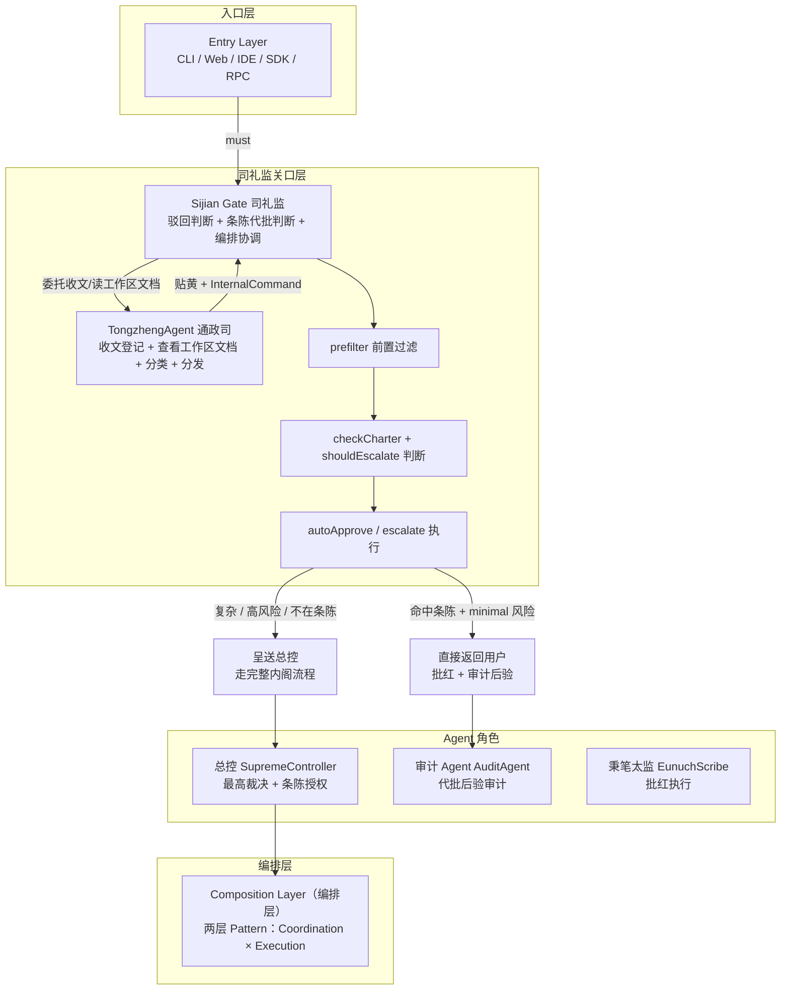
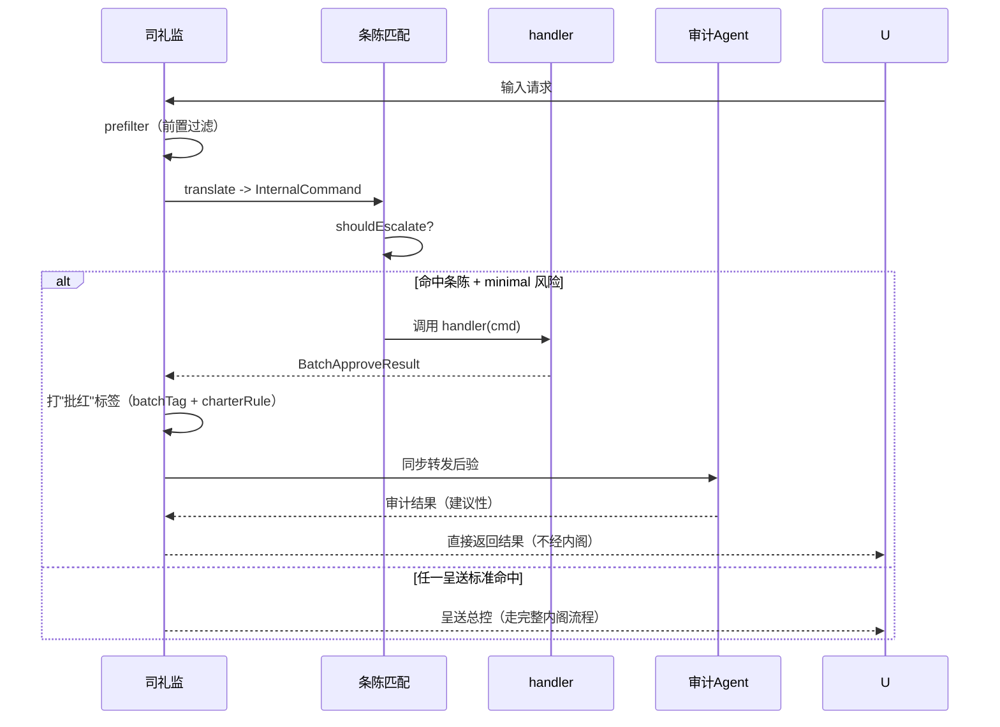

[AI 生成]

# 司礼监代批机制（Sijian Batch Approval）

> 司礼监代批机制：前置关口+有限代批权+条陈预授权+批红可追溯+四不变量。（横切机制·非独立编排模式·适用朝廷模式与大明模式朝廷阶段，竞功模式不适用）
> 文档类型声明：本文档是横切机制文档（非编排模式文档），D2 编排模板部分适用。已补架构总览图+角色定义表 2 要素，通信拓扑和微内核对接不适用。
> 状态：stable
> 维护：@XZF（主笔）
> 讨论：无
> 待决：无
---



| 角色名 | Agent 类型 | 职责 | 数量 | 可选性 |
|------|------|------|------|----------|
| 通政司 Agent | TongzhengAgent | 收文登记（原始奏章+哈希交档籍）+ 查看工作区文档（读文件→贴黄摘要）+ 分类 + 分发；不判内容对错 | 1 | 必须（司礼监 subagent，组合持有，决策 139） |
| 司礼监 Agent | SijianGate | 驳回判断 + 代批判断 + 编排协调（翻译职能已移交通政使 Agent，见决策 137） | 1 | 必须 |
| 总控 Agent | SupremeController | 最高裁决 + 条陈授权 | 1 | 必须 |
| 审计 Agent | AuditAgent | 代批后验审计 | 1 | 可选（Phase 2+） |
| 秉笔太监 | EunuchScribe | 批红执行 | 1 | 必须 |

## 1. 司礼监是什么

司礼监（InteractiveReviewAgent）是朝廷模式（见 12-chaoting-mode.md）交互层的把关者，对应明代司礼监秉笔太监。v4 给予它**有限代批权**——不只是 ming-architecture.md §3 中的翻译层，而是有代批权的前置关口。

### 1.1 定位

- **前置关口**：所有用户请求必须经司礼监才能进入内阁流程或被代批。
- **有限代批权**：司礼监可在条陈（BatchApproveCharter，预授权清单）授权范围内代总控批红简单低风险请求，不经内阁直接返回用户。
- **代批权来源**：总控（SupremeController，皇帝）预先授权的条陈。司礼监不得自行扩充条陈。
- **架构位置**：Sijian Gate（关口层），位于 Entry Layer 与 Composition Layer 之间。详见 02-architecture-layers.md §3。

### 1.2 关口层职责分工（通政司 + 司礼监）

关口层由通政司 subagent 与司礼监分工协作（决策 139）：机械性收文工作由通政司执行，判断工作由司礼监执行。通政司不决定内容对错。

| 职责 | 执行者 | 动作 | 不做什么 |
|------|--------|------|----------|
| 收文与文档预处理 | 通政司 | 收文登记（原始奏章+哈希交档籍）、查看工作区文档（读文件→贴黄摘要）、分类、分发 | 不做内容对错判断 |
| 前置过滤（prefilter） | 司礼监 | 拦截不合规/超范围/格式错的请求 | 不代决策，只过滤 |
| 翻译（translate） | 通政司 | 用户输入→InternalCommand（批红），保留原始映射 | 不丢失原始信息，翻译可逆 |
| 代批判断（autoApprove / escalate） | 司礼监 | 命中条陈+minimal 风险→代批；否则呈送总控 | 不对复杂/高风险请求代批 |

### 1.3 为什么需要代批

95% 的日常用户请求是简单低风险的（时间查询、固定 FAQ、单步只读、确定性计算）。若全部走完整内阁流程（总控→内阁票拟→首辅裁决→六部执行→三层监察→最终审查），开销过大、延迟过高。司礼监前置关口+条陈预授权让简单请求走快速通道（代批），同时批红标签+审计后验保证可追溯。这是 v4 对 ming-architecture.md 的核心扩展（决策 77）。

## 1a. 司礼监核心目的（D11）

> 司礼监的全部工作服务于一个目的：**让 PatternRuntime（皇帝）保持低上下文的最高效决策状态。**

### 七项职责（方案 B：编排协调中枢）

司礼监不只是入口关口，而是**全程参与**编排的协调中枢。从用户输入到结果返回，司礼监在背后持续压缩、汇总、过滤：

| # | 职责 | 怎么服务"皇帝低上下文" | 时机 |
|---|------|----------------------|------|
| 1 | 前置过滤 | 超出能力/违规的驳回，皇帝不看无效请求 | 入口 |
| 2 | 意图探索 | 搞清楚用户到底要什么，皇帝不用猜 | 入口 |
| 3 | 有限代批 | 95% 简单请求自己处理，皇帝根本不用看 | 入口 |
| 4 | 模式推荐 | 推荐编排模式+理由，但皇帝讨论后确认（不是司礼监拍板） | 入口→呈送 |
| 5 | 编排初始化 | 呈送前准备好一切（IntentBriefing、任务分解建议） | 呈送 |
| 6 | 全程协调 | 监控编排进展，持续压缩中间结果 | 全程 |
| 7 | 结果汇总 | 编排完成后压缩结果，呈送用户 | 出口 |

> **关键**：司礼监全程参与，但**不做决策**。决策权永远在 PatternRuntime（皇帝）。司礼监是参谋+管家，不是决策者。

> **通政司分担**（决策 139）：上述七项职责中，收文登记与工作区文档读取等机械性工作由通政司 subagent 承担——收文登记（原始奏章全文+哈希交档籍）、查看工作区文档（用户附带的文档/文件读取→贴黄摘要）、分类（复杂度分级）、分发（处理结果移交司礼监判断）。通政司不决定内容对错；前置过滤的驳回判定与代批判断仍由司礼监执行。

### IntentBriefing（意图简报=给皇帝的贴黄）

```typescript
interface IntentBriefing {
  userIntent: {
    goal: string;              // 用户到底想干嘛（一句话）
    details: string;           // 司礼监理解后的详细描述
    successCriteria?: string[]; // 怎么算做完了
    constraints?: { time?; budget?; preferences? };
  };
  sijianAssessment: {
    complexity: "simple" | "moderate" | "complex";
    recommendedMode?: string;  // 司礼监建议用什么编排模式（D12）
    suggestedAgents?: string[];
    riskLevel?: "low" | "medium" | "high";
  };
  requestContext: RequestContext;
  originalCommand: InternalCommand;  // 原始用户输入留底
  dialogueHistory?: string;          // 司礼监与用户对话摘要
}
```

### SijianCompositionBridge（呈送接口）

```typescript
interface SijianCompositionBridge {
  // === 入口：司礼监 → 皇帝 ===
  
  /** 呈送意图简报（司礼监推荐模式+理由，皇帝讨论后确认） */
  escalate(briefing: IntentBriefing): Promise<void>;
  
  // === 编排中：双向 ===
  
  /** 皇帝 → 司礼监：追问/讨论模式选择或其他问题 */
  forwardQuery(query: EmperorQuery): Promise<BriefingSupplement>;
  
  /** 皇帝 → 司礼监：执行进展报告（司礼监压缩后存档，必要时呈送） */
  reportProgress(progress: ExecutionProgress): Promise<void>;
  
  // === 出口：皇帝 → 司礼监 → 用户 ===
  
  /** 皇帝 → 司礼监：最终结果（司礼监压缩汇总后呈送用户） */
  reportResult(result: ExecutionResult): Promise<CompressedResult>;
}
```

**双向持续通道**：司礼监和 PatternRuntime 之间不只是入口单向呈送，而是全程双向协调：
- 入口：司礼监呈送 IntentBriefing（含模式推荐）
- 编排中：皇帝报告进展，司礼监压缩存档
- 追问：皇帝有疑问时 forwardQuery 与司礼监讨论
- 出口：皇帝报告结果，司礼监压缩汇总呈送用户

**模式选择不是司礼监拍板**：司礼监在 IntentBriefing 中推荐模式+理由，但最终决定权在皇帝。皇帝可以同意、讨论（forwardQuery）、或自己改选。

---

## 2. 三重职责详解

### 2.1 职责一：前置过滤（prefilter）

前置过滤在翻译之前拦截不合规请求。这是过滤，不是代决策——司礼监不替总控做方向性判断，只做规则匹配。

**三种过滤结果**：

| 情形 | 动作 | reason |
|------|------|--------|
| 超出系统能力范围 | 不受理 | `out-of-scope` |
| 违反安全策略 | 直接驳回 | `policy-violation` |
| 格式错误 | 驳回并提示正确格式 | `format-error` |

```typescript
/** 前置过滤结果 */
interface PrefilterResult {
  /** 是否通过过滤 */
  accepted: boolean;
  /** 拒绝原因（accepted=false 时填写） */
  reason?: "out-of-scope" | "policy-violation" | "format-error";
  /** 给用户的提示（格式错误时引导正确格式） */
  hint?: string;
  /** 时间戳 */
  timestamp: number;
}
```

```typescript
/** 交互审核 Agent（司礼监，v4 扩展 ming-architecture §3） */
interface InteractiveReviewAgent {
  /** 前置过滤：拦截不合规请求 */
  prefilter(userInput: string): PrefilterResult;
  /** 翻译：用户输入→内部指令（见 §2.2） */
  translate(userInput: string): InternalCommand;
  /** 反向翻译：内部指令→原始用户输入（可逆保证） */
  reverseTranslate(cmd: InternalCommand): string;
  /** 代批判断：是否可代批（见 §2.3） */
  canAutoApprove(cmd: InternalCommand): { canApprove: boolean; reason?: string };
  /** 执行代批（见 §4） */
  autoApprove(cmd: InternalCommand): BatchApproveResult;
  /** 是否必须呈送总控（见 §5） */
  shouldEscalate(cmd: InternalCommand): { escalate: boolean; reason?: string };
}
```

过滤结果为 `accepted: false` 时，请求在此终止，不进入翻译和代批流程。过滤是关口的第一道闸门。

### 2.2 职责二：翻译（translate）

翻译把用户自然语言转换为结构化 InternalCommand（内部指令，即"批红"）。翻译必须可逆——保留原始请求映射（originalMapping），使总控可在任何阶段回溯原始意图。

**翻译约束**：

- **保留原始映射**：原始用户输入完整记录在 `originalMapping` 字段，不可丢弃。
- **可逆**：`reverseTranslate(InternalCommand)` 必须能还原回用户可读的原始意图描述。
- **失败可驳回**：翻译歧义无法消解时，司礼监驳回并请求用户澄清，不强行翻译。

```typescript
/** 内部指令（批红） */
interface InternalCommand {
  /** 翻译后的内部指令文本（标准化语义） */
  command: string;
  /** 原始用户请求的映射引用（可逆翻译保证） */
  originalMapping: string;
  /** 复杂度评估（供 §5 呈送判断用） */
  complexity: CommandComplexity;
  /** 翻译时间戳 */
  timestamp: number;
}

/** 指令复杂度评估 */
interface CommandComplexity {
  /** 估计步骤数（>1 则必须呈送） */
  estimatedSteps: number;
  /** 是否依赖外部资源（API/DB/文件系统） */
  requiresExternalResource: boolean;
  /** 是否涉及数据修改 */
  involvesMutation: boolean;
  /** 风险等级 */
  riskLevel: "minimal" | "low" | "moderate" | "high";
  /** 是否命中条陈 */
  charterMatch: boolean;
}
```

翻译阶段同时完成复杂度评估，结果填入 `complexity` 字段，供 §5 呈送标准判断使用。复杂度评估必须在翻译时确定，不可延后到代批阶段——否则会破坏代批的原子性。

### 2.3 职责三：代批判断（escalate or autoApprove）

代批判断决定请求走快速通道还是完整通道。判断基于 §5 呈送标准的逻辑反操作：

```typescript
// InteractiveReviewAgent 方法实现语义（见 §2.1 接口）

// canAutoApprove：可代批 = 命中条陈 AND 不需呈送
//   等价于 cmd.complexity.charterMatch AND NOT shouldEscalate(cmd).escalate
//   返回 { canApprove, reason? }，不可代批时 reason 说明原因

// autoApprove：执行代批，返回带批红标签的结果（见 §4）

// shouldEscalate：是否必须呈送总控（任一命中即 escalate=true，见 §5）
//   返回 { escalate, reason? }，呈送时 reason 说明命中哪项标准
```

三个方法构成代批判断的完整闭环：`shouldEscalate` 是"是否必须呈送"的硬判断（返回 `{ escalate, reason? }`），`canAutoApprove` 是"是否可代批"的可选判断（必须为 `!shouldEscalate(cmd).escalate && charterMatch`，返回 `{ canApprove, reason? }`），`autoApprove` 是执行动作。代批判断不允许自由裁量——一切由条陈匹配和复杂度评估决定。

---

## 3. 条陈（BatchApproveCharter）——代批权的来源和边界

条陈是代批授权清单，由总控（皇帝）预先授权，是司礼监代批权的唯一合法来源。

### 3.1 条陈契约

```typescript
/** 条陈：代批授权清单（由总控预授权） */
interface BatchApproveCharter {
  /** 条陈 ID（由总控签发） */
  charterId: string;
  /** 签发者（必须是总控） */
  issuedBy: "supreme-controller";
  /** 签发时间戳 */
  issuedAt: number;
  /** 条陈条目列表 */
  rules: BatchApproveRule[];
  /** 版本号（条陈修改递增，不可回退） */
  version: number;
}

/** 条陈条目：单条代批授权 */
interface BatchApproveRule {
  /** 条目 ID */
  ruleId: string;
  /** 匹配条件（指令必须命中此条件才适用本条目） */
  matchCondition: CharterMatchCondition;
  /** 代批 handler（命中后调用，产出代批结果） */
  handler: CharterHandler;
  /** 风险等级必须是 minimal（强制约束，非 minimal 条目无效） */
  requiredRiskLevel: "minimal";
  /** 条目说明（供审计后验查看） */
  description: string;
}

/** 条陈匹配条件 */
interface CharterMatchCondition {
  /** 匹配模式：正则/关键词/语义标签 */
  pattern: string;
  /** 匹配类型 */
  matchType: "regex" | "keyword" | "semantic-tag";
}

/** 条陈 handler 签名 */
type CharterHandler = (cmd: InternalCommand) => Promise<BatchApproveResult>;
```

### 3.2 条陈边界（硬约束）

| 约束 | 规则 | 强制方式 |
|------|------|----------|
| 风险必须是 minimal | `requiredRiskLevel: "minimal"` 是强制字段，非 minimal 条目注册时拒绝 | 架构宪法 |
| 司礼监不得扩充 | `rules` 数组只能由总控签发修改，司礼监只有读权限 | `sijian-charter-immutable` 不变量 |
| 版本只增不减 | 条陈修改递增 version，历史版本归档供审计 | 事件溯源 |

### 3.3 条陈示例

典型条陈条目（总控预授权，coding-pack 场景）：

| 条目 | 匹配条件 | handler | 说明 |
|------|----------|---------|------|
| 当前时间查询 | 关键词"几点/现在时间" | 返回系统当前时间 | 单步只读、零风险 |
| 固定 FAQ | 语义标签"faq:<key>" | 从 FAQ 库返回固定答案 | 确定性、零风险 |
| 单步只读检索 | 关键词+`read_only:true` | 调用 read 工具读单个文件 | minimal 风险 |
| 确定性计算 | 关键词"计算"+`deterministic:true` | 执行纯函数计算（无 IO） | minimal 风险 |

每个条目都满足三个条件：minimal 风险、确定性结果、命中条件明确。总控把"这类请求司礼监可直接批"的判断固化进条陈，司礼监执行时只是匹配+调用，不做新决策。

---

## 4. 代批流程（快速通道）

代批流程是简单请求的快速通道，不经内阁、不经规划、不经多层监察。代批的合规性由批红标签+审计后验事后保证。

### 4.1 流程



### 4.2 代批结果

```typescript
/** 代批结果（带批红标签） */
interface BatchApproveResult {
  /** 代批产出（handler 返回值） */
  result: unknown;
  /** 批红标签（标识此结果为代批产出） */
  batchTag: true;
  /** 代批者（恒为司礼监） */
  approver: "sijian";
  /** 命中的条陈条目 ID（代批依据） */
  charterRule: string;
  /** 条陈版本号（代批时的条陈快照） */
  charterVersion: number;
  /** 代批时间戳 */
  timestamp: number;
  /** 是否已转发审计 Agent 后验 */
  auditForwarded: boolean;
}
```

`batchTag: true` 是代批结果的强制标识。任何缺少此标签却走快速通道的结果，视为违宪（`sijian-must-be-traceable`）。`charterRule` 字段引用具体条目 ID，是代批的法律依据——无条目引用的代批禁止（`sijian-no-arbitrary-approve`）。

### 4.3 审计后验

代批结果同步转发给都察院（AuditAgent）进行后验。后验是建议性的（不影响已返回用户的结果），但若发现代批违规（如误判复杂度、条陈匹配错误），都察院可上报总控，总控可修订条陈或追究。这构成事后追溯链。

---

## 5. 呈送标准（什么必须上升）

呈送标准定义哪些请求司礼监不得代批、必须呈送总控走完整内阁流程。任一命中即必须呈送。

### 5.1 shouldEscalate 判断

```typescript
/**
 * 是否必须呈送总控。
 * 任一命中即返回 { escalate: true, reason }，不得代批。
 */
function shouldEscalate(cmd: InternalCommand): { escalate: boolean; reason?: string } {
  const c = cmd.complexity;
  if (c.estimatedSteps > 1) return { escalate: true, reason: "multi-step" };
  if (c.requiresExternalResource) return { escalate: true, reason: "external-resource" };
  if (c.involvesMutation) return { escalate: true, reason: "data-mutation" };
  if (c.riskLevel !== "minimal") return { escalate: true, reason: `risk-${c.riskLevel}` };
  if (!c.charterMatch) return { escalate: true, reason: "not-in-charter" };
  return { escalate: false };
}

### 5.2 五项呈送标准

| 标准 | 字段 | 理由 |
|------|------|------|
| 多步骤 | `estimatedSteps > 1` | 多步任务需内阁规划拆解 |
| 依赖外部资源 | `requiresExternalResource` | 外部 IO 有不可控失败，需执行层+监察 |
| 涉及数据修改 | `involvesMutation` | 修改类操作风险高于只读，需复核 |
| 非最低风险 | `riskLevel !== "minimal"` | minimal 是代批的硬门槛 |
| 不在条陈范围 | `!charterMatch` | 条陈外无授权，代批即越权 |

呈送标准是 `sijian-escalate-complex` 不变量的执行细则。复杂请求代批被强制驳回——即使 handler 能跑通，架构也会在事后审计中标记违宪并撤销。

---

## 6. 架构宪法四不变量（core-invariants.ts，代码强制）

四不变量属架构宪法（双宪法体系中的框架行为宪法部分），硬编码在 `core-invariants.ts`，不可被身份宪法或运行时配置覆盖。详见决策 77。

| 不变量 ID | 规则 | 违反后果 |
|----------|------|---------|
| `sijian-no-arbitrary-approve` | 代批必须引用条陈具体条目（`charterRule` 字段非空），无据代批禁止 | 自动撤销，转呈送总控 |
| `sijian-must-be-traceable` | 所有代批必须打批红标签（`batchTag: true`）+ 同步转发审计 Agent 后验 | 无标签的代批视为违宪，结果作废 |
| `sijian-escalate-complex` | 复杂任务代批禁止（任一呈送标准命中） | 代批被驳回，强制呈送总控 |
| `sijian-charter-immutable` | 条陈只能由总控（`issuedBy: "supreme-controller"`）授权修改 | 司礼监自扩充的条目无效，注册时拒绝 |

### 6.1 为什么用代码强制

双宪法体系的核心问题（决策 10）：修改规则的人不能同时是被规则约束的人。司礼监是代批的执行者，若代批规则可被司礼监自己改写，就形成自引用漏洞。把四不变量写入代码层（而非配置层或提示词层），使司礼监无论 Identity 如何配置、Loop 如何执行，都无法绕过这四条。

### 6.2 与其他不变量的关系

四不变量与架构宪法其他不变量并列执行：配对检查强制、递归深度硬上限、工具分级管控、Compaction 三规则、竞争者间禁止横向通信、暂停/恢复权分离。全部硬编码，共同构成 璇玑 的安全底线。

---

## 7. 价值分析

| 维度 | 价值 | 量化 |
|------|------|------|
| 成本 | 95% 日常请求走代批快速通道，省完整内阁流程开销 | 单请求 LLM 调用从 ~10 次降到 ~1-2 次 |
| 延迟 | 简单请求秒回，不经多层编排 | 端到端延迟从秒级降到亚秒级 |
| 安全 | 前置过滤拦截不合理请求（超范围/违规/格式错） | 在翻译前就终止，不消耗下游资源 |
| 追溯 | 批红标签 + 审计后验保证代批可审计 | 任何代批都有 charterRule + auditForwarded |
| 边界 | 条陈预授权使代批权严格受限 | 非条陈/非 minimal 一律呈送 |

### 7.1 成本-安全权衡

代批机制的设计本质是在成本（快速通道省开销）和安全（不失控）之间找平衡。平衡点由两个机制锁定：

- **条陈预授权**：总控把"哪类请求可代批"固化进条陈，司礼监只执行不决策。授权范围明确、可审计、可回收。
- **四不变量代码强制**：代批的合规底线硬编码，运行时不可绕过。即使条陈被误配，不变量仍兜底（如非 minimal 风险条目注册被拒）。

两层防护使代批既快又安全：快来自条陈匹配+handler 直接执行；安全来自不变量硬约束+审计后验。

### 7.2 与紧急通道的区别

代批（司礼监）与紧急通道（总控 emergencyFallback，见 12-chaoting-mode.md）都是"绕过完整流程"的机制，但方向相反：

| 机制 | 触发者 | 场景 | 风险等级 |
|------|--------|------|----------|
| 司礼监代批 | 司礼监（关口） | 简单低风险请求的快速通道 | minimal |
| 总控紧急通道 | 总控（决策层） | 规划失效时的预设降级 | 任意（预设兜底） |

代批是入口前置优化（让简单请求不进内阁），紧急通道是出口异常兜底（让复杂请求在规划失败时仍有出路）。两者覆盖流程的两端，互不冲突。

---

## 8. 与朝廷模式其他角色的关系

司礼监不是孤立的关口，它与朝廷模式其他角色形成制衡链。

### 8.1 与总控（皇帝）的关系

- **授权关系**：总控签发条陈，授权司礼监代批。条陈是总控对司礼监的预授权。
- **呈送关系**：司礼监对不在条陈/复杂/高风险的请求呈送总控，由总控走完整内阁流程。
- **追溯关系**：总控可随时调阅代批记录（含 charterRule、charterVersion、auditForwarded），修订条陈或追究违规代批。

### 8.2 与都察院（审计 Agent）的关系

- **后验关系**：所有代批结果同步转发都察院后验。都察院审计代批是否合规（条陈匹配是否正确、复杂度评估是否准确、handler 是否越权）。
- **建议性**：都察院后验是建议性的（不影响已返回用户的结果），但发现违规可上报总控。
- **制衡**：司礼监执行代批，都察院审计代批，两者职责分离，避免司礼监"既代批又自审"。

### 8.3 与六科给事中（监督 Agent）的关系

六科给事中负责过程合规监控。代批流程不经执行层，因此六科通常不直接介入代批过程。但若代批 handler 内部调用了执行层工具（如 read 工具），该工具调用仍受六科过程监控约束。

### 8.4 与军功簿（WeightRegistry）的跨模式呼应

内阁制下 WeightRegistry 称"考绩簿"，竞功制下称"军功簿"。核心接口统一 WeightRegistry（见 07-infrastructure.md）。司礼监代批的合规记录可写入 WeightRegistry，作为后续审计的依据；都察院审计代批是否合规的结果也可反馈到 WeightRegistry 影响相关 Identity 的权重。

跨模式对照：竞功制下军功勘验使（MeritInspector）审计执行者影响权重；内阁制下都察院审计司礼监代批是否合规。两者都是"事后审计影响权重"机制的模式特化。

---

## 9. 术语

| 中文 | 英文 |
|------|------|
| 司礼监 | InteractiveReviewAgent / Sijian |
| 总控 | SupremeController |
| 都察院 | AuditAgent |
| 六科给事中 | SupervisionAgent |
| 内部指令（批红） | InternalCommand |
| 条陈 | BatchApproveCharter |
| 条陈条目 | BatchApproveRule |
| 代批结果 | BatchApproveResult |
| 前置过滤 | prefilter |
| 代批 | autoApprove / batch approval |
| 呈送 | escalate |
| 批红标签 | batch tag |
| 复杂度评估 | CommandComplexity |
| 军功簿 / 考绩簿 | WeightRegistry |

---

## 10. 相关文档

- 01-overview.md §8.1 — 司礼监代批（决策 77 摘要）
- 02-architecture-layers.md §3 — Sijian Gate（关口层定位）
- 12-chaoting-mode.md — 朝廷模式完整定义（含司礼监在内阁中的位置）
- 11-renshi-shared-base.md — 任事型共享基础层（§12 必亲批场景（照阁票批红+丝纶簿审计）、§13 上下文防丢失分层压缩、§11.2 问策入口）
- 14-daming-mode.md — 大明模式（司礼监在大明模式中的代批定位）
- 07-infrastructure.md — WeightRegistry（军功簿/考绩簿）
- 19-minggong-frameworks.md — ming-architecture.md（司礼监原始设计来源）
- 10-decisions.md — 决策 77（司礼监代批机制）、决策 10（双宪法体系）

---

## 11. 三模式共享定位
司礼监代批是朝廷模式（Chaoting mode，见 12-chaoting-mode.md）的内建机制。v4 任事型三模式（朝廷/竞功/大明）术语共享同一术语池（原则 33，已推翻原则 21 术语族不交叉规则）：朝廷模式用内阁制术语（总控/首辅/六部/都察院...），竞功制（Jinggong mode，见 13-jinggong-mode.md）用军事术语（总督/提督/评功推官/军功勘验使...）。

司礼监代批的适用边界：

| 模式 | 是否适用司礼监代批 | 说明 |
|------|--------------------|------|
| 朝廷模式 | 是 | 司礼监作为前置关口，条陈代批日常简单请求 |
| 大明模式 | 是（朝廷阶段） | 大明模式的朝廷阶段复用朝廷模式司礼监代批；竞功阶段不代批 |
| 竞功模式 | 否 | 竞功模式用军情转译使（军事语态）翻译，不代批；所有请求走总督-提督竞功流程 |

竞功模式不代批的原因：竞功场景下用户请求本身即为"军令"，需要总督拆解分发、各路提督独立攻关，不存在"简单低风险可直接代批"的语义。军情转译使只做翻译不做代批判断。

大明模式朝廷阶段复用朝廷模式司礼监代批；竞功阶段（剥离出的模糊子任务）进入竞功流程，该阶段司礼监不代批。

---

## 12. 代批范围（历史修正 v2.9）

**照阁票批红原则**：司礼监 Agent 照内阁（规划层）票拟原文批红，仅可做技术性修改（格式修正、措辞统一），不得实质改变票拟内容。

**丝纶簿审计**：每次批红记录进丝纶簿（票拟-批红对照登记册），审计 Agent 定期抽查批红是否与票拟一致。不一致则标记为"越权代批"，当次批红作废，总控重新亲批。

**必须总控亲批的场景**（非穷举清单，按风险动态判定）：
- 模式切换 / 效率转模
- 诏狱启动（Agent 隔离）
- 灾备切换
- 大额资源拨付（内承运库）
- Agent 永久降权/剔除
- 其他总控标注为"战略级"的决策

> **历史修正说明**：原设计列"7类不可代批"来源于现代重构，历史验证未找到明文清单。实际明朝靠"照阁票批红"原则 + 丝纶簿审计监督，而非分类禁例。

---

## 13. 急递通道（执行中用户新输入处理）
任务执行过程中，用户可能随时注入新输入。急递通道判定该新输入属于哪种类型，并做出相应动作：

| 新输入类型 | 判定标准 | 司礼监动作 |
|---------|---------|-----------|
| 中止信号 | 明确要求停止当前任务 | 冻结当前任务，通知总控，呈送人类 |
| 转向信号 | 要求修改方向但不终止 | 冻结当前执行上下文，排队等待总控裁决 |
| 新任务 | 与当前任务无关的独立请求 | 当前任务继续，新输入按完整流程重新进入司礼监 |

急递判定的两个约束：

1. **不可静默丢弃**：任何执行中新输入必须留下冻结/排队记录，不可因上下文满而被冲刷。
2. **冻结上下文保留**：被冻结的任务上下文进入第 1 层锚点（永不冲刷），总控裁决后可恢复。

急递通道的冻结通知经司礼监转发给总控，不经条陈代批（涉及任务状态变更，复杂度必然非 minimal）。

---

## 14. 分层压缩（上下文 4 层模型）
交互审核 Agent（司礼监）持有上下文压缩的执行权。压缩分层如下：

| 层级 | 内容 | 压缩策略 |
|------|------|---------|
| 第 0 层 | 原始奏章（用户输入全文 + 内容哈希） | **永不删除** |
| 第 1 层 | 锚点快照（批红记录/里程碑决策/切换锚点/预算快照/锁院快照/灾备快照） | **永不冲刷** |
| 第 2 层 | 动态上下文（执行过程/中间结果/对话历史） | 压缩至最近 N 轮 |
| 第 3 层 | 即时工作区（当前正在处理的少量信息） | 保留，不压缩 |

压缩触发条件：上下文超阈值（律例定义）。压缩执行时生成新贴黄（摘要由内阁/规划层产出，司礼监只负责接收转发）+ 原始奏章索引，随后续输出携带。

> **历史修正（v2.9 验证）**：贴黄（摘要生成）在明朝由内阁负责，非通政司。崇祯元年"命内阁为贴黄之式"。映射到 璇玑：摘要/投影由规划层生成，入口层只负责接收转发。

分层压缩与条陈代批的关系：压缩不影响代批的条陈匹配——`charterRule` 引用的是条陈条目 ID，与上下文内容无关。第 0/1 层的锚点信息是审计后验的关键证据。

---

## 15. 封驳偏离度评分
司礼监驳回请求（prefilter 拒绝或封驳）时，必须附带偏离度评分，作为审计 Agent 和考功司的参考依据。

偏离度评分的维度：

| 维度 | 评分标准 |
|------|---------|
| 意图偏离 | 用户请求与系统理解之间的语义距离 |
| 范围偏离 | 请求是否超出系统能力边界 |
| 格式偏离 | 输入格式是否符合接口契约 |
| 风险偏离 | 请求潜在风险等级与系统安全策略的匹配度 |

评分范围 0-100（0=完全匹配，100=完全偏离）。偏离度评分记录在代批审计日志中，不改变本次驳回结果，但影响后续相关 Agent 的考功权重。

---

## 16. 问策入口（匿名反馈通道）
每个最终输出（含代批结果和内阁流程结果）附带匿名反馈入口。用户可对输出打分并附理由。

问策入口的设计要点：

1. **匿名性**：反馈数据去标识化，不关联用户身份。
2. **非实时影响**：反馈数据存入外部评审档案，不直接改变 Agent 实时权重，但作为京察（考功周期）时的"外部参照分"纳入综合考核。见 11-renshi-shared-base.md §11.2。
3. **防刷**：反馈需去重防刷（同一任务同一用户仅计一次）。
4. **高频低分自动关联**：审计 Agent 对高频低分反馈自动关联相关 Agent 和任务，生成错误模式简报。

问策入口的数据流：最终输出 → 用户评分 → 外部评审档案 → 京察外部参照分 → 考功册。

---

## 17. 锁院期间代批暂停（全局熔断熔断器）
全局熔断锁院期间，司礼监代批权限自动暂停。所有批红请求（包括条陈命中请求）强制呈送总控。

锁院对司礼监的三重影响：

| 影响 | 说明 |
|------|------|
| 代批权限暂停 | 条陈匹配结果不再生效，所有请求走 shouldEscalate 强制呈送 |
| 条陈冻结 | 锁院期间条陈不被修改，待解锁后由总控审查是否有修订必要 |
| 审计后验继续 | 锁院前已完成的代批后验不受影响，锁院期间新代批为零 |

锁院恢复条件：连续 N 个监测周期各项指标回落至律例定义的阈值以下，总控亲批解锁。见 11-renshi-shared-base.md §8.1。

锁院期间并非所有功能停止——皇帝直控系统（东厂/内承运库/御马监/锦衣卫）和高安全敏感度正在执行任务保留通信和执行权限。司礼监作为关口层，代批权限暂停但前置过滤继续运行（拦截超范围/违规请求）。

---

## 18. 留中超时机制（LiuZhongTimeout）

> 依据：明朝「留中」——奏章呈递皇帝后长期不批，等同搁置。工程映射为代批范围外请求呈送总控后的审批超时处理。

司礼监代批范围外的请求经 `shouldEscalate` 呈送总控后，若总控（人类）在律例设定的时限内未响应，系统按预设安全策略自动处置，避免任务无限期阻塞。依据原则 27（预设优于 improvisation）。

### 18.1 超时阈值与处置

| 请求风险级别 | 默认超时阈值 | 超时处置 | 依据 |
|--------------|-------------|----------|------|
| safe | 5 分钟 | 司礼监按最保守条陈暂行，丝纶簿留底 | 原则 27 |
| moderate | 15 分钟 | 暂停该任务，通知用户待介入 | §13 |
| restricted | 30 分钟 | 暂停 + 广播告警 + 标记待人类补批 | INV-08 |
| forbidden（灾备） | 无自动处置 | 持续告警直至人类响应 | INV-21 |

### 18.2 接口定义

```typescript
/** 留中超时管理器——呈送后总控未响应的自动处置 */
interface LiuZhongTimeoutManager {
  /** shouldEscalate 呈送时启动计时 */
  startTimer(requestId: string, riskLevel: RiskLevel): void;
  /** 总控响应后取消计时（正常路径） */
  cancelTimer(requestId: string): void;
  /** 超时触发预设安全策略 */
  onTimeout(requestId: string): TimeoutFallback;
}

interface TimeoutFallback {
  action: 'conservative-proceed' | 'pause-and-notify' | 'persist-alert';
  conservativeCharterId?: string;  // safe 级别使用的保守条陈 ID
  reason: string;
  silunLogged: true;  // 丝纶簿必须留底
}
```

### 18.3 与锁院的关系

锁院期间（§17）所有呈送请求不启动留中超时——锁院本身即全局暂停，恢复需总控亲批解锁。留中超时仅在非锁院状态下生效。

---

> 文档版本：v2.15
> 本版变更（累积最近 3 条，最新在上）：
>   - v2.15：项目更名 wuwo→璇玑（ORBITA），全文品牌/路径/标识符替换（见决策 146）
>   - v2.14：关口层加通政司subagent(决策139：收文/读工作区文档/分类/分发，不判对错)
>   - v2.13：§18 留中超时机制(呈送总控后人类未响应的自动处置)
> 基于：璇玑 v4 架构设计总纲 §8、ming-architecture.md §3、决策 77
> 决策总数：139 条
> 文档总数：29 份
> 原则总数：33 条
