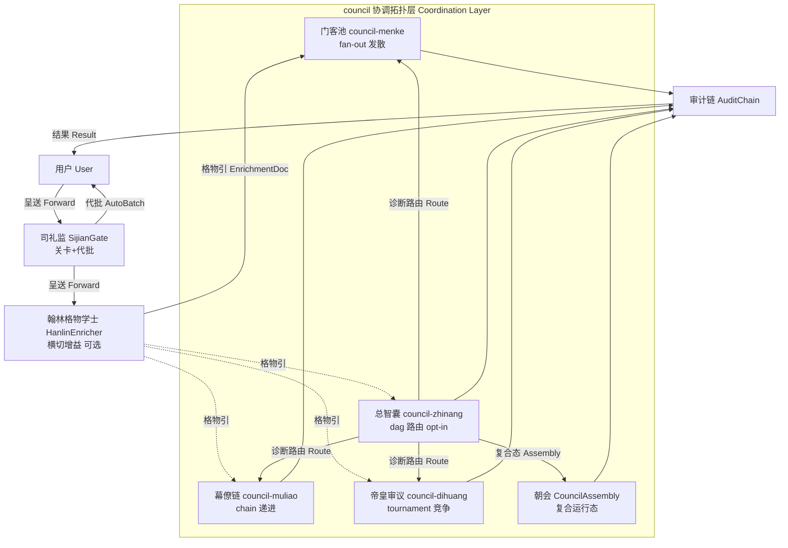
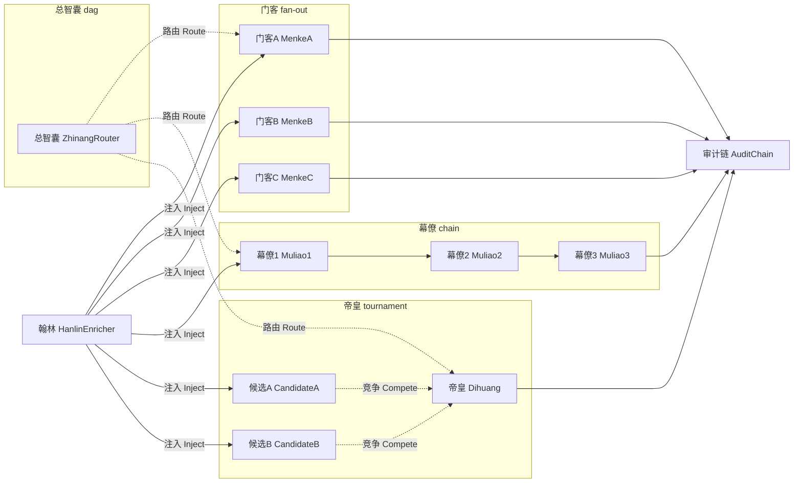
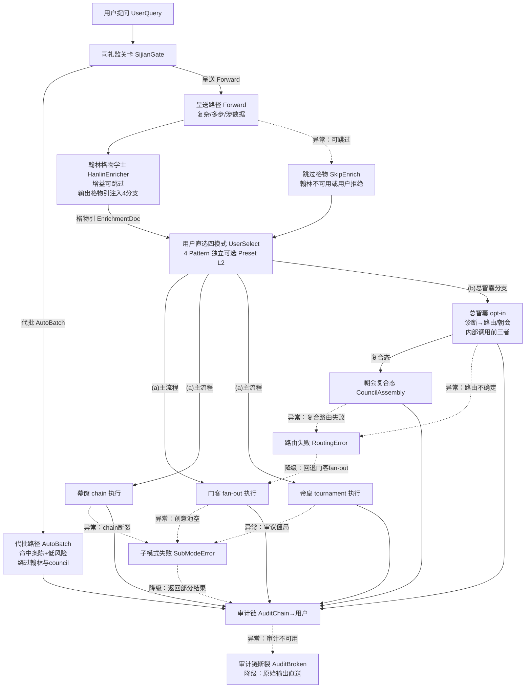

[AI 生成]

> 智囊团四模式详解：门客/幕僚/帝皇/总智囊逐层+council 朝会复合态。

> 状态：stable
> 维护：@XZF（主笔）
> 讨论：无
> 待决：无

---

## 0. 模式定位与架构总览（Mode Positioning & Architecture Overview）

### 0.1 模式定位

**一句话定义**：谋士型（Moushi）是四编排模式之一，以「朝廷（council）」为协调拓扑，通过四种 Execution 子模式（fan-out / chain / tournament / dag）实现专家团咨询。

**适用场景**：

| 场景特征 | 推荐子模式 | 原因 |
|----------|-----------|------|
| 需要最大发散、多视角创意探索 | 门客 council-menke（fan-out） | 纯发散，不可能思路合法化 |
| 需要线性递进、逐步深化 | 幕僚 council-muliao（chain） | 链式协作，每环深化前环 |
| 需要多方案竞争择优 | 帝皇 council-dihuang（tournament） | 锦标赛审议，胜出为最终 |
| 不确定选哪个 / 需融合多子模式 | 总智囊 council-zhinang（dag） | opt-in 诊断路由，可激活朝会复合态 |

**与其他编排模式的关系**：谋士型与朝廷模式（12-chaoting-mode.md）、竞功模式（13-jinggong-mode.md）共享 council 协调拓扑与 fan-out/chain/tournament Execution 原语。谋士型独有 dag Execution（总智囊路由器），其他模式不使用 dag。朝会（§5）是 council 协调拓扑的复合运行态，非独立 Execution。

### 0.2 架构总览



> 上图为谋士型整体架构（D3：基于 02-architecture-layers.md 七层架构，标注 council 协调拓扑内部结构）。四个子模式为并列可选 Preset（L2），用户可直选其一；总智囊为 opt-in 融合，内部诊断后路由到前三者或激活朝会复合态。翰林为唯一横切增益模块（原则 31），司礼监为唯一关卡模块（原则 22），二者职能不重叠。

---

## 1. 门客型 Agent 池（council-menke，fan-out）

**设计意图**：纯发散多元人格。门客型池是智囊团的「创意发生器」，核心思想是「不可能思路合法化」——每个 Agent 拥有独立的认知人格，不受现实约束，从最大可能性空间探索问题。输出物的价值不在即时可用，而在提供足够多元的备选假设，供后续幕僚落地或帝皇审查时引用。

### 1.1 角色子表

| 角色 | 英文标识 | 人格定位 | 核心职责 | 数量 | 可选性 |
|------|----------|----------|----------|----------|----------|
| 规则漏洞探索者 | RuleBreaker | 系统思维反叛者 | 识别现行规则/假设中的盲区，提出「如果绕过这条规则会怎样」的假设 | N（创意发散，通常 3-5） | 门客模式必选 |
| 疯狂科学家 | MadScientist | 技术极致主义者 | 以「资源无限」为前提探索技术可能性，提出打破常规的技术路径 | N（创意发散，通常 3-5） | 门客模式必选 |
| 历史隐喻大师 | HistoryMeta | 跨时空类比者 | 从历史事件/典故中提取同构情境，映射到当前问题 | N（创意发散，通常 3-5） | 门客模式必选 |
| 跨界艺术家 | CrossArtist | 美学/形式探索者 | 从艺术/设计/叙事等非技术领域引入结构性洞察 | N（创意发散，通常 3-5） | 门客模式必选 |
| 随机扰动器 | RandomPerturber | 熵增注入者 | 主动引入随机变量/反直觉角度，防止局部最优 | N（创意发散，通常 3-5） | 门客模式必选 |
| 创意池管理器 | IdeaPoolManager | 池的协调者 | 分发、收集、去重、共鸣检测、排序 | 1 | 门客模式必选 |

> 每个角色对应一个独立的 `MenkeAgent` 实例，由 Identity.role 和 Capability 声明区分。

### 1.2 核心接口

```typescript
/** 创意条目（门客输出原子） */
interface CreativeIdea {
  /** 创意标题/摘要 */
  idea: string;
  /** 荒唐度 0-5（0=完全合理，5=荒谬但启发性强） */
  absurdity_score: number;
  /** 火花度 0-5（启发性强度） */
  spark_score: number;
  /** 来源 Agent 的 Identity.role */
  source_agent: string;
  /** 共鸣标记（与其他创意的主题重叠度，由 IdeaPoolManager 标注） */
  resonance_flag: boolean;
}

/** 创意池管理器：门客池的分发/收集/去重/共鸣检测/排序 */
interface IdeaPoolManager {
  /** 分发问题给 N 个独立 MenkeAgent */
  distribute(problem: string, gewu: GewuCitation, agentCount: number): Promise<MenkeAgent[]>;
  /** 收集所有 Agent 的创意输出 */
  collect(agents: MenkeAgent[]): Promise<CreativeIdea[]>;
  /** 跨 Agent 去重 + 主题聚类 */
  deduplicate(ideas: CreativeIdea[]): Promise<CreativeIdea[]>;
  /** 标注共鸣（同一主题的不同表述） */
  detectResonance(ideas: CreativeIdea[]): Promise<CreativeIdea[]>;
  /** 按 spark_score × (1 - absurdity_weight) 排序 */
  rank(ideas: CreativeIdea[]): Promise<CreativeIdea[]>;
}

/** 门客型 Agent：独立的创意发散人格 */
interface MenkeAgent {
  /** Identity.role（如 "rule-breaker" / "mad-scientist"） */
  role: string;
  /** 接收问题 + 《格物引》，生成 3-5 条创意 */
  generate(problem: string, gewu: GewuCitation): Promise<CreativeIdea[]>;
}
```

### 1.3 不变量

- 每个门客 Agent 独立生成 **3-5 条**创意，不得共享上下文或串通。
- 创意列表中 **≥1 条含荒唐元素**（absurdity_score ≥ 3）。
- 荒唐度 **≥4/5 的条目必须标破茧区**（resonance_flag = true），供帝皇审查时重点参考。
- 门客之间 **禁止横向通信**（fan-out 执行模式不变量）。
- 创意池管理器不修改创意内容，仅做结构化整理。

---

## 2. 幕僚型 Agent 小组（council-muliao，chain）

**设计意图**：现实约束落地。幕僚型小组是门客创意的「约束过滤层」，核心思想是「在现实边界内出最优解」。chain 执行模式保证步骤顺序串联，输出变量绑定传递，形成可审计的决策链路。

### 2.1 角色子表

| 角色 | 英文标识 | 核心职责 | 数量 | 可选性 |
|------|----------|----------|----------|----------|
| 合规师爷 | ComplianceAide | 法规/政策/合规审查，识别法律风险 | 1 | 幕僚模式必选 |
| 钱粮师爷 | TreasuryAide | 资源/预算/时间估算，识别隐性成本 | 1 | 幕僚模式必选 |
| 文案师爷 | DraftingAide | 沟通文本包装，识别利益相关方阻力 | 1 | 幕僚模式必选 |
| 总办调度 | DispatchCoordinator | 草案拆分分发，冲突调解/升级 | 1 | 幕僚模式必选 |

### 2.2 核心接口

```typescript
/** 幕僚专家基接口 */
interface MuliaoSpecialist {
  /** Identity.role（如 "compliance-aide" / "treasury-aide"） */
  role: string;
  /** 接收门客创意 + 《格物引》，输出领域审查意见 */
  review(ideas: CreativeIdea[], gewu: GewuCitation): Promise<ReviewResult>;
}

/** 总办调度：拆分草案 + 分发 + 冲突调解 */
interface DispatchCoordinator {
  /** 将融合草案拆分为子任务分配给各幕僚 */
  split(draft: FusionDraft): Promise<SubTask[]>;
  /** 分发子任务到对应幕僚 */
  dispatch(tasks: SubTask[]): Promise<ReviewResult[]>;
  /** 调解幕僚间分歧，分歧度≥6/10 时升级 */
  mediate(results: ReviewResult[]): Promise<DisputeReport>;
}

/** 执行计划书（幕僚输出物） */
interface ExecutionPlan {
  /** 分步骤执行序列 */
  steps: PlanStep[];
  /** 总预算估算（时间/资源/风险） */
  budget: BudgetEstimate;
  /** 合规审查结论 */
  compliance: ComplianceVerdict;
  /** 利益相关方沟通策略 */
  communication: CommunicationStrategy;
}

/** 风险登记册（幕僚输出物） */
interface RiskRegister {
  /** 已识别风险项 */
  risks: IdentifiedRisk[];
  /** 总体风险等级 */
  severity: "low" | "medium" | "high" | "critical";
  /** 缓解措施建议 */
  mitigations: MitigationMeasure[];
}

/** 分歧报告（冲突升级触发） */
interface DisputeReport {
  /** 分歧度 0-10 */
  disputeLevel: number;
  /** 争议点描述 */
  points: DisputePoint[];
  /** 是否需升级（disputeLevel ≥ 6） */
  requiresEscalation: boolean;
  /** 升级建议（目标：帝皇 tournament 或用户确认） */
  escalationRecommendation: string;
}

/** 审查结果（单幕僚输出） */
interface ReviewResult {
  specialistRole: string;
  verdict: "approve" | "revise" | "reject";
  reasoning: string;
  suggestedChanges: string[];
}
```

### 2.3 不变量

- 幕僚小组内存在 **明确的优先级倾向**：必须在 `成本优先` / `速度优先` / `合规绝对` 中选其一，不能「都要」。
- 分歧度 **≥6/10 必须升级**：触发 `DisputeReport`，路由到帝皇 tournament 或向用户确认。
- 两轮迭代上限：同一草案最多经过 2 轮幕僚审查-修订循环，超过则强制输出当前最优方案并标注「未充分收敛」。
- chain 执行模式保证步骤顺序：合规审查 → 钱粮估算 → 文案包装 → 总办调度。
- 总办调度是 chain 的编排者，负责将上游门客输出转化为可执行输入。

---

## 3. 帝皇智囊中枢（council-dihuang，tournament）

**设计意图**：层级审议 + 强制反对 + 多方案择优。帝皇模式模拟「圣朝廷议」——知识检索提供信息基础，监察角色强制提出有理据反对，最终由圣裁综合裁决。tournament 执行模式保证多方案独立竞争，择优合并。

### 3.1 角色子表

| 角色 | 英文标识 | 核心职责 | 备注 | 数量 | 可选性 |
|------|----------|----------|----------|----------|----------|
| 经筵学士 | JingyanScholar | 知识检索，跨领域信息收集 | **原稿「翰林学士」重命名**，避撞全局「翰林格物学士」 | 1 | 帝皇模式必选 |
| 谏院御史 | JianyuanCritic | 强制反对 ≥3 条 + 跨域适配风险评估 | 独立于执行者的监察角色 | 1 | 帝皇模式必选 |
| 资源御史 | ResourceCensor | 实时约束数据提供（预算/时间/合规底线） |  tournament 中的「硬边界」 | 1 | 帝皇模式必选 |
| 圣裁Agent | DihuangSynthesizer | 多方案综合裁决 | **原稿「批红Agent」重命名**，避撞司礼监「批红」标签 | 1 | 帝皇模式必选 |

### 3.2 核心接口

```typescript
/** 经筵学士：帝皇模式知识检索角色 */
interface JingyanScholar {
  /** 从知识库/网络检索跨领域信息 */
  retrieve(query: string, gewu: GewuCitation): Promise<KnowledgeBundle>;
  /** 整理为结构化背景材料供圣裁参考 */
  synthesize(bundles: KnowledgeBundle[]): Promise<BackgroundBrief>;
}

/** 谏院御史：强制反对角色 */
interface JianyuanCritic {
  /** 对单方案提出 ≥3 条有理据反对 */
  dissent(option: StrategicOption): Promise<DissentReport>;
  /** 跨域适配风险评估 */
  assessCrossDomainRisk(option: StrategicOption, gewu: GewuCitation): Promise<RiskAssessment>;
}

/** 资源御史：实时约束数据提供 */
interface ResourceCensor {
  /** 返回当前可用资源上限（预算/时间/人力） */
  getConstraints(): Promise<ResourceConstraints>;
  /** 验证方案是否在约束内 */
  validate(option: StrategicOption, constraints: ResourceConstraints): Promise<ValidationResult>;
}

/** 圣裁Agent（DihuangSynthesizer）：多方案综合裁决 */
interface DihuangSynthesizer {
  /** 接收多个方案 + 谏院驳议 + 资源约束，输出裁决 */
  synthesize(
    options: StrategicOption[],
    dissent: DissentReport[],
    constraints: ResourceConstraints
  ): Promise<ArbitrationResult>;
}

/** 战略选项（帝皇 tournament 中的单方案） */
interface StrategicOption {
  /** 方案来源（哪个幕僚/门客/朝会子流程） */
  origin: string;
  /** 方案内容 */
  content: string;
  /** 方案类型 */
  category: "creative" | "execution" | "strategic" | "hybrid";
  /** 置信度 0-1 */
  confidence: number;
  /** 支持证据 */
  evidence: string[];
}

/** 驳议报告（谏院御史输出） */
interface DissentReport {
  /** 反对条目列表（≥3 条） */
  objections: Objection[];
  /** 是否可被驳回（有理据 vs 情绪化） */
  meritScore: number;
  /** 改造建议（ mandatory：必须提改造建议，不得直接驳回） */
  improvementSuggestions: string[];
}
```

### 3.3 动态人才池（馆阁选士）

帝皇模式的 `JingyanScholar`、`JianyuanCritic`、`ResourceCensor` 角色从**动态人才池**中按需选取。人才池类比「馆阁选士」——根据问题领域，从四库中动态匹配具备对应 Capability 的 Agent 填充角色。同一问题不同领域，人才池内容不同。

```typescript
/** 馆阁选士：动态人才池 */
interface TalentPool {
  /** 按领域查询可用候选人 */
  queryByDomain(domain: string): Promise<AgentProfile[]>;
  /** 按 Capability 过滤 */
  filterByCapability(capabilities: string[]): Promise<AgentProfile[]>;
  /** 选士：从候选池中选最优填充角色 */
  select(role: string, candidates: AgentProfile[]): Promise<AgentProfile>;
}
```

### 3.4 不变量

- 谏院御史必须提出 **≥3 条有理据反对**（不可跳过、不可形式化），每条例须附带改进方向。
- 圣裁Agent 必须在 **≥3 个战略选项**中做出裁决（tournament 要求多方案竞争）。
- 用户可**批再议**：对圣裁结果不满意时，可要求重新 tournament 或切换路由。
- 帝皇批驳 **必须提改造建议，不得直接驳回**（与朝会复合态共享此不变量）。
- 资源御史的约束数据是硬边界，圣裁不得在约束外裁决。

---

## 4. 总智囊融合编排器（council-zhinang，dag）

**设计定位**：主动选择才进入的 opt-in 融合模式。总智囊是 `council-zhinang` Pattern（coordination=council × execution=dag）的 **入口 ModuleInstance**，不是新 Agent 类型、不是 meta-execution。门客/幕僚/帝皇 同为独立可选模式，可由用户直选、不经总智囊；总智囊是四选一中的融合项——内部诊断问题后在 `council-menke/muliao/dihuang` 间路由，或走朝会复合态。其内部结构（Diagnoser/ModeRouter/ChaohuiModerator/AuditChain）均为 opt-in 融合模式的内部组件。

### 4.1 内部结构

```
总智囊（ZhinangRouter）
├── 问题诊断器（Diagnoser）→ 输出 DiagnosisVector
├── 模式路由器（ModeRouter）→ 按 vector 选 fan-out/chain/tournament 或朝会
├── 朝会主持人（ChaohuiModerator）→ 仅混合态激活
└── 全局审计链（AuditChain）→ 记录 session/诊断/路由/各Agent输出/用户决策/贡献度
```

### 4.2 核心接口

```typescript
/** 问题诊断向量 */
interface DiagnosisVector {
  /** 门客（创意发散）权重 0-1 */
  menke: number;
  /** 幕僚（执行落地）权重 0-1 */
  muliao: number;
  /** 帝皇（战略审查）权重 0-1 */
  dihuang: number;
  /** 诊断理由（供审计） */
  rationale: string;
}

/** council 路由模式枚举 */
type CouncilRoute = "menke" | "muliao" | "dihuang" | "chaohui";

/** 总智囊 = council 路由入口模块 */
interface ZhinangRouter {
  /** 接收问题+《格物引》，输出诊断向量 */
  diagnose(problem: string, gewu: GewuCitation): Promise<DiagnosisVector>;
  /** 按向量路由到指定策略执行 */
  route(vector: DiagnosisVector): Promise<CouncilRoute>;
  /** 朝会复合态：串行调用 fan-out→chain→tournament */
  conveneChaohui(task: Task): Promise<FusionResult>;
  /** 全局审计链查询 */
  getAuditTrail(sessionId: string): Promise<AuditEntry[]>;
}

/** 朝会主持人（混合态激活） */
interface ChaohuiModerator {
  /** 主持朝会辩论流程：门客发散 → 幕僚量化 → 帝皇批驳 */
  moderate(menkeOutput: CreativeIdea[], muliaoInput: CreativeIdea[]): Promise<ChaohuiRoundResult>;
  /** 确保帝皇批驳包含改造建议 */
  enforceDihuangSuggestion(roundResult: ChaohuiRoundResult): Promise<void>;
}

/** 全局审计链（记录全链路） */
interface AuditChain {
  /** 记录诊断事件 */
  logDiagnosis(sessionId: string, vector: DiagnosisVector): void;
  /** 记录路由事件 */
  logRoute(sessionId: string, route: CouncilRoute): void;
  /** 记录各 Agent 输出 */
  logAgentOutput(sessionId: string, agentRole: string, output: unknown): void;
  /** 记录用户决策 */
  logUserDecision(sessionId: string, decision: UserDecision): void;
  /** 查询完整审计轨迹 */
  getTrail(sessionId: string): AuditEntry[];
}

// 支撑类型（仅在本文档 §4.2 引用；结构遵循现有 usage 签名，不新增字段）
/** 框架内置类型，见 06-core-engine.md */

/** 朝会综合报告：朝会结束后输出的三阶段聚合产物（门客创意+幕僚计划+帝皇裁决），供总智囊审计链记录 */
interface FusionResult {}

/** 审计链单条记录：诊断/路由/Agent 输出/用户决策等事件的审计轨迹原子 */
interface AuditEntry {}

/** 朝会单轮结果：moderate 产出的中间态，含门客发散+幕僚量化+帝皇批驳的当前轮次汇总 */
interface ChaohuiRoundResult {}

/** 用户决策：用户在路由确认/批再议等环节的决策原子，供审计链记录 */
interface UserDecision {}
```

### 4.3 路由规则

| 条件 | 路由目标 |
|------|----------|
| `menke ≥ 0.7` | 仅门客（fan-out） |
| `muliao ≥ 0.7` | 仅幕僚（chain） |
| `dihuang ≥ 0.7` | 仅帝皇（tournament） |
| 无 ≥ 0.7（混合） | 朝会复合态 |
| 最高与次高差值 < 0.3 | **向用户确认路由**（避免误判） |

### 4.4 不变量

- 路由器编排深度 **≤3 层**（防递归）。
- 路由失败 → 回退到幕僚（chain，最稳健）。
- 总智囊 **不得递归调用自身**。
- 深度 3 层的计算：总智囊(1) → 门客/幕僚/帝皇(2) → 子 Agent(3)，不再下钻。
- 朝会中帝皇批驳必须提改造建议，不得直接驳回（§4.4 与朝会共享）。

---

## 5. 朝会模式专题（复合运行态）

### 5.1 定位声明

**朝会不是第 5 个 Execution 模式，不占 Coordination×Execution 矩阵的任何单元。**

朝会是 council 协调拓扑特有的「复合运行态」——council 路由器在诊断向量为「混合」（无单一策略权重 ≥0.7）时激活的运行态。内部**串行调用**三个合法 council×Exec 单元：

```
朝会（Chaohui）
├── 阶段 1：fan-out（门客发散）
│   └── 所有门客 Agent 并行生成创意
├── 阶段 2：chain（幕僚量化）
│   └── 合规 → 钱粮 → 文案 → 总办调度，逐级传递
└── 阶段 3：tournament（帝皇批驳）
    └── 经筵检索 → 谏院反对 → 资源约束 → 圣裁裁决
```

### 5.2 朝会主持人职责

朝会主持人（ChaohuiModerator）仅在混合态激活，职责是：

- 保证三阶段顺序执行，不跳步、不并行。
- 保证朝会产出物包含门客创意列表 + 幕僚执行计划 + 帝皇裁决报告。
- 保证帝皇批驳 **必须提改造建议，不得直接驳回**（不变量强制）。
- 朝会结束后输出 `FusionResult`（综合报告），供总智囊审计链记录。

### 5.3 朝会 vs 单模式

| 维度 | 单模式路由 | 朝会复合态 |
|------|-----------|-----------|
| 触发条件 | 单一权重 ≥0.7 | 无 ≥0.7（混合） |
| 执行策略 | 单一 Execution | fan-out → chain → tournament 串行 |
| 矩阵定位 | 占 council×Exec 单元 | **不占矩阵单元** |
| 输出物 | 单策略输出 | 三阶段综合报告 |
| 典型耗时 | 短 | 长（三阶段串联） |

### 5.4 与微内核的关系

朝会内部调用的 fan-out / chain / tournament 均走现有 PatternRuntime 执行路径。朝会本身**不注册为 Pattern**，是 council 路由器的运行时组合逻辑。在 03-execution-modes.md 的 Coordination×Execution 矩阵中，council 行标注为「fan-out / chain / tournament / dag（可路由）」，并在矩阵下方加脚注：「朝会为 council 协调拓扑的复合运行态，非独立 Execution，不占矩阵单元。」

---

## 5a. 通信拓扑（Communication Topology）

### 5a.1 门客 fan-out 通信

点对点：翰林→各门客（注入格物引）；各门客→审计链（输出创意）。门客之间**无通信**（完全并行隔离，§1.3 不变量强制）。

### 5a.2 幕僚 chain 通信

点对点：前环幕僚→后环幕僚（传递中间产物）；首环←翰林注入；末环→审计链。chain 内严格顺序传递，不跳步（§2.3 不变量强制）。

### 5a.3 帝皇 tournament 通信

发布订阅：帝皇发布审议标准→所有候选方案；候选方案发布竞争→帝皇审议。点对点：帝皇→审计链（最终方案）。谏院御史对每方案独立提交驳议（§3.4 不变量强制 ≥3 条）。

### 5a.4 总智囊 dag 通信

点对点：总智囊→子模式（路由指令）；子模式→总智囊（结果回流）。频道：朝会复合态下，多子模式通过频道共享中间状态。总智囊禁递归（§4.4 不变量强制）。



## 5b. 统一不变量清单（Unified Invariants）

> 以下为散落在 §1.3 / §2.3 / §3.4 / §4.4 / §5.2 各节不变量的汇总索引。详细措辞以各源节为准。

| 来源节 | 子模式 | 不变量摘要 |
|--------|--------|-----------|
| §1.3 | 门客 council-menke | ① 独立生成 3-5 条创意不串通 ② ≥1 条含荒唐元素（absurdity_score ≥ 3）③ 荒唐度 ≥4/5 标破茧区 ④ 禁止横向通信 ⑤ 创意池不修改内容仅结构化整理 |
| §2.3 | 幕僚 council-muliao | ① 优先级三选一（成本/速度/合规）② 分歧 ≥6/10 必须升级 ③ 两轮迭代上限 ④ chain 步骤固定：合规→钱粮→文案→总办 ⑤ 总办调度为 chain 编排者 |
| §3.4 | 帝皇 council-dihuang | ① 谏院御史 ≥3 条有理据反对 ② 圣裁 ≥3 个战略选项 ③ 用户可批再议 ④ 批驳必提改造建议不直接驳回 ⑤ 资源御史约束为硬边界 |
| §4.4 | 总智囊 council-zhinang | ① 编排深度 ≤3 层 ② 路由失败回退幕僚（chain）③ 不得递归调用自身 ④ 深度计算：总智囊(1)→子模式(2)→子Agent(3) ⑤ 朝会中帝皇批驳必提改造建议 |
| §5.2 | 朝会复合态 | ① 三阶段顺序执行不跳步不并行 ② 产出含门客创意+幕僚计划+帝皇裁决 ③ 帝皇批驳必提改造建议 ④ 输出 FusionResult 供审计链记录 |

## 5c. 边界条件（Boundary Conditions）

| 子模式/场景 | 触发条件 | 终止条件 | 降级策略 |
|------------|---------|---------|---------|
| 门客 council-menke | 用户直选 fan-out 或总智囊路由到此 | 所有门客完成输出 | 创意池空（门客无输出）→ 返回空结果 + 提示用户调整提问 |
| 幕僚 council-muliao | 用户直选 chain 或总智囊路由到此 | 末环幕僚完成输出 | chain 断裂（某环失败）→ 截断至最后成功环产物 + 标注不完整 |
| 帝皇 council-dihuang | 用户直选 tournament 或总智囊路由到此 | 帝皇裁决胜出方案 | 审议僵局（无方案达标）→ 返回所有候选 + 标注「无胜出」交用户决策 |
| 总智囊 council-zhinang | 用户主动 opt-in 选择 | 诊断→路由→子模式完成 或 朝会复合态完成 | 路由不确定（诊断无法判定）→ 降级为门客 fan-out（最大发散兜底） |
| 朝会复合态 | 总智囊诊断判定需要多子模式融合 | 所有被调度子模式完成 + 复合方案合成 | 复合路由失败（子模式间冲突）→ 回退为各子模式独立输出 + 标注未合成 |
| 资源不足 | Agent 配额耗尽或 LLM 调用预算不足 | — | 按优先级缩减：门客缩减池规模→幕僚缩减链长度→帝皇缩减候选数 |
| 翰林不可用 | 格物模块加载失败或超时 | — | 跳过格物增益，直接进入用户直选（原则 31 保证主流程不中断） |

---

## 6. 端到端工作流程



**层间数据流**：用户意图 → 司礼监过滤 → 翰林增益（可选跳过，输出《格物引》）→ 用户直选四模式之一 → 执行层 → 审计链 → 用户。翰林横切增益注入 4 并列可选分支：(a) 主流程——用户直选门客/幕僚/帝皇之一，该模式直接执行（翰林已注入），不经总智囊；(b) 总智囊分支——opt-in 融合，用户主动选择才进入，总智囊内部诊断后路由到前三者或激活朝会复合态。翰林是唯一横切增益模块，司礼监是唯一关卡模块，二者职能不重叠。

**异常分支与降级**（图中虚线路径）：① 翰林跳过——模块不可用或用户拒绝，直接进入用户直选（原则 31 保证主流程不中断）；② 子模式执行失败——创意池空/chain 断裂/审议僵局，降级返回部分结果并标注不完整；③ 总智囊路由失败——诊断无法判定（最高与次高差值 <0.3），降级回退门客 fan-out（最大发散兜底，§4.3 路由规则）；④ 审计链断裂——审计模块不可用，原始输出直送用户。所有降级路径在审计链中标注降级原因。

---

## 7. 与微内核对接

### 7.1 角色对接

智囊团角色的 `Identity.role` 按谋士型四模式（门客/幕僚/帝皇/总智囊）独立命名，与朝廷模式/竞功模式术语不交叉：

| 智囊团角色 | Identity.role 值 | 所属模式 |
|-----------|-----------------|----------|
| 门客（规则漏洞探索者） | `menke-rule-breaker` | council-menke |
| 幕僚（合规师爷） | `muliao-compliance` | council-muliao |
| 经筵学士 | `dihuang-jingyan` | council-dihuang |
| 圣裁Agent | `dihuang-synthesizer` | council-dihuang |
| 总智囊 | `zhinang-router` | council-zhinang |

### 7.2 Loop 对接

四库（Loop 库）为智囊团提供可插拔 Loop 资产：

- 门客发散 Loop → 四库 `creative` 分类
- 幕僚落地 Loop → 四库 `execution` 分类
- 帝皇审查 Loop → 四库 `review` 分类
- 总智囊路由 Loop → 四库 `orchestration` 分类

### 7.3 军功簿对接

智囊团复用现有 `WeightRegistry`（军功簿接口），智囊团专属评估维度：

- 跨域采纳率：门客创意被后续阶段引用的比例。
- 落地转化率：幕僚产出被执行的百分比。
- 批驳有效率：谏院反对被圣裁采纳的比例。
- 路由准确率：诊断向量与实际最优模式的匹配度。

### 7.4 司礼监交互

智囊团**经过司礼监关口**（司礼监是通用入口）：

- 司礼监代批 → 绕过翰林与 council，直接返回用户（代批路径不变，与朝廷模式一致）。
- 司礼监呈送 → 进入翰林增益 → council 路由。
- 翰林不参与司礼监的代批判断，只在呈送后注入。

### 7.5 Pattern 注册

council 协调拓扑经现有 `PatternRegistry` 注册。4 个具体模式 Pattern 各自声明 `coordination: "council"` + 真实 `execution` 值，朝会为复合运行态不注册为 Pattern。

| Pattern ID | coordination | execution | 角色 | Preset 层级 | opt-in |
|-----------|-------------|-----------|------|------------|--------|
| `council-menke` | council | fan-out | 门客池（创意发散） | L2 | 否（用户可直选） |
| `council-muliao` | council | chain | 幕僚链（约束落地） | L2 | 否（用户可直选） |
| `council-dihuang` | council | tournament | 帝皇审议（多方案竞争） | L2 | 否（用户可直选） |
| `council-zhinang` | council | dag | 总智囊路由器（entry ModuleInstance） | L2 | 是（用户主动选择才激活） |

> 4 Pattern 均为独立可选 Preset（L2），用户可直选其一；`council-zhinang` 为 opt-in 融合，内部诊断后调用前三者或激活朝会复合态。朝会本身**不注册为 Pattern**，是 council 路由器的运行时组合逻辑（见 §5.4）。

---

## 8. 决策记录

### 决策 91：门客映射 council-menke + fan-out Execution

**选择**：门客型 Agent 池注册为 `council-menke` Pattern，声明 `coordination: "council"` + `execution: "fan-out"`。

**理由**：fan-out 的「数据驱动动态扩展，expand/parallel/collect 三阶段」与门客「多人格并行发散，追求不可能思路」的职责完全匹配。creativeIdea 是门客的原子输出，对应 fan-out 的 collect 阶段产物。

**影响**：门客成为 council 拓扑下第一个合法 Execution 组合单元。PatternRegistry 仅校验 `compatibleWith`，不查 `execution` 字段，registration 直接通过。

---

### 决策 92：幕僚映射 council-muliao + chain Execution + 冲突升级规则

**选择**：幕僚型小组注册为 `council-muliao` Pattern，声明 `coordination: "council"` + `execution: "chain"`。分歧度 ≥6/10 触发升级到帝皇 tournament 或用户确认。

**理由**：chain 的「步骤顺序串联，输出变量绑定传递」与幕僚「合规→钱粮→文案→调度」的线性审查流程匹配。两轮迭代上限防止 chain 无限循环。

**影响**：幕僚的 chain 依赖上游客栈（门客创意列表）作为输入，输出物为可审计的 ExecutionPlan + RiskRegister。升级规则打破 chain 闭环，引入 tournament 竞争。

---

### 决策 93：帝皇映射 council-dihuang + tournament Execution + 术语重命名

**选择**：帝皇智囊中枢注册为 `council-dihuang` Pattern，声明 `coordination: "council"` + `execution: "tournament"`。内部角色「翰林学士」重命名为「经筵学士」，「批红Agent」重命名为「圣裁Agent」。

**理由**：tournament 的「N 个个体/团队同任务竞争，评功选优合并」与帝皇「多方案审议+强制反对+择优裁决」匹配。术语重命名避撞全局「翰林格物学士」（增益模块）和司礼监「批红」标签。

**影响**：帝皇成为 council 拓扑下第三个合法 Execution 组合单元。经筵学士/圣裁Agent 成为智囊团专用术语，不进入朝廷模式/竞功模式术语空间。

---

### 决策 94：总智囊路由不变量

**选择**：总智囊（ZhinangRouter）作为 `council-zhinang` Pattern 的 entry ModuleInstance，编排深度 ≤3 层，路由失败回退幕僚，不得递归调用自身。总智囊为 opt-in 融合模式，用户主动选择才进入；门客/幕僚/帝皇 可独立直选。

**理由**：dag 执行模式的「DAG 建图 + Wave 拓扑排序」适合总智囊的「诊断→路由→执行→审计」编排流程。不变量防止 council 路由器形成循环依赖或无限递归。

**影响**：总智囊的 `conveneChaohui` 方法朝会复合态调用计入编排深度，朝会内部的 fan-out→chain→tournament 串联不额外增加路由器深度。

---

### 决策 95：朝会复合态运行规则

**选择**：朝会为 council 路由器的复合运行态，不注册为 Pattern，不占 Coordination×Execution 矩阵单元。

**理由**：朝会是「council 协调拓扑特有」的运行态组合，内部串行调用 fan-out→chain→tournament，不是独立 Execution。council 的定义性机制是谋士议会式协作——4 个执行策略独立可选，dag（总智囊）为 opt-in 融合。朝会复合态是总智囊 的内部运行态组合，路由是总智囊 内部行为，非 council 族定义；若将朝会注册为独立 Pattern，将与「4 执行策略独立可选 + 总智囊 opt-in 融合」的机制相冲突。

**影响**：03-execution-modes.md 矩阵中 council 行标注为「fan-out / chain / tournament / dag（可路由）」，加脚注说明朝会复合态。17-zhinang-modes.md §5 作为朝会专题详述。

---

## 9. 适用场景

| 场景 | 推荐模式 | 理由 |
|------|----------|------|
| 创意探索/头脑风暴/突破性思路 | 门客 | 多人格并行发散，荒唐元素最大化创意空间 |
| 方案落地/合规审查/资源约束 | 幕僚 | chain 顺序串联，两轮迭代收敛到可执行方案 |
| 战略决策/多方案对比/高风险审批 | 帝皇 | tournament 竞争择优，强制反对降低决策盲区 |
| 复杂混合问题（无明确单一倾向） | 朝会 | 三阶段串联，发散→量化→审查，全面覆盖 |
| 用户不确定适合哪种模式 | 总智囊（opt-in 融合） | 主动选择才进入；诊断向量自动选择，差<0.3 时向用户确认 |
| 简单直接任务（低成本快速完成） | 门客或幕僚（单模式） | 避免朝会 overhead |
| 需要可审计决策链的任务 | 任意 + 总智囊 | AuditChain 自动记录全链路 |

---

## 10. 术语对照表

| 中文 | 英文 |
|------|------|
| 智囊团 | Brain-Trust（zhinang mode family） |
| 翰林格物学士 | HanlinEnricher |
| 《格物引》 | GewuCitation |
| 本质抽象 | essence abstraction |
| 跨域扫描 | cross-domain scan |
| 门客 | Menke |
| 幕僚 | Muliao |
| 帝皇 | Dihuang |
| 总智囊 | ZhinangRouter（Zongzhinang） |
| 朝会 | Chaohui |
| 经筵学士 | JingyanScholar |
| 圣裁Agent | DihuangSynthesizer |
| 谏院御史 | JianyuanCritic |
| 资源御史 | ResourceCensor |
| 创意池管理器 | IdeaPoolManager |
| 合规师爷 | ComplianceAide |
| 钱粮师爷 | TreasuryAide |
| 文案师爷 | DraftingAide |
| 总办调度 | DispatchCoordinator |
| 问题诊断器 | Diagnoser |
| 模式路由器 | ModeRouter |
| 朝会主持人 | ChaohuiModerator |
| 议会/谋士式协调拓扑 | council（Coordination topology） |
| 横切增益模块 | cross-cutting enricher module |
| 问题诊断向量 | DiagnosisVector |
| 全局审计链 | AuditChain |

---

## 11. 相关文档

- 见 16-moushi-overview.md（智囊团系统总论，模式定位+架构总览+角色定义+翰林详解）
- 见 03-execution-modes.md §1.3（Execution 定义：fan-out/chain/tournament/dag）+ §1.4（Coordination×Execution 矩阵，council 行+朝会脚注）
- 见 09-seam-map.md §3.14（PatternRegistry 注册缝）+ 横切增益模块注册缝
- 见 12-chaoting-mode.md（朝廷模式，结构模板参照）
- 见 13-jinggong-mode.md（竞功模式，结构模板参照）
- 见 02-architecture-layers.md §8.1（六一等概念表，Coordination 枚举含 council）
- 见 07-infrastructure.md（EventSourcedState / WeightRegistry / 图状通信接口）
- 见 10-decisions.md（决策 86-95）
- 见 15-sijian-batch.md（司礼监代批机制，智囊团复用）
- 见 18-domain-pack.md（Domain Pack + Preset，智囊团 Preset 归属）
- 见 .agents/rules/write-new-doc.md（TS 接口规范 + ASCII 字符集）

> 文档版本：v2.7
> 本版变更（累积最近 3 条，最新在上）：
>   - v2.7：补全 D2 缺项（模式定位/架构总览/通信拓扑/不变量汇总/边界条件/§6异常分支/§7.5 Pattern表）
>   - v2.6：§1.1/§2.1/§3.1 角色子表 header 各追加「数量」「可选性」2 列（D2 合规）
>   - v2.5：v4.3.2 T7 自检同步——Phase 3-4 + Pattern 矩阵 + 多用户 + coding-pack v0.7 + TUI
> 基于：智囊团重设计规格（已归档）+ 03-execution-modes.md §1.3 + 13-jinggong-mode.md 结构模板 + 16-moushi-overview.md<!-- TODO: 人工确认链接 -->
> 决策总数：102 条（本文档聚焦决策 91-95）
> 文档总数：25 份
> 原则总数：33 条
