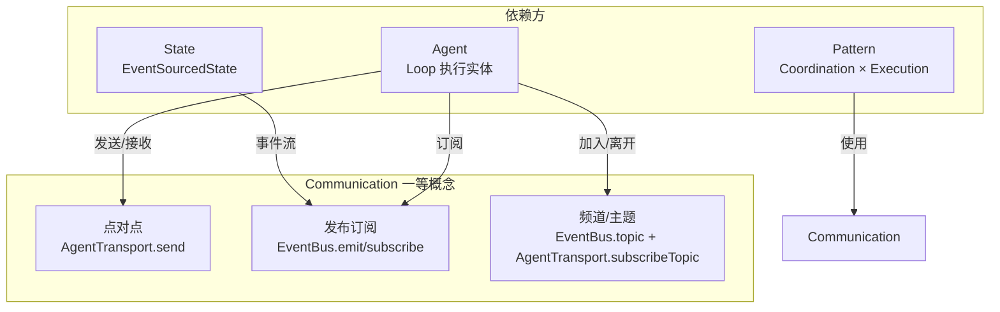
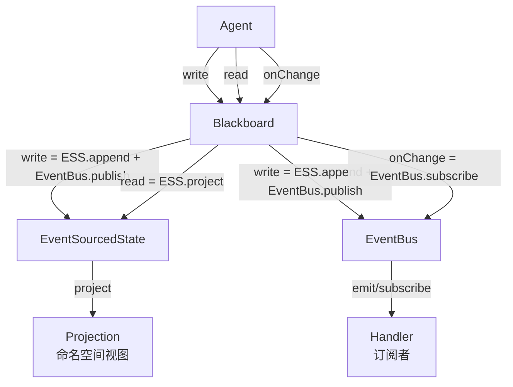
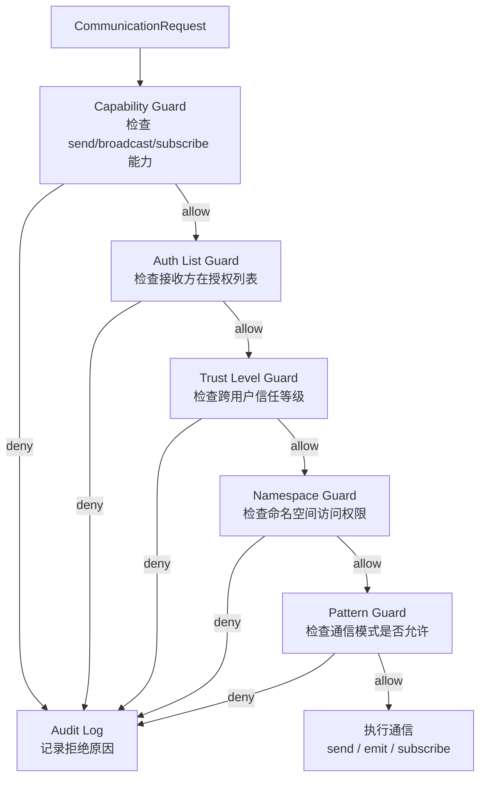
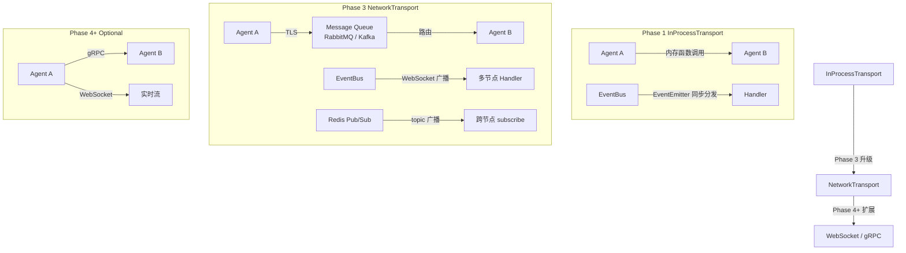

[AI 生成]

# 图状通信（Communication）
> 一句话注释：Communication 一等概念的 L4 深度文档，覆盖 EventBus / AgentTransport / Blackboard / 守卫 Pipeline / core-invariants / NetworkTransport 完整规范与设计提议。
> 状态：draft
> 维护：待定
> 讨论：无
> 待决：无
---
## 1. 通信一等概念定义

图状通信是 璇玑 微内核 6 个一等概念之一。含义是 Agent 之间通过三种模式完成信息交换：点对点（direct message）、发布订阅（publish/subscribe）、频道/主题（topic-based async）。Transport 实现可插拔，换实现不影响其他一等概念。



与微内核其他概念的关系：
- Agent 通过 Communication 发送消息、订阅事件、加入频道。
- State（EventSourcedState）将事件写入 EventBus，实现状态变更的广播。
- Pattern（Coordination/Execution）依赖 Communication 完成 Agent 间派发、结果回传、协商。

## 2. v3→v4 演变历史

v3 通信是树形单链路：两条边（dispatch 父→子、contactMainAgent 子→父）。拓扑硬编码，无法表达多 Agent 协商、多团队竞争、异步黑板协作。

v4 扩展为图状通信（决策 79）。三种模式覆盖所有协作场景：点对点用于定向请求，发布订阅用于广播通知，频道用于异步协作。权限声明式化（Identity 声明能发给谁/订阅什么），取代硬编码角色判断。

演变理由：
- 多规划者协商需要广播/订阅，不是单链路能表达。
- 竞功制多团队并行需要频道隔离，不是 dispatch 能覆盖。
- 跨用户通信需要信任授权，v3 没有此机制。

## 3. 三种通信模式对比矩阵

| 对比维度 | 点对点 | 发布订阅 | 频道/主题 |
|----------|--------|----------|-----------|
| 使用场景 | 定向请求、结果回传、单次对话 | 广播通知、状态变更、事件流 | 异步协作、黑板模式、多 Agent 并行 |
| 核心 API | AgentTransport.send | EventBus.emit / subscribe | EventBus.topic + AgentTransport.subscribeTopic |
| 权限控制 | 基于接收方 AgentId + visibility | 基于 EventPattern（namespace/topic/source） | 基于 topic 订阅权限 + Trust Level |
| 性能特征 | 单目标，延迟低 | 同步遍历订阅者，无队列 | 异步解耦，支持多消费者 |
| Phase 1 实现 | InProcessTransport（内存函数调用） | MemoryEventBus（Node.js EventEmitter） | MemoryEventBus 通配符 topic |
| Phase 3 演进 | NetworkTransport（TLS + 队列） | PersistentBroadcastBus（WebSocket + 持久化） | Redis Pub/Sub（与持久化统一） |
| 代表实现 | 内阁制协作总线、竞功制塘报旗牌使 | EventBus 全局事件流 | Blackboard 统一抽象 |

## 4. EventBus 完整规范

EventBus 是发布订阅通信的核心接口。v4 将其暴露为 Agent 可调用的工具（publish/subscribe 通信模式）。

```typescript
interface EventBus {
  /** 发布事件 */
  emit(event: DomainEvent): Promise<void>;
  /** 订阅事件 */
  subscribe(pattern: EventPattern, handler: EventHandler): Subscription;
  /** 取消订阅 */
  unsubscribe(subscription: Subscription): Promise<void>;
}

type EventPattern = {
  type?: string;
  agentId?: string;
  sessionId?: string;
  source?: string;
  /** v4 新增：命名空间过滤（与 EventSourcedState 联动） */
  namespace?: string;
  /** v4 新增：主题过滤（图状通信的频道模式） */
  topic?: string;
};

interface DomainEvent {
  id: string;
  type: string;
  source: string;
  sessionId?: string;
  agentId?: string;
  payload: Record<string, unknown>;
  timestamp: Date;
  /** v4 新增：命名空间（事件分区） */
  namespace?: string;
  /** v4 新增：主题（发布订阅模式） */
  topic?: string;
  /** v4 新增：触发者 userId（审计追溯） */
  userId?: string;
}

type Subscription = {
  id: string;
  unsubscribe(): Promise<void>;
};

type EventHandler = (event: DomainEvent) => Promise<void> | void;
```

### 4.1 Topic 命名规范

Topic 是图状通信频道模式的路由基础。命名采用分层路径，与 EventSourcedState 命名空间联动。

```
cell.<id>.<event-type>
cell.<id>.tool.<tool-name>
cell.<id>.turn.start
cell.<id>.turn.end
cell.<id>.start
cell.<id>.end

编排层：
pattern.dispatch.<from-id>.<to-id>
pattern.result.<from-id>
```

示例：
- `cell.emperor.turn.start` — 皇帝 Cell 的一个 turn 开始
- `cell.libu.tool.write` — 吏部 Cell 执行了 write 工具
- `cell.*.tool.bash` — 所有 Cell 的 bash 工具调用（监察层常用）

### 4.2 三种订阅机制

1. **精确匹配**：`subscribe({ type: "task.complete" }, handler)` 只接收 type 完全匹配的事件。
2. **命名空间过滤**：`subscribe({ namespace: "session.123" }, handler)` 接收该命名空间下的所有事件，与 EventSourcedState 联动。
3. **主题过滤**：`subscribe({ topic: "pattern.dispatch.*" }, handler)` 接收匹配 topic 模式的事件，支持通配符。

### 4.3 EventBus 不变量

- **同步执行**：`emit` 同步调用所有匹配的订阅者。Phase 1 不引入异步消息队列。
- **无返回值**：订阅者不能通过 EventBus 返回值给发布者。需要响应 → 订阅者再 `emit` 另一个事件。
- **无持久化**：EventBus 不存储事件。需要持久化的事件走 EventSourcedState。

### 4.4 Phase 规划

| Phase | 实现 | 关键特性 |
|-------|------|----------|
| Phase 1 | MemoryEventBus | Node.js EventEmitter，同步分发，无持久化 |
| Phase 3 | PersistentBroadcastBus | 事件持久化到数据库，支持 WebSocket 广播，支持回放 |

## 5. AgentTransport 完整规范

AgentTransport 是 Agent 之间点对点消息传递的核心接口。v4 扩展为图状通信（点对点 + 发布订阅 + 频道）。

```typescript
interface AgentTransport {
  /** 发送消息给目标 Agent（点对点，基于权限） */
  send(target: AgentId, message: AgentMessage): Promise<void>;
  /** 注册消息处理器 */
  onMessage(handler: MessageHandler): Subscription;
  /** 获取 Agent 连接状态 */
  getStatus(agentId: AgentId): Promise<AgentStatus>;
  /** v4 新增：广播给多个 Agent（频道/主题模式） */
  broadcast(targets: AgentId[], message: AgentMessage): Promise<void>;
  /** v4 新增：订阅主题（发布订阅模式） */
  subscribeTopic(topic: string, handler: MessageHandler): Subscription;
}

type AgentId = string;

interface AgentMessage {
  from: AgentId;
  to: AgentId;
  type: string;
  payload: Record<string, unknown>;
  traceId: string;
  timestamp: Date;
  /** v4 新增：主题（用于发布订阅模式下的消息归类） */
  topic?: string;
  /** v4 新增：通信权限标记 */
  visibility?: "private" | "topic" | "broadcast";
}

type AgentStatus = "online" | "offline" | "busy";

type MessageHandler = (message: AgentMessage) => Promise<void> | void;
```

### 5.1 v4 通信权限与不变量

- **内阁制**：协作总线（CollaborationBus）——订阅发布 + 总控授权列表 + 日志审计。Identity 声明能发给谁。
- **竞功制**：塘报旗牌使（DispatchMessenger）——点对多分发 + 固定频道独立上报 + 接收清单防篡改（confirmAllReported 才融合）。**竞争者间禁止横向通信**（公平性不变量）。
- **跨用户通信**（Phase 3）：需 Trust Level 授权（来自 UserProfile.permissions.trustLevel）。

### 5.2 Phase 规划

| Phase | 实现 | 关键特性 |
|-------|------|----------|
| Phase 1 | InProcessTransport | 直接函数调用，内存传递，无序列化开销。`broadcast` 在内存中循环 `send`；`subscribeTopic` 用内存 Map |
| Phase 3 | NetworkTransport | 跨节点消息路由，TLS 加密传输，支持消息队列（RabbitMQ/Kafka），支持重试和死信队列 |

### 5.3 通信错误类型

EventBus 和 AgentTransport 的错误通过专用异常类型表达，便于上层 catch 并做差异化处理。

```typescript
// 通信错误类型
class TransportError extends Error {
  constructor(
    message: string,
    public readonly code: "target-not-found" | "target-offline" | "timeout" | "network-error" | "serialization-error",
    public readonly targetAgentId?: string,
  ) {
    super(message);
    this.name = "TransportError";
  }
}

class SubscriptionError extends Error {
  constructor(
    message: string,
    public readonly code: "invalid-pattern" | "already-subscribed" | "max-subscriptions-exceeded",
  ) {
    super(message);
    this.name = "SubscriptionError";
  }
}

// EventBus.emit 无订阅者时不抛异常（静默成功）
// AgentTransport.send 失败时抛 TransportError
// EventBus.subscribe 模式无效时抛 SubscriptionError
```

## 5a. 频道类型与生命周期（U4）

### 四种频道

| 类型 | 用途 | 生命周期 | 没人听时 |
|------|------|----------|----------|
| 常规频道 | 六部AgentGroup通信 | Session级 | 静默成功 |
| 密奏频道 | 直送PatternRuntime | 按需点对点 | 不适用 |
| 任务频道 | 临时任务协作 | 任务级 | 异常 |
| 广播频道 | 全局通知 | Fire-and-forget | 静默成功 |

### 规则
1. 六部频道Session bootstrap时建，Session结束清
2. 密奏不需频道，AgentTransport.send点对点
3. 任务频道dispatch时建，完成时清
4. 广播无订阅者静默成功
5. Phase 1只有常规+密奏；Phase 2+全部

## 5b. Delegation 协议 — Agent 间通信语义层

> 设计草案：类型定义从 `璇玑与adapter层设计.md` 提取，尚未落地为代码。层次关系：Communication 一等概念管**传输**（怎么传：EventBus / AgentTransport / Topic），Delegation 管**语义**（传什么：任务委派与结果回传）。Delegation 通过 `AgentTransport.send` 以 AgentMessage 封装承载。
>
> 统一消息归属：Delegation 是统一消息模型 **OrbitaMessage 的 agent 部分**（见 [02-architecture-layers.md](./02-architecture-layers.md) §3a）——不是第二轨独立类型，而是「一个大整体，分两个部分」中的 agent 间交流部分；humanView 部分给人看，Delegation 部分给 agent 用。

**定位**：Delegation 是 agent 间通信的**唯一语义协议**——编排内委派、竞功、跨编排三种场景都是 Delegation 的变体。不搞广播，所有通信点对点。发起方 A 负责把 B 需要的全部上下文打包进 `task`（自包含上下文原则），B 不翻 A 的历史。

```typescript
// 设计草案：从 璇玑与adapter层设计.md 提取
type DelegationStatus =
  | 'pending'      // 已创建，子 agent 还没开始
  | 'running'      // 子 agent 正在工作
  | 'completed'    // 成功完成
  | 'failed'       // 失败
  | 'cancelled'    // 被取消

interface Delegation {
  // ── 标识 ──
  id: string                         // 唯一 ID
  fromSessionId: string              // 发起方会话（主 agent A）
  toSessionId: string                // 接收方会话（子 agent B 或另一编排的主 agent）
  childSessionId?: string            // 实际执行方会话（B 的完整 OrbitaMessage 流存在这里）

  // ── 任务 ──
  task: string                       // 自包含任务描述（A 把上下文浓缩进来）
  role?: string                      // 子 agent 角色（竞功时可区分"实现者"/"审查者"等）
  expectedOutput?: string            // 期望输出格式（约束 B 的输出）
  mode?: DelegationMode              // 委派模式

  // ── 状态 ──
  status: DelegationStatus
  createdAt: number
  startedAt?: number
  completedAt?: number

  // ── 结果（status = completed/failed 时才有）──
  resultSummary?: string             // B 的最后一条 assistant 文本（截断）
  resultError?: string               // 失败原因

  // ── 归因（用于编排间追溯）──
  rootSessionId?: string             // 最初的发起方（A→B→C 时，C 的 rootSessionId 指向 A）
  delegationDepth?: number           // 委派深度（A→B=1，B→C=2，防止无限嵌套）
}

type DelegationMode =
  | 'delegate'        // 普通 delegate（一对一）
  | 'compete'         // 竞功（多个 Delegation 同一 task，发起方打分）
  | 'cross_orchestration' // 跨编排（toSessionId 指向另一编排的主 agent）
```

### 5b.1 三种 mode 映射到编排场景

| mode | 场景 | 语义 |
|------|------|------|
| `delegate` | 编排内一对一 | 主 agent A → 子 agent B，发 task、收 resultSummary |
| `compete` | 竞功（market × tournament） | 同一 task 创建多个 Delegation（toSessionId = B1/B2/B3），全部 result 回传后 A（或评审 agent）打分选最优 |
| `cross_orchestration` | 跨编排 | toSessionId 指向另一编排的主 agent（非子 agent），对方收到后自己决定如何分配给自己的子 agent；rootSessionId 追溯最初发起方 |

竞功打分（结果质量 / 效率 / 正确性）在编排层做，不需要消息格式特殊支持——编排层只读每个子 agent 的 resultSummary + 可选完整消息流（评估细节）。

### 5b.2 DelegationContinue 追问

追问 = 在已完成的 Delegation 上追加指令。子 agent 的会话保留完整上下文继续跑，新的最后一条 assistant 文本覆盖 `resultSummary`。

```typescript
// 设计草案：从 璇玑与adapter层设计.md 提取
interface DelegationContinue {
  delegationId: string              // 原始 Delegation 的 ID
  followUpTask: string              // 追问内容（"你刚才说的 X，能详细说一下吗？"）
}
```

### 5b.3 与 Communication 传输层的关系

| 传输层（已有） | 语义层（本节新增） | 关系 |
|----------------|---------------------|------|
| AgentTransport.send | Delegation | Delegation 作为 AgentMessage.payload 承载传输 |
| EventBus.emit/subscribe | — | 事件流不承载 Delegation（语义层只管任务委派） |
| Topic 频道 | — | 频道用于异步协作，不参与点对点委派 |

Delegation 是**状态对象**（含 status 生命周期），不是一次性消息——需持久化到 SessionStore 以便 continue 追问与结果追溯。

## 6. Blackboard 统一抽象（C4 决策）

Blackboard 是 Agent 与通信/状态系统交互的统一抽象。Agent 只与 Blackboard 交互，不直接接触 EventBus 或 EventSourcedState。

```typescript
// 设计提议：C4 Blackboard 统一抽象
interface Blackboard {
  /** 写入事件 = ESS.append + EventBus.publish */
  write(event: DomainEvent): Promise<void>;

  /** 读取命名空间投影 = ESS.project */
  read(namespace: string): Promise<EventSourcedStateProjection>;

  /** 订阅变更 = EventBus.subscribe */
  onChange(pattern: EventPattern, handler: EventHandler): Subscription;

  /** 回放命名空间事件（用于恢复/重建） */
  replay(namespace: string, fromEventId?: string): Promise<EventSourcedStateProjection>;

  /** 获取命名空间快照 */
  snapshot(namespace: string): Promise<EventSourcedStateProjection>;
}
```



Blackboard 将底层 EventBus 和 EventSourcedState 的细节封装起来。Agent 不需要知道事件是同步发出还是持久化后广播，不需要知道状态是内存投影还是数据库查询。这一层抽象让 Phase 1 用 InMemory 实现、Phase 3 换 Persistent 实现时，Agent 代码零改动。

## 7. 通信权限模型（C1 决策）

通信权限采用分层守卫 Pipeline。每个守卫独立检查，返回 allow 或 deny。任一 deny 则停止检查并审计。

```typescript
// 设计提议：C1 分层守卫 Pipeline
type GuardResult = "allow" | "deny";

interface CommunicationGuard {
  name: string;
  check(request: CommunicationRequest): GuardResult;
}

interface CommunicationRequest {
  from: AgentId;
  to: AgentId | AgentId[];
  message: AgentMessage;
  capability: string;        // 发送方声明的能力
  authList: string[];        // 授权列表
  trustLevel: string;        // 信任等级
  namespace: string;         // 目标命名空间
  pattern: string;           // 通信模式（p2p/pubsub/topic）
}

// 五个守卫顺序检查
const guards: CommunicationGuard[] = [
  { name: "capability",    check: (req) => req.capability === "send" ? "allow" : "deny" },
  { name: "authList",      check: (req) => req.authList.includes(req.to as string) ? "allow" : "deny" },
  { name: "trustLevel",    check: (req) => req.trustLevel !== "none" ? "allow" : "deny" },
  { name: "namespace",     check: (req) => isNamespaceAllowed(req.from, req.namespace) ? "allow" : "deny" },
  { name: "pattern",       check: (req) => isPatternAllowed(req.pattern, req.namespace) ? "allow" : "deny" },
];
```



### 7.1 每个守卫的检查逻辑

| 守卫 | 检查逻辑 |  deny 条件 |
|------|----------|-----------|
| Capability | Identity.capabilities 声明包含本次通信能力 | 未声明 send/broadcast/subscribe |
| Auth List | 接收方 AgentId 在 Identity.authList 中 | 接收方不在授权列表 |
| Trust Level | 跨用户通信时 UserProfile.permissions.trustLevel >= 所需等级 | trustLevel = none |
| Namespace | 发送方有权写入/读取目标命名空间 | 命名空间隔离不满足 |
| Pattern | 通信模式（p2p/pubsub/topic）在当前 Coordination 下允许 | market 下横向通信 |

### 7.2 Phase 1 渐进扩展

Phase 1 只装 Capability 守卫。Phase 2+ 按需装 Auth List、Trust Level、Namespace、Pattern。每个守卫独立可插拔，不影响其他守卫。

## 8. 通信不变量（C3 决策）

通信不变量是宪法级约束，不可配置。集中硬编码在 `core-invariants.ts`，导出 `invariant_*` 函数，关键路径调用。

```typescript
// 设计提议：C3 core-invariants.ts 集中硬编码
export function invariant_market_fairness(
  from: AgentId,
  to: AgentId,
  pattern: string
): void {
  // market Coordination（竞功制）下，竞争者间禁止横向通信
  if (pattern === "market" && isCompetitor(from, to)) {
    throw new CommunicationViolation(
      `market 下竞争者 ${from} -> ${to} 禁止横向通信`
    );
  }
}

export function invariant_sijian_no_arbitrary_approve(
  approver: AgentId,
  charter: BatchApproveCharter
): void {
  // 司礼监代批必须有据：条陈由总控预授权，司礼监不得自行扩充
  if (!charter.authorizedBy.includes("supreme-controller")) {
    throw new CommunicationViolation("条陈未授权：代批必须有据");
  }
}

export function invariant_sijian_must_be_traceable(
  batchId: string,
  auditLog: AuditEntry
): void {
  // 代批必须可追溯：批红标签 + 审计记录
  if (!auditLog.batchId || !auditLog.traceId) {
    throw new CommunicationViolation("代批不可追溯：缺少批红标签或审计记录");
  }
}

export function invariant_sijian_escalate_complex(
  request: CommunicationRequest
): void {
  // 复杂必呈送：多 steps / 依赖外部资源 / 涉及修改数据 / 非最低风险
  if (
    request.steps.length > 1 ||
    request.externalResources ||
    request.dataModification ||
    request.riskLevel !== "minimal"
  ) {
    throw new MustEscalateError("复杂请求必须呈送总控，不得代批");
  }
}

export function invariant_sijian_charter_immutable(
  charter: BatchApproveCharter
): void {
  // 条陈不可擅改：只有总控能授权修改
  if (charter.modifiedBy !== charter.authorizedBy) {
    throw new CommunicationViolation("条陈被擅改：只有总控能授权修改");
  }
}

export function invariant_append_only(eventLog: DomainEvent[]): void {
  // 事件流只追加，不允许删除或修改已有事件
  for (let i = 1; i < eventLog.length; i++) {
    if (eventLog[i].id < eventLog[i - 1].id) {
      throw new StateViolation("事件流违反 append-only：乱序或篡改");
    }
  }
}

export function invariant_namespace_isolation(
  reader: AgentId,
  namespace: string,
  scope: string
): void {
  // 命名空间隔离：Agent 默认只能读取自己有权限的命名空间
  if (!hasScope(reader, namespace, scope)) {
    throw new StateViolation(
      `命名空间隔离违反：${reader} 无权读取 ${namespace}（scope=${scope}）`
    );
  }
}
```

### 8.1 不变量分类

| 不变量 | 守护支柱 | 检查时机 | 违反后果 |
|--------|----------|----------|----------|
| invariant_market_fairness | 多人协作 | 竞功制每次 dispatch | 抛出 CommunicationViolation，阻止横向通信 |
| invariant_sijian_no_arbitrary_approve | 多Agent协作 | 司礼监代批前 | 阻止未授权代批 |
| invariant_sijian_must_be_traceable | 多Agent协作 | 代批完成后 | 审计不通过，回滚代批结果 |
| invariant_sijian_escalate_complex | 多Agent协作 | 代批判断时 | 强制呈送总控 |
| invariant_sijian_charter_immutable | 多Agent协作 | 条陈变更时 | 阻止非总控修改条陈 |
| invariant_append_only | 多Agent协作 | 事件写入 EventSourcedState | 拒绝乱序/篡改事件 |
| invariant_namespace_isolation | 多人协作 | 跨命名空间读写 | 阻止越权访问 |

> **核心不变量完整列表**：本文档的通信不变量是架构宪法 core-invariants 的子集。完整 12 条核心不变量（含 Compaction 不变量、司礼监代批不变量、通信不变量、权力分离不变量、安全兜底不变量）见 `06-core-engine.md` §10。其中乐观锁相关并发控制见 `06-core-engine.md` §8.7（EventSourcedState revision/expectedRevision 机制）。

## 9. 跨节点通信架构（C2 决策）

跨节点通信采用渐进式架构。接口预留 NetworkTransport，Phase 1 用 InProcessTransport，Phase 3 推荐 Redis Pub/Sub，Phase 4+ 可选 WebSocket/gRPC。

```typescript
// 设计提议：C2 NetworkTransport 接口扩展
interface NetworkTransport extends AgentTransport {
  /** 跨节点发送（TLS 加密） */
  sendRemote(target: AgentId, message: AgentMessage): Promise<void>;

  /** 订阅远程 topic（Redis Pub/Sub 或 WebSocket） */
  subscribeRemote(topic: string, handler: MessageHandler): Subscription;

  /** 获取远程 Agent 状态 */
  getRemoteStatus(agentId: AgentId): Promise<AgentStatus>;
}
```



### 9.1 Phase 演进路线

| Phase | 实现 | 适用场景 | 技术选型 |
|-------|------|----------|----------|
| Phase 1 | InProcessTransport | 单进程单节点，开发/测试 | 内存函数调用，无序列化 |
| Phase 3 | NetworkTransport | 多节点部署，生产环境 | Redis Pub/Sub（与持久化统一技术栈），TLS 加密 |
| Phase 4+ | WebSocket/gRPC | 实时流、低延迟场景 | WebSocket（全双工）、gRPC（强类型） |

### 9.2 推荐 Redis 的理由

- 与 EventSourcedState 持久化统一技术栈，运维成本低。
- Pub/Sub 原生支持 topic 模式，与 EventBus topic 过滤天然契合。
- 性能足够支撑 Phase 3 规模，Phase 4+ 可平滑迁移。

## 10. 四模式通信使用差异矩阵

朝廷/竞功/大明/谋士四模式各自使用不同的通信能力，有明确的禁用和约束。

| 模式 | 使用点对点 | 使用发布订阅 | 使用频道/主题 | 禁用/约束 |
|------|------------|--------------|---------------|-----------|
| 朝廷（hierarchy） | 父子派发、子父请求 | 全局事件流、三层监察 | 六部并行频道 | 禁止跨六部横向通信（除非总控授权） |
| 竞功（market） | 总督→提督分发、提督→总督回报 | 全局事件流、监军实时监控 | 提督独立上报频道 | **禁止竞争者间横向通信**（公平性不变量，核心代码强制） |
| 大明（混编） | 朝廷+竞功组合 | 全局事件流 | 朝廷六部频道 + 竞功提督频道 | 效率转模时切换通信模式，需保持一致性 |
| 谋士（council） | 门客/幕僚/帝皇内部 | Council EventBus | 朝会复合态频道 | 朝会复合态串行调用 fan-out → chain → tournament，通信顺序固定 |

### 10.1 禁用规则代码强制位置

| 规则 | 强制位置 | 违反检测 |
|------|----------|----------|
| 竞功制竞争者禁止横向通信 | invariant_market_fairness（core-invariants.ts） | 每次 dispatch 检查 from/to |
| 跨用户通信需 Trust Level | C1 Trust Level Guard | Phase 3 启用 |
| 司礼监代批复杂必呈送 | invariant_sijian_escalate_complex | 代批判断时调用 |

## 11. 模式特定实现引用

本节只引用模式特定通信实现的位置，不搬运完整设计。

- **协作总线（内阁制）**：见 `11-renshi-shared-base.md` §15.3。协作总线是内阁制的发布订阅实现，包含总控授权列表 + 日志审计。
- **塘报旗牌使（竞功制）**：见 `13-jinggong-mode.md` §10。塘报旗牌使是竞功制的点对多分发实现，包含固定频道独立上报 + 接收清单防篡改。
- **Council EventBus（谋士型）**：见 `32-council-mode.md` §5。Council EventBus 是谋士型的发布订阅实现，包含朝会复合态串行调用。

## 12. 相关决策

- **决策 75**：内阁制模式完整定义（协作总线 CollaborationBus）。
- **决策 76**：竞功制模式完整定义（塘报旗牌使 DispatchMessenger）。
- **决策 79**：通信图状化（从 v3 树形单链路扩展为图状通信，三种模式定义）。

## 13. 术语对照

| 中文 | 英文 | 说明 |
|------|------|------|
| 图状通信 | Communication | 微内核一等概念，点对点+发布订阅+频道 |
| 点对点 | Point-to-Point | AgentTransport.send，定向消息 |
| 发布订阅 | Publish/Subscribe | EventBus.emit/subscribe，广播事件 |
| 频道/主题 | Topic | EventBus.topic，异步协作底层 |
| 事件总线 | EventBus | 发布订阅接口，三种订阅机制 |
| Agent 传输 | AgentTransport | 点对点接口，v4 新增 broadcast/subscribeTopic |
| 黑板 | Blackboard | 统一抽象（设计提议），write/read/onChange |
| 守卫 Pipeline | Guard Pipeline | 分层权限检查（设计提议） |
| 核心不变量 | Core Invariants | 宪法级通信约束（设计提议） |
| 网络传输 | NetworkTransport | 跨节点接口扩展（设计提议） |
| 协作总线 | CollaborationBus | 内阁制实现（见 11-renshi-shared-base.md） |
| 塘报旗牌使 | DispatchMessenger | 竞功制实现（见 13-jinggong-mode.md） |
| 军功勘验使 | MeritInspector | 竞功制角色，updateWeights |
| 六科给事中 | SupervisionAgent | 内阁制角色，过程监督 |
| 都察院 | AuditAgent | 内阁制角色，事后审计 |
| 大理寺 | ReviewAgent | 内阁制角色，高风险复核 |
| 司礼监 | InteractiveReviewAgent | 前置关口，代批机制 |
| 委派协议 | Delegation | Agent 间通信唯一语义协议，三种 mode（delegate/compete/cross_orchestration） |
| 统一业务消息 | OrbitaMessage | 人 ↔ 司礼监边界呈现/持久化消息，content blocks 线性数组 |

---
> 文档版本：v1.6
> 本版变更（累积最近 3 条，最新在上）：
>   - v1.6：项目更名 wuwo→璇玑（ORBITA），全文品牌/路径/标识符替换（见决策 146）
>   - v1.5：§5b 定位补统一消息归属（Delegation = OrbitaMessage agent 部分，见 02 §3a）
>   - v1.4：§5b 新增 Delegation 协议语义层（三种 mode + continue 追问 + 与传输层关系）
> 基于：07-infrastructure.md §2 + 02-shared-infrastructure.md §2 + 10-decisions.md 决策 75/76/79 + .sisyphus/drafts/l4-design-decisions.md
> 决策总数：无
> 文档总数：无
> 原则总数：无
