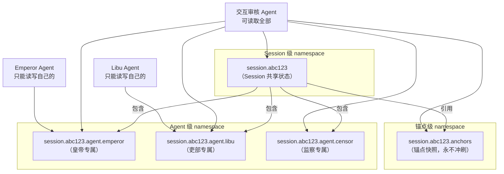
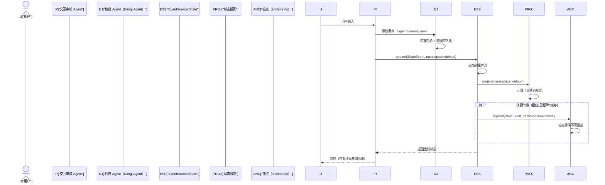

[AI 生成]

# 事件溯源状态（State）
> 状态一等概念的 L4 深度文档，以 4 层存储模型为核心骨架。覆盖 EventSourcedState 接口、档籍持久化、锚点快照、动态压缩、崩溃恢复及 namespace 层级结构。
> 状态：draft
> 维护：待定
> 讨论：无
> 待决：无
---
## 1. State 一等概念定义

State 是微内核 6 个一等概念之一，提供**事件溯源共享状态 + 命名空间**。所有状态变更为 append-only 事件，状态是事件的投影。天然支持审计（谁改了什么）、回放（Replay）、并发（事件不冲突，投影才冲突）。

State 是可插拔的：通过 `StateBackend` 实现可替换（InMemoryEventState → SqliteEventState → 档籍持久化），换实现不改接口。

**与微内核其他概念的关系**：
- Agent：State 的消费者，通过 `project` 读取自己有权的 namespace，通过 `append` 写入事件。
- Loop：Loop 执行过程中产生的中间状态（messages、toolResults）经 `append` 落入 State。
- Communication：EventBus 发布事件，State 订阅并落盘；多 Agent 异步协作时，State 作为黑板（Blackboard）提供共享视图。
- Pattern：Coordination Pattern 定义 Agent 组织方式，Execution Pattern 定义任务执行方式，两者都依赖 State 做状态共享和崩溃恢复。
- User：User 一等公民的跨 Session 记忆（UserProfile.memory）底层由 State 支撑，事件流带 `userId` 实现责任追溯。

---
## 2. v3→v4 演变历史

v3 使用可变对象 `projectState` 承载 Session 状态。可变对象在并发修改时冲突难解、审计困难、崩溃恢复只能靠快照无法回放。

v4 引入事件溯源（EventSourcedState），核心模型改变：
- 所有状态变更为 append-only 事件
- 状态是事件的投影（projection）
- 天然支持审计、回放、并发

演变理由（决策 80）：
- 并发友好：事件不冲突，投影才冲突，多 Agent 可安全并发追加
- 审计友好：事件流带 `agentId`/`traceId`/`timestamp`，完整记录谁改了什么
- 回放友好：投影可重算，崩溃恢复可从任意快照 + 增量事件重建
- 接口稳定：Phase 1 简化为可变对象 + activityLog，接口按终局形态设计，后续升级换实现不改接口

---
## 3. ★ 4 层存储模型（核心骨架）★

> **已迁移**（2026-08 会话存储重构）：4 层存储模型完整内容（含架构图、4 层总表、第 0-3 层细则、S1-A/S1-B/S2-A/S2-B 决策）已迁移至 **28-session-storage.md §4（会话存储唯一权威）**。本节仅保留 State 一等概念视角的一句话定位，细节以 28 为准。

4 层存储模型是 State 一等概念的核心骨架（决策 S0）：第 0 层档籍（永不删）→ 第 1 层锚点快照（永不冲刷）→ 第 2 层动态上下文（压缩至 N 轮）→ 第 3 层即时工作区（内存）。EventSourcedState 提供分层语义，每一层对应不同的持久化策略和压缩策略。

---
## 4. EventSourcedState 完整接口

以下接口以 07-infrastructure.md §1.4 + 02-shared-infrastructure.md §5 为源，本文档为权威定义。两处原始定义一致，本文档消除重复。

```typescript
/**
 * EventSourcedState：事件溯源状态后端。
 * v4 取代 v3 的可变对象 projectState。Phase 1 简化为可变对象 + activityLog，接口按事件溯源终局形态设计。
 */
interface EventSourcedState {
  /** 追加事件（append-only，不可修改已有事件） */
  append(event: StateEvent): Promise<void>;

  /** 投影当前状态（从事件流计算）。可指定 namespace 只投影该分区。 */
  project(namespace?: string): Promise<Record<string, unknown>>;

  /** 回放事件流（按时间范围或过滤器） */
  replay(options?: ReplayOptions): Promise<StateEvent[]>;

  /** 创建快照（加速后续 project） */
  snapshot(namespace?: string): Promise<Snapshot>;

  /** 从快照恢复 */
  restore(snapshot: Snapshot): Promise<void>;

  /** 列出所有命名空间 */
  listNamespaces(): Promise<string[]>;

  /**
   * 订阅 namespace 的事件流。handler 在事件 append 后同步触发。
   * handler 抛异常不影响 append 成功，仅记录警告。
   * 返回取消订阅函数。
   */
  subscribe(namespace: string, handler: (event: StateEvent) => void): Unsubscribe;
}

interface StateEvent {
  /** 事件唯一 ID（append-only，单调递增或 ULID） */
  id: string;
  /** 命名空间/作用域（Agent 只看自己有权的分区，与 Identity scope 联动） */
  namespace: string;
  /** 事件类型，如 "state.set" / "state.merge" / "state.delete" */
  type: string;
  /** 事件载荷 */
  payload: Record<string, unknown>;
  /** 谁触发了此事件 */
  agentId: string;
  /** 触发事件的用户 ID（审计追溯，见 §1 User 关系） */
  userId?: string;
  /** 触发时的 RequestContext traceId，便于审计关联 */
  traceId: string;
  /** 发生时间 */
  timestamp: Date;
  /** 上一事件 ID（可选，用于事件链校验） */
  previousEventId?: string;
}

interface ReplayOptions {
  /** 时间范围 */
  range?: TimeRange;
  /** 命名空间过滤 */
  namespace?: string;
  /** 事件类型过滤 */
  type?: string;
  /** 触发 Agent 过滤 */
  agentId?: string;
  /** 最大返回条数 */
  limit?: number;
}

interface TimeRange {
  start: Date;
  end: Date;
}

interface Snapshot {
  /** 快照 ID */
  id: string;
  /** 命名空间 */
  namespace: string;
  /** 快照时的状态投影 */
  state: Record<string, unknown>;
  /** 快照包含到的事件 ID */
  upToEventId: string;
  /** 快照时间 */
  createdAt: Date;
}

/** 取消订阅函数，调用后停止接收事件 */
type Unsubscribe = () => void;
```

#### StateBackend（持久化/恢复下层契约）

> [AI 生成 2026-08-13，T8 反向回流] 补全本接口定义（§1 叙述「通过 StateBackend 实现可替换」但此前未定义）。
> 定义本体回流自 `cell-base/src/core-engine/state.ts`（作者 2026-08-10 追平本节时的设计发现：
> EventSourcedState 是面向消费者的上层接口，StateBackend 是持久化/恢复的下层契约——拆分实现可插拔）。

```typescript
/**
 * StateBackend — 可插拔状态后端接口（§1）。
 * State 是可插拔的：通过 StateBackend 实现可替换（InMemoryEventState → SqliteEventState → 档籍持久化），
 * 换实现不改接口。EventSourcedState 是面向消费者的上层接口，StateBackend 是持久化/恢复的下层契约。
 */
interface StateBackend {
  /** 追加事件（append-only） */
  append(event: StateEvent): Promise<void>;
  /** 按 namespace 投影当前状态 */
  project(namespace?: string): Promise<Record<string, unknown>>;
  /** 回放事件流 */
  replay(options?: ReplayOptions): Promise<StateEvent[]>;
  /** 创建快照 */
  snapshot(namespace?: string): Promise<Snapshot>;
  /** 从快照恢复 */
  restore(snapshot: Snapshot): Promise<void>;
  /** 列出所有命名空间 */
  listNamespaces(): Promise<string[]>;
  /** 订阅 namespace 事件流，返回取消订阅函数 */
  subscribe(namespace: string, handler: (event: StateEvent) => void): Unsubscribe;
}

/**
 * Upcaster — 事件 schema 版本升级器（§5.5）。
 * 读取事件流时若 schemaVersion < 当前版本，按 matches/upgrade 升级 payload 后再投影。
 * Phase 1 默认 v1，upcaster 注册表为空（无需升级）。
 */
interface Upcaster {
  /** 判断是否处理此 (type, version) 组合 */
  matches(type: string, version: number): boolean;
  /** 将旧版本 payload 升级到当前版本 */
  upgrade(payload: Record<string, unknown>): Record<string, unknown>;
}
```

> **乐观锁扩展**：以上为基础接口。并发写入的乐观锁机制（revision/expectedRevision 版本号 + project 缓存失效策略 + 冲突解决）见 `06-core-engine.md` §8.7。Phase 1 InMemoryEventState 不需要乐观锁（单进程无并发）；Phase 3 SqliteEventState 启用。

**SessionStore 与 EventSourcedState 的映射**：

| SessionStore 操作 | EventSourcedState 操作 |
|------------------|----------------------|
| `load(id)` | `project(namespace=id)` → 构建 Session 对象 |
| `appendEvent(id, event)` | `append(event)` → 追加到事件流 |
| `replay(id)` | `replay({ namespace: id })` |
| `save(session)` | Phase 1：直接写可变对象（简化）。Phase 2+：no-op（状态是投影） |

---
## 4a. project() 触发时机与缓存（U5/贴黄模式）

> 明朝的贴黄机制：通政司读全文→写摘要（贴黄）→内阁首辅只读摘要。璇玑 的 project() 对应同样的"读全文→生成投影→缓存"模式。

### 贴黄模式

```
Agent 循环（Outer Loop 迭代）开始：
  → ContextBuilder 调 project(namespace)
    → project 内部检查 revision：
      → revision 未变 → 返回缓存（O(1)，相当于读贴黄）
      → revision 变了 → 重新遍历事件流 → 更新投影+缓存（相当于通政司更新贴黄）
  → LLM 拿到最新投影做决策
  → 工具执行（可能 append 新事件 → revision 变）
  → 回到循环开始（下一次迭代重新检查 revision）
```

### 关键规则

1. **每次 Outer Loop 迭代开始时调 project()**——保证 LLM 看到最新状态
2. **revision 缓存**——revision 未变则直接返回缓存投影，不重新遍历事件流（性能优化）
3. **revision 变化触发失效**——任何 append 操作使 namespace 的 revision +1，缓存自动失效
4. **不同 namespace 独立缓存**——Agent 只需读自己 namespace 的投影，不互相干扰

### 不同协调模式看不同 namespace

| 协调模式 | 需要看什么 | namespace |
|----------|-----------|-----------|
| 垂直协调 | 任务层级和完成状态 | `task:{taskId}` |
| 横向协调 | 跨部门进度汇总 | `session:{sessionId}:cross-bu` |
| 制衡协调 | 审批链状态 | `session:{sessionId}:approvals` |
| 元监察 | 审计日志 | `session:{sessionId}:audit` |

### Phase 标注

- **Phase 1**：每次迭代 project()（无缓存，直接遍历——InMemoryEventState 事件少，可接受）
- **Phase 2+**：revision 缓存（SqliteEventState 事件多，必须缓存）

---

## 5. StateEvent + schemaVersion（S3 决策）

S3 决策：StateEvent 增加 `schemaVersion?: number` 字段。每种 `(type, version)` 组合注册 upcaster，读取时自动升级。

```typescript
interface StateEvent {
  id: string;
  namespace: string;
  type: string;
  payload: Record<string, unknown>;
  agentId: string;
  userId?: string;
  traceId: string;
  timestamp: Date;
  previousEventId?: string;
  /** Schema 版本号（默认 v1），用于读取时升级 */
  schemaVersion?: number;
}

interface Upcaster {
  /** 判断是否处理此 (type, version) 组合 */
  matches(type: string, version: number): boolean;
  /** 将旧版本 payload 升级到当前版本 */
  upgrade(payload: Record<string, unknown>): Record<string, unknown>;
}
```

**upcaster 机制**：
1. 读取事件流时，检查每条事件的 `schemaVersion`
2. 若版本 < 当前版本，查找匹配的 Upcaster
3. 按顺序执行 upgrade，生成当前版本 payload
4. 投影使用升级后的 payload

Phase 1 默认 v1，upcaster 注册表为空（无需升级）。

---
## 6. namespace 层级结构（S4 决策）

S4 决策：三层 namespace 层级。Agent 默认只看自己事件，Session 级共享需 Identity scope 授权。

**命名规范**：
- Session 级：`session.<sid>`
- Agent 级：`session.<sid>.agent.<aid>`
- 锚点级：`session.<sid>.anchors`



**权限矩阵**：

| 角色 | Session 级 | Agent 级 | 锚点级 |
|------|-----------|---------|--------|
| 交互审核 Agent | 读 | 读 | 读 |
| 档籍 Agent | 写（第 0 层） | 不涉及 | 不涉及 |
| Emperor Agent | 读（需授权） | 读写 own | 读 |
| Libu Agent | 读（需授权） | 读写 own | 读 |
| 其他 Agent | 无 | 无 | 无 |

Agent 默认只能读写自己的 Agent 级 namespace。Session 级共享需要 Identity scope 授权（如内阁成员共享 `cabinet` namespace）。

---
## 7. State vs MemoryStore 边界（S5 决策）

> **已迁移**（2026-08 会话存储重构）：S5 混合规则与数据归属表已迁移至 **28-session-storage.md §13.1（会话存储唯一权威）**。本节仅保留决策定位。

S5 决策：**需审计 OR 跨 Session 持久 → EventSourcedState；否则 → MemoryStore**。完整数据归属示例见 28-session-storage.md §13.1。

---
## 8. 数据写入流程

用户输入 → 档籍 → 事件流 → 状态投影 → 锚点



---
## 9. 压缩流程

> **已迁移**（2026-08 会话存储重构）：压缩流程（prune → summarize → 贴黄 + 流程图）已迁移至 **28-session-storage.md §6.3（会话存储唯一权威）**。本节仅保留要点。

第 2 层 prune → summarize → 贴黄；第 0/1 层不动；第 3 层保留。详见 28-session-storage.md §6（含「DNA 永不删」心智模型与裁剪兜底语义）。

---
## 10. 崩溃恢复流程

> **已迁移**（2026-08 会话存储重构）：崩溃恢复流程（锚点 → 增量 → 重建 + 流程图）已迁移至 **28-session-storage.md §13.2（会话存储唯一权威）**。本节仅保留要点。

恢复顺序：读取第 1 层锚点快照 → 读取第 2 层增量事件 replay → 重建第 3 层即时工作区 → 验证一致性。详见 28-session-storage.md §13.2。

---
## 11. 索引-实体分离

> **已迁移**（2026-08 会话存储重构）：索引-实体分离完整内容（角色表、分离原则、架构图）已迁移至 **28-session-storage.md §5（会话存储唯一权威）**。本节仅保留原则表述。

交互审核 Agent 持有**索引**（知道有什么），档籍 Agent 持有**实体**（实际存储）。索引可重建（从事件流推导），实体不可重建（原始奏章一旦删除无法恢复）。详见 28-session-storage.md §5。
---
## 12. 相关决策

| 决策 | 标题 | 与本文档关系 |
|------|------|-------------|
| 决策 70 | 定位通用化（推翻决策 1） | State 从 v3 coding 专用 projectState 升级为通用事件溯源状态 |
| 决策 71 | Domain Pack 系统 | Session.domainState schema 由 Pack 定义，核心只提供 Record<string, unknown> |
| 决策 78 | 军功簿（WeightRegistry） | 跨任务学习闭环，与 MemoryStore 并列 |
| 决策 79 | 通信图状化 | EventBus + Blackboard 模式，State 作为黑板提供共享视图 |
| 决策 80 | 状态事件溯源 | EventSourcedState 接口定义，替代 v3 可变对象 projectState |
| 决策 83 | User 一等公民 | UserProfile 跨 Session 记忆由 State 支撑，事件流带 userId |

---
## 13. 术语对照

| 中文术语 | 英文术语 | 说明 |
|----------|---------|------|
| 事件溯源状态 | EventSourcedState | State 一等概念的实现 |
| 档籍 Agent | DangjiAgent | 第 0 层物理存储负责 Agent |
| 交互审核 Agent | InteractiveReviewAgent | 持有索引，负责压缩决策 |
| 原始奏章 | Memorial Raw | 用户输入全文 + 内容哈希，type=`memorial.raw` |
| 锚点 | Anchor | 审计后验关键证据，永不冲刷 |
| 贴黄 | Summary/Highlight | 中间段压缩生成的摘要 |
| 批红 | Approval Tag | 代批记录标签 |
| 投影 | Projection | 从事件流计算当前状态 |
| 回放 | Replay | 按条件重放事件流 |
| 快照 | Snapshot | 状态投影的瞬时拷贝，加速 project |
| 命名空间 | Namespace | 状态分区，Agent 按权隔离 |
| 黑板模式 | Blackboard | 多 Agent 异步读写共享状态 |
| 军功簿 | WeightRegistry | 跨任务学习闭环（竞功制术语） |
| 考绩簿 | WeightRegistry | 跨任务学习闭环（内阁制术语） |

---
> 文档版本：v1.7
> 本版变更（累积最近 3 条，最新在上）：
>   - v1.7：项目更名 wuwo→璇玑（ORBITA），全文品牌/路径/标识符替换（见决策 146）
>   - v1.6：会话存储重构——§3/§7/§9/§10/§11 完整内容迁移至 28-session-storage.md（唯一权威），原处改引用
>   - v1.5：§4 补 StateBackend/Upcaster 定义（T8 反向回流自 state.ts，消除 §1 悬空引用）
> 基于：07-infrastructure.md §1.4 + 15-sijian-batch.md §14 + 02-shared-infrastructure.md §5 + 04-loop-interface.md §1.4 + 31-phase-4-roadmap.md §6.1 + 10-decisions.md 决策 70/71/78/79/80/83 + .sisyphus/drafts/l4-design-decisions.md
> 决策总数：6 条（决策 70/71/78/79/80/83）
> 文档总数：29 份（v4.3.1.1 架构文档 28 份 + 本文档）
> 原则总数：33 条
