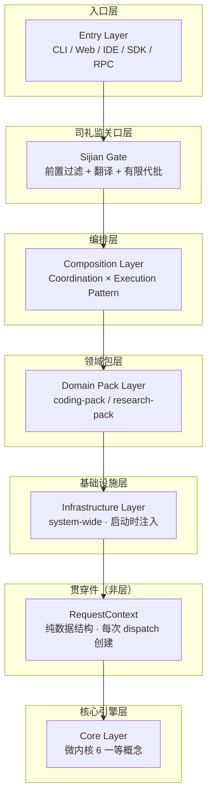
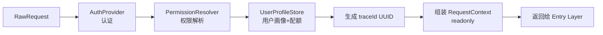
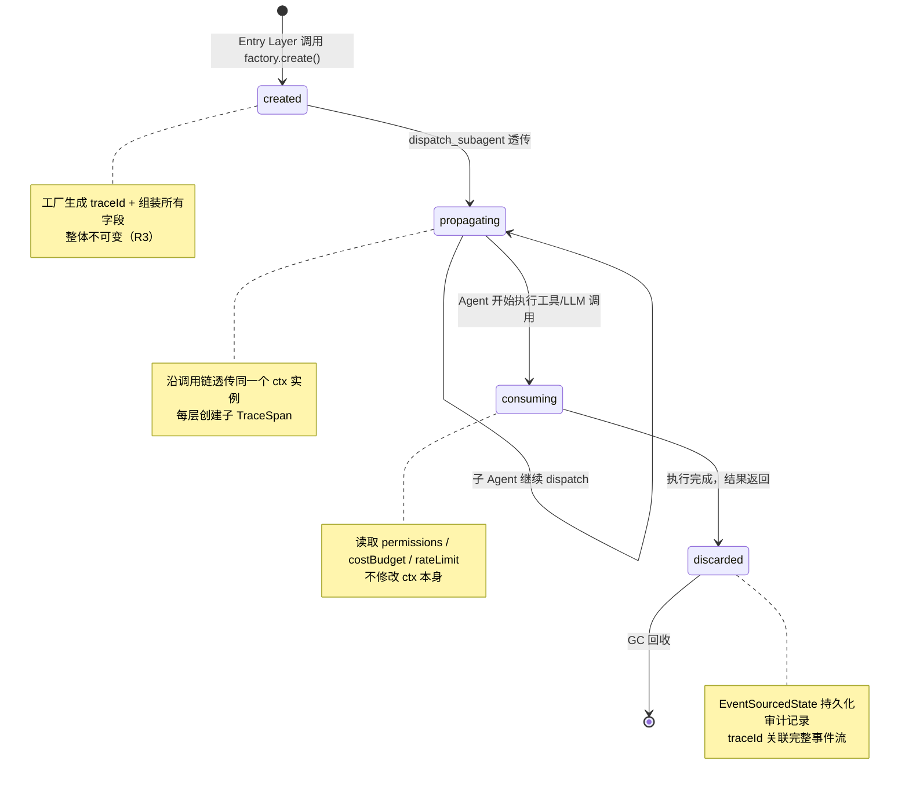
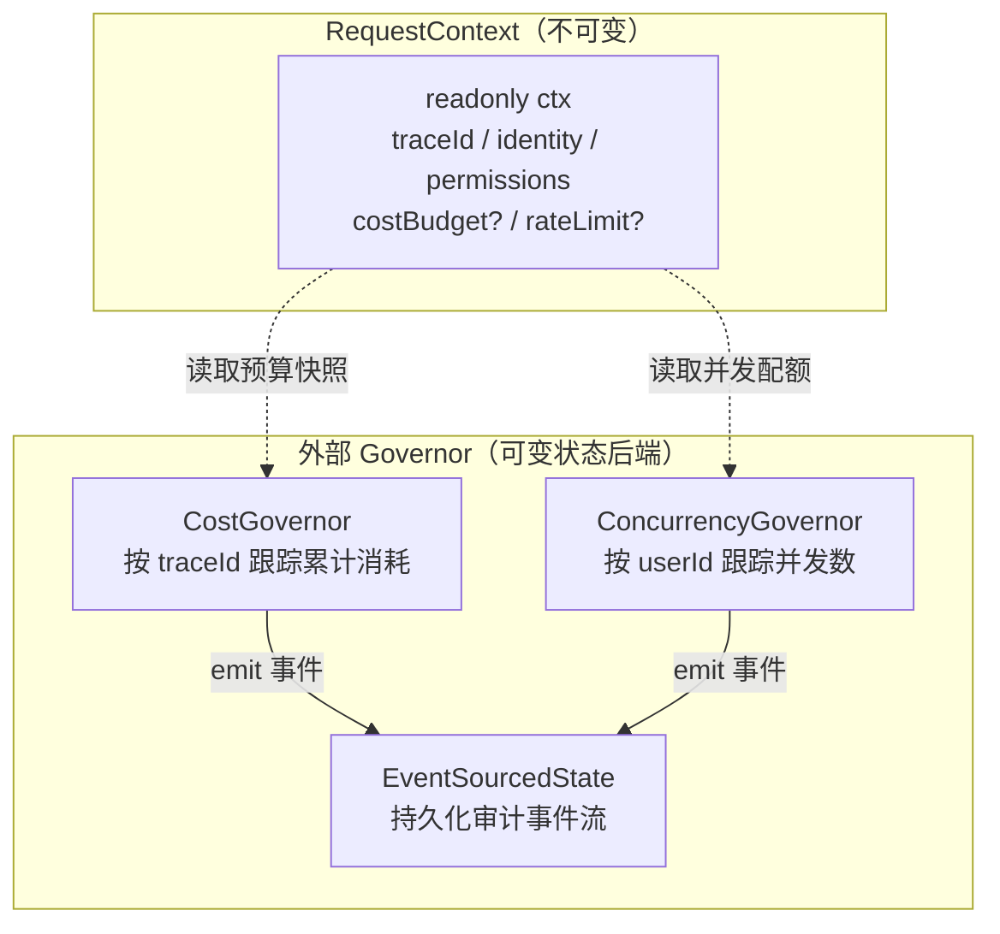
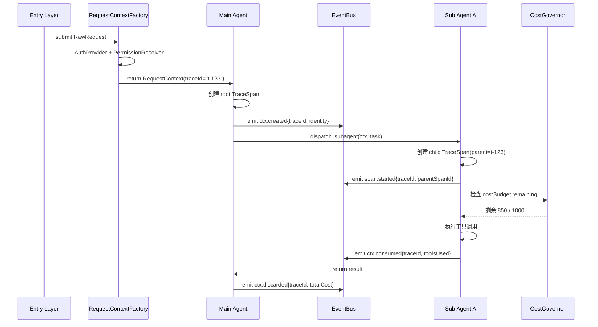
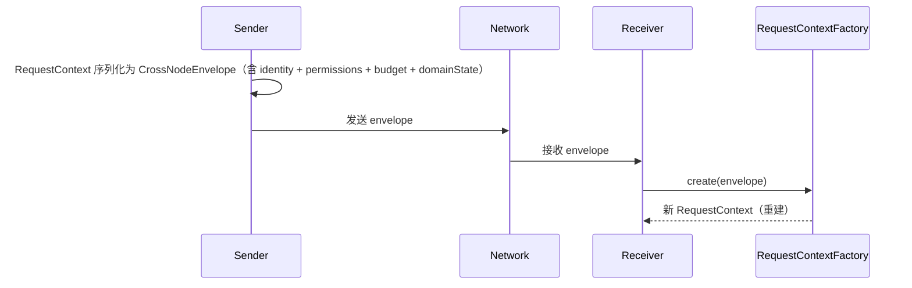

[AI 生成]
# RequestContext（请求上下文贯穿件）

> RequestContext 是 璇玑 唯一贯穿所有架构层的纯数据结构，携带每次 dispatch 的身份、权限、预算与追踪信息，沿调用链透传，不归属于任何单一架构层。

> 状态：draft
> 维护：待定
> 讨论：无
> 待决：无

---

## 1. 贯穿件定义（v3 层 → v4 贯穿件）

v3 将 RequestContext 设计为独立的一层（第 5 层），与 Entry / Composition / Infrastructure / Core 平级。v4 将其降级为**贯穿件（through-component）**：纯数据结构，不属于任何一层，在层间传递，下层不知道上层存在。

贯穿件定位对应 v4.3.1.1 七层架构中的"非层"组件：



**关键区别**：层有职责边界和实现代码，贯穿件只有数据结构。RequestContext 不注册为 Cell 插座、不实现 Infrastructure 接口、不持有任何业务逻辑。

---

## 2. 完整 TS 接口（9 字段）

源引用：`docs/architecture/orbita-code-design_v1.0/20-foundation-interfaces.md` §3.1

```typescript
export interface RequestContext {
  readonly identity: IdentityDefinition;
  readonly workspaceId: string;
  readonly transport: "cli" | "web" | "ide" | "rpc";
  readonly permissions: string[];
  readonly traceId: string;
  // Phase 3+ extensions
  readonly sessionId?: string;
  readonly tenantId?: string;
  readonly rateLimit?: { remaining: number; resetAt: number };
  readonly costBudget?: { remaining: number; currency: string };
  readonly domainState?: Record<string, unknown>;
}
```

**9 字段分类**：

| 类别 | 字段 | 必填 | 说明 |
|------|------|------|------|
| 身份 | `identity` | 是 | IdentityDefinition，定义"谁在做" |
| 环境 | `workspaceId` | 是 | 工作区隔离标识 |
| 接入 | `transport` | 是 | 接入方式：cli / web / ide / rpc |
| 权限 | `permissions` | 是 | 字符串数组，运行时权限检查 |
| 追踪 | `traceId` | 是 | 分布式追踪 ID，跨节点重建锚点 |
| 会话 | `sessionId?` | 否 | Phase 3+，会话级持久化关联 |
| 租户 | `tenantId?` | 否 | Phase 3+，多租户隔离 |
| 限流 | `rateLimit?` | 否 | 剩余配额 + 重置时间戳 |
| 预算 | `costBudget?` | 否 | 剩余预算 + 币种 |
| 领域 | `domainState?` | 否 | Domain Pack 运行时状态桶 |

---

## 3. 字段完整语义

| 字段 | 类型 | 生命周期 | 谁写入 | 谁读取 | 不可变时机 |
|------|------|----------|--------|--------|------------|
| `identity` | `IdentityDefinition` | 创建时一次性构建 | Entry Layer → Factory | 全链路 | 创建后 |
| `workspaceId` | `string` | 创建时确定 | Entry Layer → Factory | 全链路 | 创建后 |
| `transport` | `"cli" \| "web" \| "ide" \| "rpc"` | 创建时确定 | Entry Layer → Factory | Infrastructure 路由 | 创建后 |
| `permissions` | `string[]` | 创建时计算 | AuthProvider + PermissionResolver | 每层权限检查点 | 创建后 |
| `traceId` | `string` | 创建时生成 UUID | Factory 内部 | 全链路（追踪/审计） | 创建后 |
| `sessionId?` | `string` | 可选，会话级 | SessionStore | 状态持久化关联 | 创建后 |
| `tenantId?` | `string` | 可选，租户级 | UserProfileStore | 多租户隔离 | 创建后 |
| `rateLimit?` | `{ remaining, resetAt }` | 实时递减 | ConcurrencyGovernor | 每次 dispatch 前检查 | 每次检查后更新 |
| `costBudget?` | `{ remaining, currency }` | 实时递减 | CostGovernor | 每次 LLM 调用后检查 | 每次调用后更新 |
| `domainState?` | `Record<string, unknown>` | 按 Domain Pack 约定 | Domain Pack 注入 | Pack 内部模块 | Pack 内部管理 |

> 注：`rateLimit` 和 `costBudget` 的"更新"由外部 Governor 通过 EventSourcedState 完成，RequestContext 本身不提供 setter。

---

## 4. Entry Layer factory（R4：RequestContextFactory + RawRequest）

> **设计提议**：以下接口和流程为当前设计共识，尚未进入决策记录。

Entry Layer 不直接构造 RequestContext，而是提交原始请求材料，由 `RequestContextFactory` 统一处理认证、权限、配额计算，输出只读的 RequestContext。

### 4.1 RawRequest

```typescript
interface RawRequest {
  input: unknown;              // 用户原始输入
  userId?: string;             // 可选：已知用户标识
  workspaceId?: string;        // 可选：已知工作区
  transport: "cli" | "web" | "ide" | "rpc";  // 接入方式
}
```

### 4.2 RequestContextFactory

```typescript
interface RequestContextFactory {
  create(raw: RawRequest): RequestContext;
}
```

**内部处理链**：



Factory 依赖 3 个 Infrastructure 服务（均为可选接口，Phase 1 NoOp）：

| 服务 | 职责 | 无实现时行为 |
|------|------|-------------|
| `AuthProvider` | 验证 `userId` / token，返回 `IdentityDefinition` | 允许匿名，identity 为空 |
| `PermissionResolver` | 计算 `permissions[]` | 返回空数组（无权限） |
| `UserProfileStore` | 填充 `sessionId` / `tenantId` / `rateLimit` / `costBudget` | 全部 undefined |

---

## 5. 生命周期状态机（R2：created → propagating → consuming → discarded）

RequestContext 随一次 dispatch 创建，随 dispatch 完成回收。状态机定义 4 个阶段：



**R2 核心规则**：
- 一次 dispatch 只创建一个 RequestContext
- 子 Agent dispatch 透传同一个 ctx（不重新创建）
- 每层创建自己的 `TraceSpan`（子 span 关联父 traceId）
- 执行完成后 ctx 变为 discarded，由 GC 回收
- 不允许"复活" discarded 的 ctx

---

## 6. 不变量（R3：整体不可变 + 外部 Governor）

RequestContext 设计为**整体不可变对象**。所有字段在创建后不可修改。实时状态通过外部 Governor 跟踪：

| 维度 | RequestContext 本身 | 外部 Governor |
|------|---------------------|---------------|
| 身份信息 | 创建后只读 | 不变 |
| 权限列表 | 创建后只读 | 不变 |
| 预算余额 | 不存储，只存初始值 | `CostGovernor` 实时递减 |
| 速率限制 | 不存储，只存当前窗口 | `ConcurrencyGovernor` 实时计算 |
| 领域状态 | `domainState` 由 Pack 内部管理 | Pack 自行实现可变逻辑 |

**不可变的好处**：
- 透传时无拷贝开销（引用安全共享）
- 并发 dispatch 无竞态条件
- 审计日志只需记录创建时的快照
- 子 Agent 无法篡改父 Agent 的上下文

**外部 Governor 职责**：



---

## 7. 传播机制（traceId 贯穿 + 子 TraceSpan）

traceId 是跨节点跨 Agent 的追踪锚点。传播规则：

1. **同进程内**：同一 ctx 实例引用透传，零拷贝
2. **跨 dispatch**：子 Agent 收到父 ctx 的引用，创建子 `TraceSpan`（关联父 traceId）
3. **跨节点**：只传 `traceId + userId`，接收端用 factory 重建（见第 8 节）



---

## 8. 跨进程传递（R1：重建模式）

跨节点（RPC / 远程 dispatch）不允许序列化整个 RequestContext。R1 决策：**只传 `traceId + userId`**，接收端用 factory 重建完整 ctx。

**传输协议**：

```typescript
// 发送端：只传两个字段
interface CrossNodeEnvelope {
  traceId: string;    // 原始 ctx 的 traceId
  userId: string;     // 原始 ctx 的 identity.userId
}

// 接收端：重建
const rebuilt = factory.create({
  input: remoteInput,
  userId: envelope.userId,
  transport: "rpc",
});
// rebuilt.traceId === envelope.traceId（保持关联）
```



**重建保证**：
- `traceId` 保持连续性：审计日志可以跨节点串联
- `userId` 允许接收端重新解析身份和权限
- `workspaceId`、`permissions` 等由接收端 `AuthProvider` / `PermissionResolver` 重新计算
- `rateLimit`、`costBudget` 由接收端 Governor 独立跟踪（分布式锁或分片）

**为什么不能传整个 ctx**：
- 包含实时状态（budget 快照），序列化后 stale
- 权限在不同节点可能有不同解析结果
- budget 应该由各自 Governor 独立跟踪，避免跨节点竞态

---

## 9. 与三层上下文模型映射

v4.3.1.1 存在三层上下文概念，RequestContext 与它们的关系：

| 层级 | 概念 | 与 RequestContext 关系 |
|------|------|----------------------|
| 架构层 | 七层 + 1 贯穿件 | RequestContext 本身是贯穿件，不属于任何层 |
| 调用链 | Entry → ... → Core | RequestContext 沿调用链透传，每层可读取但不可修改 |
| 生命周期 | created → propagating → consuming → discarded | RequestContext 自身的状态机（第 5 节） |

**三层上下文模型图示**：

```mermaid
graph TD
    subgraph "架构层上下文"
        L1[Entry Layer]
        L2[Sijian Gate]
        L3[Composition]
        L4[Domain Pack]
        L5[Infrastructure]
        L6[Core Engine]
        TC[RequestContext<br/>贯穿件]
    end

    subgraph "调用链上下文"
        CTX[RequestContext 实例<br/>traceId + identity + ...]
        SPAN1[root TraceSpan]
        SPAN2[child TraceSpan]
        SPAN3[child TraceSpan]
    end

    subgraph "生命周期上下文"
        CREATED[created]
        PROPAGATING[propagating]
        CONSUMING[consuming]
        DISCARDED[discarded]
    end

    L1 --> L2 --> L3 --> L4 --> L5 --> TC --> L6
    CTX --> SPAN1 --> SPAN2 --> SPAN3
    CREATED --> PROPAGATING --> CONSUMING --> DISCARDED
```



---

## 10. 相关决策

| 决策 | 标题 | 关联本节 |
|------|------|----------|
| R1 | 跨节点只传 traceId + userId，接收端用 factory 重建 | 第 8 节 |
| R2 | created → propagating → consuming → discarded 四状态机 | 第 5 节 |
| R3 | 整体不可变 + 外部 Governor 跟踪实时状态 | 第 6 节 |
| R4 | 统一 factory + RawRequest，Entry Layer 不直接构造 ctx | 第 4 节 |

---

## 11. 术语对照

| 中文 | 英文 | 说明 |
|------|------|------|
| 贯穿件 | through-component | 纯数据结构，不属于任何架构层 |
| 请求上下文 | RequestContext | 贯穿件的具体实现 |
| 原始请求 | RawRequest | Entry Layer 提交给 factory 的材料 |
| 工厂 | RequestContextFactory | 统一创建 ctx 的入口 |
| 追踪 ID | traceId | 分布式追踪锚点，跨节点重建的纽带 |
| 追踪跨度 | TraceSpan | 每层创建的追踪子 span，关联父 traceId |
| 身份定义 | IdentityDefinition | ctx.identity 的类型，定义"谁在做" |
| 预算治理 | CostGovernor | 外部 Governor，跟踪累计消耗 |
| 并发治理 | ConcurrencyGovernor | 外部 Governor，跟踪并发数 |

---

> 文档版本：v1.3
> 本版变更（累积最近 3 条，最新在上）：
>   - v1.3：项目更名 wuwo→璇玑（ORBITA），全文品牌/路径/标识符替换（见决策 146）
>   - v1.2：R1-R4 入决策记录（决策 109-112）；状态转换待 PR 人工确认（G5）
>   - v1.1：§8 新增跨进程重建 sequenceDiagram
> 基于：docs/architecture/orbita_v4.5.1/02-architecture-layers.md（贯穿件定义）+ docs/architecture/orbita_v4.5.1/24-request-context.md §7（传播机制 sequenceDiagram 风格参考）
> 决策总数：4 条（R1-R4，已入决策记录）
> 文档总数：1 份（本文件）
> 原则总数：0 条
