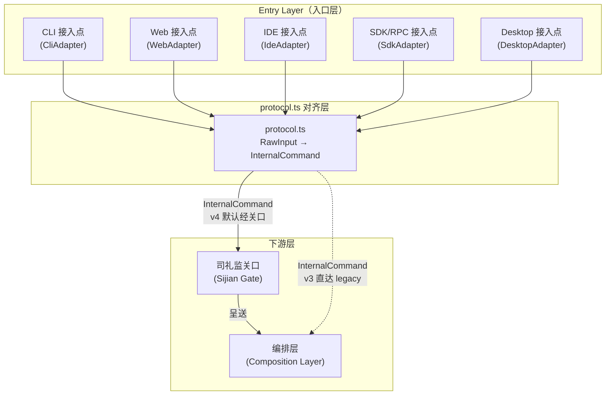
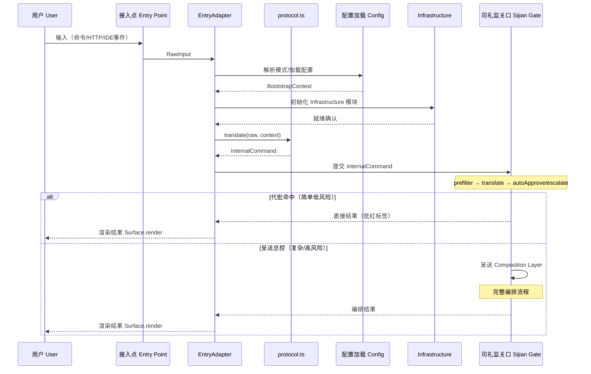

[AI 生成]

# Entry Layer（入口层）

> Entry Layer 独立设计文档：接入点定义、EntryAdapter 接口、protocol.ts 对齐层、Surface 抽象、bootstrap 流程、Phase 演进。

> 状态：draft
> 维护：待定
> 讨论：无
> 待决：无

---

## 1. 定位

Entry Layer（入口层）是 璇玑 七个一等架构层的第一层。职责：将不同前端渠道的用户输入对齐为统一的内部协议，然后交给司礼监关口层（Sijian Gate）。

本文档是 02-architecture-layers.md §2 的详细展开。02 §2 保留概述定位，本文档提供完整的接口设计、bootstrap 流程和 Phase 演进路径。新增接入点只需实现 EntryAdapter 接口并接入 protocol.ts 对齐层，无需修改下层任何代码。

**设计依据**：原则 1（边界即接口）、原则 2（接口按最终形态设计）、原则 18（通用底座——核心不含领域语义）。

---

## 2. 架构总览



**读图**：四个接入点（CLI/Web/IDE/SDK）各自实现 EntryAdapter，通过 protocol.ts 统一转换为 InternalCommand。v4 默认经司礼监关口（实线），v3 遗留路径直达编排层（虚线，Phase 2+ 废弃）。

---

## 3. 接入点定义

| 接入点 | Adapter | 传输方式 | 说明 | Phase |
|--------|---------|----------|------|-------|
| CLI | CliAdapter | stdin/stdout + readline | 命令行终端，支持 `/mode`、`/builder`、`/mode neige`、`/mode jinggong` 等斜杠命令 | Phase 1 |
| Web | WebAdapter | HTTP + WebSocket | 浏览器界面，支持可视化画板（L3 Visual Canvas） | Phase 2 |
| IDE | IdeAdapter | IPC（进程间通信） | IDE 插件，在编辑器内直接调用，支持 DualSurfaceLayout | Phase 3 |
| SDK / RPC | SdkAdapter | 程序化 API / RPC | 其他系统通过 SDK 调用（v4 扩展），`createOrbitaSession()` | Phase 4 |
| Desktop | DesktopAdapter | Electron IPC（contextBridge） | 跨平台桌面应用，复用 Web 技术栈 | Phase 1.5（本次） |

> CLI Phase 1 使用 SimpleRenderer（stdout + readline），见 08-package-structure.md `cli/` 包。
> **TUI/CLI 交互界面处置（2026-08-13 用户决策）**：TUI 交互主循环不做，直接对接桌面版（Electron + React，见下方 Desktop 章节）——SDK 的消费端是 desktop，`createOrbitaSession` + `runStream` 事件流即对接面；`entry/tui/璇玑-tui-renderer.ts` 纯函数渲染保留（desktop 可复用），`CliEntryAdapter.stream()` stub 留待 CLI 重建需要时补全。

---

## 4. EntryAdapter 接口

每个接入点实现 EntryAdapter 接口。`adapt()` 将渠道特定输入转换为统一的 InternalCommand；`stream()` 可选，将系统输出流转换为该渠道可渲染的 Chunk 序列。

```typescript
/**
 * EntryAdapter 接口（入口适配器）。
 * 每个接入点（CLI/Web/IDE/SDK）实现此接口。
 * adapt() 必须——将渠道输入对齐为内部命令。
 * stream() 可选——支持流式输出的接入点实现。
 */
interface EntryAdapter {
  /**
   * 将 RawInput（渠道原始输入）转换为 InternalCommand（统一内部命令）。
   * 转换逻辑委托给 protocol.ts 对齐层（见 §5）。
   */
  adapt(input: RawInput): InternalCommand;

  /**
   * 可选：将系统输出流转换为渠道可渲染的 Chunk 序列。
   * CLI 通过 SimpleRenderer 渲染到终端；Web 通过 WebSocket 推送；
   * IDE 通过 IPC 写入编辑器面板。
   * 不支持流式输出的接入点不实现此方法。
   */
  stream?(output: StreamOutput): AsyncIterable<Chunk>;
}

/**
 * RawInput（原始输入）——渠道特定的用户输入载体。
 * 不同接入点的结构不同，但都包含 prompt 和 source 标识。
 */
interface RawInput {
  /** 用户输入文本 / 指令 */
  prompt: string;
  /** 输入来源标识 */
  source: 'cli' | 'web' | 'ide' | 'sdk';
  /** 渠道特定元数据（CLI 的斜杠命令、Web 的 HTTP headers、IDE 的文件上下文等） */
  channelMetadata?: Record<string, unknown>;
}

/**
 * InternalCommand（内部命令）——所有接入点对齐后的统一格式。
 * 这是交给司礼监关口的输入（见 §8）。
 */
interface InternalCommand {
  /** 用户 ID（User 一等公民标识） */
  userId: string;
  /** 会话 ID */
  sessionId: string;
  /** 对齐后的用户指令 */
  prompt: string;
  /** 来源元数据，保留原始映射以支持审计和可逆性 */
  metadata: {
    source: 'cli' | 'web' | 'ide' | 'sdk';
    /** 模式选择（/mode neige=朝廷, /mode jinggong=竞功, null=默认） */
    mode?: string | null;
    /** 原始输入引用（审计追溯用） */
    rawRef?: unknown;
  };
}

// 流式输出块
interface Chunk {
  type: "text" | "tool-call" | "tool-result" | "progress" | "error" | "done";
  content: string;              // 文本内容或 JSON 序列化
  metadata?: {
    agentId?: string;
    traceId?: string;
    timestamp?: number;
    severity?: "info" | "warning" | "error";
  };
}

// 流式输出源
interface StreamOutput {
  requestId: string;
  sessionId: string;
  mode: string;                 // 当前编排模式
}
```

> 以上接口为本文档首次定义的设计规范。璇玑 当前代码实现为 0 行（见 README），接口签名在实现阶段可能微调。

---

## 5. protocol.ts 对齐层

protocol.ts 是 Entry Layer 的关键对齐模块（02-architecture-layers.md §2「关键接口」）。所有接入点不直接调用下层接口，而是通过 protocol.ts 把用户输入转换为统一的 InternalCommand。

### 5.1 为什么集中对齐

| 问题（分散对齐） | 解决（protocol.ts 集中） |
|-----------------|------------------------|
| 每个接入点各自实现转换逻辑，格式漂移 | 统一转换入口，格式一致 |
| 审计追溯困难（不知道原始输入经过什么转换） | 保留 rawRef 原始映射，转换可逆 |
| 新增接入点需要重新理解下层接口 | 新接入点只需实现 EntryAdapter + 调用 protocol.ts |
| 模式选择（/mode）逻辑散落各处 | 集中解析斜杠命令和模式标识 |

### 5.2 protocol.ts 职责

```typescript
/**
 * protocol.ts 对齐层。
 * 将 RawInput 转换为 InternalCommand，保留原始映射。
 */
namespace protocol {
  /** 主转换函数：RawInput → InternalCommand */
  function translate(raw: RawInput, context: BootstrapContext): InternalCommand;

  /** 反向映射：从 InternalCommand.metadata.rawRef 恢复原始输入（审计用） */
  function reverse(cmd: InternalCommand): RawInput;
}
```

### 5.3 转换不变量

protocol.ts 转换过程保持以下不变量：

1. **可逆性**：`reverse(translate(raw))` 必须恢复 raw 的 prompt 和 source 字段
2. **无丢失**：RawInput 的所有字段必须映射到 InternalCommand 或其 metadata
3. **无注入**：转换过程不得向 prompt 注入渠道特定内容（渠道元数据进 metadata，不进 prompt）

---

## 6. Surface 抽象

Surface（界面）是输出渲染的抽象层。EntryAdapter.stream() 产出的 Chunk 由 Surface 渲染到用户可见的界面。

### 6.1 Phase 1：SimpleRenderer

Phase 1 CLI 使用 SimpleRenderer——最简实现，stdout 输出 + readline 输入。

```typescript
/**
 * Surface 接口（界面抽象）。
 * 渲染 Chunk 到用户可见的界面。
 */
interface Surface {
  /** 渲染单个输出块 */
  render(chunk: Chunk): void;
  /** 刷新缓冲区（确保所有待渲染内容已输出） */
  flush(): Promise<void>;
}

/**
 * SimpleRenderer——Phase 1 CLI 默认 Surface。
 * stdout 输出 + readline 输入，最简实现。
 */
interface SimpleRenderer extends Surface {
  /** readline 接口实例 */
  rl: ReadlineInterface;
}
```

### 6.2 Phase 3+：DualSurfaceLayout

Phase 3 引入 IDE 接入点和双视角功能，需要左右分屏同时渲染两个 Agent 的输出。

```typescript
/**
 * DualSurfaceLayout——Phase 3+ 双面板布局。
 * 左右分屏，支持 Tournament N=2 双视角同时展示。
 */
interface DualSurfaceLayout extends Surface {
  /** 左面板（视角 A） */
  leftPanel: Surface;
  /** 右面板（视角 B） */
  rightPanel: Surface;

  /**
   * 渲染 Chunk 到指定面板。
   * 根据 chunk 的 source 标识路由到左或右面板。
   */
  render(chunk: Chunk): void;
}
```

> DualSurfaceLayout 是 Phase 3+ 设计。Phase 1/2 不实现，只用 SimpleRenderer。Surface 抽象在 Phase 1 已预留接口（原则 2：接口按最终形态设计）。

---

## 7. bootstrap 流程

bootstrap（启动引导）是接入点从接收用户输入到提交 InternalCommand 给司礼监关口的完整流程。



**读图**：接入点接收用户输入 → EntryAdapter 解析模式并加载配置 → 初始化 Infrastructure → protocol.ts 转换为 InternalCommand → 提交司礼监关口。关口代批命中时直接返回；否则呈送编排层走完整流程。结果通过 EntryAdapter.stream() → Surface.render() 返回用户。

### 7.1 BootstrapContext

bootstrap 流程中加载的上下文信息：

```typescript
/**
 * BootstrapContext——bootstrap 阶段加载的上下文。
 * 传递给 protocol.translate() 用于构建 InternalCommand。
 */
interface BootstrapContext {
  /** 用户身份（User 一等公民标识） */
  userId: string;
  /** 会话标识（新会话或恢复已有会话） */
  sessionId: string;
  /** 已加载的 Domain Pack 名称 */
  activePack: string;
  /** 协调模式（hierarchy/market/council） */
  coordinationMode: string;
  /** 执行模式（dag/tournament/chain/fan-out） */
  executionMode: string;
}
```

---

## 8. 与司礼监关口协议

Entry Layer 的输出（InternalCommand）交给司礼监关口层（Sijian Gate）。v4 默认所有请求经关口，v3 遗留的直达编排层路径在 Phase 2+ 废弃。

### 8.1 交接契约

| 维度 | Entry Layer 负责 | 司礼监关口负责 |
|------|-----------------|---------------|
| 输入格式 | 产出 InternalCommand（标准化） | 消费 InternalCommand |
| 用户上下文 | 填充 userId/sessionId | 基于此做权限检查 |
| 模式选择 | 解析 /mode 命令，填入 metadata.mode | 不关心模式解析 |
| 审计追溯 | 保留 rawRef 原始映射 | 叠加批红标签 |

### 8.2 代批路径 vs 呈送路径

InternalCommand 提交后，司礼监关口判断走代批还是呈送（详见 15-sijian-batch.md）：

- **代批路径**：命中条陈（BatchApproveCharter）+ 简单低风险 → 代批 → 打批红标签 → 直接返回 EntryAdapter → 渲染给用户
- **呈送路径**：复杂/高风险/不在条陈 → 呈送 Composition Layer → 完整编排流程 → 结果返回 EntryAdapter → 渲染给用户

Entry Layer 不参与代批判断——判断逻辑完全在司礼监关口层。Entry Layer 只负责把 InternalCommand 正确提交，并接收返回结果。

---

## 9. Phase 演进

Entry Layer 的接入点按 Phase 递进实现。每个 Phase 只新增接入点，不修改已有接入点的接口（原则 2：接口按最终形态设计，Phase 1 提供最笨实现）。

| Phase | 接入点 | Adapter | Surface | 关键依赖 | 状态 |
|-------|--------|---------|---------|----------|------|
| Phase 1 | CLI | CliAdapter | SimpleRenderer | agent-core + react-loop + coding-pack | 设计完成，待实现 |
| Phase 2 | Web | WebAdapter | WebRenderer | HTTP server + WebSocket + Visual Canvas L3 | 待验证 |
| Phase 3 | IDE | IdeAdapter | DualSurfaceLayout | IDE 插件 IPC + Tournament N=2 双视角 | 待验证 |
| Phase 4 | SDK/RPC | SdkAdapter | 不适用（程序化） | createOrbitaSession + RPC 协议 | 待验证 |
| Phase 1.5 | Desktop | DesktopAdapter | RendererSurface | cell-base + Electron + React + Vite | 设计+实现 |

### 9.1 各 Phase 关键设计点

**Phase 1（CLI）**：
- CliAdapter 解析斜杠命令（`/mode`、`/builder`）
- SimpleRenderer：stdout 输出 + readline 输入
- 不实现 stream() 的复杂逻辑——同步输出即可

**Phase 2（Web）**：
- WebAdapter 处理 HTTP POST（提交请求）+ WebSocket（流式推送）
- Visual Canvas（L3）：用户拖拽组装管道
- 新增 WebRenderer（实现 Surface 接口）

**Phase 3（IDE）**：
- IdeAdapter 通过 IPC 与 IDE 进程通信
- DualSurfaceLayout：左右分屏渲染双视角输出
- 依赖 Tournament N=2（原则 15：竞争选优）

**Phase 4（SDK/RPC）**：
- SdkAdapter 暴露 `createOrbitaSession()` 编程接口
- **[已实现 2026-08-13，B 档流式 + 配置注入 + C 档 delta]** `createOrbitaSession().run(input, { onEvent })` 实时转发回合级 AgentEvent（turn_start/tool_start/message_end/...，经 `cell.{id}.**` EventBus 订阅）；`runStream(input)` 返回 AsyncGenerator 统一事件流（event → done）。`OrbitaSessionOptions extends AssemblyOptions`（cwd/useSqlite/sqlitePath/guards/... 透传）+ `streamFn` 注入点 + `extraTools`/`wrapCell` 扩展点（桌面 legacy 模式收敛）。**C 档 token 级 delta 已实现**：LLMParams.onDelta → cell 累积发 `message_update`（打字机载体，text delta；thinking/toolcall 透传不累积）。
- 无 Surface（程序化接入不渲染界面）
- 其他系统通过 SDK 嵌入 璇玑 能力

> Phase 2+/3+/4+ 标注的完整列表见 25-phase-roadmap.md。

### 9.2 Desktop 接入点关键设计点

**DesktopAdapter**：
- 通过 Electron `contextBridge` 与渲染进程通信
- Main process 直接 `import('@璇玑/cell-base')`，零桥接（cell-base 是纯 Node TS）
- Renderer process 通过 `window.orbitaAPI` 暴露的 IPC 接口调用，**绝不直接 require cell-base**（`contextIsolation` 安全约束）
- **[已迁移 2026-08-13]** Chat 会话层从直连 pi-sdk（@璇玑/pi-coding-agent + 临时 models.json/auth.json）迁到 orbita-sdk：`main/璇玑-session.ts`（createOrbitaSession + cell.run onEvent 事件桥 → PiEvent，IPCs 协议/renderer 零改动）；provider 按 model 路由 + 缺 key 回退 mock；cell.run 新增 `CellRunOptions.onEvent`（回合级 AgentEvent 实时回调）

**Surface 实现**：
- `RendererSurface`（实现 Surface 接口，通过 `webContents.send` 推送 Chunk 到渲染进程）

**安全不变量**：
- `contextIsolation: true` / `nodeIntegration: false` / `sandbox: true`
- API key 经 `safeStorage` 加密，不进 renderer

**与其他接入点关系**：
- Entry Layer 第 5 个接入点，与 CLI/Web/IDE/SDK-RPC 平级
- MVP 范围只接 single 模式（单 Agent 对话），swarm/resume 等后续

**技术栈对照参考**：
- Cherry Studio 同款（Electron v40 + React 19 + electron-vite + Vitest）
- 源出处：https://github.com/CherryHQ/cherry-studio/blob/main/docs/references/architecture-overview.md

---

## 术语对照

| 中文 | 英文 |
|------|------|
| 入口层 | Entry Layer |
| 入口适配器 | EntryAdapter |
| 对齐层 | protocol.ts |
| 内部命令 | InternalCommand |
| 原始输入 | RawInput |
| 界面 | Surface |
| 简单渲染器 | SimpleRenderer |
| 双面板布局 | DualSurfaceLayout |
| 启动引导 | bootstrap |
| 启动上下文 | BootstrapContext |

---

> 文档版本：v1.8
> 本版变更（累积最近 3 条，最新在上）：
>   - v1.8：项目更名 wuwo→璇玑（ORBITA），全文品牌/路径/标识符替换（见决策 146）
>   - v1.7：§9.2 SDK 增注扩展：extraTools/wrapCell 扩展点 + C 档 delta 完成（message_update 打字机载体）
>   - v1.6：§9.2 Desktop 补 Chat 迁移增注（pi-session → 璇玑-session，cell.run onEvent；IPCs/renderer 零改动）
> 基于：02-architecture-layers.md §2
> 决策总数：0 条（本文档不引入新决策，设计依据见 02-architecture-layers.md §2）
> 文档总数：不适用
> 原则总数：不适用
