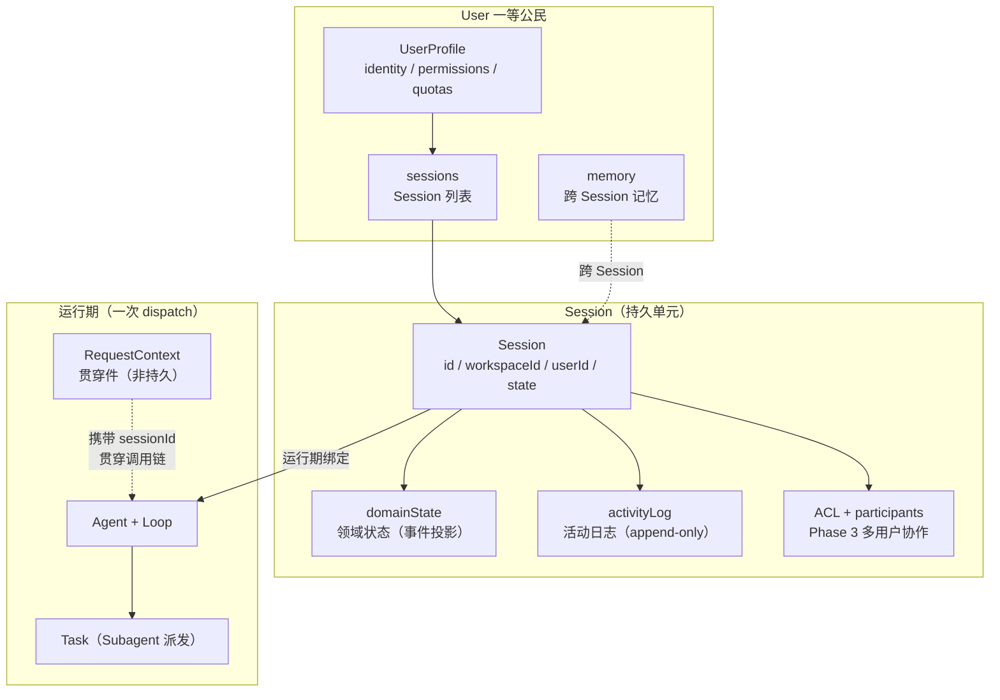
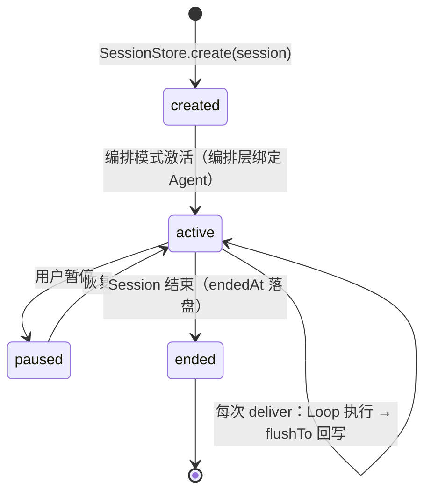
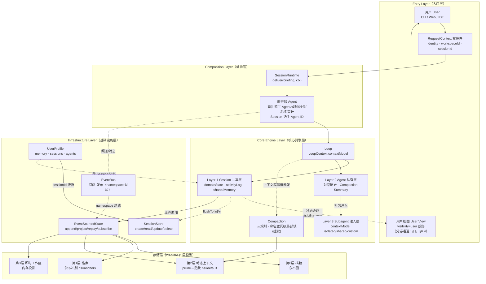
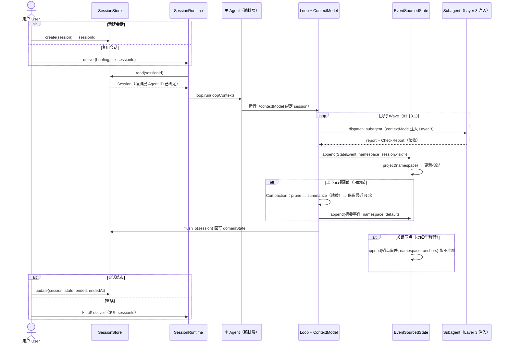

[AI 生成]

# 会话管理（Session Management）—— 总结重构

> 一句话注释：把散落在 01/02/03/05/06/07/22/23/24 各文档中的「会话管理」设计汇总重构为单一权威入口；本文以组织与表述重构为主，2026-08 起承载会话设计确认（§6.4-6.8 核模型补全、§9.4 跨空间协同）。所有内容回指源文档节号；若源文档与本文冲突，以源文档为准并反馈修正。

> 状态：draft
> 维护：待定
> 讨论：无
> 待决：无
> 基于：01-overview.md §8.7、02-architecture-layers.md §7、03-execution-modes.md §0.8、05-agent-roles.md §5.3、06-core-engine.md §4/§5/§8、07-infrastructure.md §1.1、22-communication.md §5.4、23-state.md §3-§11、24-request-context.md §2、决策 25/37/70/71/73/80/83/84/85

---

## 1. 会话定位（Session 是什么）

**Session（会话）是用户与 璇玑 协作的持久上下文单元**，是一等实体 User（用户，UserProfile）下的挂靠对象，跨任务存活（01-overview.md §8.7，决策 83）。



**关键区分（易混点）**：

| 概念 | 是什么 | 持久性 | 权威来源 |
|------|--------|--------|---------|
| Session | 用户协作的持久上下文单元 | 持久（SessionStore） | 28-session-storage.md §3 |
| RequestContext | 每次 dispatch 创建、贯穿调用链的纯数据结构 | 非持久 | 02-architecture-layers.md §7、24-request-context.md §1 |
| Task | 一次 Subagent 派发的生命周期（Session 的子级） | 随运行 | 06-core-engine.md §4.1 |
| Working | 当前 LLM 调用窗口 | 内存 | 06-core-engine.md §4.1 |

**三模式共享**：朝廷/竞功/大明三模式共享同一套术语池，Session 切换模式时称呼不切换（01-overview.md §7，原则 33）。

---

## 2. 会话数据结构

### 2.1 Session 接口（28-session-storage.md §3 权威定义）

```typescript
interface Session {
  id: string;
  workspaceId: string;
  userId: string;
  title: string;
  /** 模式运行状态（领域中立） */
  state: SessionState;
  /**
   * 领域状态容器。v4 变化：v3 的 projectState 改为无类型容器。
   * schema 由 Domain Pack 的 sessionStateSchema 定义（coding: { files, cwd, repoUrl }）。
   */
  domainState: Record<string, unknown>;
  /** v4 扩展：Session 协作元信息（多用户协作 Phase 3） */
  type?: "personal" | "shared";
  participants?: UserRef[];
  permissions?: SessionACL;
  /** 事件溯源的活动日志（Phase 1 简化为可变对象，接口按事件溯源设计） */
  activityLog: ActivityEntry[];
  metadata: Record<string, unknown>;
  createdAt: Date;
  updatedAt: Date;
  endedAt?: Date;
}
```

### 2.2 状态机与协作字段

- **SessionState**（07 §1.1）：`status: "active" | "paused" | "ended"` + agentCount + lastActivity
- **SessionACL**（07 §1.1）：owner + participants[{ userId, role: "viewer" | "editor" | "admin" }]
- **Trust Level**（01 §8.7）：none / read-only / invoke / delegate / full-control（Phase 3 信任模型）
- **domainState 设计**（01 §8.4，决策 70/71）：核心只提供 `Record<string, unknown>` 容器，schema 由 Domain Pack 定义；底层是事件投影

---

## 3. 会话生命周期



### 3.1 创建与编排绑定（03-execution-modes.md 编排激活流程）

1. `SessionStore.create(session)`（03 §215）
2. 编排层全员创建（AgentPool.create），idle 待命（司礼监/主 Agent/规划/总监督/复核/审计）
3. 执行层身份模板预注册到身份库（不创建实例）
4. **Session 记住编排层 Agent ID**：`session.emperorAgentId / plannerAgentId / chiefCheckAgentId / reviewerAgentId / auditorAgentId`（03 §228-242，Session 级持久）

### 3.2 运行（03 §0.8 + 05 §5.3 + 06 §8）

```
SessionRuntime.deliver(briefing, ctx)          // 03 §0.8 入口
  → 从 AgentPool 获取主 Agent（idle）
  → 解析 Session（requestCtx.sessionId → SessionStore）   // 05 §470
  → loopContextFactory.build(invocation, requestCtx, session) 得 LoopContext
  → agent.loop.run(loopContext)                 // Loop 运行
  → ctx.contextModel.flushTo(session)           // 回写：contextModel 变更 → session.domainState（事件追加）
```

- **contextModel 回写**（06 §703-712）：Loop 运行期间对 contextModel 的变更回写 `session.domainState`，走事件追加（append-only）
- **TaskRecord 归属**：派发的 Subagent 任务记录在 session 下（07 §4.1）

### 3.3 结束

- `SessionState.status = "ended"` + `endedAt` 落盘（07 §1.1）
- 编排层常驻 Agent 生命周期随 Session（03 §203-208：模式激活时创建，Session 结束销毁）
- 会话列表/删除：SessionStore.list() / delete()（07 §1.1 实现状态注，F6 会话列表）

---

## 4. 会话存储

> **已迁移**（2026-08 重构）：会话存储完整设计（SessionStore 接口、4 层存储模型、压缩、索引-实体分离、存储边界与恢复、本地 SQLite 落地）已集中至 **28-session-storage.md（会话存储唯一权威）**。本节不再重复，仅保留会话管理侧的上下文引用。

- **SessionStore 接口** → 28-session-storage.md §3（含 Session/SessionState/ActivityEntry/SessionACL 结构）
- **4 层存储模型**（决策 S0）→ 28-session-storage.md §4（第 0 层档籍/第 1 层锚点/第 2 层动态/第 3 层工作区）
- **索引-实体分离** → 28-session-storage.md §5
- **压缩流程**（prune/summarize/贴黄）→ 28-session-storage.md §6
- **存储边界与恢复**（S5 + 崩溃恢复）→ 28-session-storage.md §13
- **本地持久化落地**（后端/分库/schema，决策 141-144）→ 28-session-storage.md §11/§12

---

## 5. 状态命名空间与权限

### 5.1 三层层级（23-state.md §6，决策 S4）

```
session.<sid>                     // Session 级共享状态
session.<sid>.agent.<aid>         // Agent 级（默认私有）
session.<sid>.anchors             // 锚点级（永不冲刷）
```

Agent 默认只看/写自己的 Agent 级 namespace；Session 级共享需 Identity scope 授权（如内阁成员共享 `cabinet` namespace）。**权限矩阵**：交互审核 Agent 全读；档籍 Agent 写第 0 层；各 Agent 读写 own；其他无。

**可见性（2026-08 核模型补全，见 §6.4）**：Agent 级 namespace 默认 internal（内部交流，用户不可见）；`visibility="user"` 的会话进入用户视图；跨编排委托为 delegated（仅归因追溯）。

### 5.2 投影与贴黄（23-state.md §4a）

- `project()` 触发时机与缓存：不同协调模式看不同 namespace（朝廷模式看 `session.<sid>` 共享投影，竞功模式看各 worktree 分支）
- 贴黄模式：第 2 层中间段生成摘要（贴黄），保留最近 M 条原文

### 5.3 事件溯源（01-overview.md §8.4，决策 80）

- **核心模型**：所有状态变更是 append-only（只追加）事件；状态是事件的投影；天然支持审计（谁改了什么）、回放（Replay）、并发（事件不冲突，投影才冲突）
- 接口：`append / project / replay / snapshot / restore / listNamespaces / subscribe`（23-state §4）
- **乐观锁**：投影冲突时 `appendWithOptimisticLock`（expectedRevision 冲突 → 重新 project → 重试，maxRetries=3，06 §8.7）；冲突解决策略由 Domain Pack 定义（LWW / 业务级合并 / 拒绝）

---

## 6. 三层上下文与会话共享层

### 6.1 三层模型（06-core-engine.md §4.1）

| 层 | 内容 | 存活 | 可见性 |
|----|------|------|--------|
| **Layer 1 · Session 共享层** | domainState（事件投影）、Session Meta、Activity Log、sharedMemory（Phase 3） | 跨 Agent 存活（01 §615） | 所有 Agent 可读（权限内） |
| **Layer 2 · Agent 私有层** | 对话历史、System Prompt+Skills+Tools、Turn State、Compaction Summary | 随 Agent | 仅自己 |
| **Layer 3 · Subagent 注入层** | Task 描述、Identity 定义、Extra Context（contextMode 决定） | 随任务 | 由主 Agent 打包注入 |

**Subagent 默认不可见 Layer 1**，除非 contextMode 为 shared/custom（ContextGate 门控，06 §4.6）。

### 6.2 contextMode（06 §4.2-4.3）

| mode | 注入内容 | 用途 |
|------|---------|------|
| isolated | task + identity | 默认，最小上下文 |
| shared | task + identity + 最近 N 轮 | 需要共享上下文 |
| custom | task + identity + 手动选择 | 精确控制 |

### 6.3 Phase 演进（06 §4.4-4.5）

- **Phase 1 简化**：单 Main Agent，Session 共享层 = Main Agent 的 Layer 2 一部分；Subagent 默认 isolated
- **Phase 3 完整**：多 Main Agent 共享 Session 层；写操作走事件溯源+乐观锁；Activity Log append-only 天然并发；Shared Memory 更新经 EventBus 广播（最终一致）

### 6.4 用户视图层与可见性（核模型补全，2026-08 确认）

**定位**：用户视图（User View）= 用户能看到的会话内容流。会话是一个大空间（域），空间内只有「分泌」到用户视图的内容才对用户可见；其余都是 agent 内部交流。

| 概念 | 语义 | 对应核模型 |
|------|------|-----------|
| 大空间（域） | Session 即空间域，`session.<sid>` 为域边界 | 细胞 |
| Agent 小会话 | `session.<sid>.agent.<aid>`，默认 **internal**（agent 内部交流，用户不可见） | 核内区室 |
| 用户视图（User View） | `visibility="user"` 的会话内容投影；Phase 1 = Main Agent 对话流（与用户对话的会话可见，现状即此） | 胞外可见层 |
| 分泌通道 | 内部内容默认不可见；带「对外信号」的消息（对外回复、需用户确认/审批、主动呈递结果）才进入用户视图；Phase 3 按 visibility 投影 | 核孔 NES 出口 |
| 可见性回收 | 误入用户视图的内容可撤销可见性（审计留痕），防内部信息外泄 | KDEL 回收信号 |

**落地字段**：Agent 级会话可见性标记 `visibility: "user" | "internal" | "delegated"`（delegated = 委托链中间环节，仅归因可追溯、不进用户视图）；用户视图 = 对 `visibility="user"` 的 namespace 投影。Main Agent（与用户对话）= user；Subagent = internal；跨编排委托 = delegated。

### 6.5 跨层成本与标签回收（核模型补全，2026-08 确认）

| 机制 | 语义 | 落点 |
|------|------|------|
| 跨层成本 | 跨层操作（ContextGate 放行注入、`flushTo` 回写）消耗派发预算，由 CostGovernor 记账——「过核孔要耗能」，防无成本滥用共享层 | 06 §4.6 ContextGate、07 §5 CostGovernor |
| 标签回收 | Layer 3 注入内容的生命周期 = Task 生命周期；Task 结束（completed/failed/cancelled，G6 终态不可逆）→ 注入内容显式回收，防跨任务上下文泄漏 | 06 §4.1 Task、§10 G6 |

### 6.6 中间产物契约（接力协同，2026-08 确认·完整形态）

**定位**：多 agent **接力修改**同一产物时（A 写框架 → B 写实现 → C 验证），以「可检查的中间产物状态」交接，替代锁/协调器——下游 agent 只认上游留下的契约状态，识别不了就等（零协调成本，靠中间状态形状交接）。

**契约对象（Contract）**：一等数据对象，存放于共享命名空间 `session.<sid>.contracts.<taskId>`（共享层，可查询/可订阅）：

```typescript
interface Contract {
  taskId: string;                 // 接力任务 id（对应 Delegation 归因链 taskId）
  stage: string;                  // 当前阶段（如 "framework" | "implementation" | "verification"）
  ownerAgentId: string;           // 当前应写该阶段的 agent（下游）
  checks: ContractCheck[];        // 契约检查规则（可检查条件，非自然语言）
  status: "pending" | "satisfied" | "violated" | "closed";
  updatedAt: number;
}

interface ContractCheck {
  kind: "file-exists" | "symbol-exists" | "marker" | "command-passes" | "state-key";
  target: string;                 // 文件路径 / 符号名 / 共享 key / 命令
  rule: string;                   // 具体规则描述（如 "math_utils.py 存在且含 def add(a,b)"）
}
```

**生命周期（事件溯源）**：

| 步骤 | 事件 | 说明 |
|------|------|------|
| 1. 创建 | `contract_created` | 派发接力任务时创建 `contracts.<taskId>`（stage + checks + ownerAgentId=下游） |
| 2. 交接 | `contract_satisfied` | 上游完成 → 追加事件（含证据：逐条 check 结果） |
| 3. 推进 | `contract_stage_advanced` | 下游完成本阶段 → stage 推进 + 更新 checks（下一轮交接） |
| 4. 关闭 | `contract_closed` | 全部阶段完成 → 终态不可逆（G6 语义）；随 Task 结束回收（§6.5 标签回收） |
| 异常 | `contract_violated` | 下游开工检查不满足 → 等待/重试/上报（G2 Wave 就绪超时 → EmergencyFallback） |

**与现有机制的关系**：

| 现有机制 | 关系 |
|----------|------|
| CheckAgent | 契约检查规则**复用 Check 的验证能力**：Check 是任务后单方验证；契约是接力交接点多方验证（检查执行者相同，语义扩展为「契约前置验证」） |
| EventBus | 订阅 `contracts.<taskId>` 变更（namespace 过滤已支持）——下游等待阶段可感知交接完成，零轮询 |
| Delegation 归因链 | 契约 `taskId` 与归因链 taskId 一致（22-communication §5.4），接力链 = 契约链 |
| 事件溯源 + 乐观锁 | 契约状态走 append-only（决策 80），交接不冲突（每阶段只有一个 owner 写） |
| G6 终态不可逆 | `closed` 为终态，不可回退 |

**与 H1 写前意图的区别**：H1 管**并行直写**同一对象（事前占位声明）；本契约管**接力修改**同一对象（事后状态交接）。二者互补，不重叠。

### 6.7 位点专属与组合视图（字段级并行写，2026-08 确认）

**定位**：解决多个 agent **并行修改同一共享对象的不同字段**（字段级并行写）。不靠锁/协调，靠**结构上不相交**——每个 agent 只写自己的位点（字段前缀），写操作天然不冲突；最终状态由所有位点的组合解读（合成视图）。

**轻量层（Phase 1，纯约定 + 现有 ACL 扩展）**：

| 机制 | 说明 |
|------|------|
| key 位点前缀 | 共享对象 key 用 `<object>.<agentId>.<field>` 命名（如 `config.a.model`、`config.b.maxTokens`），各 agent 只写自己前缀下的字段 |
| key 前缀级写权限 | §5.1 权限矩阵从 namespace 级细化到 key 前缀级：`session.<sid>.<object>.<aid>.*` 仅 `<aid>` 可写（ACL 前缀匹配） |
| 零新基础设施 | 命名约定 + 现有 ACL 前缀匹配，无新数据结构 |

**组合视图（Phase 3，随 domainState schema）**：

| 机制 | 说明 |
|------|------|
| 合成规则 | Domain Pack 的 sessionStateSchema 增加「合成规则」：位点 → 完整对象（如 `config = merge(config.a.*, config.b.*, config.c.*)`） |
| 投影合成 | 投影器按合成规则把位点事件合成为完整对象——读取端合成、写入端不相交（事件溯源天然适合：append-only 位点事件 → 投影合成） |
| 不做 cross-talk | 位点间依赖（一个位点影响另一个）**不纳入 H3**——交给 H2 契约检查，两个机制各司其职 |

**与现有机制的关系**：
- **乐观锁**：位点写不相交 → 同一对象不同字段并行写不再触发「伪冲突」（乐观锁仍兜底同一位点竞争）
- **namespace 隔离**：namespace 管私有/共享边界；位点管共享对象内部细分，互补

### 6.8 解锁-修改-上锁（真冲突预防，2026-08 确认）

**定位**：解决真冲突（同段修改 / 原子计数丢更新 / 删改竞争）——把「冲突检测」从写后（乐观锁）提前到**写前硬门控**：共享对象默认可写，agent 可显式「解锁」（acquire）独占权，解锁状态所有 agent 可见（可订阅），写完「上锁」（release）。未解锁的写**直接被拒（fail-closed）**——冲突窗口被显式关闭，零浪费工作。

**LockManager（统一锁管理器）**：与 G3（命名空间级压缩锁，§10 已确认）统一为同一接口：

| 项 | 说明 |
|------|------|
| 粒度 | namespace 级（G3：压缩锁）+ key 级（H4：写锁）；统一 `acquire / release / query` |
| 与 H3 衔接 | key 级锁作用于**位点**（`<object>.<aid>.<field>`）；位点天然不相交的不用锁 |
| 生命周期 | 显式 acquire → release；Task 结束**强制释放**（§6.5 标签回收）；**锁超时**（G2 语义：超时 → 自动释放 + EmergencyFallback，防死锁） |
| 事件溯源 | `lock_acquired / lock_released` append-only——可审计、可订阅（EventBus）、可重放 |
| 死锁预防 | 多锁获取按**字典序**（与 G3 全序降级约定一致，§10 G3） |

**H1 写前意图并入说明**：H1（写前意图注册）**不单独立项**——H4 锁状态即避让信号（硬性、可订阅），覆盖了 H1 的避让价值；H1 的柔性协商（多个 agent 协商谁写）留待 Phase 3 评估，届时可作 LockManager 的协商扩展。

---

## 7. 上下文压缩（Compaction）

### 7.1 压缩对象与触发（06-core-engine.md §5.1-5.2）

- 只压缩 **Layer 2（Agent 私有层）**；Layer 1 由 Session 的 compaction policy 独立控制；Subagent 的 Layer 2 在自己的生命周期内独立压缩
- 触发：`contextTokens > modelLimit * 0.8`（超过 80%）

### 7.2 压缩三规则（06 §5.5，决策 25，核心不变量）

> **核心不变量**：Compaction 三规则是架构宪法（`compaction-pair-protection` 不变量，代码硬编码），不可通过提示词修改；任何 Loop 调用的 Compaction 都必须遵守。

1. **工具调用/结果对保护**：tool_call 与 tool_result 是原子单元，不可独立裁剪
2. **摘要替代**：被裁剪内容生成摘要替代（信息损失最小）
3. **激进裁剪**：空间仍不足 → 从最早的摘要开始层层递进（Level 1-3）

### 7.3 压缩并发锁（06 §5.7 + 设计提议）

- 现状：compactionLock 为 Session 级全局 Mutex（Phase 1 为 NoOp，Phase 3 真实互斥）
- **设计提议（2026-08，Phase 3）**：细化为**命名空间级局部锁**——锁粒度 = 写回目标命名空间（NamespaceLockManager），不同命名空间的压缩可并行；多把锁按字典序获取防 ABBA 死锁；与 IdentityScope 权限粒度一致

### 7.4 四层压缩流程（23-state §9）

第 0/1 层不动（永不删/永不冲刷）→ 第 2 层 prune（删超出 N 轮的旧事件）→ summarize（生成贴黄摘要）→ 保留最近 M 条原文；第 3 层保留不压缩。

---

## 8. 跨 Session 记忆

| 载体 | 范围 | 来源 |
|------|------|------|
| UserProfile.memory | 跨 Session 持久记忆（用户画像/偏好/学习） | 01-overview.md §8.7（决策 83） |
| MemoryStore LifecycleScope | ephemeral / persistent / session（跟随 Session）/ user（跨 Session 常驻）/ global | 05-agent-roles.md §5.3 |
| sharedMemory（Layer 1） | Session 内共享长期记忆（Phase 3，EventBus 广播） | 06-core-engine.md §4.5 |
| Delegation 状态 | 跨编排委托链（toSessionId / rootSessionId 追溯最初发起方） | 22-communication.md §5.4 |

**跨 Session 复用**：AgentRegistry 搜索已存在实例（UserProfile.agents 常驻 Agent、Session 内 persistent Agent、跨 Session 复用的专家 Agent）——registry 不新建实例，直接发给已预热实例（05-agent-roles.md §5.3）。

---

## 9. 会话与编排、委托、通信

### 9.1 SessionRuntime（03-execution-modes.md §0.8）

```typescript
interface SessionRuntime {
  deliver(briefing: IntentBriefing, ctx: RequestContext): Promise<ExecutionResult>;
}
```

### 9.2 Delegation 跨会话（22-communication.md §5.4）

- 通信基础：消息（Message）/ 发布订阅（Publish-Subscribe，按 namespace 过滤）/ 频道（Channel，Session 级，Session 结束即清）
- **Delegation 是状态对象**（含 status 生命周期），持久化到 SessionStore 以便 continue 追问与结果追溯
- 归因链：`fromSessionId → toSessionId → childSessionId`（实际执行方会话）+ `rootSessionId`（最初发起方）+ `delegationDepth`（防无限嵌套，02 §170-171）
- 三种委托模式：delegate（编排内一对一）/ compete（竞功：同一 task 多 Delegation fan-out，打分选优）/ cross_orchestration（跨编排：toSessionId 指向另一编排主 agent）

### 9.3 Wave 执行（03 §3.1 + 设计提议）

- Wave 内并行（Promise.all）、Wave 间串行（全部 completed 才推进）；单个 Agent 失败不中断整 Wave
- **设计提议（2026-08）**：Wave 推进条件显式化（completed + CheckReport）+ **Wave 就绪超时** → EmergencyFallback（重试/跳过/中止），兜底「无声挂起」（无事件、现有机制覆盖不到）

### 9.4 跨空间协同（受体-级联-反馈，2026-08-15 确认）

> [AI 生成] 2026-08-15 用户逐条确认 D1-D5。生物参考：05-细胞功能/01-细胞信号传导、09-细胞间通讯/01-通讯模式总览、09-细胞间通讯/04-内分泌系统、11-免疫系统/01-固有免疫系统。

**定位**：`cross_orchestration`（§9.2）从「一次派活」升级为「闭环协同」——编排空间 A ↔ 编排空间 B 跨空间沟通与协同。**不新增一等概念**：复用 Communication（消息传递）+ State（状态共享）现有机制，显式化四种形态。协同单元是编排空间（一个 session 的完整编排），不是单个 agent。

**D1 · 四种形态（两个正交维度）**

| 形态 | 维度 | 一等概念 | 现有机制 | 生物对应 |
|------|------|----------|----------|----------|
| 受体 | 消息传递 | Communication | `Identity.capabilities` + EventPattern 订阅声明（22 §4） | 受体表达 |
| 级联 | 消息传递 | Communication | EventBus.emit 同步遍历订阅者（22 §4.3）/ cross_orchestration 内部分配 | 信号级联放大 |
| 反馈 | 消息传递 | Communication | Delegation result 回传（完成即回传，§9.2） | 内分泌负反馈 |
| 间隙连接 | 状态共享 | State | namespace 权限 + Blackboard 共享投影（23-state §6） | 间隙连接 |

**正交性**：三件套 = 数据复制流过去（EventBus 无持久化，22 §4.3）；间隙连接 = 同一事件投影（append-only 可审计，23-state §1）。互不替代。间隙连接语义 = **(a) 共享同一 namespace**（多 agent 指向同一 `session.<sid>`/`cabinet`，天然一致零同步），**非** (b) 独立空间同步通道（后者机制重：需同步协议 + 冲突解决，且与消息传递职责重叠）。

**D2 · 受体载体 = agent 级 `Identity.capabilities`**

「编排空间级受体」**不是新实体**，是「对外主 agent 的 capabilities」的语义别名（两个半径，同一载体）：

| 半径 | 受体载体 | 机制 |
|------|----------|------|
| 编排内 | 各 agent 的 capabilities | `AgentRegistry.search({capabilities, sessionId})` 匹配（05 §5.1） |
| 跨编排（对外门面） | **主 agent 的 capabilities** | `cross_orchestration` 的 `toSessionId` 指向另一编排主 agent（22 §5b.1） |

框架只读 capabilities 不读 role（05 §1.3）；子 agent capabilities 仅编排内可见（sessionId 限定），跨编排 A 永远只看 B 的主 agent。

**D3 · 反馈 = 完成即回传（D3-A）**
- B 全部处理完一次性回传最终 result；A 不监控 B 内部（空间对空间粒度，生物：下丘脑只看靶腺最终激素水平，不监控每一步合成）
- **Phase 2 演进口子**：持续流式（D3-B）在有「A 中途干预 B」需求时启用，走 §6.6 中间产物契约（H2）
- **触发条件语义（2026-08-15 生物吸收 B1 信号计算门，Phase 3）**：干预/反馈条件支持 AND/OR 组合表达（`trigger: { all?: 条件[], any?: 条件[] }`，如「B 完成 AND A 确认」才回传），生物原型 = 第二信使信号计算（05-细胞功能/05）；本次仅记录语义，代码待有明确场景实现

**D4 · 启动 = 静态声明 + 动态委派（组合式）**
- **能力常驻**：`Identity.capabilities` 声明（可发现，受体持续表达）
- **连接临时**：Delegation `status` 生命周期（pending→running→completed），结束即释放
- **不搞常开持久通道**：规避资源占用/生命周期管理/广播风暴；「声明常驻 + 委派临时」达到同等效果

**D5 · 边界 = 限同一 User 内**
- 覆盖：同一 User 下多个编排空间协同
- 不覆盖：跨 User 协同（Phase 3 已有 Trust Level 授权预留，22 §5/§7 Trust Level Guard；隐私与数据隔离属另一层问题，另行设计，暂不考虑）

---

## 10. 并发与一致性（设计提议汇总）

会话层面的并发控制演进：**G1/G2/G6 已于 2026-08 代码实现**（cell-base，测试全绿）；G3/G4/G7 为已逐条确认的设计提议（未进入决策记录，按 Phase 落地）：

| # | 机制 | 落点 | 阶段 |
|---|------|------|------|
| G1 | 任务一次性领取（✅ 已实现完整版 2026-08：`AtomPlanStep.dispatchStrategy`+minimal-atom 领取守卫 exclusive/competitive+`claim` CAS） | 07 §4.1、03 CoordinationPattern | Phase 1 |
| G2 | Wave 就绪超时（✅ 已实现 2026-08：`waveTimeoutMs`+`abortStep`+迟到丢弃+fail-closed） | 03 §3.1 | Phase 1 |
| G3 | Compaction 命名空间级局部锁（✅ 2026-08 确认：全序降级注释级+锁回收） | 06 §5.7 | Phase 3 |
| G4 | ConcurrencyGovernor 故障感知降速（✅ 2026-08 确认：双层统计/退避为主/分级+滞回）+ **分级响应（2026-08-15 生物吸收 B4 双稳态：单次失败=脉冲重试警告/持续失败=停机降级，互补不重复）** | 07 §5.1 | Phase 2+ |
| G5 | 竞功胜出动态收敛 —— **不参考**，备选待评估 | 13-jinggong-mode.md 备选设计节 | — |
| G6 | TaskStatus 终态不可逆（✅ 已实现 2026-08：状态机白名单+终态冻结） | 07 §4.1 | Phase 1 |
| G7 | 命名空间级并发写计数（✅ 2026-08 确认：不自动错峰，复用 ConcurrencyMonitor，60s 窗口 Top-N） | 06 §8 | Phase 2+ |
| G8 | 用户视图层与可见性（✅ 2026-08 确认，§6.4/§6.5）：visibility 字段 + 分泌通道（NES）+ 可见性回收（KDEL）+ 跨层成本（Ran-GTP）+ 标签回收（Importin）——**类型已落地（types.ts:322 三态），消费端（用户视图过滤投影/分泌通道 internal→user/KDEL 回收）待 Phase 3** | 06 §4.6、07 §5 | Phase 3 |
| H2 | 中间产物契约（✅ 2026-08 确认·完整形态，§6.6）：接力协同交接——契约对象 `contracts.<taskId>`（stage/ownerAgentId/checks/status）+ 生命周期（created→satisfied→advanced→closed）+ 复用 Check 验证能力 + EventBus 订阅 | §6.6 | Phase 3 |
| H3 | 位点专属与组合视图（✅ 2026-08 确认，§6.7）：字段级并行写——key 位点前缀 `<object>.<aid>.<field>` + key 前缀级写权限（Phase 1 轻量层）；合成规则 + 投影合成（Phase 3 组合视图）；不做 cross-talk（交 H2） | §6.7 | Phase 1 轻量 + Phase 3 组合 |
| H4 | 解锁-修改-上锁（✅ 2026-08 确认，§6.8）：真冲突写前硬门控——LockManager 统一（G3 namespace 级 + H4 key 级）+ 锁生命周期（Task 结束强制释放/锁超时 G2）+ 锁事件溯源 + 字典序防死锁；H1 写前意图并入（不单独立项） | §6.8、§10 G3 | Phase 3 |

**一致性底线**（现有，非提议）：事件 append-only + 乐观锁（决策 80）、命名空间隔离（决策 S4）、Check 上下文屏障（06 §3a）、compaction-pair-protection 不变量（决策 25/37）。

---

## 11. 相关决策与文档索引

**相关决策**：25（压缩三规则）、37（宪法约束）、70/71（domainState 领域中立）、73（两层 Pattern）、80（状态事件溯源）、83（User 一等公民）、84（Preset）、85（Capability 契约）、S0（四层存储）、S4（namespace 层级）、S5（State vs MemoryStore）

**权威来源文档**（本文是入口，细节以源文档为准）：

| 主题 | 源文档 |
|------|--------|
| Session 数据结构/存储 | 28-session-storage.md §3 |
| 四层存储/命名空间/投影/恢复 | 28-session-storage.md §4/§5/§13 |
| 三层上下文/Compaction | 06-core-engine.md §4/§5/§8 |
| 生命周期/编排绑定/Wave | 03-execution-modes.md §0.8/§3.1 |
| RequestContext | 24-request-context.md、02-architecture-layers.md §7 |
| 委托/通信 | 22-communication.md §5.4 |
| User/跨 Session 记忆 | 01-overview.md §8.7、05-agent-roles.md §5.3 |

---

## 12. 会话管理全景图

> 总览两张图：① 会话管理架构图（组件与依赖视角，架构分层以 02-architecture-layers.md 七层为权威来源，此处只标注会话相关组件，不重画整体架构）② 端到端流程图（一次会话从创建到结束的运行时序）。

### 12.1 会话管理架构图



**要点**：
- 数据流从上往下（Entry → 编排 → 核心 → 基础设施 → 存储），事件/结果从下往上（原则：下层不知道上层存在）
- Session 是**持久边界**（SessionStore 落盘），RequestContext 是**运行期贯穿件**（不持久，每次 dispatch 创建）
- 三层上下文（Layer 1/2/3）是 Session 数据在运行期的读写视图：Layer 1 存 Session 共享数据，Loop 结束时 `flushTo` 回写（06 §703-712）
- Compaction 只作用于 Layer 2 与第 2 层存储，第 0/1 层永不删/永不冲刷（06 §5、23-state §9）

### 12.2 端到端流程图（会话生命周期时序）



**要点**：
- 会话可**复用**（同一 sessionId 多轮 deliver），也可**新建**（每次 create）
- 所有状态变更走事件追加（append-only，决策 80），投影可回放、可审计
- Compaction 与锚点都是事件流的一部分：第 2 层 prune+贴黄，第 1 层锚点永不冲刷（23-state §9/§3）
- 结束是显式状态迁移（active → ended，07 §1.1），不删除事件流

---

> 文档版本：v1.12
> 本版变更（累积最近 3 条，最新在上）：
>   - v1.12：项目更名 wuwo→璇玑（ORBITA），全文品牌/路径/标识符替换（见决策 146）
>   - v1.11：会话存储重构——§4 改为指向 28-session-storage.md（唯一权威）的引用；Session 接口/4层模型/恢复引用同步 28
>   - v1.10：生物吸收标注：§10 G8 消费端待 Phase 3、G4 补双稳态分级（B4）、§9.4 D3 补信号门触发语义（B1）
> 基于：01-overview.md §8.7、02-architecture-layers.md §7、03-execution-modes.md §0.8、05-agent-roles.md §1.3/§5.1/§5.3、06-core-engine.md §4/§5/§8、07-infrastructure.md §1.1、22-communication.md §5.4、23-state.md §3-§11、24-request-context.md §2、biology-reference 05-细胞功能/01/05、09-细胞间通讯/01/04、11-免疫系统/01
> 决策总数：14 条（25/37/70/71/73/80/83/84/85/S0/S4/S5 等本文引用）
> 文档总数：30 份
> 原则总数：33 条
