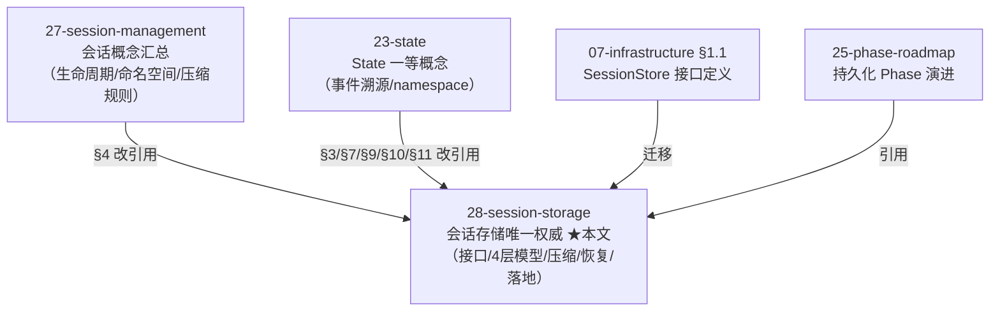
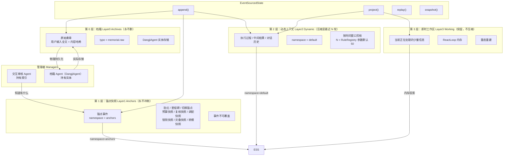
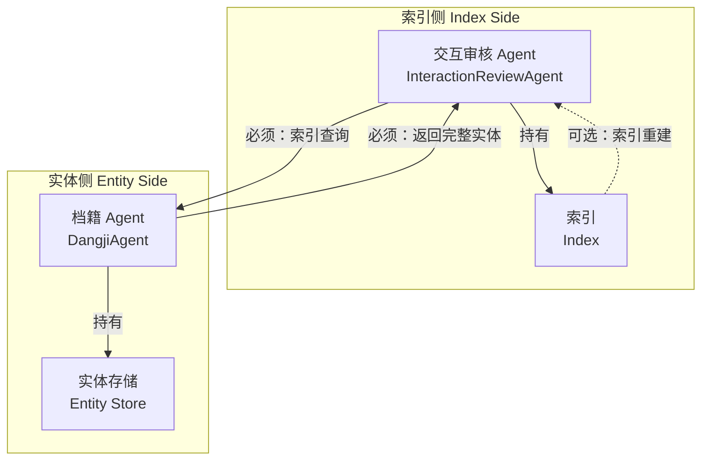
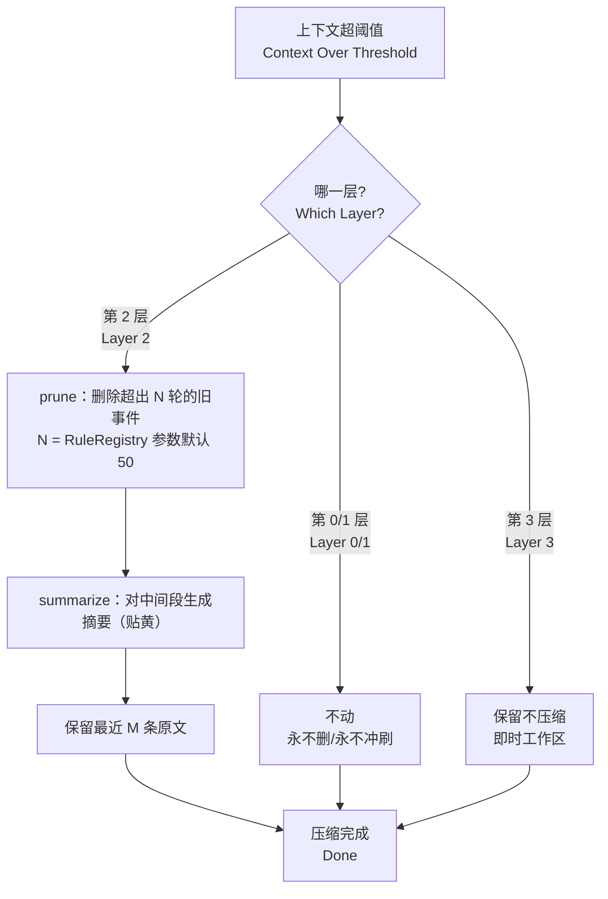
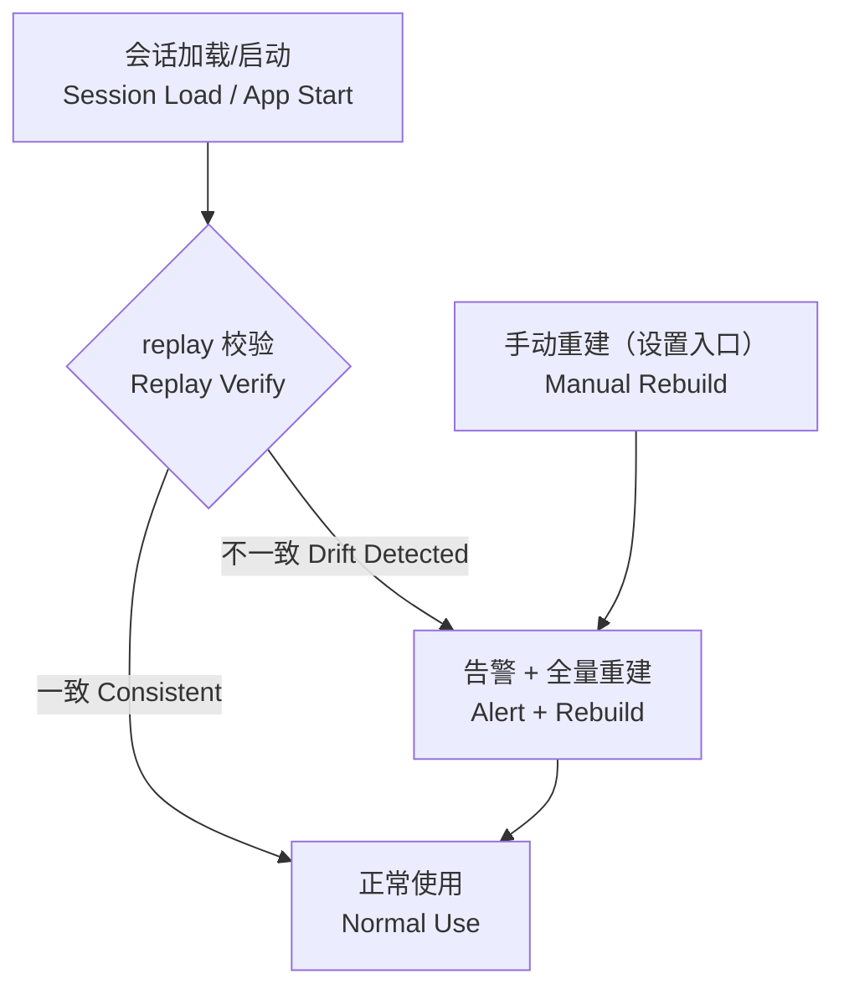
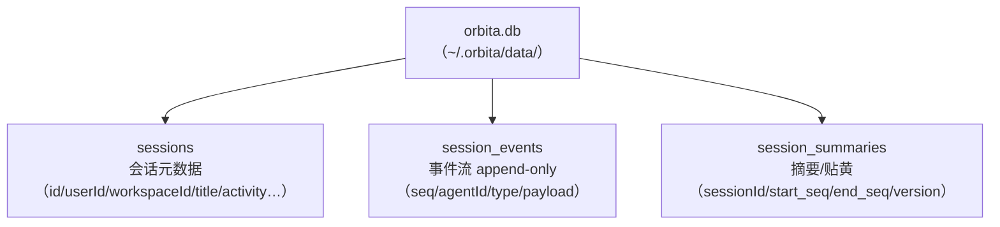
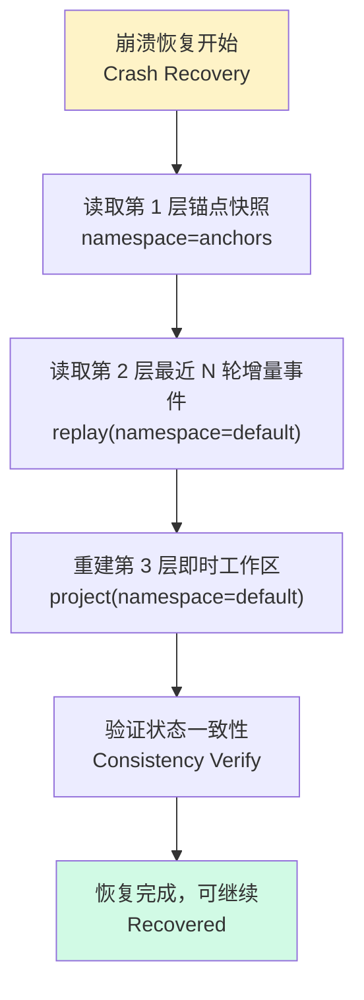

[AI 生成]

# 会话储存设计（Session Storage）
> **会话存储唯一权威文档**（2026-08 重构）：集中收纳散落在 07-infrastructure.md §1.1（SessionStore 接口）、23-state.md §3/§7/§9/§10/§11（4 层存储/边界/压缩/崩溃恢复/索引实体分离）、27-session-management.md §4（会话存储概述）的会话存储内容，并承载本地持久化落地专题（6 参考机制启发 + 4 MVP 选型，决策 141-144）。原文档相关章节已改为指向本文件的引用。
> 状态：draft
> 维护：待定
> 讨论：无
> 待决：无
---
## 1. 定位与分工

本文件是会话存储的**唯一权威**。会话管理概念（生命周期/命名空间/三层上下文）仍在 27-session-management.md；State 一等概念本体（事件溯源/namespace 层级）仍在 23-state.md——凡涉「会话数据存哪、怎么存、怎么恢复」，一律以本文件为准。



| 文档 | 与会话存储的关系 | 迁移后状态 |
|------|------------------|-----------|
| 07-infrastructure.md §1.1 | SessionStore 接口 + Session 结构 | 已迁移至本文 §3，原处留引用 |
| 23-state.md §3 | ★4 层存储模型（决策 S0）核心骨架 | 已迁移至本文 §4，原处留引用 |
| 23-state.md §7 | State vs MemoryStore 边界（S5） | 已迁移至本文 §13，原处留引用 |
| 23-state.md §9 | 压缩流程（prune/summarize/贴黄） | 已迁移至本文 §6，原处留引用 |
| 23-state.md §10 | 崩溃恢复流程 | 已迁移至本文 §13，原处留引用 |
| 23-state.md §11 | 索引-实体分离 | 已迁移至本文 §5，原处留引用 |
| 27-session-management.md §4 | 会话存储概述 | 已并入本文各章，原处留引用 |
| **28-session-storage.md** | **会话存储唯一权威（本文）** | 完整重构 |

---

## 2. 决定总览

10 项落地决定全部经用户逐项确认（2026-08 讨论确认）：

| # | 主题 | 决定 | 落章节 | 决策号 |
|---|------|------|--------|--------|
| 1 | 免疫记忆分级 | 活跃度作为**正交维度**吸收（热/温/冷映射 4 层内容模型，不替换） | §8 | 决策 141 |
| 2 | 两段式加载 | **摘要进 MVP**（先摘要后回放） | §7/§8 | 决策 142 |
| 3 | LLPC 缓存 | 元数据常驻缓存不纳入 MVP，记 Phase 2+ | §8 | 决策 141 |
| 4 | 表观遗传 | **心智模型 + 裁剪兜底**（事件流=DNA 永不删，压缩=改变表达；第 2 层裁剪为兜底） | §6 | 决策 142 |
| 5 | 摘要三问 | 何时生成=压缩触发点；存哪=**同库新表** `session_summaries`；一致性=锚定事件区间+新版本插入 | §6/§11 | 决策 142 |
| 6 | Polycomb 待决态 | 27 §6.6 中间产物契约的**状态扩展**（Phase 2+）；释放=超时 N 轮→discarded | §9 | 无（记 Phase 2+） |
| 7 | 四柱清册 | **否决存字段**（事件流已含 diff）；作审计**呈现框架**，数据靠 replay 计算 | §10 | 无 |
| 8 | 黄册+鱼鳞 | **replay 即验**（MVP 加载时对账）；双索引表记 Phase 3 | §10 | 无 |
| 9 | 皇史宬+衰败 | **启动时后台对账 + 手动重建**（MVP）；定时任务 Phase 2+；第 0 层永不删重申引用 | §10 | 无 |
| 10 | MVP 范围 | 事件流 + 元数据 + **摘要**（由决定 2 扩展） | §7 | 决策 142 |

选型：后端 **node:sqlite**（§12）｜WeightRegistry 严格会话内 + 文档引用（§14）｜单文件 + 内部分表（§11）。

---

## 3. SessionStore 接口

> 迁移自 07-infrastructure.md §1.1（2026-08 会话存储重构）。

**职责**：Session 数据的持久化存储和检索。

> **实现状态**（2026-08-13 补注）：本接口为文档声明的终局形态（create/read/update/delete/listByUser/listByWorkspace）。
> 代码侧 `core-engine/session-store.ts` 是 **Phase 1 简化实现**（load/save/appendEvent/replay/scoped + 2026-08-13 补 list()/delete() 会话管理 API）：
> `list()` 返回全部会话元数据（SessionMeta：id/cellId/createdAt/updatedAt，无 userId/workspaceId 过滤——listByUser/listByWorkspace 简化合并）；`delete(sessionId)` 删除会话+事件流。
> SessionManager（entry/sdk/session-manager.ts）提供 create/list/load/delete 高层接口（F6 会话列表/永久保存基础）。普通会话的 SQLite 持久化未实现（SqliteSessionStore 为共享会话），留待桌面 persistence 基建（见 §12 后端选型）。

**接口**：

```typescript
interface SessionStore {
  /** 创建新 Session */
  create(session: Session): Promise<string>;
  /** 读取 Session */
  read(sessionId: string): Promise<Session | null>;
  /** 更新 Session，返回更新后的 Session，避免调用方需要二次 read */
  update(sessionId: string, patch: Partial<Session>): Promise<Session>;
  /** 删除 Session */
  delete(sessionId: string): Promise<void>;
  /** 列出用户的所有 Session */
  listByUser(userId: string, limit?: number): Promise<Session[]>;
  /** 列出工作区的所有 Session */
  listByWorkspace(workspaceId: string, limit?: number): Promise<Session[]>;
}

interface Session {
  id: string;
  workspaceId: string;
  userId: string;
  title: string;
  /** 模式运行状态（领域中立） */
  state: SessionState;
  /**
   * 领域状态容器。v4 变化：v3 的 projectState: ProjectState 改为无类型容器。
   * schema 由 Domain Pack 的 sessionStateSchema 定义（coding: { files, cwd, repoUrl }）。
   */
  domainState: Record<string, unknown>;
  /** v4 扩展：Session 协作元信息（多用户协作 Phase 3） */
  type?: "personal" | "shared";
  participants?: UserRef[];
  permissions?: SessionACL;
  /** 事件溯源的活动日志（Phase 1 简化为可变对象，接口按事件溯源设计） */
  activityLog: ActivityEntry[];
  metadata: Record<string, unknown>;
  createdAt: Date;
  updatedAt: Date;
  endedAt?: Date;
}

interface SessionState {
  status: "active" | "paused" | "ended";
  agentCount: number;
  lastActivity: Date;
}

interface ActivityEntry {
  timestamp: Date;
  agentId: string;
  type: string;
  detail: string;
}

/** v4 新增：多用户协作 Session 的访问控制 */
interface SessionACL {
  owner: string;
  /** 参与者及其权限 */
  participants: Array<{ userId: string; role: "viewer" | "editor" | "admin" }>;
}

/** v4 新增：用户引用（轻量，详见 07-infrastructure.md §1.5 UserProfileStore） */
interface UserRef {
  userId: string;
  displayName?: string;
}
```

**本地后端落地**：接口实现由 `StateBackend`（可插拔）分派——见 §11/§12。

---

## 4. ★ 4 层存储模型（核心骨架，决策 S0）★

> 迁移自 23-state.md §3（2026-08 会话存储重构）。4 层存储模型是会话存储的核心骨架（决策 S0）。



**4 层总表**：

| 层级 | 内容 | 压缩策略 | EventSourcedState 映射 | 谁管理 |
|------|------|----------|----------------------|--------|
| 第 0 层 | 原始奏章（用户输入全文 + 内容哈希） | **永不删** | 档籍持久化层（DangjiAgent 实体，type=`memorial.raw`） | 档籍 Agent |
| 第 1 层 | 锚点 + 批红 + 切换锚点 + 预算快照 + 复核快照 + 调配快照 + 锁院快照 + 灾备快照 + 转模快照 | **永不冲刷** | namespace=`anchors`，事件不可覆盖 | 交互审核 Agent |
| 第 2 层 | 动态上下文（执行过程、中间结果、对话历史） | 压缩至最近 N 轮 | 默认 namespace，按时间窗口剪枝 | 交互审核 Agent |
| 第 3 层 | 即时工作区（当前正在处理的少量信息） | 保留 | 内存投影，重启重建 | ReactLoop |

### 4.1 第 0 层：档籍（永不删）

第 0 层存储**原始奏章**（用户输入全文 + 内容哈希），事件 type=`memorial.raw`。物理持久化由**档籍 Agent（DangjiAgent）**负责。

DangjiAgent 职责（来自 31-phase-4-roadmap.md §6.1）：
- 第 0 层持久化
- 全 Agent 日志归档
- 灾备恢复
- 历史版本保存（20+ 类记录）

档籍 Agent 不参与压缩决策，仅负责物理存储与检索。

### 4.2 第 1 层：锚点快照（永不冲刷）

第 1 层存储**锚点事件**，namespace=`anchors`，事件不可覆盖。锚点是审计后验的关键证据。

**S1-A 决策（分 namespace）**：anchors namespace 保存完整状态快照；default namespace 只保存引用（锚点 ID 列表），不重复存储完整状态。

**S1-B 决策（自动兜底）**：第 2 层事件流超过 200 事件时，自动创建非锚点快照（可覆盖），加速后续 `project`。

9 类锚点：
- 批红（代批记录）
- 里程碑（任务关键节点）
- 切换锚点（模式切换）
- 预算快照（配额使用情况）
- 复核快照（高风险复核结果）
- 调配快照（资源调配记录）
- 锁院快照（暂停状态）
- 灾备快照（灾备恢复点）
- 转模快照（模式转换记录）

### 4.3 第 2 层：动态上下文（压缩至最近 N 轮）

第 2 层存储**动态上下文**（执行过程、中间结果、对话历史），namespace=`default`。

**S2-A 决策（N 值）**：N = RuleRegistry 参数，默认 50 轮。RuleRegistry 由交互审核 Agent 管理，可按任务复杂度调整。

**S2-B 决策（混合压缩）**：压缩分为三步：
1. **prune 太旧**：删除超过 N 轮的旧事件
2. **summarize 中间段**：对中间段生成摘要（贴黄）
3. **最近 M 条保持原文**：保留最近 M 条事件的原文

**两种压缩的区别**：
- EventSourcedState 事件流裁剪：直接删除超出 N 轮的事件（不可逆）
- LLM 上下文压缩（CompactionPolicy）：生成摘要替代原文（可逆，摘要保留语义）

前者是存储层压缩，后者是推理层压缩，两者独立但可协同。

### 4.4 第 3 层：即时工作区（保留，不压缩）

第 3 层存储**即时工作区**（当前正在处理的少量信息），保留不压缩。这是 ReactLoop 的内存工作区，重启后从第 1 层锚点 + 第 2 层增量事件重建。

---

## 5. 索引-实体分离

> 迁移自 23-state.md §11（2026-08 会话存储重构）。

交互审核 Agent 持有**索引**（知道有什么），档籍 Agent 持有**实体**（实际存储）。

| 角色 | 持有 | 职责 |
|------|------|------|
| 交互审核 Agent | 索引 | 知道有哪些原始奏章、锚点、事件流；负责压缩决策、锚点创建、索引维护 |
| 档籍 Agent（DangjiAgent） | 实体 | 物理存储与检索；不参与压缩决策 |

分离原则：
- 交互审核 Agent 不直接访问第 0 层实体，只通过 DangjiAgent 接口查询
- DangjiAgent 不判断哪些该删、哪些该压缩，只执行存储/检索指令
- **索引可重建（从事件流推导），实体不可重建（原始奏章一旦删除无法恢复）**



---

## 6. 压缩语义与摘要机制

> 压缩流程迁移自 23-state.md §9（2026-08 会话存储重构）；「DNA 永不删」语义来自表观遗传启发（决定 4/5）。

### 6.1 心智模型：DNA 不变，表达可变

| 生物 | 映射 |
|------|------|
| DNA 序列 | **原始事件流**（永不物理删除） |
| 表观标记 | 摘要/贴黄 + 活跃度（决定旧轮次「表达」或「沉默」） |
| iPS 重编程 | 从锚点重置/重放（擦除表达状态恢复完整上下文） |

**压缩 = 改变表达状态，不是删除**：旧轮次压缩为摘要后不再进上下文，但事件流本体仍在。

### 6.2 裁剪兜底（不变量）

「永不删」是**主导心智模型**，第 2 层动态上下文裁剪（§4.3 S2-B）**保留为存储膨胀兜底**——极端膨胀（日志型/超大体量事件）仍可物理裁剪，需在裁剪时记录「开除」审计信息（衔接 §10 四柱框架）。

### 6.3 压缩流程（23 §9 迁移）



### 6.4 摘要三问（决定 5）

| 问题 | 方案 |
|------|------|
| 何时生成 | 压缩流程触发点（§6.3：上下文达 N 轮/阈值） |
| 存哪 | 同库新表 `session_summaries`（与事件流同 SQLite 文件、事务内同步，§11） |
| 一致性 | 摘要锚定事件区间（`start_seq`/`end_seq`），重放/审计按区间校验；摘要更新走**新版本插入**（不覆盖，摘要本身可追溯） |

---

## 7. MVP 落库边界

MVP 持久化内容 = **事件流 + 会话元数据 + 摘要（贴黄）**。投影不落库——靠 replay 重建（呼应 §5「索引可重建，实体不可重建」）。

| 数据 | MVP 落库 | 说明 |
|------|----------|------|
| 会话元数据 | ✅ | `sessions` 表（§11） |
| 事件流 | ✅ | `session_events` 表，append-only（§11） |
| 摘要（贴黄） | ✅ | `session_summaries` 表（§6/§11） |
| 投影/快照 | ❌ | replay 重建（决策 142 理由） |
| LLPC 元数据缓存 | ❌ | Phase 2+（§8.3） |
| 待决态 | ❌ | Phase 2+（§9） |

---

## 8. 活跃度分级与存储策略（决定 1/3）

### 8.1 正交维度

活跃度（热/温/冷）是 **State 实现策略**维度，与 4 层内容模型（§4）正交：

| 活跃度 | 含义 | 存储策略 | 免疫对照 |
|--------|------|----------|----------|
| 🔥 热（hot） | 当前活跃会话 | 内存常驻（第 3 层即时工作区） | T_EM 效应记忆 |
| 🌤️ 温（warm） | 近期/常用会话 | SQLite 落库 + 元数据可常驻 | T_CM 中央记忆 |
| 🧊 冷（cold） | 已归档会话 | 只留摘要（贴黄）+ 原件入档籍（第 0 层） | T_RM 组织驻留 |

**边界**：活跃度是 State 实现策略，不新增一等概念（不触发 §0.5 准入条件 4 条）——见决策 141。

### 8.2 两段式加载（决定 2）

会话重开时：**先加载摘要（贴黄）**秒开恢复上下文 → **按需回放**（replay）细节区间。对应免疫「二次应答更快更强」。

### 8.3 LLPC 元数据常驻缓存（决定 3）

常用会话列表/元数据进内存缓存（LLPC 长期低水平分泌抗体类比）——**不纳入 MVP**：会话量小时 SQLite 查询已足够快，缓存引入「失效一致性」问题。记 Phase 2+，触发条件：会话列表查询成为可测性能瓶颈。

---

## 9. 中间产物待决态（决定 6，Phase 2+）

### 9.1 机制归属

Polycomb 二价标记（H3K4me3 激活 + H3K27me3 抑制并存）映射中间结果的「待决态」——作为 **27-session-management.md §6.6 中间产物契约的状态扩展**，非全新机制：

- 不新增一等概念（§0.5 不触发）
- 不新增独立 StateEvent type——用现有 status/state 字段表达 `pending / promoted / discarded`
- 决策者：交互审核 Agent（27 已有概念）——用户确认优先，无人工信号时按规则裁决

### 9.2 释放规则（防变相全保留）

> **默认超时**：pending 条目超过 N 轮（N 与第 2 层压缩窗口一致）无任何信号 → 自动标记 `discarded`（可裁剪，事件流本体仍保留）。

### 9.3 MVP 取舍

MVP 阶段中间结果按现有契约处理（产出即归属，不挂待决态）；待决态记 **Phase 2+**（出现「半成品区间」场景时启用）。

---

## 10. 审计与对账（决定 7/8/9）

### 10.1 四柱呈现框架（决定 7）

**否决「快照存四柱字段」**（事件流已含全部 diff，存储冗余）。四柱作为**审计呈现框架**：审计报告用「旧管/新收/开除/实在」描述变化来源，**数据由 replay 区间计算**，非存储字段。

### 10.2 双视图对账（决定 8）

| 视图 | 中心 | 回答 |
|------|------|------|
| 黄册视角 | Session/Agent | 「谁做了什么」 |
| 鱼鳞视角 | 事件流 | 「状态怎么来的」 |

**MVP：replay 即验**——加载时 replay 事件流 → 计算投影 → 与持久化投影/摘要对比，不一致告警（零额外表）。**双索引表记 Phase 3**（会话量大、replay 太慢时优化，与 SessionStore 升 PgStore 同阶段）。

### 10.3 周期全量对账（决定 9）

| 触发 | 阶段 |
|------|------|
| 启动时后台对账（最近活跃会话 replay 校验） | MVP |
| 手动重建索引按钮（万历清丈类比） | MVP |
| 定时任务（每日/每周） | Phase 2+ |

**第 0 层永不删**（皇史宬「任何人无权销毁」）为架构既有决策（§4.1），本文重申引用，不新增决策。



---

## 11. 存储布局与 schema（选型④）

**单文件 + 内部分表**（用户已拍板）：`~/.orbita/data/orbita.db`，三表 `sessions` / `session_events` / `session_summaries`，`userId`/`workspaceId` 为列（权限过滤靠 SQL WHERE，本地单用户无文件级隔离需求）。



| 表 | 关键列 | 说明 |
|----|--------|------|
| `sessions` | id, userId, workspaceId, title, activity, status, updatedAt | 活跃度（§8）状态列 |
| `session_events` | sessionId, seq, agentId, type, payload, ts | append-only，事件溯源（决策 80） |
| `session_summaries` | sessionId, start_seq, end_seq, version, content, ts | 摘要新版本插入（§6.4），锚定区间 |

**每 workspace 一文件记 Phase 3+**：触发条件 = 出现按 workspace 独立备份/分享硬需求，或单文件超大（>数百 MB）需物理分拆——见决策 144。

---

## 12. 后端选型（选型②）

| 候选 | 结论 | 理由 |
|------|------|------|
| **node:sqlite** | ✅ **MVP 默认** | Electron 38 内置（Node 22.5+）、零打包负担、WAL、同步 API（状态「待验证」：Electron 38 内实际可用性实现时验证） |
| better-sqlite3 | 🔁 替代候选 | node:sqlite 实验 API 变动时的切换目标（需 electron-rebuild） |
| sql.js | ❌ 否决 | 无 WAL（整个库一次性落盘），违背「数据基础设施可信性」教训 |

**可插拔**：后端经 `StateBackend` 接口切换（决策 143）——接口在 23-state.md §4 定义，实现层在本专题落地。

---

## 13. 存储边界与恢复

### 13.1 State vs MemoryStore 边界（S5 决策）

> 迁移自 23-state.md §7（2026-08 会话存储重构）。

S5 决策：混合规则。

- **需审计 OR 跨 Session 持久 → EventSourcedState**
- **否则 → MemoryStore**

| 数据归属示例 | 存储后端 | 理由 |
|-------------|---------|------|
| 用户输入原文（档籍） | EventSourcedState（第 0 层） | 需审计 + 永不删 |
| 批红记录 | EventSourcedState（第 1 层） | 需审计 + 永不冲刷 |
| 对话历史 | EventSourcedState（第 2 层） | 需审计 + 跨 Session 可回放 |
| 预算快照 | EventSourcedState（第 1 层） | 需审计 + 里程碑级持久 |
| 即时工作区（当前 turn） | MemoryStore（第 3 层） | 不需持久 + 重启重建 |
| 工具调用中间结果 | EventSourcedState（第 2 层） | 可回放 + 需审计 |
| Agent 内部临时变量 | MemoryStore | 不需审计 + 生命周期短 |

### 13.2 崩溃恢复流程（23 §10 迁移）



**崩溃恢复顺序**（来自 07-infrastructure.md §1.4）：
1. 读取第 1 层锚点快照 → 恢复关键状态
2. 读取第 2 层最近 N 轮增量事件 → 恢复执行上下文
3. 重建第 3 层即时工作区 → 恢复当前处理状态

索引由交互审核 Agent 携带，实体由档籍 Agent 持久化。

---

## 14. 与相邻模块的边界（选型③）

**跨会话记忆（WeightRegistry 军功簿/考绩簿）严格不纳入会话储存**：其持久化继续走 07-infrastructure.md §9 的 Phase 2 计划（25-phase-roadmap.md「WeightRegistry：SQLite 持久化 + ε-greedy」），本专题仅引用不承接。

> 边界一句话：会话储存管「一次会话发生了什么」；WeightRegistry 管「长期来看什么做法好」。前者是历史档案，后者是学习结论——**档案不替学习做决定**。

---

## 15. 参考机制来源

| 机制 | 来源文档 | 决定 |
|------|----------|------|
| 免疫记忆分级（T_CM/T_EM/T_RM/LLPC） | biology-reference/11-免疫系统/04-免疫记忆.md | 决定 1/3 |
| 表观遗传（DNA 不变表达可变/iPS 重编程） | biology-reference/08-基因到表征/01-表观遗传学.md | 决定 4 |
| Polycomb 二价标记 | biology-reference/08-基因到表征/06-染色质状态与细胞记忆.md | 决定 6 |
| 四柱清册（旧管/新收/开除/实在） | ming-dynasty-reference/05-资源链/06-黄册与鱼鳞图册.md | 决定 7 |
| 黄册+鱼鳞双重验证 | ming-dynasty-reference/05-资源链/06-黄册与鱼鳞图册.md | 决定 8 |
| 皇史宬/黄册衰败（一正一反） | ming-dynasty-reference/05-资源链/10-皇史宬与档案制度.md | 决定 9 |
| 贴黄（摘要·效率与保真，原件归档） | ming-dynasty-reference/04-信息链/01-通政司与贴黄.md | 决定 5 |
| 锁院/灾备快照（锚点机制） | ming-dynasty-reference/07-特殊治理/01-灾备与应急机制.md | 决策 S1-A（第 1 层锚点快照，§4.2） |

---

## 16. 相关决策

新增决策：决策 141（活跃度正交维度）、决策 142（MVP 持久化范围）、决策 143（node:sqlite 后端）、决策 144（单文件分库）。引用既有决策：决策 S0（4 层存储模型）、S1-A/S1-B（锚点）、S2-A/S2-B（压缩）、S5（State vs MemoryStore 边界）、决策 70/71/78/79/80/83（State 体系）、决策 25（压缩三规则）。

---

## 17. 术语对照

| 中文术语 | 英文 |
|----------|------|
| 会话储存 | Session Storage |
| 档籍 | Archives（Layer 0） |
| 锚点快照 | Anchor Snapshot（Layer 1） |
| 动态上下文 | Dynamic Context（Layer 2） |
| 即时工作区 | Working Memory（Layer 3） |
| 活跃度 | Activity（hot/warm/cold） |
| 摘要/贴黄 | Summary / Tie-Huang |
| 待决态 | Pending State |
| 对账 | Reconciliation |
| 双视图 | Dual View |

---

> 文档版本：v2.3
> 本版变更（累积最近 3 条，最新在上）：
>   - v2.3：项目更名 wuwo→璇玑（ORBITA），全文品牌/路径/标识符替换（见决策 146）
>   - v2.2：§15 锁院/灾备行决定引用修正 S0→S1-A（锚点快照存储决策）
>   - v2.1：§15 参考机制来源补 2 行溯源（贴黄→决定 5，锁院/灾备快照→决策 S0 锚点）
> 基于：07-infrastructure.md §1.1/§1.4 + 23-state.md §3/§7/§9/§10/§11 + 27-session-management.md §4 + biology-reference/11-免疫系统/04-免疫记忆.md + biology-reference/08-基因到表征/01-表观遗传学.md + biology-reference/08-基因到表征/06-染色质状态与细胞记忆.md + ming-dynasty-reference/05-资源链/06-黄册与鱼鳞图册.md + ming-dynasty-reference/05-资源链/10-皇史宬与档案制度.md + 10-decisions.md 决策 141-144
> 决策总数：4 条（决策 141-144，本专题新增）
> 文档总数：无（非总览文档）
> 原则总数：无（非总览文档）
