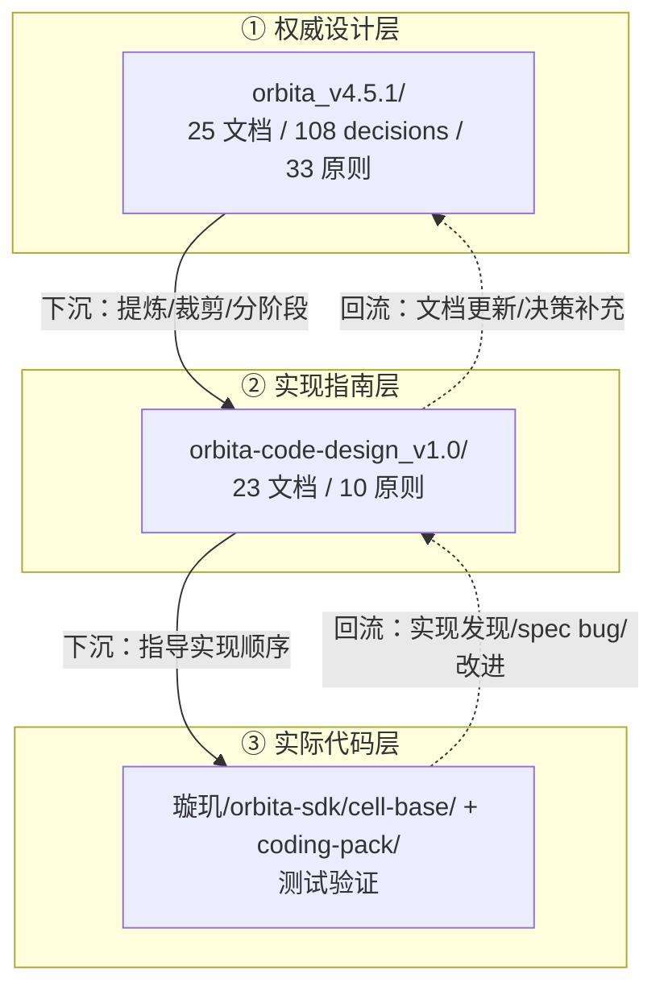
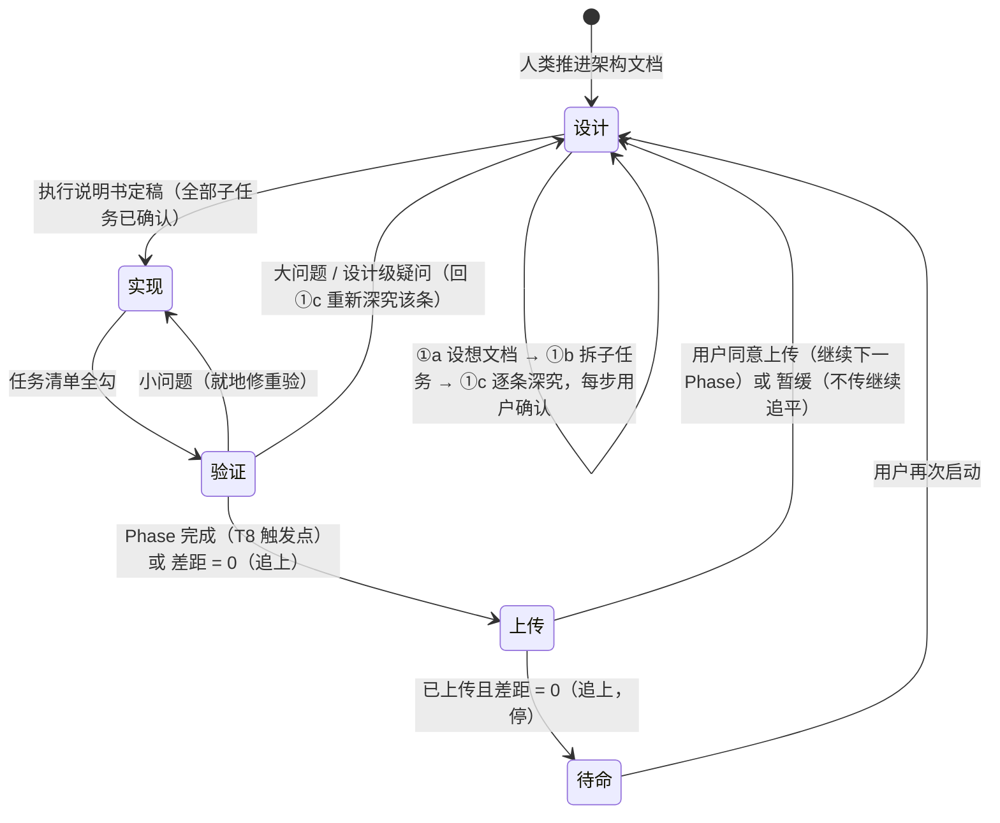

# 璇玑 贡献者规范（agent 首读，单文件版）

> 一句话注释：AI 协作者和人类贡献者的完整规范（法典）。定义设计哲学、铁律、任务路由、各任务操作流程、文档写作规范、自查清单。核心规则（四支柱/铁律/检查表/任务路由）已同步至 CLAUDE.md 作为 agent 始终上下文。开工必读。

> 状态：stable
> 维护：@XZF（主笔）
> 讨论：无
> 待决：无

---

## 0. 设计哲学（开工必读，永恒不变）

> 本节是 璇玑 所有设计决策的最高指导。每次开工前加载确认。

### 0.1 四根支柱

璇玑 的存在由四根支柱定义。永恒不变——变了就不是 璇玑。

| 支柱 | 含义 | 如果违反 |
|------|------|---------|
| 可插拔能力 | 能力可加可删可换 | 就不是底座，是专用工具 |
| 编排可组装 | 编排模式可自由组合 | 就不是框架，是固定流程 |
| 多人协作 | 多人类用户共存协作 | 就不是协作软件，是单用户工具 |
| 多Agent协作 | 多Agent协调执行 | 就不是多Agent系统，是单体工具 |

### 0.2 原则零（三条元规则）

1. **原则服务于四根支柱，不是支柱服务于原则。**
2. **原则是当前最优设想，可以变——更好的出现就换。**
3. **一切设计修改从整个软件 + 未来可能出发考虑。不打补丁。修改前自检：属于哪？为什么？未来怎么演进？答不上来就停下来想。**

第③条管的不只是原则——一切设计修改（原则、决策、架构、文档）都适用。原则阻碍架构演进 → 改原则，不是改架构。

### 0.3 五层可变性模型

| 层级 | 性质 | 可变性 |
|------|------|--------|
| 四根支柱 | 存在定义 | 永恒不变 |
| 原则零 | 元规则 | 永恒不变 |
| 具体原则 | 当前最优设想 | 随认知更新 |
| 实现选择 | 当前方案 | 随架构演进 |
| 文档格式 | 写作规范 | 严格固定 |

越往上越稳定，越往下越自由。唯一永恒的是四根支柱。

### 0.4 哲学对齐检查（每次关键设计决策前 + 提交前过一遍）

> 本检查表已同步至 CLAUDE.md，在 agent 上下文中始终可见。
> ⚠️ 强制：每次关键设计决策前自问；每次提交前必过此检查表。

| 检查问题 | 对应支柱 |
|----------|----------|
| 改动是否让能力更难加/删/换？ | 可插拔能力 |
| 改动是否让编排更不自由？ | 编排可组装 |
| 改动是否损害了多用户协作？ | 多人协作 |
| 改动是否削弱了多Agent协调？ | 多Agent协作 |

任何一题答「是」，停止并重新设计。

### 0.5 一等概念（微内核 6 个，不可随意增减）

> 一等概念是微内核的存在基础。新增/移除/降级必须通过架构自检流程（铁律 5）。

| 概念 | 含义 | 可插拔 |
|------|------|--------|
| Agent | 跑 Loop 的实体 | 是 |
| Loop | Agent 内部执行引擎 | 是 |
| User | 一等公民（profile/memory/quota） | 是 |
| Communication | 图状通信（点对点+发布订阅+频道） | 是 |
| State | 事件溯源共享状态+命名空间 | 是 |
| Pattern | 两层：Coordination × Execution | 是 |

**新增一等概念须同时满足 4 条准入条件**：
1. 跨所有编排模式通用（非某模式专用）
2. 可插拔（换实现不影响其他一等概念）
3. 被 ≥2 架构层依赖
4. 新增会改变核心契约（微内核接口）

不满足任意一条 → 不入一等，放 Infrastructure 或 Domain Pack。
新增/移除/降级一等概念时必须主动询问用户，说明理由，用户确认后方可修改。

### 0.6 一等架构层（7 层 + 1 贯穿件）

> 架构分层是 璇玑 的组织骨架。层序与依赖方向不可违反。

| 序号 | 层名 | 职责 |
|------|------|------|
| 1 | Entry Layer（入口层） | 统一接入（CLI/Web/IDE/SDK/RPC） |
| 2 | Sijian Gate Layer（司礼监关口层） | 前置过滤+翻译+有限代批 |
| 3 | Composition Layer（编排层） | Coordination × Execution 两层 Pattern |
| 4 | Domain Pack Layer（领域包层） | 领域能力可插拔注入 |
| 5 | Infrastructure Layer（基础设施层） | system-wide，生命周期与进程相同 |
| 6 | Core Engine Layer（核心引擎层） | 微内核 6 一等概念 |
| — | RequestContext（贯穿件） | 贯穿件，非层（纯数据结构） |

依赖方向：上层依赖下层，下层不知道上层存在。

**新增一等架构层须同时满足 3 条准入条件**：
1. 跨所有编排模式存在（每个模式都会经过它）
2. 有独立的职责边界（不与其他层职责重叠）
3. 有自身维护的一等概念

新增/移除/合并一等架构层时必须主动询问用户，说明理由，用户确认后方可修改。

---

## 1. 七条铁律（always-on）

> 每次开工前过一遍。每次提交前再过一遍。

### 铁律 1：本版变更必填

每次内容修改（含 typo）都必填文档尾的「本版变更」字段。约束：≤100 字符、单行、累积 3 条最新在上、禁止"无"/空白。

### 铁律 2：编号不重排

决策/原则/NN 编号连续追加不重排。新增从当前最大值 +1 起。被推翻/降级的条目保留原编号，标注状态后不再使用。

### 铁律 3：文档头尾 4+6 元数据

所有 NN 编号文档必须有：
- 文档头 4 字段：状态/维护/讨论/待决
- 文档尾 6 字段：版本/本版变更/基于/决策总数/文档总数/原则总数（按文档性质选填计数）

详见 §10.2。

### 铁律 4：G1-G10+G13 AI 防护

| 代号 | 禁止 | 正确 |
|------|------|------|
| G1 | 编造链接（GitHub/Discussion/Issue URL） | 填「无」+ TODO 注释，等人工补全 |
| G2 | 编造 username（@xxx） | 填「待定」，等人工补全 |
| G3 | 修改已有决策内容不标注变更 | 决策末尾追加变更记录（版本+摘要），重大推翻加 [已推翻] 标注 |
| G4 | 擅自 resolve #OPEN-N（待决项） | 等人工指令，AI 仅根据明确指令更新字段值 |
| G5 | 自主 draft→stable 状态转换 | PR 人工确认后才转换 |
| G6 | 执行 `git push -f`（force-push） | 检测到需求时通知用户手动执行 |
| G7 | AI 生成内容不标注来源 | 文档最顶部标注 `[AI 生成]` |
| G8 | 人工审核后不追加标记 | 追加审核人 + 审核日期 |
| G9 | 编造非事实内容（架构事实/接口/类/模块/数据） | 所有声明必须有源文件依据，不确定标注「待验证」 |
| G10 | 无用户同意下修改 CLAUDE.md / AGENTS.md | 主动询问用户，说明要改什么、为什么改、改后是否更好，用户确认后才能改 |
| G13 | 不确定推论当确定事实呈现 | 区分事实与推论，不确定时明确标注 |

### 铁律 5：架构文档主版本+1 → 触发架构自检

架构文档主版本 +1 时，commit 前必须：
1. 启动架构自检 — agent 读全量架构文档，按一等概念/一等层准入条件提炼，主动询问用户确认
2. 更新卖点文件 — 自检确认后，同步更新 `卖点与进展方向.md`

铁律 5 触发时不可 silent skip，必须主动告知用户并等待确认。

### 铁律 6：任务隔离

每个 task 只修改 plan 指定文件，不跨任务污染其他文件。多任务混合时读全部相关节。

### 铁律 7：哲学对齐

所有改动不得违反四根支柱中的任何一根。开工前确认哲学在上下文；每次提交前再次核对（见 §0.4 检查表）。违反任意一根支柱即超出 璇玑 的定义范围。

---

## 2. 任务路由总览

> 开工前先读本节（约 2 分钟），识别本次任务类型。

### 2.1 任务速查表

| 任务 | 你要做... | 读哪节 |
|------|----------|--------|
| T1 写新文档 | 创建 NN-xxx.md 编号文档、首次创建根级规范文件 | §3 |
| T2 改文档 | 修改现有文档内容（typo/措辞/章节/决策原则补充/引用修正） | §4 |
| T3 决策原则 | 新增/修改决策（10-decisions.md）、新增/替换/降级原则 | §5 |
| T4 git 操作 | commit / push / 开 PR / branch / merge / debug | §6 |
| T5 会话同步 | 启动时 git fetch + 检查合作者远端变更 + 通知用户 | §7 |
| T6 术语维护 | 新增/修改术语、术语表更新、模式术语调整 | §8 |
| T7 架构自检 | 架构文档主版本+1 时，读全量文档提炼一等概念/一等层，询问用户确认后更新卖点文件 | §9 |
| T8 闭环同步 | Phase 完成/发现偏差时，检查三层一致性，回流实现发现 | §14 |
| T9 闭环运行 | 启动/推进完整闭环循环（设计 ①a/①b/①c → 实现→验证→循环） | §15 |

### 2.2 任务识别提示

- 含「写新文档/创建 NN-xxx/新增编号文档」→ **T1**
- 含「修改/补充/修订/fix typo」+ 已存在文件 → **T2**
- 含「决策 N/原则 N/新增决策/原则」→ **T3**
- 含「commit/push/PR/branch/merge」→ **T4**
- 含「同步/git fetch/检查合作者」→ **T5**
- 含「术语/glossary/中英对照/新术语」→ **T6**
- 含「架构自检/一等概念/一等层/卖点文件更新」→ **T7**
- 含「闭环/三层同步/回流/下沉/一致性检查」→ **T8**
- 含「闭环运行/启动闭环/推进闭环/loop」→ **T9**

### 2.3 多任务规则

任务匹配多个类型时，**读全部相关节**。例：「写一份新文档并新增决策」= §3 + §5，两节都要读。

### 2.4 兜底规则

不在 T1-T9 范围（如：删除文档、改 README 文档地图、改 .github/ 配置、纯查询）→ **问人类**，不猜测。

### 2.5 启动仪式（开工前必走 2 步）

每次 session 开工前，按顺序执行：

1. **上下文确认** — CLAUDE.md 已自动加载（含四支柱/原则零/铁律/哲学对齐检查表/任务路由），确认核心规则在上下文。如需权威细节，回读 §0-§1。
2. **同步启动** — 执行 `git fetch origin` + 检查远端变更，有变更时通知用户

**跨任务切换**：同一 session 内切换任务类型时，重走步骤 1（确认上下文）。

**单人本地豁免**：单人本地开发且无 remote 变更（`git log HEAD..origin/main` 为空）时，可跳过步骤 2。

---

## 3. T1 写新文档

**适用场景**：创建 NN-xxx.md 编号文档、首次创建根级规范文件（AGENTS.md/README.md）。

### 3.1 前置检查

1. **编号查重**：读 README.md 文档地图表格，确认 NN 编号未被占用
2. **主题查重**：grep 现有文档标题，确认主题不重叠（重叠则改旧文档而非新建）
3. **编号顺序**：新增编号从当前最大值 +1 起

### 3.2 写文档

文档头顺序：一句话注释 → 4 字段协作元数据块（状态/维护/讨论/待决）

文档尾 6 字段：文档版本 / 本版变更 / 基于 / 决策总数 / 文档总数 / 原则总数

正文按章节规范自由组织，格式规则见 §10、§11。

### 3.3 同步 README

在 README.md 文档地图表格新增一行（文件名 / 内容 / 编排类型 / 何时阅读）。

### 3.4 常见错误

| # | 错误 | 正确做法 |
|---|------|---------|
| 1 | 编造 Discussion 链接填入「讨论」字段 | 填「无」+ `<!-- TODO: 人工确认链接 -->` |
| 2 | 编造 @username 填入「维护」字段 | 填「待定」 |
| 3 | 「本版变更」填「无」或空白 | 填具体摘要 |
| 4 | 创建文档前不查编号冲突 | 先读 README 文档地图 |
| 5 | 忘记同步 README 文档地图 | 新建后必须新增一行 |

---

## 4. T2 改文档

**适用场景**：修改已存在的 NN 编号文档内容（typo/措辞/章节/引用修正）。

**覆盖范围**：NN-xxx.md 编号文档、AGENTS.md 本身、_archive/ 下的重定向头追加。

**不适用**：创建新文档（→ §3）、新增决策/原则（→ §5）、git 操作（→ §6）。

### 4.1 判断修改类型

**轻量修订**（以下全部满足）：typo/措辞/格式/引用修正 → 次版本+1，不更新文档头 4 字段。

**完整修订**（任一满足）：新增章节/决策/原则/接口/术语 → 按需更新文档头 4 字段 + 判定是否主版本+1。

| 修改内容 | 版本升级 | 文档头 4 字段 |
|----------|----------|---------------|
| typo/措辞/格式/引用 | 次版本+1 | 不更新 |
| 新增章节/决策/接口/术语 | 按规则判定 | 按需更新 |

### 4.2 修订流程

**轻量路径**：
1. 修改内容
2. 检查 D1（加 Mermaid 图了吗）、D8（需要更新 README 文档地图吗）
3. 文档尾「文档版本」次版本+1
4. 文档尾「本版变更」追加摘要

**完整路径**（7 项检查）：
1. 文档头「状态」（如变化）
2. 文档头「维护」（如换人）
3. 文档头「讨论」（如有新 Discussion）
4. 文档头「待决」（如有新待决项）
5. 文档尾「文档版本」（按规则升级）
6. 文档尾「本版变更」（必填）
7. 本次修订是否触发主版本+1？如触发，启动架构自检（铁律 5）
8. 检查 D1-D8 文档铁律合规（改文档后：Mermaid 图更新、文档地图同步、节点双语、跨文档引用一致性）

### 4.3 状态转换

| 从 | 到 | 条件 |
|----|----|------|
| draft | stable | 连续 3 次修订无反对 + 待决清零 + PR 人工确认 |
| stable | draft | 内容重构 >30% 章节 + 主版本+1 |
| any | deprecated | 创建决策 + 废弃日期 + 替代文档链接 |

### 4.4 Cascade 更新

**决策推翻**：决策 N 推翻决策 M → 决策 M 标题加「**[已推翻]** 见 决策 N」+ 末尾标注 + grep 全仓引用。

**原则变更**：保留旧编号，标注 `[已推翻]/[已降级]/[已合并]`，注明替代关系，grep 全仓。

**#OPEN-N 状态变更**：需人工指令触发（G4），AI 仅根据明确指令更新。

**文档废弃**：文件头加 `> [已废弃 vX起] 替代：xxx.md`，保留 1 版本后删除，更新 README 地图。

### 4.5 版本号判例表

| 场景 | 版本类型 |
|------|----------|
| typo 修复/措辞调整 | 次版本+1 |
| 新增子节（非核心接口） | 次版本+1 |
| 新增决策/原则 | 次版本+1 |
| 新增章节（内容新增） | 主版本+1 |
| 推翻核心原则 | 主版本+1 |
| 核心接口字段重命名 | 主版本+1 |
| 文档拆分或合并 | 次版本+1 |
| 新增术语到术语表 | 次版本+1 |
| 新增 Coordination/Execution Pattern | 主版本+1 |
| 新增一等概念 | 主版本+1 |
| 新增一等架构层 | 主版本+1 |

### 4.6 常见错误

| # | 错误 | 正确做法 |
|---|------|----------|
| 1 | 「本版变更」填"无"或空白 | 填具体摘要 |
| 2 | 自主 draft→stable 提升 | 需 PR 人工确认 |
| 3 | 决策「实现 PR」永远停留"无" | PR 合并后回填 |
| 4 | 改文档后忘记更新 README 文档地图 | 同步新增/更新一行（D8） |
| 5 | 新增内容无 Mermaid 图 | 结构/流程类内容必须有图（D1） |
| 6 | 改引用文档后未检查引用方 | grep 全仓引用并同步更新（D7） |

---

## 5. T3 决策原则

**适用场景**：新增/修改决策（10-decisions.md）、新增/替换/降级原则、变更 #OPEN-N 状态。

### 5.1 决策格式

所有决策统一五段式。讨论来源和实现 PR 如暂无填「无」。

```markdown
## 决策 N：标题

**选择**：xxx

**理由**：xxx

**影响**：xxx

**讨论来源**：Discussion/Issue 链接 或 #OPEN-N 或 无

**实现 PR**：#PR-N 或 无
```

### 5.2 新增决策

1. 读取 `10-decisions.md` 文档尾，确认当前最大决策编号
2. 新编号 = 当前最大值 + 1
3. 统一五段式，讨论来源/实现 PR 如暂无填「无」
4. 在 `10-decisions.md` 末尾追加，同步更新文档尾「决策总数」
5. 如有引用此决策的文档，更新交叉引用

### 5.3 决策推翻（4 步）

1. 决策 M 标题追加 `**[已推翻]**` 标注
2. 决策 M 末尾追加：`**已推翻**：本决策被决策 N 推翻，详见决策 N。`
3. grep 全仓所有 `决策 M` 引用，更新为 `决策 N（已推翻决策 M）`
4. 检查所有引用决策 M 的文档确认已更新

### 5.4 PR 合并后回填

决策的「实现 PR」字段在 PR 合并后必须回填。AI 在任何涉及该决策的文档更新时检查该字段，如为「无」则查询 PR 状态并回填。

### 5.5 原则操作

**新增**：编号从当前最大值 +1，建议标注守护支柱（P/C/H/A/F），更新 README.md 原则速查节。

**推翻/降级/合并**：保留旧编号，标注状态，注明替代关系。

**当前原则状态参考**：
- 原则 21 **[已推翻]** → 见原则 33
- 原则 26 **[已降级]** → 内容并入原则 24
- 原则 28 **[已降级]** → 内容并入原则 25

### 5.6 常见错误

| # | 错误 | 正确做法 |
|---|------|----------|
| 1 | 修改已有决策内容不标注变更（违反 G3） | 决策末尾追加变更记录：「**变更记录**：vX.Y — 摘要」 |
| 2 | 决策「实现 PR」合并后不填 | 合并后立即回填 |
| 3 | 新增决策后忘记更新文档尾「决策总数」 | 同步更新 10-decisions.md 文档尾 |
| 4 | 决策推翻后未 grep 全仓更新引用 | grep 全仓，更新所有引用方（D7） |

---

## 6. T4 git 操作

**适用场景**：commit / push / 开 PR / branch 管理 / merge / 合作者 debug。

### 6.1 commit 格式

格式：`<type>: <短描述>`

只有 4 个 type：

| type | 含义 | 示例 |
|------|------|------|
| note | 学习笔记 / 草稿笔记 / 决策 | `note: 设计哲学原则零定义` |
| spike | 实验代码 | `spike: 试 hook 3-tier composition` |
| chore | 杂项（rename / cleanup / init / 配置） | `chore: 更新文档地图` |
| fix | 修 bug | `fix: progress 文件 backlink 路径错误` |

commit 前确认所有改动文件的文档尾「本版变更」字段已更新。

### 6.2 规则合规检查（push/PR 前强制）

上传同步之前，必须按 CLAUDE.md 和 AGENTS.md 逐项检查所有改动文件：

1. **CLAUDE.md 护城河检查**：
   - 哲学对齐：改动不违反四根支柱（哲学对齐检查表 4 问）
   - AI 防护：G1-G10+G13 全过
   - 文档铁律：D1-D8 全过（D5 已否决除外）
2. **AGENTS.md 法典检查**：
   - 结构合规：文件命名 / 章节编号 / 头尾元数据 / 编号不重排
   - 版本号：本版变更非空 + ≤100 字符 + 累积 3 条
   - 引用正确：文档间引用 + README 地图一致
   - 术语一致：共享术语池合规
3. **确认全部符合后，方可 push/开 PR**。任一不合规 → 先修再上传。

### 6.3 PR 提交

使用 `.github/PULL_REQUEST_TEMPLATE.md` 模板。「## 本批次改动摘要」表格必填，禁止留空或填「无」。

表格结构：

| 变更类型 | 文件路径 | 一句话原因 | 关联决策/原则 |
|----------|----------|------------|---------------|
| 新增/修订/删除 | path/to/file | 一句话说明 | 决策 N / 原则 N / 无 |

AI 生成 PR 时必须从 `git diff` 自动填充，禁止手输猜测。

### 6.4 Branch 策略

| Branch | 用途 | 直推 |
|--------|------|------|
| main | 稳定 baseline | ❌ 只通过 PR |
| wafo | wafo 个人草稿 | ✅ 自由 push |
| xiaozhifeng | 肖志锋个人草稿 | ✅ 自由 push |
| shared/* | 联合实验 | ✅ 两人都可 |

### 6.5 互相 debug

上传（push/PR）之前，必须经过合作者 debug：
- wafo 写的 → XZF debug
- XZF 写的 → wafo debug
- 结果写到对方 progress 的「Debugging @partner's work」节
- 未 debug 不上传

### 6.6 force-push 禁令（G6）

AI 永久禁用 `git push -f` / `git push --force` / `git push --force-with-lease`。检测到需要 force-push 时，通知用户手动执行。

### 6.7 同步失败处理

网络失败重试 1 次。仍失败则：
1. 显式通知用户：「⚠️ 同步失败：[原因]。建议手动 git fetch。」
2. 禁止 AI 默默继续

### 6.8 Progress 文件

每次架构文档变更，必须同步写 progress 文件：`progress/YYYY-MM-DD-作者-主题.md`

结构：Relevant source files / Overview / What I did（配 backlinks）/ Decisions / Next / Questions for @partner

### 6.9 常见错误

| # | 错误 | 正确做法 |
|---|------|----------|
| 1 | force-push 越权执行（G6） | 通知用户手动执行 |
| 2 | 同步失败 silent skip | 通知用户 + 原因 |

---

## 7. T5 会话同步

**适用场景**：session 启动时的 git 同步、推送阶段的跨人协作通知。

**与 T1-T4 的分工**：T5 只覆盖 git fetch + 远端变更检查 + 用户通知。

### 7.1 启动同步

每次 session 启动时执行：
1. `git fetch origin` — 拉取远端最新状态
2. `git log HEAD..origin/main --oneline` — 检查是否有远端新 commit
3. 有变更 → 通知用户：「远端有新变更：[N] 个 commit」，列出摘要
4. 无变更 → 一句话确认即可

### 7.2 推送前检查

push 或 PR 前按顺序执行：
1. 执行 §6.2 规则合规检查（CLAUDE.md + AGENTS.md 全项）
2. 确认已通知合作者（如有）
3. 全部通过后方可 push

网络失败处理见 §7.3。

### 7.3 网络失败处理

`git fetch` 失败时：重试 1 次。仍失败 → 显式通知用户：「⚠️ 同步失败：[原因]，建议手动 git fetch。」

### 7.4 常见错误

| # | 错误 | 正确做法 |
|---|------|----------|
| 1 | 同步失败 silent skip | 通知用户 + 原因 |
| 2 | 未检查远端就直接提交 | 先 fetch 再 push |
| 3 | 未执行 §6.2 合规检查就 push | 逐项检查后再传 |

---

## 8. T6 术语

**适用场景**：新增/修改术语、术语表更新、模式术语调整、消歧注补充。

### 8.1 术语呈现格式

首次出现：「中文术语（英文术语）」，如 翰林格物学士（HanlinEnricher）。

后续直接使用中文。同一段落反复出现时可用英文简称。

### 8.2 中英对照表

两列表格，中文在前、英文在后。完整术语表以 `21-glossary.md` 为准。

### 8.3 三模式共享术语池

朝廷/竞功/大明三模式共享同一套术语体系。写模式文档时只出现本模式术语，共享能力用核心通用名。谋士型术语独立维护。

依据：原则 33（原原则 21 已推翻）。

### 8.4 术语消歧注

同一中文术语在不同上下文中有不同含义时，必须添加消歧注。格式：

```
> 消歧注：翰林学士（HanlinScholar）≠ 翰林格物学士（HanlinEnricher）
区分依据：上下文 + 英文标识符
```

### 8.5 术语变更过渡期

旧名保留一个版本过渡期：新术语首次引入时旧名与新名并列，下一个版本中方可移除。

### 8.6 常见错误

| # | 错误 | 正确做法 |
|---|------|----------|
| 1 | 三族术语残留 | 统一用共享术语池 |
| 2 | 共享能力硬绑模式称呼 | 用核心通用名 |
| 3 | 术语变更未设过渡期 | 保留旧名 + 1 版本 |
| 4 | 消歧注缺失 | 同中文不同含义时加注 |

---

## 9. T7 架构自检

**适用场景**：架构文档主版本 +1 时触发（铁律 5）。

### 9.1 触发条件

任何 NN 编号架构文档主版本 +1 时，commit 前必须启动架构自检。

### 9.2 自检流程

1. **读全量架构文档** — agent 读取所有 NN-xxx.md + docs/architecture/ 下文档
2. **提炼一等概念** — 按准入 4 条件（§0.5）逐一评估，列出当前一等概念清单 + 候选 + 建议
3. **提炼一等架构层** — 按准入 3 条件（§0.6）逐一评估，列出当前一等层清单 + 候选 + 建议
4. **报告用户确认** — 将提炼结果按 §9.3 格式呈现，逐项让用户确认，不可跳过
5. **更新卖点文件** — 用户确认后，同步更新 `卖点与进展方向.md`

### 9.3 输出格式

架构自检报告至少包含：
- 当前一等概念清单（6 个）+ 有无新增/降级建议
- 当前一等架构层清单（7 层 + 1 贯穿件）+ 有无新增/合并/降级建议
- 不符合准入条件但被提到的情况 + 建议放哪

### 9.4 常见错误

| # | 错误 | 正确做法 |
|---|------|----------|
| 1 | 主版本+1 时 silent skip 自检 | 必须启动并逐项询问用户 |
| 2 | 只列清单不按准入条件评估 | 逐条按 §0.5/§0.6 准入条件检查 |
| 3 | 提炼结果未经用户逐项确认就修改 | 每项等用户明确确认 |
| 4 | 自检后忘记更新卖点文件 | 同步更新 `卖点与进展方向.md` |

---

## 10. 文档写作规范

### 10.1 语言与语气

中文为主。术语中文在前、英文在括号里（见 §8.1）。直接、无赘语。不用填充短语。

### 10.2 文档头尾元数据

**文档头**（紧接一句话注释之后，4 字段固定顺序）：

```
> [一句话注释：说明文档用途和定位]

> 状态：draft | stable | deprecated
> 维护：@username（主笔） 或 待定
> 讨论：GitHub URL 或 无（见 G1）
> 待决：#OPEN-N 或 无
```

- 状态 regex：`^状态：(draft|stable|deprecated)$`
- 维护：未经人工确认填「待定」（见 G2）
- 讨论：禁止编造，不确定填「无」+ `<!-- TODO -->`（见 G1）
- README.md 特例：「讨论」「待决」必须为「无」

**文档尾**（6 字段固定顺序）：

```
> 文档版本：v主.次
> 本版变更（累积最近 3 条，最新在上，≥4 条时删最旧）：
>   - v4.19：项目更名 wuwo→璇玑（ORBITA），全文品牌/路径/标识符替换（见决策 146）
>   - vX.Y：[≤100 字符摘要]
>   - vX.Y-1：[≤100 字符摘要]
> 基于：[来源文档或"无"]
> 决策总数：138 条（v3 1-69 + v4 70-138）
> 文档总数：N 份（仅在 README/AGENTS 等总览文档）
> 原则总数：N 条（仅在 README/AGENTS 等总览文档）
```

- 本版变更约束：`≤100` 字符、单行、累积最多 `3` 条、最新在上、≥4 条时自动删除最旧条目

### 10.3 标题层级

```
# 文档标题
## 大节（阿拉伯数字连续编号）
### 小节
```

大节之间用 `---` 分隔。

### 10.4 图表规范

#### Mermaid 强制（D1）
架构图/流程图/拓扑图/状态图必须用 Mermaid。不允许纯文字描述替代。ASCII 框图仅限简单文本示意（如字符界面布局），不得用于架构表达。

#### 类型选择
| 图表目的 | Mermaid 类型 | 示例场景 |
|----------|-------------|---------|
| 架构分层 | `graph TD`（含 `subgraph` 分组） | 七层架构总图、模式架构总览 |
| Agent 交互流程 | `sequenceDiagram` | 司礼监代批、多 Agent 协作链路 |
| 状态流转 | `stateDiagram-v2` | Agent 生命周期、任务状态机 |
| 数据/控制流 | `graph TD` | 依赖方向、数据管道 |

#### 节点与分组规范
- `subgraph` 命名用英文驼峰（如 `entryLayer`、`coreEngineLayer`），后跟中文标签
- 节点 ID 简洁有意义（E/S/C/P/I/R/K），节点文本含中文名称 + 英文标识符
- 虚线箭头（`-.->`）表示可选/异步路径，实线箭头（`-->`）表示必须/同步路径

#### 禁止事项
- 不允许 ASCII 框图替代架构图
- 不允许纯文字段落替代流程图
- 不允许编排文档无图（D2）
- 不允许架构图节点只用中文无英文标识符

#### 代码块
- TypeScript 代码块：标记 ` ```typescript `
- ASCII 框图：统一字符集 `┌ ─ ┐ │ └ ┘ ├ ┤ ▼ ► ┬ ┴ ┼`，框内中文标注职责（仅限简单文本示意，不得替代 Mermaid 架构图）

### 10.5 交叉引用

- 文档间引用：写文件名 + 节号，如 `见 04-four-libraries.md 第 3 节`
- 原则引用：只写编号，如 `原则 5` 或 `见原则 12`
- 决策引用：只写编号，如 `决策 7` 或 `见决策 23`

---

### 10.6 编排文档模板（D2）

每个编排模式文档必须独立成 NN 编号文档，包含以下要素（不限制固定节数，编排简单可精简、复杂可扩展）：

1. **模式定位** — 一句话定义 + 适用场景 + 与其他模式的关系
2. **架构总览** — Mermaid `graph TD`（含 `subgraph` 分层），标注各层 Agent 角色
3. **角色定义** — 表格（角色名 / Agent 类型 / 职责 / 数量 / 可选性）
4. **端到端工作流** — Mermaid `sequenceDiagram` 或 `graph TD`，覆盖正常路径 + 至少 1 条异常分支
5. **通信拓扑** — 点对点 / 发布订阅 / 频道 关系描述
6. **不变量** — 模式运行期间必须保持的约束
7. **边界条件** — 触发条件、终止条件、降级策略
8. **与微内核对接** — 使用哪些一等概念、注册哪些 Pattern

架构总览图使用 D3 规则：引用唯一权威架构来源（从 README 文档地图查），在此基础上标注本模式的 Agent 角色分配，不重新画整体架构。

---

## 11. 文件命名与编号

### 11.1 文档命名

`NN-kebab-case.md`（两位数字 01-99 + 连字符小写），如 `12-chaoting-mode.md`。

### 11.2 编号规则

决策编号和原则编号均连续追加不重排。新增从当前最大值 +1 起。被推翻/降级的条目保留原编号，标注状态后不再使用。

插入式编号：仅必要时用字母后缀（如 12a），优先追加末尾。

### 11.3 版本号规则

`v主.次`。主版本+1：架构大改（层/模式/核心接口变化）。次版本+1：措辞/示例/补充/typo。

### 11.4 归档文件

`_archive/` 下文件不可修改，只可追加重定向头。不可创建新归档文件。

---

## 12. 提交前自查清单
> ⚠️ 强制：提交前逐项检查，零违反

> 每次提交 PR 前逐项检查。这是统一清单，涵盖全部任务类型。

### 12.1 哲学对齐
- [ ] 本次改动不违反四根支柱（§0.4 检查表，任何一题答「是」则停止）

### 12.2 结构合规（写/改文档时）
- [ ] 文件命名遵循 `NN-kebab-case.md`
- [ ] 章节编号阿拉伯数字连续，无跳号
- [ ] 大节之间用 `---` 分隔
- [ ] 文档头含 4 字段协作元数据块
- [ ] 文档尾含 6 字段连续元信息（版本/本版变更/基于/计数）
- [ ] 决策/原则编号连续追加，不重排
- [ ] CLAUDE.md 自包含核心规则（四支柱/原则零/铁律/检查表/任务路由/G1-G10+G13）+ 指路牌指向 AGENTS.md
- [ ] 两文件职责分离：CLAUDE.md = 护城河（核心规则始终上下文），AGENTS.md = 法典（完整规范）
- [ ] D1：架构图/流程图均用 Mermaid，无纯文字替代（§10.4）
- [ ] D2：编排文档含架构图+端到端流程图（§10.6）
- [ ] D3：架构总图引用唯一权威来源（从 README 文档地图查），编排文档不重画
- [ ] D4：架构每层有对应文档或明确子节
- [ ] D6：Mermaid 节点含中英文双语标识
- [ ] D7：被引用文档更新后，所有引用文档同步核对
- [ ] D8：README 文档地图表完整，新文档同步新增一行

### 12.3 版本号
- [ ] 内容修改后文件尾版本号同步更新
- [ ] 「本版变更」字段非空、≤100 字符、累积≤3 条、最新在上
- [ ] 状态字段值严格匹配 (draft|stable|deprecated)

### 12.4 引用正确
- [ ] 文档间引用写文件名 + 节号
- [ ] 原则/决策引用只写编号，不复制全文
- [ ] README 文档地图表格与实际文件一致

### 12.5 术语一致
- [ ] 三模式共享术语池合规
- [ ] 共享能力用核心通用名，不硬绑模式称呼
- [ ] 新术语首次出现：中文术语（英文术语），见 §8.1

### 12.6 AI 防护
- [ ] 「讨论」字段未编造链接（G1）
- [ ] 「维护」字段未编造 username（G2）
- [ ] 修改已有决策已在末尾标注变更记录（G3）
- [ ] 未擅自 resolve #OPEN-N（G4）
- [ ] 未自主 draft→stable 提升（G5）
- [ ] 未执行 force-push（G6）
- [ ] AI 生成内容已在文档最顶部标注 `[AI 生成]`（G7）
- [ ] 人工审核后已追加审核人 + 审核日期（G8）
- [ ] 所有技术声明有源文件依据，不确定已标注「待验证」（G9）
- [ ] 未在无用户同意下修改 CLAUDE.md / AGENTS.md（G10）
- [ ] 未将不确定推论当确定事实呈现（G13）

### 12.7 会话同步
- [ ] 启动时已 git fetch 检查远端变更
- [ ] 远端有变更时已通知用户
- [ ] push 前已执行 §6.2 规则合规检查
- [ ] PR 描述含「## 本批次改动摘要」节且非空

### 12.8 v4 架构特殊检查
- [ ] 核心接口无 coding 语义（filePath/cwd 等不出现在核心契约）
- [ ] 工具分级具体映射不在核心层定义
- [ ] 四层加载优先级正确：pack < builtin < user < project < group
- [ ] 新增 Infrastructure 模块不新增微内核一等概念
- [ ] 各编排文档架构图与权威架构（D3）一致，无漂移
- [ ] D1-D8 文档铁律全部通过（D5 已否决除外）
- [ ] 三层闭环：Phase 完成后已执行 T8 一致性检查（铁律 8）

### 12.9 闭环运行检查
- [ ] `.orbita/loop/state.json` 已更新（当前阶段/active_plan/验证结果）
- [ ] 验证证据已落盘 `.orbita/loop/evidence/`（测试输出/T8 报告/验收记录）
- [ ] 关键决策已按 §15.3 清单问用户并确认
- [ ] 闭环未断：设计（①a/①b/①c）→实现→验证→循环 每阶段产物齐全

---

## 13. 指针

- **CLAUDE.md**：`CLAUDE.md`（护城河，核心规则始终上下文）
- **完整旧版规范**：`_archive/AGENTS-v2.9.md`（作废参考，不再维护，含 §0-§12 完整原文）
- **旧版规则目录**：`_archive/agents-rules/`（原 `.agents/rules/` 归档，不再使用）
- **文档地图与原则速查**：`README.md`（阅读指南 + 33 原则速查）
- **所有决策**：`10-decisions.md`（决策 1-138，含 9 条修改备注）
- **术语对照**：`21-glossary.md`（中英双语术语表）
- **卖点与进展**：`卖点与进展方向.md`（架构自检后同步更新，见铁律 5）
- **闭环运行**：`.orbita/loop/`（闭环状态/计划/证据/学习记录，协议见 §15）

---

## 14. T8 三层闭环同步

**适用场景**：Phase 完成、代码发现设计缺陷、v4.5.1 主版本+1、定期同步。

### 14.1 三层架构关系



### 14.2 触发条件（任一即触发）

1. **Phase 完成**：如 Phase 3.2 完成 → 检查 ①②③ 一致性
2. **代码发现设计缺陷**：spec bug / 缺失设计 / 更优方案 → 立即触发回流
3. **v4.5.1 主版本+1**：铁律 5 触发时，同时执行 T8 下沉检查
4. **定期同步**：每 ≥2 周或 ≥1 个 Milestone 执行一次

### 14.3 正向检查（下沉完整性）

检查方向：① → ② → ③

- [ ] v4.5.1 新增设计要素（决策/原则/接口）→ cell-base 文档是否有对应章节？
- [ ] cell-base 文档新增接口/模块 → 代码是否有对应实现（含 NoOp 预留）？
- [ ] 三层版本号是否递增同步？
- [ ] 是否有跳层（①→③ 直接写代码未经过 ②）？

### 14.4 反向检查（回流完整性）

检查方向：③ → ② → ①

- [ ] 代码实现中的设计决策（如新建类而非修改旧类）→ cell-base 文档是否记录？
- [ ] cell-base 文档记录的实现发现 → v4.5.1 是否有对应决策/原则更新？
- [ ] 代码中的 spec bug → 是否已在文档中标注修正？
- [ ] 是否有只改代码不回文档的断链？

### 14.5 闭环同步报告

每次 T8 执行后产出报告，含：
- 三层差异清单（哪些设计要素在 ②/③ 缺失）
- 断链清单（哪些改动只在一层，未传播）
- 修复建议（优先级排序）
- 报告保存到 `.orbita/loop/evidence/t8-sync-{date}.md`

### 14.6 常见错误

| # | 错误 | 正确做法 |
|---|------|---------|
| 1 | ① 新增决策但 ②③ 未同步 | 决策生效前先下沉到 ② 文档，再实现到 ③ 代码 |
| 2 | ③ 代码发现 spec bug 直接修复，不回 ②① | 先在 ② 文档记录 bug + 修正，再回 ① 更新设计决策 |
| 3 | Phase 完成后不执行 T8 | Phase 完成必触发 T8（铁律 8） |
| 4 | T8 只做正向检查不做反向 | 正向+反向必须都做（闭环 = 双向） |

---

## 15. 闭环运行协议

**适用场景**：T9 闭环运行的完整循环。**两阶段**：大阶段一「设计」（人类主导，完善架构 + 产出设想文档 + 执行说明书）→ 大阶段二「自动追平」（agent 按执行说明书 实现→验证，自动循环直到追上架构文档）。

### 15.1 闭环状态机（2 大阶段）



### 15.2 阶段定义

| 大阶段 | 子阶段 | 主导 | 输入 | 输出 | 完成判定 |
|--------|--------|------|------|------|---------|
| 一 · 设计 | ①a 设想文档 | 人类（agent 辅助验证） | 架构文档（`orbita_v4.5.1/` + `orbita-code-design_v1.0/`）+ 参考文档 | `.orbita/loop/designs/{topic}-vision.md`（整体设想：目标/范围/设计意图/与架构关系） | 用户确认设想文档定稿 |
| 一 · 设计 | ①b 拆分子任务 | 人类 + agent 讨论 | 设想文档 | 子任务清单（每个可独立验证） | 用户确认清单拆分 |
| 一 · 设计 | ①c 执行说明书 | agent 起草 + 用户逐条确认 | 子任务清单 | `.orbita/loop/specs/{topic}-spec.md`（每条子任务：竞品参考/架构约束/实现建议/代码骨架） | 全部子任务确认（"可以"/"改成 X"），说明书定稿 |
| 二 · 自动追平 | ② 实现 | agent 自动 | 执行说明书 | 代码/文档改动 | 任务清单全勾（照说明书执行，TDD + 铁律 6 任务隔离） |
| 二 · 自动追平 | ③ 验证 | agent 自动 | 实现产物 | evidence + T8 报告 | 两级验证 + §15.4 硬门槛全过 |
| 二 · 自动追平 | ④ 上传闸门（Phase 完成/追上时） | 用户决定 + agent 执行 | 本批改动汇总 | commit + push/PR（遵循 §6 T4 规则） | 用户同意才执行 T4；成功后 `--uploaded` 记 last_upload |
| 二 · 自动追平 | 判定（验证后自动） | agent 自动 | 验证结果 + 上传结果 | 回 ①c 深究 / 待命 | 差距=0 且已上传 → 待命；否则自动回 ①c 重新深究 |

### 15.2b 设计阶段三子阶段操作细则（①a/①b/①c）+ loop 强制机制

**①a 设想文档**（`.orbita/loop/designs/{topic}-vision.md`）：
- 记录该阶段的**整体设想**：目标（要解决什么问题）、范围（做什么/不做什么）、设计意图（为什么这样设计）、与架构的关系（触碰哪些决策/原则/架构层）。
- 由人类主导，agent 辅助验证（检查设想与架构文档是否冲突、是否违反四根支柱）。
- 用户确认设想文档定稿后，才进入 ①b。

**①b 拆分子任务**：
- 从设想文档拆出**子任务清单**：每个子任务独立可看懂、可独立验证（方法论五原则第 1 条）。
- 拆完后展示给用户确认清单拆分；用户确认后进入 ①c。

**①c 执行说明书**（`.orbita/loop/specs/{topic}-spec.md`）：
- 对每个子任务**逐条深究**，每条的说明书必须含 4 段：

| 段落 | 内容 | 要求 |
|------|------|------|
| 竞品参考 | pi / Claude / n8n / 明朝 / 生物参考 等现成软件或参考体系怎么实现？为什么这样设计？ | agent 研究 + 网络搜索，标注来源；找不到公开资料则标注「基于推理」 |
| 架构约束 | 璇玑 架构（v4.5.1）对这条子任务有什么约束？触碰哪些一等概念/架构层/决策/原则？ | 逐条列出，违反支柱则标记不可行 |
| 实现建议 | 根据架构要怎么实现？为什么这样做？ | 精确到：放哪个文件、接口签名、命名理由、与其他模块的导入关系 |
| 代码骨架 | 伪代码/接口定义级别的实现规划 | 精确到每个函数签名、关键类型定义、核心算法伪代码；禁止"实现一个 X 功能"这类模糊描述 |

- **逐条确认流程**：agent 写完一条 → 展示给用户 → 用户说「可以」或「改成 X」→ 修改到用户满意 → 才进入下一条。**每一步实现都要与用户讨论，用户同意才能下一步。**
- 全部确认后，说明书定稿（文件头标注 `状态：confirmed`），阶段一完成 → 进入阶段二。
- **硬约束**：说明书不完整（缺段/缺文件路径/缺签名）不得进入阶段二；用户未逐条确认不得进入阶段二；竞品研究不能只凭内置知识，必须尝试搜索外部资料（找不到则标注「基于推理」）。

**子阶段追踪**：靠产物文件判断，不设 state.json 字段——
- ①a 完成 = `designs/` 下有该 topic 的设想文档
- ①b 完成 = 子任务清单已写入说明书草稿或单独清单文件且用户确认
- ①c 完成 = `specs/` 下说明书文件头标注 `状态：confirmed`

**loop 强制机制（三层，防模型跳过讨论）**：
1. **hook 软提示**：`session-start.js` 在 `current_stage == 设计` 时输出强约束提示（①c 每步需用户确认；specs/ 无 confirmed 说明书禁止进入阶段二）。
2. **脚本硬 gate**：`advance-state.js --stage 实现` 时校验当前 plan 的执行说明书——`specs/{plan 文件名}` 必须存在且文件头含 `状态：confirmed`，否则 `exit 1` 拒绝推进。模型无法跳过。
3. **spec-status 对账**：`scripts/spec-status.js` 只读对账 `active_plans` ↔ `specs/`，输出每个 plan 的说明书状态；session-start hook 在 `设计` 阶段自动调用，进度一目了然。

**上传闸门（T4 前置，用户同意才能上传）**：
- 触发：仅 **Phase 完成**（T8 触发点，对照 `00-master-plan.md` 确认）或 **追上（差距=0）** 时停下问用户（上传 / 暂缓）；自动追平中间轮次（差距>0 且非 Phase 完成）不问，回 ①c 重新深究。
- 执行：用户同意后走 §6 T4（commit 格式 / §6.2 合规检查 / §6.5 互相 debug / §6.4 branch 策略，main 只走 PR）；上传后 `node .orbita/loop/scripts/advance-state.js --uploaded` 标记本轮已上传。
- 兜底：用户随时可手动发起上传（不限于闸门）；合作者需要看到进展时不受轮次限制。

### 15.3 关键决策人工确认清单（必须问用户，禁止自行决断）

- 一等概念新增/移除/降级（§0.5）
- 一等架构层新增/移除/合并（§0.6）
- 修改 CLAUDE.md / AGENTS.md（G10）
- 架构文档主版本 +1（铁律 5）
- 新增/推翻决策或原则（§5）
- 技术栈 / 架构选型
- 范围变更
- PR 合并（G5）

### 15.4 自动验证（④ 验证阶段强制，任一不通过 → 按问题分级处理，禁止进入待命）

**两级验证（防「规划了却没实现」）**：
- 第一级 · 实现验证（对账）：plan 的每个 task 是否**确实实现**（代码/文档真的改了，不是只写了计划）
- 第二级 · 架构文档验证：对照 `orbita-code-design_v1.0/` 检查实现是否达标——文档声明的接口/模块/行为在代码中是否存在且符合

**问题分级处理**：
- 小问题（实现细节偏差/局部错误）→ 就地修 → 重验
- 大问题（实现与说明书/架构文档实质脱节）→ 回 ①c 重新深究该条，更新执行说明书后重走 实现-验证

**硬门槛**（任一不通过 → 按问题分级处理）：

1. 测试全绿（vitest / npm test）
2. 类型检查通过（tsc）
3. 验证证据落盘 `.orbita/loop/evidence/`（测试输出 / T8 报告 / 验收记录）
4. T8 三层一致性检查通过（§14，含回流报告）
5. 文档尾「本版变更」已更新（铁律 1）

### 15.5 载体目录

`.orbita/loop/` 职责：

| 路径 | 职责 |
|------|------|
| `state.json` | 当前阶段 / loop_mode / design_armed + chase_armed 双启动开关 / active_plan / 上次验证结果 / last_upload / 轮次 uploaded 标记 / 闭环历史 |
| `plans/` | 阶段计划文档 |
| `evidence/` | 验证证据（测试输出 / T8 报告 / 验收记录） |
| `learnings/` | 跨轮学习记录（含参考文档挖掘心得） |
| `hooks/` | `session-start.js`（SessionStart hook 入口，注入当前阶段） |
| `scripts/` | 辅助脚本（阶段推进等） |

### 15.6 工具与调用

- 流程 playbook：调用 `璇玑-loop` skill（判断标准见本节，操作细节在 skill 内）
- 状态注入：SessionStart hook 读 `state.json` → `.orbita/loop/hooks/session-start.js`
- 状态查看/推进：`node .orbita/loop/scripts/advance-state.js`（或直接读 `state.json`）

### 15.7 常见错误

| # | 错误 | 正确做法 |
|---|------|---------|
| 1 | 关键决策不问用户就推进 | 按 §15.3 清单逐项确认 |
| 2 | 验证未过就进入待命/下一轮 | §15.4 硬门槛任一不满足 → 按问题分级处理 |
| 3 | 未启动就自动推进 | 两阶段各自需用户启动（design_armed / chase_armed）；未启动只汇报，等用户说「启动阶段一 / 启动阶段二」 |
| 4 | 闭环状态不更新 | 每阶段完成必须更新 `state.json` |
| 5 | 参考文档挖完不留记录 | 心得写入 `learnings/` |
| 6 | 流程细节重复写进 AGENTS.md | 细节放 `璇玑-loop` skill，AGENTS.md 只留判断标准 |

---

## 16. 差距快照（Gap Snapshot）

**适用场景**：回答「架构文档更新了什么、代码实现了多少、差哪些」。按需触发（用户说「检查差距」/ T8 验证时），**不自动跑**——需要时才比对，避免浪费。

### 16.1 比对范围

| 端 | 位置 | 说明 |
|----|------|------|
| ① 架构文档 | `docs/architecture/` 下**最新 `orbita_v*` 版本目录**（当前 `orbita_v4.5.1`） | 自动扫描版本目录取最高（v4.5.1 > v4.3.1.1）；`--source <目录>` 可覆盖 |
| ③ 代码实现 | `璇玑/` 全目录 TypeScript 源文件（`.ts`/`.tsx`） | cell-base/coding-pack/orbita-cli/orbita-desktop 全部子包；排除 node_modules/dist/隐藏目录/编译产物 |

### 16.2 定位

文档级 + 变更摘要 + 标识符提取，半自动定位：
- **机械层自动**：脚本提取文档声明的符号（TS 代码块声明 + 反引号标识符形态）→ 搜索代码存在性 → 标记 aligned/partial/stale
- **语义层人工**：缺失符号是「文档超前于代码」（真差距）还是「提取误报/命名差异」（伪差距），边界情况人工确认（G9）

### 16.3 载体

- 比对源：`docs/architecture/orbita_v4.5.1/`（① 权威设计层，默认）；可用 `--source <目录>` 切换（如 code-design 实现指南层）
- 脚本：`.orbita/loop/scripts/gap-check.js`
- 快照：`.orbita/loop/gap-snapshot.json`（文档级：doc_version / status / change_summary / symbols / missing_count / missing_files）
- 排除：元文档（AGENTS/CLAUDE/README）、决策记录（10-decisions）、术语表（21-glossary）、归档（_archive-*）、卖点文件（卖点与进展方向.md）不参与差距比对

### 16.4 增量逻辑

- 快照 doc_version == 当前文档版本 → **复用**（零成本，不重扫）
- 版本变化 → **只重检该文档** + 生成 change_summary（新增/消失符号）
- 新文档 → 首次全量检查
- 防漂移（文档改了但版本号没升）：定期 `--full` 强制全量（建议每 3-5 轮）

### 16.5 用法

| 命令 | 行为 |
|------|------|
| `node .orbita/loop/scripts/gap-check.js` | 增量检查（默认） |
| `node .orbita/loop/scripts/gap-check.js --full` | 强制全量 |
| `node .orbita/loop/scripts/gap-check.js --json` | JSON 输出（供脚本消费） |
| `node .orbita/loop/scripts/gap-check.js --summary` | 只输出摘要计数 |

### 16.6 与 T8 的关系

T8 三层一致性检查（§14）可调用 gap-check 获取差距快照作为验证证据；差距 > 0 时，差距清单即待办来源（可据此生成 gap plan）。

---

> 文档版本：v4.19
> 本版变更（累积最近 3 条，最新在上）：
> 基于：AGENTS.md v3.1 + .agents/rules/* 全部 7 文件 + _archive/AGENTS-v2.9.md
> 决策总数：138 条（v3 1-69 + v4 70-138）
> 文档总数：29 份
> 原则总数：33 条
