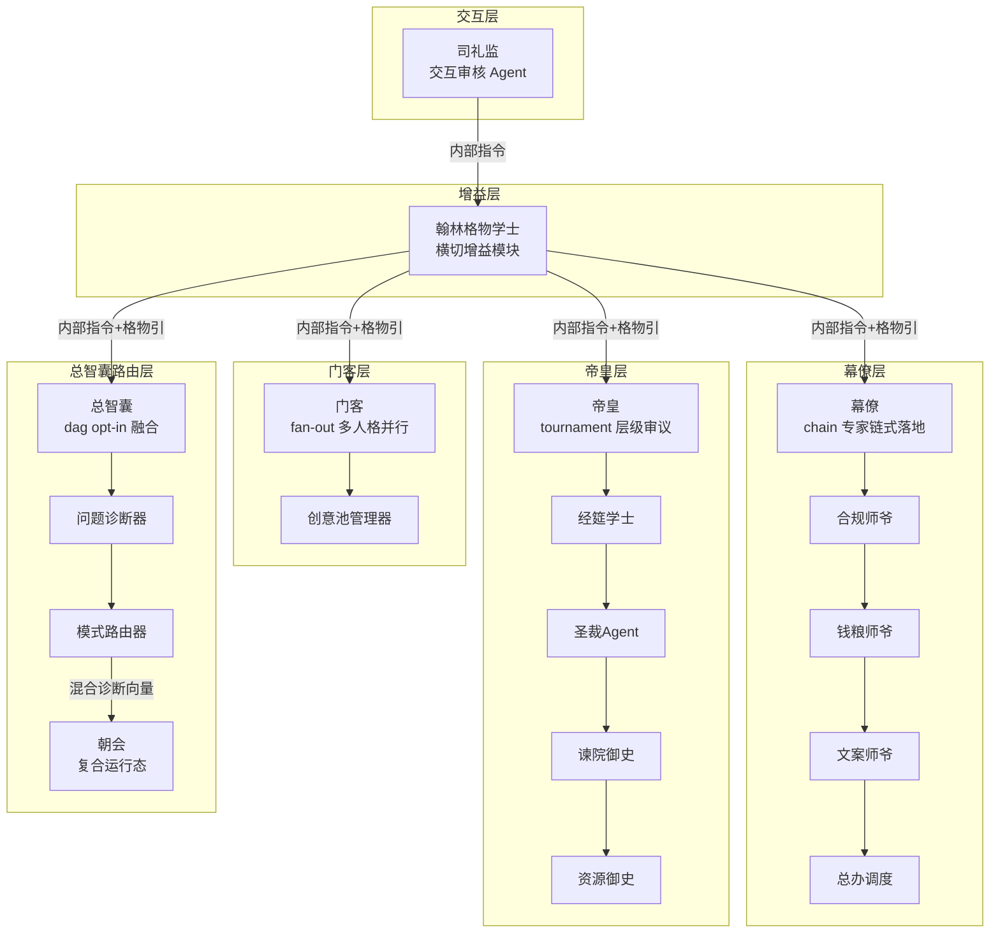
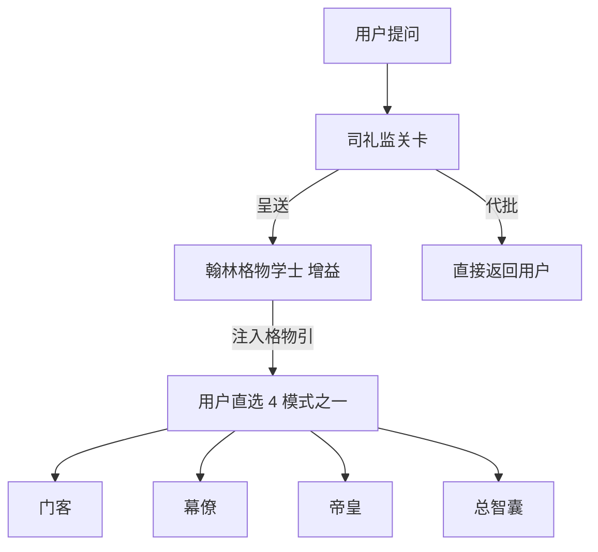
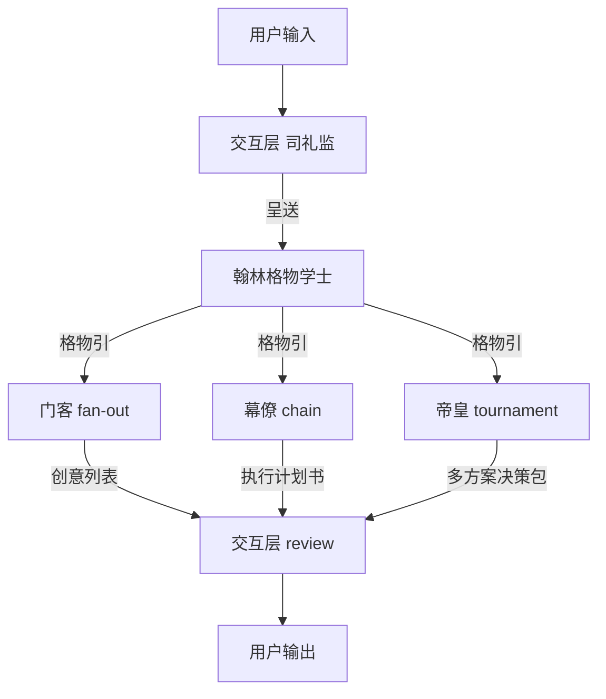
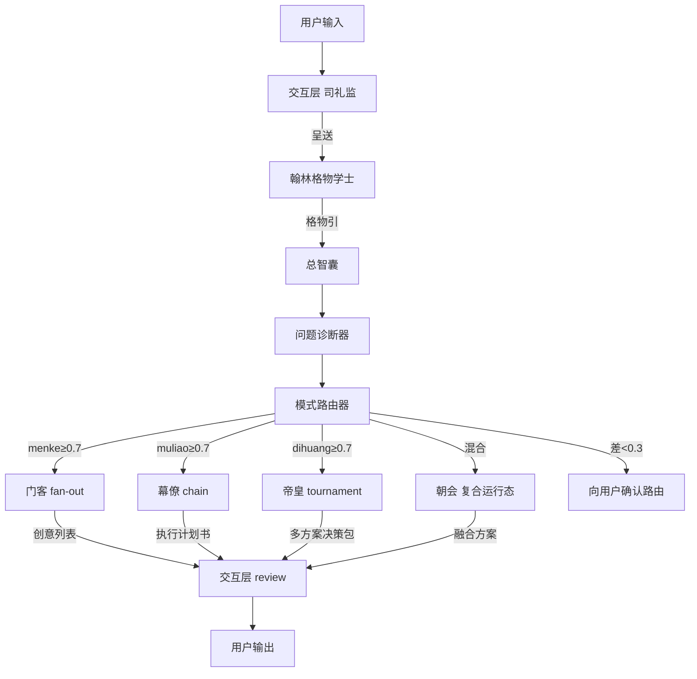

> 智囊团模式系统（zhinang）：智囊团隐喻，council 协调拓扑+翰林横切增益+四模式并列可选（门客/幕僚/帝皇专注工具可直选，总智囊 opt-in 融合）+朝会复合态。

> 状态：stable
> 维护：@XIAOZF99（主笔）
> 讨论：无
> 待决：无

---

## 1. 模式定位

wuwo v4 顶层分两类编排类型：任事型（朝廷模式/竞功模式/大明模式）与谋士型（本节智囊团）。

智囊团是 wuwo v4 的**谋士型（第二编排类型）**，技术名 `zhinang`，中文显示名**智囊团**，Coordination Pattern 为 `council`（议会/谋士式），默认 Execution 随模式而定（门客=fan-out / 幕僚=chain / 帝皇=tournament / 总智囊=dag）。来源隐喻为智囊团谋士体制，定位是 council Coordination Pattern 的完整多策略族 Preset——**4 个模式并列可选：门客/幕僚/帝皇 为独立可选的专注工具（可直选、可独立使用），总智囊 为 opt-in 融合模式（用户主动选才进入，内部诊断后调用前三者或激活朝会）**。

| 属性 | 值 |
|------|----|
| 技术名 | `zhinang` |
| 中文显示名 | 智囊团 |
| Coordination | `council` |
| 默认 Execution | 随模式（council-menke=fan-out 等） |
| 来源隐喻 | 智囊团谋士体制 |

智囊团是用户主动选择进入的**谋士型（第二编排类型）**（见 03-execution-modes.md §1.5）。它与朝廷模式（hierarchy+dag）、竞功模式（market+tournament）按职责并列，各自拥有独立的术语体系，严格不交叉（原则 21（已推翻，见原则 33））。本文档只出现智囊团术语：翰林格物学士 / 门客 / 幕僚 / 帝皇 / 总智囊 / 朝会 / 经筵学士 / 圣裁Agent / 谏院御史 / 资源御史 / 创意池管理器 / 合规师爷 / 钱粮师爷 / 文案师爷 / 总办调度 / 《格物引》 / council。朝廷模式术语（总控/首辅/六部/都察院…）、竞功模式术语（总督/提督/评功推官…）不出现在本文档。共享核心通用名（Agent / Loop / Pattern / Coordination / Execution / 军功簿 WeightRegistry / 司礼监 / 四库 / Identity / Capability）可用。

---

## 2. 架构总览

智囊团以「谋士智囊」为核心隐喻，构建六层协作体系：司礼监关口过滤输入，翰林格物学士做横切增益输出《格物引》注入下游；下游为 **4 个用户并列可选模式**——门客（fan-out 创意发散）/幕僚（chain 执行落地）/帝皇（tournament 战略审查）为独立可选的专注工具（可独立使用，用户直选），总智囊（dag）为 opt-in 融合模式（用户主动选才进入，内部诊断后调用前三者或激活朝会复合态）。各策略层产出经谏院御史/资源御史审核，最终由圣裁Agent（经筵学士辅助）裁决。



核心思想贯穿六层：

- **增益屏障**：翰林格物学士只增加上下文，不拦截请求。可跳过，不改变司礼监的过滤/代批权力。
- **4 模式独立可选 + 总智囊内部融合路由**：翰林注入下游 4 个并列可选分支——门客/幕僚/帝皇 为独立可选的专注工具（用户直选，可独立使用），总智囊 为 opt-in 融合模式（用户主动选才进入），内部根据诊断向量路由到前三者或激活朝会复合态，避免单一策略盲区。
- **复合态优先**：朝会不是第 5 个 Execution 模式，而是总智囊（dag）的运行态组合，内部串行调用三策略，不占矩阵单元。
- **审计全链路**：全局审计链贯穿总智囊路由到各策略执行，确保每一步可追溯、可复审。
> 守护支柱：A（多Agent协作）+ C（可组装）

---

## 3. 角色定义

| 角色 | 所属层 | 核心职责 | 关键限制 |
|------|--------|----------|----------|
| 翰林格物学士（HanlinEnricher） | 增益层 | 本质抽象+跨域扫描，输出《格物引》注入下游 | 只增加上下文，不拦截；可跳过 |
| 创意池管理器（IdeaPoolManager） | 门客池 | 分发/收集/去重/共鸣检测/排序 | 门客并发时不阻塞 |
| 门客（Menke） | 门客池 | 多人格并行创意发散，追求「不可能」思路 | 仅创意发散，无执行约束 |
| 合规师爷（ComplianceAide） | 幕僚池 | 法规政策审查 | 幕僚 chain 中的一个环节 |
| 钱粮师爷（TreasuryAide） | 幕僚池 | 资源/预算/时间估算+隐性成本 | 幕僚 chain 中的一个环节 |
| 文案师爷（DraftingAide） | 幕僚池 | 沟通文本包装+利益相关方阻力识别 | 幕僚 chain 中的一个环节 |
| 总办调度（DispatchCoordinator） | 幕僚池 | 草案拆分分发+冲突调解/升级 | 幕僚 chain 收口节点 |
| 幕僚（Muliao） | 幕僚池 | 专家链式协作，约束下出可执行方案 | 链式依赖，上游阻塞下游 |
| 经筵学士（JingyanScholar） | 帝皇池 | 知识检索，为帝皇审议提供依据 | 帝皇 tournament 的一个角色 |
| 圣裁Agent（DihuangSynthesizer） | 帝皇池 | 综合裁决，形成最终决策 | 须采纳谏院反对意见中的改造建议 |
| 谏院御史（JianyuanCritic） | 帝皇池 | 强制反对，须提 ≥3 条有理据反对+跨域适配风险评估 | 不得直接驳回，须提改造建议 |
| 资源御史（ResourceCensor） | 帝皇池 | 实时约束数据提供，防止帝皇方案超资源 | 数据来源独立于提案方 |
| 帝皇（Dihuang） | 帝皇池 | 层级审议+强制反对+多方案择优 | 强制反对不落地则流会 |
| 总智囊（ZhinangRouter） | council 路由 | 诊断问题→路由到三模式或朝会 | 路由器编排深度 ≤ 3 层；不得递归调用自身 |
| 朝会主持人（ChaohuiModerator） | council 路由 | 混合态议会辩论主持 | 仅混合态激活 |
| 问题诊断器（Diagnoser） | council 路由 | 输出 DiagnosisVector{menke/muliao/dihuang} | 最高与次高差值 < 0.3 时向用户确认 |
| 模式路由器（ModeRouter） | council 路由 | 按向量选 fan-out/chain/tournament 或朝会 | 路由失败回退到幕僚（chain） |

---

## 4. 翰林格物学士横切增益层详解

翰林格物学士（HanlinEnricher）是智囊团的**全局横切增益模块**，位于司礼监之后、下游 4 模式分支之前。智囊团默认启用；朝廷模式/竞功模式可选启用（Phase 2+ 扩展，本文档不强制）。

增益模块与司礼监关卡的职能不重叠：司礼监是「门」（能拒绝/绕过），翰林是「增益」（只增加上下文，不拦截）。二者在数据流上前后衔接，不交叉。



翰林位于司礼监之后、下游 4 模式分支之前。智囊团经过司礼监（司礼监是通用入口，代批路径不变）。

```typescript
/** 《格物引》：翰林输出，注入下游模式 */
interface GewuCitation {
  /** 本质判断（1-2 句，剥离行业语境的底层结构） */
  essenceJudgment: string;
  /** 跨域参照（3-5 个领域的同构解法） */
  crossDomainRefs: CrossDomainRef[];
  /** 命中的领域（供总智囊诊断器调权重） */
  matchedDomains: string[];
}

/** 单条跨域参照 */
interface CrossDomainRef {
  domain: string;        // 军事/医学/建筑/生态/法律/教育/艺术/生物学
  analogy: string;       // 同构问题描述
  solution: string;      // 经典解法
  lesson: string;        // 失败教训
}

/** 翰林格物学士 = 横切增益模块 */
interface HanlinEnricher {
  /** 本质抽象：剥离行业语境，提炼底层结构 */
  abstract(problem: string): Promise<string>;
  /** 跨域扫描：8 领域匹配同构解法 */
  scanCrossDomain(essence: string): Promise<CrossDomainRef[]>;
  /** 输出《格物引》 */
  produce(problem: string): Promise<GewuCitation>;
}
```

---

## 5. 四模式定位

4 模式并列可选，可独立使用——门客/幕僚/帝皇 为专注工具可直选，总智囊 为 opt-in 融合（主动选才进入）。

| 模式 | council 内 Execution | 对应 Pattern 名 | 一句话职责 |
|------|---------------------|-----------------|------------|
| 门客（创意发散） | `fan-out` | `council-menke` | 多人格并行发散，追求「不可能」思路 |
| 幕僚（执行落地） | `chain` | `council-muliao` | 专家链式协作，约束下出可执行方案 |
| 帝皇（战略审查） | `tournament` | `council-dihuang` | 层级审议+强制反对+多方案择优 |
| 总智囊（融合编排） | `dag` | `council-zhinang` | opt-in 融合：主动选才进入，内部诊断后调用前三者或激活朝会 |
| 朝会（复合运行态） | council 复合态，不占矩阵单元 | 不注册 Pattern | 三策略各抽 Agent 组议会辩论 |

---

## 6. 模式切换

`/mode zhinang` 切换进入谋士型/智囊团类型，经现有 `PatternRuntime.switchPlan`（与朝廷模式/竞功模式切换同机制）。进入后**用户直接选 4 个模式之一**：门客/幕僚/帝皇 可独立直选作为专注工具，总智囊 需用户主动选择才进入（opt-in 融合编排）。切换时术语随之切换（原则 21（已推翻，见原则 33）不交叉规则，扩展为三族（术语族））。模式间手动切换时，当前产出物（创意列表/执行草案/审查意见/《格物引》）自动带入新模式输入。

朝会是总智囊（dag 路由器）的**运行态组合**，不是第 5 个 Execution 模式，不占 Coordination×Execution 矩阵的任何单元。总智囊 在诊断向量为「混合」（无单一策略权重 ≥0.7）时激活朝会，内部串行调用 fan-out（门客发散）→ chain（幕僚量化）→ tournament（帝皇批驳）。在 03-execution-modes.md 矩阵里，council 行标注为「fan-out/chain/tournament/dag（可路由）」，并在矩阵下方加脚注：「朝会为 council 协调拓扑的复合运行态（= 总智囊 内部复合态），非独立 Execution，不占矩阵单元。」

---

## 7. 与微内核对接

### 7.1 角色 = Identity.role 配置

智囊团的每个角色都是 Identity 库中的模板，通过 `Identity.role` 字段区分。架构只理解 Agent，不 `switch(role)`。Loop 行为差异通过 Identity 配置的 hooks/slots 实现。

### 7.2 Loop = 四库之一

Agent Loop 是四库（身份/架构提示词/技能/Loop）之一。智囊团各角色从 Loop 库选取合适的 Loop，运行期只读（只能从已注册的 Loop 选，不能运行期创建）。不同角色可配置不同 Loop（如门客用发散 Loop，帝皇用审议 Loop），但都从 Loop 库选取，无特权通道。

### 7.3 通信 = 图状通信

智囊团的通信走图状通信（点对点 + 发布订阅 + 频道）。翰林格物学士的输出通过图状通信注入 council 路由；门客并发时通过发布订阅交换创意；朝会辩论通过频道异步协作。总智囊的全局审计链记录所有通信事件（决策 80）。

### 7.4 状态 = 事件溯源

智囊团下所有状态变更（路由决策、朝会辩论记录、审查意见、用户裁决）都是 append-only 事件，状态是事件的投影（EventSourcedState）。命名空间分区：Agent 只看自己有权的分区（与 Identity scope 联动）。全局审计链是事件流的核心消费者。

### 7.5 Pattern 组合 = council×[fan-out|chain|tournament|dag]

council 作为第 5 协调拓扑，Capability 契约白名单允许 council 与 fan-out / chain / tournament / dag 四种 Execution 组合（见 03-execution-modes.md §1.4）。朝会为 council 特有的复合运行态，不在白名单内，也不占矩阵单元。具体 Pattern 注册走现有 PatternRegistry 缝（见 09-seam-map.md §3.14），翰林增益模块走横切增益模块注册缝。

---

## 8. 工作流程

智囊团提供两条并列工作流程，用户进入族后按需选择。两条流程共享交互层（司礼监关口）与翰林横切增益；区别在翰林之后——(a) 用户直选专注工具直接执行；(b) 用户主动选总智囊（opt-in 融合编排）由其诊断后路由或激活朝会。

(a) 直选流程 —— 用户直选 门客/幕僚/帝皇 之一（4 模式独立可选，可独立使用）：



(b) 总智囊融合流程 —— 用户主动选 总智囊（opt-in 融合编排）：



---

## 9. 决策记录

### 决策 86：council 注册为第 5 协调拓扑

**选择**：在 PatternRegistry 中注册 `council` 作为第 5 个 Coordination Pattern（与 hierarchy / market / peer-mesh / federation 并列），不新增一等概念。

**理由**：council 的定义性机制是谋士议会式协作——多个专精谋士角色以议会形态分工，4 个执行策略（fan-out/chain/tournament/dag）作为独立可选模式；其中 dag（总智囊）是 opt-in 融合模式，内部诊断后调用前三者或激活朝会复合态。路由分发是总智囊 的内部行为，非 council 拓扑的定义。此机制与现有四种拓扑（hierarchy/market/peer-mesh/federation）正交，需独立注册。复用 PatternRegistry 现有缝（只校验 provides/requires/compatibleWith，不查 execution 字段），不改框架接口。

**影响**：02-architecture-layers.md §8.1 六一等概念表的 Pattern 行，Coordination 枚举从 hierarchy/market/peer-mesh/federation 扩展为含 council（显示名议会/谋士式）。03-execution-modes.md §1.2 Coordination 表加 council 行（机制描述=谋士议会式协作），§1.4 矩阵加 council 行，council 内 4 个 Execution（fan-out/chain/tournament/dag）作为独立可选模式并列注册。

---

### 决策 87：翰林格物学士为横切增益模块（非关卡非一等概念）

**选择**：翰林格物学士（HanlinEnricher）定义为「横切增益模块」，区别于司礼监「关卡模块」（gate）。增益模块只增加上下文、不拦截、可跳过；关卡模块能拒绝/绕过。不新增一等概念，走新增的「横切增益模块注册」缝。

**理由**：翰林与司礼监职能不重叠（一个增益、一个过滤），混为关卡会丧失增益的可跳过性。增益模块是 v4 新增模块类型，与关卡模块、Pattern 模块三分天下。

**影响**：09-seam-map.md 新增「横切增益模块注册」缝（仿现有 §3.14 PatternRegistry 缝）。07-infrastructure.md 不新增一等概念，仅注册缝说明。02-architecture-layers.md §3 七层栈说明补翰林增益模块位置（司礼监后、Composition 前）。

---

### 决策 88：术语重命名（经筵学士·圣裁Agent）+ 不交叉规则扩三族

**选择**：帝皇模式内原稿「翰林学士」重命名为**经筵学士**（JingyanScholar，帝皇讲席，区别于翰林格物学士）；「批红Agent」重命名为**圣裁Agent**（DihuangSynthesizer，帝皇裁决，区别于司礼监批红标签）。不交叉规则（原则 21（已推翻，见原则 33））从两族扩展为三族：朝廷模式（文官）/竞功模式（军事）/智囊团（谋士）。

**理由**：原命名与全局「翰林格物学士」和司礼监「批红」标签撞名，导致术语跨模式漂移。三族不交叉是 v4 核心术语规范，智囊团作为第三独立族必须明确边界。

**影响**：智囊团文档（17/18）禁用「翰林学士」「批红Agent」等撞名。AGENTS.md §2 v4 术语规范补「第三族=智囊团」段落。17-zhinang-modes.md §3 帝皇详解用经筵学士/圣裁Agent/谏院御史/资源御史。

---

### 决策 89：朝会为 council 复合运行态，不占矩阵单元

**选择**：朝会（Chaohui）是 council 路由器的运行态组合（内部串行调用 fan-out→chain→tournament），不是第 5 个 Execution 模式，不注册为 Pattern，不占 Coordination×Execution 矩阵的任何单元。

**理由**：朝会没有独立的 execution 语义，它是 council 特有的「混合诊断向量激活的组合执行路径」。若将其列为独立 Execution，矩阵会膨胀且语义重复（朝会内部就是三策略的组合）。

**影响**：03-execution-modes.md §1.4 矩阵 council 行标注 fan-out/chain/tournament/dag（可路由），下方加脚注：「朝会为 council 协调拓扑的复合运行态，非独立 Execution，不占矩阵单元。」17-zhinang-modes.md §5 朝会专题说明此定位。

---

### 决策 90：智囊团经过司礼监关口

**选择**：智囊团默认经过司礼监关口（与朝廷模式/竞功模式一致）。司礼监代批（命中条陈+低风险）→ 直接返回用户，绕过翰林与 council；司礼监呈送（复杂/多步/涉数据）→ 进入翰林增益 → council 路由。

**理由**：司礼监是通用入口，所有模式共享。智囊团作为新模式族不破坏通用入口设计。翰林增益在呈送后注入，不参与代批判断，保持司礼监代批路径不变。

**影响**：智囊团数据流明确「司礼监 → 翰林 → council 路由」顺序。司礼监四不变量（sijian-no-arbitrary-approve / sijian-must-be-traceable / sijian-escalate-complex / sijian-charter-immutable）同样适用于智囊团。15-sijian-batch.md 文档无需修改，智囊团复用现有代批机制。

---

## 10. 适用场景

| 场景 | 推荐使用 | 理由 |
|------|----------|------|
| 复杂问题需多视角创意发散+落地验证 | 推荐 | 门客 fan-out 出不可能思路，幕僚 chain 落地约束，帝皇 tournament 审查择优 |
| 战略级决策，需多方案强制反对+择优 | 推荐 | 帝皇 tournament 的强制反对机制防止方案盲区，谏院御史跨域风险评估 |
| 跨领域问题，需本质抽象+同构解法参照 | 推荐 | 翰林格物学士跨域扫描提供 8 领域同构解法，避免领域思维定式 |
| 混合维度问题，无单一策略权重占优 | 推荐 | 朝会复合态串行调用三策略，议会辩论融合产出综合方案 |
| 创意密集型任务（ brainstorming / 战略规划） | 推荐 | 门客多人格并行发散，创意池管理器去重/共鸣检测，质量远高于单 Agent |
| 简单线性任务，无明确领域划分 | 谨慎 | 六层 overhead 较大，简单任务可用单模式（如仅门客）或切回朝廷模式 |
| 实时性要求极高，无法承受多层路由延迟 | 谨慎 | council 路由+三策略串行/并行叠加延迟，代批快速通道可缓解部分场景 |
| 完全自主执行，无需人类意图审查 | 不适用 | 司礼监强制要求翻译和审查，无法跳过。如需跳过需修改架构设计 |

---

## 11. 术语对照表

| 中文 | 英文 |
|------|------|
| 智囊团 | Brain-Trust（zhinang mode family） |
| 翰林格物学士 | HanlinEnricher |
| 《格物引》 | GewuCitation |
| 本质抽象 | essence abstraction |
| 跨域扫描 | cross-domain scan |
| 门客 | Menke |
| 幕僚 | Muliao |
| 帝皇 | Dihuang |
| 总智囊 | ZhinangRouter（Zongzhinang） |
| 朝会 | Chaohui |
| 经筵学士 | JingyanScholar |
| 圣裁Agent | DihuangSynthesizer |
| 谏院御史 | JianyuanCritic |
| 资源御史 | ResourceCensor |
| 创意池管理器 | IdeaPoolManager |
| 合规师爷 | ComplianceAide |
| 钱粮师爷 | TreasuryAide |
| 文案师爷 | DraftingAide |
| 总办调度 | DispatchCoordinator |
| 问题诊断器 | Diagnoser |
| 模式路由器 | ModeRouter |
| 朝会主持人 | ChaohuiModerator |
| council | 议会/谋士式协调拓扑 |
| 横切增益模块 | cross-cutting enricher module |
| 问题诊断向量 | DiagnosisVector |
| 全局审计链 | AuditChain |

---

## 12. 相关文档

- 见 01-overview.md 第 8 节（v4 核心机制概述）
- 见 03-execution-modes.md §1.4（Coordination×Execution 组合矩阵，council 行+朝会脚注）
- 见 09-seam-map.md §3.14（PatternRegistry 注册缝）+ §3.16 EnricherRegistry（横切增益模块注册缝）
- 见 12-chaoting-mode.md（朝廷模式，结构模板参照）
- 见 17-zhinang-modes.md（智囊团四模式详解）
- 见 02-architecture-layers.md §8.1（六一等概念表，Coordination 枚举含 council）
- 见 07-infrastructure.md（EventSourcedState / WeightRegistry / 图状通信接口）
- 见 10-decisions.md（决策 86-90）
- 见 15-sijian-batch.md（司礼监代批机制，智囊团复用）
- 见 18-domain-pack.md（Domain Pack + Preset，智囊团 Preset 归属）

> 文档版本：v1.8
> 本版变更（累积最近 3 条，最新在上）：
>   - v1.8：v4.3.2 T7 自检同步——Phase 3-4 + Pattern 矩阵 + 多用户 + coding-pack v0.7 + TUI
>   - v1.7：六层智囊团图转 Mermaid + 翰林/直选/总智囊流程图转 Mermaid + 守护支柱标签 + 页脚原则总数更新
>   - v1.6：更新引用术语（11-neige-mode→12-chaoting-mode、朝廷/竞功模式现役引用替换、原则21加注推翻）
> 基于：智囊团重设计规格（.sisyphus/drafts/zhinang-design-spec.md）+ wuwo v4 §1-§3,§8
> 决策总数：101 条（本文档聚焦决策 86-90）
> 文档总数：23 份
> 原则总数：34 条
